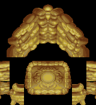
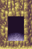

# Alchemy — Golden Sun decompilation

Alchemy is a fan-made attempt to recover the original **Golden Sun** for Game
Boy Advance as readable, buildable source code. Towns, battle effects,
characters, music, menus, text, Psynergy effects, and the engine beneath them
are being taken apart and reconstructed piece by piece.

“Total decompilation” counts canonical assets, exact C, and assembly with
positive structural reasons to remain. Unowned bytes and ordinary assembly
still awaiting clean C are excluded.

  
  

The name comes from the moment alchemy is released upon Weyard. This project
is similarly trying to release the game from one finished cartridge image into
code, art, maps, and music that people can explore.

## Where the project stands

See [STATUS.md](STATUS.md) for the live byte counts, what has been recovered,
what remains, and how verification works.
