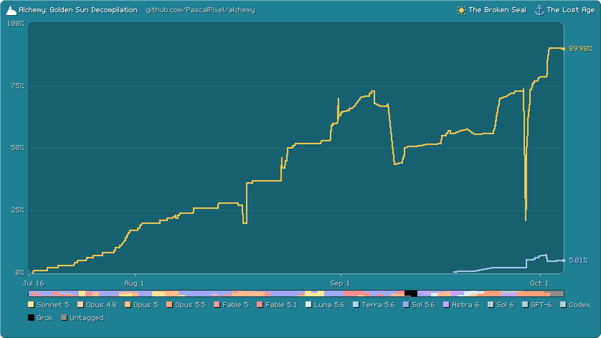
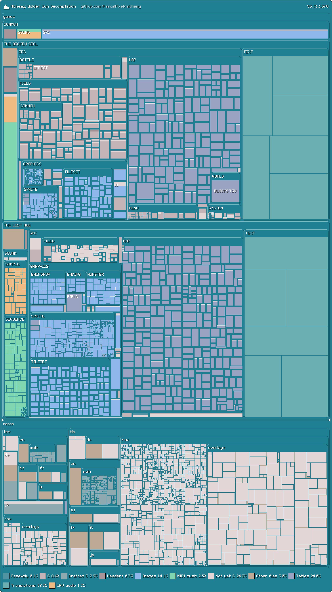

# ⛰️ Alchemy: the Golden Sun decompilation

In Golden Sun, lighting the four Elemental Lighthouses releases Alchemy upon
the world. I’m doing the same thing to the games themselves. **The Broken
Seal** ☀️ and **The Lost Age** ⚓️ are being rewritten, piece by piece, into a
form people can read, change and build on.

## Progress

**☀️ 89.98% · ⚓️ 5.01%**

The number measures executable code rebuilt from source across all six
languages. It includes matching C and proven assembly; art, music, text and
other data are separate. A piece only counts in a language whose verified
build links that source and is identical to the original.

See the exact counts and what they include

Each language uses the English edition’s code sizes. Code found only in
another language is outside this counter and needs a separate audit.
There is also a known counting limit: code absent from Japanese still leaves
an English-sized obligation. That needs resolving before an exact 100% claim.
The parentheses below show counted bytes / total executable bytes.

<!-- progress-breakdown:start -->

| Language | ☀️ TBS | ⚓️ TLA |
| :--- | ---: | ---: |
| Japanese | 89.85% (1,233,894/1,373,150) | 5.05% (100,056/1,978,894) |
| English | 90.10% (1,237,320/1,373,150) | 7.36% (145,708/1,978,894) |
| German | 89.91% (1,234,652/1,373,150) | 4.49% (88,936/1,978,894) |
| Spanish | 89.99% (1,235,794/1,373,150) | 4.33% (85,800/1,978,894) |
| French | 89.99% (1,235,794/1,373,150) | 4.50% (89,152/1,978,894) |
| Italian | 90.02% (1,236,222/1,373,150) | 4.33% (85,784/1,978,894) |

Bytes added across all six editions:

| Code | ☀️ TBS | ⚓️ TLA |
| :--- | ---: | ---: |
| C | 6,985,708 | 264,896 |
| Proven assembly, including libraries | 127,728 | 166,236 |
| 8-byte far-call stubs (veneers) | 300,240 | 164,304 |
| Total counted | 7,413,676 | 595,436 |
| Total executable | 8,238,900 | 11,873,364 |
| FAKEMATCH-steered C, already included above | 4,273,576 | 50,448 |
<!-- progress-breakdown:end -->

FAKEMATCH marks C that needs a matching aid to reproduce the original
compiler’s register choices or instruction order. Those bytes are already
included in C, and the aids stay visible in the source. Removing them is the
final step after both games reach 100%.

These counts are generated together from the six verified builds of each
game. If any build is missing or stale, that game’s counts stay pending.

The chart shows The Broken Seal in gold and The Lost Age in blue, with hourly
measurements where available and the older daily records elsewhere. Dips mark
stricter counts, not lost work.

## Why Alchemy?

When Camelot made Golden Sun, they wrote it as instructions a person can read
and then turned those into the unreadable code that sits on the cartridge. The
readable version was never released.

I do this with AI, and a lot of it. The AI does the heavy lifting, and the
original game is the judge.

Once a game can be read, it can be changed. That opens the door to things fans
have wanted for years: Golden Sun running natively on PC, phones and modern
consoles, widescreen and smoother frame rates, quality-of-life fixes, new
translations, and new storylines, quests and Djinn. Alchemy doesn’t do these
things itself. It lays the foundation, and then all of us get to build on it.

## Acknowledgements

_Golden Sun_, its characters, music, art and original code were created by
Camelot Software Planning and published by Nintendo. Alchemy is an unofficial
fan project and is not affiliated with or endorsed by either company.

Thank you to:

- The [r/GoldenSun community](https://www.reddit.com/r/GoldenSun/), for sharing
  Alchemy, cheering it on, and keeping the love for these games alive.
- Tarpman and Karathan, for identifying the compiler and flags Camelot used.
- Coaltergeist, for [camelot-gcc](https://github.com/Coaltergeist/camelot-gcc),
  the compiler Alchemy first built with.
- [pret](https://github.com/pret), whose decompilations set the standard Alchemy
  measures itself against, and whose [agbcc](https://github.com/pret/agbcc)
  Alchemy builds the games’ library code with.
