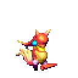

# Alchemy — Golden Sun decompilation

An all-AI, for-fun attempt at decompiling Golden Sun (GBA). The reconstruction
and tooling in this repository are being written collaboratively with AI coding
agents—Anthropic's Claude and OpenAI's Codex—as an experiment in how far they
can take a clean-room decompilation together. It is a hobby/research project,
not a serious or community-driven decomp, and it is nowhere near complete.

“Project completion” means a byte-identical, pret-like source tree with
clean code, coherent source art and audio, and a flat, intentional repository
layout. No overall percentage is published until semantic asset maturity and
repository organization have auditable criteria. Byte reconstruction only
measures deterministic round trips; it does not certify that an atlas, map,
sequence, or archive is already presented in its final human-readable form.

  
  
  
  

The name comes from the moment alchemy is released upon Weyard. This project
is similarly trying to release the game from one finished cartridge image into
code, art, maps, and music that people can explore.

## Where the project stands

See [STATUS.md](STATUS.md) for the live byte counts, what has been recovered,
what remains, and how verification works.
