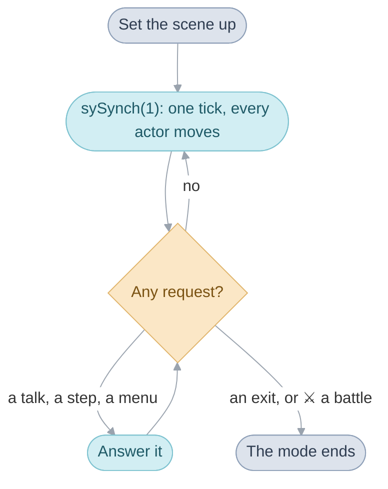

# Field

The field is everything outside a battle and outside a menu: walking round
a town, talking, opening a chest, crossing the World Map.

One piece of code runs all of it, the same in every scene. Everything that
makes Vale Vale, its people, its doors and its story, is tables and small
functions that this code asks the scene for.

## The field mode

The [field mode](glossary.md#field-mode) is one function. It sets a
scene up, then goes round one small loop until the party leaves.

The first box of the loop is a single call, `sySynch(1)`. That call runs one
tick of the game: every [event](glossary.md#event) once, and one of the
events moves every actor. This function is the code that is waiting, and when
`sySynch(1)` returns it looks at the requests itself
([Waiting and events](system.md#waiting-and-events)). This is not a loop that
runs the game. It asks for one tick, then asks whether anything needs an
answer.

No request is answered in the middle of a tick. Pressing A only sets a
[field request](glossary.md#field-request): the leader's actor script sees
the button and notes it. A step onto a doorstep or a battle coming due is
noted by the function itself, from where the leader stands after the tick.
So an answer always starts between two ticks, and can take as long as it
likes: one line from a villager, or a whole cutscene. While it lasts, the
answer is the code that waits, and the loop above stands still inside it.

A battle is just another way out. The cave is thrown away while the battle
runs and set up again afterwards, with everyone put back where they stood.
[The field mode serves requests](../../games/tbs/src/field/README.md#the-field-mode-serves-requests)
goes through the set-up and each kind of request.

## Scenes and areas

The game is cut into [scenes](glossary.md#scene): Vale outdoors, the hall
of its Sanctum, the World Map, even the Title. There are 201, and one table
lists them all. A scene's row says which overlay holds its code, which map
it is drawn on, and which [area](glossary.md#area) it belongs to.

An area is a group of scenes that belong together, such as Vale with its
houses. It is the unit for two things: the name shown when you arrive, and
what the game deliberately forgets when you leave, such as where you
pushed a pillar. A few things are forgotten sooner, each time a scene is
entered, such as a log rolled into Kolima Forest's river
([State that cleans itself up](../../games/tbs/src/scene/README.md#state-that-cleans-itself-up)).

## Cues and scripts

The field code knows nothing about a mayor. It asks the scene, and the
scene's answer to "what can happen here?" is a table of
[cues](glossary.md#cue). A row says what the player does (talks,
steps, searches, casts), to whom or where, a condition on the game flags,
and what runs.

The table is read from the top and the first row that fits wins. That one
rule is how the story moves. Vault's mayor has two rows: a welcome that
counts until he has given it, and a warning that always counts. Nothing
anywhere says "the mayor is now in state two". The flags say what has
happened, and the tables say what that means here.

What a row runs is usually a [script](glossary.md#script): a function in the
scene's overlay that takes the party over and plays from top to bottom,
calling `sySynch()` as it goes. A door opening is a script, and so is a whole
cutscene. Each line of one is an
[script command](glossary.md#script-command), a C call such as
`fdActorWalkTo`.
[How a cue is chosen](../../games/tbs/src/scene/README.md#how-a-cue-is-chosen)
shows the mayor's rows as they are written.

## Exits and entrances

Leaving works the same way. Each way out of a scene is an
[exit](glossary.md#exit), and a table gives the rows it can lead to, again
with conditions, again first match wins. That is how the path down from Sol
Sanctum leads to one Vale before the eruption and another after it.

Each row names the [entrance](glossary.md#entrance) on the other side: the
spot where the party appears, and how far the screen may scroll there.
[Exits](../../games/tbs/src/scene/README.md#exits) shows the rows for that path.

## Actors and actor scripts

Everything that moves or changes by itself is an [actor](glossary.md#actor):
Isaac, a villager, a chest, each footprint in Imil's snow. A scene has room
for 64.

Every actor carries an [actor script](glossary.md#actor-script), a short
list of orders that is worked through a little each tick. A footprint's
is two orders long: `SC_WAIT` for two seconds, then disappear.

An actor does not run itself. It is a row in a table, and one
[event](glossary.md#event) visits every row each tick and carries that
actor's script on from where it stopped. The footprint's two seconds are a
count in its row that the event takes one off each tick: not the
[`sySynch()`](glossary.md#wait) a cutscene calls
([Waiting and events](system.md#two-kinds-of-waiting)).

Isaac is an actor like any other. While the player steers, his script is
one order on repeat: do what the D-pad says. When a scene's script needs
him, it swaps his actor script for another. That swap is all "the game takes control"
ever means.

A scene's script and an actor script are two kinds of thing. A scene's script
is C, and it is the code that waits. An actor script is a table, which the
actors' event reads. So a scene's script never moves anyone itself. It gives
an actor a target or an actor script with a command that returns at once, and
then calls `sySynch()` while the event does the moving. `fdActorWalkTo` only
starts a walk.
`fdActorWalkToAndWait` starts it and then calls `sySynch(1)` until the actor is
there ([One waiter at a time](system.md#one-waiter-at-a-time)).
[Everything that moves runs an actor script](../../games/tbs/src/field/README.md#everything-that-moves-runs-an-actor-script)
lists the orders.

## The ground

The ground is a [map](glossary.md#map): a grid of 16-pixel
[metatiles](glossary.md#metatile). A metatile says which picture is drawn there, how
high the ground is, and a number for what standing there does, its
[metatile behavior](glossary.md#metatile-behavior).

Height does most of the work. Isaac can step up a little and down a little
more, so a cliff is simply ground too high to step onto, and few walls are
marked as walls.

The behavior numbers are split in two. The high ones mean the same
everywhere: a ledge, a ladder, a gap to jump. The rest mean nothing until
a scene's cue table gives them a meaning, so the same number is a
ladder in Vale and a jar with an Apple in Kolima.

A map is drawn as three layers, ground, walls and roofs, with the actors
between them. That is how Isaac walks behind a house without the game
knowing what a house is. [Maps](../../games/tbs/src/map/README.md) has the format.

## Field Psynergy and random battles

Both follow the pattern above: the field code does the general part and the
scene supplies the particular.

Cast Move and the field code draws the hand and finds what it touches. Only
Vale knows its pillar can be pushed, and says so with one more kind of
cue row: Move, on the pillar.

Random battles measure distance. After each tick the field's function adds
to a counter by how far the leader has walked, and
the ground he walks on says how fast it fills and which enemies come.
Running gets you there sooner, after exactly the same distance.

## The World Map

The World Map is one of the 201 scenes, with exits into towns and its own
random battles. Its map is flat like any other. The tilt toward the horizon
is drawn by stretching the picture differently on every line of the screen.
[The World Map in perspective](../../games/tbs/src/field/README.md#the-world-map-in-perspective)
works through it.

## Where the code is

- [Field code](../../games/tbs/src/field/README.md) is the walking itself, the same in
  every scene: the mode, actors, movement, field Psynergy and random
  battles.
- [Scenes](../../games/tbs/src/scene/README.md) is what belongs to one scene: its tables
  and its scripts.
- [Maps](../../games/tbs/src/map/README.md) is the ground each scene is drawn on.
