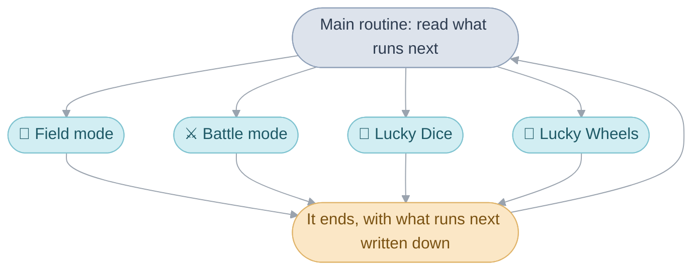
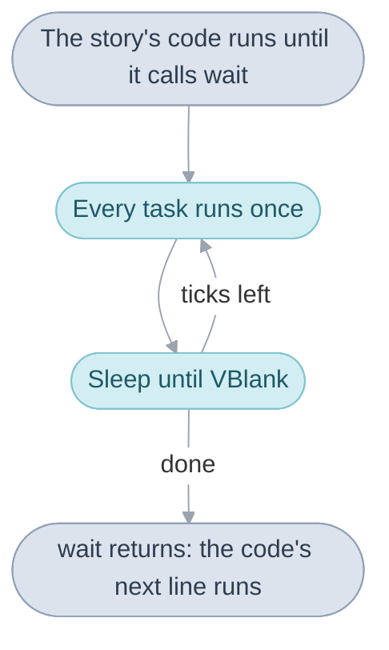

# The system library

The system library is what every other part of the game stands on. It
decides what runs, lets time pass, loads a scene's code and writes the save.

Four ideas, and you know how the whole program hangs together.

## The main routine


The game is one function that starts when the console is switched on and
never returns. All it does is call a [mode](glossary.md#mode) as
a function and, when that returns, call the next one. There are four
kinds.



The [field mode](glossary.md#field-mode) runs one
[scene](glossary.md#scene): a town's streets, a dungeon floor, the World
Map. It ends when the party leaves, and says where the exit leads. The
other three end with a result, such as a battle won or lost.

Everything else the player sees is inside one of the four. The Title and
the File Screen are scenes, so the field mode runs them. A menu or a
shop is not a mode. It is a function called from inside one, and it
returns there.

The main routine is a loop, but a slow one. One trip round it is a whole
visit to a town or a whole battle. The loop that goes round once a tick is
not here: it is inside `sySynch()`, which
[Waiting and events](#waiting-and-events) comes to.

Between two modes the main routine wipes the slate. Every event is
taken off the list and all the memory the last mode took is handed
back. The cave you return to after a battle is not the old cave kept
aside. It is built again from scratch.

So a mode can pass something on in only three places, the three things
the main routine leaves alone:

- the [main routine's state](glossary.md#main-routines-state), one C struct
  in a global, `MainRoutineStateWork`, which holds the party, their coins, what
  runs next and how the last mode ended;
- the [game flags](glossary.md#game-flag), one bit for each thing the game
  remembers, such as a chest being open;
- the actor snapshot, `ActorSnapshotWork`, where the field copies who stands
  where before it ends for a battle, so that the same scene can be set up
  again as it was.

Two short ranges of the flags do not last. One is cleared when the party
arrives in a scene and the other when it arrives in a new area, which is
how a puzzle resets
([State that cleans itself up](../../games/tbs/src/scene/README.md#state-that-cleans-itself-up)).

Take the three thieves in Vault's inn. The script that ends in their attack
writes two destinations into the main routine's state, one for a win and one
for a loss, asks for a battle, and lets the field mode end. The battle
knows nothing about Vault: it runs, and writes its result. The main routine
reads the result, picks the matching destination, and starts a fresh field
mode in the loft.

That is why any mode can follow any other, and why Camelot's own debug
menu can drop the party into any scene in the game.
[The main routine](../../games/tbs/src/system/README.md#the-main-routine) goes through one
trip round it, and the function itself is `gmMainRoutineRun` in
[main_routine.c](../../games/tbs/src/game/main_routine.c).

## Waiting and events


The game has no loop at the top that turns once a tick and calls
everything else. Its tick loop is inside one function, [`sySynch()`](glossary.md#wait),
and this is all of its shape:

```c
void sySynch(Sint32 ticks) {
	for(tick = 0; tick < ticks; tick++) {
		/* every task runs once */
		/* this tick's sprites are put in order */
		/* sleep until VBlank, when the tick is copied to the screen */
	}
}
```

So `sySynch(10)` does not stand aside while something else runs the game. It
runs ten ticks of the game, there and then, and returns.

One piece of code calls it at a time: the code that is telling the story
just now, a cutscene, a menu, the field's own function. That code is plain C.
It runs once from top to bottom, and wherever it says `sySynch()` it stands
still while the loop inside goes round.



So a tick is two stretches of work: what the story's code did since its
last `sySynch()`, and then the events. Both have to be done before VBlank, or
the tick is shown one VBlank late.

This is what lets a cutscene or a menu be written as a plain list, top to
bottom, in the order things happen. A night at an inn is: wait, fade to
black, play the tune and wait for it to end, wait, fade back in. No state
is kept between ticks to remember how far the night has got: the place in
the code is the memory.

### Events

An [event](glossary.md#event) is a function on a short list, which holds 20.
Each trip round the loop calls every event on it once, highest rank first
(the code calls the rank `pri`). An event does one tick's worth of
something and returns at once: move the actors a step, type the next
letters into a window, swap the river's tiles.

Four things about events are easy to get wrong:

- Events run only from inside `sySynch()`. If no code is waiting, nothing in the
  game moves. The river in the picture above flows because the villager's
  code is waiting for a button.
- An event must never call `sySynch()`. It is being called from inside one, and
  must return for the tick to end.
- An event is a whole piece of work, not a thing in the world. A villager is
  not an event, and neither is a footprint. They are
  [actors](glossary.md#actor), rows in a table, and one event visits all of
  them each tick.
- The list keeps a function, a rank and one flag, and nothing else. What a
  event needs to remember lives with whatever put it on the list: the
  field's state, a window's.

Anything may put an event on the list and take it off again. The field and
the windows keep theirs there as long as they run, a scene adds its own for
a waterfall or a puzzle, and the [main routine](#the-main-routine) takes
every one off between two modes. A few events are called from the VBlank
handler instead, once a VBlank: the ones that copy something to the screen.

### Two kinds of waiting

An actor has to pause too: a villager stands a while between two strolls.
It cannot call `sySynch()`, because the event that moves it has to return. So an
[actor script](glossary.md#actor-script) has a wait of its own, which is
only a number kept in the actor. This is the script of a villager who
wanders near home:

```c
SC_ANIMATION(2),          /* walk */
SC_WANDER_HOME(4, 8, 16), /* pick a spot near home and head for it */
SC_SYNC,                  /* stay on this line until it arrives */
SC_ANIMATION(1),          /* stand */
SC_WAIT(20),              /* stand for 20 ticks */
```

These are numbers in a table, not code that runs (`SC_` is for script
command). Each tick the actors' event comes to this villager. If his count
is above zero it takes one off and goes on to the next actor; otherwise it
reads his script on from where he stopped. Twenty villagers can all be
part-way through a pause, each with a count of his own.

| | `sySynch(20)` in C | `SC_WAIT(20)` in an actor script |
| --- | --- | --- |
| What it is | a function that runs 20 ticks of the game | an order that sets a count to 20 |
| Who uses it | the one piece of code telling the story | every actor, each for itself |
| Does it hold anything up? | that code stands still | no: the event passes that actor by for 20 ticks |
| How many at once | one | as many as there are actors |

The second happens inside the first. The story's code is in `sySynch()`, the
loop there runs the events, one event steps the actors, and each actor counts
its own pause down.

### One waiter at a time

The game has one line of execution, so two pieces of code never wait side
by side. What does happen is one wait after another, at any depth: a script
shows a message, and showing a message waits for the A Button before it
returns.

When two things must take time together, neither of them waits. The code
tells each actor where to go, which returns at once, and then waits once
for both:

```c
fdActorWalkTo(ACTOR_PARTY_LEADER, 120, 96); /* returns at once */
fdActorWalkTo(ACTOR_GARET, 136, 96);        /* so does this */
sySynch(40);                                /* both walk while this runs */
```

A script command whose name ends `AndWait` does the last two steps
together: it starts the walk, then calls `sySynch(1)` until that actor has
arrived.

Because an event cannot wait, it cannot start something long, like a
conversation. It leaves a [request](glossary.md#field-request) instead, and
the field's function, which is the code waiting, reads the requests each time
its `sySynch(1)` returns.

If you have used coroutines: the story's code is the one coroutine, and
`sySynch()` is its yield and the scheduler in one.

### Who may wait

| Code | What calls it | May it call `sySynch()`? |
| --- | --- | --- |
| The story's code: a mode, a script, a menu, a shop, a battle effect | the main routine, and each other | yes |
| An event | `sySynch()`, once a tick | no |
| An order of an actor script | the actors' event, once a tick for each actor | no |
| The VBlank handler, and the few events it calls | the console, at every VBlank | no |

No event puts another event on the list either. Adding one sorts the list
again, and that would upset the pass that is running.

### Every way of taking time

| Written as | Where | What it does |
| --- | --- | --- |
| `sySynch(n)` | the story's code | runs `n` ticks of the game and returns |
| `fdScriptWait(n)` | a script | calls `sySynch(n)` |
| a command that takes time, such as `fdScriptShowMessage` or one ending `AndWait` | a script | starts something, then calls `sySynch(1)` until it is over: a window has closed, an actor has arrived |
| `SC_WAIT(n)` | an actor script | sets a count in the actor, which the actors' event takes one off each tick |
| `SC_SYNC` | an actor script | holds the script on this order until the actor has arrived |
| a count in its owner's state | an event | the event looks at it each tick and returns: a pause in the middle of a line, the time a hit flashes in a battle |

Only the first three hold any code up, and they are all `sySynch()`. The rest
are numbers that an event looks at once a tick. `fdActorWalkToAndWait` gives
up after 600 ticks, ten seconds, and goes on with the actor still walking.

### A talk, tick by tick

Isaac walks up to a man in Vault's street and the player presses A. This
is who runs what.

1. The field's function is in its walking loop, which calls `sySynch(1)` over and over, and is the only code
   waiting.
2. Inside one `sySynch(1)` the actors' event comes to Isaac. His script is on
   the order that reads the D-pad and the buttons, `SC_PLAYER`. It sees the
   A Button and sets a request in the field's state. The event goes on to the
   man, whose script is part-way through an `SC_WAIT`, and takes one off
   his count.
3. `sySynch(1)` returns. The field's function finds a request and leaves its
   walking loop. It puts Isaac on the idle script, finds that the nearest
   actor in reach is the man and that the scene has a talk cue for him,
   and turns the request into a talk. No tick has passed.
4. It answers the talk. It marks the man paused, turns the two to face
   each other, and asks for a window with his line. Asking returns at once.
5. The same code now calls `sySynch(1)` until the window has closed. Over
   those ticks the windows' event grows the window, types the line a few
   letters a tick, and then looks each tick for the A Button. The actors'
   event passes the man by, because he is paused, so his count stays where
   it was.
6. The player presses A. The windows' event shrinks the window and closes
   it, and the loop of step 5 ends. The man's pause is lifted, Isaac's
   script is `SC_PLAYER` again, and the field's function is back in its
   walking loop. The man's count goes on from where it stopped.

Through all six steps one piece of code was running or waiting, the field's
function and what it called. Everything else was an event's visit.

### When nothing waits

Code that works for a long time without calling `sySynch()` holds the whole
game still. No event runs, so no actor moves and no window grows. The tick
it is building is never marked finished, so the picture on screen is left
as it is.

The VBlank handler is not held up. The console calls it at every VBlank
whatever the code is doing, and it goes on reading the buttons, running its
own events and preparing the sound. So a tick that takes two frames is
[slowdown](glossary.md#slowdown), with the music at its proper speed, and
code that never waited would be a still image with the tune playing on.

[The tick loop](../../games/tbs/src/system/README.md#the-tick-loop) has a tick's order
in full, and [The event runner](../../games/tbs/src/system/README.md#the-event-runner) says
which event goes first and how an event comes and goes.

## Overlays

The game has 201 scenes, and each has things of its own: what its people
say, what its doors and switches do. All of it together is far more than
the console's memory holds, and a town's code matters only while the party
is there.

So that code is kept packed on the cartridge in
[overlays](glossary.md#overlay), and the one a scene needs is unpacked on
arrival into one fixed stretch of memory, over whichever overlay was there
before. Only one is ever loaded. An overlay often holds several scenes that
belong together, so 96 cover all 201: Crossbone Isle and the floors of its
cave are one. Its code looks at which scene the party is in and answers
for that one. A battle and the two games in Tolbi load none.

Two things follow. The always-loaded part of the game, the
[main image](glossary.md#main-image), knows nothing about any one town: it
asks whichever overlay is loaded the same few questions through a table at
a fixed address. And one overlay can never call another, so code two of
them need is built into both.
[How an overlay reaches the rest of the game](../../games/tbs/src/system/README.md#how-an-overlay-reaches-the-rest-of-the-game)
shows both directions.

## Saving

A save is the three things that outlive a mode: the game flags, the
main routine's state and the actor snapshot, taken again as the save begins
so that it holds where the people in the current scene stand. Nothing else
needs saving, because everything else is rebuilt from those.

That gives a simple rule for anything new: if the game should remember it,
it has to live in a flag or in the main routine's state. A yes-or-no fact is
a flag. Anything larger goes in the main routine's state, which still has
stretches no code uses.

The save lives in a [flash chip](glossary.md#flash-chip) on the cartridge,
written in 16 sectors. Each of the three files is two parts of one sector
each, which leaves ten sectors spare. A save writes each part's new copy
into a spare sector, reads it back, and only then retires the old one. If
the batteries die halfway, the old copy is still whole.
[Saving](../../games/tbs/src/system/README.md#saving) follows a save onto the chip.

## The rest of the system library

- [The system library's code](../../games/tbs/src/system/README.md) is the detail behind this page:
  start-up, the tick, the event list, the heap, saving and the link cable.
- [The Game Pak](../../games/tbs/src/system/README.md) is the cartridge: how its contents
  are laid out and found, and the flash chip.
- [Graphics](../../games/tbs/src/graphics/README.md) is how a picture gets from a PNG to
  the screen.
- [Sound](../../games/tbs/src/sound/README.md) is the music, the jingles and the driver
  that plays them.
- [Debug scenes](../../games/tbs/src/debug/README.md) are the test rooms and menus Camelot
  left on the cartridge.
