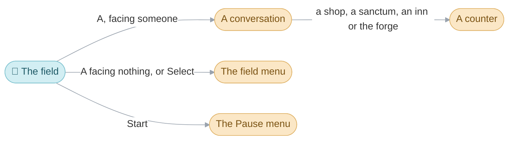

# The menu engine

Everything the player reads or chooses comes in a bordered box: a
villager's line, the field menu, the Pause menu, a shop's counter, a
battle's commands. The menu engine is the code that draws those boxes and
runs the screens built from them.

It rests on two ideas: one event draws every box, and every screen is plain
code that waits.

## Windows

A box is a [window](glossary.md#window). The code that wants one only
asks for it, because the drawing is done by the windows' own
[event](glossary.md#event), which runs once in every frame from inside whatever code is waiting. Each frame
it grows every opening window a little, shrinks every closing one, and
types the next letters into any that have text coming. That is why a line
and the portrait beside it can both be on the move while the conversation
that asked for them stands still.

It is also why every window in the game looks and behaves alike. Change the
window colour in the settings and a conversation, a menu and a shop counter
all change together, because only one piece of code draws them.
[Windows](../../games/tla/src/window/README.md#windows) follows one from opening to
closing.

## Messages

A piece of the game's text is a [message](glossary.md#message), and code
asks for it by its number, never by its words. On the cartridge a message
is packed small and has blanks in it: for a number, an item, the name the
player gave Felix.

Showing one is two steps. First the whole message is decoded: unpacked,
with its blanks filled from the game's state at that moment. Then the
windows' event types it a few letters a frame, stops at the end of each
page, and each frame after that looks for a button.

[Decoding a message](../../games/tla/src/window/README.md#decoding-a-message) shows the
packing and what a blank can hold.

## Menus

A menu is not a state the game switches into. It is a function the field
calls, which returns when the menu closes. Inside, it is code that waits:
draw the choices, call `sySynch(1)`, look at the buttons, go round again. A
question inside a screen is another call, one level deeper, and B returns
from it.

So nothing has to remember where the player was. When the menu closes the
field is on the very line that opened it, with Felix where he stood.
[A screen is code that waits](../../games/tla/src/menu/README.md#a-screen-is-code-that-waits)
shows one screen open, ask and close.

One rule decides what a menu may do by itself. Anything that needs only the
party, such as casting Cure on Jenna, the screen does on the spot. Anything
that touches the scene, such as Frost on one of Daila's puddles, it cannot
do: it writes down who is casting what, sets a request, and closes. The
field finds the request and does the casting. That is why the menu is
always gone before the puddle freezes.

With eight in the party the screens grow a little: the members come four to
a page, and the Status screen is where the order is changed, which decides
who fights in front.

## Shops, sanctums and inns

A visit to a counter starts as an ordinary conversation. The shopkeeper's
[script](glossary.md#script) calls the shop's code as a function and goes on
when it returns, exactly as the field calls a menu. So a whole shop visit
can sit in the middle of a conversation.

There are three kinds, and The Lost Age adds a fourth. A shop buys, sells
and repairs, a sanctum revives and cures, and an inn restores HP and PP,
charging only for the party members still standing. In Yallam, Sunshine the
blacksmith forges the materials the party brings him into equipment, ready
by the time they visit the inn. What each shop stocks, and what each
material can become, is a table.

## Saving and the Pause menu

Start opens the Pause menu, where saving and the settings are. Each save
file carries a short summary beside its data, and the list of files is
drawn from the summaries alone, so the game never reads a whole file just
to show the list. [The system library](system.md#saving) says what a save holds.

## Where the code is

- [Windows](../../games/tla/src/window/README.md) is the boxes and the text typed into
  them, and the Pause menu with its saving and settings.
- [Menus](../../games/tla/src/menu/README.md) is the four screens of the field menu:
  Psynergy, Djinn, Item and Status.
- [Shops](../../games/tla/src/shop/README.md) is the counters of a town: shops, sanctums,
  inns and the forge.
