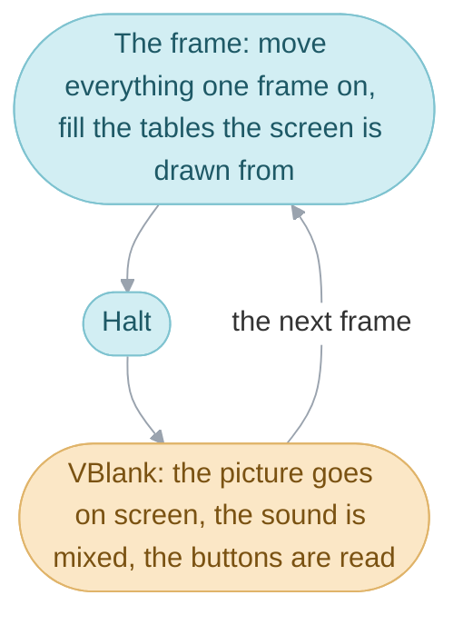
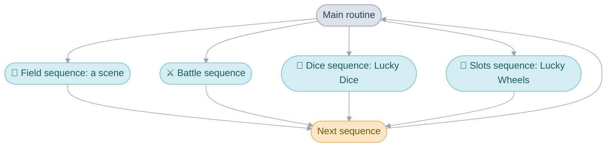
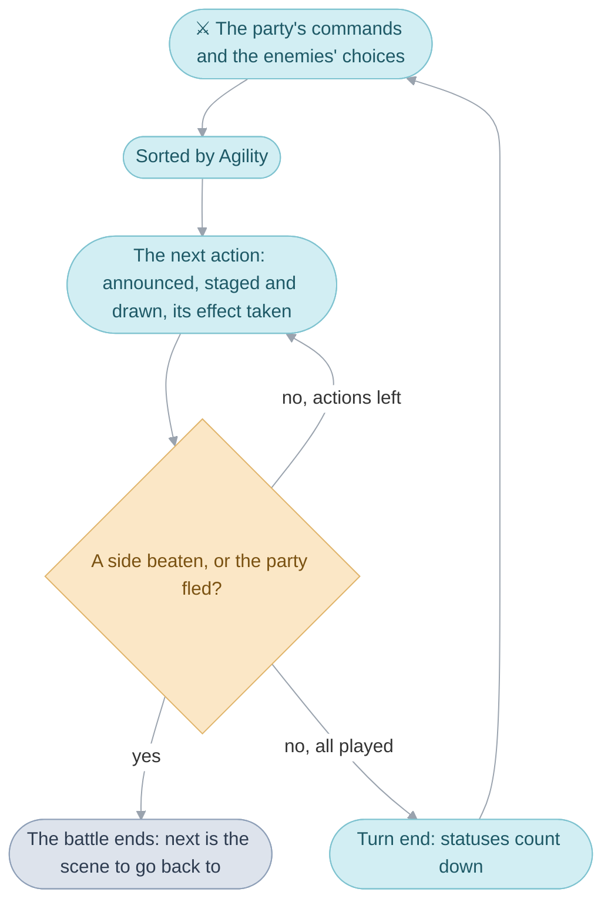
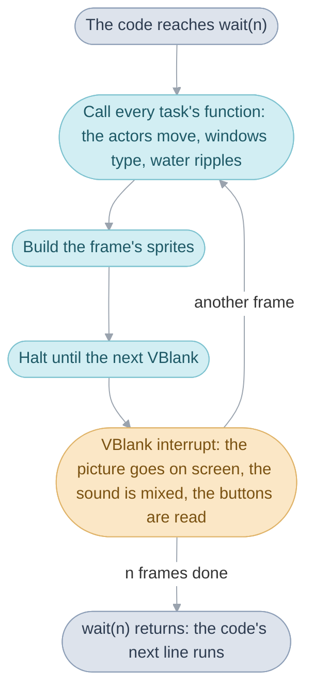
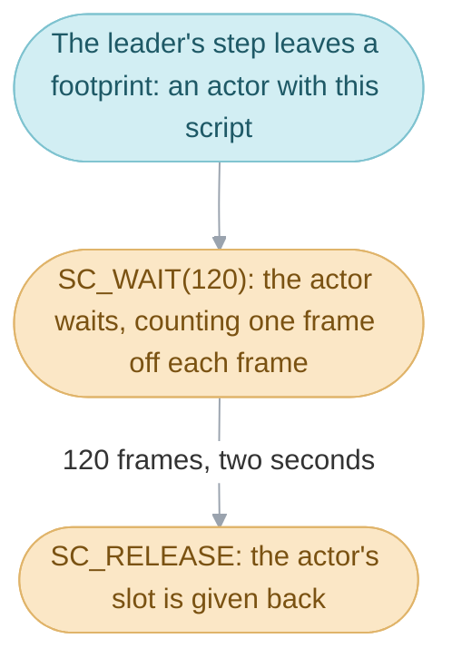
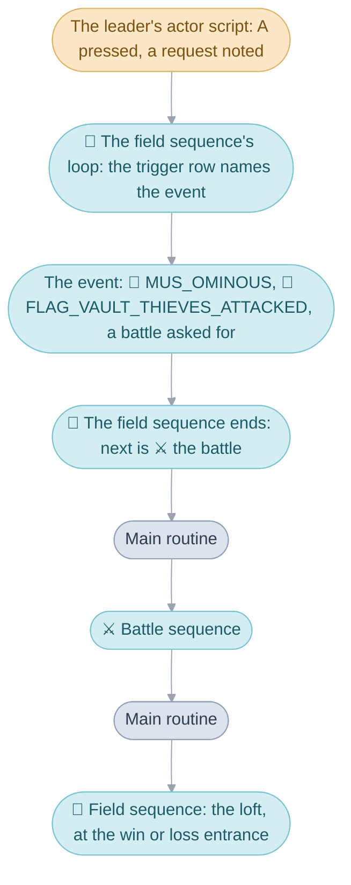

# The Broken Seal


> [!NOTE]
> In Japan, Golden Sun carries the subtitle 開かれし封印, The Broken Seal.
> These pages call the game by that subtitle, to keep it apart from
> [The Lost Age](glossary.md#the-two-games).

Switch the console on and the title card settles over Mt. Aleph. Press
Start, choose a file, and the party stands in Vale. From here on the player
sees one thing at a time: the party walking around a town, a conversation,
a battle, a menu, a game of dice. Underneath, the game runs on four
mechanisms, each one running inside the one before it:

1. The [main routine](glossary.md#main-routine) runs one
   [sequence](glossary.md#sequence) at a time: the field, a battle, Lucky Dice
   or Lucky Wheels.
2. A sequence's code runs from top to bottom, and lets time pass by calling
   [`wait(n)`](glossary.md#wait), which runs n [frames](glossary.md#frame) of
   the game.
3. In each frame, `wait()` calls the game's [tasks](glossary.md#task), the
   functions that keep the screen moving.
4. One task moves the [actors](glossary.md#actor), stepping each actor's
   [actor script](glossary.md#actor-script) on a little every frame.


This page is the first chapter. It starts with the console and the frame,
the unit everything else is measured in, then takes the four mechanisms in
order, each with what the player sees of it, and ends by following one moment
of the game through all four. The pages for the
[four divisions](#the-four-divisions) of the code go deeper into each.

## The console


The Game Boy Advance has a screen of 240 by 160 pixels, which it redraws
about 60 times a second, and ten buttons: the four directions of the D-pad,
A, B, L, R, Start and Select. Everything the player sees is drawn out of two
kinds of picture. The [background layers](glossary.md#background-layer) are
large grids of tiles, four of them stacked one behind another, which the
ground, the walls, the roofs and the windows are drawn on. The
[sprites](glossary.md#sprite-and-oam) are small pictures placed anywhere, up
to 128 at once, which the people, the cursor and the battle's effects are
drawn with. The console draws both by itself from tables in its memory; the
game's work each frame is to fill those tables.

The cartridge holds the code and every picture, map, tune and line of text,
about 8 MB. The processor runs most of the code straight from the cartridge:
this is the [main image](glossary.md#main-image), about 1 MB, cut into
fourteen [banks](glossary.md#bank). The rest of the code runs from the
console's RAM, which is small: 256 KB of slower memory and 32 KB of fast
memory. A scene's code is unpacked into the slower RAM as an
[overlay](glossary.md#overlay) when the party arrives there, and the routines
that must be quick, such as the interrupt handlers, are copied into the fast
memory at start-up.

| Memory          | Size   | What runs or lives there                                         |
| --------------- | ------ | ---------------------------------------------------------------- |
| The cartridge   | 8 MB   | the main image's code and every picture, map, sound and message |
| EWRAM           | 256 KB | the scene's overlay and one of the heap's two pools              |
| IWRAM           | 32 KB  | the interrupt handlers, the stack and the heap's other pool      |

[System](system.md#start-up) follows the console from power-on to the first
sequence.

## The frame


Everything in the game that takes time is counted in frames. A frame is one
picture: the game prepares it, then waits for the screen to show it at the
next [VBlank](glossary.md#vblank), the moment about 60 times a second between
one picture on the screen and the next. Isaac walks
one pixel a frame, and runs one and a half with B held; a message types a
few letters a frame; a pause in a conversation is so many frames; an animation
shows each of its pictures for so many frames.

| Name               | Value               | Meaning                                       |
| ------------------ | ------------------- | --------------------------------------------- |
| `FIELD_WALK_SPEED` | `Q16_ONE`           | 1 pixel a frame, in 16.16 fixed point         |
| `FIELD_RUN_SPEED`  | `Q16_ONE * 3 / 2`   | 1.5 pixels a frame, with the dash key held    |
| 60 frames          |                     | about one second                              |

A frame is what the game does for one picture, and then a halt until the
next VBlank. The VBlank interrupt runs on its own at every
VBlank, whatever the game's code is doing: it puts the finished picture on
screen, mixes the next slice of sound and reads the buttons. What a frame has
to do is usually done well before its VBlank arrives. When it takes longer
than one VBlank, the picture is shown a VBlank late, and since everything
counted in frames runs by the frame, it all runs slow together, while the
music, mixed at every VBlank, keeps its tempo: that is
[slowdown](glossary.md#slowdown) ([System](system.md#slowdown)).



Who does the frame's work, and how the code that is waiting gets to wait,
is the subject of the four mechanisms.

## The main routine and its sequences


Walking through a cave, the party runs into a battle. The cave goes away,
the battle plays out, and the cave comes back. To the player it is one game;
to the code it is two sequences, one after the other. A sequence is one
whole kind of play, with its own code, its own memory and its own tasks. The
field sequence runs while the party walks around a place: a town, a cave, a
room, the World Map. The battle sequence runs a fight from its opening to the
spoils. The two smallest sequences are the games in Tolbi: Lucky Dice is the
dice sequence and Lucky Wheels the slots sequence, each played from its own
room.


The main routine, `MainRoutine_Run`, starts when the console is switched on
and runs until it is switched off. It runs one sequence, waits for it to
finish, and starts the next.



A sequence decides what comes after it: before it ends it writes what runs
next into the [main routine's work](glossary.md#main-routines-work), the one
piece of memory every sequence shares, and the main routine reads that and
starts it. What runs next is `gMainRoutineWork.next`. In the cave, the field
sequence wrote the battle there and ended; the battle wrote the cave back and
ended.

| Value in `next`                 | What the main routine runs                     |
| ------------------------------- | ---------------------------------------------- |
| a scene's number                | 🏡 the field sequence, on that scene           |
| `SEQUENCE_BATTLE`               | ⚔️ the battle sequence                         |
| `SEQUENCE_DICE`                 | 🎲 the dice sequence, Lucky Dice               |
| `SEQUENCE_SLOTS`                | 🎰 the slots sequence, Lucky Wheels            |

### Scenes


The field sequence runs one [scene](glossary.md#scene). A scene is a place,
such as Vale or a room of Vault's inn, or a screen, such as the Title or the
File Screen. There are 201 of them, every one a row of the scene table,
`gScenes`, and each has a scene code (`PLOGV00` is Vale on the stormy night
of the prologue) and an area name, the name the game shows when the party
arrives somewhere new. Scenes that share a name, its music and a range of
[flags](#game-flags) make an [area](glossary.md#area): Vale and its houses
are one area, 71 in all.

Walking through a door is a handover too. When the party walks out of a
scene, the field sequence ends, and the main routine starts it again on the
scene the [exit](glossary.md#exit) leads to. The fade to black between Vale
and the Sanctum's hall is the gap between two sequences.


Walking from Vale into the Sanctum is therefore the same handover as walking
into a battle: one sequence ends and the next starts. That is why `next`
holds either kind of thing: a scene's number means the field sequence
running that scene, and a number above all the scenes means one of the other
sequences. When a battle or a game of dice ends, the main routine goes back
to a scene the field sequence runs (`Scene_ReturnFromSequence`).

### The World Map


The World Map is a scene like any other, run by the field sequence, with
its own map, exits into every town and cave, and random battles of its own.
It looks different because it is drawn in perspective: the game gives every
line of the screen its own scale, a wider and more distant strip of the flat
map the higher the line, so the land tilts away from the party
(`WorldMap_BuildScanlineTable`). Walking out of Vale's gate leads to it, and
walking into a town on it leads to that town's first scene.
[Field](field.md#the-world-map) works through the lines.

### Exits and entrances


An exit is a doorway or a map edge, and a scene names each of its exits for
where it leads. The party arrives in the next scene at an
[entrance](glossary.md#entrance), a spot and a facing named for where the
party comes from. Each side of a door therefore names the other:
`SOL_ENTRANCE_TO_VALE` on the Sol Sanctum side, `VALE_FROM_SOL_ENTRANCE` on
Vale's.

A scene's exit table turns an exit into a scene and an entrance, and a row
can hold only until a flag is set. The path down from Sol Sanctum's entrance
has three rows for one exit:

```c
SCENE_EXIT_UNLESS(SOL_ENTRANCE_TO_VALE, Vale, VALE_FROM_SOL_ENTRANCE, FLAG_SOL_SANCTUM_ERUPTED),
SCENE_EXIT_UNLESS(SOL_ENTRANCE_TO_VALE, ValeEruption, VALE_ERUPTION_FROM_SOL_ENTRANCE, FLAG_VALE_PARTY_LEFT),
SCENE_EXIT_UNLESS(SOL_ENTRANCE_TO_VALE, Vale, VALE_FROM_SOL_ENTRANCE, EXIT_FLAG_NONE),
```

The first row that holds wins. Until the Sanctum erupts, the path leads to
Vale. Once it has, and until the party leaves Vale for good, the same path
leads to a different scene, Vale erupting, drawn on the same map with the
villagers gathered. After that it leads to Vale again. The recording shows
the first two. [Field](field.md#exits-and-entrances) covers the tables.

### Game flags


The same gate, three times, with different people standing there: the scene
reads the story to decide who stands where. The story, and everything else
the game remembers that is a yes or a no, is kept in the
[game flags](glossary.md#game-flag): 4,096 of them, each a single bit, each
named for its fact. `FLAG_VALE_STORM` is set during the stormy night,
`FLAG_VALE_PARTY_LEFT` once the party has set out, `FLAG_KALAY_REACHED` once
it has reached Kalay. A scene's set-up reads the flags and places its actors;
an exit row holds until its flag is set; a trigger row retires when its flag
is set. The flags are saved with the game, so a save file is, to a large
degree, the list of flags that are set.

Two ranges of the flags are scratch space with a short life: the scene flags
are cleared each time the party enters a scene, and the area flags each time
it enters another area, so a scene can keep a note (the pillar has been moved,
the villager has been spoken to today) without the note outliving the visit.
[Game rules](src/game/README.md#the-game-flags) lists the ranges.

### Overlays

A town's people and events matter only while the party is there, and all
201 scenes' code would be too much to keep in memory at once. Each scene's
code is therefore an overlay, a packed piece of code unpacked into one 32 KB
area of RAM when the party arrives, over the scene before. The rooms of one
place often share their code, so the 201 scenes share 96 overlays. The main
image asks the overlay a fixed set of questions through a small table at its
start: where the party can arrive, where it can leave, who stands where and
what can happen there. [System](system.md#overlays) describes both tables,
and [Places](https://alchemy.pascalpixel.com/tbs/places) has a page for every
scene.

### The battle sequence


The battle sequence is the other large one. It runs in
[turns](glossary.md#turns-and-actions): the party chooses its commands and the
enemies their moves, the actions are sorted by Agility, fastest first, and each
is played in turn, announced, staged and drawn, its targets taking its effect.
After every action the game checks whether a side has been beaten, so a battle
can end in the middle of a turn; when every action has played, the turn ends
and the statuses count down. The sequence is code that waits, like the field:
one loop of turns, each action running its frames before the next starts.



The battle reads the party, the enemies' [formation](glossary.md#formation)
and the background from the main routine's work, and leaves its result
there: a win, a loss or a flight, which decides the scene the main routine
goes back to. [Battle](battle.md) follows a battle from its opening to the
spoils.

### Why every sequence starts fresh


Between two sequences the main routine clears away everything the last one
set up: it removes its tasks, the interrupt handlers it set for effects drawn
line by line, and every block of memory it borrowed from the
[heap](glossary.md#heap-and-pools), the pool sequences take their working
memory from. So a sequence passes everything on through the main routine's
work and the game flags, and any scene or battle can follow any other. The
[debug menus](glossary.md#debug-menus) rely on this: the debug scene selector
writes any scene and entrance as what runs next and lets the scene end, and
the main routine takes the party there. [System](system.md#the-main-routine)
goes through the clearing up and the start-up before the first sequence.

### What the game remembers


Three kinds of memory hold the game's state, each with its own lifetime.

| Memory                   | Holds                                                         | Lives                                   |
| ------------------------ | ------------------------------------------------------------- | --------------------------------------- |
| The main routine's work  | what runs next, the party, its coins and Djinn, the options   | always; a save file keeps it            |
| The game flags           | 4,096 yes-or-no facts: the story, chests opened, Djinn found  | always; a save file keeps them          |
| A [work](glossary.md#work) in a heap slot | a sequence's or a menu's own state, such as the field's requests | one sequence; cleared before the next |

A save file is the first two: the main routine's work and the flags, written
to the cartridge's flash chip. Everything else is rebuilt from them when the
party arrives somewhere. [System](system.md#saving) covers the writing.

## Code that waits


While the villager's line waits for A, the river keeps flowing and the
letters of the next page keep appearing. The code that showed the line is
standing still at one call, and that call is where the rest of the game
runs.

A sequence's code runs from top to bottom. Here is the whole of one event in
Vale, a young man asking after Jenna, from [vale.c](src/scene/vale.c):

```c
static void Vale_AskWhetherJennaHasReturned(void) {
  Event_Start();
  Actor_TurnToFaceEachOther(ACTOR_PARTY_LEADER, ACTOR_YOUNG_MAN_ASKING_FOR_JENNA, 20);
  Event_SetMessageId(MsgValeIsJennaBackYet);
  Event_ShowMessageAndWait(ACTOR_YOUNG_MAN_ASKING_FOR_JENNA, 0);
  GameFlag_Set(FLAG_VALE_ASKED_IF_JENNA_IS_BACK);
  Event_End();
}
```

Each line runs once the one before it has finished. The two people turn to face
each other and the code waits 20 frames; the message is shown and the code
waits until the player has read it; a flag is set; the event ends. The turning
and the reading each take time, and the code simply stands at that line until
it is done.

That is possible because the game loop is inside [`wait(n)`](glossary.md#wait).
Each call runs n frames of the game and then returns to the next line. In
each frame it calls every task's function one after another, builds the sprites, and
halts until the VBlank. `Actor_TurnToFaceEachOther` and
`Event_ShowMessageAndWait` both call it.



Simplified, from [frame.c](src/system/system/frame.c):

```c
void wait(s32 frames) {
  while (frames--) {
    Task_RunPass(TASK_PASS_FRAME);  /* call every task's function */
    Oam_BuildBuffer(...);           /* build the frame's sprites */
    VBlankIntrWait();               /* halt until the next VBlank */
  }
}
```

Only one piece of code is ever waiting at a time. The field sequence calls
the event, the event calls `Event_ShowMessageAndWait`, and that calls
`wait()`: one chain of calls, on one stack, standing still at its deepest
call while the frames go by. A wait can come from deep inside that chain,
and `wait()` keeps room on the stack for the frame's work
([System](system.md#waiting-and-tasks)).

### Events


An [event](glossary.md#event) is code that waits, written for one scene: a
conversation that does more than show one line, or a cutscene. It runs
between `Event_Start`, which stops the leader, and `Event_End`, one
event command to a line. Each command
that takes time, such as a walk or a message, runs its frames before the
next line starts, so an event reads as the scene plays: this person walks
there, that one speaks, a pause, the music changes. The scene's own code is
in its overlay, so each scene's events are written beside the tables that
start them. [Scenes](src/scene/README.md#events) shows how they are written.

### Menus


A menu is code that waits too. Pressing A with nothing in front of the
leader, or Select, opens a row of icons, Psynergy, Djinn, Item and Status,
and each opens a screen. The screen is a function that draws its windows,
waits for the buttons a frame at a time and returns when the player backs
out, and the field sequence's loop, which called it to answer the menu
request, carries on walking when it returns. While a screen is open the
scene's people are held behind it. The screens live in their own
[bank](glossary.md#bank) of the main image and share one
[work](glossary.md#work), since only one runs at a time.
[Interface](interface.md#the-field-menu) goes through them.

## Tasks


The letters appear a few at a time, and the arrow bobs while the window
waits: a task does both. A task is whatever has to keep moving while the
code waits: the actors walking, a window typing out its text, the map's
water rippling. Each is one function in the task table, `gTasks`, which
holds up to 20, and `wait()` calls each in every frame until the task is
removed. A task has no memory of its own: what it works on lives in a work,
the field's or the windows', and the task reads and updates it each frame.

A sequence adds the tasks it needs when it starts, each with a priority that
orders it among the rest, higher first, and removes them when it ends. The
field adds these, among others:

| Task                        | Priority               | Each frame                                              |
| --------------------------- | ---------------------- | ------------------------------------------------------- |
| `PaletteFade_Update`        | `TASK_PASS_FRAME + 15` | steps a fade of the colours                             |
| `Actor_UpdateAllThumb`      | `TASK_PASS_FRAME + 10` | moves every actor one frame on                          |
| `MapGrid_UpdateLayerScroll` | `TASK_PASS_FRAME + 5`  | scrolls the map's layers to follow the camera           |
| `ActorSystem_PlaceSprites`  | `TASK_PASS_FRAME`      | places each actor's sprite where the actor now is       |
| `TilesetAnim_Update`        | `TASK_PASS_FRAME`      | animates the map's tiles: water, torches, flowers       |
| `AreaNameWindow_Update`     | `TASK_PASS_FRAME`      | shows and hides the area's name on arrival              |

The order matters: the actors move before their sprites are placed, and the
map scrolls before the sprites are placed on it. A battle adds its own:
its playback, which runs the actions, and its camera at
`TASK_PASS_FRAME - 1`, so the camera is placed after everything else in the
battle's frame has moved.

A task runs in the middle of the code's `wait()`, so it acts within its one
frame and returns. What it notices for the code it serves, it leaves as a
note in that code's work, and the code acts on the note once its `wait()`
returns. The field sequence's loop is the plainest case:

```c
do {
  wait(1);                      /* one frame: every task runs */
  Field_UpdateWalking(...);     /* what the ground under the leader does */
} while (Field_CountRequests() == 0);
```

When the player presses A, a task notes it during `wait(1)` (the next section
says which), and when `wait(1)` returns the loop finds that note, a
[request](glossary.md#field-request), leaves the loop and answers it.


### Requests

A request is one of twelve notes in the field's work, each a thing the
walking leader has run into: a doorway, an enemy, a person to talk to, a
chest to search, a button pressed. The loop answers them in a fixed order,
most urgent first, and the walk goes on once the last is answered. Leaving
comes first, so an event that ends by taking an exit simply ends the scene.

| Order | Request (`FieldWork` member) | What it asks for                                                        |
| ----- | ---------------------------- | ----------------------------------------------------------------------- |
| 1     | `exit`                       | leave the scene: `next` becomes the scene the exit leads to              |
| 2     | `raisedTrigger`              | run a trigger the scene's own code raised, such as the party falling    |
| 3     | `encounter`                  | a random or a requested battle: `next` becomes the battle               |
| 4     | `stepTrigger`                | a step trigger or an exit on the cell stepped onto                      |
| 5     | `pushCell`                   | a ledge, a climbing spot or a jump the leader pushes against            |
| 6     | `aButton`                    | the A button: talking if someone is ahead, else searching, else the menu |
| 7     | `fieldMenu`                  | the field menu                                                          |
| 8     | `talk`                       | talk to someone                                                         |
| 9     | `examineCell`                | search a cell: a chest, a jar, a sign                                   |
| 10    | `psynergy`                   | use Psynergy on the field                                               |
| 11    | `item`                       | use an item on the field                                                |
| 12    | `pauseMenu`                  | the Pause menu                                                          |

[Field](field.md#the-field-sequence-and-its-requests) follows the loop
through each.

## Actor scripts


Every person and moving thing in a scene, down to a footprint in the snow, is
one of 64 actors, each a slot of `gActors` holding a position, a facing, a
sprite and a place in a script. All of them are moved by one task,
`Actor_UpdateAllThumb`. Each frame it comes to every actor: an actor
counting down a wait counts one frame off, and any other runs the commands of
its actor script until one says the actor is done for the frame, such as a
step of a walk or a wait. An actor script therefore moves on a little every
frame, and each actor keeps its own place in its script. A footprint's whole
script is two commands, from [facing.c](src/field/facing.c):

```c
SC_WAIT(120), SC_RELEASE,
```



An actor script is a short list of commands, `SC_` words in a table, and the
actors' task reads it: walk to a point, turn, wait, jump to a label, play an
animation, release the slot. A villager's script wanders to random spots near
its home (`SC_WANDER`). The leader's script hands its actor to the field's
built-in player control (`SC_PLAYER`), which reads the buttons, walks the
leader and notes the field's requests. The thieves' scripts in the next section
walk them up a ladder while the event waits. [Field
code](src/field/README.md#everything-that-moves-runs-an-actor-script) covers
the commands.

### Who stands where

A scene's actor table says who is in it: one row for each person or thing,
with its sprite, a condition on the flags, where it starts and the script
it runs. The field places them when the scene starts, after reading the flags,
which is how the same gate holds a crowd on the stormy night and stands
quiet after the party has left. The party itself is placed by the entrance.
[Scenes](src/scene/README.md#who-stands-where) covers the table.

### Maps and cells


A scene is drawn on a [map](glossary.md#map), a grid of 16-pixel squares,
the [cells](glossary.md#cell). Each cell says what is drawn there, how high
its ground is, and what standing there does: a wall, a door, a ledge, a
chest, plain ground. A town is drawn as three flat sheets stacked one behind
another, the ground, the walls and the roofs, and an actor's sprite takes
its place in the stack from the cell under it, so Isaac passes behind a roof
without any code working out who hides whom.


Each frame the leader's control tests the ground just ahead. When the way is
blocked it tries headings a little to either side and takes the first that
is open, so the leader slides along a wall instead of stopping dead, and a
step too high or a drop too deep counts as a wall.

| Rule                 | Value     | Meaning                                       |
| -------------------- | --------- | --------------------------------------------- |
| a step up            | 8 pixels  | ground more than this higher stops the leader |
| a step down          | 12 pixels | ground more than this lower stops the leader  |
| a cell               | 16 pixels | one square of the map's grid                  |

[Maps](src/map/README.md) shows how the three layers share one grid, and
[Field](field.md#movement) gives the speeds on each kind of ground.

### Triggers


When the loop answers a talk, a search, a step or a cast, it looks the
request up in the scene's trigger table. Each row says what starts it, who
or where it is for, the condition under which it still applies, and what it
does. The chest in Sol Sanctum is one row:

```c
{ EXAMINE_TRIGGER(EXAMINE_CHEST), CELL_BEHAVIOR_SOL_SANCTUM_RELIEFS_CHEST, FLAG_SOL_SANCTUM_FIRST_SMALL_JEWEL_FOUND, FIND_ITEM(ITEM_SMALL_JEWEL) },
```

A search, at the cell the chest stands on, until the flag says the jewel has
been found, gives the Small Jewel. Finding it sets that flag, so the next
search of the chest finds no row and the chest stays open. The loop runs
the first row that fits, which is why a person's rows are listed in story
order: each retires itself by setting its flag, and the next talk falls
through to the next row. A row's last column names a message to show, an
item to give, or an event to run. [Scenes](src/scene/README.md#the-tables)
lists the kinds of row.

## Sound


Every [sound](glossary.md#sound) is asked for with `Sound_Play` and a
number, and the number's range says what kind it is: music, a jingle or an
SE, a sound effect. The names in `sounds.h` say which: 🎵 `MUS_INN` is the
inn's music, and 📣 `SE_` names the effects. A jingle, such as the short tune
when an item is found, silences the music until it ends; an SE plays over
it. The driver has eight players, one for each kind, so a sound of one kind
plays over the others, and the music already playing carries on when it is
asked for again, which lets every scene ask for its music on arrival. The mixing
happens in the VBlank interrupt, so the music keeps time whatever the code
is doing. [System](system.md#sound) covers the driver.

## From a conversation to a battle and back


In Vault, the party pushes a crate aside with Move and climbs to the inn's
loft, where a villager lies tied up. All of it happens in one scene,
`SceneId_LogRoomsA`: a single map holding every room inside Vault's buildings,
all of them walled in logs, each room reached by its own entrance
([log_rooms_a.c](src/scene/log_rooms_a.c)). Talking to the villager starts a
fight with the three thieves, and each step of it is the work of the four
mechanisms one after another.



### Talking to the villager

The main routine is running the field sequence for that scene, and the field
sequence's loop is in `wait(1)` while the player walks. In each of those
frames, the actors' task steps the leader's actor script, and when A is
pressed the script notes it (`Field_CheckConfiguredKeys` sets `aButton`).
When `wait(1)` returns, the loop sees the request, finds the villager ahead
(`Field_FindNearbyTalkTarget`) and looks him up in the scene's trigger
table, which holds this row:

```c
{ TRIGGER_TALK, ACTOR_TIED_UP_VILLAGER, CONDITION_ALWAYS, EVENT(LogRoomsA_FreeRooferAndConfrontThieves) },
```

The row names an event, and the loop calls it.

### The event

`LogRoomsA_FreeRooferAndConfrontThieves` is code that waits, running straight
through from `Event_Start` to `Event_End`. Isaac cuts the villager free, the
three thieves come up the ladder to `MUS_OMINOUS`, they speak, and they
attack. Every pause between those steps is an `Event_Wait`, which calls
`wait()`; during each one the actors' task walks the thieves up the ladder and
the windows' task types out what they say.
At its end the event sets a story flag, writes into the main routine's work
where the story goes after a win and after a loss, and asks the field for the
battle (one line, which picks the bars that close the screen, is left out):

```c
GameFlag_Set(FLAG_VAULT_THIEVES_ATTACKED);
base = (s32)&SceneId_LogRoomsA;
Event_SetAfterBattleDestination(base, LOG_ROOMS_A_LOFT_AFTER_THIEVES_DEFEATED);
Event_SetDefeatDestination(base, LOG_ROOMS_A_LOFT_AFTER_LOSING_TO_THIEVES);
Battle_SetType(BATTLE_TYPE_SCRIPTED);
Field_RequestBattleFromEncounterTable(ENCOUNTER_ZONE_SCRIPTED_VALE_VAULT, 5);
```

The cast in the second line is there because the scene table defines each
`SceneId_` as an assembler symbol whose address is the scene's number. The
last line only asks for the battle: it notes the thieves'
[formation](glossary.md#formation) as a request, which the loop answers once
the event has returned, as it answered the A press.

### The battle

The field sequence answers the request by writing `SEQUENCE_BATTLE` as what
runs next, and the formation beside it, and then it ends. The main routine
clears the scene away, its tasks with it, and starts the battle
sequence (`Battle_RunFar`), which adds tasks of its own, such as its camera.
Everything the battle reads comes from the main routine's work: the formation,
the party, the battle music and the background chosen for the scene. When it
ends, `Scene_ReturnFromSequence` reads its result: a win goes to the
after-battle [destination](glossary.md#destination) the event wrote, a loss
to the defeat destination.

### Back in the loft

The main routine runs the field sequence on `SceneId_LogRoomsA` again, at the
[entrance](glossary.md#entrance) the event chose, and the field sequence adds
its tasks and places the scene's actors afresh. The scene's
`Scene_Initialize` switches on that entrance. At
`LOG_ROOMS_A_LOFT_AFTER_THIEVES_DEFEATED`, `LogRoomsA_DefeatThieves` stages
the beaten thieves, and `LogRoomsA_ReturnStolenGoods` sets
`FLAG_VAULT_THIEVES_JAILED` and hands back the stolen goods. At
`LOG_ROOMS_A_LOFT_AFTER_LOSING_TO_THIEVES` it plays `LogRoomsA_LoseToThieves`
and sends the party to the Vault Sanctum. The entrance alone tells the scene
which event to play.

### The same moment, mechanism by mechanism

| Step                                | Mechanism                                               |
| ----------------------------------- | ------------------------------------------------------- |
| The leader walks up to the villager | the leader's actor script, stepped by the actors' task  |
| A is pressed                        | the actor script leaves a request in the field's work   |
| The request is found                | the field sequence's loop, after `wait(1)` returns      |
| The villager is cut free            | the event, code that waits, between `Event_Start` and `Event_End` |
| The thieves climb the ladder        | their actor scripts, stepped during the event's waits   |
| Their words type out                | the windows' task, during the same waits                |
| The battle is asked for             | a request, answered when the event returns              |
| The scene goes away                 | the field sequence ends; the main routine clears it     |
| The battle                          | the battle sequence, with its own tasks                 |
| The loft again                      | the field sequence, at the entrance the event chose     |

## The four divisions

The code falls into four divisions, each with a page:

- [System](system.md): start-up, the main routine, waiting and tasks, memory,
  banks, overlays, saving and sound.
- [Battle](battle.md): a battle from the first menu to the spoils, and the
  game's rules.
- [Field](field.md): scenes and their requests, actors, maps, the World Map
  and field Psynergy.
- [Interface](interface.md): windows and messages, the menus,
  shops and inns.

Beside them, [Places](https://alchemy.pascalpixel.com/tbs/places) has every
scene in story order, [Source](src/README.md) every file of the code, the
[Glossary](glossary.md) the words these pages share, and
[Unused](https://alchemy.pascalpixel.com/tbs/unused) what the game keeps but
never plays.