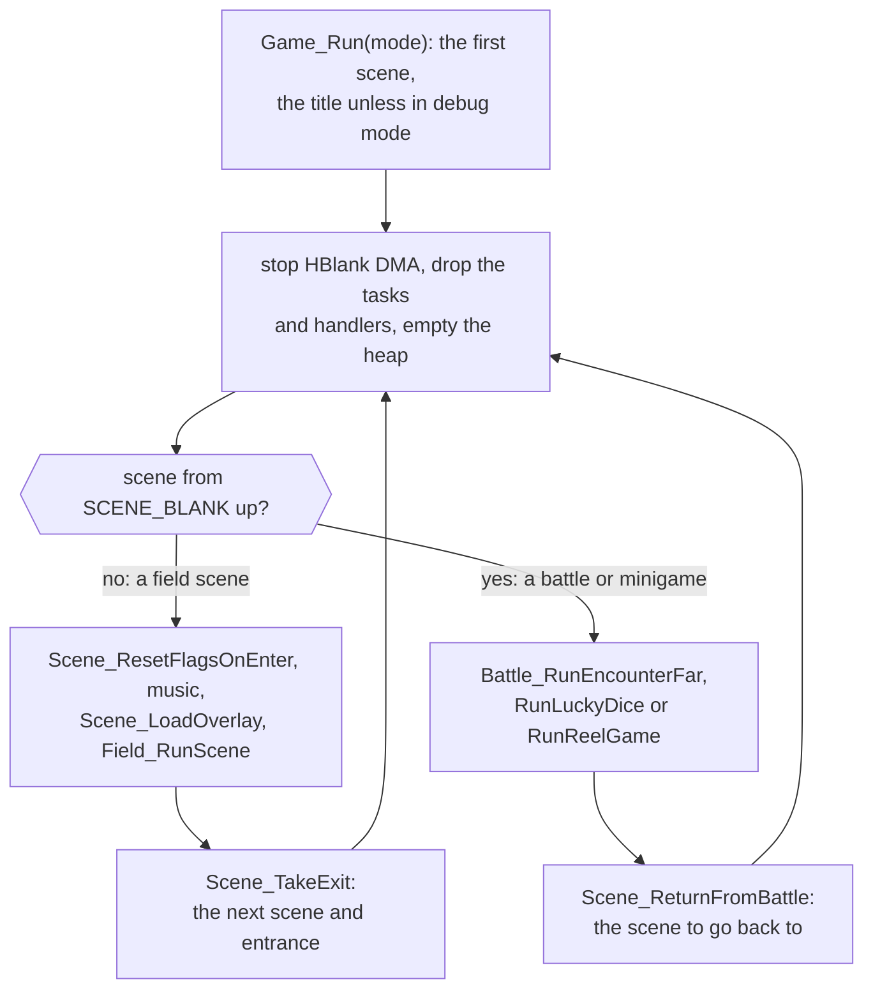
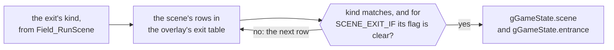

# ☀️ The Broken Seal

The Broken Seal is one loop, `Game_Run`, that runs one scene at a time. A
scene is a map and the overlay of code that drives it, and the scene table
says which of each a scene uses and which place it belongs to. Scenes are
joined by named entrances and exits, and everything a scene knows about how
far the story has gone comes from the game flags. The code itself is divided
by the banks of the main image, with one folder for each large bank.

## The main loop

`Game_Run` runs one scene at a time from a clean runtime, for as long as the
game runs.

`Game_Run`, in [object/scene.c](src/object/object/scene.c), is the game's
main loop, and it never returns. `System_Initialize` calls it at power-on
with `GAME_RUN_TITLE`, which makes the title (`SceneId_Title`) the first
scene; the debug start modes begin at Vale's gate or the clear screen
instead, and only while `gDebugMode` is set. The current scene and the
entrance the party arrives by are `gGameState.scene` and
`gGameState.entrance`.

Each pass of the loop starts from a clean runtime. It stops the DMA channel
a scene may have left running for an HBlank effect, drops every task and the
HBlank and VCount handlers, and empties the heap, so nothing a scene
allocated survives it. Then it does one of two things:

- A field scene has its flags updated (`Scene_ResetFlagsOnEnter`), its music
  started unless `FLAG_KEEP_MUSIC` or `FLAG_KEEP_MUSIC_HELD` keeps what is
  playing, and its overlay unpacked (`Scene_LoadOverlay`). `Field_RunScene`
  runs it until the party takes an exit and returns the exit's kind, and
  `Scene_TakeExit` turns that into the next scene and entrance.
- A battle or a minigame is a scene number from `SCENE_BLANK` up
  (`SCENE_BATTLE`, `SCENE_LUCKY_DICE`, `SCENE_REEL_GAME`), with no row in the
  scene table and no overlay, since its code is in the main image. It returns
  a result rather than an exit, and `Scene_ReturnFromBattle` picks the scene
  to go back to: the defeat point after a defeat, the destination an event
  set, or else the field scene the battle started from, with
  `FLAG_KEEP_PARTY_POSITION` set so that the party and the actors come back
  where they were.

A random battle is therefore an exit like any other: the field scene sets
the next scene to `SCENE_BATTLE` and leaves, and the loop loads it again
afterwards. [Field objects](src/object/README.md) follows a field scene from
`Field_RunScene` to its exit, including how a battle is chosen from the
encounter zones in `encounter.tsv`.

| Name | Value | Meaning |
| --- | --- | --- |
| `GAME_RUN_TITLE` | 0 | start at the title, with a fresh game state |
| `GAME_RUN_DEBUG_VALE` | 1 | in debug mode, start at `SceneId_ValeGate` |
| `GAME_RUN_DEBUG_CLEAR` | 2 | in debug mode, start at the clear screen |
| `SCENE_BLANK` | `0x1fb` | the first scene number with no row in the scene table |
| `SCENE_REEL_GAME` | `0x1fc` | Lucky Wheels at Tolbi's spring |
| `SCENE_LUCKY_DICE` | `0x1fd` | Lucky Dice at Tolbi's spring |
| `SCENE_BATTLE` | `0x1fe` | a battle |

## Scenes and overlays

A scene is its code, an overlay unpacked over the last scene's, and its map.

A scene's code is an overlay, a compressed resource that `Resource_LoadCode`
unpacks into `gOverlayArea`, 32 KB of EWRAM, when the scene loads. The next
scene's overlay is unpacked over it, so only one is ever in memory.

The field engine knows a scene only through the six stubs at the start of
its overlay (`struct SceneEntries`): its initialization, and the functions
that return its entrances, exits, placements, events and exit regions. They
are functions rather than pointers to tables so that a scene can return a
different table as the story moves on. Each overlay also ends in an import
table of the main-image functions it calls, reached through the far-call
tables; overlays never call each other, and code several scenes need is
compiled into each of them from `scene/common/`.
[Scenes](src/scene/README.md) describes the tables and how to find an event,
and [Engine](engine.md#overlays) the overlay's two tables.

The other half of a scene is its map: three background layers with the
actors drawn between them, and a grid of cells under them that says how high
the ground is, where it can be walked and which cells raise events.

## The scene table and places

The scene table gives each scene its overlay, its place, its variant and its
map, and defines its id.

The scene table, `gField_SceneTable` in [field/scenes.s](src/field/scenes.s),
has a row for each of the 201 scenes, `struct SceneRecord`: the overlay's
resource, the group, the variant and the map. Each row also defines the
scene's id, `SceneId_<Place>`, as the row's position, so code names a scene
by a symbol the linker resolves rather than by a number.

The 201 scenes share 96 overlays, and a shared overlay holds the code and
tables for all of its scenes (Bilibin, its treasury and the Bilibin
Barricade are one overlay). The group is the place: the scenes of one place
share it, and it chooses their music, the area name shown on arrival and the
flags kept while the party is inside. There are 71 groups. Vale is eight
scenes in one group, and the World Map is a group of one. A group and an
overlay are independent: the Bilibin Barricade shares Bilibin's overlay but
is a place of its own.

The variant marks towns. A `SCENE_VARIANT_TOWN` scene, a town or one of its
interiors, restores no PP, recovers no Djinn and does no poison damage as
the party walks, Retreat is blocked there and Avoid doesn't wear off.

| Name | Value | Meaning |
| --- | --- | --- |
| scenes | 201 | rows of `gField_SceneTable` |
| overlays | 96 | the scenes' code, some shared by several scenes |
| groups | 71 | places: their music, area name and kept flags |
| `SCENE_VARIANT_FIELD` | 1 | every other scene: dungeons, the world map |
| `SCENE_VARIANT_TOWN` | 2 | a town or one of its interiors |

## Entrances and exits

An exit leads to a scene and an entrance, and the entrance decides where the
party appears.

[scene_links.h](include/scene_links.h) names every way between scenes. Each
scene's entrances are named by where the party arrives from
(`VALE_GATE_FROM_SANCTUM`) and its exits by where they lead
(`VALE_GATE_TO_WORLD_MAP`), and a door is named the same from both sides.

An exit row, `SCENE_EXIT(exit, scene, entrance)`, maps an exit kind to a
scene and an entrance. `Scene_TakeExit` looks up the current scene's rows in
the overlay's exit table and takes the first one whose kind matches; a row
written `SCENE_EXIT_IF` is taken only while its flag is clear, and the
search otherwise goes on to the next row. The entrance then decides where
the party appears, and a scene's initialization often tests it as well, to
play the part of a sequence that the previous scene sent the party to.

## Game flags

The game flags are the saved bits that record how far the story has gone,
with two ranges cleared for the scene code.

The game flags are 4,096 bits in `gGameFlagBytes`, saved with the game and
named in [flags.h](include/flags.h): the party and the Djinn first, then the
system flags the engine shares, then the story flags, and most chest and
find flags last, each place's in a section of its own. Eight flags starting at a multiple of 8 can
also be read and written as a byte, which is how counters live among the
flags.

Two ranges are cleared for the scene code, so that a scene never has to
undo what it changed. `Scene_ResetFlagsOnEnter` clears the scene's own flags
(`FLAG_SCENE_FIRST` to `FLAG_SCENE_LAST`) on every ordinary entrance, and the
place's flags (`FLAG_PLACE_FIRST` to `FLAG_PLACE_LAST`) when the party enters
another group. A scene keeps an opened door in a scene flag, and the door is
closed again the next time the party comes in; a place flag lasts as long as
the party stays anywhere in the place.
`FLAG_KEEP_PARTY_POSITION` keeps both ranges, which is what lets a scene come
back from a battle unchanged. Entering a group also sets its
`FLAG_PLACE_VISITED` flag, which puts the place's marker on the world map
screen.

A scene reads the story flags in three places. Its entry functions choose
which table to return; its event, placement and exit rows each carry a
condition, and `Scene_FindEvent` runs the first event row whose kind,
trigger and condition fit; and its initialization restores what the flags
say has already happened. Because rows and flags interact this way, some
code can never run, and its comment opens with `Unused:` and says why:
`Event_UnusedGaretJoinsIsaac`, in [vale_storm.c](src/scene/vale_storm.c),
answers a cell the party reaches only after crossing the cells where Garet
joins, so its first test, `FLAG_VALE_STORM_GARET_JOINED`, always ends it.
[Unused](unused.md) collects every such case.

| Name | Value | Meaning |
| --- | --- | --- |
| `FLAG_DJINNI_0` | 48 | Flint's flag; each Djinni's is this plus its `DjinniId` |
| `FLAG_KEEP_PARTY_POSITION` | `0x109` | keeps both cleared ranges, and the party where it was |
| `FLAG_KEEP_MUSIC` | `0x11a` | keeps the music for one scene change |
| `FLAG_KEEP_MUSIC_HELD` | `0x11b` | keeps the music for as long as it is set |
| `FLAG_PLACE_VISITED(group)` | `0x180` + group | the place's marker on the world map screen |
| `FLAG_SCENE_FIRST` to `FLAG_SCENE_LAST` | `0x200` to `0x2ff` | the scene's 256 flags, cleared on every ordinary entrance |
| `FLAG_PLACE_FIRST` to `FLAG_PLACE_LAST` | `0x300` to `0x3ff` | the place's 256 flags, cleared on entering another group |

[Game rules](src/game/README.md#the-game-flags) gives the layout and the
calls.

## How scenes depend on the story

The story is the order the flags are set in, and these scenes show the forms
that dependence takes, in story order.

- **One scene per point in the story.** The prologue's stormy night in Vale
  is a scene of its own, [vale_storm.c](src/scene/vale_storm.c), on its own
  map, and it sets `FLAG_VALE_STORM` when it starts. A place that changes
  completely gets a scene; a place whose people change reads the flags.
- **One scene that reads the flags.** Vale's town gate,
  [vale_gate.c](src/scene/vale_gate.c), is one scene for the whole game.
  `ValeGate_GetEvents` returns one of five event tables, tested in order:
  after `FLAG_REACHED_KALAY`, after `FLAG_VALE_PARTY_LEFT`, the farewell
  when the party arrives by `VALE_GATE_FROM_SANCTUM`, the storm while
  `FLAG_VALE_STORM` is set, and otherwise the day the story begins. Its exits
  and placements are chosen the same way. The storm ends here: the battle
  against the two strangers returns to `VALE_GATE_AFTER_TRAVELERS_BATTLE`,
  which clears `FLAG_VALE_STORM` and leaves by `VALE_GATE_TO_TITLE`.
- **A scene with no events.** [vale_eruption.c](src/scene/vale_eruption.c),
  the ground before the sanctum while Mt. Aleph erupts, plays its whole
  sequence from its initialization on arrival and leaves by its one exit.
- **A row that lasts until its flag is set.** In the Elemental Star room,
  [sol_sanctum_elemental_star_room.c](src/scene/sol_sanctum_elemental_star_room.c),
  each pedestal's search row lasts until that star's flag is set, so each
  star is taken once.
- **A flag set by an entrance.** The World Map's initialization sets
  `FLAG_VALE_PARTY_LEFT` the first time the party arrives by
  `WORLD_MAP_FROM_VALE_GATE`, and the gate's tables change from then on.
- **One sequence cut into parts by entrances.**
  [venus_lighthouse_aerie.c](src/scene/venus_lighthouse_aerie.c), the
  Lighthouse Aerie, is one scripted sequence interrupted by two battles and
  two trips to the World Map. Each part starts in its initialization from
  the entrance the part before sent the party to; arriving at
  `WORLD_MAP_AFTER_VENUS_LIGHTHOUSE_LIT`, `WorldMap_Initialize` plays the
  lighthouse transition and sends the party straight back to
  `VENUS_LIGHTHOUSE_AERIE_AFTER_BEACON_LIT`. Mercury Lighthouse uses the same
  transition from `WORLD_MAP_AFTER_MERCURY_LIGHTHOUSE_LIT`.
- **The last scene.** [lemurian_ship.c](src/scene/lemurian_ship.c), at the
  edge of Lalivero, ends the game by leaving for the title scene by
  `TITLE_FROM_LEMURIAN_SHIP` with `FLAG_KEEP_MUSIC` set.

[Places](src/field/scenes.s) lists every scene in story order with what
happens there.

## The world map

The World Map, [world_map.c](src/scene/world_map.c), is a scene like the
others but drawn in perspective, on the two background layers the hardware
can scale and rotate. Only the blocks around the party are in video memory
at a time; `Map_UpdateCurrentTileBlock` loads the block around the party
into both layers. The picture below was made by moving that point across the
whole map and laying each block out flat, one pixel for each pixel of the
map, so it also shows the squares the map's data leaves blank.

Its code does three kinds of work. Each place is an actor on the map, and
touching one raises the trigger that the event table turns into that place's
exit. It holds what the party meets on the map itself, three Djinn and a
storm. And its initialization plays the story's moments between places,
chosen by the entrance the last scene sent the party to.
[World](world.md) explains how the tilt is drawn.

## How the code is organised

The code is divided as the main image is, into banks, with one folder for
each large bank.

The main image is the program the processor runs from the cartridge, and
`main.ld` lays it out in fourteen banks, each at an address fixed per
edition. Each bank begins with a far-call table of 8-byte jumps, one for
each function another bank calls, and a caller in another bank uses the
function's `Far` name: `Game_Run`, in the `object` bank, starts a battle
with `Battle_RunEncounterFar`. The nine large banks each have a folder, in
the order the cartridge holds them: `runtime`, `field`, `window`, `game`,
`object`, `menu`, `shop`, `battle` and `effect`.
[System](src/system/README.md#why-the-program-is-cut-into-banks) explains
why the program is cut into banks. The five small banks'
code sits in the folder it belongs with. `graphics`, `map`, `sound` and
`system` gather one kind of thing wherever it is linked, and `scene` and
`debug` hold overlays. [`objects.tsv`](objects.tsv) lists every object in
link order with the image and bank it goes in, and [Source](src/README.md)
goes through every folder.

## Section pages

- [World](world.md): the field engine, the maps, the request loop a scene
  runs and field Psynergy.
- [Battle](battle.md): how a battle runs from the first menu to the spoils,
  how an ability's damage and healing are worked out, and how its effects
  are drawn.
- [Menus](menus.md): the field menu and its screens, the shops and inns, and
  the windows text is drawn in.
- [Engine](engine.md): start-up, frame timing and tasks, banks and far
  calls, overlays and sound cues.
- [Places](src/field/scenes.s): every scene in story order, with its
  placements and events.
- [Game rules](src/game/README.md): stats, items, Djinn, classes, levels and
  the flags.
- [Unused](unused.md): the scenes, events and lines the game keeps but never
  plays, and why each never runs.
- [Source](src/README.md): every file of the code, with its comments.
