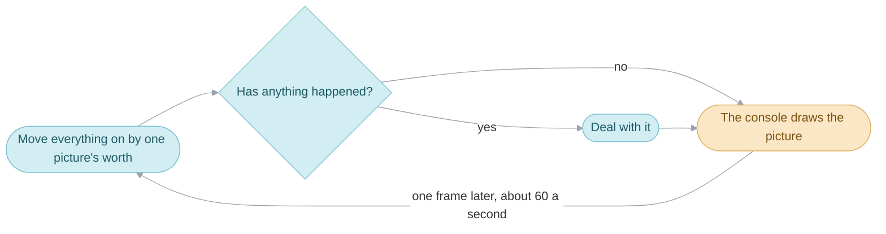
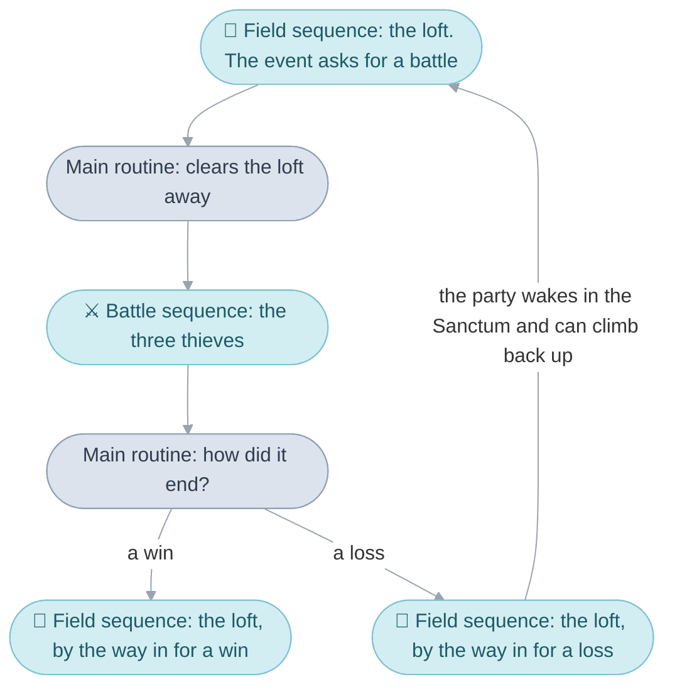
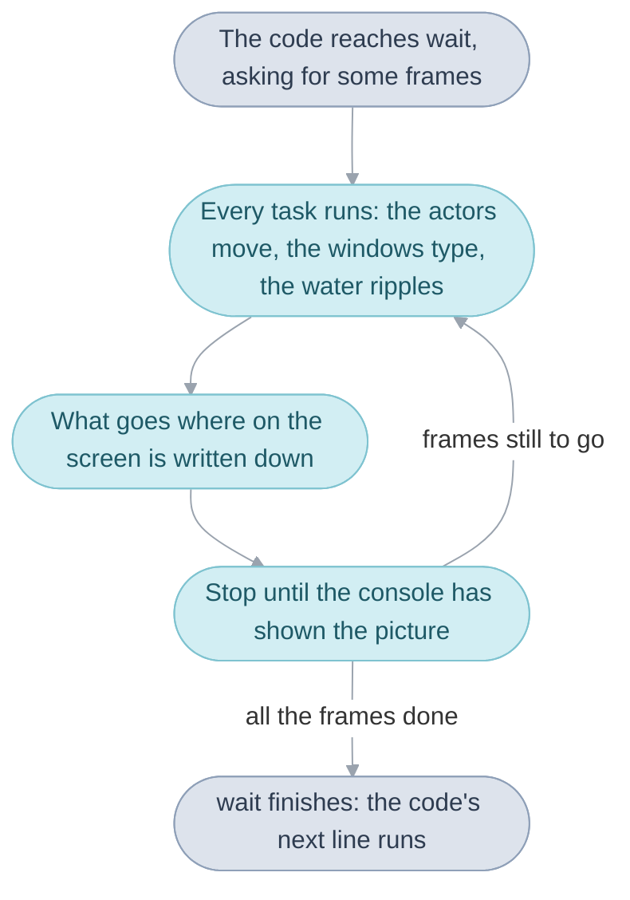
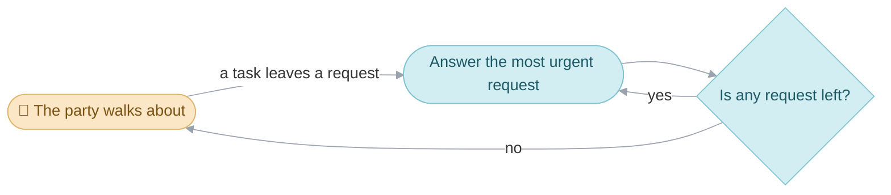
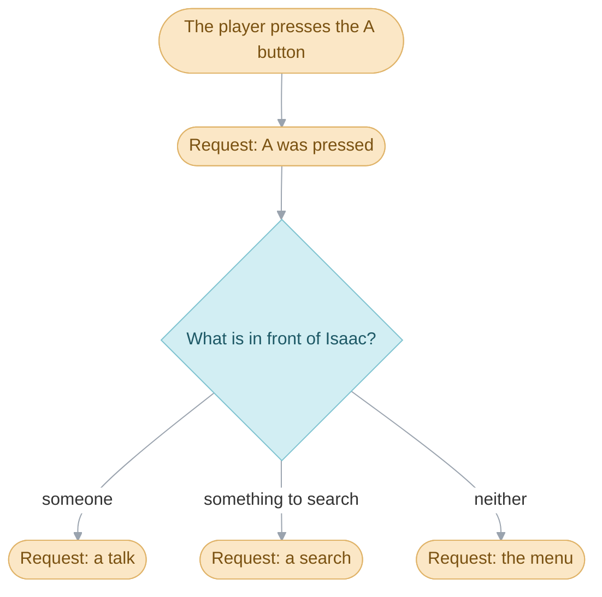
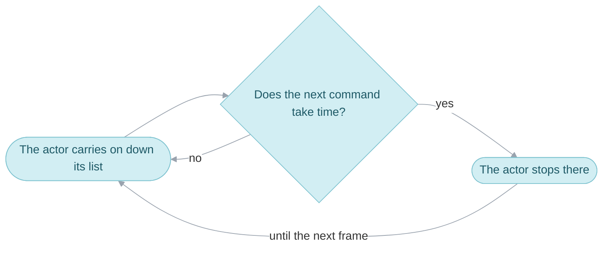
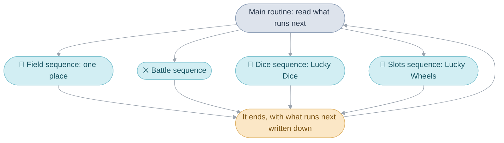
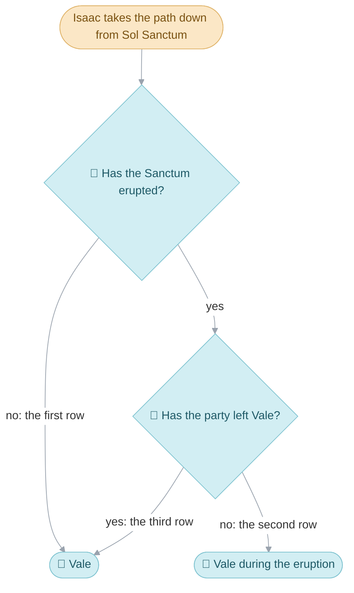
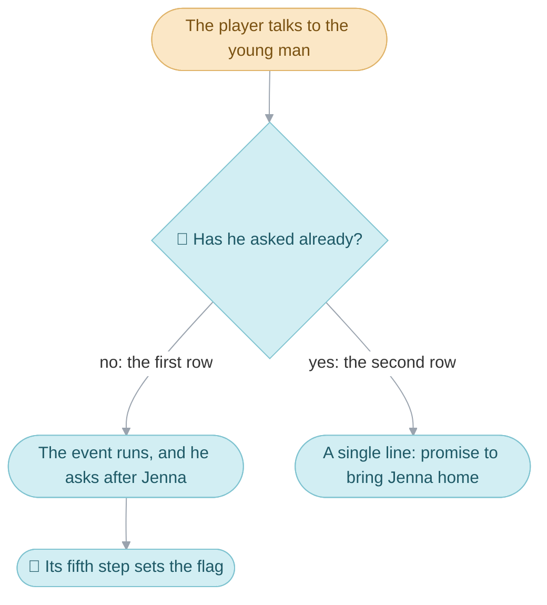

# The Broken Seal


Talk to a villager by Vale's river and she stops to wait for the A button.
The river behind her doesn't. Why does it keep flowing while the game is
waiting for you?

Open a chest in Sol Sanctum, and it is still open at the end of the game.
How does the game know?

Walk down from Sol Sanctum after Mt. Aleph erupts and the path leads to a
different Vale, with the villagers gathered by the river. Where did the
other one go?

The answers are all in the game's code, the instructions on the cartridge
that the console follows, and each takes only a few lines of it. This page
shows you those lines. It starts by following one moment from beginning to
end: the fight with the three thieves in Vault.

## From a conversation to a battle and back


In Vault, Isaac, Garet and Ivan push a crate aside with Move, climb into the
loft of the inn, and find a villager tied up. Talk to him and Isaac cuts him
free. Three thieves appear, there is a long argument, and they attack.

Here is that moment again, slowly, from the code's side.

### Talking to the villager

While the player walks Isaac about the loft, the game is going round a very
small loop. It moves everything on by one picture's worth, looks whether
anything has happened that it should deal with, and goes round again. It
does this about 60 times a second, once for each picture the console draws.
One trip round is called a [frame](glossary.md#frame).



Part of every frame is moving the people. Each person or thing in a place is
an [actor](glossary.md#actor), and each actor has a short list of
instructions of its own, its [actor script](glossary.md#actor-script).
Isaac's script is three instructions long: do what the D-pad says, wait one
frame, start again.

On the frame the player presses A, that first instruction notices. It
doesn't start a conversation itself. It only sets a
[request](glossary.md#field-request) that says "A was pressed".

At the end of the frame the game finds the request and looks at what is in
front of Isaac. It is the villager, so this is a talk.

Every place in the game has a list of the things that can happen there. The
loft's list is in [log_rooms_a.c](src/scene/log_rooms_a.c), a file named for
the log walls of Vault's rooms, and it has this row:

```c
{ TRIGGER_TALK, ACTOR_TIED_UP_VILLAGER, CONDITION_ALWAYS, EVENT(LogRoomsA_FreeRooferAndConfrontThieves) },
```

Read it from left to right: a talk, to the tied-up villager, always, runs
this event. So the game starts it.

### The event

An [event](glossary.md#event) is a conversation or a cutscene written out as
code, one instruction to a line, in the order the player watches it. This
one is about two hundred lines long.

Isaac cuts the villager free. Garet and Ivan, who aren't shown while Isaac
walks about, are placed on the spot where he stands and step out beside him.
The villager explains that he came up to fix the roof and was knocked out
from behind.

Then the thieves' leader appears and the music changes. The event doesn't
steer his two men in step by step. It hands each of them a short actor
script with the spots to run to, and waits until they have arrived.

The leader asks `Will you let us go?` The event has a reply ready for a yes
and another for a no, and after either one it goes on to the same refusal
and the same last line, which ends `Get 'em!!!`

All through this the event is waiting for things: dozens of pauses, each
from a sixth of a second to a little over a second, people walking, windows
of text waiting for A. Each time, the event's code stops at that line until
the thing is done. How the thieves keep walking while it is stopped is a
question of its own, and the section below answers it.

Near its end the event writes down where the story should go after a win and
where after a loss. Both are the loft again, but by two differently named
ways in. Then, just before it ends, comes this instruction:

```c
  Field_RequestBattleFromEncounterTable(ENCOUNTER_ZONE_SCRIPTED_VALE_VAULT, 5);
```

It asks for a battle. The game keeps its groups of enemies in lists, and the
two things in the brackets say which list, the one for the story's fights
around Vale and Vault, and which entry in it, number 5.

Notice that it only asks. It sets a request, the same kind the A press
set. The battle can't start while the event is still running. It starts
once the event has ended and the game looks at its requests again.

### The battle

The game finds the battle request. Now something bigger happens: the loft
goes away altogether.

The game only ever plays one kind of thing at a time. Walking around a place
is one, and a battle is another. Each is called a
[sequence](glossary.md#sequence). The loft has been one sequence, the
field sequence, and the fight will be a second, the battle sequence.

So the field sequence writes down "a battle comes next, against these
enemies", closes the screen, and ends. A small piece of code that has been
running since the console was switched on, the
[main routine](glossary.md#main-routine), reads what was written and starts
the battle sequence. Between the two it clears away everything the loft was
using.

When the battle is over, the main routine looks at how it ended. After a
win, it goes to the place the event wrote down for a win. After a loss, it
first puts the leader back on his feet with 1 HP, and then goes to the place
written down for a loss.



### Back in the loft

The main routine starts the field sequence on the loft once more. Nothing is
left over from before the battle. The loft's code is loaded again and its
people are placed afresh.

So how does the loft know what to show? By the way in. When it sets itself
up, it looks at which of its named ways in the party is arriving by, and
plays a different event for each:

- After a win, the thieves are shown beaten. The stolen goods come out of
  their chests and the thieves are led away.
- After a loss, as in the recording, the party lies beaten and the thieves
  hold it and the villager hostage. Then the party wakes up in Vault's
  Sanctum.

After a loss the player can climb straight back up. Just before the battle
the event had the game remember one yes-or-no fact: the thieves have
attacked. A fact remembered this way is called a flag. The flag is still
set, so this time the loft skips the rescue and goes straight to the thieves
and the same battle.

### The four mechanisms

Four pieces of machinery took a turn in that moment, and the rest of this
page takes them in this order:

1. Code such as the event is written in the order things happen, and stops
   wherever something takes time ([Code that waits](#code-that-waits)).
2. While it is stopped, the game still runs a short list of small jobs in
   every frame, the tasks ([Tasks](#tasks)).
3. One of those tasks moves every actor a little further through its actor
   script ([Actor scripts](#actor-scripts)).
4. Around all of it, the main routine runs one sequence after another: the
   loft, the battle, the loft again
   ([The main routine and its sequences](#the-main-routine-and-its-sequences)).

After the four comes [what a place is made of](#what-a-place-is-made-of):
the chest, the two Vales, and how the game remembers the story.

## Code that waits


A villager by Vale's river says his line and waits for A. While he waits,
the river keeps flowing. Press A, and the next page types itself out a few
letters at a time.

Something is plainly still running. Yet the code that showed his line is
standing still, stopped at one instruction until the player has read it.
How can both be true?

Start with the code that stands still. Here is the whole of another
conversation in Vale, from [vale.c](src/scene/vale.c). Late in the story a
young man asks Isaac whether Jenna is back yet:

```c
static void Vale_AskWhetherJennaHasReturned(void) {
  Event_Start();
  Actor_FaceEachOther(ACTOR_PARTY_LEADER, ACTOR_YOUNG_MAN_ASKING_FOR_JENNA, 20);
  Event_SetMessageId(MsgValeIsJennaBackYet);
  // "Oh, it's Isaac, isn't it? Is Jenna back yet? Promise me,..."
  Event_ShowMessage(ACTOR_YOUNG_MAN_ASKING_FOR_JENNA, 0);
  GameFlag_Set(FLAG_VALE_ASKED_IF_JENNA_IS_BACK);
  Event_End();
}
```

Skip the first and last lines, which only give the event its name, and the
line beginning `//`, which is a note for whoever reads the code. Each of the
six lines left is one instruction, and each runs only when the one before it
has finished.

1. The conversation starts, which stops Isaac walking.
2. Isaac and the young man turn to face each other. The `20` is how long
   they take: 20 frames, a third of a second.
3. The young man's line is chosen.
4. The line is shown in a window, and the code stays here until the player
   has read it to the end.
5. The game is told to remember that he has asked.
6. The conversation ends.

Steps 2 and 4 take time, a third of a second for one and as long as the
player likes for the other. The code does nothing clever about that. It
stops at the line until the line is done.

### The game runs inside the wait

Here is the trick. Each of those two lines, somewhere inside it, uses the
instruction [`wait`](glossary.md#wait) with a number of frames. And `wait`
does not sit idle. For each frame it is asked for, it runs one whole frame
of the game:

1. It runs every [task](glossary.md#task), the small jobs that keep the
   screen alive. The actors move, the windows type their letters, the
   river flows.
2. It writes down where every small moving picture on the screen should be
   drawn.
3. It stops until the console has shown the picture.

When it has done that for the number of frames asked, it finishes, and the
code that used it moves on to its next line.



So there is no master clock above the game, ticking the frames along. A
frame is run by whichever piece of code happens to be waiting. The young
man's conversation runs the game for 20 frames while two people turn. Then
his window runs it, frame after frame, until A is pressed. That is why the
river never stops, and why the thieves could walk while their event stood
still.

`wait(20)` means "run 20 frames of the game, then carry on". Nearly
everything in the game that takes time comes down to it, a menu as much as a
conversation: an open [menu](src/menu/README.md#the-screens) is code going
round and round a `wait` of one frame, looking at the buttons each time. The
real thing is `wait` in [frame.c](src/system/system/frame.c), and
[Scenes](src/scene/README.md#events) shows how events are written.

### The frame


Everything in the game that takes time is counted in frames. The screen is
240 dots wide, and the dots are called pixels. Walking, Isaac moves one
pixel in every frame. Running, with B held, he moves one and a half. There
are about 60 frames a second, so walking the width of the screen takes
about four seconds.

The third step of `wait` is what keeps the frames even. When the frame's
work is done, the game stops and waits for the console. The console draws
its picture line by line, and after the last line there is a short gap
before it starts the next picture. The gap is called the
[VBlank](glossary.md#vblank).

At every VBlank the console wakes the game up for a moment, to run one small
piece of its code. That piece hands the console what the frame wrote down,
so the picture changes only in the gap, never halfway down the screen. It
reads the buttons, so each frame starts out knowing what is held. And it
prepares the next sixtieth of a second of sound. Then the game starts on the
next frame.

Usually the frame's work is done with time to spare. When it isn't, the work
runs past one VBlank and is ready only for the next. Then everything counted
in frames slows down together: the walking, the typing, every pause.

The music doesn't. Its sound is prepared at every VBlank, whether or not a
frame is finished, so the tune keeps its speed while the picture drags
behind it. This is the game's [slowdown](glossary.md#slowdown)
([System](system.md#slowdown)).

## Tasks


Garet's sister's line arrives a letter at a time, and when the page is
full a small arrow bobs at its end. Both are done by a task.

A [task](glossary.md#task) is one of the small jobs `wait` runs in every frame.
It is a small piece of code that does one frame's worth of something and
finishes at once: every person moved one step on, the next letters
typed, the river's squares swapped for the next picture of water.

The game keeps the tasks in a list with room for 20. Whatever needs a job
done every frame puts a task on the list. From then on it runs in every
frame, whatever else is going on, until it is taken off again.

The order they run in matters, so each task is given a rank and higher ranks
run earlier in the frame. While the party walks around a town, the task that
moves the actors runs before the task that slides the map along to follow
Isaac. Both run before the task that puts each actor's picture on the
screen. In any other order Isaac would be drawn where he was a frame ago.

### Requests for the code that waits

A task has one frame, so it can't start a conversation or open a menu, which
take many. What it can do is set a request for the code that is waiting. The
A press in the loft was one.

There are twelve kinds of request, and each is something the walking leader
has run into: a way out, an enemy, a person to talk to, a chest, a button
the player pressed. The game answers them one at a time, the most urgent
first, and goes back to walking only when none is left. Leaving the place is
the most urgent.



One press of A can become three things. The game looks at what is in front
of Isaac and sets a second request: a talk if someone is there, a search if
there is something to search, and the menu if there is neither. Then it
answers that one. [Requests](#requests), near the end of this page, lists
all twelve.



## Actor scripts


Isaac walks through Imil's snow and leaves footprints, and each one is gone
after a moment. Every footprint is an actor.

An [actor](glossary.md#actor) is anything in a place that can move or
change: Isaac, a villager, a treasure chest, a footprint. There is room for
64 at once. For each, the game keeps where it is, which way it faces, which
picture shows it, and how far it has got through its actor script.

A footprint has about the shortest script there is. This is all of it, from
[facing.c](src/field/facing.c):

```c
SC_WAIT(120), SC_RELEASE,
```

Wait 120 frames, then give up your room among the 64. That is the whole life
of a footprint: two seconds, and gone.

On snow, a new footprint actor is made every 18 frames Isaac walks. One task
moves all the actors. Each frame it visits every one of them, and each
footprint has one frame counted off its 120.

The same kind of list runs everyone else, with commands such as walk to this
spot, turn, play this animation, go back to the start. Each frame an actor
carries on down its list until it reaches a command that takes time, such as
one step of a walk, and there it stops until the next frame.



A villager who strolls about has a script that picks random spots near where
he started and walks to them (`SC_WANDER_HOME`). Isaac's script, the three
instructions from the loft, starts with `SC_PLAYER`: do what the D-pad says.
That command is also what notices A, Select and Start and leaves the
requests.
[Field code](src/field/README.md#everything-that-moves-runs-an-actor-script)
covers the commands.

## The main routine and its sequences


A random battle in Goma Cave is the loft's handover without an event. The
field sequence counts Isaac's steps until a battle is due, writes down "a
battle, against a Ghost and a Skeleton", and ends. This time it also notes
where everyone is standing, so that when the cave comes back they can be put
where they stood.

There are four kinds of sequence:

- The [field sequence](glossary.md#field-sequence) runs while the party
  walks around a place: a town, a cave, a room, the World Map. These pages
  often call it the field for short.
- The battle sequence runs one fight, from its opening to the experience and
  coins at the end.
- The dice sequence is one visit to Lucky Dice in Tolbi.
- The slots sequence is one visit to Lucky Wheels, the slot machine, also in
  Tolbi.


The main routine begins when the console is switched on and never finishes.
All it does is run one sequence, wait for it to end, and run the next. The
sequence that is ending always says what the next one is.



A sequence leaves that word in a block of memory every sequence can read
and nothing ever clears. The code calls such a block a work, so this one is
the [main routine's work](glossary.md#main-routines-work). The main routine is
`MainRoutine_Run` in [main_routine.c](src/system/main_routine.c), and it is
short enough to read in one sitting.

### The battle sequence


A battle doesn't know where it was started from. Which enemies to fight,
which background to show and which music to play were all written into the
main routine's work before the field ended.

Inside, it runs in [turns](glossary.md#turns-and-actions). One thing about
them is easy to miss while playing: after every single action the game
checks whether one side has been beaten. So a battle can end in the middle
of a turn, and whoever hadn't moved yet never does.
[Battle](battle.md) follows a battle from its opening to the spoils.

## What a place is made of


The loft was a place with a list of things that can happen in it and named
ways in. Every place in the game is built from a few such lists, and they
are where the chest and the two Vales are explained.

### Scenes

The code's word for a place is a [scene](glossary.md#scene): a town's
streets, a cave, a floor of a dungeon, or the rooms inside a town's
buildings. A few scenes are screens instead, such as the Title and the File
Screen. There are 201 in all.

In the recording Isaac climbs to the Sanctum's door, Vale fades out, and the
Sanctum's hall fades in. Vale and the hall are two scenes, and going from
one to the other is the loft's handover again: the field sequence ends on
Vale and the main routine starts it on the hall. The moment of black is the
gap between the two.

Scenes that belong together make an [area](glossary.md#area). Vale's eight
scenes are one area, and there are 71 areas in all. An area's scenes share
a name. The name comes up on the screen only when the party crosses from one
area into another, which is why it doesn't appear again each time Isaac
steps in and out of a house.

### Exits and entrances


Isaac walks down the path from Sol Sanctum's entrance twice in the
recording. The first time it leads into Vale as he left it. The second time,
after Mt. Aleph has erupted, the same path leads to Vale with the villagers
gathered by the river.

A way out of a scene is an [exit](glossary.md#exit): a doorway, a path, the
edge of the map. Where the party appears in the next scene is an
[entrance](glossary.md#entrance), a spot to stand on and a direction to
face. The loft's "ways in" were entrances.

Each side of a door is named for the other. The path is
`SOL_ENTRANCE_TO_VALE` on the Sol Sanctum side, and the spot it leads to is
`VALE_FROM_SOL_ENTRANCE` on Vale's.

Every scene has a list of its exits, and each row says which scene and
entrance the exit leads to. A row can also name a [flag](#game-flags), one
of the yes-or-no facts the game remembers, such as "Mt. Aleph has erupted".
A flag that is remembered as yes is said to be set. A row with a flag counts
only until that flag is set.

The path down from Sol Sanctum's entrance has three rows for the one exit,
in [sol_sanctum_entrance.c](src/scene/sol_sanctum_entrance.c):

```c
SCENE_EXIT_UNLESS(SOL_ENTRANCE_TO_VALE, Vale, VALE_FROM_SOL_ENTRANCE, FLAG_SOL_SANCTUM_ERUPTED),
SCENE_EXIT_UNLESS(SOL_ENTRANCE_TO_VALE, ValeEruption, VALE_ERUPTION_FROM_SOL_ENTRANCE, FLAG_VALE_PARTY_LEFT),
SCENE_EXIT_UNLESS(SOL_ENTRANCE_TO_VALE, Vale, VALE_FROM_SOL_ENTRANCE, EXIT_FLAG_NONE),
```

Read each row as: this exit leads to this scene, at this entrance, unless
this flag is set. The game takes the first row that still counts.

Until the Sanctum erupts, that is the first row, and the path leads to Vale.
Once it has erupted the first row no longer counts, so the second does: the
path leads to another scene, `ValeEruption`, which is Vale during the
eruption. When the party has left Vale on its journey the second row stops
counting too, and the third, which has no flag, sends the path to Vale
again.



So the two Vales in the recording really are two scenes, and the path
chooses between them by asking the story. [Scenes](src/scene/README.md#exits)
covers the lists.

### Triggers


Isaac checks a chest in Sol Sanctum and finds a Small Jewel. How does the
game know what a search of that square should do, and that it has been done
once already?

The list of things that can happen in a scene is its list of
[triggers](glossary.md#trigger). The row for the tied-up villager was one.
When the game answers a talk, a search, a step or a Psynergy, it looks down
this list for a row that fits. Each row has four parts: what the player did,
who or what they did it to, a flag, and what happens. The chest is one row:

```c
{ EXAMINE_TRIGGER(EXAMINE_CHEST), CELL_BEHAVIOR_SOL_SANCTUM_RELIEFS_CHEST, FLAG_SOL_SANCTUM_FIRST_SMALL_JEWEL_FOUND, FIND_ITEM(ITEM_SMALL_JEWEL) },
```

Read it from left to right: a search of a chest, at the square this chest
stands on, until the flag "the first Small Jewel has been found" is set,
gives a Small Jewel.

Finding the jewel sets that flag. So the next search finds that the row no
longer counts, and the chest stays open.

The game takes the first row that fits, and that is how people come to say
new things. The young man who asks after Jenna has two rows, one after the
other:

```c
{ TRIGGER_TALK, ACTOR_YOUNG_MAN_ASKING_FOR_JENNA, FLAG_VALE_ASKED_IF_JENNA_IS_BACK, EVENT(Vale_AskWhetherJennaHasReturned) },
{ TRIGGER_TALK, ACTOR_YOUNG_MAN_ASKING_FOR_JENNA, CONDITION_ALWAYS, MSGNO(MsgValePromiseMeIsaacPromiseMeYoull) },
```

The first talk fits the first row and runs the event shown in
[Code that waits](#code-that-waits). The fifth step of that event set
`FLAG_VALE_ASKED_IF_JENNA_IS_BACK`, so the first row never fits again. Every
talk after that falls through to the second row, which always fits and
shows a single line, asking Isaac to promise he'll bring Jenna back home.



[Scenes](src/scene/README.md#the-tables) lists the kinds of row.

### Game flags


The recording shows Vale's gate three times: crowded on the stormy night,
quiet after the party has set out, and changed again once the party has
reached Kalay. It is one scene each time. What differs is what the game
remembers.

The game remembers the story as a long row of yes-or-no facts, the
[game flags](glossary.md#game-flag). There are 4,096 of them, and each has a
name in the code that says what it stands for:

- `FLAG_VALE_STORM` is set during the stormy night.
- `FLAG_VALE_PARTY_LEFT` is set once the party has left Vale.
- `FLAG_KALAY_REACHED` is set once the party has reached Kalay.

Every scene has a list of its actors: one row for each person or thing, with
its picture, where it starts, the script it follows, and a flag that must be
set, or must be clear, for it to be there at all. Each time the party
arrives at the gate, the game places everyone whose flag agrees
([Scenes](src/scene/README.md#who-stands-where)).

Two stretches of the flags are short-lived:

- 256 scene flags are cleared each time the party walks into a scene.
- 256 area flags are cleared when the party crosses into another area.

A scene uses them for things that should reset. This is why a puzzle left
half done is back as it started when the party leaves the room and returns.
[Game rules](src/game/README.md#the-game-flags) lists every range.

### What the game remembers


Save by Vale's river, switch off, and load the file again. Isaac stands by
the river with the same coins, the same Djinn, and every chest he opened
still open. The villagers, though, are back where they start.

That is because the game keeps what it knows in three places, and only two
of them are saved.

| Where                    | What it holds                                                  | How long it lasts                         |
| ------------------------ | -------------------------------------------------------------- | ----------------------------------------- |
| The main routine's work  | what runs next, where the party stands, the party, its coins and Djinn, the settings | always, and a save file keeps it |
| The game flags           | 4,096 yes-or-no facts: the story, chests opened, Djinn found   | always, and a save file keeps them        |
| A sequence's own [work](glossary.md#work) | whatever one sequence or one menu is busy with: who stands where right now, which window is open | until that sequence ends |

A save file is the first two rows, written to a chip inside the cartridge
that keeps what is written without power. Everything in the third row is
rebuilt from them when the party arrives somewhere.
[System code](src/system/README.md#saving) covers the writing.

### Maps and cells


Isaac walks behind a house in Vale. The roof hides him, and he comes out on
the other side.

A scene is drawn on a [map](glossary.md#map), a grid of squares 16 pixels on
a side. The squares are called [cells](glossary.md#cell). Each cell says
three things: what is drawn there, how the ground is shaped and how high it
is, and what standing there does. It might be plain ground, a wall, a door,
a ledge or the spot a chest stands on.

A town is drawn as three sheets, one behind another: the ground, the walls
and the roofs. An actor's picture is slotted into that stack according to
the cell it stands on. Nothing has to work out that the roof is in front of
Isaac. He is simply standing on a cell that puts him behind it.


The cells are also why Isaac slides along a cliff instead of stopping dead
when he walks into it at an angle. Each frame, before he moves, the game
tests the ground 8 pixels ahead of him in the direction the D-pad points. If
the way is blocked, it tries directions a little further round to either
side, and Isaac goes the first way that is open. Against a cliff, that way
is along it.

Height counts as a wall too. Isaac can step up onto ground at most 8 pixels
higher than where he stands, and down onto ground at most 12 pixels lower.
Anything more stops him.

[Maps](src/map/README.md) shows how the three sheets share one grid, and
[Field code](src/field/README.md#walking-and-running) gives the speeds on
each kind of ground.

### The World Map


The World Map is a scene too, run by the field sequence, with exits into
every town and cave and random battles of its own. The party walks more
slowly there, half a pixel a frame.

It looks different because the land tilts away from the party. The map
itself is flat. The game draws each row of the screen at its own size: the
higher up the screen a row is, the wider and more distant the strip of the
flat map it shows.
[Field code](src/field/README.md#the-world-map-in-perspective) works through
the rows.

## Sound


Isaac pays for a room at an inn. The town's music stops, a short tune plays
as the party sleeps, and the town's music comes back.

The player hears three kinds of [sound](glossary.md#sound). Music plays on
and on until something changes it. A jingle is a short tune, like the inn's
or the one for a found item, that silences the music while it plays and then
gives it back. An SE, a sound effect, plays over both: a footstep, a menu
click, an impact.

The code asks for all three the same way, with one instruction and the
sound's number. In the code each number has a name, 🎵 `MUS_` for music and
jingles and 📣 `SE_` for effects, so the inn's tune is asked for with
`Sound_Play(MUS_INN)`. Each kind of sound has its own stretch of numbers,
which is how the game tells from the number alone what to do with the music.

Asking for the music that is already playing changes nothing. So every scene
simply asks for its music each time the party arrives, and walking from Vale
into one of its houses leaves the tune playing on without a hitch.
[Sound](src/sound/README.md#the-sound-driver) covers the rest.

## The console


The Game Boy Advance has ten buttons: the four directions of the D-pad, A,
B, L, R, Start and Select. Hold A, B, Select and Start together, as in the
recording, and the game starts again from the Camelot logo.

Everything on its screen is one of two kinds of picture.

The [background layers](glossary.md#background-layer) are four large sheets,
stacked one behind another. Each is a grid of tiles, small square pictures
laid side by side like a mosaic. In a town, three of the sheets are the
ground, the walls and the roofs, and the boxes of text are drawn on the
fourth.

The [sprites](glossary.md#sprite-and-oam) are small pictures that can sit
anywhere on the screen, up to 128 of them at once. The people are sprites.
So are the pointing hand in a menu and even the letters of a spoken line.

The console draws both kinds by itself. The game never paints the screen. It
only writes down, in lists the console reads, which tile goes in which square
and which sprite sits where. That is the writing down each frame ends with.
Where the code itself is kept is the first thing under
[For readers of the code](#for-readers-of-the-code).

## For readers of the code

These last sections are for anyone about to open the source. They say where
the code is kept and how the pieces above share the console's memory, where
a running game keeps what it is working on.

The cartridge holds everything: the code, and every picture, map, tune and
line of text. The code on it is kept in two ways. Most of it, the part that
is needed all the time, the console runs straight from the cartridge. This
is the [main image](glossary.md#main-image). The code of each single scene
is kept apart, as an [overlay](glossary.md#overlay).

### Overlays

A town's people and their lines matter only while the party is there, and
the console's memory is far too small to hold the code of all 201 scenes at
once.

So each scene's code is stored packed small on the cartridge. When the party
arrives, it is unpacked into one fixed stretch of memory, on top of the code
of the scene the party just left.

Some scenes share one overlay. Two of Goma Cave's scenes do, and that is
how 201 scenes need only 96 overlays.

The main image knows nothing about any one town. It asks the overlay that
is loaded the same six questions each time: where can the party arrive,
which parts of the map are ways out, where does each way out lead, who
stands where, what can happen here, and what should be set up first.
[System code](src/system/README.md#how-an-overlay-reaches-the-rest-of-the-game)
shows how the questions are asked, and
[Places](https://alchemy.pascalpixel.com/tbs/places) has a page for every
scene.

### Why every sequence starts fresh


The recording shows a menu the player is never given. It is a scene
selector Camelot's developers left on the cartridge, one of the
[debug menus](glossary.md#debug-menus), and it can send the party to any
scene in the game.

It can be that simple because of what the main routine does between two
sequences. It empties the list of tasks and takes back every block of memory
the last sequence took from the [heap](glossary.md#heap-and-pools), the
game's shared supply of memory. The next sequence starts as
if nothing had run before it.

So a sequence can pass something on only through the two things that are
never cleared: the main routine's work and the game flags. The selector
writes the chosen scene and entrance as what runs next and lets the current
scene end. The main routine does the rest, exactly as it would for a door.
[System code](src/system/README.md#clearing-away-the-last-sequence) goes
through the clearing.

### Requests

The twelve requests, in the order the field looks for them. The names are
the ones the code uses.

| Order | Request         | What it asks the field to do                                     |
| ----- | --------------- | ---------------------------------------------------------------- |
| 1     | `exit`          | leave the scene, by the exit named                               |
| 2     | `raisedTrigger` | run something the scene's code, or the field itself, asked for, such as the message when a poisoned party member collapses |
| 3     | `encounter`     | start a battle, random or one the story asked for                |
| 4     | `stepTrigger`   | run what belongs to the cell just stepped on                     |
| 5     | `pushCell`      | start the jump or the climb the leader is pushing towards        |
| 6     | `aButton`       | A was pressed: turn it into a talk, a search or the field menu   |
| 7     | `fieldMenu`     | open the field menu                                              |
| 8     | `talk`          | talk to someone                                                  |
| 9     | `examineCell`   | search the cell ahead: a chest, a jar, a sign                    |
| 10    | `psynergy`      | use a Psynergy on the field                                      |
| 11    | `item`          | use an item on the field                                         |
| 12    | `pauseMenu`     | open the Pause menu, where saving is                             |

[Field code](src/field/README.md#the-twelve-requests) follows the field
through each.

## The four divisions

The code falls into four divisions, each with a page that goes further than
this one:

- [System](system.md): switching on, the main routine, waiting and tasks,
  memory, overlays, saving and sound.
- [Battle](battle.md): a battle from the first menu to the spoils, and the
  rules of the game.
- [Field](field.md): scenes and their requests, actors, maps, the World Map
  and Psynergy used on the field.
- [Interface](interface.md): windows and messages, the menus, shops and
  inns.

There is more beside them. [Places](https://alchemy.pascalpixel.com/tbs/places)
has every scene in story order, [Source](src/README.md) every file of the
code, the [Glossary](glossary.md) the words these pages share, and
[Unused](https://alchemy.pascalpixel.com/tbs/unused) what the game keeps but
never plays.

> [!NOTE]
> In Japan, Golden Sun carries the subtitle 開かれし封印, The Broken Seal.
> These pages call the game by that subtitle, to keep it apart from
> [The Lost Age](glossary.md#the-two-games).
