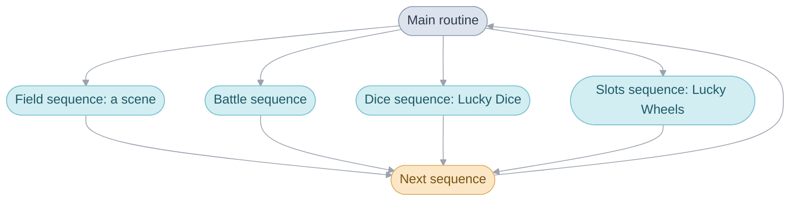
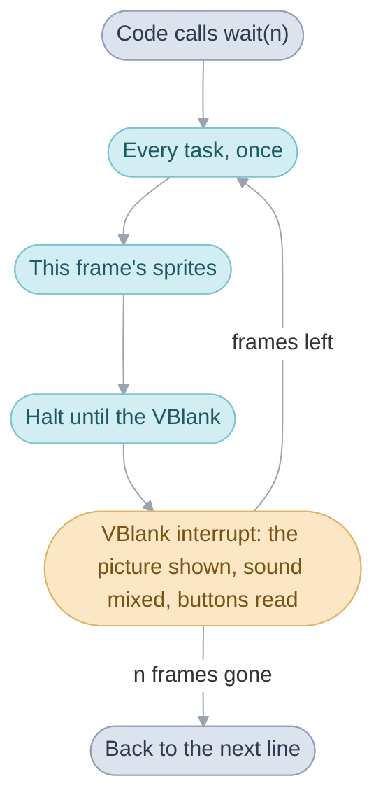
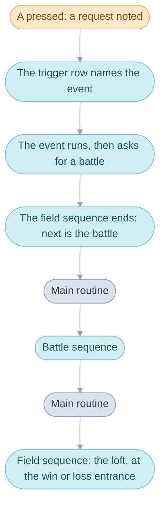

# The Broken Seal


In Japan, Golden Sun carries the subtitle 開かれし封印, The Broken Seal. These
pages call the game by that subtitle, to keep it apart from
[The Lost Age](glossary.md#the-two-games).

## One sequence at a time

The game does one thing at a time. The party walks around a place, or fights
a battle, or plays Lucky Dice or Lucky Wheels in Tolbi's game room. Each of
these is a [sequence](glossary.md#sequence): the field sequence, the battle
sequence, the dice sequence and the slots sequence. The
[main routine](glossary.md#main-routine) runs them. It starts one, waits for it
to finish, and starts the next, for as long as the console is on.



Every sequence starts fresh, and nothing of the last one is left running when
it begins. A sequence decides what comes after it: before it ends it writes
what runs next into the [main routine's work](glossary.md#main-routines-work),
the one piece of memory every sequence shares, and the main routine reads
that and starts it. The main routine is `MainRoutine_Run`, and what runs next
is `gMainRoutineWork.next`.

## Scenes

The field sequence runs one [scene](glossary.md#scene). A scene is a place,
such as Vale or a room of Vault's inn, or a screen, such as the Title or the
File Screen. Each has a scene code (`PLOGV00` is Vale on the stormy night of
the prologue) and an area name.

When the party walks out of a scene, the field sequence ends, and the main
routine starts it again on the scene the [exit](glossary.md#exit) leads to.
Walking from Vale to its gate is therefore the same handover as walking into a
battle: one sequence ends and the next starts. That is why `next` holds either
kind of thing: a scene's number means the field sequence running that scene,
and a number above all the scenes means one of the other sequences
(`SEQUENCE_BATTLE`, `SEQUENCE_DICE`, `SEQUENCE_SLOTS`). When a battle or a game
of dice ends, the main routine goes back to a scene the field sequence runs
(`Scene_ReturnFromSequence`).

## Frames, waiting and tasks

Every sequence is straight-line code: it does one thing, then the next, and
where time must pass it calls [`wait(n)`](glossary.md#wait), which returns to
the next line once n [frames](glossary.md#frame) have gone by. A frame is one
picture: the game prepares it, then waits for the screen to show it at the
next [VBlank](glossary.md#vblank), about 60 times a second.



Simplified, from [frame.c](src/system/system/frame.c):

```c
void wait(s32 frames) {
  while (frames--) {
    Task_RunPass(TASK_PASS_FRAME);  /* every frame-pass task, once */
    Oam_BuildBuffer(...);           /* this frame's sprites */
    VBlankIntrWait();               /* halt until the next VBlank */
  }
}
```

While code waits, things on screen keep moving: people walk, water ripples,
text types out. Each of these is a [task](glossary.md#task), a short function
that `wait()` calls once every frame until it is removed. A sequence adds the
tasks it needs when it starts: the field adds its actors, its map's scrolling
and its windows, and a battle adds its camera. Each VBlank the VBlank
interrupt also mixes the next slice of sound and reads the buttons, whatever
the game is doing.

When a frame's work takes longer than one VBlank, everything counted in
frames runs slow, while the music, mixed at every VBlank, keeps its tempo:
that is [slowdown](glossary.md#slowdown) ([System](system.md#slowdown)).

## From a conversation to a battle and back


In Vault, the party pushes a crate aside with Move and climbs to the inn's
loft, where a villager lies tied up. All of it happens in one scene,
`SceneId_LogRoomsA`: a single map holding every room inside Vault's buildings,
all of them walled in logs, each room reached by its own entrance
([log_rooms_a.c](src/scene/log_rooms_a.c)).



### Talking to the villager

The main routine is running the field sequence for that scene, and the field
sequence's loop calls `wait(1)` once a frame while the player walks. Pressing
A does not interrupt anything: the leader's control routine, which a task runs
during the wait, only notes a [request](glossary.md#field-request)
(`Field_CheckConfiguredKeys` sets `aButton`). When `wait(1)` returns, the loop
sees the request, finds the villager ahead (`Field_FindNearbyTalkTarget`) and
looks him up in the scene's [trigger](glossary.md#trigger) table, which holds
this row:

```c
{ TRIGGER_TALK, ACTOR_TIED_UP_VILLAGER, CONDITION_ALWAYS, EVENT(LogRoomsA_FreeRooferAndConfrontThieves) },
```

The row names an [event](glossary.md#event), and the loop calls it.

### The event

`LogRoomsA_FreeRooferAndConfrontThieves` runs straight through, from
`Event_Start` to `Event_End`. Isaac cuts the villager free, the three thieves
come up the ladder to `MUS_OMINOUS`, they speak, and they attack. Every pause
between those steps is an `Event_Wait`, which calls `wait()`, and the tasks
keep the actors moving during each one. The event does not start the battle
itself. At its end it sets a story flag, writes into the main routine's work
where the story goes after a win and after a loss, and asks the field for the
battle (one line, which picks the bars that close the screen, is left out):

```c
GameFlag_Set(FLAG_VAULT_THIEVES_ATTACKED);
base = (s32)&SceneId_LogRoomsA;
Event_SetAfterBattleDestination(base, LOG_ROOMS_A_LOFT_AFTER_THIEVES_DEFEATED);
Event_SetDefeatDestination(base, LOG_ROOMS_A_LOFT_AFTER_LOSING_TO_THIEVES);
Battle_SetType(BATTLE_TYPE_SCRIPTED);
Field_RequestBattleFromEncounterTable(ENCOUNTER_ZONE_SCRIPTED_VALE_VAULT, 5);
```

The cast in the second line is there because the scene table defines each
`SceneId_` as an assembler symbol whose address is the scene's number. The
last line only asks for the battle: it notes the thieves'
[formation](glossary.md#formation) as a request, which the loop answers once
the event has returned, as it answered the A press.

### The battle

The field sequence answers the request by writing `SEQUENCE_BATTLE` as what
runs next, and the formation beside it, and then it ends. The main routine
clears the scene away and starts the battle sequence (`Battle_RunFar`). The
battle never reads the scene. Besides the formation, it reads the party, the
battle music and the background chosen for the scene from the main routine's
work. When it ends, `Scene_ReturnFromSequence` reads its result: a win goes to
the after-battle [destination](glossary.md#destination) the event wrote, a
loss to the defeat destination.

### Back in the loft

The main routine runs the field sequence on `SceneId_LogRoomsA` again, at the
[entrance](glossary.md#entrance) the event chose. The scene's
`Scene_Initialize` switches on that entrance. At
`LOG_ROOMS_A_LOFT_AFTER_THIEVES_DEFEATED`, `LogRoomsA_DefeatThieves` stages
the beaten thieves, and `LogRoomsA_ReturnStolenGoods` sets
`FLAG_VAULT_THIEVES_JAILED` and hands back the stolen goods. At
`LOG_ROOMS_A_LOFT_AFTER_LOSING_TO_THIEVES` it plays `LogRoomsA_LoseToThieves`
and sends the party to the Vault Sanctum. Nothing on the map decides this:
the entrance tells the scene which event to play.

## Why every sequence starts fresh

Between two sequences the main routine clears away everything the last one
set up: it removes its tasks, the interrupt handlers it set for effects drawn
line by line, and every block of memory it borrowed from the
[heap](glossary.md#heap-and-pools), the pool sequences take their working
memory from. So a sequence can pass nothing on except through the main
routine's work and the [game flags](glossary.md#game-flag), and any scene or
battle can follow any other. The [debug menus](glossary.md#debug-menus) rely
on this: the debug scene selector writes a scene and entrance as what
runs next and lets the scene end. [System](system.md#the-main-routine) goes
through the clearing up and the start-up before the first sequence.

## The four divisions

The code falls into four divisions, each with a page:

- [System](system.md): start-up, the main routine, waiting and tasks, memory,
  banks, overlays, saving and sound.
- [Battle](battle.md): a battle from the first menu to the spoils, and the
  game's rules.
- [Field](field.md): scenes and their requests, actors, maps, the World Map
  and field Psynergy.
- [Interface](interface.md): windows and messages, the menus,
  shops and inns.

Beside them, [Places](https://alchemy.pascalpixel.com/tbs/places) has every scene in story order,
[Source](src/README.md) every file of the code, the [Glossary](glossary.md)
the words these pages share, and
[Unused](https://alchemy.pascalpixel.com/tbs/unused) what the game keeps but
never plays.
