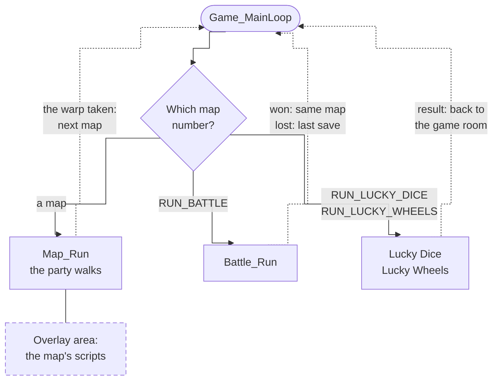

# The Broken Seal

[The Broken Seal](glossary.md#the-two-games) is the first game in the series,
released as simply "Golden Sun" outside of Japan.

Everything the [party](glossary.md#the-party) walks around in is a
[map](glossary.md#map): a room, a town, a dungeon floor or the world map. The
game is always in exactly one map. Walking through a door ends that map and
starts the next. The game's [main loop](#the-main-loop) does that: it runs
one map, then the next, for as long as the game is on.

A map is made of two things. Its [layout](glossary.md#layout) is the picture
and the ground: what is drawn, and where the party can walk. Its
[scripts](glossary.md#script) are code: who stands where, and what happens when
the party talks to someone or steps somewhere. A map's scripts are loaded
only while the party is in it. On the cartridge they are packed in
[overlays](#maps-and-overlays), each holding the scripts of one map or of a
few neighbouring maps: 201 maps share 96 overlays.

The rest of the game's code is always loaded: the engine that moves and draws
everyone, the windows and menus, battles, the Lucky Dice and Lucky Wheels
minigames, and saving. A battle or a minigame takes a turn of the main loop as
if it were a map, but needs no overlay, because its code is always there. A
map knows how far the story has gone from the
[game flags](glossary.md#game-flag), a long list of yes-or-no facts saved with
the game. The always-loaded code is cut into [banks](glossary.md#bank)
([How the code is organised](#how-the-code-is-organised)).

That main loop is unlike most games'. In most games, the Pokémon games among
them, the main loop goes round once a [frame](glossary.md#frame), a sixtieth
of a second, and calls each part of the game in turn, so anything that takes
time is cut into steps that remember where they got to. This game's main loop
goes round once per map, battle or minigame, and one turn can last minutes.
Frames are counted inside: a cutscene, a menu or a map's script is an ordinary
function that runs from start to finish, and when time has to pass it asks to
wait a number of frames. While it waits, small jobs called
[tasks](glossary.md#task) keep everything else moving, each run once a frame
([Engine](engine.md#waiting-and-tasks)). So a scene's code reads top to
bottom, in the order things happen; the price is that only one piece of code
waits at a time, and whatever moves alongside it, an animation or a flashing
light, has to be a task of its own.

## The main loop

Walking through the Sanctum's door ends Vale and starts the Sanctum: the game
throws away everything Vale had set up, loads the Sanctum's code and runs it
until the party leaves again. The whole game is that loop, once for each map,
not once a [frame](glossary.md#frame). A map can run for minutes; while it
does, its code waits frame by frame and the engine keeps the screen moving
([Engine](engine.md#waiting-and-tasks)).

Each time round, the game first clears away whatever the last map left
running: its per-frame jobs, its screen effects and all the memory it
borrowed. Then it works out which flags the new map starts with, starts the
map's music (unless a flag asks to keep the music already playing), unpacks
the map's code and runs it. The map runs until the party takes a
[warp](glossary.md#warp), a way out, and the warp names the next map and the
place in it where the party appears.

A battle or a minigame takes a map's place in the loop. It has no code of its
own to unpack, since its code is always loaded, and when it ends it reports a
result rather than a warp. The game then goes back to the map the battle
started from, with everyone standing where they stood; after a defeat it goes
to the place a [script](glossary.md#script) chose for losing that battle, or
else to the last save. A random battle starts the same way as walking through
a door: the map names the battle as the next stop and leaves.

At power-on the loop starts with the title screen, and the main menu comes
next. Both are rows of the map table, run like maps though the party never
walks there.

The loop is `Game_MainLoop`; one pass through a field map is
`Map_ResetFlagsOnEnter`, `Map_LoadOverlay`, `Map_Run` and `Map_TakeWarp`, and
a battle's return is `Map_ReturnFromRun`. [Running a map](src/overworld/README.md)
follows a field map from its arrival to its warp.

## Maps and overlays

Only one map's code is in memory at a time. Most of what a map needs (who
stands there, what they say, its cutscenes) matters nowhere else, so each
map's code is packed on the cartridge as an [overlay](glossary.md#overlay)
and unpacked into the same 32 KB of memory over the map before it. Overlays
never call each other; code several maps need is copied into each.

The rest of the game knows a map only through six questions it can ask the
map's code: set yourself up; where can the party arrive; where do your warps
lead; who stands here; what happens when the player talks, searches or steps
somewhere (the [map events](glossary.md#map-event)); and which areas of you
lead out. Each answer is a function rather than a fixed table, so a map can
answer differently as the story moves on.

The six questions are `struct MapEntries`, at the start of every overlay.
[Engine](engine.md#overlays) describes how an overlay is loaded and
[Maps](src/map/README.md) how a map event is found.

## The map table and map sections

Arriving at Vale from the world map shows the name "Vale" for a moment. The
name belongs to Vale's [map section](glossary.md#map-section), the group of
maps the village is made of: walking between Vale's houses shows nothing,
because the party stays in the same section. A map's code says what happens
there; its map section chooses the music, the area name and which flags are
kept while the party stays inside. The two are chosen separately: the Bilibin
Barricade runs on Bilibin's code but is a map section of its own. The name
shows for 90 frames, a second and a half, and a few maps hide it on purpose.

Every map is one row of the map table, which names the map's code, its map
section, its layout and its type. A town, or a room inside one, is a safer
kind of map: there the party regains no
[PP](glossary.md#psynergy-and-pp) and recovers no
[Djinn](glossary.md#djinn) as it walks, poison does no damage, Retreat (which
takes the party back to where it entered the map section) doesn't work, and
Avoid doesn't wear off.

The table is `gMapHeaders`, one `struct MapHeader` a row; code names each map
by its row's symbol, `MapId_<Place>`.

| What                                                  | Count |
| ----------------------------------------------------- | ----- |
| maps                                                  | 201   |
| overlays, the maps' code, some shared by several maps | 96    |
| map sections                                          | 71    |

## Warps and warp destinations

The path down from Sol Sanctum's entrance is one warp, but where it leads
depends on the story: to Vale, or, on the night Mt. Aleph erupts, to the
village in flames. A warp only names where it goes. The map's warp table turns
that name into a map and a [warp destination](glossary.md#warp-destination),
the spot where the party appears and the way it faces, and a row of the table
can be made to count only until a certain flag is set. The game takes the
first row that counts.

The path in the recording has three rows: one to Vale that counts until the
sanctum erupts, one to Vale erupting that counts until the party leaves the
village, and one to Vale again for the rest of the game. A map's set-up often
looks at the warp destination too, to play the part of a sequence the last
map sent the party to.

Every way between maps has a name in [map_warps.h](include/map_warps.h).
Destinations are named for where the party comes from
(`VALE_PLAZA_FROM_SANCTUM`) and warps for where they lead
(`VALE_PLAZA_TO_WORLD_MAP`), so a door has the same name from both sides. The
recording's rows are `gSolSanctumEntrance_Warps` in
[sol_sanctum_entrance.c](src/map/sol_sanctum_entrance.c).

## Game flags

The chest gives its Small Jewel once. Opening it sets a game flag, and the
chest's row in the map's event table counts only while that flag is clear;
from then on the chest is drawn open and searching it finds it empty. A map
keeps nothing of its own between visits: whatever the game must remember, a
chest or the end of a chapter, is a flag saved with the game.

There are 4,096 flags, in a fixed order: the party and the Djinn first, then
the ones the engine shares, then the story, then the chests and other finds,
each map section's together. Two ranges are scratch space that a map never
has to tidy up. A map's own 256 flags are cleared each time the party
arrives, so a stone pillar pushed out of place is back where it was on the
next visit; a map section's 256 are cleared only when the party enters
another section. Neither is cleared when the party comes back from a battle,
since it returns to the same moment. Entering a map section also sets the
flag that puts its marker on the world map screen, and
eight flags in a row can be read together as a small number, which is how
counters live among the flags.

Because event rows and flags depend on each other, some of the game's code can
never run; its comment opens with [`Unused:`](glossary.md#unused), and
[Unused](https://alchemy.pascalpixel.com/tbs/unused) collects every case.

The flags are `gGameFlagBytes`, named in [flags.h](include/flags.h); the
chest is `FLAG_SOL_SANCTUM_FIRST_SMALL_JEWEL_FOUND`.
[Game rules](src/game/README.md#the-game-flags) has the layout and the calls.

## How maps depend on the story

The same gate is one map for the whole game, yet different people stand there
at different points in the story. Each time the party arrives, the map asks
the flags which version of itself to be and returns that version's tables.
The story is the order the flags are set in, and these maps show the forms
the dependence takes, in [story order](glossary.md#the-places-in-story-order).

- **One map that reads the flags.** Vale's gate, in the recording, asks in
  turn: has the party reached Kalay, has it left Vale, has it just come out
  of the Sanctum, is this the stormy night? The first yes picks the people
  and events; with no yes it is an ordinary day
  (`ValePlaza_GetEvents` in [vale_plaza.c](src/map/vale_plaza.c)).
- **One map per point in the story.** The prologue's stormy night elsewhere
  in Vale is a map of its own, on its own layout
  ([vale_stormy_night.c](src/map/vale_stormy_night.c)). A place that changes
  completely gets a map; a place whose people change reads the flags.
- **A map with no map events.** Vale while Mt. Aleph erupts plays its whole
  sequence as it starts and leaves by its one warp
  ([vale_eruption.c](src/map/vale_eruption.c)).
- **A row that lasts until its flag is set.** Each pedestal in the room of the
  Elemental Stars offers its star until that star's flag is set, so each star
  is taken once, as the chest above is opened once
  ([sol_sanctum_elemental_star_room.c](src/map/sol_sanctum_elemental_star_room.c)).
- **A flag set by arriving.** The first time the party reaches the World Map
  from Vale, the World Map sets the flag that says the party has left, and
  Vale's gate changes from then on.
- **One sequence cut into parts.** The top of Venus Lighthouse is one scripted
  sequence broken by two battles and two trips to the World Map; each part
  starts from where the part before sent the party
  ([venus_lighthouse_aerie.c](src/map/venus_lighthouse_aerie.c)).
- **The last map.** The Lemurian ship at the edge of Lalivero ends the game by
  sending the party to the title screen
  ([lemurian_ship.c](src/map/lemurian_ship.c)).

[Places](src/field/map_headers.s) lists every map in story order with what
happens there.

## The world map

The World Map is a map like the others, drawn in perspective on the two
background layers the hardware can scale and rotate. The picture above is the
whole of it laid flat. The world is stored as squares 512 pixels on a side,
and only the four squares around the party are unpacked at a time.

Its code does three kinds of work. Each town or dungeon is a figure standing
on the map, and touching one takes the warp into that place. It holds what
the party meets on the map itself: three Djinn and a storm. And it plays the
story's moments between places, chosen by where the last map sent the party.
The code is [world_map.c](src/map/world_map.c), and
[World](world.md#the-world-map) explains how the tilt is drawn.

## How the code is organised

The main program runs straight from the cartridge and is laid out in fourteen
banks, about 1 MB of the English cartridge, followed by the sound code, the
music and the packed pictures and maps. Each bank starts at a fixed place, and
code in one bank calls another bank only through a short list of entrances at
that bank's start, so a bank can grow without moving the others. In the code
an entrance has the function's name with `Far` added: the main loop starts a
battle with `Battle_RunFar`, which leads to `Battle_Run` in the battle bank.
The [glossary](glossary.md#far-call) says how such a call works, and
[System](src/system/README.md#why-the-program-is-cut-into-banks) why the
program is cut into banks.

The source's folders follow the cartridge:

- The nine large banks each have a folder, in cartridge order: `runtime`,
  `field`, `window`, `game`, `overworld`, `menu`, `shop`, `battle` and
  `battle_anim`. `overworld` runs a map from arrival to warp; `field` moves
  and draws the objects.
- The five small banks' code sits in the folder it belongs with.
- `graphics`, `layout`, `sound` and `system` are grouped by topic and linked
  into whichever bank or image needs them.
- `map` and `debug` hold overlays.

[`objects.tsv`](objects.tsv) lists every object in link order with the image
and bank it goes in, and [Source](src/README.md) goes through every folder.

## Section pages

- [World](world.md): the field engine, the layouts, the request loop a map
  runs and field Psynergy.
- [Battle](battle.md): how a battle runs from the first menu to the spoils,
  how damage and healing are worked out, and how its animations are drawn.
- [Menus](menus.md): the field menu and its screens, the shops and inns, and
  the windows text is drawn in.
- [Engine](engine.md): start-up, frame timing and tasks, banks and far calls,
  overlays and songs.
- [Places](src/field/map_headers.s): every map in story order, with its object
  event templates and map events.
- [Game rules](src/game/README.md): stats, items, Djinn, classes, levels and
  the flags.
- [Unused](https://alchemy.pascalpixel.com/tbs/unused): the maps, scripts and
  lines the game keeps but never plays, and why each never runs.
- [Source](src/README.md): every file of the code, with its comments.
- [Glossary](glossary.md): the words every page uses, from Psynergy and Djinn
  to banks, overlays and bg events.
