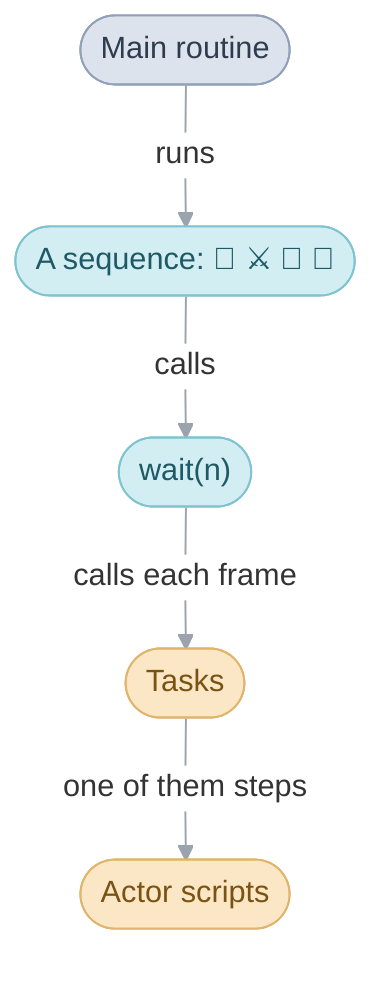
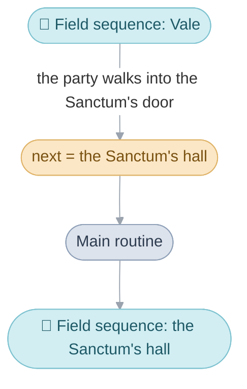
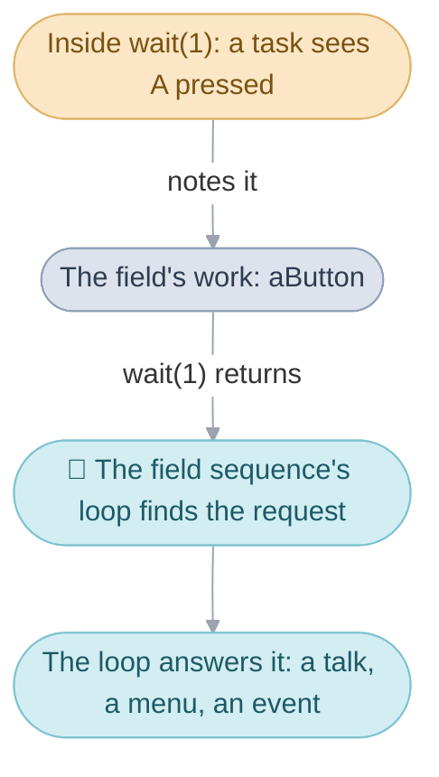
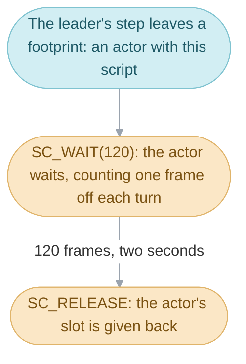

# The Broken Seal


> [!NOTE]
> In Japan, Golden Sun carries the subtitle 開かれし封印, The Broken Seal.
> These pages call the game by that subtitle, to keep it apart from
> [The Lost Age](glossary.md#the-two-games).

Switch the console on and the title card settles over the mountain. Press
Start, choose a file, and the party stands in Vale. From here on the player
sees one thing at a time: the party walking around a town, a conversation,
a battle, a menu, a game of dice. Underneath, the game runs on four
mechanisms, each one running inside the one before it:

1. The [main routine](glossary.md#main-routine) runs one
   [sequence](glossary.md#sequence) at a time: the field, a battle, Lucky Dice
   or Lucky Wheels.
2. A sequence's code runs from top to bottom, and lets time pass by calling
   [`wait(n)`](glossary.md#wait), which runs n [frames](glossary.md#frame) of
   the game.
3. In each frame, `wait()` calls the game's [tasks](glossary.md#task), the
   functions that keep the screen moving.
4. One task moves the [actors](glossary.md#actor), stepping each actor's
   [actor script](glossary.md#actor-script) on a little every frame.



The sections below take the four in that order, each with what the player
sees of it, and the last follows one moment of the game through all four.
The pages for the [four divisions](#the-four-divisions) of the code go
deeper into each.

## The main routine and its sequences


Walking through a cave, the party runs into a battle. The cave goes away,
the battle plays out, and the cave comes back. To the player it is one game;
to the code it is two sequences, one after the other. The field sequence
runs while the party walks around a place. The battle sequence runs the
fight. The two smallest sequences are the games in Tolbi: Lucky Dice is the
dice sequence and Lucky Wheels the slots sequence, each played from its own
room.


The main routine, `MainRoutine_Run`, starts when the console is switched on
and runs until it is switched off. It runs one sequence, waits for it to
finish and starts the next.


A sequence decides what comes after it: before it ends it writes what runs
next into the [main routine's work](glossary.md#main-routines-work), the one
piece of memory every sequence shares, and the main routine reads that and
starts it. What runs next is `gMainRoutineWork.next`. In the cave, the field
sequence wrote the battle there and ended; the battle wrote the cave back and
ended.

### Scenes


The field sequence runs one [scene](glossary.md#scene). A scene is a place,
such as Vale or a room of Vault's inn, or a screen, such as the Title or the
File Screen. Each has a scene code (`PLOGV00` is Vale on the stormy night of
the prologue) and an area name.

Walking through a door is a handover too. When the party walks out of a
scene, the field sequence ends, and the main routine starts it again on the
scene the [exit](glossary.md#exit) leads to. The fade to black between Vale
and the Sanctum's hall is the gap between two sequences.



Walking from Vale into the Sanctum is therefore the same handover as walking
into a battle: one sequence ends and the next starts. That is why `next`
holds either kind of thing: a scene's number means the field sequence
running that scene, and a number above all the scenes means one of the other
sequences (`SEQUENCE_BATTLE`, `SEQUENCE_DICE`, `SEQUENCE_SLOTS`). When a
battle or a game of dice ends, the main routine goes back to a scene the
field sequence runs (`Scene_ReturnFromSequence`).

### Why every sequence starts fresh


Between two sequences the main routine clears away everything the last one
set up: it removes its tasks, the interrupt handlers it set for effects drawn
line by line, and every block of memory it borrowed from the
[heap](glossary.md#heap-and-pools), the pool sequences take their working
memory from. So a sequence passes everything on through the main routine's
work and the [game flags](glossary.md#game-flag), and any scene or battle can
follow any other. The [debug menus](glossary.md#debug-menus) rely on
this: the debug scene selector writes any scene and entrance as what runs
next and lets the scene end, and the main routine takes the party there.
[System](system.md#the-main-routine) goes through the clearing up and the
start-up before the first sequence.

## Code that waits


While the villager's line waits for A, the river keeps flowing and the
letters of the next page keep appearing. The code that showed the line is
standing still at one call, and that call is where the rest of the game
runs.

A sequence's code runs from top to bottom. An event walks the leader to a
door, waits 30 frames, shows a message and waits for A; a battle shows its
menu, waits for a choice and plays the attack. Each line runs once the one
before it has finished. The game loop is inside `wait(n)`. Each call runs n
frames of the game and then returns to the next line. In each frame it calls
every task's function in turn, builds the sprites, and halts until the
screen shows the picture at the next [VBlank](glossary.md#vblank), about 60
times a second.


Simplified, from [frame.c](src/system/system/frame.c):

```c
void wait(s32 frames) {
  while (frames--) {
    Task_RunPass(TASK_PASS_FRAME);  /* call every task's function */
    Oam_BuildBuffer(...);           /* build the frame's sprites */
    VBlankIntrWait();               /* halt until the next VBlank */
  }
}
```

A frame is the unit of everything that takes time: a walk is so many pixels
a frame, a message so many letters a frame, a pause so many frames. The
VBlank interrupt runs on its own at every VBlank, whatever the code is
doing. When a frame's work takes longer than one VBlank, everything counted
in frames runs slow, while the music, mixed at every VBlank, keeps its tempo:
that is [slowdown](glossary.md#slowdown) ([System](system.md#slowdown)).

## Tasks


The letters appear a few at a time, and the arrow bobs while the window
waits: a task does both. A task is whatever has to keep moving while the
code waits: the actors walking, a window typing out its text, the map's
water rippling. Each is one function in the task table, `gTasks`, and
`wait()` calls it in every frame until the task is removed. A sequence adds
the tasks it needs when it starts, each with a priority that orders it among
the rest: the field adds its actors, its map's scrolling and its windows, and
a battle adds its camera.

A task runs in the middle of the code's `wait()`, so it acts within its one
frame and returns. What it notices for the code it serves, it leaves as a
note in that code's [work](glossary.md#work), and the code acts on the note
once its `wait()` returns. The field sequence's loop is the plainest case:

```c
do {
  wait(1);                      /* one frame: every task runs */
  Field_UpdateWalking(...);     /* what the ground under the leader does */
} while (Field_CountRequests() == 0);
```

When the player presses A, a task notes it during `wait(1)` (the next section
says which), and when `wait(1)` returns the loop finds that note, a
[request](glossary.md#field-request), leaves the loop and answers it.



## Actor scripts


Every person and moving thing in a scene, down to a footprint in the snow, is
one of 64 actors, and all of them are moved by one task,
`Actor_UpdateAllThumb`. Each frame it gives every actor a turn: an actor
counting down a wait counts one frame off, and any other runs the commands of
its actor script until one says the actor is done for the frame, such as a
step of a walk or a wait. An actor script therefore moves on a little every
frame, and each actor keeps its own place in its script. A footprint's whole
script is two commands, from [facing.c](src/field/facing.c):

```c
SC_WAIT(120), SC_RELEASE,
```



The leader's script hands it to the field's built-in player control
(`SC_PLAYER`), which reads the buttons, walks the leader and notes the
field's requests. A villager's script wanders to random spots near its home
(`SC_WANDER`), and the thieves' scripts in the next section walk them up a
ladder while the event waits.
[Field code](src/field/README.md#everything-that-moves-runs-an-actor-script)
covers the commands.

## From a conversation to a battle and back


In Vault, the party pushes a crate aside with Move and climbs to the inn's
loft, where a villager lies tied up. All of it happens in one scene,
`SceneId_LogRoomsA`: a single map holding every room inside Vault's buildings,
all of them walled in logs, each room reached by its own entrance
([log_rooms_a.c](src/scene/log_rooms_a.c)). Talking to the villager starts a
fight with the three thieves, and each step of it is the work of the four
mechanisms in turn.


### Talking to the villager

The main routine is running the field sequence for that scene, and the field
sequence's loop is in `wait(1)` while the player walks. In each of those
frames, the actors' task steps the leader's actor script, and when A is
pressed the script notes it (`Field_CheckConfiguredKeys` sets `aButton`).
When `wait(1)` returns, the loop sees the request, finds the villager ahead
(`Field_FindNearbyTalkTarget`) and looks him up in the scene's
[trigger](glossary.md#trigger) table, which holds this row:

```c
{ TRIGGER_TALK, ACTOR_TIED_UP_VILLAGER, CONDITION_ALWAYS, EVENT(LogRoomsA_FreeRooferAndConfrontThieves) },
```

The row names an [event](glossary.md#event), and the loop calls it.

### The event

`LogRoomsA_FreeRooferAndConfrontThieves` is code that waits, running straight
through from `Event_Start` to `Event_End`. Isaac cuts the villager free, the
three thieves come up the ladder to `MUS_OMINOUS`, they speak, and they
attack. Every pause between those steps is an `Event_Wait`, which calls
`wait()`; during each one the actors' task walks the thieves up the ladder and
the windows' task types out what they say.
At its end the event sets a story flag, writes into the main routine's work
where the story goes after a win and after a loss, and asks the field for the
battle (one line, which picks the bars that close the screen, is left out):

```c
GameFlag_Set(FLAG_VAULT_THIEVES_ATTACKED);
base = (s32)&SceneId_LogRoomsA;
Event_SetAfterBattleDestination(base, LOG_ROOMS_A_LOFT_AFTER_THIEVES_DEFEATED);
Event_SetDefeatDestination(base, LOG_ROOMS_A_LOFT_AFTER_LOSING_TO_THIEVES);
Battle_SetType(BATTLE_TYPE_SCRIPTED);
Field_RequestBattleFromEncounterTable(ENCOUNTER_ZONE_SCRIPTED_VALE_VAULT, 5);
```

The cast in the second line is there because the scene table defines each
`SceneId_` as an assembler symbol whose address is the scene's number. The
last line only asks for the battle: it notes the thieves'
[formation](glossary.md#formation) as a request, which the loop answers once
the event has returned, as it answered the A press.

### The battle

The field sequence answers the request by writing `SEQUENCE_BATTLE` as what
runs next, and the formation beside it, and then it ends. The main routine
clears the scene away, its tasks with it, and starts the battle
sequence (`Battle_RunFar`), which adds tasks of its own, such as its camera.
Everything the battle reads comes from the main routine's work: the formation,
the party, the battle music and the background chosen for the scene. When it
ends, `Scene_ReturnFromSequence` reads its result: a win goes to the
after-battle [destination](glossary.md#destination) the event wrote, a loss
to the defeat destination.

### Back in the loft

The main routine runs the field sequence on `SceneId_LogRoomsA` again, at the
[entrance](glossary.md#entrance) the event chose, and the field sequence adds
its tasks and places the scene's actors afresh. The scene's
`Scene_Initialize` switches on that entrance. At
`LOG_ROOMS_A_LOFT_AFTER_THIEVES_DEFEATED`, `LogRoomsA_DefeatThieves` stages
the beaten thieves, and `LogRoomsA_ReturnStolenGoods` sets
`FLAG_VAULT_THIEVES_JAILED` and hands back the stolen goods. At
`LOG_ROOMS_A_LOFT_AFTER_LOSING_TO_THIEVES` it plays `LogRoomsA_LoseToThieves`
and sends the party to the Vault Sanctum. The entrance alone tells the scene
which event to play.

## The four divisions

The code falls into four divisions, each with a page:

- [System](system.md): start-up, the main routine, waiting and tasks, memory,
  banks, overlays, saving and sound.
- [Battle](battle.md): a battle from the first menu to the spoils, and the
  game's rules.
- [Field](field.md): scenes and their requests, actors, maps, the World Map
  and field Psynergy.
- [Interface](interface.md): windows and messages, the menus,
  shops and inns.

Beside them, [Places](https://alchemy.pascalpixel.com/tbs/places) has every scene in story order,
[Source](src/README.md) every file of the code, the [Glossary](glossary.md)
the words these pages share, and
[Unused](https://alchemy.pascalpixel.com/tbs/unused) what the game keeps but
never plays.
