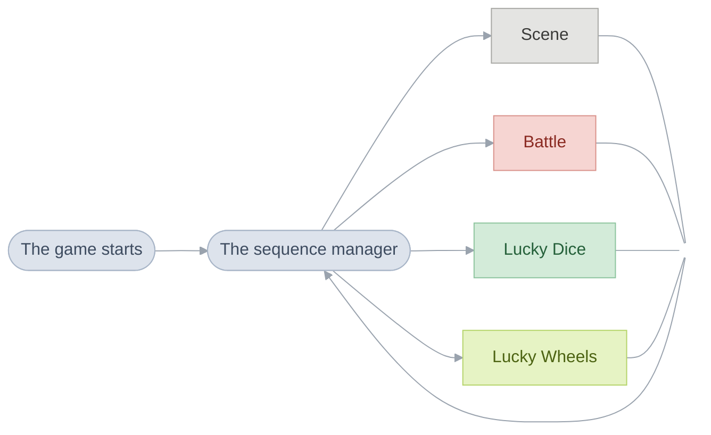
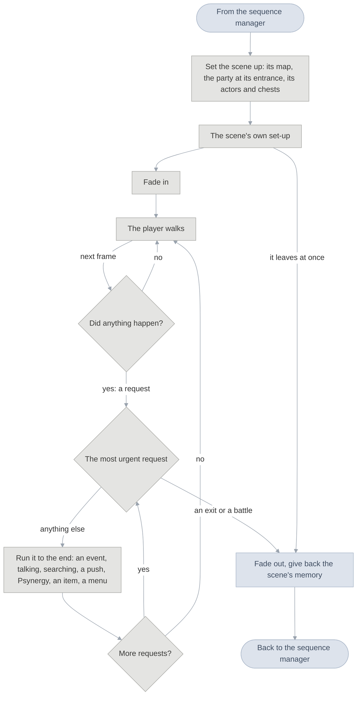

# The Broken Seal

"The Broken Seal" is the subtitle of the Japanese release of the game known
everywhere else simply as Golden Sun. To keep [the two
games](glossary.md#the-two-games) apart, these pages call the first one The
Broken Seal, or TBS for short.

The whole game is one loop, the [sequence manager](#the-sequence-manager).
Each time round it runs one [sequence](glossary.md#sequence): a
[scene](glossary.md#scene) (a place, or a screen such as the Title or the File
Screen), a battle, Lucky Dice or Lucky Wheels. The first is the Title;
from there each exit leads to the next scene.

## The sequence manager

Walking through the Sanctum's door ends Vale and starts the Sanctum: the game
throws away everything Vale set up (its [tasks](glossary.md#task), its screen
effects, every block of memory it borrowed), loads the Sanctum's code and runs
it until the party leaves. Unless a flag asks to keep the music playing, each
scene starts its own.

A battle takes a scene's place in the loop. Its code is always loaded, so
there is nothing to unpack, and when it ends the party stands where it stood.
After a defeat the game goes to the place an [event](glossary.md#event) chose
for losing that battle, or else to the last Sanctum.

Most games' main loops go round once a [frame](glossary.md#frame) and call
each part of the game in turn, so anything that takes time is cut into steps
that remember where they got to. This one goes round once per sequence, and a
turn can last minutes. An event, a menu or a scene's code is an ordinary
function that runs from start to finish and asks to wait a number of frames
when time must pass; while it waits, tasks keep everything else moving
([Engine](engine.md#waiting-and-tasks)). Event code therefore reads top to
bottom in the order things happen, and whatever moves alongside it has to be
a task of its own.

At power-on `System_Initialize` clears the fast memory, installs the code that
always stays loaded and the interrupt handlers, loads the window graphics,
starts the sound and calls `SequenceManager_Run`, which never returns. Each
time round, a scene's turn is `Scene_Arrive`, `Scene_ChooseMusic`,
`Scene_LoadOverlay`, then `SceneManager_Run` below, whose result goes to
`Scene_TakeExit`. A battle or a minigame reports a result rather than an exit,
and `Scene_ReturnFromSequence` turns it into the scene to go back to.

## The scene manager

A scene has two states, and the scene manager switches between them. While
the player walks, the game runs one [frame](glossary.md#frame) at a time and
only watches: the buttons, and the ground the party steps onto. When it sees
something that should happen it notes a
[field request](glossary.md#field-request) and stops watching. Then it
handles the requests, each from start to finish, while the walking waits;
when none is left, the player walks again. Everything that happens in a
scene, every conversation, cutscene, menu and battle, starts as one of these
requests.

What raises each request:

| Request        | What raises it                                                                     |
| -------------- | ---------------------------------------------------------------------------------- |
| exit           | stepping onto a way out, or an event that sends the party on                       |
| raised trigger | the scene's own code, the world map's L and R, or a party member falling to poison |
| random battle  | walking where battles happen, once enough steps have passed                        |
| step trigger   | stepping onto a cell the scene watches                                             |
| push           | walking into a stone pillar or anything else Move or a shove can shift             |
| A              | the A button: talk to whoever is ahead, else search, else open the field menu      |
| field menu     | Select                                                                             |
| Psynergy, item | the L and R shortcuts                                                              |
| Pause menu     | Start                                                                              |

The table is in order of urgency: when several are waiting, the scene manager
takes the highest first. An exit ends the scene. A random battle names the
battle as the next [sequence](glossary.md#sequence) and ends the scene too,
which is why the party comes back from a battle to the same spot: the scene
starts again, keeping where everyone stood. Every other request runs, and
may raise another (talking to someone can start an event, which can take an
exit).

Before the first frame of walking, the scene's own set-up runs. It can play a
whole event before the player gets control, as Vale erupting does, and if it
takes an exit the scene ends without fading in.

The scene manager is `SceneManager_Run` in
[scene_manager.c](src/overworld/overworld/scene_manager.c); the walking frame
is `Field_UpdateWalking`, and the buttons are read by
`Field_CheckConfiguredKeys`. [Running a
scene](src/overworld/README.md#the-scene-manager-serves-requests) follows each
request in full.

## Scenes and overlays

Only one scene's code is in memory at a time. Who stands in a scene, what they
say and what happens there matter nowhere else, so each scene's code is packed
on the cartridge as an [overlay](glossary.md#overlay) and unpacked into the
same 32 KB over the scene before it. Overlays never call each other; code
several scenes need is copied into each.

The rest of the game reaches a scene only through six questions, the six
functions of `struct SceneEntryPoints` at the start of every overlay: set
yourself up; where can the party arrive; where do your exits lead; who stands
here; what happens when the player talks, searches or steps somewhere; and
which parts of you lead out. Each answer is a
function rather than a fixed table, so a scene can answer differently as the
story moves on. [Engine](engine.md#overlays) describes loading an overlay and
[Scenes](src/scene/README.md) finding a [trigger](glossary.md#trigger).

## The scene table and areas

Every scene is a row of `gScenes`, and code names it by its row's
symbol, `SceneId_<Place>`. A row gives four things, each chosen separately:
its code, what happens there; its area, with the music, the area name and the
flags kept while inside; its map, the picture and the ground; and its type, a
town being safer. The Bilibin Barricade runs on Bilibin's code but is an
[area](glossary.md#area) of its own, and several scenes can share a [map](glossary.md#map). Walking between
Vale's houses shows no name because the party stays in Vale's area; arriving
from the world map shows "Vale" for 90 frames, a second and a half.

In a town, or a room in one, the party regains no
[PP](glossary.md#psynergy-and-pp) and recovers no [Djinn](glossary.md#djinn)
as it walks, poison does no damage, Retreat doesn't work and Avoid doesn't
wear off.

| What                                                      | Count |
| --------------------------------------------------------- | ----- |
| scenes                                                    | 201   |
| overlays, the scenes' code, some shared by several scenes | 96    |
| areas                                                     | 71    |

## Exits and entrances

An [exit](glossary.md#exit) only names where it goes. The scene's exit table
turns that name into a scene and an [entrance](glossary.md#entrance), the
spot where the party appears and the way it faces. A row can count only until
a flag is set, and the game takes the first row that counts: the path in the
recording has three rows. Before the Sanctum erupts it leads to Vale; after,
until the party leaves Vale, to Vale erupting; and from then on to Vale
again. A scene's
set-up often looks at the entrance too, to play the part of an event the last
scene sent the party to.

Every way between scenes is named in [scene_exits.h](include/scene_exits.h),
entrances for where the party comes from (`VALE_PLAZA_FROM_SANCTUM`) and exits
for where they lead (`VALE_PLAZA_TO_WORLD_MAP`), so a door has the same name
from both sides. The recording's rows are `gSolSanctumEntrance_Exits` in
[sol_sanctum_entrance.c](src/scene/sol_sanctum_entrance.c).

## Game flags

A scene keeps nothing of its own between visits: whatever the game must
remember, a chest or the end of a chapter, is a [game
flag](glossary.md#game-flag) saved with the game. The chest's row in the
scene's trigger table counts only while
`FLAG_SOL_SANCTUM_FIRST_SMALL_JEWEL_FOUND` is clear; opening it sets the flag,
and from then on the chest is drawn open and empty.

There are 4,096 flags in [flags.h](include/flags.h), in a fixed order: the
party and the Djinn, the engine's, the story's, then the chests and other
finds, each area's together. Two ranges are scratch space. A scene's own 256
are cleared each time the party arrives, so a stone pillar pushed out of place
is back on the next visit; an area's 256 are cleared on entering another
area. Neither is cleared on coming back from a battle, which returns to the
same moment. Eight flags in a row can be read as a small number, which is how
counters live among them. [Game rules](src/game/README.md#the-game-flags) has
the layout and the calls.

Because trigger rows and flags depend on each other, some of the game's code
can never run; its comment opens with [`Unused:`](glossary.md#unused), and
[Unused](https://alchemy.pascalpixel.com/tbs/unused) collects every case.

## How scenes depend on the story

The story is the order the flags are set in. Each time the party arrives, a
scene asks the flags which version of itself to be and returns that version's
tables; Vale's gate is `ValePlaza_GetTriggers` in
[vale_plaza.c](src/scene/vale_plaza.c). The other forms the dependence takes,
in [story order](glossary.md#the-places-in-story-order):

- **A scene per point in the story.** A place that changes completely gets a
  scene of its own, as the stormy night elsewhere in Vale does
  ([vale_stormy_night.c](src/scene/vale_stormy_night.c)).
- **A scene with no triggers.** Vale erupting plays its whole event as it
  starts and leaves by its one exit
  ([vale_eruption.c](src/scene/vale_eruption.c)).
- **A row that lasts until its flag is set.** Each pedestal in the room of the
  Elemental Stars offers its star once, as the chest does
  ([sol_sanctum_elemental_star_room.c](src/scene/sol_sanctum_elemental_star_room.c)).
- **A flag set by arriving.** The first time the party reaches the World Map
  from Vale, it sets the flag that says the party has left.
- **One event cut into parts.** The top of Venus Lighthouse is one event
  broken by two battles and two trips to the World Map, each part starting
  where the last sent the party
  ([venus_lighthouse_aerie.c](src/scene/venus_lighthouse_aerie.c)).
- **The last scene.** The Lemurian ship at the edge of Lalivero ends the game
  by sending the party to the Title
  ([lemurian_ship.c](src/scene/lemurian_ship.c)).

[Places](src/field/scenes.s) lists every scene in story order with what
happens there.

## The world map

The World Map is a scene like the others, drawn in perspective on the two
background layers the hardware can scale and rotate. Its world is stored as
squares 512 pixels on a side, and only the four around the party are
unpacked at a time. Each town or dungeon is a figure on the map that takes
its exit when touched; the map also holds three Djinn and a storm, and plays
the story's moments between places, chosen by where the last scene sent the
party. The code is [world_map.c](src/scene/world_map.c);
[World](world.md#the-world-map) explains the tilt.

## How the code is organised

The main program runs straight from the cartridge in fourteen
[banks](glossary.md#bank), about 1 MB of the English cartridge, followed by
the sound code, the music and the packed pictures and maps. The nine large
banks each have a folder, in cartridge order: `runtime`, `field`, `window`,
`game`, `overworld`, `menu`, `shop`, `battle` and `battle_anim`; the five
small banks' code sits in the folder it belongs with. `overworld` runs a
scene from arrival to exit, and `field` moves and draws its actors.
`graphics`, `map`, `sound` and `system` are grouped by topic and linked
wherever they are needed, and `scene` and `debug` hold overlays.

Each bank starts at a fixed place, and code in one bank calls another only
through a short list of entrances at that bank's start, so a bank can grow
without moving the others. An entrance has the function's name with `Far`
added: the sequence manager starts a battle with `Battle_RunFar`, which leads
to `Battle_Run` in the battle bank ([far calls](glossary.md#far-call);
[why the program is cut into
banks](src/system/README.md#why-the-program-is-cut-into-banks)).
[`objects.tsv`](objects.tsv) lists every object in link order, and
[Source](src/README.md) goes through every folder.

## Section pages

- [World](world.md): the field engine, the maps, the request loop a scene
  runs and field Psynergy.
- [Battle](battle.md): how a battle runs from the first menu to the spoils,
  how damage and healing are worked out, and how its animations are drawn.
- [Menus](menus.md): the field menu and its screens, the shops and inns, and
  the windows text is drawn in.
- [Engine](engine.md): start-up, frame timing and tasks, banks and far calls,
  overlays and songs.
- [Places](src/field/scenes.s): every scene in story order, with its
  actor templates and triggers.
- [Game rules](src/game/README.md): stats, items, Djinn, classes, levels and
  the flags.
- [Unused](https://alchemy.pascalpixel.com/tbs/unused): the scenes, events
  and lines the game keeps but never plays, and why each never runs.
- [Source](src/README.md): every file of the code, with its comments.
- [Glossary](glossary.md): the words every page uses, from Psynergy and Djinn
  to banks, overlays and examine triggers.
