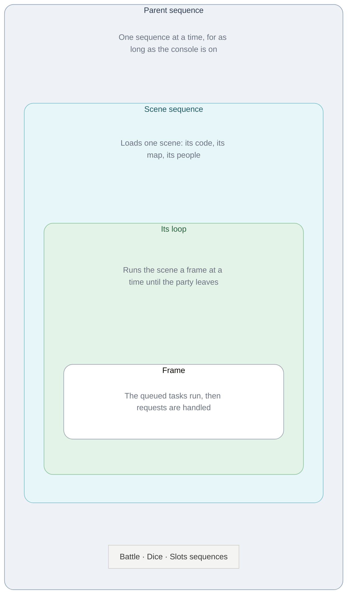
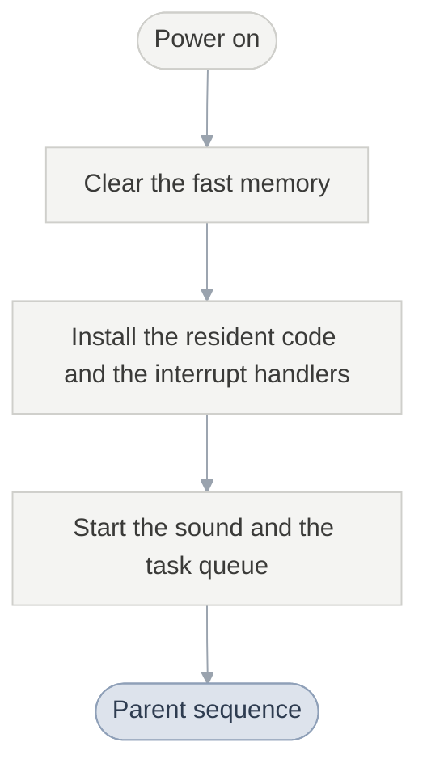
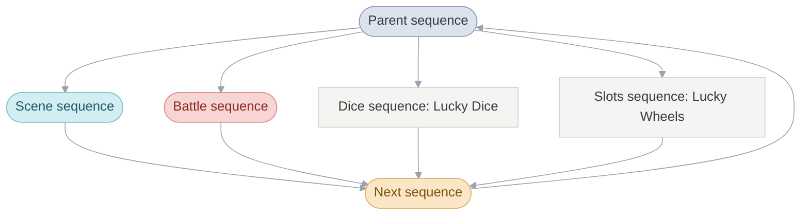
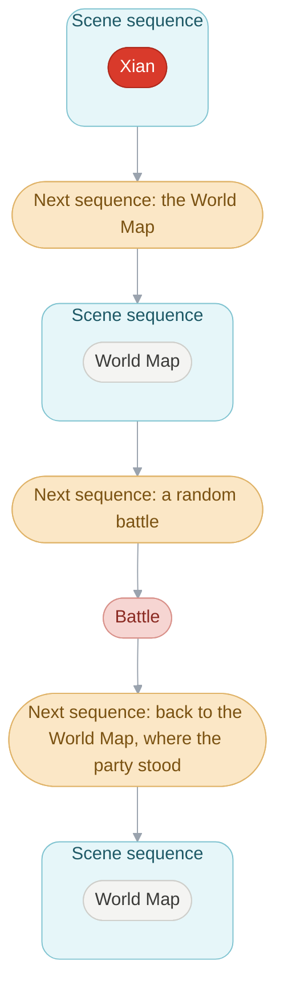
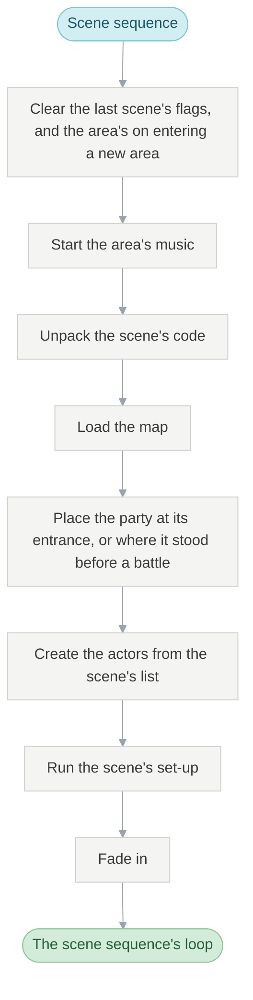
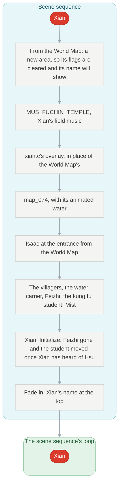
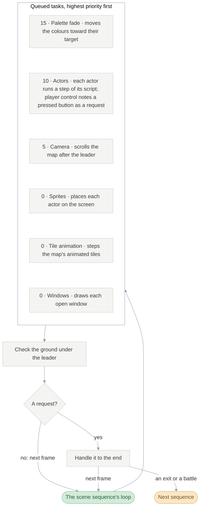
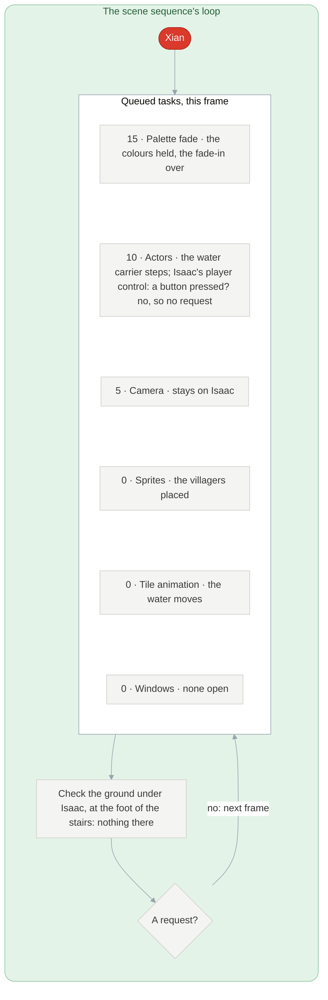
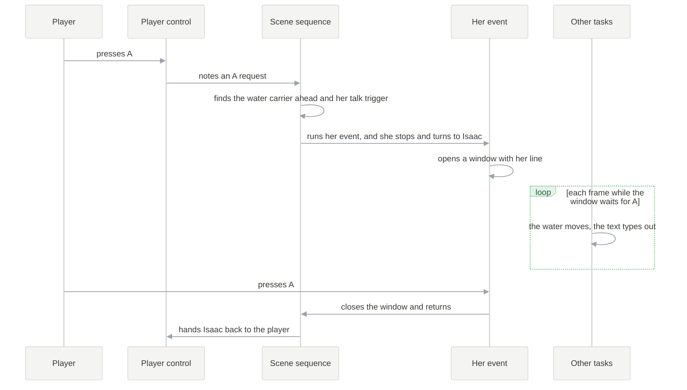

# The Broken Seal

Golden Sun was released in Japan as Golden Sun: The Broken Seal. These pages
use the Japanese subtitle, or TBS, to keep it apart from
[The Lost Age](glossary.md#the-two-games).

## How the game is built

Every sequence, event, menu and battle animation in The Broken Seal is code
that runs from its start to its end and waits where it stands whenever time
must pass, while short tasks run once a frame to keep the world moving:

- **One sequence at a time.** The [parent sequence](#the-parent-sequence)
  runs one [sequence](glossary.md#sequence) (a scene, a battle, a minigame)
  from start to finish.
- **Sequences hand over by themselves.** A scene that meets a random battle
  writes the battle down as the next sequence and ends; the battle ends by
  reporting a result, and the game works out where to go back to.
- **Code waits in place.** An event or a menu is an ordinary function that
  runs top to bottom and pauses when time must pass. While it pauses, a short
  list of [tasks](glossary.md#task) keeps the world moving
  ([Waiting in place](#waiting-in-place)).
- **The scene's loop only listens.** The scene sequence goes round once a
  frame while the player walks, and acts on what the tasks noted down.
- **A battle's rules and animations run together.** Damage appears while the
  attack is still on screen ([Battles](#battles)).
- **A frame that runs long slows the game instead of skipping work.** The
  picture and every movement slow down; the music doesn't
  ([When a frame runs long](#when-a-frame-runs-long)).

## Architecture

The game runs in four layers, each inside the one above it.



- **[Parent sequence](#the-parent-sequence).** Runs one
  [sequence](glossary.md#sequence) at a time, for as long as the console is
  on: the scene sequence, the battle sequence, the dice sequence (Lucky Dice)
  or the slots sequence (Lucky Wheels).
- **[Scene sequence](#the-scene-sequence).** Loads one
  [scene](glossary.md#scene): a place such as Xian, or a screen such as the
  Title.
- **[Its loop](#the-scene-sequences-loop).** Runs that scene, one
  [frame](glossary.md#frame) at a time, until the party leaves.
- **Frame.** Every queued [task](glossary.md#task) runs once, then the scene
  sequence handles what the player or the scene asked for.

A box keeps its name and colour in every chart below. Xian, the example
throughout, is red.

## Start-up



Power-on runs once. It clears the fast memory, installs the code that stays
resident and the interrupt handlers, loads the window graphics, starts the
sound and empties the task queue. Then it hands control to the parent
sequence, which never returns.

**Reference:** `System_Initialize` · [Engine: Start-up](engine.md#start-up)

## The parent sequence




Each pass runs one sequence to its end. The sequence then names the next one,
and in the transition the parent sequence clears everything the last one left
behind (its tasks, its screen effects, the memory it borrowed) before starting
it.



A battle replaces the scene for a turn. Its code is always loaded, so there is
nothing to unpack, and afterwards the party stands where it stood. After a
defeat the game goes where an [event](glossary.md#event) chose for losing that
battle, or else to the last Sanctum.

### How a sequence finds its way back

Sequences pass nothing to each other directly. Everything goes through common,
`gCommon`, the one struct every sequence shares:

| When                       | What is written                                                                              |
| -------------------------- | -------------------------------------------------------------------------------------------- |
| a scene starts             | the return point (this scene and entrance), and empty after-battle and defeat destinations   |
| an event prepares a battle | the after-battle or defeat destination, where the story should continue                      |
| a random battle starts     | the battle as the next scene, its enemy group as the entrance, every actor's position        |
| the battle ends            | its result: won, fled or lost                                                                |

`Scene_ReturnFromSequence` reads them back. A win or a flight goes to the
after-battle destination, or else to the return point with everyone where they
stood; a defeat goes to the defeat destination, or else to the last Sanctum
with the leader at 1 HP. Lucky Dice and Lucky Wheels return the same way. The
result stays in `gCommon.sequenceResult` for the scene that comes back.
The Title and the File Screen need none of this: they are ordinary scenes.

**Reference:** `ParentSequence_Run` · `Scene_ReturnFromSequence`

## Waiting in place

The screen refreshes about 60 times a second, at each
[VBlank](glossary.md#vblank). The game moves in
[frames](glossary.md#frame), and every frame happens inside one function,
`WaitFrames`. Whatever code is in charge (the scene sequence, an event, a
menu, a battle animation) calls it when time must pass:

```c
void WaitFrames(s32 frames) {         /* simplified */
  while (frames--) {
    Task_RunPass(TASK_PASS_FRAME);    /* every queued task, once */
    Oam_BuildBuffer(...);             /* this frame's picture */
    VBlankIntrWait();                 /* halt until the next VBlank */
  }
}
```

The tasks are the world's moving parts: the actors, the camera, the animated
water, the open windows. They run whoever is waiting, so the world keeps
moving through a conversation, a menu or a cutscene without any of that code
knowing about it.

An event therefore reads in the order things happen. Showing the water
carrier's line, `Event_ShowMessageAndWait` simplified:

```c
window = FieldMessage_ShowAtActor(actorId, flags);  /* open her window */
while (!Window_IsClosedFar(window))
  WaitFrames(1);                                    /* the water keeps moving */
```

The window itself is drawn by a task, which types the line out and closes the
window once the player presses A.

| Frame | Code in charge         | Tasks during its wait                         | After the wait                                |
| ----- | ---------------------- | --------------------------------------------- | --------------------------------------------- |
| 1     | scene sequence         | the carrier steps, the water moves            | nothing asked for: next frame                 |
| 2     | scene sequence         | player control sees A and notes a request     | a talk request: run her event                 |
| 3     | her event              | the window types her line, the water moves    | window still open: wait again                 |
| …     | her event              | A pressed: the window task closes the window  | window closed: return                         |
| next  | scene sequence         | the carrier walks on                          | nothing asked for: next frame                 |

The conversation is the function itself, paused inside `WaitFrames` and
resumed on the next line, so nothing has to note how far it has got: the place
it has reached in its own code says so. To allow a wait from deep inside any
function, `WaitFrames` copies the caller's stack aside while the frame runs
([Runtime](src/runtime/README.md#the-stack-switch-in-waitframes)).

### When a frame runs long

Each VBlank interrupts the game, whatever it is doing. The interrupt always
mixes the next slice of sound and reads the buttons, and it puts up a new
picture only if `WaitFrames` has finished one. A frame whose tasks take longer
than one refresh still runs to the end, while the screen shows the old picture
until the next VBlank. Every wait, walk and animation is counted in frames, so
they all slow down together, while the music, counted in VBlanks, keeps its
tempo. This is the game's slowdown. The VBlanks a frame took are counted in
`gFrameVBlanks`.

**Reference:** [Engine: Waiting and tasks](engine.md#waiting-and-tasks) ·
[Runtime: The frame loop](src/runtime/README.md#the-frame-loop) ·
`Event_WaitFrames`

## The scene sequence





Between scenes the parent sequence clears the
[game flags](glossary.md#game-flag) the last scene kept for itself, and the
[area](glossary.md#area)'s flags on entering a new area. It starts the area's music and unpacks the scene's code, its
[overlay](glossary.md#overlay). The scene sequence then loads the
[map](glossary.md#map), places the party at its
[entrance](glossary.md#entrance) and creates every
[actor](glossary.md#actor) on the scene's list. Last, the scene's own set-up
arranges the place as the story has left it, and the screen fades in.

**Reference:** `Scene_Arrive` · `Scene_ChooseMusic` · `Scene_LoadOverlay` ·
`SceneSequence_Run` · `Xian_Initialize` in [xian.c](src/scene/xian.c)

## The scene sequence's loop



Every frame, each queued task runs once, highest priority first. The camera
ranks below the actors so that it follows where they are now. The scene
sequence then checks the ground under the leader and handles any
[field request](glossary.md#field-request) to the end before the next frame.

### A frame in Xian



Isaac stands still and the player presses nothing, yet the village moves: the
water carrier walks her round and the water flows.

### Talking to the water carrier



A request can take as long as it needs. Her event waits for A inside an
ordinary function, and the tasks keep the village moving around the window.

### Requests

| Request        | Raised by                                                                          |
| -------------- | ---------------------------------------------------------------------------------- |
| exit           | stepping onto a way out, or an event that sends the party on                       |
| raised trigger | the scene's own code, the world map's L and R, or a party member falling to poison |
| random battle  | walking where battles happen, once enough steps have passed                        |
| step trigger   | stepping onto a cell the scene watches                                             |
| push           | walking into a stone pillar or anything else Move or a shove can shift             |
| A              | the A button: talk to whoever is ahead, else search, else open the field menu      |
| field menu     | Select                                                                             |
| Psynergy, item | the L and R shortcuts                                                              |
| Pause menu     | Start                                                                              |

Requests are handled in this order. An exit ends the scene. A random battle
names the battle as the next sequence and ends the scene too, which is why the
party returns from a battle to the same spot.

**Reference:** `SceneSequence_Run` in
[scene_sequence.c](src/overworld/overworld/scene_sequence.c) ·
`PaletteFade_Update` · `Actor_UpdateAllThumb` · `MapGrid_UpdateLayerScroll` ·
`ActorSystem_PlaceSprites` · `TilesetAnim_Update` · `WindowSystem_Update` ·
`Field_CheckConfiguredKeys` · `Field_UpdateWalking` ·
[Running a scene](src/overworld/README.md#the-scene-sequence-serves-requests)

## Battles


A battle is a sequence of its own with an ordinary loop, in `Battle_Run`:

```c
for (;;) {                                  /* one round */
  actionCount = Battle_GatherActions(...);  /* menus and enemy habits */
  for (i = 0; i < actionCount; i++) {       /* in Agility order */
    BattleStaging_DispatchAction(...);      /* announce, animate, apply */
    /* stop here if a side has fled or been beaten */
  }
  Battle_ProcessRoundEnd();                 /* statuses count down */
}
```

An attack's animation is an ordinary function that waits frame by frame.
Its damage comes from a task, playback, which stays idle until the animation
signals that the blow has landed and then applies it target by target. So
Quake's damage messages appear while the rock is still rising, rather than
after it: the rules decide how much, the animation only when. The battle's
code also stays loaded between battles, so starting one unpacks nothing.

**Reference:** [Battle](battle.md) ·
[Rules and animations run together](battle.md#rules-and-animations-run-together)

## Scenes and overlays

Only one scene's code is in memory at a time. Its people, their lines and its
events matter nowhere else, so each scene's code is packed on the cartridge as
an overlay and unpacked into the same 32 KB. Overlays never call each other;
code that several scenes need is copied into each.

The rest of the game reaches a scene through six functions,
`struct SceneEntryPoints` at the start of every overlay:

1. Set up the scene.
2. Where can the party arrive?
3. Where do the exits lead?
4. Who stands here?
5. What happens when the player talks, searches or steps somewhere?
6. Which parts lead out?

Each answer is a function rather than a fixed table, so a scene can answer
differently as the story moves on.

**Reference:** [Engine: Overlays](engine.md#overlays) ·
[Scenes](src/scene/README.md) · [trigger](glossary.md#trigger)

## The scene table and areas


Every scene is a row of `gScenes`, named in code by its row's symbol,
`SceneId_<Place>`. A row picks four things independently:

| Part | What it decides                                         |
| ---- | ------------------------------------------------------- |
| code | what happens there                                      |
| area | the music, the area name, the flags kept while inside   |
| map  | the picture and the ground                              |
| type | whether it is a town                                    |

The Bilibin Barricade runs on Bilibin's code but is an area of its own, and
several scenes can share a map. Walking between Vale's houses shows no name,
since the party stays in Vale's area; arriving from the world map shows "Vale"
for 90 frames, a second and a half.

In a town the party regains no [PP](glossary.md#psynergy-and-pp) and recovers
no [Djinn](glossary.md#djinn) as it walks, poison does no damage, Retreat
doesn't work and Avoid doesn't wear off.

| What     | Count | Note                               |
| -------- | ----- | ---------------------------------- |
| scenes   | 201   |                                    |
| overlays | 96    | some shared by several scenes      |
| areas    | 71    |                                    |

## Exits and entrances


An [exit](glossary.md#exit) only names where it goes. The scene's exit table
turns that name into a scene and an entrance: the spot where the party appears
and the way it faces. A row can last only until a flag is set, and the first
row that holds wins. The path in the recording has three rows:

| Until                    | The path leads to |
| ------------------------ | ----------------- |
| the Sanctum erupts       | Vale              |
| the party leaves Vale    | Vale erupting     |
| from then on             | Vale              |

A scene's set-up often reads the entrance too, to play the part of an event
the last scene sent the party to.

Every way between scenes is named in [scene_exits.h](include/scene_exits.h):
entrances for where the party comes from (`VALE_PLAZA_FROM_SANCTUM`), exits for
where they lead (`VALE_PLAZA_TO_WORLD_MAP`), so a door has the same name from
both sides.

**Reference:** `gSolSanctumEntrance_Exits` in
[sol_sanctum_entrance.c](src/scene/sol_sanctum_entrance.c)

## Game flags


A scene keeps nothing between visits. Whatever the game must remember, a chest
or the end of a chapter, is a game flag saved with the game. The chest's
trigger row counts only while `FLAG_SOL_SANCTUM_FIRST_SMALL_JEWEL_FOUND` is
clear; opening it sets the flag, and from then on the chest is drawn open and
empty.

[flags.h](include/flags.h) holds 4,096 flags in a fixed order: the party and
the Djinn, the engine's, the story's, then the chests and other finds, each
area's together. Two ranges are scratch space:

| Range           | Size | Cleared                          | Example                                   |
| --------------- | ---- | -------------------------------- | ----------------------------------------- |
| a scene's flags | 256  | each time the party arrives      | a stone pillar pushed out of place is back |
| an area's flags | 256  | on entering another area         |                                           |

Neither is cleared on returning from a battle, which comes back to the same
moment. Eight flags in a row can be read as a small number, which is how
counters live among them.

Because trigger rows and flags depend on each other, some of the game's code
can never run. Its comment opens with [`Unused:`](glossary.md#unused), and
[Unused](https://alchemy.pascalpixel.com/tbs/unused) collects every case.

**Reference:** [Game rules: The game flags](src/game/README.md#the-game-flags)

## How scenes depend on the story


The story is the order the flags are set in. Each time the party arrives, a
scene asks the flags which version of itself to be and returns that version's
tables. Vale's gate is `ValePlaza_GetTriggers` in
[vale_plaza.c](src/scene/vale_plaza.c).

The other forms it takes, in
[story order](glossary.md#the-places-in-story-order):

| Form                               | Example                                                                                                                       |
| ---------------------------------- | ----------------------------------------------------------------------------------------------------------------------------- |
| a scene per point in the story     | the stormy night in Vale ([vale_stormy_night.c](src/scene/vale_stormy_night.c))                                               |
| a scene with no triggers           | Vale erupting plays its event and leaves by its one exit ([vale_eruption.c](src/scene/vale_eruption.c))                       |
| a row that lasts until its flag    | each pedestal of the Elemental Stars offers its star once ([sol_sanctum_elemental_star_room.c](src/scene/sol_sanctum_elemental_star_room.c)) |
| a flag set by arriving             | reaching the World Map from Vale marks that the party has left                                                                |
| one event cut into parts           | the top of Venus Lighthouse, broken by two battles and two trips to the World Map ([venus_lighthouse_aerie.c](src/scene/venus_lighthouse_aerie.c)) |
| the last scene                     | the Lemurian ship at Lalivero sends the party to the Title ([lemurian_ship.c](src/scene/lemurian_ship.c))                     |

**Reference:** [Places](src/field/scenes.s), every scene in story order

## The world map


The World Map is a scene like the others, drawn in perspective on the two
background layers the hardware can scale and rotate. Its world is stored in
squares 512 pixels on a side, and only the four around the party are unpacked
at a time. Each town or dungeon is a figure that takes its exit when touched.
The map also holds three Djinn and a storm, and plays the story's moments
between places, chosen by where the last scene sent the party.

**Reference:** [world_map.c](src/scene/world_map.c) ·
[World: The world map](world.md#the-world-map)

## How the code is organised

The main image runs straight from the cartridge in fourteen
[banks](glossary.md#bank), about 1 MB of the English cartridge, followed by
the sound code, the music and the packed pictures and maps.

| Folder                                    | Holds                                         |
| ----------------------------------------- | --------------------------------------------- |
| `runtime`, `field`, `window`, `game`, `overworld`, `menu`, `shop`, `battle`, `battle_anim` | the nine large banks, in cartridge order; the five small banks' code sits with the folder it belongs to |
| `graphics`, `map`, `sound`, `system`      | code grouped by topic, linked wherever needed |
| `scene`, `debug`                          | overlays                                      |

`overworld` runs a scene from arrival to exit, and `field` moves and draws its
actors.

Each bank starts at a fixed place, and code in one bank reaches another only
through a short list of entrances at that bank's start, so a bank can grow
without moving the others. An entrance is the function's name with `Far`
added: the parent sequence starts a battle with `Battle_RunFar`, which leads
to `Battle_Run` in the battle bank.

**Reference:** [far calls](glossary.md#far-call) ·
[Why the main image is cut into banks](src/system/README.md#why-the-main-image-is-cut-into-banks) ·
[`objects.tsv`](objects.tsv) · [Source](src/README.md)

## Section pages

| Page                                                 | Covers                                                               |
| ---------------------------------------------------- | -------------------------------------------------------------------- |
| [World](world.md)                                    | the field engine, the maps, the request loop and field Psynergy      |
| [Battle](battle.md)                                  | a battle from the first menu to the spoils, damage, its animations   |
| [Menus](menus.md)                                    | the field menu and its screens, shops and inns, windows              |
| [Engine](engine.md)                                  | start-up, frames and tasks, banks and far calls, overlays, songs       |
| [Places](src/field/scenes.s)                         | every scene in story order, with its actor templates and triggers    |
| [Game rules](src/game/README.md)                     | stats, items, Djinn, classes, levels and the flags                   |
| [Unused](https://alchemy.pascalpixel.com/tbs/unused) | what the game keeps but never plays, and why                         |
| [Source](src/README.md)                              | every file of the code, with its comments                            |
| [Glossary](glossary.md)                              | the words every page uses                                            |
