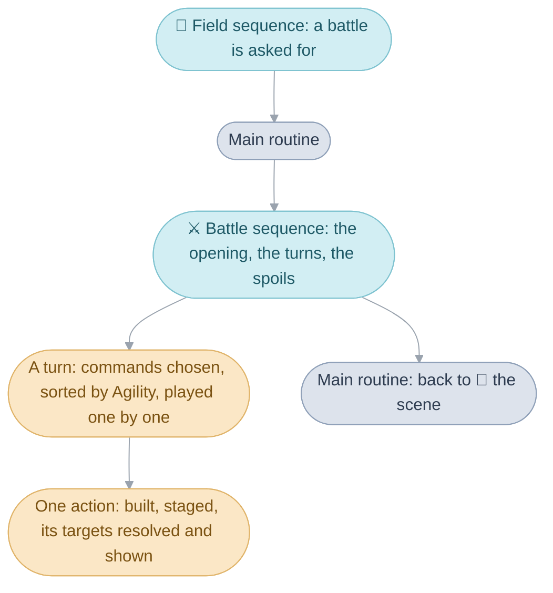

# Battle

Walking through a cave, the party runs into a battle. The cave goes away and
the enemies appear on a battlefield of their own. Each
[turn](glossary.md#turns-and-actions) the player picks a command for each
party member, every enemy picks a move of its own, and the game plays the
actions one after another, fastest first, until one side has nobody left
standing or the party runs away. Then the spoils are handed out and the cave
comes back.

The Battle division is the code that runs all of this, in three folders:

- [Battles](src/battle/README.md) holds the rules of a fight: who acts when,
  who is hit and what happens to them.
- [Game rules](src/game/README.md) holds what the rules work on: the party
  and the enemies, the tables of abilities, items, Djinn and classes, and the
  arithmetic of damage.
- [Battle effects](src/battle_effect/README.md) draws what the rules decide:
  the sword swing, the rising rock, the summon.

## Starting a battle

A battle is a [sequence](glossary.md#sequence), which the
[main routine](glossary.md#main-routine) runs between two
[scenes](glossary.md#scene). A random encounter, a chest that turns out to be
a Mimic and an [event](glossary.md#event) all start one the same way: they
ask the field for a [formation](glossary.md#formation), the group of enemies
to fight. The field sequence ends, the main routine clears the scene away and
starts the battle, and when the battle is over its result decides the scene
the party goes back to.
[Random battles](src/field/README.md#random-battles) says when the field
asks,
[Leaving for a battle and coming back](src/field/README.md#leaving-for-a-battle-and-coming-back)
follows the handover, and
[Starting a battle](src/battle/README.md#starting-a-battle) the opening.

## Units and abilities

Everyone in a fight, party member or enemy, is a [unit](glossary.md#unit):
its HP, [PP](glossary.md#psynergy-and-pp), Attack, Defense, Agility and Luck,
its statuses, and its [Power and Resist](glossary.md#power-and-resist) in
each [element](glossary.md#the-four-elements). Everything a unit can do when
it acts is an ability: Attack, Quake, a [Djinni](glossary.md#djinn), a
[summon](glossary.md#summons), using an item, an enemy's special move. An
ability's rules and the battle effect that draws it are chosen separately,
so Quake, Earthquake and Quake Sphere share one battle effect at three
strengths. [The unit](src/game/README.md#the-unit) describes a unit, and
[Commands and ability ids](src/battle/README.md#commands-and-ability-ids)
how a command finds its ability.

## Turns and actions

A turn is one pass of choosing, sorting and playing. The party's actions come
from the command menu and the enemies' from each enemy's habits; they are
sorted by Agility, fastest first, and played one by one. After every action
the game checks whether a side has been beaten, so a battle can end in the
middle of a turn. [Turns](src/battle/README.md#turns) follows a turn
through, with the enemies' habits, the order, the first strikes and running
away.

## Building and staging an action

Just before a unit acts, the player reads its announcement, such as
`Isaac attacks!`. By then the game has worked out everything about the
action that the screen must show: which ability it is, whether a weapon
unleashes its own in Attack's place, who it reaches, and whether it is
dodged or lands a critical hit. Then the action is
[staged](glossary.md#staging): the attacker runs up and strikes, the caster
raises a hand and glows in its element.
[Building an action](src/battle/README.md#building-an-action) takes the
action apart, and [Staging an action](src/battle/README.md#staging-an-action)
shows each kind.

## Resolving an ability

When Avalanche hits three targets, the one aimed at takes the most and the
ones beside it less, and a target weak to Venus takes more than one that
resists it. Every damaging Psynergy works its number out the same way: the
ability's power, scaled by the element and by the distance, plus a little
luck. [How an ability resolves](src/battle/README.md#how-an-ability-resolves)
works one Avalanche through, and
[Battle arithmetic](src/game/README.md#battle-arithmetic) has the formulas.

## Rules and battle effects run together

The damage messages appear while Quake's rock is still rising: the
[battle effect](glossary.md#battle-effect) keeps drawing while the outcome
shows. How much damage is the rules' business alone; the battle effect only
signals the moment the blow lands, and from then on the rules show each
target's flinch, message and falling HP beside it.
[How outcomes reach the screen](src/battle/README.md#how-outcomes-reach-the-screen)
explains the signal and what follows it.

## Battle effects

Every ability's battle effect, from a sword swing to a summon's arrival, is
one function that draws it frame by frame and returns when it is over. Most
draw into a small picture kept off screen, the canvas, which is shown
stretched and blended over the battle.
[Battle effects](src/battle_effect/README.md) describes how an ability picks
its effect and how an effect draws.

## The battlefield on screen

The battlefield is one flat picture which the camera zooms, with the units
as [sprites](glossary.md#sprite-and-oam) over it and the windows on a
[background layer](glossary.md#background-layer) in front.
[The zoomed battlefield](src/battle/README.md#the-zoomed-battlefield)
explains how a picture too large for the zooming layer is shown through it.

## The end of the battle

A battle ends when a side has nobody left standing, or the party gets away.
A win hands out the spoils the fallen enemies left: experience, with every
level gained, then coins, then items. A loss sends the party to the last
Sanctum, unless an event chose somewhere else.
[The end of the battle](src/battle/README.md#the-end-of-the-battle) goes
through the spoils and the way back.

## Design

A battle is a sequence so that it can start from nothing: everything it needs
arrives through the [main routine's work](glossary.md#main-routines-work), and
everything it leaves behind goes back the same way, as a result the main
routine turns into the next scene.
