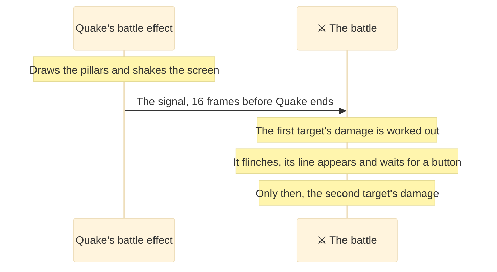

# Battle

Walk through Goma Cave for long enough and the screen goes black. When the
picture comes back the cave is gone, and the party is facing its enemies on a
battlefield of their own.

From there every fight goes the same way. The player picks a command for each
party member, and every enemy picks a move. Then everyone acts, one after
another, fastest first. That is a [turn](glossary.md#turns-and-actions), and
turns repeat until one side has nobody left standing or the party runs away.
Then the party is told what it won, and the cave comes back.

This page walks through one fight from its opening to its spoils, with a
short stop at each part. Three longer guides tell the rest:

- [Battles](src/battle/README.md) is the fight itself: who acts when, who is
  hit, and what the party wins.
- [Game rules](src/game/README.md) is the numbers a fight uses: Isaac's
  Attack, a Gryphon's HP, the lists of every ability, item, Djinni and class,
  and the sums that turn stats into damage.
- [Battle effects](src/battle_effect/README.md) is the pictures: the sword
  swing, Quake's pillars of rock, the summon.

In some of the recordings below the Psynergy lands on Isaac, Garet, Ivan and
Mia themselves. Those are battles set up for the recording, with party
members standing where the enemies would.

## Starting a battle

A fight can begin three ways. The party walks into a random battle, as in
Goma Cave. A chest jumps into the air and turns out to be a Mimic. Or the
story calls for one, as when a boss steps forward. A scripted moment of the
story like that is an [event](glossary.md#event).

All three hand the battle one number. The number names a
[formation](glossary.md#formation), a group of enemies the game can send
against the party. One of Goma Cave's formations says a Ghost, a Vermin and
a Wild Mushroom, and the battle turns that into enemies standing in a line,
each with a name and HP.

A random battle also rolls a die before the battle appears. One time
in 16 the battle opens with `Isaac's party attacks first!` and the enemies
stand still for a turn. Battles from a Mimic or an event never roll it.

When does a walk turn into a fight? That is in
[Random battles](src/field/README.md#random-battles), and
[Leaving for a battle and coming back](src/field/README.md#leaving-for-a-battle-and-coming-back)
follows the party out of the cave. The line-up and the opening are in
[Starting a battle](src/battle/README.md#starting-a-battle).

## Units and abilities

Open the Status screen on Isaac and you see his HP,
[PP](glossary.md#psynergy-and-pp), Attack, Defense, Agility and Luck, and his
[Power and Resist](glossary.md#power-and-resist) in each
[element](glossary.md#the-four-elements). The game keeps all of those
numbers together in one bundle, and calls the bundle a
[unit](glossary.md#unit).

A Gryphon is a unit too. The game has a list of enemies with a row for each
kind, and when the battle starts the Gryphon's unit is filled in from its
row. Because both sides are kept the same way, the battle can ask Isaac and a
Gryphon the same questions: how fast is it, what is its Defense, is it
asleep?

Everything a unit can do when it acts is an ability: Attack, Quake, a
[Djinni](glossary.md#djinn), a [summon](glossary.md#summons), using an Herb,
a Gryphon's Wing Flutter.

What an ability does and what it looks like are kept in separate lists. That
is how Quake, Earthquake and Quake Sphere can be three abilities with three
strengths and still share one picture: the same three pillars of rock rise
once for Quake, twice for Earthquake and three times for Quake Sphere.

Everything a unit holds is laid out in
[The unit](src/game/README.md#the-unit). How each command in the battle
menu finds its ability is in
[Commands and ability ids](src/battle/README.md#commands-and-ability-ids).

## Turns and actions

Before the first blow of a turn, the game writes down what everyone will do.
The party's choices come from the command menu and the enemies' from the
dice. Then the whole list is sorted and played from the top.

The sorting goes by Agility. A party member gets a little luck on top: their
place is their Agility plus up to a sixteenth more, drawn at random. With an
Agility of 120 that is anywhere from 120 to 127, which is why two party
members of nearly equal speed can swap places from one turn to the next. An
enemy's place is its Agility alone.

Enemies do something else the party cannot. An enemy chooses twice. Its
first choice is made with everyone else's, and it only counts if the enemy
chose to guard or to run, because a guard has to be up before the first blow
of the turn.

Any other first choice is thrown away, and the enemy chooses again at the
moment it acts. By then the faster units have acted, so it does not waste a
blow on a party member who has just gone down.

After every action the game checks whether a side has been beaten, so a
battle can end in the middle of a turn.

[Turns](src/battle/README.md#turns) has the rest: how an enemy's dice pick
its move, how `attacks first!` plays out, and the odds of running away.

## Building and staging an action

Give Isaac the Swift Sword and choose Attack. Some turns the player reads
`Isaac attacks!`. Other turns the sword `lets out a howl!` and Isaac strikes
with Sonic Smash instead.

That was decided before the line appeared. The Swift Sword unleashes 35
times in a hundred, and some equipment raises its odds.

More is settled before Isaac moves: who the blow reaches, whether it is
dodged, and whether it is a critical hit. The game has to know early,
because a dodge and a critical hit are each drawn differently from a plain
hit.

Then comes the part the player watches. The attacker runs up and leaps, or
the caster raises a hand and glows in its element, or a summon takes the
whole screen. The game's word for this is [staging](glossary.md#staging).

For everything that is settled in advance, and in what order, read
[Building an action](src/battle/README.md#building-an-action).
[Staging an action](src/battle/README.md#staging-an-action) has a recording
of each kind.

## Resolving an ability

Cast Avalanche at three targets and they do not take the same damage. The
one the cursor was on takes all of it. The target next to it takes 80
percent, and the one beyond that 60.

The full amount starts from a number the game keeps for each ability, its
power. Avalanche's is 160.

Then the element counts. Avalanche is a Venus ability, so the game compares
the caster's Venus Power with the target's Venus Resist. Each point the
Power is ahead adds half a percent, and each point behind takes half a
percent off. A caster 20 points ahead does a tenth more.

Last, a random 0 to 3 is added, so two casts in a row rarely match exactly.

Every damaging Psynergy works its number out this way. A plain Attack does
not: it starts from half of what the attacker's Attack is above the target's
Defense.

One target is followed through every step in
[How an ability resolves](src/battle/README.md#how-an-ability-resolves).
Each sum is given on its own in
[Battle arithmetic](src/game/README.md#battle-arithmetic).

## Rules and battle effects run together

Watch the end of Quake closely. The first target flinches while the ground
is still shaking, before Quake's picture has finished.

Two parts of the game are at work at once. One is the picture of the
ability, which the game calls its
[battle effect](glossary.md#battle-effect). It draws the pillars and shakes
the screen, and it knows nothing about damage. The other is the battle,
which knows the damage and draws no rock.

They meet at one moment. The battle effect gives a signal when the blow
should be felt, and the battle starts showing what happened. Quake gives its
signal 16 [frames](glossary.md#frame) before it ends. A frame is one picture
on the screen, and the console draws about sixty a second.

From the signal on, the battle takes the targets one at a time. The first
target's damage is worked out, it flinches, its line appears and waits for a
button. Only then is the second target's damage worked out.

How two things can run side by side on one small console is the subject of
[How outcomes reach the screen](src/battle/README.md#how-outcomes-reach-the-screen).

## Battle effects

Heat Wave's blaze glows over the battle, and you can still see Mia through
it.

The blaze is drawn on a small square picture of its own, which the code
calls the canvas. The console lays the canvas over the battle like a sheet
of glass. For Heat Wave, as for most effects, the colours on the canvas are
added to the colours of the battle underneath, which is what makes fire look
like light.

The canvas also makes trails easy. The Psynergy Fire throws fireballs with
fading tails, and it never draws a tail. Each frame the game dims everything
on the canvas to three quarters of its brightness, then Fire draws the
fireballs again a little further on. What is left of the earlier drawings is
the tail.

Nearly every effect draws on the canvas, though not all in the same way.
[Battle effects](src/battle_effect/README.md) shows how, and follows one
effect, Bolt, frame by frame.

## The battlefield on screen

The battlefield looks deep, and the camera seems to swing through it. It is
one flat picture with its depth painted in.

The console builds its screen from a few flat pictures laid over one
another, as the recording pulls them apart. Each is a
[background layer](glossary.md#background-layer). One layer can be zoomed
and slid as a whole, and the battlefield is on that one. The units stand
over it as [sprites](glossary.md#sprite-and-oam), small pictures the console
can place anywhere on the screen. The party's status window and the command
menu are on a layer in front, which never zooms.

There is a catch. The zooming layer can hold only so much picture, and the
battlefield is more than that. So the picture is kept as an upper half
and a lower half. The console draws the screen from the top, one line at a
time, and at the line where the lower half begins the game switches the
layer over to it.

[The zoomed battlefield](src/battle/README.md#the-zoomed-battlefield) counts
it out, and has the camera too.

## The end of the battle

A battle ends in one of three ways: a win, a flight or a defeat.

A win hands out what the fallen enemies left. Experience comes first, and
every party member still standing gets the whole amount, with each level
gained shown as it happens. Then the coins, then any items.

A flight only fades to black, and the party is back where it stood.

After a defeat the game revives Isaac, or whoever leads the party, with
1 HP. The party wakes at the place set for it, most often the last Sanctum,
unless an event chose somewhere else.

What an enemy leaves behind, and what a Djinni's finishing blow adds to it,
is in [The end of the battle](src/battle/README.md#the-end-of-the-battle).

## Design

When the screen goes black in Goma Cave, the cave is really gone. The game
clears it away, and the battle starts with nothing of it.

So the battle reads what it needs from the
[main routine's work](glossary.md#main-routines-work) instead: the party,
the formation's number, the kind of battle (a random one, or one the story
called for), the picture of the place and the music.

When the fight is over the battle hands back one answer: won, fled or lost.
The cave is then built again from scratch, and after a win or a flight the
party is usually put back where it stood. That is the round trip in the
recording at the top of this page.

It is also why a Mimic's chest in Mercury Lighthouse and a walk through Goma
Cave can lead to the very same kind of fight. The battle never looks at the
room it came from. It only reads the work.
