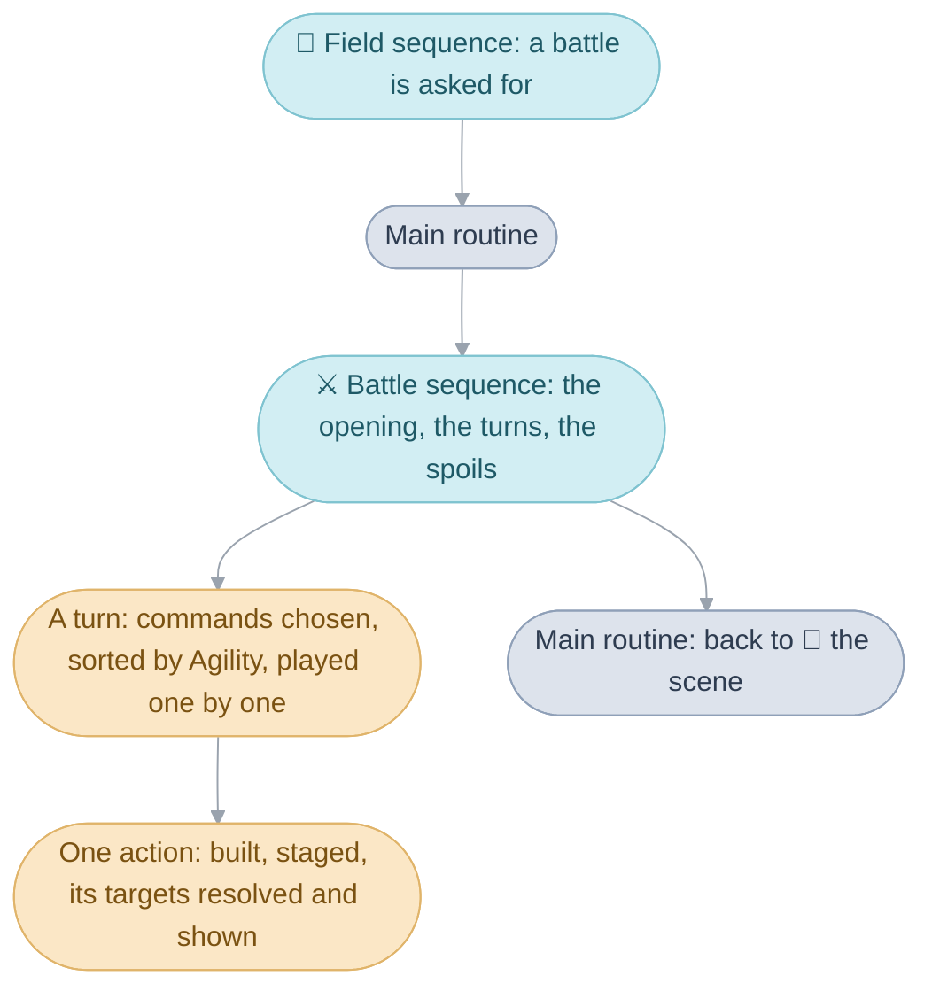
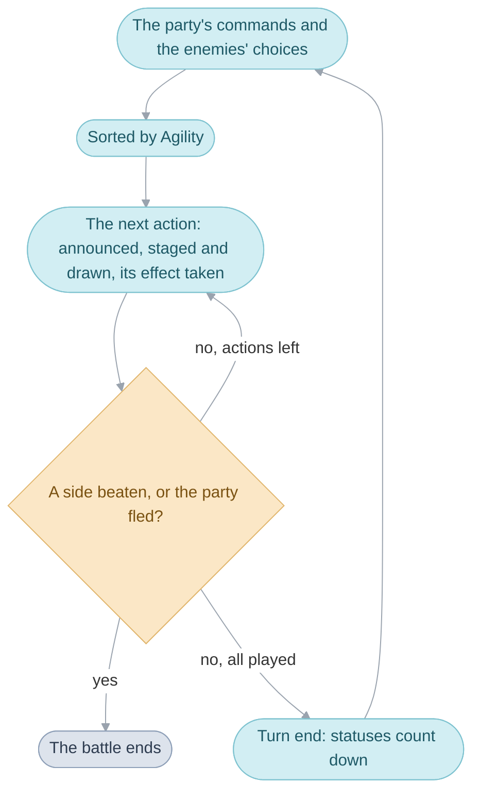
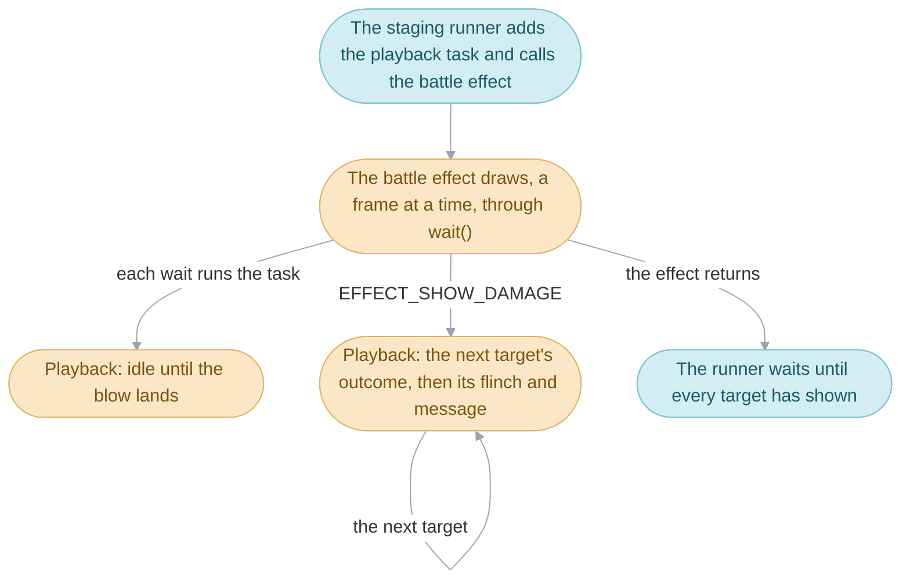
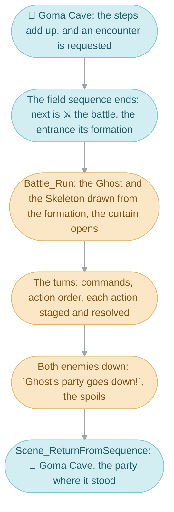

# Battle

Walking through a cave, the party runs into a battle. The cave goes away and
the enemies appear on a battlefield of their own. Each
[turn](glossary.md#turns-and-actions) the player picks a command for each
party member, every enemy picks a move of its own, and the game plays the
actions one after another, fastest first, until one side has nobody left
standing or the party runs away. Then the spoils are handed out and the cave
comes back. The Battle division is the code that runs all of this, and it
falls into two halves: the rules, which decide who acts when, who is hit and
for how much, and the [battle effects](glossary.md#battle-effect), which draw
it.

1. [Starting a battle](#starting-a-battle): how the field hands over to the
   battle [sequence](glossary.md#sequence) and gets the party back.
2. [Units and abilities](#units-and-abilities): the two things every rule is
   about.
3. [Turns and actions](#turns-and-actions): one pass of choosing, sorting and
   playing.
4. [Building and staging an action](#building-and-staging-an-action): a
   command becomes an action, and the action is shown.
5. [Resolving an ability](#resolving-an-ability): the arithmetic behind
   `Ivan takes 203 damage!`.
6. [Rules and battle effects run
   together](#rules-and-battle-effects-run-together): how the damage shows
   while the rock is still rising.
7. [Battle effects](#battle-effects): what each ability draws.
8. [The battlefield on screen](#the-battlefield-on-screen): one flat picture
   zoomed by the camera.
9. [The end of the battle](#the-end-of-the-battle): a win, a loss or a flight,
   and the way back.

[Battles](src/battle/README.md) goes through the rules,
[Game rules](glossary.md#game-rules) holds their tables and arithmetic, and
[Battle effects](src/battle_effect/README.md) draws what they decide.

## Starting a battle

A battle is a sequence like any other, which the
[main routine](glossary.md#main-routine) runs between two
[scenes](glossary.md#scene). Every way into a battle leaves the same request
in the field's [work](glossary.md#work): the number of a
[formation](glossary.md#formation), the group of enemies to fight. A random
encounter sets it after the party has walked far enough
([Random encounters](field.md#random-encounters)), a chest that turns out to
be a Mimic sets it from its [examine trigger](glossary.md#examine-trigger),
and an [event](glossary.md#event) sets it with
`Field_RequestBattleFromEncounterTable`. An event may first mark the battle
`BATTLE_TYPE_SCRIPTED`, so the party cannot run, and set where the party goes
if it wins and if it loses, as the thieves in Vault's inn loft do.

The [field sequence](glossary.md#field-sequence)'s loop answers the request:
it saves where the scene's [actors](glossary.md#actor) stand, writes into the
[main routine's work](glossary.md#main-routines-work) `SEQUENCE_BATTLE` as
the next sequence and, in the entrance field a scene would use for where the
party arrives, the formation to fight, and ends the scene. The main routine's
next pass tears the scene down, so the battle starts with the console's
memory cleared ([System](system.md#the-main-routine)), and calls
`Battle_RunFar`, the [far call](glossary.md#far-call) into the battle's
[bank](glossary.md#bank). `Battle_Run` plays the whole battle and returns how
it ended. The main routine reads that result to choose the scene to go back
to: after a win or a flight the party stands where it stood, unless the event
chose another [destination](glossary.md#destination); after a loss it goes to
the destination the event set for a defeat, or else to the restart point,
most often the last Sanctum.

[Battles](src/battle/README.md#starting-a-battle) follows `Battle_Run`
through its set-up: the formation drawn into enemies, the units placed, and
the curtain opening on them.

## Units and abilities

Everyone in a fight, party member or enemy, is a [unit](glossary.md#unit),
and everything a unit can do when it acts is an ability: Attack, Quake, a
[Djinni](glossary.md#djinn), a [summon](glossary.md#summons), using an item,
an enemy's special move. The command menu is how the player chooses one for
each party member; an enemy's row of the enemy table lists the eight it
chooses among.

A unit is a `struct Unit`: its HP, [PP](glossary.md#psynergy-and-pp), Attack,
Defense, Agility and Luck, its statuses and the turns each has left, and for
every [element](glossary.md#the-four-elements) its own
[Power and Resist](glossary.md#power-and-resist). A party member's unit lives
in the main routine's work and is saved with the game; an enemy's is built
for the battle from its row of the enemy table.

An ability is a number, and three tables say what that number means: what the
ability does (its targets, element, range, PP cost, power and added effect),
which battle effect draws it and how strongly, and anything special about how
it is staged. The rules and the battle effect are chosen separately, so
abilities with different arithmetic can share one battle effect: Quake,
Earthquake and Quake Sphere share one at three strengths.

A unit is read by `Unit_Get` (`src/game/game/units.c`); the ability tables
are `src/game/ability_table.c` (`struct AbilityDefinition`, read by
`Ability_Get`), then `gAbilityBattleEffects` and `gAbilityStaging` in
`src/battle/ability_staging.c`. [Game rules](src/game/README.md) holds the
units and every table of items, abilities, Djinn, enemies, summons and
classes, and [Battles](src/battle/README.md#commands-and-ability-ids) shows
how a command finds its ability.

## Turns and actions

A turn is one pass of choosing, sorting and playing actions. The faster a
unit, the earlier it acts, and after every action the game checks whether a
side has been beaten, so a battle can end in the middle of a turn.

The party's actions come from the command menu, the enemies' from each
enemy's habits. Each is a `struct BattleAction` with a priority: a party
member's Agility plus a random sixteenth, an enemy's Agility as it is. They
are sorted highest first, except that the Djinn Granite, Flash and Ground go
before everyone, and Defend takes hold as soon as the order is settled. Then
each action is announced, [staged](glossary.md#staging) and drawn, and its
targets take its effect; when every action has played, the turn ends with the
statuses counting down.

One loop runs the turns and, inside it, one runs the actions, stopping at the
first side beaten ([Battles](src/battle/README.md#turns) quotes it).

An enemy chooses twice in a turn: a guard it picks while the commands are
gathered is kept, so that its guard goes up with the party's, and anything
else is chosen afresh at the moment it acts. A random battle may open with a
first strike for either side, and running away is a roll made as the commands
are gathered, likelier with every failed try.
[Battles](src/battle/README.md#turns) follows a turn through, with the
enemies' habits, the action order, the first strikes and the flight.

## Building and staging an action

Just before a unit acts, the player reads its announcement, such as
`Isaac attacks!`. By then the game has built the chosen command into an
action run, a `struct BattleActionRun`: which ability it is, who it reaches,
and the rolls the battle effect must show. A weapon may unleash its own
ability in Attack's place; a cast short of PP is announced and then fails;
an ability reaches the places within its range of the aimed one, counted
along the side's line. A dodge and a critical hit look different from a plain
blow, so the action rolls them while it is built, before anything is drawn.

The action is then handed to a runner for its staging: the attacker runs up
and strikes, the caster raises a hand and glows in its element, a summon
fades out the side it leaves alone, the user raises an item.
[Battles](src/battle/README.md#building-an-action) takes the action apart,
and [Staging an action](src/battle/README.md#staging-an-action) the runners.

## Resolving an ability

In the ability recordings the party's own characters stand on the enemy side
([Battle effects](src/battle_effect/README.md#evidence) says how they are
made).

When Avalanche hits three targets, the one aimed at takes the most and the
ones beside it less, and a target weak to Venus takes more than one that
resists it. Every damaging Psynergy works its number out the same way: the
ability's power, scaled by the element and by the distance, plus a little
luck.

An ability's power is the damage the aimed target takes at an even match,
when the caster's Power in the element equals the target's Resist;
Avalanche's is 160.

- The element: Power above the Resist raises the damage and Power below it
  lowers it, by half a percent a point. Twenty points ahead gives 281 in 256,
  so 160 becomes 175.
- The distance, counted in places along the target side's line: one place
  away keeps 80 percent and two places 60, so 175, 140 and 105.
- The roll: a random 0 to 3 is added.
- The guard: a defending target takes half; one behind Total Defense or the
  Djinni Flash a tenth.

Each of these rounds down. In the recording Ivan takes 203 rather than 160
because Isaac's Venus Power is above Ivan's Venus Resist, and Garet and Mia,
further along the line, take less. Before the damage the game rolls whether
the ability's added effect, such as Sleep, takes hold, and afterwards applies
it.

`BattleAbility_ApplyToTarget` (`src/battle/battle/ability.c`) does this for
each target; the formulas are in `src/game/game/battle_arithmetic.c`.
[Battles](src/battle/README.md#how-an-ability-resolves) has every kind of
ability's formula, the fall-off tables and the added effects.

## Rules and battle effects run together

The damage messages appear while the rock is still rising: the battle effect
keeps drawing while the outcome shows. How much damage is the rules' business
alone; the battle effect only times when it shows.

A battle effect is an ordinary function with its own loop: it waits a
[frame](glossary.md#frame) whenever time has to pass and returns only when it
is over. The damage comes from a task, which the waiting runs once a frame
([System](system.md#waiting-and-tasks)). That task, playback, stays idle until
the battle effect signals that the blow has landed. From then on it applies the
ability to one target at a time and plays the
[playback queue](glossary.md#playback-queue) entries that target's rules left
behind: the flinch, the message, the falling HP. A battle effect that gives no
signal, such as Torch's, leaves playback to start once it returns, so its
damage shows afterwards.

Every staging runner that plays a battle effect (`staging.c`) follows this
pattern: it adds the playback as a [task](glossary.md#task), calls the battle
effect and waits for the playback to show every target. The signal is
`EFFECT_SHOW_DAMAGE`, and playback is in `src/battle/battle/playback.c`.
[Battles](src/battle/README.md#how-outcomes-reach-the-screen) takes one
target's queue apart.

## Battle effects

Every ability's battle effect, from a sword swing to a summon's arrival, is
one function that draws it frame by frame and returns when it is over; the
staging runner that called it waits for it to return. Most draw into the
[canvas](src/battle_effect/README.md#the-canvas), a small picture kept off
screen and shown stretched and blended over the battle.

A battle effect enters through one of three doors, each lending it the memory
it draws in
([Battle effects](src/battle_effect/README.md#the-three-doors-and-what-they-lend)).
[Battle effects](src/battle_effect/README.md#how-an-ability-picks-its-effect)
describes how the battle effect is chosen and how it draws.

## The battlefield on screen

The battlefield is one flat picture zoomed by the camera, with the units as
[sprites](glossary.md#sprite-and-oam) over it:

| [Layer](glossary.md#background-layer) | What it holds |
| --- | --- |
| `BG0` | the windows: status and messages |
| `BG1` | the battlefield at a fixed size, while a battle effect borrows `BG2` |
| `BG2` | the battlefield zoomed with the camera, or a battle effect's canvas |
| sprites | the units |

`BattleCamera_SetRange` (`src/battle/battle/background.c`) sets the zoom;
[Battles](src/battle/README.md#the-zoomed-battlefield) explains how one
picture too large for the zooming layer is shown through it.

## The end of the battle

A battle ends when a side has nobody left standing, or the party gets away.
A win is named after the first enemy to fall, and the spoils the fallen
enemies left are handed out: the experience to each party member still
standing, with every level gained and what it brought, then the coins, then
the items. A loss plays its own music and message. Every way out clears the
party members' battle-only state, so the next battle starts clean, and
`Battle_Run` returns a number the main routine reads: how many enemies fell,
or that the party fled or was defeated.
[Battles](src/battle/README.md#the-end-of-the-battle) goes through the
spoils and the way back.

## A random battle in Goma Cave

The party walks through Goma Cave, a battle starts, the party wins, and the
cave comes back. Each moment is the work of the mechanisms above in order.

### The encounter

While Isaac walks, the field counts his steps against the cave's encounter
zone, and when enough have passed it leaves a request in the field's work: a
formation from the zone's table. The field sequence's loop finds the request
after its next `wait(1)`, stops the leader, saves the actors, writes the
battle as the next sequence with the formation as its entrance, flashes the
screen and ends. The main routine clears the cave away and calls
`Battle_RunFar`.

### The opening

`Battle_Run` takes its heap slots, draws the formation into two enemies, a
Ghost and a Skeleton, each with a unit of its own from `FIRST_ENEMY_UNIT` up,
lists both sides, places every unit on the battlefield and rolls for a first
strike. The curtain parts over 80 frames while the camera swings to face the
party, `Ghost appeared!` and `Skeleton appeared!` are announced, and the
command menu comes up.

### The turns

Each turn, `Battle_GatherActions` collects the party's commands from the menu
and a choice from each enemy, and `BattleActionOrder_Sort` orders them by
Agility. `BattleStaging_DispatchAction` plays each: it builds the action run,
with its ability, targets and rolls, stages it with its battle effect, and
runs the playback beside the effect, so that each target's damage shows as
the blow lands. After each action `Battle_Run` counts who still stands.

### The spoils and the way back

When the Skeleton falls after the Ghost, the enemies' list is empty:
`Ghost's party goes down!` names the first to fall, `Battle_AwardSpoils`
gives the experience and the coins, and `Battle_Run` returns 2, the enemies
defeated. `Scene_ReturnFromSequence` reads a win and writes Goma Cave back as
the next sequence with `FLAG_KEEP_PARTY_POSITION` set, so the field sequence
places the saved actors where they stood.

### The same battle, mechanism by mechanism

| Moment                                 | Mechanism                                                  |
| -------------------------------------- | ---------------------------------------------------------- |
| The steps add up in the cave           | the field's random encounters, a request in the field's work |
| The cave goes away                     | starting a battle: the field sequence ends, the main routine starts the battle sequence |
| The Ghost and the Skeleton appear      | the formation drawn into units; the opening                |
| The commands and the enemies' moves    | turns and actions: gathered, sorted, played                |
| Each blow and its message              | building and staging an action; the rules and the battle effect running together |
| `Ghost's party goes down!`, the coins  | the end of the battle: the spoils                          |
| The cave comes back                    | starting a battle, the other way: the main routine reads the result |

## Design

A battle is a sequence so that it can start from nothing: everything it needs
arrives through the main routine's work, and everything it leaves behind goes
back the same way, as a result the main routine turns into the next scene.

## Limits

- There are 519 abilities.
- Four party members fight at once, against at most `BATTLE_ENEMY_CAPACITY`
  (6) enemies.
- `FORMATION_COUNT` (380) formations, each with up to five kinds of enemy.
- A turn holds `BATTLE_ACTION_CAPACITY` (20) actions, and the playback queue
  `BATTLE_PLAYBACK_CAPACITY` (64) entries, which `BattlePlayback_Push` trusts
  its callers to stay within.
- A battle effect draws into a 128 by 128 pixel canvas and has room for 64
  particles of its own.
