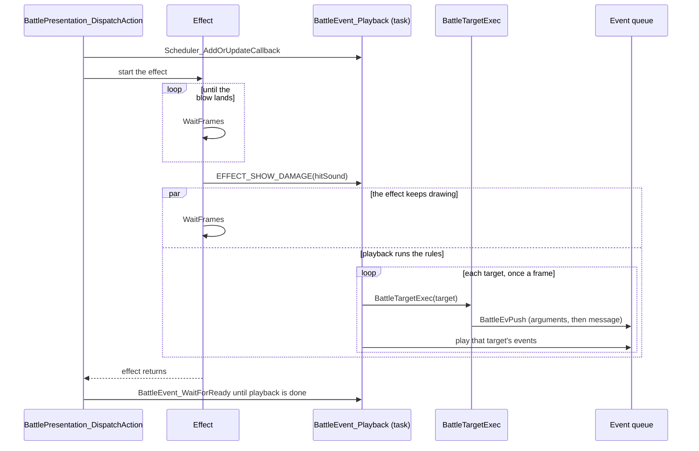

# Battle

The battle layer is the code that runs a fight from its opening transition to
the spoils: the rounds and turn order, the ability tables, the arithmetic each
target goes through, and the effects drawn over the battlefield while it
resolves.

## Starting a battle

A battle is a scene of its own, but not an overlay: its code is in the main
image's `battle` bank. A random encounter raises a field exit like any other,
with `SCENE_BATTLE` as the next scene and the enemy group in
`gGameState.entrance`. `Game_Run` (`src/object/object/scene.c`) resets the
task table and the heap as it does between any two scenes, then calls
`Battle_RunEncounterFar(entrance)` instead of loading an overlay. The debug
battle menu (`DebugBattle_RunMenu`) is the only other caller.

`Battle_RunEncounter` (`src/battle/battle/encounter.c`) allocates the
battle's work slots, `gBattleWork` among them, sets `FLAG_IN_BATTLE`, and
fights the whole battle before it returns. The result is the number of
enemies defeated, `ENCOUNTER_FLED` or `ENCOUNTER_PARTY_LOST`.
`Scene_ReturnFromBattle` then reloads the field scene the battle started
from, with the party where it was, or after a defeat goes to the defeat
point. The enemy group is a row of `formatn.tsv`, which `formation.c` turns
into enemy units; the encounter zones in `src/object/encounter.tsv` choose
the row.

## Units and abilities

Everyone in a fight is a unit. Party members keep their character numbers as
unit ids, and enemies take ids from `FIRST_ENEMY_UNIT`. `UnitGetFar` returns
a unit's `struct BattleUnit`, with its HP, PP, stats, statuses and a Power and
a Resist in each element.

Everything a unit can do on its turn is an ability, from Attack to Quake, a
Djinni, a summon, an item's use or an enemy's special move. An ability id is
a row number, the same row in three tables:

- `src/game/actions.tsv` (`struct BattleAct`, read with `BattleActGet`) says
  what the ability does: its targets, element, range, PP cost, power, added
  effect and ability kind.
- `src/battle/actflags.tsv` (`gBattle_ActionFlags`) picks the effect that
  draws it, and how it is staged.
- `src/battle/actstat.tsv` (`gBattle_ActionStatus`) can override how the
  battle shows it.

Quake is row 3. Its row of `actions.tsv` has element `ELEMENT_VENUS`, range 2,
a PP cost of 4 and a power of 12, and its `flags` are `0x85`:
`ACTION_USABLE_IN_BATTLE` plus `ABILITY_KIND_DAMAGE`. The ability kind, the
low four bits of `flags` (`ABILITY_KIND_MASK`), chooses the formula the
targets go through. The effect kind in `actflags.tsv` is an unrelated number
that chooses only the animation, so the formula and the picture can be
changed independently. [Game rules](src/game/README.md) has the tables and
the unit stats they feed.

## Rounds and turns

A round has five steps, each in its own part of `src/battle/battle/`:

1. `round.c` gathers every unit's action: the party's from the command menu,
   the enemies' from `BattleCommand_SelectAutomatic` (`enemy_ai.c`), or from
   the other console in a link battle, and from `auto_battle.c` under
   `FLAG_AUTO_BATTLE`. `BattleQueue_SortByPriority` sorts them by Agility,
   fastest first, except that Granite, Flash and Ground go before everyone.
2. `BattleCommand_BuildPlan` (`plan.c`) turns each action into a
   `struct BattlePlan`: the ability id, the targets, double and critical blows
   rolled in advance, and the staging.
3. `BattlePresentation_DispatchAction` (`staging.c`) stages the plan and runs
   its effect.
4. `BattleTargetExec` (`target_exec.c`) applies the ability to each target.
5. `turn_end.c` counts down stat changes and statuses, recovers Djinn and
   applies poison and the Grim Reaper's countdown.

The battle ends when one side has no unit left standing or the party gets
away. [Battles](src/battle/README.md) goes through each step, enemy action
selection, first strikes and escape.

## Resolving an ability

`BattleTargetExec` handles one target at a time. It rolls the added effect
(`BattleHitCheck`), then switches on the ability kind to choose the formula,
then applies the added effect if it landed. The formulas are in
`src/game/game/battle_calc.c` and are called by their far-call names:
`BattleAtkCalc` for attacks, `BattlePowerCalc` for Psynergy damage,
`BattleRecoveryCalc` for healing.

For `ABILITY_KIND_DAMAGE` the power is the damage the aimed target takes when
the caster's Power in the ability's element equals the target's Resist in it;
a random 0 to 3 is then added. Quake's 12 is therefore 12 to 15. Two factors
scale it:

- Distance. A range counts places in the target side's line-up, and each step
  from the aimed place takes a lower share from the fall-off tables in
  `src/battle/battle_calc.s`: 80 percent one step away and 60 two steps away
  for Psynergy damage. Summons and enemy unleashed damage have tables of
  their own.
- Element. Each point the caster's Power is ahead of the target's Resist adds
  half a percent, up to double, and each point behind takes half a percent
  off, down to nothing (`Battle_GetElementMultiplier`). The multiplier is
  counted in 256ths (`FULL_RATE`), and every result rounds down.

[Battles](src/battle/README.md#how-an-ability-resolves) has every ability
kind's formula, the fall-off tables and the added effects, worked through for
Avalanche, Cure and Ragnarok.

## The battle's picture

A battle is drawn on three backgrounds and the sprites. The battlefield is
`BG2`, an affine plane in perspective (`BATTLE_BACKGROUND_PLANE`):
`BattleCamera_SetRange` builds a page of per-line values, and an HBlank DMA
gives every line from 0 to 135 its own `BG2CNT` and scale, so the plane stops
above the status window and turns with the camera's yaw. Outside the time
commands are chosen (`FLAG_CHOOSING_COMMANDS`), its top 16 lines are left off.
`BG1` holds the same picture flat. An effect that needs `BG2` for its canvas
switches the background to that flat picture (`BATTLE_BACKGROUND_FLAT`), whose
horizontal scroll follows the camera. `BG0` holds the windows, and the units
are sprites.

## Effects

`BattlePresentation_DispatchAction` starts the effect through one of three
entry points, chosen by bits of the plan's `presentationFlags`, which are the
ability's `actflags.tsv` row:

- `BattleFx_RunTableEffect` for an ordinary effect kind, an index into
  `gBattleFx_EffectHandlers`.
- `BattleFx_DispatchByIdRange` when `STAGING_BY_ID_RANGE` is set: casting
  impacts, beam sequences and ring and spark scenes, by the effect kind's
  range.
- `BattleFx_RunSceneEffect` when `STAGING_SCENE` is set: the summons' scenes.

Each entry point takes three heap blocks (the sprite sheet, the work block
and the canvas), runs the effect to its end and releases them in reverse
order, since releasing a heap block also releases everything allocated after
it. An effect must therefore remove every callback that reads those blocks
before it returns.

Most effects draw into a canvas of 128 by 128 pixels, one byte each, which
`BG2` shows blended over the battle and stretched to twice its width
(`BattleFx_BeginCanvasLayer`). An effect copies pictures onto the canvas
through blitters, ARM routines `BattleFx_BuildBlitter` assembles at run time
for one combination of size, mirroring, clipping and blend mode, and moves
particles over it. It never writes video memory itself: it sets
`transferPending` and waits, and the callback
`BattleFx_ProcessPendingGraphicsTransfer` copies the canvas and then fades,
clears or keeps the pixels left in it as the work block's transfer mode says.
Canvas pixels are levels in a palette ramp, so fading them makes trails die
away without per-particle bookkeeping.

Flint is a casting impact, reached through `BattleFx_DispatchByIdRange`
(`src/effect/parts/casting_impact.c`): 64 sparks gather on the caster, `BG2`
is moved so the impact sits over the target, and 32 scattering sparks follow
the impact.

Every effect runs a fixed number of frames, and within a frame its steps run
in a fixed order. The order is part of the effect's output: later steps draw
over earlier ones, and many steps draw random numbers, so moving one changes
every random value after it.

The twelve summons that need two or more Djinn are scenes, enumerated by
`enum SceneEffectKind`. They take the same three blocks; unlike
`BattleFx_RunTableEffect`, `BattleFx_RunSceneEffect` leaves setting
`work->effect` to each scene. The four summons that need one Djinni, Venus,
Mercury, Mars and Jupiter, are ordinary effect kinds. A summon's damage
(`ABILITY_KIND_SUMMON`) also adds 3 percent of the target's maximum HP to the
power for each Djinni it uses.

`BattleFx_RunJudgment` (`src/effect/parts/judgment.c`) replaces the battle's
display with backdrops of its own and runs in two parts, each with its own
frame clock (`JUDGMENT_GATHER_FRAMES`, `JUDGMENT_SWEEP_FRAMES`). The battle
comes back near the end of the second part, and the damage is shown after
it has.

[Battle effects](src/effect/README.md) describes the canvas, the blitters,
the particle pools and every effect family.

## Rules and effects run together

An effect is an ordinary function with a loop of its own: it calls
`WaitFrames` whenever time has to pass and returns only when the animation is
over. The battle code that called it cannot run until then, yet the damage
messages appear while the effect is still on screen.

They are shown from a task. Before it starts the effect,
`BattlePresentation_DispatchAction` schedules `BattleEvent_Playback`
(`src/battle/battle/playback.c`) with `Scheduler_AddOrUpdateCallback`, and
after the effect returns it waits in `BattleEvent_WaitForReady` until
playback is done. Playback stays idle until the effect calls
`EFFECT_SHOW_DAMAGE(hitSound)`, which most effects do on the frame the blow
lands; if an effect never calls it, the wait after the effect starts playback
instead. From then on, once a frame, the task runs `BattleTargetExec` for the
next target and plays that target's events over the following frames before
it moves on.

The two sides meet at the battle event queue (`struct BattleEventQueue`,
`BATTLE_EVENT_CAPACITY` events). `BattleTargetExec` never draws or waits: it
changes the target's HP and statuses and pushes events with `BattleEvPush` in
the order the player sees them, a message's arguments before the message,
since the message takes them from the window system's argument table when it
is decoded. `BattleEvent_DispatchQueued` plays the same queue straight
through, for outcomes shown outside an effect, such as a cast that is sealed
or short of PP.

The invariant is that the effect decides only when the damage appears, and
the rules alone decide how much it is. A later target's arithmetic runs while
the effect is still drawing. XXX: what starts playback for the effect parts
that never call `EFFECT_SHOW_DAMAGE`, beyond the wait after the effect, is not
known.

## Limits

- There are 519 abilities, ids 0 to 518; `actstat.tsv` is one row shorter.
- A plan reaches at most `TARGET_MAX` (14) targets.
- The party fights four at a time and the enemies six at most
  (`PARTY_BATTLE_SIZE`, `ENEMY_BATTLE_SIZE`).
- `formatn.tsv` has 380 enemy groups, each of up to five kinds of enemy.
- The event queue holds `BATTLE_EVENT_CAPACITY` (64) events.
- The canvas is 128 by 128 pixels, the work block holds 64 particles, and
  there are two blitter slots.
