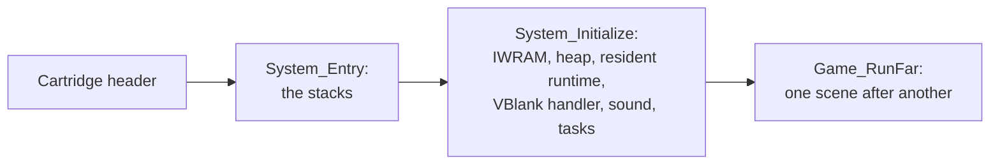
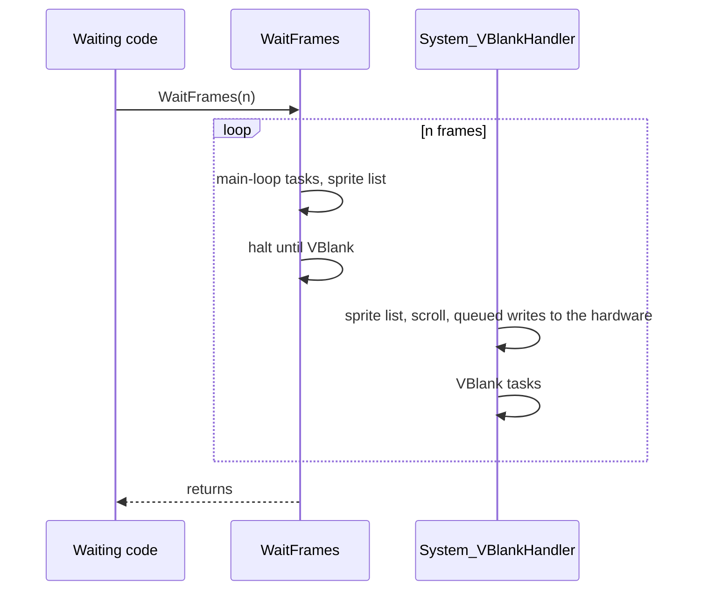
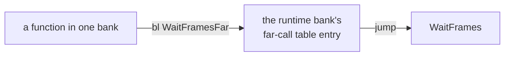

# Engine

The engine is the code the field, the battles and the menus are built on:
start-up, the frame loop and its tasks, the banked layout of the main image,
the overlays that hold each place's code, and the sound driver's cues.

## Start-up

Start-up takes the console from the cartridge header to the game's main loop,
and never returns.

The cartridge header jumps to `System_Entry` (`src/system/entry.s`), which
sets up the interrupt and system stacks at the top of IWRAM and calls
`System_Initialize`. That function clears IWRAM below the stacks, empties the
heap, copies the resident runtime into IWRAM and points the interrupt vector
at its dispatcher, installs `System_VBlankHandler`, starts the sound driver,
resets the task table, waits ten frames and calls `Game_RunFar`.

Neither function returns. `Game_Run` loads one scene after another for as
long as the game runs, starting with the title. A soft reset (A, B, Select
and Start held together) sets `gResetRequested`, and the frame loop restarts
the game from the cartridge's entry point.
[Runtime](src/runtime/README.md#start-up) goes through start-up step by step.
The title's intro, with the Nintendo and Camelot logos before it, is code in
[Graphics](src/graphics/README.md#the-title-sequence), beside the handwritten
decoders that unpack tiles and animation frames for the rest of the game.

## Waiting and tasks

Code lets time pass by calling `WaitFrames`, and work that must go on while
it waits runs as a task the scheduler calls every frame.

There is no main loop that calls each part of the game once a frame. A menu
screen, a cutscene or a battle effect is an ordinary function with a loop of
its own, and when time has to pass it calls `WaitFrames(n)` and continues
after `n` frames. Each frame, `WaitFrames` runs the main-loop tasks
(`Scheduler_RunPass(SCHEDULER_KEY_MAIN_LOOP)`), builds the sprite list
(`Render_BuildOamList`) and halts the CPU until VBlank. The VBlank handler
then copies the sprite list and scroll registers to the hardware, carries out
the queued register writes and runs the VBlank tasks.

Work that has to continue while a function waits is a task: a routine added
with `Scheduler_AddOrUpdateCallback`, which the scheduler runs every frame
however deep in its calls the waiting function is. Window animation, battle
event playback (`BattleEvent_Playback`) and a scene's callbacks are tasks.

This design puts a bound on the stack. The system stack is 1,792 bytes of
IWRAM, and the interrupt handlers and the sound mixer run on it too. A
function waiting from deep in its own calls would leave the tasks too little
room, so when the stack pointer is below `Ram_FrameWaitStackTop`, 512 bytes
above the heap's end, `WaitFrames` copies everything from the stack
pointer up to that top into `gSavedStack` in EWRAM, runs its frames from the
top and copies the stack back on return. Tasks therefore always start with the same 512 bytes. It also
means a task must not call `WaitFrames`: the nested call would overwrite the
outer caller's saved stack. XXX: nothing guards against this, and whether any
task does it isn't known.

| Name | Value | Meaning |
| --- | --- | --- |
| `SCHEDULER_KEY_MAIN_LOOP` | `0xc80` | the pass `WaitFrames` runs each frame |
| `SCHEDULER_KEY_VBLANK` | `0x480` | the pass the VBlank handler runs |
| `Ram_IwramHeapEnd` | `0x03007800` | the end of the IWRAM heap |
| `Ram_FrameWaitStackTop` | `0x03007a00` | the stack top `WaitFrames` runs its frames from, 512 bytes above the heap's end |

[Runtime](src/runtime/README.md#the-frame-loop) has the frame's order,
[the stack switch](src/runtime/README.md#the-stack-switch-in-waitframes) and
[the task scheduler](src/runtime/README.md#the-task-scheduler).

## Banks and far calls

The main image's code is laid out in banks at fixed addresses, and a call
from one bank to another goes through an 8-byte jump in the callee's far-call
table.

`main.ld` places the main image's code in banks (`runtime`, `field`,
`window`, `game` and the rest), each at an address fixed per edition, with
unused space after it. Each bank begins with a far-call table of 8-byte
jumps, one for each function another bank calls, and a caller in another bank
normally calls the table entry (`WaitFramesFar` for `WaitFrames`) rather than
the function's own address. Not every call does: the auto-battle code
(`src/battle/battle/auto_battle.c`) calls `WaitFrames` directly. XXX: which
calls skip the table, and why, isn't known; a count of direct calls between
banks in the link map would settle how common it is.

Distance isn't the reason: a Thumb `bl` reaches 4 MB either way, and the main
image is a little over 1.5 MB. The tables let a bank change size within its
space without moving any address another bank depends on. XXX: likely Camelot
linked each bank on its own against the others' tables, because fixed starts
and tables are what that would need; the ROM shows only the result.
[System](src/system/README.md#why-the-program-is-cut-into-banks) has the
memory map and the per-edition bank addresses.

## Overlays

Each place's code is an overlay, unpacked into one fixed area of EWRAM when
its scene loads, and it meets the main image only through two tables.

An overlay is a compressed resource unpacked into `gOverlayArea`, 32 KB of
EWRAM. There are 96 of them, listed in the
scene table (`src/field/scenes.s`). Only one is loaded at a time, so overlays
never call each other, and code several scenes need is copied into each of
them (`src/scene/common/`).

An overlay and the main image meet at two tables, each in a fixed order:

- The entry table (`scene/entry/<place>.s`) opens the overlay with six stubs
  the field code calls through `struct SceneEntries`: the scene's start-up
  and the functions that return its entrances, exits, placements, events and
  exit regions.
- The import table (`scene/import/<place>.s`) holds the main-image functions
  the overlay calls. EWRAM is out of `bl` range of the ROM, so each call goes
  through a stub holding the address of the function's far-call entry, never
  the function itself; an overlay therefore depends only on positions in the
  far-call tables.

[System](src/system/README.md#how-an-overlay-reaches-the-rest-of-the-game)
describes both tables and how `Resource_LoadCode` restores the overlay's
branches as it unpacks it.

## Sound cues

Every sound is played by `AudioCommand_Play` with a cue number, whose range
decides whether it is music, a fanfare or a sound from the song table.

Below 80 a cue is music; from 80 to 99 (`AUDIO_JINGLE_FIRST`) a
fanfare; from 100 (`AUDIO_SONG_FIRST`) an entry of the song table, played on
the player its row names, which is how sound effects play. Cues 17, 18 and
289 are controls rather than sounds.

A fanfare doesn't stop the music. The music's volume drops to 0 while it keeps
playing, the fanfare plays on player 0, and once that player stops the music
fades back in over 64 frames, so the code that asked for the fanfare doesn't
have to track it. The driver is Nintendo's MusicPlayer2000.

| Name | Value | Meaning |
| --- | --- | --- |
| `AUDIO_CUE_FADE_BGM` | 17 | fade the music out over 112 frames |
| `AUDIO_CUE_KEEP_BGM` | 18 | keep the music that is playing |
| `AUDIO_JINGLE_FIRST` | 80 | first fanfare cue; below it, music |
| `AUDIO_SONG_FIRST` | 100 | first cue that is a song table row |
| `AUDIO_CUE_FADE_SLOT3` | `0x121` (289) | fade player 3 out over 48 frames |

[Sound](src/sound/README.md#what-a-cue-number-means) covers the players,
[the fanfare's return](src/sound/README.md#the-fanfares-return-to-the-music)
and [the driver's lock](src/sound/README.md#the-drivers-lock).

## Debug rooms

Three test scenes kept in the ROM are reached only from the debug scene
selector.

The ROM keeps three test scenes: a room that hands out Djinn, a room for
levels and for browsing items, icons and letters, and a room of shop and
message tests. Only the debug scene selector reaches them, and only while
`gDebugMode` is set. Each is an ordinary scene overlay, so they're the
smallest complete examples of how a scene is built.
[Debug rooms](src/debug/README.md#how-the-rooms-are-reached) goes through
them.

## Limits

- The frame loop, its tasks and the VBlank work share 512 bytes of stack, and
  a task must not call `WaitFrames`.
- 20 scheduled tasks at a time.
- An overlay has the 32 KB of the overlay area, and a bank the space up to
  the next bank's fixed start.
- Eight sound players; cues are 12 bits, 0 to 4,095.
