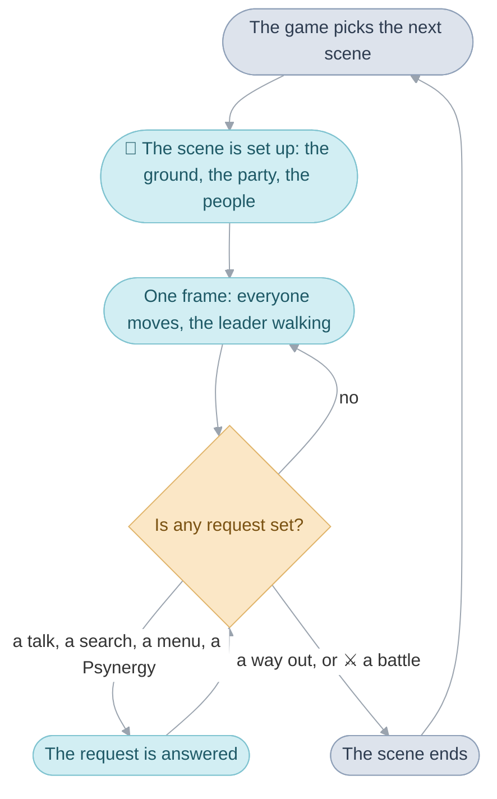

# Field

Walk Isaac around Vale. He goes where the D-pad points, the river keeps
flowing, and a villager wanders by the gate. Step onto a doorstep and a door
opens. Press A beside someone and they talk. Walk out of the gate and the
World Map opens, and in a cave any step may start a battle.

The game calls all of that the [field](glossary.md#field): everything
[the party](glossary.md#the-party) does outside a battle and outside a
menu.

Each section below gives one idea from it in brief, and ends by pointing to
the guide with the rest. There are three guides. [Field
code](src/field/README.md) is the walking itself, which is the same in every
town. [Scenes](src/scene/README.md) is what belongs to one place: Vale's
people, Vale's doors, what each villager says. [Maps](src/map/README.md) is
the ground each place is drawn on.

## Scenes and areas

Climb the steps to the Sanctum's door in Vale. Vale fades out, and the hall
fades in with Isaac just inside. The game has ended one place and started
another.

It calls each such place a [scene](glossary.md#scene). Vale outdoors is
one, the Sanctum's hall is another, and so is the World Map. Even the Title
is one. There are 201, and the last ten were the developers' own test rooms
([Debug scenes](src/debug/README.md#the-test-scenes)).

The game keeps one list of all 201, with a line for each. A line says where
to find the scene's own instructions, such as what Vale's villagers say,
and which ground it is drawn on.

It also says whether the scene is a town. In the 53 scenes marked as towns,
houses and shops included, Retreat does not work and walking brings no PP
back.

Last, a line says which [area](glossary.md#area) the scene belongs to. An
area is a group of scenes the game treats as one place. Vale's is the
village outdoors, its plaza, Kraden's cottage, the Sanctum and the insides
of the houses. Come in from the World Map and `Vale` shows in a small
window, because the party has changed area. Walk on into the Sanctum and no
name shows, because it has not.

The stone pillar in Vale shows what else an area is for. Push the pillar to
one side, go into a house and come out, and it is where you left it. Walk
out to the World Map and back, and it stands in the middle again. The game
remembers some things only for as long as the party stays in one area, and
forgets them on purpose when it leaves.

How does a game forget on purpose? [State that cleans itself
up](src/scene/README.md#state-that-cleans-itself-up) has the answer, and
[The game flags](src/game/README.md#the-game-flags) covers everything the
game remembers. [Scenes](src/scene/README.md#design) says why the 201 are
kept as one list.

## The field sequence and its requests

In Vault, walk up to the young man in the recording and press A. A moment
ago the player was steering Isaac freely. Now both have stopped and turned
to each other, and a line of text is on the screen. How did the walk know
to stop?

The walk goes one [frame](glossary.md#frame) at a time. A frame is one
picture on the screen, and the console draws about sixty a second. In each
frame everyone in town moves a little. Then the game asks a single
question: has anything happened that needs an answer?

Whatever needs an answer has set a [field
request](glossary.md#field-request). Pressing A sets one. So does stepping
onto a doorstep, a battle coming due, or picking a Psynergy from the menu.
There are twelve kinds of request.

When a request is found the walk stops, and the requests are answered one
at a time. A request to leave the place is answered first, since nothing
else matters once the party has gone. When no request is left, the player
has Isaac back.

The code that does all this, from setting a scene up to leaving it, is
called the [field sequence](glossary.md#field-sequence).

A battle is the surprise in the diagram. To the field sequence a battle is
a way out, like a door. The cave the party was in is thrown away while the
battle plays. Afterwards the cave is set up again from nothing, with
everyone put back where they stood.

What does the A button do when nobody is in front of Isaac? [The field
sequence serves
requests](src/field/README.md#the-field-sequence-serves-requests) follows
it, and goes through the set-up and all twelve requests.

## Triggers and events

Once the party has reached Kalay, go back to Vault and talk to the mayor. He
is delighted: `Oh, Isaac! You've come back to Vault!` Talk to him a second
time and he only warns: `Those guys really wanted revenge on you, so take
good care of yourselves.`

The walking code is the same in every town, so it knows nothing about a
mayor. It asks the scene. Every scene answers the same six questions:

- What can happen here?
- Where does the party arrive?
- Who stands where?
- Is there anything to set up before the screen fades in?
- Has the leader walked into a way out?
- Where does this way out lead?

The answer to "what can happen here?" is a list, and each line of it is a
[trigger](glossary.md#trigger). A line says what the player does (talks,
steps, searches, casts), to whom or where, when the line still counts, and
what happens then.

The mayor has two lines. The first is his welcome, and it counts only until
Isaac has been welcomed. The second is his warning, and it always counts.
The game reads the list from the top and takes the first line that fits.
That one rule is how a villager comes to say something new as the story
moves on.

What happens then can be small: one message, an item found, a way out. Or
it can be an [event](glossary.md#event), a short piece of the scene's own
instructions that takes the party over and plays from top to bottom. The
mayor's welcome is an event. So is a door opening, and so is a whole
cutscene.

The mayor's two lines are shown as they are written in [How a trigger is
chosen](src/scene/README.md#how-a-trigger-is-chosen), along with the one
case where the rule is broken on purpose: a chest that still answers after
it is empty. [The entry table](src/scene/README.md#the-entry-table) takes
the six questions one by one.

## Exits and entrances

Walk down the path from Sol Sanctum's entrance before the eruption and it
leads into Vale. Walk down it just after, and the same path leads into a
different scene: Vale in the middle of the eruption.

The game gives every way out of a scene a name, and calls it an
[exit](glossary.md#exit). This path's name amounts to "from Sol Sanctum's
entrance, to Vale". But there are two Vales, so the name is not enough.

A list belonging to the scene settles it, and it has three lines for this
one path. The first sends the party to Vale and counts until the eruption.
The second sends it to Vale during the eruption and counts until the party
has left the village. The third sends it to Vale again, ever after. As with
the mayor, the first line that counts wins.

Each line also names the spot where the party appears on the other side,
called an [entrance](glossary.md#entrance). An entrance is named for where
the party came from: here, "Vale, from Sol Sanctum's entrance".

An entrance can say how far the screen may scroll, too. The insides of
several houses are often drawn next to each other on one piece of ground,
which the game calls a [sheet of rooms](glossary.md#sheet-of-rooms). The
entrance keeps the neighbouring rooms out of sight.

[Exits](src/scene/README.md#exits) shows the three lines for the path, and
[Entrances](src/scene/README.md#entrances) the spots. A random battle is a
way out that skips both lists, and [Leaving for a battle and coming
back](src/field/README.md#leaving-for-a-battle-and-coming-back) says where
the party goes when it loses.

## Actors and their actor scripts

Walk through Imil's snow and Isaac leaves footprints, which fade one by one
behind him. Nobody is going round rubbing them out. Each footprint looks
after itself.

Everything on the field that moves or changes by itself is an
[actor](glossary.md#actor). Isaac is one, and so are the townspeople, a
chest, and each footprint. Even the point the screen is centred on is an
actor, one nobody can see. A scene has room for 64 at once.

Every actor carries a short list of orders, and carries out a little more
of it in each frame. The game calls the list an [actor
script](glossary.md#actor-script). A footprint's is two orders long: wait
120 frames, then disappear. That is two seconds.

The neat part is Isaac himself. While the player is steering, his script is
a single order, repeated every frame: do what the D-pad says. When a door
or a cutscene needs him, the event takes that order away and gives him
others. That is all it means for the game to take control.

What orders can a script give, and how does a villager wander without one
written for him? [Everything that moves runs an actor
script](src/field/README.md#everything-that-moves-runs-an-actor-script)
answers both, and [Who stands
where](src/scene/README.md#who-stands-where) shows how a scene lists its
people.

## Movement

Walk Isaac into a cliff at a slant and he does not stop dead. He slides
along it.

He walks one pixel a frame, a pixel being one dot of the screen, and runs
one and a half with B held. Before he moves, the game tests the ground a
few pixels ahead. If the way is blocked it tries the directions a little to
either side, then a little further round, and takes the first that is
clear. Along the wall is usually the nearest one.

Most walls are not marked as walls at all. Every spot on the ground has a
height, and Isaac can step up by 8 pixels and down by 12. A cliff is simply
ground too high to step onto.

When no direction is clear, Isaac stays put and the game counts the frame
as a push. A door, a ledge or a ladder usually answers only after more than
12 pushes in a row, about a fifth of a second. That is why Isaac leans on a
door for a moment before it opens, and why brushing past a ledge does not
send him over it.

[Walking and running](src/field/README.md#walking-and-running) has the
tests the game makes each frame, and [How high a step can
go](src/field/README.md#how-high-a-step-can-go) the heights.

## Cells and cell behaviors

The foot of the ladder beside Isaac's house looks like any other patch of
grass. What makes it a place to climb is a number.

The ground of a place is its [map](glossary.md#map): a grid of squares, 16
pixels on a side. The game calls each square a [cell](glossary.md#cell). A
cell says what is drawn there, how high the ground is, and what standing
there does. That last part is a number, its [cell
behavior](glossary.md#cell-behavior).

The cell at the foot of the ladder carries the number 100. By itself 100
means nothing. Vale's list of triggers gives it a meaning: walk north into
a cell numbered 100 and Isaac climbs onto the roof. In Kolima, 100 is a jar
with an Apple in it. Each scene reads its map through its own list, so the
numbers from 1 to 239 are free to mean something new in every place.

The few numbers above 239 mean the same everywhere, so no scene has to
explain them. One is a ledge, hopped down with Down held. Others are a
wall, something to climb, a gap to jump, and the plain jars and barrels
that anyone can search.

[Cells](src/map/README.md#cells) lists them, and shows how one cell of Sol
Sanctum is written down.

## Map layers

Walk Isaac behind a house in Vale and the roof hides him.

A town is not one picture. It is three flat sheets laid one over another:
the ground at the back, then the walls and edges, then the roofs and
treetops in front. The people are drawn between the sheets, usually in
front of the walls and behind the roofs. So Isaac disappears behind a roof
without the game ever working out what a house is.

The console is built to draw sheets like these, and calls each a
[background layer](glossary.md#background-layer). Every frame the three
slide together, to follow Isaac.

[Towns and dungeons on
screen](src/field/README.md#towns-and-dungeons-on-screen) has a recording
of Vale pulled apart into its sheets, and says how the waterfall keeps
falling. [One grid, three layers](src/map/README.md#one-grid-three-layers)
shows where the three sheets are kept in a map.

## The World Map

On the World Map the land seems to stretch away toward a horizon. It is a
flat map all the same, and the tilt is a trick.

The console draws the screen one line at a time, 160 lines from top to
bottom, and it can stretch a picture differently on every line. So the game
gives each line its own stretch. The lines at the bottom show a short strip
of ground near the party, drawn large. The lines at the top show a long
strip far away, squeezed small. Stack them up and the flat map leans away.

The World Map is one of the 201 scenes, with its own ways out, into towns
and caves, and its own random battles. It also has two buttons that no town
has. Hold L and the view pulls back to show more of the land. Press R and a
picture of the whole world comes up, with markers on places the party has
been.

[The World Map in
perspective](src/field/README.md#the-world-map-in-perspective) works
through the lines, and says why the world holds still while someone talks.
[The World Map's data](src/map/README.md#the-world-maps-data) says how so
large a map is stored.

## Random encounters

Random battles are less random than they feel. The game is measuring how
far the party has walked.

It keeps a count that goes up as Isaac moves, and a battle starts when the
count is full. How fast it fills depends on the ground. In the room of Goma
Cave with the pond, it fills after 480 pixels of walking, which is thirty
cells.

Run through that room and the battle comes sooner, but after the same 480
pixels. Running through a cave meets no fewer monsters than walking through
it. Standing still meets none.

A little luck is mixed in, so the player cannot count steps. After every
battle the game draws a random number and stretches or shrinks the distance
to the next one.

The ground says who attacks, too. Each stretch of monster ground lists its
groups of monsters and how likely each is. It also names the level it was
made for: the pond room is made for level 4, and a party that has outgrown
it meets its battles further apart.

[Random battles](src/field/README.md#random-battles) has the counting, the
luck, what the Lure Cap and Avoid change, and the pond room's monsters.

## Field Psynergy

Cast Move facing the stone pillar in Vale and a giant hand settles on it,
ready to push. Cast Move in the open and the same hand appears, finds
nothing, and is gone.

The walking code draws the hand both times, because the hand is the same
everywhere. What it cannot know is that a pillar in Vale is something Move
should push. That is Vale's knowledge, and Vale writes it in its list of
triggers as one more kind of line: Move, on the pillar.

So a cast of [Psynergy](glossary.md#psynergy-and-pp) begins by looking. The
game checks what Isaac is facing, and whether the scene has a line for this
Psynergy on that thing. Vale's line runs once the player has steered the
pillar, and remembers where it now stands.

[How field Psynergy reaches its
target](src/field/README.md#how-field-psynergy-reaches-its-target) follows
a cast moment by moment, and says how far each Psynergy reaches.

## Design

Nothing interrupts the walk in the middle of a frame. A doorstep, a button
or a monster can only set a request, and the requests are read once the
frame is over. So an answer always starts between one frame and the next,
and can take as long as it likes: a single line from the mayor, or a whole
cutscene.

The walking code never learns the story. It asks each scene its six
questions again on every visit, and the scene's own instructions decide
the answers. Vale keeps three whole lists of triggers, one for each stretch
of the story, and hands over the one that fits the day. Inside a list, the
mayor's rule does the rest.
