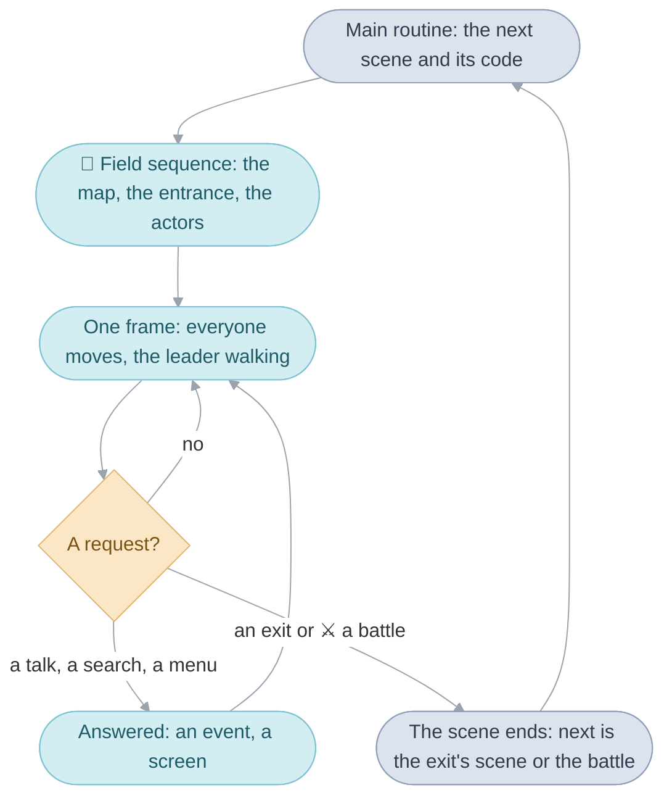

# Field

The party walks around Vale. The leader goes where the D-pad points, the
river keeps flowing, a villager wanders by the gate, and a step onto a
doorstep or a press of A makes something happen. A door leads into a house,
the gate leads out onto the World Map, and in a cave any step may start a
battle.

The [Field](glossary.md#field) division is the code that runs wherever the
[party](glossary.md#the-party) walks, in three folders:

- [Field code](src/field/README.md) runs the walk: it moves everyone, draws
  the ground and answers what the player does.
- [Scenes](src/scene/README.md) holds each place's own code: its people, its
  doors and what happens there.
- [Maps](src/map/README.md) holds the ground each place is drawn on.

## Scenes and areas

A [scene](glossary.md#scene) is one place the party can be: a town, a floor
of a dungeon, the rooms of a few houses, the World Map, or a screen such as
the Title. There are 201, and a table says four things about each: which
[overlay](glossary.md#overlay) holds its code, which
[area](glossary.md#area) it belongs to, whether it is a town, and which
[map](glossary.md#map) it is drawn on. An area is a group of scenes that
share a name, music and a set of [game flags](glossary.md#game-flag): Vale
and the rooms of its houses are one, so the name `Vale` shows on arriving
from the World Map and stays away on walking from the street into a house.
[Scenes](src/scene/README.md#design) says how a scene finds its code,
[State that cleans itself up](src/scene/README.md#state-that-cleans-itself-up)
which flags a scene and an area may scribble on, and
[The game flags](src/game/README.md#the-game-flags) describes the flags as
a whole. The last ten scenes are the developers' test rooms
([Debug scenes](src/debug/README.md#the-test-scenes)).

## The field sequence and its requests

The [field sequence](glossary.md#field-sequence) runs one scene, from the
moment the party arrives until it leaves. First it sets the scene up: the
map, the party at its [entrance](glossary.md#entrance), the people. Then it
walks the party one [frame](glossary.md#frame) at a time. Whatever should
interrupt the walk leaves a note, a
[field request](glossary.md#field-request): a press of A beside someone, a
step onto a doorstep, a random battle coming due. Once the frame is over,
the requests are answered one at a time in a fixed order, leaving first,
and the walk goes on.
[The field sequence serves requests](src/field/README.md#the-field-sequence-serves-requests)
goes through the set-up and each of the twelve requests.

## Triggers and events

The field knows nothing about Vale. It puts six fixed questions to the
scene's code, such as who stands where and what can happen here, and each
answer is a table. What can happen is the scene's table of
[triggers](glossary.md#trigger). A row says what starts it, such as a talk,
a step or a search, whom or where it is for, when it still applies, and
what it runs: a message, or an [event](glossary.md#event), code that plays
from top to bottom while the party waits. The first row that fits runs, so
a villager says something new once the story has moved on.
[The entry table](src/scene/README.md#the-entry-table) lists the questions,
and [How a trigger is chosen](src/scene/README.md#how-a-trigger-is-chosen)
follows a row being found.

## Exits and entrances

An [exit](glossary.md#exit) is a way out of a scene, named for where it
leads, and an entrance is where the party arrives in the next one, named
for where it came from. The leader takes an exit by stepping onto a marked
doorstep or into a box on the ground. The scene ends, and the
[main routine](glossary.md#main-routine) looks the exit up in the scene's
exit table, where a row can hold only until a flag is set, so one path can
lead to different scenes as the story moves on. The entrance gives a
position, a facing and how far the camera may go, which is how a
[sheet of rooms](glossary.md#sheet-of-rooms) shows one room at a time.
[Exits](src/scene/README.md#exits) and
[Entrances](src/scene/README.md#entrances) describe the two tables, and
[Leaving for a battle and coming back](src/field/README.md#leaving-for-a-battle-and-coming-back)
the ways out that skip them.

## Actors and their actor scripts

Everything on the field that moves or changes by itself is an
[actor](glossary.md#actor): the party, the townspeople, a chest, the camera
that follows the leader, and each footprint in Imil's snow. Each actor runs
an [actor script](glossary.md#actor-script), a short list of commands such
as walk there, wait and turn, a little further every frame. The leader's
script lets the D-pad steer him, so the player's control is an actor script
like any other. A scene lists its people in a table, each with a place, a
facing and a way of moving, and knows each by its
[actor id](glossary.md#actor-id).
[Everything that moves runs an actor script](src/field/README.md#everything-that-moves-runs-an-actor-script)
lists the commands, and
[Who stands where](src/scene/README.md#who-stands-where) describes the
table.

## Movement

The leader walks one pixel a frame, and runs one and a half with B held.
Each frame the game tests the ground a few pixels ahead before he moves,
and when the way is blocked it tries headings a little further round, so
he slides along a wall where he might have stopped dead. Most walls are
only ground too steep to step onto: he can step up 8 pixels and down 12.
The frames he spends walking into something are counted, and a doorstep
answers after 12 of them, which is why he leans on a door for a moment
before it opens.
[Walking and running](src/field/README.md#walking-and-running) covers the
tests, and
[How high a step can go](src/field/README.md#how-high-a-step-can-go) the
heights.

## Cells and cell behaviors

A map is a grid of 16-pixel squares, the [cells](glossary.md#cell). Each
cell says what is drawn there, how its ground is shaped, and what standing
there does, which is its [cell behavior](glossary.md#cell-behavior). Most
behaviors belong to the scene, whose trigger table says what each means
there, so the same one can be a doorstep in one town and a chest in the
next. A few mean the same everywhere: a wall, a ledge to hop down, a
climbing spot, a gap to jump, and the jars and barrels anyone can search.
[Cells](src/map/README.md#cells) lists every behavior and explains the
shapes.

## Map layers

A town is drawn as three flat sheets, one over another: the ground, the
walls and edges, and the roofs and treetops. The people stand between the
walls and the roofs, so Isaac disappears when he walks behind a house. Each
sheet is one of the console's
[background layers](glossary.md#background-layer), all three are cut from
the map's one grid, and every frame they scroll to follow the camera.
[Towns and dungeons on screen](src/field/README.md#towns-and-dungeons-on-screen)
explains what is drawn in front of what, and
[One grid, three layers](src/map/README.md#one-grid-three-layers) how the
sheets share the grid.

## The World Map

The World Map is a scene like any other, with exits into every town and
cave and random battles of its own. It looks different because its flat map
is tilted: every line of the screen shows the map at its own scale, a
farther and wider strip the higher the line, so the land leans away from
the party. Holding L pulls the view back, and R brings up a picture of the
whole world with a marker on every area the party has visited.
[The World Map in perspective](src/field/README.md#the-world-map-in-perspective)
works through the lines, and
[The World Map's data](src/map/README.md#the-world-maps-data) says how so
large a map is stored.

## Random encounters

How far the party walks decides when a random battle starts, and where it
walks decides how often and against whom. A counter grows as the leader
moves, and a battle starts when it reaches its mark. The ground underfoot
belongs to a zone, which says how far apart its battles are, what level it
is made for and which groups of enemies can appear. When a battle comes
due, the field notes where everyone stands and the scene ends; the battle
runs as the next [sequence](glossary.md#sequence), and afterwards the scene
is set up again with everyone back in place.
[Random battles](src/field/README.md#random-battles) has the counting and
the zones.

## Field Psynergy

Using Move on a stone pillar slides it, and using it where nothing answers
shows the same giant hand and moves nothing. The cast only draws the
[Psynergy](glossary.md#psynergy-and-pp). What it does to a place is
decided by that scene's triggers: a row names the Psynergy, the person or
thing it is for, and the moment it runs at, before the cast or after it.
[How field Psynergy reaches its target](src/field/README.md#how-field-psynergy-reaches-its-target)
follows a cast through each moment.

## Design

The walk stops only between frames. What moves the actors runs in the
middle of a frame, where it can only leave a note; the field sequence reads
the notes once the frame is over and answers them with code that is free to
take its time. That one rule lets an event be written as plain code from
top to bottom.

A scene's answers are functions. The field asks the scene's code for each
table, so the code can hand back a different table as the flags change, and
one overlay can serve several scenes.

Exits and entrances name each other. An exit says only where it leads, and
the next scene's entrance says where that is, so a door is two names, one
on each side, and the exit table is the one place the two are joined.

A battle leaves the scene entirely. The memory a sequence borrows, the
[heap](glossary.md#heap-and-pools), is emptied between one sequence and the
next, so the field keeps everyone's place in a snapshot outside it, and the
scene is set up again from the start with the party put back.
