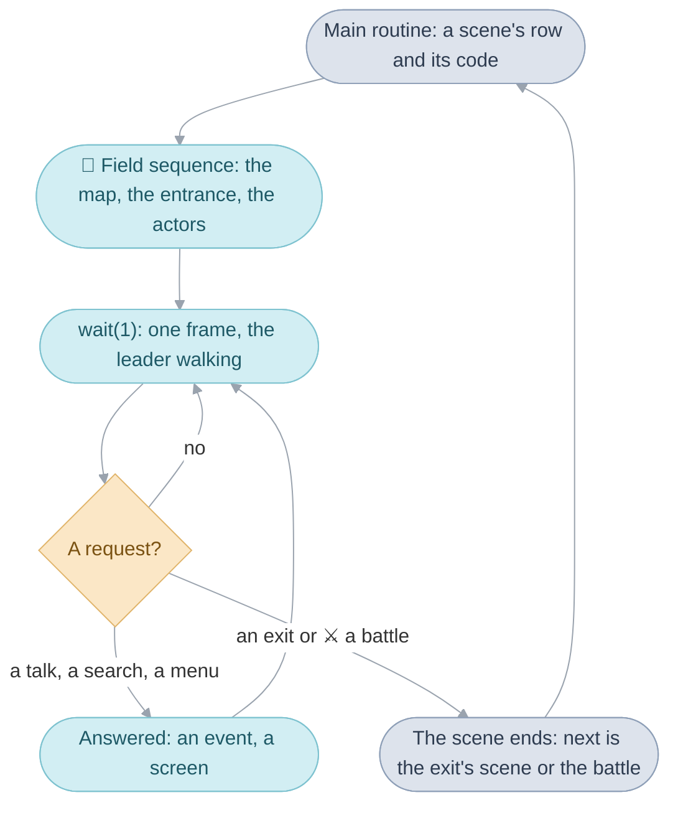
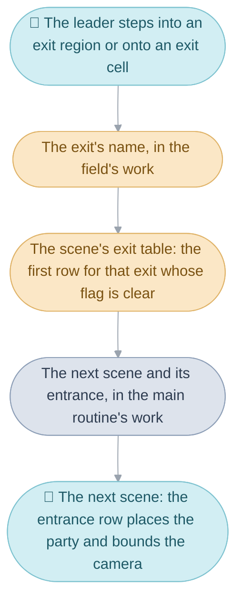
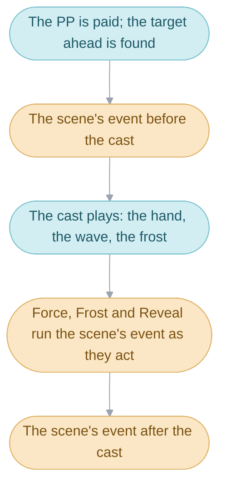

# Field


The party walks around Vale. The leader goes where the D-pad points, the
river keeps flowing, a villager wanders by the gate, and a step onto a
doorstep or a press of A makes something happen. All of that is the Field,
the division of the code that runs wherever the [party](glossary.md#the-party)
walks: a town, a [room](glossary.md#room), a dungeon or the World Map. Three
folders share it. [Field code](src/field/README.md) runs the
[field sequence](glossary.md#field-sequence), moves the
[actors](glossary.md#actor) and draws the [map](glossary.md#map);
[Maps](src/map/README.md) holds what the ground is like; and
[Scenes](src/scene/README.md) holds each [scene](glossary.md#scene)'s own
code, its people, its [triggers](glossary.md#trigger), its events and its
exits. The [main routine](glossary.md#main-routine) that starts each scene
belongs to the System ([System](system.md#the-main-routine)).

This page takes the division in the order one visit to a town runs through
it:

1. The main routine picks the scene from the scene table and loads its code.
2. The field sequence sets the scene up, then walks the party a
   [frame](glossary.md#frame) at a time, each frame one call of `wait(1)`,
   the call that runs one frame of the whole game
   ([The Broken Seal](README.md#code-that-waits)), answering each
   [field request](glossary.md#field-request) the walk raises.
3. The scene's code answers the field's questions: where the party arrives,
   who stands where, and what a talk, a step or a search does there.
4. An [exit](glossary.md#exit) ends the scene and names the
   [entrance](glossary.md#entrance) of the next one.
5. Underneath, the actors and their actor scripts, the leader's movement,
   the [cells](glossary.md#cell) of the map and its layers, the World Map,
   random encounters and field Psynergy do what the requests and events ask
   for.



## Scenes and areas


A scene is one place the party can be, and the scene table is the list of
them. Every scene is a row of `gScenes`, and its row number is its name in
the code, `SceneId_Vale` or `SceneId_Sanctum`. There are 201 rows: the towns,
each room of each house, each floor of a dungeon, the World Map, and screens
such as the Title and the File Screen.

A row says four things, each chosen on its own: which
[overlay](glossary.md#overlay) holds the scene's code, which
[area](glossary.md#area) the scene belongs to, whether it is a town, and
which map it is drawn on. The four are independent, so the Bilibin Barricade
runs on Bilibin's overlay but is an area of its own, and Vault before and
after the thieves are two scenes drawn on one map.

An area is a group of scenes that share a name, music and a set of flags.
There are 71 of them. Vale and the rooms of its houses are one area, so
walking from the street into a house shows no name, while arriving from the
World Map shows `Vale` for 90 frames. Arriving in an area sets its visited
flag, which the world picture reads to mark the places the party has been.

A town is a scene whose row says so. Walking around a town costs the party
nothing: it regains no [PP](glossary.md#psynergy-and-pp), its
[Djinn](glossary.md#djinn) stay as they are, poison does no damage, and
Retreat refuses.

### Scene and area flags

Two ranges of the [game flags](glossary.md#game-flag) are scratch space for
the scene. The scene flags are cleared each time the party walks into a
scene, so a puzzle starts over on the next visit. The area flags are cleared
only when the party enters another area, so a fact can follow the party from
a town's street into its houses and back. A return from a battle clears
neither: the party comes back to the scene as it left it.

`Scene_Arrive` clears the flags and marks the area's name to be shown,
`Scene_ChooseMusic` picks its music and `Scene_LoadOverlay` unpacks its
code, all before the field sequence starts. The rows are `struct Scene` in
[scenes.s](src/field/scenes.s), the music and the names come from
`gScene_MusicRules` and `gArea_NameRules` in
[scene_rules.s](src/field/scene_rules.s), and
[Places](https://alchemy.pascalpixel.com/tbs/places) has a page for every
scene in [story order](glossary.md#the-places-in-story-order).

| Name                      | Value          | Meaning                                                   |
| ------------------------- | -------------- | --------------------------------------------------------- |
| `SCENE_TYPE_TOWN`         | 2              | a town or one of its rooms: 53 rows                       |
| `AREA_NAME_WINDOW_FRAMES` | 90 frames      | how long the area's name shows, about a second and a half |
| `FLAG_SCENE_TEMP_FIRST`   | `0x200`        | the first of the 256 scene flags                          |
| `FLAG_AREA_TEMP_FIRST`    | `0x300`        | the first of the 256 area flags                           |
| `FLAG_AREA_VISITED(area)` | `0x180 + area` | the party has been in this area                           |

## The field sequence and its requests


The field sequence runs one scene from the moment its code is loaded until
the party leaves it, and it is one function, `FieldSequence_Run`. It has two
halves: setting the scene up, and then a loop that walks the party until
something stops the walk.

Setting up happens in a fixed order, since each step needs the one before.
The map is loaded, or the World Map's tilted view is built. The random
battles of the scene are chosen. The actors' two
[tasks](glossary.md#task) are added, one to move the actors and one to draw
them. The scene's code is asked for its triggers. The party is placed at its
entrance, the scene's people are placed, and a camera actor is placed on
the leader. Coming back from a battle, everyone is
put back where they stood. The chests and Psynergy Stones the map marks are
placed. The scene's own set-up runs, and it may send the party straight on.
Then the screen fades in from the backdrop colour over 16 frames, the area's
name shows if the area is new, and a Djinni or an item left over from the
last scene is given.

The loop is the part the player feels. Each pass calls `wait(1)`, which runs
one frame of the whole game: every task once, the leader's walk included,
and then a picture ([The Broken Seal](README.md#code-that-waits) explains
`wait()`). When `wait(1)` returns, the loop looks at the cell the leader
stands on (`Field_UpdateWalking`) and then at the requests.

A request is a note in the field's [work](glossary.md#work) that something
should stop the walk. Whatever happens during the frame leaves such a note:
pressing A beside someone, stepping onto a doorstep or a random battle
coming due each sets a request, and the loop finds it once `wait(1)` has
returned. Then the walk stops, the loop answers the requests one at a time
in a fixed order, and the walk starts again. Leaving comes first, so an
[event](glossary.md#event) that ends by taking an exit simply ends the
scene. A random battle is a way out too: the battle runs as
the next [sequence](glossary.md#sequence), and afterwards the scene is set
up again with the party where it stood.

| Order | Request          | How the loop answers it                                                        |
| ----- | ---------------- | ------------------------------------------------------------------------------ |
| 1     | an exit          | the loop ends and the scene with it                                            |
| 2     | a raised trigger | a trigger the scene's own code raised, or the party falling to poison          |
| 3     | an encounter     | everyone's place is remembered and the battle becomes the next sequence        |
| 4     | a step trigger   | the scene's trigger for the cell stepped onto, or the exit it marks            |
| 5     | a push cell      | a ledge, a climbing spot or a gap, once the leader has pushed for more than 12 frames |
| 6     | the A button     | a talk if someone is ahead, else a search if something is, else the field menu |
| 7     | the field menu   | the row of icons: Psynergy, Djinn, Item, Status                                |
| 8     | a talk           | the actor's talk trigger: a message or an event                                |
| 9     | a search         | the cell's examine trigger: a chest, a jar, a sign                             |
| 10    | Psynergy         | Move, Reveal and the rest, played on the field                                 |
| 11    | an item          | an item used on the field                                                      |
| 12    | the Pause menu   | the Pause menu, with Save your quest                                           |

The requests are the twelve members of `struct FieldWork`, and
`Field_CountRequests` says whether any is set.
[Field code](src/field/README.md#the-field-sequence-serves-requests) goes
through the set-up and each answer.

## Scene entries and triggers


The main image learns a scene's people and events by asking. It puts six
fixed questions to the scene's code, and each answer is a function in the
overlay: set the scene up, where can the party arrive, where do the exits
lead, who stands where, what can happen here, and where are the exit
regions. Because an answer is a function, a scene can answer differently as
the story moves on: Vault gives one list of what can happen before its
thieves are jailed and another after.

What can happen is the scene's table of triggers.
Each row says what starts it (a talk, a step onto a cell, a search, an item
or Psynergy), who or where it is for, the condition under which it applies
(most often until a flag is set), and what it runs. The loop runs the first
row that fits, so a person's rows are written in story order. Babi has
three:

```c
{TRIGGER_TALK, ACTOR_INVISIBLE_BABI, FLAG_MET_INVISIBLE_BABI, EVENT(AltmillerCave_MeetInvisibleBabi)},
{TRIGGER_TALK, ACTOR_INVISIBLE_BABI, FLAG_ALTMILLER_CAVE_MYSTIC_DRAUGHT, EVENT(AltmillerCave_RepeatRockOrder)},
{TRIGGER_TALK, ACTOR_INVISIBLE_BABI, FLAG_BABI_SAVED, EVENT(AltmillerCave_RestoreBabiAndInviteParty)},
```

Each of the first two rows retires itself: meeting Babi sets
`FLAG_MET_INVISIBLE_BABI`, and opening the chest that holds the Mystic
Draught sets the second row's flag, so the next talk falls through to the
next row.

A row can ask more of the leader than its kind says. A step trigger can
need the leader to have pushed against the cell for more than 12 frames,
and a step or talk trigger can need the leader to face within 45 degrees
of a given heading, so one person or one wall answers differently from
each side.

A talk needs someone to talk to. When A is pressed, the loop looks for the
nearest actor within 32 pixels and no more than 48 pixels higher or lower;
beyond 11 pixels the actor must also lie within about 67 degrees of the way
the leader faces. The actor stops, the leader stops, each turns to face the
other, and the actor's row runs: a message, or an event, which is plain C
that plays from top to bottom while the party waits, between `Event_Start`
and `Event_End`. Afterwards the actor turns back, or keeps watching the
leader, as its placement says.

The rows are `struct Trigger`, `Scene_FindTrigger` finds the first that
fits, `Field_FindNearbyTalkTarget` picks whom A is for and
`Scene_TalkToActor` runs the talk. [Scenes](src/scene/README.md#the-tables)
describes every kind of row, and
[Field code](src/field/README.md#what-a-talk-a-step-or-a-search-runs) the
answers.

## Exits and entrances


An exit is a way out of a scene, and it only names where it leads. The
leader raises one in two ways: by walking into one of the scene's exit
regions, a box of pixels the scene lists, or by stepping onto a cell whose
trigger row is an exit. Either way the field's work holds the exit's name,
the loop ends, and the field sequence hands the name to the main routine.

The main routine turns the name into a scene and an entrance through the
scene's exit table. The table lists, for each exit, the scene and entrance
it leads to, and a row can hold only until a flag is set; the first row
that holds wins. The path down from Sol Sanctum's entrance has three rows
for one exit:

```c
SCENE_EXIT_UNLESS(SOL_ENTRANCE_TO_VALE, Vale, VALE_FROM_SOL_ENTRANCE, FLAG_SOL_SANCTUM_ERUPTED),
SCENE_EXIT_UNLESS(SOL_ENTRANCE_TO_VALE, ValeEruption, VALE_ERUPTION_FROM_SOL_ENTRANCE, FLAG_VALE_PARTY_LEFT),
SCENE_EXIT_UNLESS(SOL_ENTRANCE_TO_VALE, Vale, VALE_FROM_SOL_ENTRANCE, EXIT_FLAG_NONE),
```

Until the Sanctum erupts the path leads to Vale; once it has, and until the
party leaves Vale for good, the same path leads to Vale erupting; after
that it leads to Vale again.

An entrance is where the party arrives, and it belongs to the next scene.
Its row gives a position, a facing and how far the camera may go, so a
[sheet of rooms](glossary.md#sheet-of-rooms) can show one room by letting
the camera see only that far. Exits are named for where they lead and
entrances for where the party comes from, so each side of a door names the
other: `SOL_ENTRANCE_TO_VALE` on the Sol Sanctum side,
`VALE_FROM_SOL_ENTRANCE` on Vale's.



Some ways out carry their own [destination](glossary.md#destination). A
random battle, Retreat and an event that sets where to go next write the
scene and entrance themselves, and the exit table is left alone. After a
battle the main routine reads what the field sequence set as it started:
the after-battle destination if an event set one, else the scene the party
left, with its position kept; after a defeat the defeat destination, else
the restart point, usually the last Sanctum.


An exit's row also says how the leader leaves: with the exit sound,
silently, or up or down a stair. A stair centres the leader on its cell and
plays his leaving animation for 18 frames, in which he walks into the
opening away from the player, darkening as he goes, and sets a flag that
makes the next scene play the matching arrival, in which he steps out of
its opening toward the player.

`Field_CheckExitRegions` tests the exit regions and
`Scene_RunStepTriggerOrExit` the exit cells; `Scene_TakeExit` reads the
exit table, `Scene_ReturnFromSequence` chooses where a battle returns to and
`Scene_ApplyEntrance` reads the entrance row. `Exit_StartStairsUp` and
`Exit_StartStairsDown` play a stair's leaving and `Entrance_PlayArrival`
its arrival. The exits are
`SCENE_EXIT` and `SCENE_EXIT_UNLESS` words, the entrances
`struct SceneEntrance` and the exit regions `struct SceneExitRegion`, all in
the scene's overlay; [Scenes](src/scene/README.md#the-tables) describes the
tables.

| Name                     | Value  | Meaning                                                            |
| ------------------------ | ------ | ------------------------------------------------------------------ |
| `EXIT_STYLE_NORMAL`      | `0x00` | the leader leaves with the exit sound                              |
| `EXIT_STYLE_SILENT`      | `0x10` | the leader leaves with no sound                                    |
| `EXIT_STYLE_STAIRS_UP`   | `0x20` | up a stair, with a climbing animation the next scene answers       |
| `EXIT_STYLE_STAIRS_DOWN` | `0x30` | down a stair, the same the other way                               |
| `EXIT_KEEP_DESTINATION`  | 999    | the next scene is already set: a battle, Retreat, an event's choice |

## Actors and their actor scripts


Everything on the field that moves or changes by itself is an actor: the
party, the townspeople, the camera that
follows the leader, a chest, and each footprint in the snow. There are 64
slots for them, and each actor runs a short
[actor script](glossary.md#actor-script), a list of `SC_` commands, a
little further every frame. The leader's whole script is three commands:

```c
SC_PLAYER, SC_WAIT(1), SC_LOOP(SC_FOREVER, SC_TOP),
```

Read the D-pad and move one frame's worth, wait a frame, do it again. The
camera's script is the same shape with `SC_CAMERA`, and the World Map's
leader runs `SC_WORLD`. These commands hand the actor to a routine built
into the field, so the player control is itself an actor script.

A scene knows its actors by [actor id](glossary.md#actor-id): 0 to 7 are the
party's characters, and from 8 on the rows of the scene's actor table in
order. The table says, for each person or thing, its sprite, the flag
condition under which it is placed, where it stands, which way it faces, how
it moves (standing still, wandering near home, or a script of its own) and
how it turns when spoken to. The field places the leader, then the table's
rows, then the camera.

The actors are `gActors`, read as `struct Actor`; `Actor_UpdateAllThumb` is
the task that steps every script and moves every actor each frame, and
`Event_SpawnActorPlacements` places a table's rows. The rows are
`struct ActorPlacement`, and the scripts are written in the `SC_` macros of
[actor_script.h](include/field/actor_script.h).
[Field code](src/field/README.md#everything-that-moves-runs-an-actor-script)
lists the commands and follows a script round Vault's well.

| Name                  | Value | Meaning                                           |
| --------------------- | ----- | ------------------------------------------------- |
| `ACTOR_COUNT`         | 64    | slots in `gActors`                                |
| `ACTOR_ID_COUNT`      | 66    | actor ids a scene can name                        |
| `ACTOR_FIRST_PLACED`  | 8     | the actor id of the actor table's first row       |
| `MOVEMENT_TYPE_WANDER`| 2     | a placed actor wanders within 16 pixels of home   |

## Movement


The leader walks one pixel a frame, and runs one and a half with B held.
Each frame the player control reads the D-pad and tests the ground 8 pixels
ahead, and a little to either side of that, before it moves. When the way
is blocked it tries headings further and further round, up to 67.5 degrees
off the pad's direction, and takes the first that is open, so the leader
slides along a wall instead of stopping dead. A wall is a cell marked as
one, or ground more than 8 pixels higher or 12 pixels lower.

Walking into something solid counts. The frames the leader has pushed
against a wall or an actor are counted, and a doorstep or a ledge answers
only once the count passes 12, which is why the leader leans on a door for
a moment before it opens. A solid actor marked pushable, such as a stone
pillar, slides a quarter of a pixel each frame the leader pushes it, and the
leader slows to a quarter pixel a frame while pushing.

`Actor_UpdatePlayerControl` steers the leader on a town or dungeon map and
`MapGrid_CheckCollision` judges each point it tests. Speeds are pixels a
frame with a fraction, `Q16_ONE` being one pixel.

| Name                 | Value             | Meaning                                       |
| -------------------- | ----------------- | --------------------------------------------- |
| `FIELD_WALK_SPEED`   | `Q16_ONE`         | 1 pixel a frame                               |
| `FIELD_RUN_SPEED`    | `Q16_ONE * 3 / 2` | 1.5 pixels a frame, with the dash key held    |
| `FIELD_ACCELERATION` | `Q16_ONE / 4`     | a quarter pixel a frame faster each frame     |
| `COLLISION_TOO_HIGH` | 1                 | the ground ahead is more than 8 pixels higher |
| `COLLISION_TOO_LOW`  | -1                | the ground ahead is more than 12 pixels lower |

[Field code](src/field/README.md#walking-and-running) covers running,
pushing, footprints and the World Map's walk, and
[How high a step can go](src/field/README.md#how-high-a-step-can-go) the
heights.

## Cells and cell behaviors


A map is a grid of 16-pixel squares, the cells, and each
cell says what is drawn there, how high its ground is, and what standing
there does. What standing there does is the cell's
[cell behavior](glossary.md#cell-behavior), one byte. The walking update
reads the behavior of the cell under the leader every frame and raises the
request it calls for.

Most of the byte's values belong to the scene: the scene's trigger table
says what each means there, so a value that is a doorstep in one town is a
chest in the next. A few values mean the same everywhere. Two mark ground
with random battles of its own, six mark the jars, barrels, boxes, graves,
books and wells anyone can search, one marks the Lamakan Desert's burning
sand, three mark the places the leader can jump down, climb or jump across
by pushing against them (a fourth, `CELL_BEHAVIOR_JUMP_FORWARD_UNREACHED`,
the walking update never passes on), and one is a wall whatever the
heights.

A loaded cell is `struct MapGridCell` and the behaviors are
`enum CellBehavior`; `Field_UpdateWalking` reads the cell under the leader
and `Field_RunPushCell` jumps and climbs.
[Maps](src/map/README.md#cells) lists every behavior and explains the
heights.

| Name                                                 | Value      | Meaning                                                   |
| ---------------------------------------------------- | ---------- | --------------------------------------------------------- |
| `CELL_BEHAVIOR_EVENT_FIRST` to `_LAST`               | 1 to 239   | the scene's own step triggers, exits and examine triggers |
| `CELL_BEHAVIOR_ENCOUNTER_GROUND_1`, `_2`             | 240, 241   | ground with random battles of its own                     |
| `CELL_BEHAVIOR_JAR` to `CELL_BEHAVIOR_WELL`          | 242 to 247 | search spots with the same lines in every scene           |
| `CELL_BEHAVIOR_DESERT_SAND`                          | 250        | ground that hurts the party as it walks                   |
| `CELL_BEHAVIOR_LEDGE`, `_CLIMB`, `_JUMP_FORWARD`     | 252 to 254 | pushed against for more than 12 frames: a jump or a climb |
| `CELL_BEHAVIOR_WALL`                                 | 255        | a wall whatever the heights                               |

## Map layers


A town or dungeon is drawn as flat sheets stacked one on another: the
ground on `BG3`, walls and edges on `BG2`, roofs and treetops on `BG1`, and
messages and menus on `BG0` in front of everything. On most maps the ground
is at the back and the roofs in front, with the people between the walls
and the roofs, which is how Isaac passes behind a roof. The console itself
decides who hides whom: it draws its
[background layers](glossary.md#background-layer) and sprites in the order of
their priorities, each map gives its three layers theirs, and an actor's
sprite takes its priority from the cell under it, 2 on open ground and 3
where the cells put it behind a building.

Each frame the map scrolls its layers to follow the camera, drawing the
column or row of cells that comes into view, before the actors' sprites are
placed on it. `MapGrid_UpdateLayerScroll` scrolls and
`ActorSystem_PlaceSprites` places; a cell's priority bits are read as
`ACTOR_PRIORITY_AUTOMATIC` tells it to.
[Field code](src/field/README.md#towns-and-dungeons-on-screen) gives the
priorities, and [Maps](src/map/README.md#one-grid-three-layers) shows how
the three layers share one grid.

| Name                     | Value | Background | Meaning                                   |
| ------------------------ | ----- | ---------- | ----------------------------------------- |
| `MAPGRID_LAYER_GROUND`   | 0     | `BG3`      | the ground, at the back                   |
| `MAPGRID_LAYER_MIDDLE`   | 1     | `BG2`      | walls and edges, under the actors         |
| `MAPGRID_LAYER_OVERHEAD` | 2     | `BG1`      | roofs and treetops, over the actors       |

## The World Map


The World Map is a scene like any other, run by the field sequence, with
exits into every town and cave and random battles of its own. It looks
different because its flat map is tilted into perspective: the game gives
every one of the screen's 160 lines its own scale, a wider and more distant
strip of the map the higher the line, so the land tilts away from the
party. The two tilted layers are the console's scaling backgrounds, and
the camera turns a little toward the way the pad points.

The party walks at half a pixel a frame there, and runs at one. Holding L
pulls the view back to 1.6 times as far while the party stands still, and
R brings up the [world picture](glossary.md#still-picture), a picture of
the whole world with a marker on every area the party has visited. When a
menu or an event opens, the game draws the tilted view once into an
ordinary [still picture](glossary.md#still-picture), so that the windows can
use the layer the tilt was using.

`WorldMap_InitializePerspective` builds the view in place of loading a map,
`WorldMap_BuildScanlineTable` gives each line its scale,
`Actor_MoveOnWorldMap` walks the leader, `WorldMap_StartStillPicture` makes
the still picture and `WorldPicture_Show` draws the world picture.
[Field code](src/field/README.md#the-world-map-in-perspective) works
through the lines, and [Maps](src/map/README.md#the-world-maps-data) has
its data.

| Name                   | Value         | Meaning                                       |
| ---------------------- | ------------- | --------------------------------------------- |
| `WORLD_MAP_WALK_SPEED` | `Q16_ONE / 2` | half a pixel a frame                          |
| `WORLD_MAP_RUN_SPEED`  | `Q16_ONE`     | 1 pixel a frame, with the dash key held       |
| `MapIndex_World`       | 1             | the World Map's row of the map table          |

## Random encounters


How far the party walks decides when a random battle starts, and where it
walks decides how often and against whom. Every frame the leader moves, a
counter grows by an amount that depends on the leader's speed and on the
zone of the ground underfoot, and a battle starts when the counter reaches
its mark. In a scene each kind of ground has a zone, chosen by a rule for the
scene and its entrance; on the World Map the zone comes from the region and
the kind of ground under the party. A zone says how far apart its battles
are, what level it is made for, and which groups of enemies can appear with
what chances.

A party above the zone's level meets fewer of its battles: each level of
the difference, up to five, spaces them further apart, and with Avoid such a
zone has none at all. Cloak stops them, and so does a scene that turns them
off.

`Encounter_CountStepsAndSelectFormation` fills the counter and draws the
enemies from a row of `gEncounterZones`, and `Encounter_SelectMapZones`
chooses a scene's zones from `gScene_EncounterRules`.
[Field code](src/field/README.md#random-battles) has the roll step by step
and what happens when the battle comes.

| Name                   | Value | Meaning                                                      |
| ---------------------- | ----- | ------------------------------------------------------------ |
| `ENCOUNTER_ZONE_NONE`  | 0     | ground with no battles                                       |
| `FLAG_NO_ENCOUNTERS`   | `0x160` | no random battles anywhere                                 |
| `FLAG_LURE_CAP`        | `0x167` | the counter fills twice as fast                            |

## Field Psynergy


Using Move on a stone pillar slides it, and using it where nothing answers
shows the same hand and moves nothing. The cast only draws the Psynergy;
what it does to a scene is decided by the scene's own triggers. A Psynergy
trigger names the ability, the thing it is for (an actor, a cell, or
anywhere) and the moment it runs at. Three moments belong to the cast:
before it plays, where its event can still stop the cast or turn it away
from its target; after it, where the event does what the Psynergy does
there; and while Force, Frost or Reveal acts on its target, which those
three run themselves. The other three surround the ending of Cloak and
Reveal, which run out by themselves
([Field code](src/field/README.md#how-field-psynergy-reaches-its-target)).



In Vale, the pillar's row answers Move after the cast, and its event notes
which column the pillar now stands in and makes the ground under it solid:

```c
{ PSYNERGY_ON_ACTOR(ABILITY_MOVE), ACTOR_PILLAR, CONDITION_ALWAYS, EVENT(Vale_MovePillarBelowCliff) },
```

A cast aims at the nearest actor in a cone ahead of the leader, as far as
its kind reaches: 16 pixels for Ply, Frost, Lift, Carry and Growth, 32 for
Mind Read, Move, Whirlwind, Douse and Halt, 48 for Force and Catch.
`Field_UsePsynergy` runs a cast, `Scene_FindPsynergyTrigger` finds the
scene's row for each moment and `FieldPsynergy_Run` plays it;
[Field code](src/field/README.md#how-field-psynergy-reaches-its-target)
covers each moment and each cast.

## Debug scenes

The scene table ends with ten scenes no player can walk into, the
developers' test rooms for Djinn, levels, items, shops and messages. Only
the debug scene selector reaches them, in
[debug mode](glossary.md#debug-menus), a build switch of the developers'
own; [Debug scenes](src/debug/README.md#the-test-scenes) goes through them.

## From a doorstep in Imil to the room inside


Isaac walks up to one of the six house doors in Imil and leans on it. The
door opens, he walks in, and the room inside fades up. Each step is one of
this page's mechanisms; the rows below are the southwest house's, and the
other five doors have rows of the same shape.

### Pushing against the door

The field sequence's loop is in `wait(1)`, and inside that frame the
leader's actor script, `SC_PLAYER`, reads Up on the pad and tests the
ground 8 pixels ahead. The door is a wall, so the step is refused, the
leader keeps his heading, and the count of frames he has pushed goes up by
one. When `wait(1)` returns, `Field_UpdateWalking` reads the cell under him,
whose behavior is one of Imil's doorstep values, and sets the step trigger
request to it.

### Finding the row

The loop answers the request by looking the value up in Imil's trigger
table, which holds one row for each of its six doors:

```c
{ STEP_TRIGGER_WALKING_INTO(FACING_NORTH), 51, CONDITION_ALWAYS, EVENT(Imil_OpenDoorAndExit) },
```

The row asks for a push of more than 12 frames and a leader facing north,
so for the first dozen frames `Scene_FindTrigger` finds nothing and the
request is cleared; on the thirteenth it finds this row, and the loop calls
the event.

### The event

`Imil_OpenDoorAndExit` is code that waits. It clears every placed actor's
motion flags, so none follows the ground or falls while the door is
redrawn, plays the door's sound, redraws the door's cells open, starts the
leader
walking north at half speed, and waits 16 frames while the actors' task
walks him in. Its last command asks for the exit, named by the door's
number:

```c
Import_EventSetExitRequest(exit);
```

### Leaving and arriving

When the event returns, the loop finds the exit request first and ends. The
field sequence closes the screen with the backdrop fade and hands the exit
to the main routine, whose `Scene_TakeExit` finds it in Imil's exit table:

```c
SCENE_EXIT(IMIL_TO_HOUSE_SOUTHWEST, IceRooms, ICE_ROOMS_HOUSE_SOUTHWEST),
```

The next scene is `SceneId_IceRooms`, the sheet of rooms that holds the
rooms of Imil's houses, at the entrance named for this door. Imil and its
rooms are one area, so the area flags survive and no name shows. The field
sequence
starts again on that scene: `Scene_ApplyEntrance` reads the entrance row,
which places Isaac just inside the door facing north and bounds the camera
to that one room of the sheet, `Actor_ResetForLeader` places him and the
room's people, and the screen fades in.

### The same moment, mechanism by mechanism

| Step                            | Mechanism                                                    |
| ------------------------------- | ------------------------------------------------------------ |
| Isaac leans on the door         | movement: the refused step counts as a push                  |
| The doorstep is noticed         | cells and cell behaviors: the walking update raises a request |
| The row is found                | scene entries and triggers: the first row that fits          |
| The door opens and Isaac walks in | the event, code that waits, with the actors' task          |
| The exit is taken               | the field sequence: the exit request ends the loop           |
| The next scene is chosen        | exits and entrances: the exit table                          |
| No area name shows              | scenes and areas: Imil and its rooms share an area           |
| Isaac stands inside the door    | exits and entrances: the entrance row, read as the field sequence sets up |

## Design

The walk stops only between frames. A task runs inside `wait()`, in the
middle of a frame, so it can only leave a note; the loop reads the notes
once the frame is over and answers them with code that waits. That one
rule is what lets an event be written as plain C from top to bottom, and it
is why every request is a member of the field's work.

A scene's answers are functions. The main image asks the overlay for each
table, so the overlay can hand back a different table as the flags change,
and one overlay can serve several scenes.

Exits and entrances name each other, and every position lives in an
entrance row. An exit says only where it leads; the next scene's entrance
row says where that is. A door is therefore two names, one on each side,
and the exit table is the one place the two are joined.

A battle leaves the scene entirely. The [heap](glossary.md#heap-and-pools),
the memory a sequence borrows its work from, is emptied between one
sequence and the next, so the field remembers where everyone stood in a
snapshot outside the heap, and the main routine remembers the scene and
entrance to come back to. The scene is then set up again from the start,
with the party put back.

## Limits

- 201 scenes, from 96 overlays, in 71 areas; one overlay loaded at a time.
- 64 actors, and 66 actor ids a scene can name.
- Twelve requests, answered one at a time.
- 256 scene flags and 256 area flags.
- A snapshot keeps 32 actors across a battle.
