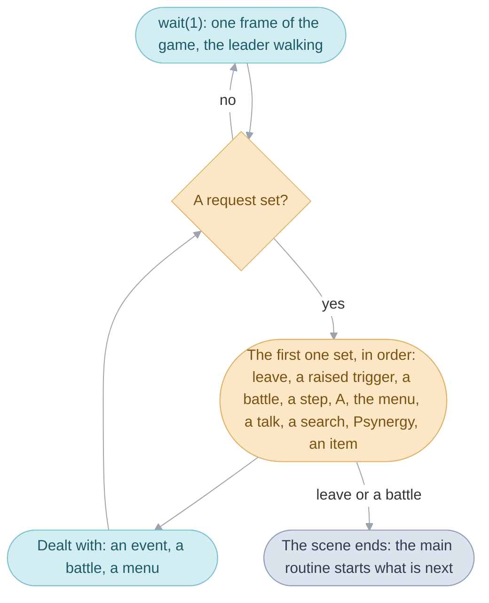

# Field

The field is everywhere the [party](glossary.md#the-party) walks: a town, a
[room](glossary.md#room), a dungeon or the World Map. Three folders run it.
[`field`](src/field/README.md) holds the Field's code in four of the
[banks](glossary.md#bank) of the main image: it runs the field sequence,
moves the actors and draws the [map](glossary.md#map); the main routine that
starts each scene is the System's ([System](system.md#the-main-routine)).
[Maps](src/map/README.md) says what the ground is like, and
[Scenes](src/scene/README.md) holds each [scene](glossary.md#scene)'s own code:
its people, triggers, events and exits. The
[main image](glossary.md#main-image) keeps only a few rule tables keyed by
scene (music, area names, random battles).

## The field sequence and its requests

The [field sequence](glossary.md#field-sequence) runs one scene while the
player has control.


Every scene starts cold ([System](system.md#design)). The
[main routine](glossary.md#main-routine) loads the scene's code; the field sequence loads the map, places the party at its
[entrance](glossary.md#entrance) and the scene's people, runs the scene's own
setup (which can move the party straight on) and fades in, naming the
[area](glossary.md#area) when the party enters a new one.

Each [frame](glossary.md#frame) the loop calls `wait(1)`, which runs the game
for one frame, the leader's walk included
([The Broken Seal](README.md#frames-waiting-and-tasks)), and then checks the
ground under the leader (`Field_UpdateWalking`). What happens during that
frame can't stop the loop: stepping into a doorway, pressing A beside someone
or a random battle starting only leaves a
[request](glossary.md#field-request), a note in the field sequence's work,
which the loop reads when `wait(1)` returns. The walk then stops, the game
deals with the requests one at a time in a fixed order, and the walk starts
again. Leaving comes first, so an
[event](glossary.md#event) that ends by taking an [exit](glossary.md#exit),
like this door, simply ends the scene. A random battle is a way out too: the
battle runs as the next [sequence](glossary.md#sequence), and then the scene
loads again with its actors put back.



`Scene_Arrive` clears the last scene's flags, `FieldSequence_Run` runs the
scene and `struct FieldWork` holds the requests, which
[Field code](src/field/README.md#the-field-sequence-serves-requests) lists in
order.

## Scenes and areas

Every scene is a row of `gScenes`, named in code `SceneId_<Place>`. A row picks
four things independently: the [overlay](glossary.md#overlay) that holds the
scene's code, its area, its map and whether it is a town. The Bilibin
Barricade runs on Bilibin's code but is an area of its own, and several scenes
can share a map. An area shares its name and music, which a scene's own rule
can override, and its area flags are kept while the party stays inside it.
Walking between Vale and its houses shows no name; arriving from the World Map
shows "Vale" for 90 frames. In a town the party regains no
[PP](glossary.md#psynergy-and-pp) and recovers no [Djinn](glossary.md#djinn)
as it walks, and poison does no damage. [Places](src/field/scenes.s) has a
page for each scene, in [story order](glossary.md#the-places-in-story-order).

## Scene entries and triggers

The main image does not know a scene's people or events; it asks the scene's
code a fixed set of questions
([Scenes](src/scene/README.md#the-entry-table)), each answered by a function,
so a scene can answer differently as the story moves on: Vault gives one list
of what can happen before its thieves are jailed and another after.


What can happen is a table of [triggers](glossary.md#trigger). Each row says
what starts it (talking, stepping on a spot, searching, an item or Psynergy),
who or where it is for, the condition under which it applies (most often
until a flag is set), and what it runs. The game runs the first row that fits,
so Babi's three rows play in story order:

```c
{TRIGGER_TALK, ACTOR_INVISIBLE_BABI, FLAG_MET_INVISIBLE_BABI, EVENT(AltmillerCave_MeetInvisibleBabi)},
{TRIGGER_TALK, ACTOR_INVISIBLE_BABI, FLAG_ALTMILLER_CAVE_MYSTIC_DRAUGHT, EVENT(AltmillerCave_RepeatRockOrder)},
{TRIGGER_TALK, ACTOR_INVISIBLE_BABI, FLAG_BABI_SAVED, EVENT(AltmillerCave_RestoreBabiAndInviteParty)},
```

Each of Babi's first two rows retires itself: meeting him sets
`FLAG_MET_INVISIBLE_BABI`, and opening the chest that holds the Mystic
Draught sets the second row's flag, so the next talk falls through to the next
row.

A row runs a message or an event: plain C that plays from top to bottom while
the party waits, most often between `Event_Start`, which
stops the leader, and `Event_End`. The rows are `struct Trigger`, found by
`Scene_FindTrigger`, and [Scenes](src/scene/README.md#how-a-trigger-is-chosen)
covers the choice.

## Exits and entrances

An exit is a doorway or map edge the leader walks into; it only names where it
leads. The scene's exit table turns that name into a scene and an entrance, the
spot where the party appears and the way it faces; a row can hold until a flag
is set, and the first row that holds wins. The way down from Sol Sanctum's
entrance has three rows: to Vale until the Sanctum erupts, then to Vale
erupting until the party leaves Vale, then to Vale again.

In `scene_exits.h` exits are named for where they lead
(`SOL_ENTRANCE_TO_VALE`), entrances for where the party comes from
(`VALE_FROM_SOL_ENTRANCE`), so each side of a door names the other. The three
rows are in `gSolSanctumEntrance_Exits`, each a `SCENE_EXIT_UNLESS` row that
holds until its flag is set, and `Scene_TakeExit` reads them;
[Scenes](src/scene/README.md#the-tables) covers the tables.

## Scene and area flags

Two ranges of [game flags](glossary.md#game-flag) hold a scene's passing state:
scene flags are cleared each time the party enters a scene, area flags when it
enters another area, and neither on a return from battle.
[Scenes](src/scene/README.md#state-that-cleans-itself-up) gives the ranges and
how scenes name them.

## Actors and their actor scripts

Every moving thing, down to a footprint in the snow, is one of 64
[actors](glossary.md#actor), each stepping through a short
[actor script](glossary.md#actor-script) of `SC_` commands every frame.


A footprint's actor script waits 120 frames and releases its actor;
[`field`](src/field/README.md#everything-that-moves-runs-an-actor-script)
covers the commands and the [sprites](glossary.md#sprite-and-oam).

## Movement

Walking moves the leader one pixel a frame, and holding B, the dash key, one
and a half. Each frame the game tests the ground just ahead; when the way
is blocked it tries headings a little to either side and takes the first that
is open, so the leader slides along a wall instead of stopping dead. Ground
more than 8 pixels higher, or more than 12 lower, stops the leader like a
wall. `Actor_UpdatePlayerControl` steers the leader and
`MapGrid_CheckCollision` judges each point it tests.

Speeds are 16.16 fixed point: `0x10000` is one pixel.

| Name | Value | Meaning |
| --- | --- | --- |
| `FIELD_WALK_SPEED` | `0x10000` | 1 pixel a frame |
| `FIELD_RUN_SPEED` | `0x18000` | 1.5 pixels a frame, with the dash key held |

[`field`](src/field/README.md#how-high-a-step-can-go) gives the speeds
on each kind of ground and how high a step can go.

## Cells and cell behaviors

A map is a grid of 16-pixel squares, [cells](glossary.md#cell), and each cell
says what is drawn there, how high its ground is, and what standing there does.
What standing there does is the cell's
[cell behavior](glossary.md#cell-behavior), a number the walls and triggers
look up. Most numbers belong to the scene, whose trigger table gives each its
meaning there, so a number that is a door in one town can be a chest in the
next; a few, such as walls, ledges and the jars anyone can search, mean the same
everywhere. A loaded cell is `struct MapGridCell` and the behaviors are
`enum CellBehavior`, which [Maps](src/map/README.md#cells) lists.

## Map layers

A town or dungeon is drawn as flat sheets stacked one on another: the ground
on `BG3`, walls and edges on `BG2`, roofs and treetops on `BG1`, and messages
and menus on `BG0`. On most maps the ground is at the back and the roofs in
front, with the characters between the walls and the roofs, which lets Isaac
pass behind a roof. No code works out who is hidden: the console draws its
[background layers](glossary.md#background-layer) and sprites in the order of
their priorities. Each map gives its layers their priorities, and an actor
marked to follow the ground (`ACTOR_PRIORITY_AUTOMATIC`) takes its sprite's
priority from the cell under it, where that cell gives one
(`ActorSystem_PlaceSprites`): 2 on open ground and 3 where the cells put it
behind a building. [Maps](src/map/README.md#one-grid-three-layers) shows how the three
layers share one grid.

## The World Map

The World Map is a flat map tilted into perspective.


The game gives every line of the screen its own scale: a line is drawn from
one straight strip of the flat map, a wider and more distant strip the higher
the line (`WorldMap_BuildScanlineTable`). When a menu or an event opens, the
game draws the view into an ordinary
[still picture](glossary.md#still-picture) (`WorldMap_StartStillPicture`), so
that the windows can use the layer the tilt was using.
[`field`](src/field/README.md#the-world-map-in-perspective) works through the
lines.

## Random encounters

How far the party walks, not how long, decides when a random battle starts,
and where it walks decides how often and against whom: in a scene each kind of
ground has a zone, and on the World Map the zone comes from the region
underfoot. A party stronger than a zone meets fewer of its battles.
`Encounter_CountStepsAndSelectFormation` counts and picks the enemies from a
row of `gEncounterZones`;
[Field code](src/field/README.md#random-battles) has the roll step by step.

## Field Psynergy

Using Move on a stone pillar slides it; using it where nothing answers shows
the same hand and moves nothing.


The cast only draws the Psynergy; the scene's own events decide what it does
there. A scene's Psynergy triggers answer three moments: before the cast,
where an event can still stop it or turn it away from its target; after the
cast, where the event does what the Psynergy does there; and while Force,
Frost or Reveal acts on its target, which those three run themselves. In
Vale, the event after Move notes where the pillar now stands and makes the
ground under it solid. `Field_UsePsynergy` runs a cast and `FieldPsynergy_Run`
plays it;
[Field code](src/field/README.md#how-field-psynergy-reaches-its-target)
covers
each moment and each cast.

## Debug scenes

The scene table ends with ten scenes no player can walk into, the developers'
test rooms for Djinn, levels, items, shops and messages. Only the debug scene
selector reaches them, in [debug mode](glossary.md#debug-menus), which the
released game never turns on; [Debug
scenes](src/debug/README.md#the-test-scenes) goes through them.

## Limits

- 201 scenes, from 96 overlays, in 71 areas.
- One overlay loaded at a time.
