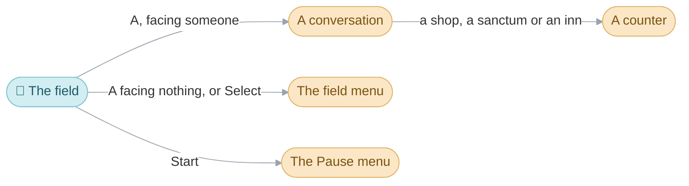

# Interface

Everything the player reads or chooses comes in a bordered box: a
villager's line, the field menu, the Pause menu, a shop's counter, a
battle's commands. The Interface is the code that draws those boxes and
runs the screens built from them.

It rests on two ideas. One task draws every box. And every screen is plain
code that waits.

## Windows

A box is a [window](glossary.md#window). Whoever wants one asks for it
once, then carries on or waits. It never draws it.

The drawing is done by the windows' own [task](glossary.md#task), which
runs once in every frame whatever else is going on. Each frame it grows
every opening window a little, shrinks every closing one, and types the
next letters into any that have text coming. That is why a line and the
portrait beside it can both be on the move while the conversation that
asked for them stands still.

It is also why every window in the game looks and behaves alike. Change the
window colour in the settings and a conversation, a menu and a shop counter
all change together, because there is only one place that draws them.
[Windows](src/window/README.md#windows) follows one from opening to
closing.

## Messages

A piece of the game's text is a [message](glossary.md#message), and code
refers to it by a name, never by its words. On the cartridge a message is
packed small and has blanks in it: for a price, an item, the name the
player gave Isaac.

Showing one is two steps. First the whole message is decoded: unpacked,
with its blanks filled from the game's state at that moment. Then the
windows' task types it a few letters a frame, stops at the end of each
page, and waits for a button.

[Decoding a message](src/window/README.md#decoding-a-message) shows the
packing and what a blank can hold.

## Menus

A menu is not a state the game switches into. It is a function the field
calls, which returns when the menu closes. Inside, it is code that waits:
draw the choices, wait a frame, look at the buttons, go round again. A
question inside a screen is another call, one level deeper, and B returns
from it.

So nothing has to remember where the player was. When the menu closes the
field is on the very line that opened it, with Isaac where he stood.
[A screen is code that waits](src/menu/README.md#a-screen-is-code-that-waits)
shows one screen open, ask and close.

One rule decides what a menu may do by itself. Anything that needs only the
party, such as casting Cure on Garet, the screen does on the spot. Anything
that touches the place, such as Move on a pillar, it cannot do: it writes
down who is casting what, sets a request, and closes. The field finds the
request and does the casting. That is why the menu is always gone before
the pillar moves.

## Shops, sanctums and inns

A visit to a counter starts as an ordinary conversation. The shopkeeper's
[event](glossary.md#event) calls the shop's code and waits for it to
return, exactly as the field waits for a menu. So a whole shop visit can
sit in the middle of a conversation.

There are three kinds. A shop buys, sells and repairs. A sanctum revives
and cures. An inn restores HP and PP, and charges only for the party
members still standing. What each shop stocks is a table.

## Saving and the Pause menu

Start opens the Pause menu, where saving and the settings are. Each save
file carries a short summary beside its data: the leader, the area, the
play time. The list of files is drawn from the summaries alone, so the game
never reads a whole file just to show the list.
[System](system.md#saving) says what a save holds.

## Where the code is

- [Windows](src/window/README.md) is the boxes and the text typed into
  them, and the Pause menu with its saving and settings.
- [Menus](src/menu/README.md) is the four screens of the field menu:
  Psynergy, Djinn, Item and Status.
- [Shops](src/shop/README.md) is the counters of a town: shops, sanctums
  and inns.
