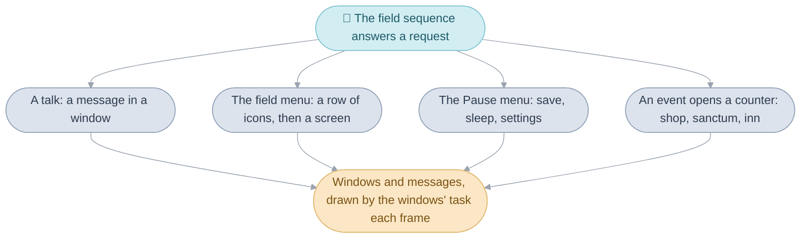
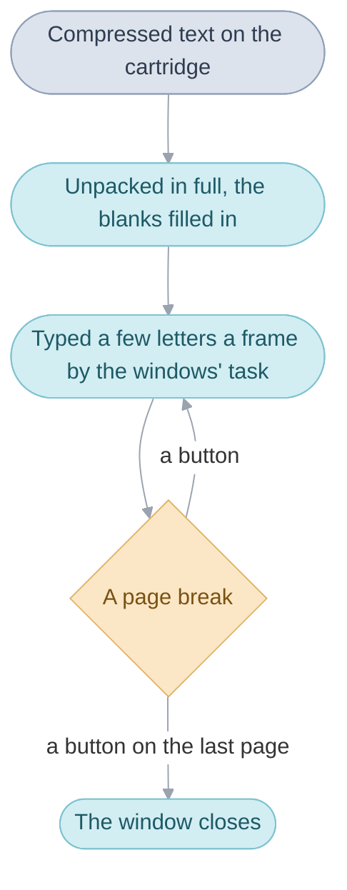

# Interface

Everything the player reads or chooses comes in a box with a
[border](glossary.md#border): what people say, the field menu and its
screens, the Pause menu, the shop, sanctum and inn counters, the battle's
commands. The interface is the division of the code that draws those boxes,
the [windows](glossary.md#window), types the game's
[messages](glossary.md#message) into them, and runs the screens the
[party](glossary.md#the-party) chooses from. Five mechanisms do it, each
built on the one before:

1. A window is a bordered rectangle on one layer of the screen, opened by
   code that waits while it grows to size.
2. A message is text unpacked whole from the cartridge, then typed into a
   window a few letters a frame by a [task](glossary.md#task).
3. The field menu is a row of icons, each opening a screen that loops a frame
   at a time until the player backs out.
4. The Pause menu saves the game, sleeps the console and changes the
   settings.
5. A town's counters, its shops, sanctums and inns, are screens the town's
   [scene](glossary.md#scene) opens when the player talks to the keeper.

The windows and messages are the ground the rest stands on, so this page
takes them first, then the menus and the counters, and ends by following one
night at an inn through all five. Each section ends where its folder guide
goes deeper: [Windows](src/window/README.md), [Menus](src/menu/README.md)
and [Shops](src/shop/README.md).

## Windows

A window is a bordered rectangle drawn on one
[background layer](glossary.md#background-layer) of the console, placed on a
grid of 8-pixel tiles, 30 across and 20 down. All the windows share that one
layer, and the map keeps the other three, so opening a window changes
nothing about how the map is drawn, except on the World Map, whose tilted
view is first redrawn as a still picture ([Field](field.md#the-world-map)).
The letters typed on the field, the portraits and the pointing hand are
[sprites](glossary.md#sprite-and-oam) riding on the windows.

Opening, a window grows out of its centre over eight
[frames](glossary.md#frame), and closing, it shrinks back over four. The code
that opens one is code that waits: `Window_Create` takes a slot and stands in
[`wait(1)`](glossary.md#wait) until the window is at full size, so that the
caller can write in it as soon as the call returns. A closing window keeps
its slot until it has shrunk away, so it still counts against the windows
open at once. Everything the windows keep from frame to frame lives in one
[work](glossary.md#work), set up afresh for each scene and each battle, which
holds the windows, the messages being typed and the sprites they carry.

`Window_Create` opens a window, `Window_Close` starts closing it, and the
windows' task, `WindowSystem_Update`, grows and shrinks them once a frame;
[Windows](src/window/README.md#windows) has the rest.

| Name                  | Value                | Meaning                        |
| --------------------- | -------------------- | ------------------------------ |
| `WINDOW_OPEN_FRAMES`  | 8                    | frames a window takes to open  |
| `WINDOW_CLOSE_FRAMES` | 4                    | frames a window takes to close |
| `WINDOW_COUNT`        | 8, or 12 in Japanese | windows open at once           |

## Messages

A message is the text the game types into a window. The cartridge stores
the text compressed, and a message is unpacked in full, with its blanks
filled in, before its first letter appears: the innkeeper's `21` is a number
the inn's code hands over, which the unpacking writes into the text where
the message has its blank. Doing the slow work once, ahead of time, leaves
each frame's typing cheap. The letters then appear a few at a time, to the
speaker's voice blip, and each page break waits for a button.

The typing is the work of the same task that zooms the windows, which runs
each frame inside `wait()`: up to three messages can be typing at once, and
the code that showed a message waits a frame at a time until its text has
ended. The player's message speed sets how many letters come a frame, and in
battle the text runs at a pace of its own, so the battle keeps moving.

`Message_OpenWindow` does all of it for one message: unpacks it, sizes a
window to its first page, opens the window and starts the typing. The text
is in `games/tbs/text`, one PO catalog per language, and code names a
message by its linker symbol, such as `MsgGameSaved`.
[Windows](src/window/README.md#decoding-a-message) goes through unpacking,
[the text buffer](src/window/README.md#the-text-buffer) the unpacked text
waits in, and [typing](src/window/README.md#typing).

| Name                     | Value               | Meaning                          |
| ------------------------ | ------------------- | -------------------------------- |
| `MESSAGE_COUNT`          | 3                   | messages typing at once          |
| `MESSAGE_ARGUMENT_COUNT` | 8                   | blanks waiting to be filled      |
| `gMessageSpeed_Steps`    | 1, 1 or 10          | letters a frame, slow to fast    |

## The field menu

Pressing A with nothing in front of the leader, or Select, opens a row of
icons: Psynergy, Djinn, Item and Status, the Djinn icon only once the first
Djinni has joined. Each icon opens a screen, and backing out of the screen
brings the icons back. A screen is a function that draws its windows, reads
the buttons a frame at a time in `wait(1)` and returns when the player backs
out, so the field sequence's loop, which called the menu to answer the menu
[request](glossary.md#field-request), carries on walking when it returns.
While a screen is open the scene's people are held behind it, and so are the
weather and the map's animations, with the exceptions under
[Limits](#limits).

`FieldMenu_Run` draws the row and calls the chosen screen through the menu
[bank](glossary.md#bank). The screens share one block of memory, the menu
work, since only one runs at a time;
[Menus](src/menu/README.md#the-screens) goes through each screen.

| Name              | Value       | Meaning                                       |
| ----------------- | ----------- | --------------------------------------------- |
| `MENU_WORK_SIZE`  | 2,672 bytes | the menu work the screens take turns with     |
| `HEAP_SLOT_MENU`  |             | the heap slot it lives in, shared with the counters |

### Closing a screen with Start

Start closes a screen at once, however many choices deep the player is. A
small task plays the cancel sound and sets a [game flag](glossary.md#game-flag),
and every loop of the screen checks that flag beside its own buttons and
returns as if the player had backed out, so the loops unwind one after
another without any of them knowing how deep the player was. The Djinn
screen checks for Start in its own choosers instead. The task is
`Menu_UpdateCancelSound` and the flag `FLAG_MENU_START_PRESSED`
([Menus](src/menu/README.md#design)).

### Psynergy and items used on the field

Psynergy or an item used on a party member works inside the screen, and
Psynergy meant for the world, such as Move, is cast by the field after the
menu has closed. Only the running scene knows what the leader is facing and
what its own [triggers](glossary.md#trigger) do with it, and none of that
runs while the menu is open. So the screen writes down what was chosen and
closes, and the scene decides what Move does to that pillar.

The screen writes its choice into the field's work, `gFieldWork`, as a
request, and the field sequence's loop hands it to `Field_UsePsynergy` or
`Field_UseItem` ([Menus](src/menu/README.md#the-psynergy-screen)).

## The Pause menu and saving

Pressing Start on the field brings up the Pause menu: `Save your quest`,
`Sleep` and `Change settings`. Saving asks which of the three files in the
cartridge's backup memory to use and writes the game into it: the
[main routine's work](glossary.md#main-routines-work), the game flags, where
the scene's people stand, and a short summary the file list shows. Sleep
stops the console until L and R are pressed together, and Change settings
sets the windows' colour and brightness, the message speed, Speech, whether
people talk with voice blips, and Auto-Sleep. The menu is one window with its
entries drawn as tiles and a function that loops a frame at a time, like a
screen of the field menu.

`PauseMenu_Run` runs the menu, `Save_ToChosenFile` saves and
`SettingsMenu_Run` runs the settings;
[Windows](src/window/README.md#the-pause-menu) has each, and
[System](system.md#saving) how a save reaches the flash chip.

| Name              | Value | Meaning                     |
| ----------------- | ----- | --------------------------- |
| `SAVE_FILE_COUNT` | 3     | save files                  |
| `SAVE_PART_BYTES` | 4 KB  | one of a file's two parts   |

## Shops, sanctums and inns

A town's counters are its shops, sanctums and inns, each opened by the
town's scene's [event](glossary.md#event) when the player talks to the
keeper. A shop sells what its row of a stock table lists, and the rare items
the game calls artifacts, which share one stock across the game: every shop
of a kind sells a rare item once any shop of that kind has listed it, until
it is bought. A sanctum's priest revives, cures and lifts curses for a fee.
An inn restores the HP and [PP](glossary.md#psynergy-and-pp) of the party
members still standing, at a price for each of them. A counter is a
conversation and a few icon menus: the keeper's lines are messages with
their blanks, the choices rows of icons with a Yes and No, and the coins a
small window of its own.

A scene opens a shop with `Shop_Run`, a sanctum with `Sanctum_Run` and an
inn with `Inn_CheckIn`. The counters borrow the field menu's work, since
only one of the two is open at a time. [Shops](src/shop/README.md#shops) has
the stock tables and buying,
[the sanctum's services](src/shop/README.md#sanctums) their fees and
[the inn](src/shop/README.md#inns) its prices.

## A night at the inn, mechanism by mechanism

Isaac walks up to Bilibin's innkeeper and presses A. The field sequence's
loop finds the talk request when its `wait(1)` returns, and the scene's
trigger row for the innkeeper names an event, which calls `Inn_CheckIn` with
Bilibin's row of the inn prices and the innkeeper's actor.

### The price in a blank

`Inn_CheckIn` takes the counters' work, opens the innkeeper's portrait in a
window of its own, and works out the night's price: Bilibin's 7 coins for
each party member still standing, 21 for three. It pushes that number as a
message argument, and `Shop_ShowKeeperMessage` shows the welcome and the
question: the message is unpacked with `21` written into its blank, a window
is sized to it and zooms open, and the windows' task types it out a few
letters a frame while the shop code waits. A second window, opened at once,
shows `Your Coins: 500` as a label drawn in one go.

### Yes or No

`Shop_AskYesNo` runs an icon menu, a Yes and a No with the pointing hand,
which is the same loop as the field menu's row: a frame at a time, reading
the buttons, until A picks one. On Yes with the coins in hand the coins
window closes, `Please enjoy your stay.` shows, and `Inn_PlaySleep` takes
the price off the party's coins, restores each standing party member's HP
and PP, and plays the night: the screen closes in an oval around Isaac, the
inn's music 🎵 `MUS_INN` plays, and the screen opens again. The portrait
opens once more and the innkeeper's last line shows; then every window is
closed, the work given back, and the event ends.

| Step                               | Mechanism                                            |
| ---------------------------------- | ---------------------------------------------------- |
| A is pressed by the innkeeper      | the field's talk request, then the scene's trigger row |
| The counter opens                  | the inn's screen, `Inn_CheckIn`, on the counters' work |
| The price is written into the line | a message argument, filled in as the message is unpacked |
| The line is typed out              | the windows' task, a few letters a frame             |
| `Your Coins: 500`                  | a label drawn as window tiles in a window of its own |
| Yes or No                          | an icon menu, looping a frame at a time              |
| The night                          | the shop code, through the field's screen transition |

## Design

Every box the player reads goes through one path, `Message_OpenWindow`, and
one task draws every window, so a conversation, a menu and a counter look and
behave alike: the same border, the same zoom, the same typing and the same
buttons. The screens are plain functions that loop in `wait(1)`, which is
why a menu can be opened from the field sequence's loop, run for as long as
the player likes, and return to the very line that called it, with the
scene's people held still behind it the whole time. The counters and the
field menu share one block of memory because only one of them is open at a
time, which keeps the heap small.

## Limits

- A window must be 2 to 30 tiles wide and high to be drawn, on a screen of 30
  by 20 tiles.
- Three messages being typed at once, 64 sprites carried by windows and eight
  message blanks; a ninth blank is dropped.
- The text buffer holds 512 letter codes (256 in Japanese).
- The menu work is 2,672 bytes and has room for eight party members, though
  this game's party is at most four, and 32 entries in a list; a party member
  carries 15 items.
- In Japanese the weather and the map's animations go on behind the Item and
  Psynergy screens, and in English behind the Psynergy screen.
- A shop sells at most 24 items and 8 artifacts.
