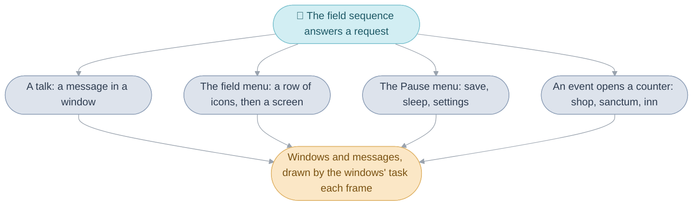

# Interface

Everything the player reads or chooses comes in a box with a
[border](glossary.md#border): what people say, the menu the player opens
while walking, the Pause menu, the counters of a town's shops, sanctums and
inns, the battle's commands. Each box grows open, the words are typed into
it a few letters at a time, and a pointing hand marks the choice.

The Interface division is the code that draws those boxes and runs the
screens made of them, in three folders:

- [Windows](src/window/README.md) draws the boxes, types the text into them,
  and runs the Pause menu with its saving and settings.
- [Menus](src/menu/README.md) runs the field menu's four screens: Psynergy,
  Djinn, Item and Status.
- [Shops](src/shop/README.md) runs the counters of a town: its shops,
  sanctums and inns.

## Windows

A [window](glossary.md#window) is a bordered rectangle on the screen. All
the windows are drawn on one of the console's four
[background layers](glossary.md#background-layer), and the map keeps the
other three, so a town looks the same however many windows are open over
it. The typed letters, the portraits and the pointing hand are
[sprites](glossary.md#sprite-and-oam) that ride on a window. A window grows
out of its centre as it opens and shrinks back as it closes, and the code
that opened it waits until it is at full size, so it can write in the
window straight away. One [task](glossary.md#task), run once a
[frame](glossary.md#frame), does the growing and shrinking for every window
there is. [Windows](src/window/README.md#windows) follows a window from
opening to closing.

## Messages

A [message](glossary.md#message) is the text the game types into a window.
The cartridge stores the text packed small, and a message is unpacked whole
before its first letter appears, with its blanks filled in: an innkeeper's
price, a party member's name. Doing the slow part once leaves each frame's
typing cheap. The windows' task then types a few letters a frame, to the
speaker's voice blip, and stops at the end of each page until a button is
pressed, while the code that showed the message waits for the text to end.
[Decoding a message](src/window/README.md#decoding-a-message) unpacks one,
and [Typing](src/window/README.md#typing) covers the letters, the pages and
the speed the player chooses in the settings.

## The field menu

Pressing A with nothing in front of the leader, or Select, opens a row of
icons: [Psynergy](glossary.md#psynergy-and-pp), [Djinn](glossary.md#djinn),
Item and Status. Each icon opens a screen that asks a few questions, whose,
which, on whom, and backing out of it brings the icons back. A screen is
code that waits: a function that draws its windows, reads the buttons one
frame at a time and returns when the player backs out. The
[field sequence](glossary.md#field-sequence), the code that was walking the
[party](glossary.md#the-party), called the menu and simply carries on when
it returns, and the people of the town are held still behind the screen
meanwhile. Only one screen is open at a time, so all four take turns with
one block of memory.
[A screen is code that waits](src/menu/README.md#a-screen-is-code-that-waits)
shows how a screen opens, loops and closes, and
[The screens](src/menu/README.md#the-screens) goes through each one.

### Closing a screen with Start

Start closes a screen at once, however many questions deep the player is. A
small task notices the press, plays the cancel sound and raises a
[game flag](glossary.md#game-flag), one of the yes-or-no facts the game
keeps. Every question checks that flag beside its own buttons and returns
as if the player had backed out, so the questions unwind one after another
without any of them knowing how deep the player was.
[Closing a screen with Start](src/menu/README.md#closing-a-screen-with-start)
follows the unwinding.

### Psynergy and items used on the field

Psynergy or an item used on a party member works inside the screen: Cure
heals while the menu is still open. Psynergy meant for the world, such as
Move on a stone pillar, is cast after the menu has closed. Only the
[scene](glossary.md#scene), the room the party is in, knows what the leader
is facing and what should happen to it, and none of the scene's code runs
while the menu is open. So the screen writes down what was chosen and
closes, and the field sequence carries it out.
[The Psynergy screen](src/menu/README.md#the-psynergy-screen) and
[The Item screen](src/menu/README.md#the-item-screen) say how each choice is
sorted.

## The Pause menu and saving

Pressing Start while walking brings up the Pause menu: `Save your quest`,
`Sleep` and `Change settings`. Saving asks which of three files to use and
writes the game into it: the party and its progress, every game flag, where
the scene's people stand, and a short summary for the list of files to
show. Sleep stops the console until L and R are pressed together. The
settings change the windows' colour and brightness, the message speed,
whether people speak with voice blips, and whether the console goes to
sleep by itself. The menu is one window and a function that waits, like a
screen of the field menu.
[The Pause menu](src/window/README.md#the-pause-menu) describes it,
[Saving](src/window/README.md#saving) what a file holds, and
[The settings menu](src/window/README.md#the-settings-menu) each setting.

## Shops, sanctums and inns

A town's counters open when the player talks to the keeper: the scene's
[event](glossary.md#event), the piece of code that runs the conversation,
calls the counter and waits for it to finish. A shop buys, sells and
repairs, and offers the rare items the game calls artifacts, which every
shop of the same kind sells once one has turned up. A sanctum's priest
revives a fallen party member, cures poison and lifts curses for a fee. An
inn restores the HP and PP of the party members still standing, at a price
for each of them. A counter is built from the same parts as everything
above: the keeper's lines are messages with their blanks, the choices are
rows of icons, and the coins have a small window of their own.
[Shops](src/shop/README.md#shops), [Sanctums](src/shop/README.md#sanctums)
and [Inns](src/shop/README.md#inns) take each counter in turn.

## Design

Every spoken line takes one path into a window, and one task draws every
window, so a conversation, a menu and a counter look and behave alike: the
same border, the same growing open, the same typing and the same buttons.

The screens are plain functions that wait, so the field sequence can call
one and get control back at the line that called it. The field menu and the
counters share one block of memory because only one of them is ever open,
which keeps the [heap](glossary.md#heap-and-pools), the memory the game
lends out, small.
