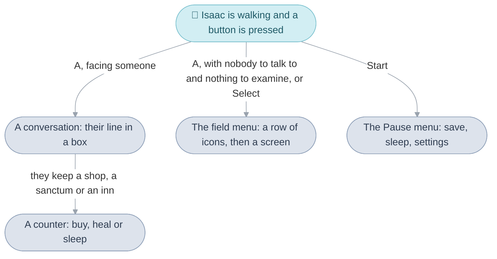

# Interface

Talk to Garet's sister in Vale and a bordered box grows open at the top of
the screen. Her portrait appears beside it, and her line is typed into it
letter by letter.

Everything the player reads or chooses in the game comes in a box like hers.
The menu with the party's Psynergy and items is made of them. So are the
Pause menu and the counter of every shop, sanctum and inn. A battle's
commands are too, and [Battles](src/battle/README.md#the-partys-commands)
covers those.

The game's makers sorted their work into four divisions: System, Battle,
Field and Interface. Interface is the one that draws those boxes and runs the
screens built from them. It has three guides:

- [Windows](src/window/README.md) is about the boxes and the text typed into
  them, and about the Pause menu with its saving and its settings.
- [Menus](src/menu/README.md) is about the four screens of the field menu:
  Psynergy, Djinn, Item and Status.
- [Shops](src/shop/README.md) is about the counters of a town: its shops,
  sanctums and inns.

Which of them the player gets depends on the button, and on what Isaac is
facing when it is pressed.

## Windows

The game's name for one of these boxes is a
[window](glossary.md#window).

A window does not simply appear. It starts as a sliver at its own centre and
grows to full size. Opening takes eight [frames](glossary.md#frame). A frame
is one picture on the screen, and the console draws about sixty a second, so
a window is open in about an eighth of a second. Closing is quicker: it
shrinks back into its centre in half the time.

Something has to redraw the window on each of those frames, and it is not
the conversation. The part of the game that started the conversation asks
for the window once and then only waits.

The redrawing is done by a [task](glossary.md#task), which is a small chore
the game runs once in every frame, whatever else is waiting. The windows have
a task of their own. Each frame it draws every opening window a little
bigger and every closing one a little smaller. That is how two windows, such
as a line and the portrait beside it, can be on the move at once.

[Windows](src/window/README.md#windows) follows one window from opening to
closing.

## Messages

Ask Bilibin's innkeeper for a room and the price depends on the party. An
inn charges for each party member still standing, and Bilibin's charges 7
coins each. With three standing, the night costs 21.

So the innkeeper's line cannot be kept on the cartridge with the price
already in it. It is kept once, with a blank where the number goes, and the
game writes `21` into the blank before showing it.

Names work the same way. Garet's sister's line is kept without Garet's name.
The game looks the name up in the party and writes it in, just as a villager
can say the name the player gave Isaac.

The game's word for one piece of its text, such as a person's line, is a
[message](glossary.md#message). Besides its blanks, a message is kept
squeezed small to save room on the cartridge. Before its first letter
appears, the whole message is unpacked and its blanks are filled, which the
game calls decoding.

Then the windows' task types it. At the two slower message speeds that is
one letter each frame. At the end of a page the typing stops, the little
arrow bobs, and nothing more comes until a button is pressed.

[Decoding a message](src/window/README.md#decoding-a-message) shows how the
text is squeezed and what a blank can hold.
[Typing](src/window/README.md#typing) covers the letters, the pages and the
message speed the player picks in the settings.

## The field menu

Stand Isaac where there is nobody to talk to and nothing to examine, and
press A. A window with the party's HP and PP comes up, and under it a row of
icons: [Psynergy](glossary.md#psynergy-and-pp), Item and Status, with
[Djinn](glossary.md#djinn) among them once the party has a Djinni. Select
brings up the same row whatever Isaac is facing.

Each icon opens a screen, and a screen asks a few short questions. The
Psynergy screen asks `Whose Psynergy?`, then `Which Psynergy?`, then
`Use it on whom?` B goes back one question, and B on the first question
brings the icons back.

Close the menu and Isaac is exactly where he was. The part of the game that
walks the [party](glossary.md#the-party) and starts conversations is called
the [field sequence](glossary.md#field-sequence). It opened the menu and
stopped where it was, the way a cook stops at one line of a recipe to answer
the door. When the menu closes, it carries on from that line.

[A screen is code that waits](src/menu/README.md#a-screen-is-code-that-waits)
shows how a screen opens, asks and closes, and
[The screens](src/menu/README.md#the-screens) goes through all four.

### Closing a screen with Start

Start closes a screen in one press, however many questions deep the player
is.

The game does not teach each question how to close all the ones before it.
While the Psynergy, Item or Status screen is open, a small task watches for
Start. When it sees the press it plays the cancel sound and leaves a note
that says "Start was pressed". The note is a
[game flag](glossary.md#game-flag), one of the yes-or-no facts the game
keeps.

Every question looks at that note each frame, beside its own buttons. When
the note is there, the question ends just as if the player had pressed B. So
the questions end one after another, back to the icons, and none of them has
to know how deep the player was.

The Djinn screen has no such task. Its questions watch for Start themselves.

[Closing a screen with Start](src/menu/README.md#closing-a-screen-with-start)
follows the questions as they end.

### Psynergy and items used on the field

Cast Cure on Garet from the menu and he is healed there and then, with the
screen still open. Psynergy or an item used on a party member needs nothing
but the party, so the screen does the work itself.

Move on a stone pillar is different. The pillar belongs to the place, and
pushing it is the field's business. So the screen does not cast Move. It
writes down who is casting and what, the whole menu closes, and the field
sequence finds the note and casts it. That is why the menu is always gone
before the pillar moves.

[The Psynergy screen](src/menu/README.md#the-psynergy-screen) and
[The Item screen](src/menu/README.md#the-item-screen) give the tests that
decide whether a choice is for the party or for the field.

## The Pause menu and saving

Press Start while walking and the Pause menu opens: `Save your quest`,
`Sleep` and `Change settings`.

Saving writes the game into one of three files. Along with the party, its
progress and the state of the world, each file gets a short summary: the
leader, the area, the play time and a little more. The list of files is
drawn from the summaries alone, so the game can show all three files without
reading any of them whole.

In the settings, move the colour slider and every window on the screen
changes with it, the settings menu included. All windows are drawn from one
set of colours, so there is nothing else to update.

In the Battle Arena the menu will not open. Start gets
`The Pause menu is not available now.` instead.

[The Pause menu](src/window/README.md#the-pause-menu) describes the menu,
[Saving](src/window/README.md#saving) what a file holds, and
[The settings menu](src/window/README.md#the-settings-menu) each setting.

## Shops, sanctums and inns

Walk up to the counter of Bilibin's item shop and press A. The shopkeeper
says `Welcome! We have just the gear you need.` and four icons come up: Buy,
Sell, Artifacts and Repair.

A visit starts as an ordinary conversation. A person the player can talk to
has an [event](glossary.md#event), the piece of the town's code that runs
when the player talks to them. A shopkeeper's event starts the shop's own
code, and waits until the visit is over.

There are three kinds of counter:

- A shop buys, sells and repairs, and offers the rare items the game calls
  artifacts. Artifacts are shared across the world. Open Vault's weapon shop
  once, leave its Magic Rod unbought, and Bilibin's weapon shop will offer
  the Magic Rod too.
- A sanctum's priest revives a fallen party member, cures poison, drives off
  a haunting and removes a curse. Reviving costs 20 coins for each level of
  the one revived.
- An inn fills the HP and PP of the party members still standing, and
  charges only for them. A member who is down sleeps for free and wakes up
  still down.

[Shops](src/shop/README.md#shops), [Sanctums](src/shop/README.md#sanctums)
and [Inns](src/shop/README.md#inns) take each counter in turn.

## Design

Garet's sister, the Psynergy screen and Bilibin's shopkeeper look alike
because they are made alike. Every line of text is decoded and typed by the
same steps, and one task draws every window. The colour slider is the proof:
one change, and a conversation, a menu and a shop counter all take the new
colour.

Menus and counters are also all entered the way the cook answers the door.
Whatever opened one stops at its line and carries on from there when it
closes. That is why a shop visit can sit in the middle of a conversation,
and why Isaac is where the player left him when a menu closes.
