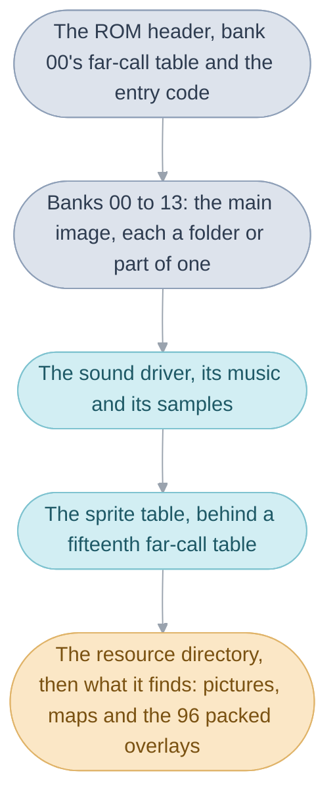
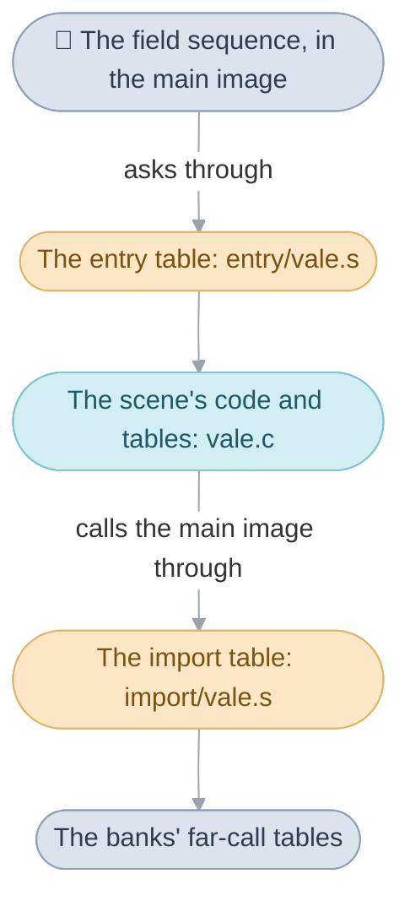

# The Broken Seal's source

The player sees a town, a battle, a menu or a game of dice, and somewhere in
this folder is the C that runs it.

The folders follow the cartridge, where the code lies in two kinds of place
([The console](../README.md#the-console)). The
[banks](../glossary.md#bank) are fourteen stretches of code the processor
runs straight from the cartridge, and together they are the
[main image](../glossary.md#main-image). The
[overlays](../glossary.md#overlay) are the code of each
[scene](../glossary.md#scene), unpacked into memory only while the party is
there.

Most folders here are one bank or one kind of overlay.

## Finding the code for something in the game

Start from what was on the screen:

| What the player saw                                     | Where its code is                                     |
| ------------------------------------------------------- | ----------------------------------------------------- |
| a town, cave or room: its people, their lines, its events | `scene/`, a file named for the place, such as [scene/vale.c](scene/vale.c) |
| the people moving, the map drawn and scrolling           | `field/field/`                                        |
| walking into a random battle, a chest, talking to someone | `field/field_sequence/`                               |
| field Psynergy such as Move, and what an event can do   | `field/event_commands/`                               |
| Lucky Dice and Lucky Wheels                             | `field/lucky_dice.c`, `field/lucky_wheels.c`          |
| a battle's turns, its damage, an enemy's choice         | `battle/battle/`                                      |
| what an ability looks like in battle                    | `battle_effect/battle_effect/`, a file for each effect |
| what an item, ability, enemy, Djinni or class is        | the tables in `game/`, such as `game/item_table.c`    |
| a message window opening and typing                     | `window/window/`                                      |
| the battle menus, the file list, name entry             | `window/screens/`                                     |
| the Psynergy, Djinn, Item and Status screens            | `menu/menu/`                                          |
| the title intro and the credits                         | `menu/title_intro.c`, `menu/credits.c`                |
| a shop, an inn, a Sanctum's healer                      | `shop/shop/`                                          |
| music, a jingle or a sound effect                       | `sound/sound.c`, with the names in `include/sounds.h` |
| saving                                                  | `system/system/save.c`                                |
| a picture or a map                                      | `graphics/`, `map/`                                   |

Searching for the English name of a thing usually finds it. Each battle
effect's file opens by naming the abilities that play it, so searching
`battle_effect/` for Quake leads to
[quake.c](battle_effect/battle_effect/quake.c).

The game's text is in [`games/tbs/text`](../text), one file for each
language, and every message there has a name the code uses. "(No saved data)"
is `MsgSaveNoData`, and searching for that leads to the save file list in
[window/screens/save.c](window/screens/save.c).

To read the game from the beginning, start at `System_Initialize` in
[system/system/start_up.c](system/system/start_up.c), the first C to run. It
ends by calling the [main routine](../glossary.md#main-routine), in
[system/main_routine.c](system/main_routine.c), which is short enough to
read whole. [System code](system/README.md#start-up) follows power-on step
by step.

## What each folder holds

The code is in [four divisions](../README.md#the-four-divisions), each with
a page of its own, and every folder has a guide.

[System](../system.md), the code under everything else:

- [System code](system/README.md): start-up, the main routine,
  [`wait()`](../glossary.md#wait) and the [tasks](../glossary.md#task), the
  [heap](../glossary.md#heap-and-pools), the buttons, saving and the link
  cable.
- [The Game Pak](gamepak/README.md): what belongs to the cartridge itself.
  The [far-call](../glossary.md#far-call) tables through which banks call
  each other, the
  [resource directory](../glossary.md#resource-directory), the numbered list
  through which every picture, map and overlay is found, and the code for
  the chip the saves are written to.
- [Sound](sound/README.md): the code that plays music, jingles and sound
  effects. The music and samples themselves are in
  [`games/tbs/sound`](../sound).
- [Graphics](graphics/README.md): every picture, as a PNG.
- [Debug scenes](debug/README.md): the ten test scenes the developers left
  on the cartridge.

[Field](../field.md), the party walking around a place:

- [Field code](field/README.md): the [actors](../glossary.md#actor),
  walking, drawing and scrolling the map, and the
  [field sequence](../glossary.md#field-sequence), which runs one scene from
  the party's arrival to the [exit](../glossary.md#exit) it leaves by. Also
  random encounters, field [Psynergy](../glossary.md#psynergy-and-pp), the
  commands events are written in, and Lucky Dice and Lucky Wheels.
- [Scenes](scene/README.md): one file for each place, saying who stands
  where and what happens there, and the three scenes that are screens: the
  Title, the File Screen and the Battle Arena.
- [Maps](map/README.md): the [maps](../glossary.md#map) the scenes are
  played on, as data.

[Battle](../battle.md), a fight from its opening to the spoils:

- [Battles](battle/README.md): the order of actions, the enemies' choices,
  what each ability does to its targets, and the spoils.
- [Game rules](game/README.md): the party's state and the rules every part
  of the game asks about. [Units](../glossary.md#unit) and their stats,
  items, levels, classes, [Djinn](../glossary.md#djinn) and the
  [game flags](../glossary.md#game-flag), with the tables that define every
  item, ability, Djinni, enemy, [summon](../glossary.md#summons) and class.
- [Battle effects](battle_effect/README.md): what each ability shows on
  screen.

[Interface](../interface.md), the screens the player reads:

- [Windows](window/README.md): the boxes text appears in, the typing of
  messages, and the screens built from windows, among them the battle menus,
  the file list and name entry.
- [Menus](menu/README.md): the field menu's Psynergy, Djinn, Item and Status
  screens, the title intro and the credits.
- [Shops](shop/README.md): every counter that buys, sells, repairs or heals,
  and the inn.

## Banks and folders

A bank is a stretch of the cartridge with a fixed start, and the folders are
cut along the same lines. So a folder's name usually says which stretch of
the cartridge its code is in.

Each bank opens with its far-call table, and the banks are named after those
tables
([The Game Pak](gamepak/README.md#why-the-main-image-is-cut-into-banks)
says why the code is cut up this way).

Each large bank is one folder. A small bank's code sits in the folder it
belongs with. The credits and the title intro, for example, are banks of
their own, and live in `menu/` with the other screens.

| Bank | Its far-call table | Its code                                                        |
| ---- | ------------------ | --------------------------------------------------------------- |
| 00   | `SYSTEM.S`         | `system/`, with the save chip's code in `gamepak/flash/`        |
| 01   | `FIELD.S`          | `field/`                                                        |
| 02   | `WINDOW.S`         | `window/`                                                       |
| 03   | `GAME.S`           | `game/`                                                         |
| 04   | `FIELD_SEQUENCE.S` | `system/main_routine.c`, then `field/field_sequence.c` and `field/event_commands.c` |
| 05   | `MENU.S`           | `menu/`                                                         |
| 06   | `SHOP.S`           | `shop/`                                                         |
| 07   | `BATTLE.S`         | `battle/`                                                       |
| 08   | `BATTLE_EFFECT.S`  | `battle_effect/`                                                |
| 09   | `CREDITS.S`        | `menu/credits.c`                                                |
| 10   | `TITLE.S`          | `menu/title_intro.c`                                            |
| 11   | `LUCKY_DICE.S`     | `field/lucky_dice.c`                                            |
| 12   | `LUCKY_WHEELS.S`   | `field/lucky_wheels.c`                                          |
| 13   | `SOUND.S`          | `sound/sound.c`                                                 |

The tables themselves are the files of `gamepak/far_call/`. After the
banks, the cartridge holds everything that is data, in this order:

The fifteenth far-call table, `SPRITE.S`, has one entry: the lookup of a
sprite by its number, in `system/sprite_metadata.c`
([Graphics](graphics/README.md#sprites-and-their-animations)).

## Objects and parts

Each compiled file is one [object](../glossary.md#object), and inside it
the functions keep the order they have on the cartridge. Neighbours in a
file are neighbours on the cartridge.

Some objects are too long to read as one file. The battle's runs to some
13,000 lines. Such an object is written as parts, each holding one family of
functions, in a folder with the object's name.

So `battle/battle.c` is only a guide to its parts followed by a list of them.
The code is in the 24 files of `battle/battle/`, such as `turn.c`,
`enemy_ai.c` and `spoils.c`. The parts are compiled together as the one file
`battle.c`, so they share what `battle_internal.h` declares and nothing else
needs to see it.

Eleven objects are written this way: `system`, `field`, `field_sequence`,
`event_commands`, `game`, `window`, `screens`, `menu`, `shop`, `battle` and
`battle_effect`. In each, the guide at the top of the `.c` file is the place
to start, and each part opens by saying what it holds.

## Overlays

When the party arrives somewhere, the scene's code is unpacked into memory
over the scene before, and the field asks it who stands where and what can
happen ([System](../system.md#overlays)). There are 96 overlays, 93 in
`scene/` and 3 in `debug/`. Each is three files:

- `<scene>.c`, the scene's code and tables. This is the one to read.
- `entry/<scene>.s`, the
  [entry table](../glossary.md#entry-table-and-import-table): one entry for
  each of the six questions the field asks a scene
  ([Scenes](scene/README.md#the-entry-table)).
- `import/<scene>.s`, the import table: one entry for each function of the
  main image the scene calls.

Code that several scenes use is in the headers of `scene/shared/`. Only one
overlay is in memory at a time, so each scene that uses such a header gets a
copy of its own
([Scenes](scene/README.md#code-shared-between-overlays)).

## Headers

A structure the field fills and a battle reads has to be declared once,
where both can see it. [`games/tbs/include`](../include) holds what the
whole game shares, and it is where the names of things are:

| Header                                     | What it names                                    |
| ------------------------------------------ | ------------------------------------------------ |
| `flags.h`                                  | the game flags                                   |
| `sounds.h`                                 | the music, jingles and sound effects             |
| `scene_ids.h`                              | the scenes                                       |
| `item_ids.h`, `ability_ids.h`, `djinn_ids.h`, `enemy_ids.h` | the items, abilities, Djinn and enemies |
| `sprite_ids.h`                             | the sprites                                      |
| `field/event.h`                            | the calls events are written in                  |
| `module/<path>.h`                          | what the C file at `<path>.c` defines            |

The last row is the [module header](../glossary.md#module-header). Every C
file has one at the same path under [`include/module`](../include/module),
so `battle/battle.c` is declared in `module/battle/battle.h`.

## C and assembly

Nearly all of the game is C. The processor has two sets of instructions.
Thumb's instructions are 16 bits long, and ARM's are 32. Almost every C file
is Thumb.

Three are ARM: `window/glyph_arm.c`, `field/world_map_lines.c` and
`field/actor_update_arm.c`. The first two are copied into RAM before they
run, because ARM instructions run slowly from the cartridge. The third is
unused ([Field](field/README.md#routines-run-from-ram)).

The files ending in `.s` are assembly, and there are three kinds:

- Most only place data: a picture built from the PNG beside it, a table, or
  a map, under the name the code uses.
- The far-call tables in `gamepak/far_call/` and each overlay's entry and
  import tables are lists of [veneers](../glossary.md#veneer), tiny pieces
  of code that only jump on.
- A few are routines written by hand in assembly: the sound mixer, the
  interrupt code, some arithmetic, and the decoders that unpack pictures
  and text.

The decoders are ARM, so the code that calls one copies it into RAM first.
Each sits beside its caller:

| What it unpacks                                              | File                                |
| ------------------------------------------------------------ | ----------------------------------- |
| a message's packed text                                      | `window/message_decode.s`           |
| the windows' pictures and icons                              | `window/decompress_4bpp.s`, `window/expand_opaque.s` |
| a sprite's picture; the World Map's still picture            | `field/picture_decode.s`            |
| a map's grid                                                 | `field/map_grid_convert.s`          |
| a battle background                                          | `battle/background_decode.s`        |
| a battle background, for the credits                         | `menu/credits_background_decode.s`  |

## Evidence

The folders and the parts are ours. The cartridge keeps no file or folder
names, so nothing in it records how [Camelot](../glossary.md#camelot)
divided its files. Each folder is cut along a bank or a kind of thing, and
each part where one family of functions ends and the next begins.
