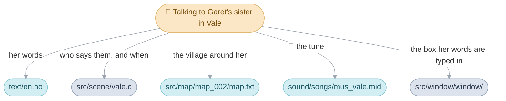

# The Broken Seal's source

Talk to Garet's sister in Vale and the player reads
`You guys are so lucky, Garet.` Everything about that moment is written down
somewhere in these folders: her words, the fact that she is the one who says
them, the village she stands in and the tune playing over it.

The game is written in a programming language called C, in plain text files
whose names end in `.c`. You don't need to know C to find your way around.
Most of what a player remembers is kept as lists and tables with the game's
own names in them, and those can be read almost like a page of a strategy
guide.

This page says where to look. It starts from things you know from playing and
gives a real file for each.

Every path on this page starts from `games/tbs`, the folder that holds this
game. Four folders inside it matter here:

- `src/` is the game itself: its code, its pictures and its maps.
- `text/` is every line the game can show.
- `sound/` is the music. (`src/sound/` is something else: the code that
  plays it.)
- `include/` is the lists of names, such as the name of every item.



## Finding the code for something in the game

### A line of dialogue

Every line the game can show is in [`text/`](../text), one file for each of
the six languages. The English one is `text/en.po`. Open it, search for
`so lucky`, and there she is:

```
msgctxt "MsgValeYouGuysAreSoLuckyGaret"
msgid "04532"
msgstr ""
"You guys are so lucky,\n"
"{actor_name:2}.{page_break}"
"I wish I could\n"
"go with you.{end_wait}"
```

The first row is the name the rest of the source calls this line by:
`MsgValeYouGuysAreSoLuckyGaret`. The second is the line's number, its place
in the game's long list of text. After the empty third row come her words.

The marks among the words are instructions for showing them. `\n` starts a
new row in the box. `{page_break}` waits for a button press before the next
sentence. `{end_wait}` waits once more and closes the box. And
`{actor_name:2}` is where the game writes Garet's name
([Windows](window/README.md#decoding-a-message) follows the line from here
to the screen).

### Who says a line

To find out who says a line, look for its name in every file at once. There
are two easy ways.

- On the project's page on GitHub, type the name into the search box at the
  top.
- With a copy of the project on your own computer, use your text editor's
  "find in files", or type this in a terminal from the project's folder:
  `grep -rn MsgValeYouGuysAreSoLuckyGaret games/tbs`

Apart from the six text files and this page, the search finds one row, in
[src/scene/vale.c](scene/vale.c):

```
{ TRIGGER_TALK, ACTOR_GARETS_SISTER, CONDITION_ALWAYS, MSGNO(MsgValeYouGuysAreSoLuckyGaret) },
```

Read across: when the player talks to Garet's sister, always, show that
line. Her brother's row is the next one down.

Vale has three lists of rows like this, because people say different things
as the story moves on. Each list's name says when it is used. This row is in
`gVale_TriggersAfterLeaving`, the one for after the party has set out. The
other two are `gVale_Triggers`, for before the party leaves Vale, and
`gVale_TriggersAfterKalay`, for the party's return from Kalay.

### A town's events

The game's word for one place the party can stand in is a
[scene](../glossary.md#scene), and `src/scene/` has one file for each:
[bilibin.c](scene/bilibin.c),
[mercury_lighthouse.c](scene/mercury_lighthouse.c),
[tolbi.c](scene/tolbi.c).

A scene file holds the lists of who stands where and what each person says,
and the scene's events. An event is a scripted moment where people walk,
turn and talk. Between the lines of code are notes in plain English, which
programmers call comments, and they say what the player sees.

`vale.c` opens with a long comment that tells Vale's story in order,
beginning with the day Isaac mends the roof. That first event is
`Vale_MendingTheRoof`, and searching the file for the name finds it.

A large place is several scenes. Vale also has `vale_plaza.c`, `vale_cave.c`
and `vale_kradens_cottage.c`.

### The inside of a house

The rooms behind a town's doors are not in the town's file. Rooms drawn in
the same style share a scene, so one file can hold rooms from several doors.

To find a room, start from the door. Bilibin's inn is behind a door that
`src/scene/bilibin.c` calls `BILIBIN_TO_INN`. Search that file for the name
and one of the rows found is:

```
SCENE_EXIT(BILIBIN_TO_INN, CottageRoomsC, COTTAGE_ROOMS_C_INN),
```

It reads: this door leads to the scene `CottageRoomsC`. So the inn and
its innkeeper are in
[src/scene/cottage_rooms_c.c](scene/cottage_rooms_c.c). A door of Vale such as
`VALE_TO_COTTAGE_ROOMS_A_NORTH` leads the same way to `cottage_rooms_a.c`,
where every room is one of Vale's ([Scenes](scene/README.md) has more about doors).

### An item's stats

What a thing is, in numbers, is in the tables of `src/game/`. The Long Sword
is near the top of [src/game/item_table.c](game/item_table.c):

```
[ITEM_LONG_SWORD] = {
    .price = 200,
    .type = ITEM_TYPE_WEAPON,
    .equipMask = EQUIP_CHARACTER(ISAAC) | EQUIP_CHARACTER(GARET) | EQUIP_CHARACTER(FELIX),
    .icon = 1,
    .primaryBonus = 14,
    .element = ELEMENT_NONE,
},
```

It costs 200 coins and it is a weapon. `equipMask` is who can equip it:
Isaac, Garet and, by this table, Felix. `primaryBonus` is the Attack it adds
while equipped, 14. Armor uses `secondaryBonus`, which is Defense.
`icon` is which little picture the menus show for it, and `element` says it
belongs to none of the four elements.

The other tables are read the same way:

- [src/game/ability_table.c](game/ability_table.c) has every Psynergy and
  attack. Quake costs 4 PP and has a power of 12.
- [src/game/enemy_table.c](game/enemy_table.c) has every enemy. Two rows
  are named Vermin, a weaker and a stronger one. The first, at level 1, has
  20 HP and leaves 2 coins and 2 experience points. It also has a 1 in 16
  chance of leaving an Herb.
- `src/game/djinn_table.c`, `src/game/summon_table.c` and
  `src/game/class_table.c` have the Djinn, the summons and the classes.

Inn prices are not in the item table, since a night's sleep is not an item.
They are one row of numbers in [src/shop/shop/inn.c](shop/shop/inn.c): 2
coins a guest in Vale, 7 in Bilibin, 25 in Lalivero. Tolbi's is 0, and
nothing in the game ever asks for it, because Tolbi's inns are always full.

### A battle effect

What Quake does to an enemy's HP and what Quake looks like are kept apart.
The numbers are in the ability table above. The look is in
`src/battle_effect/battle_effect/`, one file for each effect.

[quake.c](battle_effect/battle_effect/quake.c) says, in a comment above its
code, that three rock pillars rise from the left, 4 frames apart, and sink
again, throwing the targets into the air. A frame is one picture on the
screen, and the console draws about sixty a second. The same comment lists
the abilities that play the effect: Quake, Earthquake and Quake Sphere. They
are one effect, run with different timings.

Most effect files carry such a list, so looking for an ability's English
name in that folder is the quickest way to find how it is drawn.

### A picture, a tune, a map

These are not code, and they are kept in formats ordinary programs open.

- Pictures are PNG images, which any picture viewer shows. They are under
  `src/graphics/`. Saturos is `src/graphics/monster/saturos.png`.
- Music is in [`sound/songs`](../sound/songs) as MIDI files, a common
  format for written-out music. Vale's is `sound/songs/mus_vale.mid`.
- A map is a text file with a short code for each square of ground. Vale's
  is `src/map/map_002/map.txt`.

The map folders are numbered, not named, and the numbers do not follow the
story. Getting from a place to its folder takes two tables. In
`src/field/scenes.s`, Vale's row is `scene Vale, 883, 3, 2, 3`, and the last
number says which line of a second table, in `src/map/maps.c`, describes its
map. That line leads to the folder.
[Maps](map/README.md#finding-a-scenes-map) walks through the last step, and
says how to read `map.txt`.

## What each folder holds

Every folder of `src/` has a guide, linked here. Start from what was on the
screen.

Several folders hold a folder of their own name, such as
`src/battle/battle/`. That is where a very long file has been cut into
smaller ones, and it is where most of the code is.

The party walking around a place ([Field](../field.md)):

- `src/scene/`: each place's people, lines and events
  ([Scenes](scene/README.md)). Three scenes are screens and not places: the
  Title, the File Screen and the Battle Arena.
- `src/field/field/`: the people moving, the map drawn and scrolling
  ([Field code](field/README.md)).
- `src/field/field_sequence/`: walking into a random battle, opening a
  chest, talking to someone.
- `src/field/event_commands/`: what an event can make people do, and
  [Psynergy](../glossary.md#psynergy-and-pp) used outside battle, such as
  Move.
- `src/field/lucky_dice.c` and `src/field/lucky_wheels.c`: Lucky Dice and
  Lucky Wheels.
- `src/map/`: the ground each scene is played on ([Maps](map/README.md)).

A fight, from its opening to the spoils ([Battle](../battle.md)):

- `src/battle/battle/`: the order of turns, the damage, an enemy's choice
  of action, and the spoils ([Battles](battle/README.md)).
- `src/battle_effect/battle_effect/`: what each ability shows on screen
  ([Battle effects](battle_effect/README.md)).
- `src/game/`: the tables shown above, and the rules that use them, such as
  how a level is gained and what class a set of
  [Djinn](../glossary.md#djinn) gives ([Game rules](game/README.md)).

The screens the player reads ([Interface](../interface.md)):

- `src/window/window/`: a box of text opening and its message being typed
  ([Windows](window/README.md)).
- `src/window/screens/`: the battle menus, the list of save files and name
  entry.
- `src/menu/menu/`: the Psynergy, Djinn, Item and Status screens
  ([Menus](menu/README.md)). The title intro and the credits are beside
  them, in `src/menu/title_intro.c` and `src/menu/credits.c`.
- `src/shop/shop/`: every counter that buys, sells, repairs or heals, and
  the inn ([Shops](shop/README.md)).

What the player never looks at directly ([System](../system.md)):

- `src/system/`: switching on, reading the buttons, and saving, which is
  `src/system/system/save.c` ([System code](system/README.md)).
- `src/sound/`: the code that starts and plays music, jingles and sound
  effects ([Sound](sound/README.md)). Each one's name is in
  `include/sounds.h`.
- `src/graphics/`: every picture, as a PNG ([Graphics](graphics/README.md)).
- `src/gamepak/`: the cartridge's own parts, among them the code that
  writes a save to the cartridge's memory chip
  ([The Game Pak](gamepak/README.md)).
- `src/debug/`: the ten test scenes the developers left on the cartridge
  ([Debug scenes](debug/README.md)).

A line's name finds what shows it, even when no one speaks it.
`(No saved data)` is `MsgSaveNoData` in `text/en.po`, and looking for that
name leads to the list of save files in
[src/window/screens/save.c](window/screens/save.c).

## For readers of the code

The rest of this page explains why the files are cut up the way they are.
It helps when you are reading the C itself. Nothing above depends on it.

### Reading the game from the beginning

To read the game in the order it runs, start at the function
`System_Initialize` in
[src/system/system/start_up.c](system/system/start_up.c). A function is one
named piece of code, and this is the first C to run after the console is
switched on.

It ends by handing over to the
[main routine](../glossary.md#main-routine), in
[src/system/main_routine.c](system/main_routine.c). The main routine is short
enough to read whole. [System code](system/README.md#start-up) follows the
switching on step by step.

### Banks and folders

The folders follow the cartridge. Its code lies in fourteen stretches called
[banks](../glossary.md#bank), each with a fixed start, and together they are
the [main image](../glossary.md#main-image): the code that is always there,
whatever place the party is in
([The Game Pak](gamepak/README.md#why-the-main-image-is-cut-into-banks)
says why the code is cut up this way).

Each large bank is one folder. A small bank's code sits in the folder it
belongs with. The credits and the title intro, for example, are banks of
their own, and live in `src/menu/` with the other screens.

Each bank opens with a list of the functions other banks may call, its
[far-call](../glossary.md#far-call) table, and the banks are named after
those tables. The tables are the files of `src/gamepak/far_call/`.

| Bank | Its far-call table | Its code                                                        |
| ---- | ------------------ | --------------------------------------------------------------- |
| 00   | `SYSTEM.S`         | `src/system/`, with the save chip's code in `src/gamepak/flash/`        |
| 01   | `FIELD.S`          | `src/field/`                                                        |
| 02   | `WINDOW.S`         | `src/window/`                                                       |
| 03   | `GAME.S`           | `src/game/`                                                         |
| 04   | `FIELD_SEQUENCE.S` | `src/system/main_routine.c`, then `src/field/field_sequence.c` and `src/field/event_commands.c` |
| 05   | `MENU.S`           | `src/menu/`                                                         |
| 06   | `SHOP.S`           | `src/shop/`                                                         |
| 07   | `BATTLE.S`         | `src/battle/`                                                       |
| 08   | `BATTLE_EFFECT.S`  | `src/battle_effect/`                                                |
| 09   | `CREDITS.S`        | `src/menu/credits.c`                                                |
| 10   | `TITLE.S`          | `src/menu/title_intro.c`                                            |
| 11   | `LUCKY_DICE.S`     | `src/field/lucky_dice.c`                                            |
| 12   | `LUCKY_WHEELS.S`   | `src/field/lucky_wheels.c`                                          |
| 13   | `SOUND.S`          | `src/sound/sound.c`                                                 |

The cartridge opens with its header, bank 00's far-call table and the first
code the console runs, and the banks follow. After bank 13 the cartridge
holds the rest, in this order:

1. The sound driver, its music and its samples.
2. The table that describes each sprite, behind a fifteenth far-call table,
   `SPRITE.S`. That table has one entry: the lookup of a sprite by its
   number, in `src/system/sprite_metadata.c`
   ([Graphics](graphics/README.md#sprites-and-their-animations)).
3. The [resource directory](../glossary.md#resource-directory), then what it
   finds: the pictures, the maps and the 96 packed overlays described below.

### Objects and parts

Each compiled file is one [object](../glossary.md#object), and inside it
the functions keep the order they have on the cartridge. Neighbours in a
file are neighbours on the cartridge.

Some objects are too long to read as one file. The battle's runs to some
13,000 lines. Such an object is written as parts, each holding one family of
functions, in a folder with the object's name.

So `src/battle/battle.c` is only a guide to its parts followed by a list of
them.
The code is in the 24 files of `src/battle/battle/`, such as `turn.c`,
`enemy_ai.c` and `spoils.c`. The parts are compiled together as the one file
`battle.c`, and what they share among themselves is declared in
`battle_internal.h`.

Eleven objects are written this way: `system`, `field`, `field_sequence`,
`event_commands`, `game`, `window`, `screens`, `menu`, `shop`, `battle` and
`battle_effect`. In each, the guide at the top of the `.c` file is the place
to start.

### Overlays

A place's code is not part of the main image. It is stored packed, and when
the party arrives it is unpacked into the console's memory over the code of
the place before. Such a piece of code is an
[overlay](../glossary.md#overlay) ([System](../system.md#overlays)).

There are 96 overlays, 93 in `src/scene/` and 3 in `src/debug/`. Each has three
files, shown here for Vale:

- `src/scene/vale.c`, the scene's code and tables. This is the one to read.
- `src/scene/entry/vale.s`, the
  [entry table](../glossary.md#entry-table-and-import-table). The field asks
  every scene the same six things, among them where the party can come in,
  who stands where and what can happen. This table has one entry for
  each ([Scenes](scene/README.md#the-entry-table)).
- `src/scene/import/vale.s`, the import table: one entry for each function of
  the main image the scene calls.

Code that several scenes use is in the files of `src/scene/shared/`. Only one
overlay is in memory at a time, so each scene that uses one of those files
gets a copy of its own
([Scenes](scene/README.md#code-shared-between-overlays)).

### Headers

A header is a file ending in `.h` that gives names to things so that many C
files can use them. [`include/`](../include) holds the ones the whole game shares, and it is
where the names of things are:

| Header                                     | What it names                                    |
| ------------------------------------------ | ------------------------------------------------ |
| `flags.h`                                  | the [game flags](../glossary.md#game-flag), the yes-or-no facts the game remembers |
| `sounds.h`                                 | the music, jingles and sound effects             |
| `scene_ids.h`                              | the scenes                                       |
| `item_ids.h`, `ability_ids.h`, `djinn_ids.h`, `enemy_ids.h` | the items, abilities, Djinn and enemies |
| `sprite_ids.h`                             | the sprites                                      |
| `src/field/event.h`                            | the calls events are written in                  |
| `module/<path>.h`                          | what the C file at `<path>.c` offers other files |

The last row is the [module header](../glossary.md#module-header). It sits
at the same path under [`include/module`](../include/module) as its C file
has under `src/`, so `src/battle/battle.c` is declared in
`include/module/battle/battle.h`.

### C and assembly

Nearly all of the game is C. The console's processor has two sets of
instructions. Thumb's instructions are 16 bits long, and ARM's are 32.
Almost every C file is Thumb.

Three are ARM: `src/window/glyph_arm.c`, `src/field/world_map_lines.c` and
`src/field/actor_update_arm.c`. The first two are copied off the cartridge into
the console's own memory before they run, because ARM instructions run
slowly from the cartridge. The third is unused
([Field](field/README.md#routines-run-from-ram)).

The files ending in `.s` are assembly, which is the processor's own
instructions written out one by one. There are three kinds:

- Most only place data: a picture built from the PNG beside it, a table, or
  a map, under the name the code uses.
- The far-call tables in `src/gamepak/far_call/` and each overlay's entry and
  import tables are lists of [veneers](../glossary.md#veneer), tiny pieces
  of code that only jump on.
- A few are routines written by hand: the sound mixer, the code that answers
  the console's interrupts, some arithmetic, and the decoders that unpack
  pictures and text.

The decoders are ARM. Most sit in the folder that uses them:

| What it unpacks                                              | File                                |
| ------------------------------------------------------------ | ----------------------------------- |
| a message's packed text                                      | `src/window/message_decode.s`           |
| the windows' pictures and icons                              | `src/window/decompress_4bpp.s`, `src/window/expand_opaque.s` |
| a sprite's picture                                           | `src/field/picture_decode.s`            |
| a map's grid                                                 | `src/field/map_grid_convert.s`          |
| a battle background                                          | `src/battle/background_decode.s`        |
| a battle background, for the credits                         | `src/menu/credits_background_decode.s`  |

## Evidence

The folders and the parts are ours. The cartridge keeps no file or folder
names, so nothing in it records how [Camelot](../glossary.md#camelot), the
game's developer, divided its files. Each folder is cut along a bank or a
kind of thing, and each part where one family of functions ends and the next
begins.
