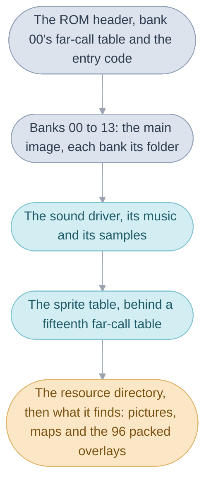
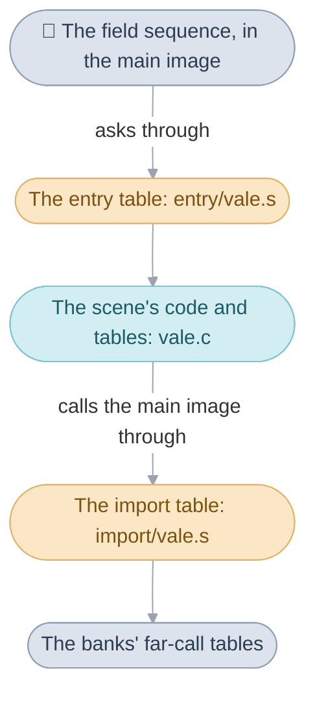

# The Broken Seal's source

The player sees a town, a battle, a menu or a game of dice, and somewhere in
this folder is the C that runs it. The folders follow the cartridge. The
game's code lies there in two kinds of place: the [banks](../glossary.md#bank)
of the [main image](../glossary.md#main-image), fourteen stretches of code the
processor runs straight from the cartridge, and the
[overlays](../glossary.md#overlay), one packed piece of code for each
[scene](../glossary.md#scene) or group of scenes, unpacked into RAM only while
one of them runs. Most folders are one bank or one kind of overlay, so a
folder says where its code lies. The cartridge keeps no file or folder names,
so every name here is ours; the C, assembly and editable pictures, sounds and
text build the cartridge's exact bytes
([matching decompilation](../glossary.md#matching-decompilation)).

The folders come first, then what lies under them, each resting on the one
before:

1. The folders, grouped by the four divisions of the code, and what each
   holds.
2. The banks: where each folder's code lies on the cartridge, and why the
   main image is cut into fourteen.
3. Objects and parts: the unit the build compiles, and how the longest are
   split to be read.
4. Overlays: the three files every scene's code is made of.
5. Headers: what the whole game shares, and what each file declares.
6. C and assembly: which compiler built each file, and why a few files stay
   assembly.

## What each folder holds

The code folders are grouped by the
[four divisions](../README.md#the-four-divisions) of the code, each with a
page of its own, and each code folder holds one or more banks
([below](#banks-and-folders)). The other folders each gather one kind of
thing, a scene, a map or a picture, from wherever the linker places it. Each
folder name's source is in the [glossary](../glossary.md#bank-folder).

[System](../system.md) is the base code every other part runs on, in two
folders:

- [System code](system/README.md) starts the console and lets time pass
  through [`wait()`](../glossary.md#wait), one [frame](../glossary.md#frame)
  at a time, with the [main routine](../glossary.md#main-routine), the
  [tasks](../glossary.md#task), the [heap](../glossary.md#heap-and-pools), the
  buttons, saving, the link cable, the memory map and the overlays.
- [The Game Pak](gamepak/README.md) holds what belongs to the cartridge
  itself: the ROM header, the [far-call](../glossary.md#far-call) tables, the
  [resource directory](../glossary.md#resource-directory), the numbered list
  through which every image, table and overlay is found, and the flash chip
  the saves are written to.

[Field](../field.md) is everything outside a battle, in one folder:

- [Field code](field/README.md) is the code under every town, dungeon and
  the World Map: the [actors](../glossary.md#actor), walking, loading,
  scrolling and drawing the map, and the
  [field sequence](../glossary.md#field-sequence) in `field_sequence.c`,
  which runs one scene from its set-up to the [exit](../glossary.md#exit) the
  party leaves by, with random encounters, field
  [Psynergy](../glossary.md#psynergy-and-pp) and the event commands
  (`event_commands.c`), and Lucky Dice and Lucky Wheels.

[Battle](../battle.md) is a fight, in two folders:

- [Battles](battle/README.md) runs a fight: the order of actions, the
  enemies' choices, what each ability does to its targets and the spoils.
- [Battle effects](battle_effect/README.md) draws what each ability shows on
  screen, one function for each battle effect.

[Interface](../interface.md) is the windows, menus and shops, in three
folders:

- [Windows](window/README.md) draws the boxes text appears in, decodes the
  stored messages and types them out, and holds the screens built from
  windows, among them the battle menus, the file list and name entry.
- [Menus](menu/README.md) holds the field menu's Psynergy, Djinn, Item and
  Status screens, and the two small banks the Title calls: the title intro
  and the credits.
- [Shops](shop/README.md) holds every counter that buys, sells, repairs or
  heals, and the inn.

Six folders stand beside the four divisions:

- [Game rules](game/README.md) holds the party's state and the rules every
  division asks about: [units](../glossary.md#unit) and their stats, items,
  levels, classes, [Djinn](../glossary.md#djinn) and the
  [game flags](../glossary.md#game-flag), with the C tables that define every
  item, ability, Djinni, enemy, [summon](../glossary.md#summons) and class.
  No programming division is credited with it.
- [Sound](sound/README.md) holds the sound layer, Nintendo's MusicPlayer2000
  driver and the mixer copied into IWRAM; the music and samples themselves
  are in [`games/tbs/sound`](../sound).
- [Scenes](scene/README.md) holds the scenes' overlays: who stands where, the
  [triggers](../glossary.md#trigger) and the [events](../glossary.md#event),
  and the three scenes that are screens: the Title, the File Screen and the
  Battle Arena.
- [Debug scenes](debug/README.md) holds the three debug overlays and the ten
  debug scenes the cartridge keeps.
- [Maps](map/README.md) holds the [maps](../glossary.md#map) as data.
- [Graphics](graphics/README.md) holds the pictures, each with the assembly
  that only places it.

## Banks and folders

A function's address is fixed by the bank it lies in, and the folders are
cut along the same lines, so a folder's name usually says which stretch of
the cartridge its code occupies. [`main.ld`](../main.ld) lays the main image
out in fourteen banks, each after the first starting at an address fixed per
[edition](../glossary.md#editions). Each bank opens with its far-call table,
the 8-byte [veneers](../glossary.md#veneer) through which other banks call
its functions, so a bank's code can grow or shrink without moving an address
another bank holds
([The Game Pak](gamepak/README.md#why-the-main-image-is-cut-into-banks)
gives the reason in full). The System's bank 00 is the exception: other banks
call its functions directly, and its table, at the start of the cartridge,
serves only the overlays ([System](../system.md#banks-and-far-calls)).

The cartridge runs from the header to the last packed overlay in this order:

Each large bank is one folder, and each small bank's code sits in the folder
it belongs with: the credits and the title intro are banks of their own,
because the Title calls them, and live in `menu/` with the screens. The
object list, [`objects.tsv`](../objects.tsv), names each object's bank in
its `place` column, as `main.ld` does, and the banks take their names from
their far-call tables, which are the `.S` files of `gamepak/far_call/`:

| Place         | Far-call table     | Folder                                                                           |
| ------------- | ------------------ | -------------------------------------------------------------------------------- |
| `rom_main_00` | `SYSTEM.S`         | `system`, with the flash library in `gamepak/flash`                              |
| `rom_main_01` | `FIELD.S`          | `field`                                                                          |
| `rom_main_02` | `WINDOW.S`         | `window`                                                                         |
| `rom_main_03` | `GAME.S`           | `game`                                                                           |
| `rom_main_04` | `FIELD_SEQUENCE.S` | `system/main_routine.c`, then `field` (`field_sequence.c`, `event_commands.c`)   |
| `rom_main_05` | `MENU.S`           | `menu`                                                                           |
| `rom_main_06` | `SHOP.S`           | `shop`                                                                           |
| `rom_main_07` | `BATTLE.S`         | `battle`                                                                         |
| `rom_main_08` | `BATTLE_EFFECT.S`  | `battle_effect`                                                                  |
| `rom_main_09` | `CREDITS.S`        | `menu` (`credits.c`)                                                             |
| `rom_main_10` | `TITLE.S`          | `menu` (`title_intro.c`)                                                         |
| `rom_main_11` | `LUCKY_DICE.S`     | `field/lucky_dice.c`                                                             |
| `rom_main_12` | `LUCKY_WHEELS.S`   | `field/lucky_wheels.c`                                                           |
| `rom_main_13` | `SOUND.S`          | `sound`                                                                          |

After the banks come the sound driver and its data, the music and samples
under [`games/tbs/sound`](../sound), then `SPRITE.S`, a fifteenth far-call table
whose one entry is the sprite metadata lookup in `system/sprite_metadata.c`,
with the sprite tables behind it, and last the resource directory and
everything it finds by number: the pictures, the maps and, at the very end,
the 96 packed overlays. The far-call tables are all in `gamepak/far_call/`,
and `graphics`, `map` and `sound` gather one kind of thing (pictures, maps,
sound) from wherever the linker places it.

The object list also lays out the RAM, before and after the banks: the
layout of EWRAM and IWRAM (`system/ewram.s`, `system/iwram.s`,
`system/iwram_high.s`), which only gives each variable its address, and the
routines the cartridge carries to copy into IWRAM at start-up, the interrupt
code and the sound mixer, which `main.ld` places in the ROM and links at
their IWRAM addresses.

## Objects and parts

Every file the build compiles or assembles is one object, the linker's object
file, unrelated to the actors in a scene. [`objects.tsv`](../objects.tsv)
lists the objects in link order, with the image each belongs to (`main`, or
an overlay's number in the resource directory), its place in that image, its
sections, and, where only some editions link it, those editions. Within one
object, code and data follow the order they are defined in, so a function's
place in its file is its place on the cartridge, and only the object list
orders the objects themselves.

Some objects are too long to read as one file: the battle object runs to
some 13,000 lines. Such an object is written as parts, each holding one
family of functions, in a folder of the object's own name beside its `.c`.
`battle/battle.c` includes its private header, `battle_internal.h`, and then
the 24 files under `battle/battle/`; only `battle.c` is compiled. The `.c`
opens with a guide to its parts and then includes them in cartridge order,
and each part opens with what it holds, so the tops of a folder's files read
as its table of contents. Eleven objects are written this way: `system`,
`field`, `field_sequence`, `event_commands`, `game`, `window`, `screens`,
`menu`, `shop`, `battle` and `battle_effect`. The parts are ours, cut where
one family ends and the next begins, since the cartridge shows one object
and keeps nothing of how [Camelot](../glossary.md#camelot) divided its files.

| File                  | What it says                                          |
| --------------------- | ----------------------------------------------------- |
| `<object>.c`          | the guide comment, then its parts in cartridge order  |
| `<object>_internal.h` | what the parts share; places no bytes                 |
| `<object>/*.c`        | the parts, each opening with what it holds            |

## Overlays

When the party arrives somewhere, the scene's code is unpacked into one
32 KB area of EWRAM, over the scene before, and the field asks it who stands
where and what can happen ([System](../system.md#overlays)). In the source,
an overlay is three files in its folder, linked in this order:

- `entry/<scene>.s`, the
  [entry table](../glossary.md#entry-table-and-import-table): six veneers,
  one for each question the field asks a scene, its set-up and the functions
  that hand the field sequence its entrances, exits, actor placements,
  triggers and exit areas ([Scenes](scene/README.md#the-entry-table)).
- `<scene>.c`, the scene's code and tables.
- `import/<scene>.s`, the import table: one veneer for each main-image
  function the overlay calls, chosen by name from the one list every overlay
  keeps in the same order, `system/overlay/imports.inc`.

Where an overlay's RAM variables are still assembly, `scene/bss/<scene>.s`
holds them, and the overlay has a row in [`overlays.tsv`](../overlays.tsv)
for its `.bss` section. Code several scenes use is in headers under
`scene/shared/`, and each scene that includes one compiles its own copy,
since only one overlay is loaded at a time and each reaches only the main
image ([Scenes](scene/README.md#code-shared-between-overlays)). In the object
list, an overlay's rows carry its number in the resource directory as their
image, and `system/overlay/overlay.ld` links each at the overlay area's
address.
[System code](system/README.md#how-an-overlay-reaches-the-rest-of-the-game)
describes how an overlay is packed and loaded.

| Folder   | Overlays                                                       |
| -------- | -------------------------------------------------------------- |
| `scene/` | 93, with the Title, the File Screen and the Battle Arena       |
| `debug/` | 3: the test scenes, Increase item and level, and Menu test     |

## Headers

A struct the field fills and a battle reads has to be declared once, where
both can see it. [`games/tbs/include`](../include) holds what the whole game
shares: types, structures, flags, sounds, the ids of scenes, items, abilities
and sprites, and the event calls. The `Makefile` puts `include` and its
folders `battle`, `field`, `game`, `gamepak`, `graphics`, `menu`, `shop`,
`sound`, `system` and `window` on the include path, so code includes those
headers by name alone. Each compiled C file, a module, has a
[module header](../glossary.md#module-header) at the same path under
[`include/module`](../include/module) (`module/battle/battle.h` for
`battle/battle.c`), and an object written as parts keeps its private header
beside it.

| Header                        | What it holds                                             |
| ----------------------------- | --------------------------------------------------------- |
| `include/flags.h`             | the [game flags](../glossary.md#game-flag)                |
| `include/sounds.h`            | the music, jingles and sound effects                      |
| `include/field/event.h`       | the calls events are written in                           |
| `include/module/<path>.h`     | what the C file at `<path>.c` defines                     |
| `include/module/import.h`     | the main-image routines the overlays call                 |
| `include/gamepak/far_call/`   | each far-call table's `Far` names                         |

## C and assembly

Nearly all of the game is C: about 95% of the bytes of code across the six
editions, with the far-call and overlay stubs counted apart. Three
[compilers](../glossary.md#the-compilers) built it, and the three ARM files
are copied into RAM before they run, since the processor's 32-bit
instructions run slowly over the cartridge's 16-bit bus. [Matching](MATCHING.md)
explains how a build is judged against the cartridge and why some of the C is
written as it is.

| Code                                   | Compiler                           | Where                                                                       |
| -------------------------------------- | ---------------------------------- | --------------------------------------------------------------------------- |
| ARM C                                  | GCC 2.95.2                         | `window/glyph_arm.c`, `field/actor_update_arm.c`, `field/world_map_lines.c` |
| the sound driver's C, the flash library | `old_agbcc`                        | `sound/`, `gamepak/flash/`                                                  |
| the game's Thumb C                     | alchemy-gcc, a GCC of July 2000    | every other C file, and libgcc                                              |

Code stays assembly only where its instructions show that none of those
compilers wrote it. Each such file states that proof in comment lines at its
top that begin `@ Why` ([Matching](MATCHING.md#the-other-markers)). The
proofs are instructions the compilers never emit: a branch on a shift's carry
(`system/trig.s`, `system/decompress_byte_lz.s`), a load into `pc` from a
table the code rewrites (`battle/background_decode.s`), a switch from Thumb
to ARM inside a routine (`sound/mixer.s`), a write to the processor's mode
(`system/entry.s`). Most of this handwritten code is decoders, the sound
mixing and the routines copied into
[IWRAM](../glossary.md#iwram-and-ewram). The few handwritten instructions
inside the C are each marked `CAMELOT_ASM` with their proof.

The decoders unpack tiles, sprites and text for the rest of the game. Each is
linked into the bank of the code that calls it and written in the processor's
32-bit instructions, so its caller copies it into RAM first, a
[heap slot](../glossary.md#heap-slot) or the heap
([Field](field/README.md#routines-run-from-ram)). For the two battle
background decoders the copy is needed for another reason too: they rewrite
their own table of commands before they start, which only code in RAM can do.

| Routine                                                        | What it unpacks                                                                    | File                                                                       |
| -------------------------------------------------------------- | ---------------------------------------------------------------------------------- | -------------------------------------------------------------------------- |
| `Text_DecodeSymbol`, `Message_FindArm`                         | one symbol of packed message text; where a message starts                          | `window/message_decode.s`                                                  |
| `Tile_Decompress4bpp`, `Tile_ExpandMasked`, `Tile_ExpandOpaque` | window images and icons                                                            | `window/decompress_4bpp.s`, `window/expand_opaque.s`                       |
| `Render_DecodePicture`, `TileMap_DrawRows`                     | a sprite animation's picture into its sprite; the World Map's still picture        | `field/picture_decode.s`                                                   |
| `Tile_ConvertMapGrid`                                          | a map's three decoded planes into cells                                            | `field/map_grid_convert.s`                                                 |
| `BitDecoder_DecodeImage`                                       | a battle background                                                                | `battle/background_decode.s`                                               |
| `Credits_DecodeBackground`                                     | a battle background, its colours moved into one half of the credits' memory        | `menu/credits_background_decode.s`, `menu/credits_background_expand.s`     |

The rest of the assembly, about 50 KB in each edition, is stubs: the 8-byte
entries of the far-call tables in `gamepak/far_call/` (`.S` files, which the
C preprocessor reads first) and of every overlay's entry and import tables.
The compiler's library routines come from libgcc, built from alchemy-gcc's
sources: the call-through-register stub, linked once into bank 00 and into
each overlay that needs it, and the double-precision arithmetic two overlays
use (`scene/vault_cave.c` and `scene/lunpa_fortress.c`). Most `.s` files
place data, not code: an image
built from the PNG beside it, a table from its `.tsv`, or a map, under the
name the code uses.

## Where to start reading

`System_Initialize`, in [system/system/start_up.c](system/system/start_up.c),
is the first C to run; it ends by calling `MainRoutine_Run` through its
far-call stub. The main routine, in
[system/main_routine.c](system/main_routine.c), is short enough to read
whole, and [System code](system/README.md#start-up) follows power-on step by
step.

To find the code behind something in the game, search for its English name.
Each battle effect's comment names the abilities that play it, so searching
`battle_effect/battle_effect/` for Quake leads to
[quake.c](battle_effect/battle_effect/quake.c). Each place's code is the
overlay in `scene/` named for it, such as [scene/bilibin.c](scene/bilibin.c).
The game's text is in [`games/tbs/text`](../text), a PO catalog for each
language, where each message carries its linker name: "(No saved data)" is
`MsgSaveNoData`, which leads to the save file list in
[window/screens/save.c](window/screens/save.c).
