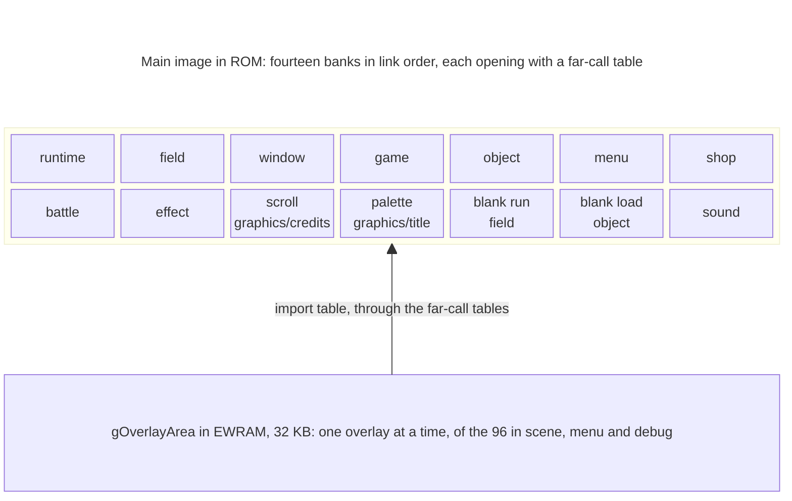

# The Broken Seal's source

The source is divided the way the cartridge divides the program: one folder
for each large bank of the main image, folders for the overlays, and four
folders that gather one kind of thing (pictures, maps, sound, the memory
layout) wherever the link places it. The cartridge keeps no file or folder
names, so every name here is ours, chosen for what the folder holds.

## Banks and folders

`main.ld` lays the main image out in fourteen banks, each starting at an
address fixed per edition and opening with a far-call table
([Engine](../engine.md) explains why). The nine large banks each have a
folder, in link order: `runtime`, `field`, `window`, `game`, `object`,
`menu`, `shop`, `battle` and `effect`. The five small banks hold one
mechanism each, and their code sits in the folder it belongs with:

| Bank | Code | Folder |
| --- | --- | --- |
| scroll | the credits | `graphics/credits` |
| palette | the title intro, the logos and the palette fade | `graphics/title` |
| blank run | Lucky Dice | `field` |
| blank load | the slot machine | `object` |
| sound | the cue layer and the driver | `sound` |

The bank names are the far-call tables' (`system/far_call/SCROLL.S` and the
rest). Code in another bank calls a function through its table entry, by
its name with `Far` added (`Battle_RunEncounterFar`); inside a bank,
functions call each other directly. The runtime bank is the exception:
every bank calls its functions directly, and its table is used by the
overlays.

`graphics`, `map`, `sound` and `system` don't follow a bank. `scene` and
`debug` hold overlays, and `menu` holds three overlays beside its bank.

## Objects and parts

Every file the build compiles or assembles is one object.
[`objects.tsv`](../objects.tsv) lists them in link order, with the image
each belongs to (`main`, or an overlay's resource number), the place in
that image (`rom_main_07` is the battle bank) and its sections, and
[`main.ld`](../main.ld) gives each bank its start in each edition. Within
one object, code and data follow definition order, so a function's place in
its file is its place in the ROM.

An object too long to read as one file is written as parts.
`battle/battle.c` includes its private header, `battle_internal.h`, and then
the files under `battle/battle/` in ROM order; only `battle.c` is compiled.
The guide comment at the top of such a `.c` says where each family starts,
and each part's first line says what it holds, so the tops of a folder's
files read as its table of contents. The parts are ours, not Camelot's
files.

## Folders

The field is split four ways. [Field](field/README.md) is the engine under
every town, dungeon and the world map: the objects on the map, movement, and
loading, scrolling and drawing the maps. [Field objects](object/README.md)
runs one scene on that engine, from its set-up to the exit the party leaves
by, with random encounters, field Psynergy and the commands scene scripts
use; `Game_Run`, the loop that runs one scene after another, is there too.
[Scenes](scene/README.md) holds the places, one overlay each: placements,
events and cutscenes. [Maps](map/README.md) holds the maps themselves as
data.

[Battles](battle/README.md) runs a fight: turn order, the enemies' choices,
what each ability does to its targets and the spoils.
[Battle effects](effect/README.md) draws what each ability shows on screen,
one function for each effect.

[Windows](window/README.md) draws the framed boxes text appears in, decodes
the compressed messages and types them out, and holds the screens built from
windows, among them the battle menus, the save file menu and name entry.
[Menus](menu/README.md) holds the field menu's Psynergy, Djinn, Item and
Status screens, and three overlays: the title, the file select screen and the
Battle Arena's lobby. [Shops](shop/README.md) holds every counter that buys,
sells, repairs or heals.

[Game rules](game/README.md) holds the party's state and the rules other
code asks about: units and their stats, items and inventories, levels,
classes, Djinn and the game flags, with the `.tsv` tables that define every
item, ability, Djinni, enemy, summon and class.

[Runtime](runtime/README.md) starts the console and runs every frame
through `WaitFrames`, with the keypad, the heap, fades, sprites, saving and
the link cable. [System](system/README.md) holds the memory map, the
far-call tables, the overlay stubs, the resource directory pictures, tables
and overlays are found through, and the flash save library.
[Graphics](graphics/README.md) holds most of the pictures, the title intro,
the credits and the handwritten decoders. [Sound](sound/README.md) holds the
cue layer and Nintendo's MusicPlayer2000 driver; the songs and samples are
in [`../sound`](../sound). [Debug rooms](debug/README.md) holds the three
test scenes the ROM keeps.

## Overlays

The scene table, `gField_SceneTable` in [field/scenes.s](field/scenes.s),
has 201 scenes, and they share 96 overlays: 90 under `scene/`, three under
`menu/` and three under `debug/`. `Scene_LoadOverlay`
([object/object/scene.c](object/object/scene.c)) unpacks the overlay a
scene's row names before `Field_RunScene` runs it; a battle or a minigame is
main-image code and loads none. [Engine](../engine.md) describes how an
overlay meets the main image.

Each overlay is three files in its folder:

- `entry/<place>.s`, the entry table: six stubs, written with
  `overlay_veneer`, that the field code calls to start the scene and to get
  its entrances, exits, placements, events and regions.
- `<place>.c`, the scene's code and tables.
- `import/<place>.s`, the import table: the stubs the overlay calls the main
  image through, chosen from the list in `system/overlay.inc`.

Only one overlay is loaded at a time, so code several places use is in
headers under `scene/common/`, and each scene that includes one compiles its
own copy. [System](system/README.md) describes the stubs and how an overlay
is packed.

## Headers

[`../include`](../include) holds what the whole game shares: types and
structures, the flags in `flags.h`, the songs and sound effects in
`songs.h`, and the commands scenes are written in, in `event.h`. The
`Makefile` puts `include` and its folders `battle`, `field`, `game`,
`graphics`, `lib`, `menu`, `sound` and `system` on the include path, so code
includes those headers by name alone.

[`../include/unit`](../include/unit) mirrors this folder: each compiled C
file has a header at the same path under `unit` that declares what it
defines (`unit/battle/battle.h` for `battle/battle.c`; `unit/scene/` has one
for each place). [`../include/farcall`](../include/farcall) has a header for
each bank with its `Far` names. An object written as parts keeps its private
header beside it.

## C and assembly

In tbs-en, 95% of the bytes of code come from C. alchemy-gcc, a GCC of July
2000, compiles the game's Thumb C. Three files written for ARM
(`window/glyph_arm.c`, `field/update.c` and `field/vertices.c`) are compiled
by GCC 2.95.2, and the sound driver's C and the flash save library by pret's
`old_agbcc`. `make modern` also builds the C with a current GCC.
[Matching](MATCHING.md) explains how a build is judged against the
cartridge and why some of the C is written as it is.

Code stays assembly only where its instructions show that none of those
compilers wrote it. Each such file states its proof in its `@ C2:` lines: a
branch on a shift's carry (`runtime/trig.s`,
`system/resource/decode_byte_lz.s`), a load into `pc` from a table the code
rewrites (`graphics/tile/decode.s`), a switch from Thumb to ARM inside a
routine (`sound/mixer.s`), a write to the processor's mode
(`system/entry.s`). This handwritten code is about 16 KB, mostly decoders,
the sound mixing and the routines copied into IWRAM. The few handwritten
helpers inside the C are each marked `CAMELOT_ASM` with their proof.

The rest of the assembly, about 50 KB, is stubs: the 8-byte entries of the
far-call tables in `system/far_call/` (`.S` files, which the C preprocessor
reads first) and of every overlay's entry and import tables. The compiler's
library routines come from libgcc, built from alchemy-gcc's sources; two
overlays use its double-precision arithmetic.

Most `.s` files place data, not code: a picture built from the PNG beside it,
a table from its `.tsv`, or a map, under the name the code uses.

## Where to start reading

`System_Initialize`, in [runtime/runtime/system.c](runtime/runtime/system.c),
is the first C to run; it ends by calling `Game_Run`, which is short enough
to read whole. [Runtime](runtime/README.md) follows the same path.

To find the code behind something in the game, search for its English name.
Each effect's comment names the abilities that play it, so searching
`effect/` for Quake finds [effect/parts/quake.c](effect/parts/quake.c). Each
place's code is the scene named for it. The game's text is in
[`../text`](../text), a PO catalog for each language, where each message
carries its linker name: "(No saved data)" is `MsgSaveNoData`, which leads to
the save file menu in
[window/battle_command/save.c](window/battle_command/save.c).
