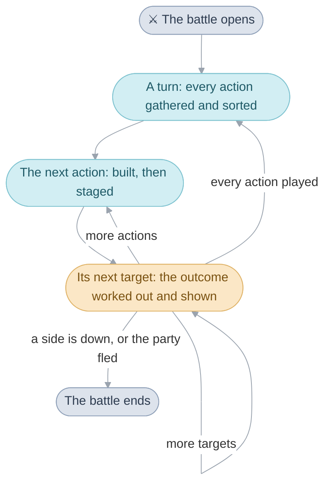
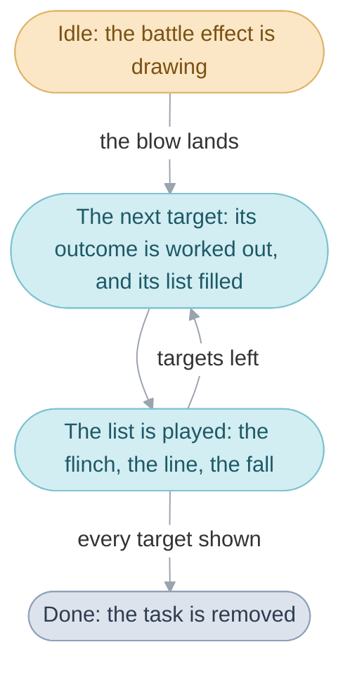

# Battles

Walk up and down a passage of Goma Cave and sooner or later the screen
flashes and goes black. A curtain parts on Isaac, Garet and Ivan facing a
Ghost, and the game reports `Ghost appeared!`.

From there every battle goes the same way. The player picks a command for
each party member. Then everyone on the field acts, one after another, the
fastest first. Each [turn](../../glossary.md#turns-and-actions) repeats this
until one side has nobody left standing or the party runs away.

This page follows a fight from that flash to the coins at the end. Everything
the rules of a fight decide is worked out in this folder:

- who acts in what order
- which move each enemy makes
- who a move reaches
- whether a blow misses or lands a critical hit
- how much damage each target takes
- which statuses take hold
- what the party wins

The answers come from tables and dice rolls. A table is a list the game
keeps on the cartridge, with one row for each enemy, each move or each item.
A dice roll is a random number. The player sees each answer as a line of
text, such as `Ivan takes 15 damage!`.

A fight passes through these steps, in this order:

1. [Starting a battle](#starting-a-battle): the enemies are drawn from a
   list, and the curtain opens on them.
2. [Turns](#turns): the party's commands and the enemies' choices are
   gathered, sorted by Agility and played one after another.
3. [Building an action](#building-an-action): a chosen command becomes a
   move, the fighters it reaches and the dice rolls the screen must show.
4. [Staging an action](#staging-an-action): the fighters move and the move's
   picture plays. That picture, such as Quake's shaking ground, is the move's
   [battle effect](../../glossary.md#battle-effect).
5. [How outcomes reach the screen](#how-outcomes-reach-the-screen): each
   target flinches and gets its line of text, one target at a time.
6. [How an ability resolves](#how-an-ability-resolves): what one target
   takes, and why.
7. [The end of an action and of a turn](#the-end-of-an-action-and-of-a-turn):
   poison, the Grim Reaper, the Djinn and the countdowns.
8. [The end of the battle](#the-end-of-the-battle): the spoils, and the way
   back to the field.
9. [The zoomed battlefield](#the-zoomed-battlefield): how one flat picture is
   made to look deep.

The steps sit inside one another. A battle is turns, a turn is actions, and
an action is dealt out to one target after another.

Several recordings on this page show party members hitting each other. Those
were made in test battles set up from the game's debug menu, a hidden menu
its makers used.

Three neighbours do the rest of a battle's work.
[Battle effects](../battle_effect/README.md) draws what each move looks
like. [Windows](../window/README.md) holds the command menu and the
[party](../../glossary.md#the-party)'s status window. And the
[game rules](../game/README.md) hold the tables of moves, items and enemies
and the arithmetic of damage.

## Starting a battle

A battle starts from one number. It names a
[formation](../../glossary.md#formation), one of the 380 groups of enemies
the game can send against the party. The one in this recording says: one
Lizard King, one Harridan and two Stone Soldiers.

Before anything shows, the battle turns that number into enemies standing in
a line, with names and HP. It also rolls for a
[first strike](#first-strikes-and-fleeing). Then the opening plays, and the
turns begin.

### The enemies of a formation

A formation lists up to five kinds of enemy. For each kind it gives the
fewest and the most that can appear.

One formation lists only Vermin, two at the fewest and three at the
most. So the party always meets two Vermin, and sometimes a third. Another
lists a Vermin, a Wild Mushroom and a Bat. Only the Bat is certain. A second
Bat, the Vermin and the Wild Mushroom each come or stay away at random.

Every kind comes its fewest number of times. Then each kind gains a random
number more, up to its most, while there is room.

A battle has room for six enemies, and a large enemy takes the room of two.
So a formation of large enemies fills up sooner than one of small ones.

The formation also says how its enemies line up, in one of two ways:

- Nearly every formation is shuffled. Enemies of one kind stand together, and
  the kinds are put in a random order. That is why the same group of enemies
  does not always stand the same way round.
- Eleven formations keep their own order instead. The Bandit with his two
  Thieves is one, Menardi with Saturos another, and the one in the recording a
  third. The first enemy listed stands in the centre and the rest go
  alternately to either side of it. In the recording the Lizard King is in the
  middle, the Harridan beside it, a Stone Soldier on its other side and the
  second Stone Soldier beyond the Harridan.

Two enemies of one kind need telling apart, so each takes a mark after its
name: a digit from 1 in the English game, a letter of the alphabet in the
Japanese one. The first of a kind has no mark until a second arrives. Then
both are marked, `Stone Soldier1` and `Stone Soldier2`. An enemy called into
the battle later takes the next unused mark, and an enemy that leaves gives
its mark back.

Every fighter, party member or enemy, is a [unit](../../glossary.md#unit).
A unit is its stats, its HP and [PP](../../glossary.md#psynergy-and-pp), its
statuses and its [Power and Resist](../../glossary.md#power-and-resist) in
each [element](../../glossary.md#the-four-elements)
([The unit](../game/README.md#the-unit)).

The battle keeps each side as a list of its units, four party members at
most and six enemies. A unit's position in its list is its place. Places
come back all through this page: every range and distance in a battle is
counted in them.

### The opening

A battle opens on a curtain. It starts as a solid block covering the
battlefield and parts from the middle: one edge moves up and its mirror image
moves down.

The opening is timed in [frames](../../glossary.md#frame). A frame is one
picture on the screen, and the console draws about sixty a second. The
curtain takes 80 of them, a little over a second.

While it opens, the camera swings round toward the party's side and draws
back, its zoom easing from 180 percent to 100. The party's status window
opens, and each enemy is announced with a line of its own,
`Lizard King appeared!`. If the battle starts with a first strike, that is
announced last: `Isaac's party attacks first!` or
`Isaac's party was caught by surprise!`.

One formation opens differently. The Fusion Dragon on the Venus Lighthouse
aerie arrives in a storm. In place of the curtain, the picture cracks and
shatters into white over 128 frames, the battlefield becomes the aerie in the
storm, and the Fusion Dragon flashes as the colours come back. Only then does
the status window open and the party fade in, over 16 frames. The enemy is
announced last.

## Turns

A turn is every unit acting once. In the recording Ivan, Isaac and Mia attack
before any enemy moves, and the Lizard King goes last.

The game gets that order by writing every action down before the first one
plays. Each action is a short note. For Isaac attacking the second enemy in
the line it says: who acts, Isaac. The command, Attack. Where it is aimed,
the enemies' second place. And a priority, the number the turn is sorted by.

The party's notes come from the command menu and the enemies' from their own
choices. Then the notes are sorted, highest priority first, and played in
that order.

After every action the game asks whether a side has nobody left standing, so
a battle can end in the middle of a turn. When every action has played, the
turn ends with its countdowns, and the next turn begins with the command
menu.

A guard is what Defend puts up: the unit takes less damage until the turn is
over. Gathering a new turn starts by taking down the guards left from the
turn before.

### The party's commands

The command menu asks each party member still standing for one action. A
party member who has two actions this turn is asked twice. That happens
after the Djinni Kite has readied them.

A party member who is asleep, confused, charmed or stunned is not asked. A
note is still written for them, with no command in it. Their place in the
order comes round like anyone's, and that is when the player reads
`Garet is asleep!`.

A party member's priority is their Agility plus up to a sixteenth more,
drawn at random. With an Agility of 120 it comes out anywhere from 120 to
127. That is why two party members of nearly equal speed may swap places
from turn to turn. A second action in the same turn gets half that
priority, so it comes late in the order.

Flee is different. It is one command for the whole party. Its note is given
a priority above any Agility, so the attempt to run plays before anything
else.

### The enemies' choices

Every enemy has a list of eight moves in its row of the enemy table, and a
habit for choosing among them. The dice do the rest.

Take a Gryphon. Its list runs Wing Flutter, Tornado, Twin Beaks, Impact,
Attack, Sonic Slash, Bind and Ward. Its habit favours the start of the list,
so it uses Wing Flutter most and Ward least.

Each pick rolls a number from 0 to 255. Wing Flutter takes rolls 0 to 52,
Tornado 53 to 99, Twin Beaks 100 to 140, and so on down to Ward's 245 to
255. So Wing Flutter comes up about one time in five and Ward one time
in 23.

The enemies of this game have three habits between them:

- Most pick evenly. Each of the eight moves takes 32 of the 256 rolls, one
  time in eight.
- Thirty-two kinds, the Gryphon among them, favour the start of their list
  as above, from 53 rolls for the first move down to 11 for the last.
- The Manticore and one of Saturos's fights start at a random move and then
  go down the list in order, a step at each pick they make as they act.

An enemy chooses twice each turn. Its first pick is made while the turn is
gathered, and it stands only if it is a guard (Defend, or the stronger Total
Defense some enemies have) or an attempt to run away. A guard has to be up
before anyone acts, or it would be worthless against a faster attacker. Any
other first pick is thrown away.

The second pick is made at the moment the enemy acts, and it is the one the
player sees announced. By then the faster units have acted, so the enemy
chooses with the battlefield as it now stands. It does not waste a blow on a
party member who has just gone down, and it can heal an ally hurt a moment
ago.

A pick the enemy cannot use is drawn again:

- Psynergy it lacks the PP for, though some kinds of enemy try anyway and
  fail
- for some kinds, any Psynergy while their Psynergy is sealed
- a guard, at the moment it acts
- any move with no target worth it

After 18 failed picks the enemy defends.

A sleeping or stunned enemy loses its actions. An enemy with two actions a
turn takes its second at half its Agility.

The target is chosen with the move. Among the units of the side the move
may reach, the enemy keeps those it would do something to: a stat it can
still raise, a status the unit lacks, a downed ally a revival can bring
back, a standing unit a blow can hurt. It picks one of those at random.

Many enemies lean toward the strongest when they aim a single-target
attack. They sort the candidates by HP left, or by maximum HP as the Gryphon
does, and favour the front of the list a little. With two party members to
choose from, the stronger is picked 6 times in 11.

### Action order

The gathered actions are sorted highest priority first. Equal priorities
keep the order they were written down in. The party's actions were written
first, so on a tie the party acts first. The enemies were shuffled before
they chose, so enemies of equal Agility act in a shuffled order.

Three [Djinn](../../glossary.md#djinn) go before everyone. Granite, Flash
and Ground, whose effects guard or hold, have their priority raised past any
Agility.

Once the order is settled, Defend and Total Defense take hold at once, before
the first action plays. So a defending unit's guard is up against everything
that turn, including the actions of units faster than it.

### First strikes and fleeing

Now and then a random battle opens with `Isaac's party attacks first!` and
the enemies stand still for a turn. More rarely it opens with
`Isaac's party was caught by surprise!`, and some enemies act before the
party can choose anything.

The roll is made while the battle is set up. The party strikes first one time
in 16, and otherwise the enemies one time in 32.

When the party strikes first, no enemy actions are written down that turn.
When the enemies strike first, the party chooses nothing, and two to five
enemies, drawn at random, act once each. The next turn is an ordinary one.

Choose Flee and the game rolls for it on the spot, before any action plays.
The chance starts at 50 percent. It gains 20 for each earlier try in this
battle. It gains 5 for each level the party's average is above the enemies'
average, or loses 5 for each level below. Only units still standing count
toward the averages.

So a party at level 20 against Gryphons, which are level 23, starts at 35
percent, and after one failure tries again at 55. A party that struck first
always gets away.

A failed try turns the rest of the turn into a surprise. The player reads
`But there's no escape!`, and two to five enemies act once each before the
turn ends.

There is a gap in this, and it works in the player's favour. Suppose Garet
is asleep when Isaac's party chooses Flee. The party always gets away. No
roll is made at all.

The reason is the order the notes are written in. A party member who is
asleep, confused, charmed or stunned gets an empty note before the menu even
opens, so Garet's empty note is the first on the list and Flee is the
second. But the game only makes the escape roll when the very first note is
Flee. It finds Garet's, and moves on. Later, when the flight is staged, the
game asks only whether a roll failed. None did, so `Isaac and friends run!`
is followed by the party running off the field. Garet is left asleep where
he stands, and the battle ends as a flight.

The kind of battle decides which of these rolls are made:

- A random battle rolls for a first strike, and the party may run.
- A Mimic's battle, and the fight with the travelers in Vale, make no
  first-strike roll. The menu still offers Flee, and the roll is set to fail
  whatever it came to. That rule sits inside the roll, though. So the gap
  above opens here too: with a party member asleep, the party can walk away
  from a Mimic.
- In the other battles an event starts, there is no first-strike roll and
  the command menu refuses to run: `This is no time to be running away!`
- A link battle, two players' parties fought against each other over a link
  cable, is the same.
- Flint's lesson on the world map, where he teaches the party to use Djinn,
  always gives the party the first strike.

## Building an action

Just before a unit acts, the player reads its announcement, such as
`Isaac attacks!` or `Isaac's Swift Sword lets out a howl! Sonic Smash!`.

By then the game has turned the short note from the command menu into a full
account of the action. When Isaac casts Quake at the middle one of three
enemies, the account reads something like this:

- who acts: Isaac
- the move: Quake, of the Venus element
- who it reaches: the middle enemy, aimed at, and the enemy on either side,
  each one place away
- how it is shown: a cast, with Quake's battle effect

Every action of the turn gets such an account, made just as it is about to
play.

The first thing checked is whether the unit can act at all:

- A unit held by the Djinni Ground `is unable to move!`, and the hold is
  used up.
- A sleeping one `is asleep!`.
- A stunned one `is paralyzed and cannot move!`.
- A unit wearing a cursed item loses one action in four, except Defend:
  `is bound and cannot move!`.

An action stopped here shows its line and ends.

Otherwise the command gives the move, its targets and its announcement. The
unit pays what the command costs, the dice the battle effect must know about
are rolled, and the way the action will be shown is settled.

### Commands and ability ids

Everything a unit can do when it acts is an ability: Attack, Quake, a
Djinni's unleash, a summon, an item's use, an enemy's special move. Each is a
row of the ability table, 519 in all, and the game knows each by its row
number, its ability id.

The command the player chose decides which ability the action carries.

- Attack is the ability Attack, unless the weapon unleashes. Each weapon has
  an unleash chance, counted in steps of 5 percent, and the rest of the
  equipment can add to it. The Swift Sword's is 7 steps, 35 percent. When it
  happens, the player reads `Isaac's Swift Sword lets out a howl!` and the
  unleashed ability's name, `Sonic Smash!`.
- Psynergy is the ability chosen in the menu. A caster short of PP, or whose
  Psynergy is sealed, still announces the cast. The failure shows a moment
  later, and the PP is paid only when the cast goes ahead.
- Djinn takes the Djinni's ability. A set Djinni is unleashed and goes on
  standby. A Djinni on standby is set again instead, with a short burst of
  its element and `Flint is set to Isaac!`, and that is the whole action.
  One still recovering says so: `Flint is still in recovery!`
- Item takes the item's ability. An item with none, or a broken one, makes the
  user defend, and an item an earlier command this turn used up says so. An
  item the user keeps (a weapon, a ring, a Psynergy item) is raised,
  `Mia raises the Healing Ring!`. Anything else is used.
- Summon takes the [summon](../../glossary.md#summons)'s ability. The game
  counts the standby Djinn of each element on the user's side against what
  the summon needs, and marks the ones it uses. If they are no longer
  there, the player reads that the summoner
  `doesn't have enough standby Djinn!`.
- Defend and Total Defense show `Garet is defending!` and end, because
  their guard was raised when the order was sorted.
- An enemy's ability is announced as `Gryphon1 uses Wing Flutter!`, or with
  `unleashes` for some of its special attacks. A few have wording of their
  own, such as `Fighter Bee looks for allies!`.

The action takes its element from the ability. A plain Attack is the
exception: it strikes with the weapon's element, or an enemy's with its own.

### Targets and range

Move the cursor along the enemies and the ones an ability will reach light
up around it. Each side stands in a line, and an ability reaches the places
within its range of the aimed one. The range is counted in places along the
line, whatever the spacing on the screen.

A range of 1 is the aimed unit alone, and each point more adds a place on
either side. So Quake's range of 2 reaches three units and Avalanche's range
of 3 reaches five. The widest range covers the whole side, with every target
treated as the aimed one. The reach stops at the ends of the line.

A command is aimed at a place, not at the unit standing there, and the
targets are found only when the action is about to play. By then things may
have changed.

The reach passes over a unit that has left the battle, and over a downed
unit unless the ability revives. A downed unit still holds its place, so the
units beside it stay as far apart as they were.

When nobody in reach is left, the unit defends instead. That is why, when
Garet fells the enemy Isaac was also aiming at, the player reads
`Isaac is defending!`.

For each target the account keeps who it is and how many places it stands
from the aimed one. That [distance](#distance) is used when the ability
resolves.

### Rolls made in advance

A dodge and a critical hit look different from a plain blow, so the battle
effect has to know which it is before it starts. That is why these are
rolled while the action is built, before anything is drawn.

A plain Attack always lands on a target that cannot get out of the way:
down, asleep, stunned, charmed or held by Ground. Otherwise it misses one
time in 32. An attacker under Delude makes one more roll before that, and misses
on 153 of its 256 numbers, about three times in five.

A critical hit lands one time in 32. If that roll fails, there is a second
chance: half the percentage the attacker's equipment adds to its unleash
chance.

Some abilities can strike two or three times. One roll decides it for all
their targets:

| Ability | Chance | Blows |
| --- | --- | --- |
| Gust, Rapid Smash, Slice | 153 in 256 | two |
| Sonic Smash | 153 in 256 | three |
| Flying Attack, Double Fang, Twin Beaks | 1 in 4 | two |
| Swift Strike | 1 in 4 | three |

A success multiplies every target's damage by two or three, and plays a
stronger version of the battle effect so the extra blows show.

Annihilation rolls its instant death here too, so its burst can show whether
it landed. Every other added effect is rolled for each target as the blow
lands.

### Staging and announcement

The [staging](../../glossary.md#staging) is what happens around a battle
effect: whether the unit runs up and strikes, raises a hand to cast, or
nothing moves at all. Rockslide, in the recording, is staged full screen.
The camera swings and the rest of the caster's side fades out.

Most abilities are staged by what they are. An Attack is a run up and a
blow. Anything that costs PP is a cast. An item is raised. An ability with
nothing to draw shows only its lines of text.

The rest have a staging of their own, written in a table with a row for
each ability:

- Gaia, Mother Gaia, Grand Gaia, Rockfall, Rockslide, Avalanche and the
  summon Procne are full screen.
- Eleven summons, from Ramses to Thor, are full screen with the summoner
  hidden too.
- Thirty-six abilities are run up to like an Attack. The Djinni Flint is
  one, and many weapon unleashes.
- Twenty Djinn that do not strike, such as Granite and Quartz, are cast
  without the caster's glow.
- The four smallest summons, Venus, Mercury, Mars and Jupiter, are plain
  casts.
- Slice and seven weapon unleashes are staged as an enemy's special move is,
  with streaks of the element around the user where a caster has a field of
  stars.

Which battle effect plays comes from a second table, again a row for each
ability ([How an ability picks its
effect](../battle_effect/README.md#how-an-ability-picks-its-effect)).

The announcement follows the command: `Isaac attacks!`, `Isaac casts Quake!`,
`Isaac unleashes Flint!`, `Isaac summons Venus!`, or `Mia uses` and the
item's name.

## Staging an action

Staging is the part of an action the player watches.

When an action's place in the order comes round, an enemy first makes its
second pick. The camera starts easing toward its view for the action. The
acting unit is picked out with a pulsing glow. Then the action is built,
and played in the way its staging names.

Afterwards the things an action leaves behind are settled, such as poison,
and every unit goes back to its spot. The action's note is crossed off. The
Djinni Ground looks at that: it can only hold a unit whose note is still
waiting.

### An attack

The attacker runs up to its first target. The camera swings halfway toward
the attacker's side, and the attacker leaps the distance in exactly the
time its leaping picture takes. The blow's battle effect starts just before
the leap ends, so the two meet.

A miss plays differently. The target hops back out of the way, and
`Ivan nimbly dodges the blow!` shows.

A critical hit gets the stage to itself, as in the recording. Everyone but
the pair is cleared off the field, and the camera closes in on them, from
100 to 130 percent, over the run up. Afterwards everyone is shown again.

The blow drawn is the attacker's own: one for Isaac, Garet and Jenna,
another for Ivan and Mia, and each kind of enemy its own.

### A cast

The caster raises a hand. The camera swings toward the targets from the
caster's side, the cast's sound plays and the caster glows in its element.

The glow depends on who casts. A field of stars gathers on a unit casting
Psynergy, and streaks of the element surround an enemy using a special
move. A Djinni's user has no glow, since the Djinni's battle effect opens
with a flourish of its own.

A cast that failed shows why here, `But the Psynergy was blocked!` or
`...But doesn't have enough PP!`, and the rest of the cast is skipped.
Otherwise the battle effect plays, the outcomes show, and the targets return
to their spots.

### A summon or a full-screen cast

The summons and the full-screen Psynergy take the whole screen. The camera
turns, and the caster raises a hand and glows. The rest of the caster's side
fades out, over about a quarter of a second, and a summon hides its summoner
too.

So the targets have the field to themselves while a summon plays, and share
it with only the caster during a full-screen cast. Afterwards everyone fades
back in and the camera returns to its usual view.

### An item

The user raises the item. An item with a battle effect dims the background
to about two thirds of its brightness while the effect
plays. An item with none waits a second.

Then the item is spent as its row in the item table says:

- An item that is used up, such as an Herb, leaves the inventory. If the
  same party member has another item command later this turn, that command
  follows its item to its new slot.
- An item that may break, such as the Healing Ring, does so one time in
  eight: `Your Healing Ring broke!`
- Hermes' Water becomes an Empty Bottle.

### A flight

The party's flight was decided when the commands were gathered. The player
reads `Isaac and friends run!` either way. A party that got away runs off
the field, each party member able to move running one after another, and
the battle ends. One that failed reads
`But there's no escape!`.

Enemies run too. An enemy that runs, `Rat Soldier runs!`, gets away seven
times in ten. It runs off the field and is out of the battle. Otherwise it
too reads `But there's no escape!`.

## How outcomes reach the screen

Watch Plasma land on three party members. Garet flinches, his line appears
and waits for a button, and only then does Isaac's turn to flinch come.

Inside the game it does not happen that slowly. Say Plasma takes 46 HP from
Garet. His HP drops by 46 in one go, in a single frame. What takes time is
the showing.

So the game splits the two. Working out what Plasma does to Garet changes
his numbers at once and leaves behind a list of things to show, in order:

1. Garet flinches.
2. A number for the next line: 46.
3. A name for the next line: Garet.
4. The line itself. It is stored as
   `{argument_actor_name:1} takes {argument_signed_number} damage!`, and the
   name and the number are written into its two blanks
   ([Windows](../window/README.md#decoding-a-message)).
5. Garet is drawn again as he now is.

That list is the [playback queue](../../glossary.md#playback-queue). It has
room for 64 entries. Besides these five kinds, an entry can be a sound, a
unit falling, or a fresh drawing of the status window.

### Who plays the list

While Plasma's lightning is on screen, the battle effect is busy drawing it,
one frame after another. It cannot also be typing Garet's line.

So the game gives the list to a helper. It keeps a short set of chores that
it runs once in every frame, whatever else is going on, and it calls each one
a [task](../../glossary.md#task). Just before the battle effect starts, a
task is added whose chore is to play the list
([System](../../system.md#waiting-and-tasks)).

That is how lightning and text can share the screen. Every frame the battle
effect draws a little more lightning, and the task shows a little more of
the list.

The task does nothing until the battle effect tells it the blow has landed.
Each battle effect chooses that moment for itself, and it is the only thing
it has to say. From then on the task goes through the targets:

Notice that Isaac's damage is not worked out until Garet's line has been
read. Each target's outcome is decided when its turn to be shown comes.

Three kinds of entry make the playback wait:

- A flinch: the unit flashes white twice, and its panel in the status window
  lights with it.
- A fall: an enemy turns grey and dissolves, gone in a little over half a
  second. A fallen party member lies down.
- A line of text waits until it has finished typing, then shows the bobbing
  arrow and waits for the player to press a button.

The names and numbers a line needs are queued just before it and take no
time.

The targets are taken in their order along the line, whoever was aimed at.

A battle effect that never says so, such as Torch's, leaves the list to
start when the effect is over, so its damage shows afterwards.

## How an ability resolves

Once the battle effect shows the blow land, or the healing reach its target,
each target in turn finds out what the ability does to it. That means how
much damage it takes or how much it heals, and whether the ability's added
effect takes hold. An added effect is what an ability does besides damage or
healing: Sleep's sleep, Impair's lowered Defense, Taint's poison.

For one target it goes in seven steps:

1. It notes how far the target stands from the aimed place, the ability's
   element, and how strong the user is in it.
2. It rolls for the Djinn bonus, and for whether the added effect lands.
3. It brings in a new enemy if the ability calls one.
4. It applies the added effects that change how damage is dealt.
5. It deals the damage or healing.
6. It applies the added effect.
7. It rolls whether the hit woke the target, and works the target's stats
   out again.

All of it happens within one frame. Everything the player should see of it
goes into the playback queue to be shown afterwards.

### The ability kind

Every ability has a power, one number in its row of the ability table. What
that number means depends on the ability's kind.

Ragnarok and Quake show the difference. Ragnarok's power is 35 and it is an
attack kind: the 35 is added to an ordinary blow of Isaac's sword, so it
hits harder the higher his Attack is. Quake's power is 12 and it is a damage
kind: his Attack does not come into it at all, only his Power in Venus.

Two phrases in the table need saying first. An even match is the user's
Power in the element equalling the target's Resist in it, so that the
element neither helps nor hurts
([The element multiplier](#the-element-multiplier)). And a plain blow is
what Attack does: half the amount the user's Attack is above the target's
Defense.

| Ability kind | What the target takes | What the power is |
| --- | --- | --- |
| healing (Cure, Ply, Herb) | HP back, by the healer's Power in the element | the HP restored at Power 100 |
| effect (Sleep, Impair, Drain) | damage only when the added effect lands | the damage at an even match |
| attack (Attack, Ragnarok) | a blow, the user's Attack against the target's Defense | damage added to a plain blow |
| multiplied attack (Flint, Quick Strike) | a plain blow times the power | the multiplier, in tenths |
| damage (Quake, Avalanche) | damage scaled by the user's Power against the target's Resist | the damage at an even match |
| enemy damage (Wing Flutter, War Cry) | as damage, falling off faster with distance | the damage at an even match |
| summon (Ramses, Judgment) | as damage, with a share of the target's maximum HP added | the damage at an even match, before the share |
| PP damage (Crazy Voice) | PP lost, as damage | the PP lost at an even match |
| PP healing (Psy Crystal) | PP back, as healing | the PP restored at Power 100 |

A few rules sit on top of the table:

- Healing, blows and damage add a random 0 to 3.
- A summon adds 3 percent of the target's maximum HP for each Djinni it
  uses: 3 percent for Venus, 12 for Judgment.
- A blow always does at least 1 damage.
- A critical hit makes the blow a quarter bigger, and then adds a little
  more: the target's level divided by 5, plus 6.

Granite, Flash, Kite, Defend and Flee have no power to apply. Their whole
work is their added effect.

A guard cuts the result. A target that defends, or that the Djinni Granite
guards, takes half. One behind an enemy's Total Defense or the Djinni Flash
takes a tenth.

The formulas themselves belong to the game rules. That way the menus, which
show what Cure would heal, get the same answers as the battle
([Battle arithmetic](../game/README.md#battle-arithmetic)).

### The element multiplier

Look at how a damage line ends. In the recording Froth Sphere, a Mercury
ability, gives Ivan three exclamation marks and the others one.

The game stores the line three times over: ending in a full stop, in one
exclamation mark and in three. Three marks mean the element is the one this
target resists worst of the four. A full stop means it is the one it resists
best. Anything between gets one mark.

That is a hint at a rule underneath. Each unit has a Power and a Resist in
each of the four elements, and the gap between the attacker's Power and the
target's Resist decides how much the element counts.

Each point of Power ahead of the Resist adds half a percent, up to double at
200 points ahead. Each point behind takes half a percent off, down to
nothing at 200 behind. So Quake cast with a Venus Power of 120 at an enemy
with a Venus Resist of 100 does a tenth more.

A blow feels the element at half strength, a quarter of a percent a point.
Healing uses the healer's Power alone, and each point above or below 100
moves it one percent.

A character's Power and Resist come from the
[element levels](../game/README.md#element-levels) the Status screen shows,
an enemy's from the enemy table, and equipment adds to both. A summon
[raises its summoner's Power](#the-end-of-an-action).

A Djinni striking the element the target resists worst may also earn the
Djinn bonus. An enemy it fells gives more coins and experience and is
likelier to leave its item ([The spoils](#the-spoils)). The chance, in
percent, is the Djinni's user's Power less the target's Resist, plus 30.
When the bonus is won, the falling enemy flashes through changing colours
for half a second before it turns grey.

### Distance

An ability that reaches several units hits the one aimed at hardest and the
ones beside it less. Here Isaac aims at Ivan, with no one on Ivan's other
side, so Garet is one place away and Mia two.

Every kind but the two attack kinds falls off with the target's distance
from the aimed place. The figures are percentages:

| Places from the aimed one | 0 | 1 | 2 | 3 | 4 | 5 |
| --- | --- | --- | --- | --- | --- | --- |
| damage and healing | 100 | 80 | 60 | 40 | 20 | 10 |
| summons | 100 | 70 | 40 | 30 | 20 | 10 |
| enemy damage, effect and PP damage | 100 | 50 | 30 | 10 | 10 | 10 |
| an added effect's chance | 100 | 60 | 30 | 30 | 30 | 30 |

Take Avalanche, a damage ability with a power of 160 and a range of 3. At an
even match the aimed target takes 160 to 163, one place away 128 to 131 and
two places away 96 to 99.

Now put the user's Power 20 ahead and let the aimed target defend. Twenty
points are a tenth more, 176, which the game's rounding makes 175. The
random 0 to 3 gives 175 to 178, and the guard halves it: 87 to 89.

Blows work differently. With Attack 100 against Defense 60, a plain Attack
deals half the difference, 20 to 23. Ragnarok (power 35) adds its power to
that, 55 to 58. Flint (power 16) multiplies the blow by 1.6, 32 to 35.

Cure (power 70) restores 70 to 73 HP at Power 100 and 83 to 86 at 120. The
Healing Ring casts Cure, but it always restores 70 to 73, since an item's
user counts as Power 100.

### Whether the added effect lands

When Ivan casts Confuse at a group, some fall to it and the player reads
`But it has no effect on Garet!` for the others. Each target gets its own
roll.

The roll fails at once when there is nothing to do: a revival on a unit
still standing, a cure on a unit without the status.

Otherwise the chance starts from the effect's own rate. Sleep's is 45
percent, poison's 55, Confuse's 35 and Condemn's instant death 20. Then
three things move it:

- It gains 3 for each element level the user is ahead of the target in the
  ability's element, or loses 3 for each level behind.
- It loses 3 for every two points of the target's Luck.
- It gains 25 when the target is weak to the effect. Each enemy's row names up
  to three effects it is weak to. A Gryphon is weak to a lowered Attack.

Last, the result is scaled by the distance, from the table above.

So Sleep cast by someone two Jupiter levels ahead of a target with 10 Luck
has 45 + 6 - 15, about 36 percent. On the unit beside the aimed one it has
60 percent of that, about 21.

A few effects have a fixed chance that levels and Luck do not touch: Quartz's
revival 60 percent, Dew's 90, and 100 for an effect with no rate of its own,
such as Impact's raised Attack. Luff's seal is rolled three times and needs
only one success.

When the added effect of an effect-kind ability fails, the target takes no
damage either.

### Calling an ally, and effects that change the damage

Some added effects stand in for the damage or change how it is dealt, so they
are applied before it. The most visible brings in a new enemy.

Ally Search, Search for Help and Speed Surge bring one in when the roll
succeeds and there is room for another enemy. The newcomer takes the place of
an enemy that has left, or joins the end of the line, and the enemies are
lined up again. The player reads `Fighter Bee2 appears!!`, or for Speed
Surge `It split off into` and the new enemy's name. When it does not work,
the player reads `But no one came!` or `It failed to divide!`.

Ally Search and Speed Surge bring another of the caller's kind. Search for
Help brings a random kind from the battle's formation.

Other effects that landed change the damage itself:

- Torch's blow counts half the target's Defense.
- Severe Blow and Thrash leave the target 1 HP at most.
- Condemn and the other instant deaths skip the damage.
- Dynamite and Mortal Blow take their user out of the battle.
- Psy Drain takes its damage from PP, and fails on a target with none.
- Ground holds a target only if it has an action still to play this turn.

### Applying the added effect

Statuses and stat changes are countdowns kept on the unit, and the end of
each turn takes one off them. Impair lowers Mia's Defense by a quarter for
seven turns, and the number in the line is how far it fell.

A stat moves in steps the game calls stages, each an eighth of the stat.
Impair is two stages down.

The effect is applied when it landed and the target is still standing. A
revival needs the target down instead, and a drain still works on a target
its own damage has just felled. These are the rules the effects share.

- A stat change moves Attack, Defense or Resistance one or two stages, at most
  four either way, for seven turns. Resistance is Resist in all four elements
  at once, and a stage of it is 20 Resist. The line gives how far the stat
  moved, so a stat already at its limit shows 0. Zephyr and Vine set Agility
  outright, to double or half, for five turns.
- A status (Delude, Confuse, Charm, Paralyze, Sleep) and Bind's seal last
  seven turns, unless they [end early](#the-end-of-a-turn). Luff's seal lasts
  two turns that always run their course.
- Curse starts the Grim Reaper's countdown at seven. A second Curse on the
  same unit takes one more off it.
- Restore and Elixir clear delusion, stun, sleep, the seal and the Grim
  Reaper's countdown. Tonic clears those, poison and the evil spirit.
  Confusion and charm run their course under both.
- Drain gives the user all the HP the target lost, Sap half, Psy Drain the PP
  it took, and Psy Leech a tenth of the damage as PP.
- Break returns every raised stage to 0 and removes a summon's boost. Kite
  lets the target act twice next turn, Ground costs it its next action, and
  Haunt sets an evil spirit on it.

### After each target

A sleeping unit that is hit may wake up. Losing HP or PP wakes it one time
in four, unless it fell asleep this very turn.

A unit haunted by an evil spirit pays for its own attacks. For each target
it took HP or PP from, one time in four, a quarter of that loss (at least 1)
is put aside. The unit loses the total from its own HP at the end of its
action.

Flint's lesson has rules of its own, so that it always plays out the same
way. A plain Attack always misses. A Djinni's blow that would fell its
target leaves it 1 HP instead. And a summon always fells it.

## The end of an action and of a turn

Some things in a battle happen without anybody choosing them. They happen
at two moments: when a unit's action ends, and when the whole turn ends.

### The end of an action

When a unit's action has played, the game settles what the action leaves
behind. The Djinn the unit unleashed go from Set to Standby. The Djinn a
summon used start to recover, one a turn, the first in two turns.

The rest happens only while both sides still have someone standing.

A summoner takes its summon's boost: more Power in the element the summon
used most Djinn of. One Djinni gives 10 Power, two 30, three 60 and four
100. The player reads `Isaac's Earth Power rises by 10!`, with a pillar of
the element over him.

Then the unit pays what it owes:

- the evil spirit's share of the damage it dealt, with a line that begins
  `A curse does`
- poison's bite, a tenth of the unit's maximum HP, or a fifth for deadly
  poison
- the Grim Reaper's countdown, which drops by one and at 0 takes the unit:
  `The Grim Reaper calls out to Isaac!`

All of this comes after the unit's own action, whatever it was. That is why
a poisoned party member is hurt even on a turn they slept through.

### The end of a turn

When every action has played, the game goes through the Djinn and then every
unit, the party's first.

A Djinni whose recovery has run out is set again, `Flint is set to Isaac!`,
with a burst of its element.

Each unit still standing regains whatever HP and PP it gets back every
turn, from equipment for a party member or from its row of the enemy table
for an enemy. The line is the healing one, `recovers` so many `HP!`. Then
every countdown it carries comes down one: the Agility change, the Attack,
Defense and Resistance changes, delusion, confusion, charm, stun, sleep, the
seal, Regenerate and Reflect. Each shows its line when it ends.

A lowered stat or a status may end before its turns run out, and the player
reads, for a delusion, `Isaac sees clearly once again!`. Once five turns or
fewer are left, each turn's end rolls for it. The chance in percent is three
times the unit's Luck, less five times the turns left, plus a head start
that depends on the status:

| Countdown                         | Head start |
| --------------------------------- | ---------- |
| charm                             | 70         |
| confusion                         | 60         |
| sleep                             | 50         |
| stun                              | 40         |
| a lowered Attack                  | 30         |
| delusion                          | 30         |
| Bind's seal, once Luff's is gone  | 30         |
| a lowered Defense or Resistance   | 20         |

So a sleeping unit with Luck 5 and three turns left wakes with a chance of
15 - 15 + 50, 50 percent. Charm is the easiest to shake off and a lowered
Defense the hardest.

A raised stat, an Agility change, Regenerate and Reflect always run their
full course.

## The end of the battle

A battle ends in one of three ways: a win, a flight or a defeat.

Whichever it is, what the battle did to the party members is undone: raised
and lowered stats, statuses, a summon's boost, the Grim Reaper's countdown.
Poison is not on that list, which is why it follows the party out of the
battle. Recovering Djinn come one turn nearer.

### The spoils

A win against several enemies gets a line to the victory music,
`Ghost's party goes down!`. The name in it is not the last enemy to fall. It
is the kind that comes first in the battle's own line-up, among the kinds
that fell. That is normally the enemy announced first when the battle
opened. So the party can fell a Skeleton last and still read the Ghost's
name.

A lone enemy felled by a party member gets no such line. `You felled` and
its name has already said it.

Then the party is handed what the fallen enemies left. The spoils were
gathered as each enemy fell: its coins, its experience and perhaps its item.

Each enemy's row gives its item and a chance for it. A chance of 1 means
always, and each step more halves the odds: one time in 2, in 4, in 8. A
Gryphon's is 1, so it always leaves its Potion. An item is rolled for only
until it is won, so two Gryphons still leave one Potion. The battle keeps
at most four items, and prefers rare ones when it has to choose.

An enemy felled with the Djinn bonus gives more. Its coins gain the roll of
some six-sided dice, one die and one more for every ten of its levels. Its
experience gains the same number of four-sided dice. If 30 percent of what
the enemy normally gives is more than the dice came to, the bonus is that 30
percent instead. And its item is four times as likely.

The experience comes first. Every party member still standing gets the whole
amount. Each level gained shows what it brought: the level, the Psynergy newly
learned, and each stat that rose.

Then come the coins, and the items best first. An item the inventory has no
room for is held over for the field to deal with.

A loss plays the defeat music and `Isaac's party has been defeated!`, or
`Isaac goes down in defeat...` when he was fighting alone. A flight only
fades to black.

### Back to the field

After a win or a flight the party goes back to the room it came from,
standing where it stood. An event can ask for something else, an after-battle
[destination](../../glossary.md#destination), as when a boss's defeat leads
straight into the next part of the story.

After a loss the leader is revived with 1 HP. The party goes to the place an
event set for a defeat, or else to the restart point, which is most often
the last Sanctum.

## The zoomed battlefield

The battlefield looks deep, and the camera seems to move through it. It is
one flat picture of the place, 256 dots wide and 120 high, with its depth
already painted in. The dots are the screen's pixels.

The console builds its screen from a few
[background layers](../../glossary.md#background-layer) laid over one
another, as the recording pulls them apart. One of those layers can be
zoomed and slid as a whole, and the battlefield is drawn on that one. Once a
frame the camera's distance sets the zoom and the camera's swing sets the
sideways slide. The windows stay flat on a layer in front.

The fighters are [sprites](../../glossary.md#sprite-and-oam): small pictures
the console draws on top of the layers, each placed wherever the game says.
The party's column is 80 dots right of the centre, 32 dots apart. The
enemies' column is 80 dots left, spaced by their size.

### A picture too big for its layer

There is a catch. A layer is drawn from tiles, small squares of 8 dots by 8,
laid side by side like a mosaic. The zooming layer can use only 256
different tiles, and the battlefield needs 480.

So the picture is stored as two sets of tiles, its upper part and its lower
part. The console draws the screen line by line from the top, and the game
is allowed to change a layer's settings between one line and the next. Partway
down the screen, at the line where the picture's lower part begins, it
switches the layer from the first set to the second. Zoom the picture and
that line moves, so the game works it out afresh every time.

The player never sees the join.

A battle effect that needs the zooming layer for its own picture moves the
battlefield to a plain copy on another layer, which still slides sideways
with the camera. The battlefield is moved back when the action is over
([The canvas](../battle_effect/README.md#the-canvas)).

### The camera

The camera never jumps. Each frame it closes a sixteenth of the gap between
where it points and where it has been asked to point, so it starts fast and
slows as it arrives.

It is asked for a swing of an eighth of a circle to one side while a party
member acts, to the other while an enemy does, and halfway toward an
attacker for its run up.

## Design

The rules and the pictures are kept apart on purpose. The rules decide what
Plasma does to Garet. Plasma's battle effect decides only when the player
sees it.

So one set of arithmetic serves every battle effect in the game, and the
menus too: the HP that Cure promises in the Psynergy menu is worked out by
the same sum that heals in battle.

The dice are thrown at two moments for the same reason. What the picture
must show (a dodge, a critical hit, a double blow) is rolled before anything
is drawn, so the right picture can be chosen. Everything else is rolled
target by target as the blow lands.

## How it fits with the rest of the game

A battle takes over the whole game while it lasts. The room the party was
walking in is cleared away, and when the battle ends the party is put back
on the same spot.

It still leans on its neighbours all the way through. The fighters on the
battlefield are made the same way as the people walking around a town. The
command menu, the status window and every line of text belong to
[Windows](../window/README.md). The tables and the sums belong to the
[game rules](../game/README.md). And every picture of a move belongs to
[Battle effects](../battle_effect/README.md).

## Limits

- The party fights four at a time and the enemies six at most. In a link
  battle each player sends three.
- There are 380 formations, each of up to five kinds of enemy. Which one a
  random battle uses is the [field](../field/README.md)'s choice.
- A turn has room for 20 actions. That is exactly four party members and
  six enemies with two actions each, so it can never run out.
- An enemy's name has room for 14 characters, its mark included.

## Words used here

- **[unit](../../glossary.md#unit)**: a fighter on either side, such as
  Isaac or `Stone Soldier2`.
- **place**: a unit's position in its side's line.
- **side**: the party or the enemies.
- **guard**: what Defend and Total Defense put up for a turn.
- **ability**, **ability id**: anything a unit does when it acts, from Attack
  to Quake, a Djinni, a summon, an item's use or an enemy's move. The id is
  its row number in the ability table.
- **ability kind**: which sum an ability's targets go through. Ragnarok is an
  attack kind, Quake a damage kind.
- **power**: an ability's one number, whose meaning depends on its kind. A
  unit's Power and Resist, capitalized as the Status screen writes them, are
  something else: its strength and protection in each element.
- **added effect**: what an ability does besides damage or healing, such as
  Sleep's sleep.
- **[staging](../../glossary.md#staging)**: how an action is shown: a run
  up, a cast, a raised item.
- **[playback queue](../../glossary.md#playback-queue)**: the list of
  things to show for one target, such as Garet's flinch and his damage line.

## Evidence

Every ability and enemy on this page is called what the English game calls
it.

Some of what the game can do, no battle ever asks for. A formation could be
lined up a third way, with its kinds mixed together, and no formation is.
An enemy could choose its move in four more ways, such as always repeating
its last one, and no enemy does.

When an enemy sorts the party to find the strongest, the sort has a slip.
With three or more candidates it can leave them in the wrong order: three
party members with 1, 2 and 3 HP left come out as 2, 3, 1.

## For readers of the code

This last part is for anyone who goes on to read the game's code, the
instructions it is written in. A function is one named piece of them.

- The whole battle, from its set-up to the spoils, is one function,
  `Battle_Run` in [`battle/run.c`](battle/run.c).
- An enemy's choice is `BattleAI_ChooseAction` in
  [`battle/enemy_ai.c`](battle/enemy_ai.c).
- The full account of an action is called the action run, and it is made by
  `BattleActionRun_Build` in [`battle/action.c`](battle/action.c).
- Each kind of staging is one function in
  [`battle/staging.c`](battle/staging.c).
- The task that plays the list is `BattlePlayback_Run` in
  [`battle/playback.c`](battle/playback.c).
- What an ability does to one target is `BattleAbility_ApplyToTarget` in
  [`battle/ability.c`](battle/ability.c).
- The line-by-line switching of the battlefield's tiles is in
  [`battle/background.c`](battle/background.c). The settings for all the
  screen's lines are prepared ahead and swapped in during the
  [VBlank](../../glossary.md#vblank), the short gap between one picture and
  the next.

Because the room is cleared away before a battle, everything the battle
needs is left for it beforehand in the
[main routine's work](../../glossary.md#main-routines-work): the party, the
formation's number, the kind of battle, the music an
[event](../../glossary.md#event) chose and the
[battle background](../../glossary.md#battle-background)
([Field code](../field/README.md#leaving-for-a-battle-and-coming-back)).
The battle hands back one number: the count of enemies that fell, or a mark
for a flight or a defeat. The [main routine](../../glossary.md#main-routine)
reads it and chooses what runs next
([System](../../system.md#the-main-routine)). To the main routine a battle
is one more [sequence](../../glossary.md#sequence), run in place of the
[field sequence](../../glossary.md#field-sequence). Its fighters are the
field's [actors](../../glossary.md#actor). The game rules sit in another
[bank](../../glossary.md#bank) of the cartridge and are reached by
[far calls](../../glossary.md#far-call).

Three sizes are fixed. An action can list 14 targets. The playback queue
holds 64 entries, and nothing checks that one target's outcome stays within
them. And the staging table is one row shorter than the ability table, so
the last ability, Thrash, is staged by what it is.
