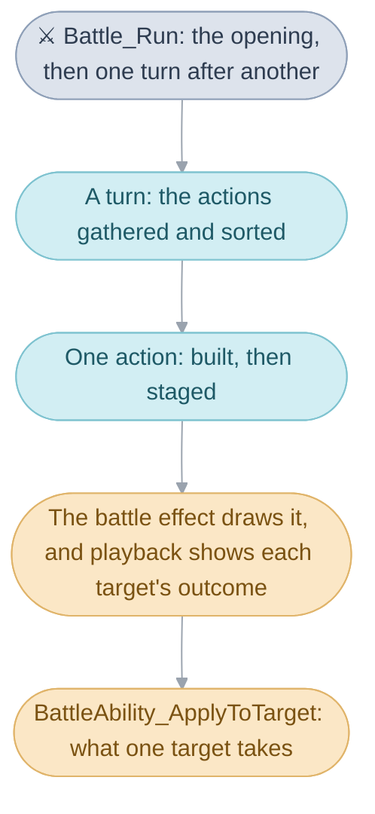
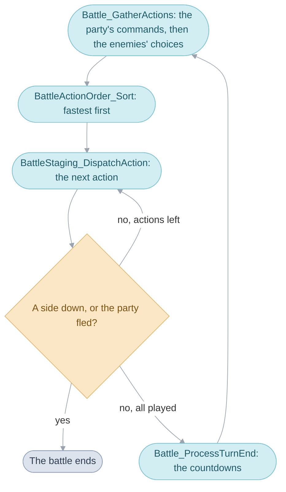
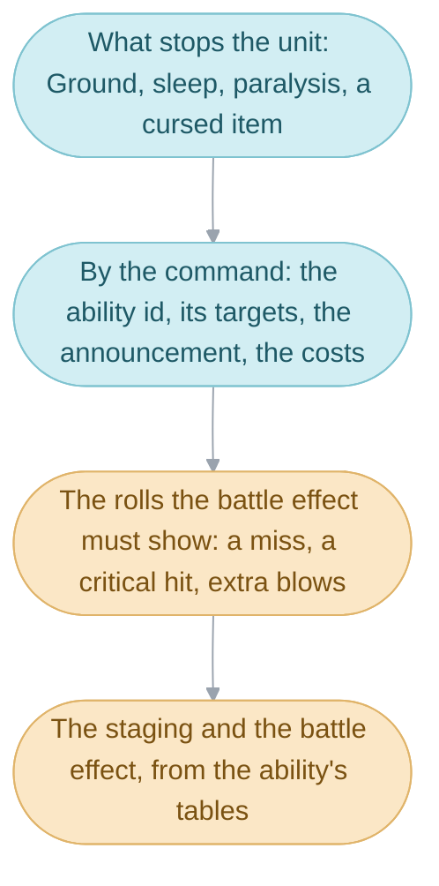
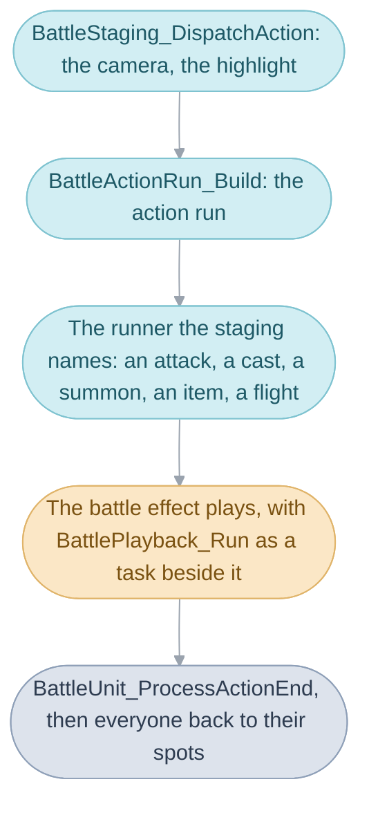
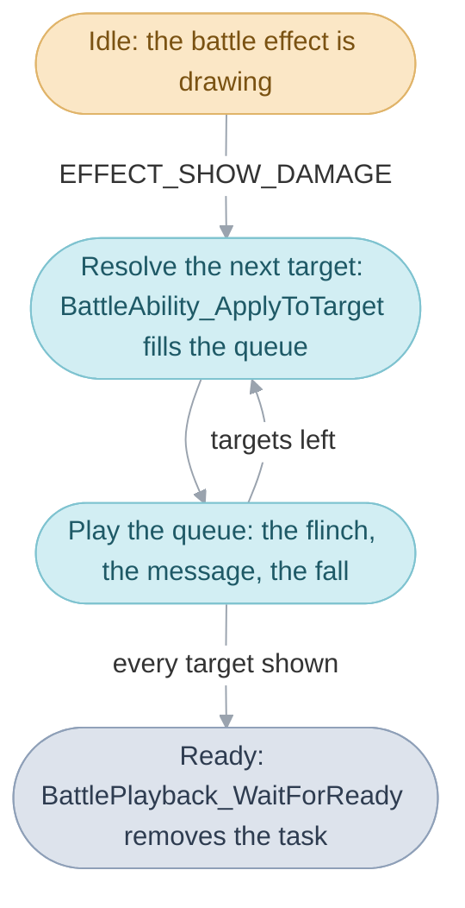
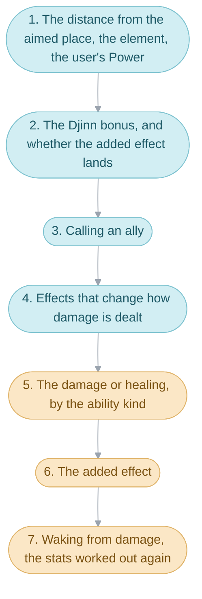
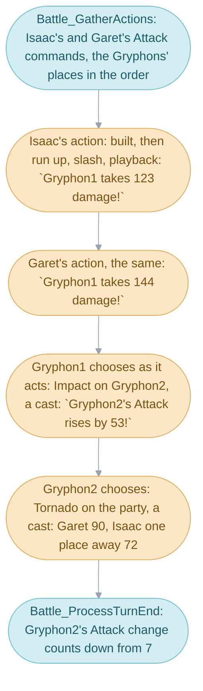

# Battles


The party walks into a battle. The enemies appear one by one, and each
[turn](../../glossary.md#turns-and-actions) the player chooses a command for
each party member; then every fighter acts one after another, each action
with its announcement, its battle effect and its messages, until one side has
nobody left standing or the party runs away. Everything the rules of a fight
decide is worked out in this folder: who acts in what order, which move each
enemy makes, who an ability reaches, whether a blow misses or lands a critical
hit, how much damage each target takes, which statuses take hold, and what
the party wins. The answers come from tables and dice rolls, and each shows
up on screen as a message such as `Ivan takes 15 damage!`.

A battle runs on these mechanisms, in the order control passes through them:

1. [Starting a battle](#starting-a-battle): the
   [formation](../../glossary.md#formation) becomes a row of enemies, and the
   curtain opens on them.
2. [Turns](#turns): the party's commands and the enemies' choices are
   gathered, sorted by Agility and played one after another, and the turn
   ends with its countdowns.
3. [Building an action](#building-an-action): a chosen command becomes an
   action run, with its ability, its targets and the rolls the battle effect
   must show.
4. [Staging an action](#staging-an-action): a runner moves the
   [units](../../glossary.md#unit) about, plays the
   [battle effect](../../glossary.md#battle-effect) and runs the playback
   beside it.
5. [How outcomes reach the screen](#how-outcomes-reach-the-screen): the
   [playback queue](../../glossary.md#playback-queue), one target at a time.
6. [How an ability resolves](#how-an-ability-resolves): what one target takes,
   from the ability's kind, the element, the distance and the added effect.
7. [The end of an action and of a turn](#the-end-of-an-action-and-of-a-turn):
   poison, the Grim Reaper, the Djinn and the countdowns.
8. [The end of the battle](#the-end-of-the-battle): the spoils, and the way
   back to the field.
9. [The zoomed battlefield](#the-zoomed-battlefield): one flat picture
   zoomed by the camera.



[Battle](../../battle.md) explains a battle as a whole.
[Battle effects](../battle_effect/README.md) draws what each ability looks
like, [Windows](../window/README.md) holds the command menu and the
[party](../../glossary.md#the-party)'s status window, and the
[game rules](../../glossary.md#game-rules)
([Game rules](../game/README.md)) hold the ability, item and enemy tables and
the arithmetic the rules call.

## Starting a battle


The [scene](../../glossary.md#scene) the party was walking in is cleared away
before a battle starts, so everything it needs arrives through the
[main routine's work](../../glossary.md#main-routines-work): the party, the
[formation](../../glossary.md#formation) to fight, the kind of battle, the
music an [event](../../glossary.md#event) chose and the
[battle background](../../glossary.md#battle-background).
[Battle](../../battle.md#starting-a-battle) follows the handover; here
`Battle_Run` begins.

`Battle_Run` sets the battle up in one straight run. It takes the battle's
[heap slots](../../glossary.md#heap-slot): the camera, the battle's own
[work](../../glossary.md#work) (`gBattleWork`), the six enemy units and the
background's work. It clears the [tasks](../../glossary.md#task) and sets
`FLAG_IN_BATTLE`. It builds the enemies from the formation
(`BattleFormation_BuildEnemyList`), adds the camera's task
(`BattleCamera_Update`), starts the music, lists the units of both sides
(`BattleUnit_Collect`), places each unit on the battlefield with a
[sprite](../../glossary.md#sprite-and-oam) of its own
(`BattleUnit_RefreshPlacement`), brings the
[Djinn](../../glossary.md#djinn) on standby up to date
(`DjinnRecovery_Reconcile`), works out which
[summons](../../glossary.md#summons) the party can call
(`BattleSummon_UpdateAvailability`), opens the party's status window, loads
the background and rolls who strikes first. Then the opening plays
(`BattleTransition_Run`) and the turns begin.

### The enemies of a formation

A formation is a row of `gFormations` naming up to five kinds of enemy, each
with the fewest and the most of it that appear. `BattleFormation_BuildEnemyList`
draws the battle's enemies from it: every kind comes its minimum number of
times, then each kind gains a random number more, up to its maximum, while
the six enemy sprite slots hold them. A large enemy takes two slots, so a
formation of large enemies fills up sooner than one of small ones.

The formation's layout orders them on the field. A shuffled formation keeps
each kind together and shuffles the kinds; an interleaved one draws each enemy
from a random kind with any left; any other layout keeps the row's order and
stands its first enemy in the centre, the rest alternately either side of it.

Two enemies of one kind need telling apart, so each takes a letter after its
name: a digit abroad, a letter of the alphabet in Japanese. The first of a
kind stands bare until a second arrives; then both are lettered,
`Stone Soldier1` and `Stone Soldier2`. An enemy called into the battle later
takes the next unused letter, and an enemy that leaves gives its letter back
(`BattleEnemy_ClaimNameLetter`, `BattleEnemy_ReleaseNameLetter`).

Every fighter is a unit, a `struct Unit` holding its stats, its HP and
[PP](../../glossary.md#psynergy-and-pp), its statuses and, for each
[element](../../glossary.md#the-four-elements), its
[Power and Resist](../../glossary.md#power-and-resist). A party member keeps
its character number as its unit id; the enemies take the ids from
`FIRST_ENEMY_UNIT` up, in the enemy units block the battle allocated. The
battle keeps the two sides as two lists of unit ids, `partyUnits` and
`enemyIds`, and a unit's position in its list is its place, the thing every
range and distance is counted in.

| Name                  | Value | Meaning                                               |
| --------------------- | ----- | ----------------------------------------------------- |
| `FORMATION_COUNT`     | 380   | rows of `gFormations`                                 |
| `PARTY_BATTLE_SIZE`   | 4     | party members who fight; `LINK_PARTY_SIZE`, 3, in a link battle |
| `ENEMY_BATTLE_SIZE`   | 6     | enemies at most, as many as the enemy sprite slots    |
| `FIRST_ENEMY_UNIT`    | 128   | the first enemy's unit id; a party member's is 0 to 7 |
| `BATTLE_UNIT_LIST_END` | 255  | ends a list of unit ids                               |
| `BATTLE_UNIT_REMOVED` | 254   | a place whose unit has left the battle                |

### The opening


The curtain is drawn on a background layer of its own: a closed curtain of
solid rows, which parts over 80 [frames](../../glossary.md#frame) as one row
moves up and its mirror image moves down, each running through the curtain's
edge pictures. While it opens, the camera swings round to face the party's
side and zooms in from 180 to 100 percent (`BattleTransition_AdvanceTimer`,
`BattleTransition_DrawRows`), the party's status window opens, and each enemy
is announced with `<enemy> appeared!` (`BattleIntro_AnnounceEncounter`). A
battle with a first strike announces it last:
`<leader>'s party attacks first!` or
`<leader>'s party was caught by surprise!`.

One formation opens differently: the Fusion Dragon on the Venus Lighthouse
aerie arrives in a storm. There is no curtain: the picture cracks and
shatters into white over the storm's battle background, and the Fusion
Dragon flashes as the colours come back
(`BattleEffect_RunShatteringOpeningFar`, 128 frames). Only then does the
status window open and the party fade in, over 16 frames, and the enemy is
announced last.

## Turns


A turn is every unit acting once. The party chooses its commands, the
enemies make their choices, the actions are sorted so that the fastest acts
first, and then each action plays in its place in the order. After every
action `Battle_Run` asks whether a side has nobody left standing, so a battle
can end in the middle of a turn. When every action has played, the turn ends
with its
countdowns, and the next turn begins with the command menu.



The loop in `Battle_Run`, simplified:

```c
for (;;) {                                     /* one turn */
  actionCount = Battle_GatherActions(battle->actions);
  for (i = 0; i < actionCount; i++) {          /* one action */
    if (BattleStaging_DispatchAction(&battle->actions[i], ...) == 1)
      goto fled;
    if (BattleUnit_ListLiving(BATTLE_SIDE_MASK_PARTY, 0) == 0)
      goto party_lost;
    if (BattleUnit_ListLiving(BATTLE_SIDE_MASK_ENEMIES, 0) == 0)
      goto won;
  }
  Battle_ProcessTurnEnd();
}
```

The turn's actions are rows of `BattleWork.actions`, each a
`struct BattleAction`: the unit, its command, the command's parameter (an
ability, a Djinni, a summon or an inventory slot), the aimed place, the range
and a priority, the number the sort reads. `Battle_GatherActions` fills them:
first it ends last turn's guards (`BattleUnit_ResetGuardLevels`) and sets the
camera to the fixed view the player chooses commands in
(`BattleCamera_SetCommandView`), then it gathers the party's actions, then
the enemies', and sorts them. A turn's first action waits 10 frames facing the
party before it plays, and every turn ends with a wait of 20 frames.

### The party's commands


Each party member still standing chooses one action for each action it has
this turn, usually one; a party member with two is asked twice. A party member
who is asleep, confused, charmed or stunned loses the turn instead: its action
is `COMMAND_NONE`, kept in the list so that its place in the order is known
(`Battle_BuildUnitActions`). The command menu asks the rest one after another
and appends their actions (`Battle_CollectPartyCommandsFar`, in the window
code).

The menu gives a party member's action its priority: its Agility plus up to a
sixteenth more, drawn at random, so two party members of nearly equal speed may
swap places from turn to turn. A second action in a row counts half the
Agility. Flee is one command for the whole party, listed first with a priority
above any Agility, so the attempt to run plays before anything else.

| Name               | Value    | Meaning                                              |
| ------------------ | -------- | ---------------------------------------------------- |
| `COMMAND_ATTACK`   | 0        | a plain attack, or the weapon's unleash              |
| `COMMAND_PSYNERGY` | 1        | the Psynergy chosen, the parameter its ability       |
| `COMMAND_ITEM`     | 2        | an item, the parameter its inventory slot            |
| `COMMAND_DEFEND`   | 3        | Defend                                               |
| `COMMAND_ENEMY_ABILITY` | 4   | an enemy's ability, the parameter its ability        |
| `COMMAND_DJINN`    | 5        | a Djinni, set or unleashed                           |
| `COMMAND_SUMMON`   | 6        | a summon                                             |
| `COMMAND_TOTAL_DEFENSE` | 7   | an enemy's Total Defense: a tenth of the damage      |
| `COMMAND_NONE`     | 8        | a lost action                                        |
| `COMMAND_FLEE`     | 99       | the party runs; priority `0x7ffe`, first in the turn |
| a party member's priority | Agility, plus up to a sixteenth at random | higher acts first |

### The enemies' choices

Every enemy has a list of eight actions in its row of the enemy table and a
habit for choosing among them, and the dice do the rest
(`BattleAI_ChooseAction`). A Gryphon's list runs Wing Flutter, Tornado, Twin
Beaks, Impact, Attack, Sonic Slash, Bind and Ward, and its habit favours the
start of the list, so it uses Wing Flutter most and Ward least: each pick rolls
a number from 0 to 255, and Wing Flutter takes rolls 0 to 52, Tornado 53 to
99, Twin Beaks 100 to 140, and so on down to Ward's 245 to 255.

An enemy chooses twice each turn. While the turn is gathered it keeps its pick
only if it is a guard, so that its guard goes up with the party's before
anyone acts; any other pick is thrown away, and the enemy picks afresh at the
moment it acts. The second choice is the one the player sees announced, and it
is made with the battlefield as it stands then, after the faster units have
acted.

A pick the enemy cannot use is drawn again: Psynergy it lacks the PP for, or
while its Psynergy is sealed (which habits refuse which depends on the enemy's
targeting strategy), a flight after it has been challenged, a guard at the
moment it acts, and any ability with no target worth it. After 18 failed picks
the enemy defends. A sleeping or stunned enemy loses its actions; an enemy
with two actions a turn takes its second at half its Agility.

The target is chosen with the ability (`BattleAI_ChooseTarget`): among the
units of the side the ability may reach, those it would do something to (a
stat it can still raise, a status the unit lacks, a downed unit a revival can
bring back, a standing unit a blow can hurt), one at random. A single-target
attack from an enemy with a targeting strategy leans toward the strongest: it
sorts the candidates by HP left or by maximum HP and favours the front of the
list, 6 chances in 11 for the first of two, 6, 5 and 4 in 15 for three.

| Habit (`enum EnemyActionStrategy`) | How the entry is picked                                   |
| --------------------------------- | --------------------------------------------------------- |
| `ACTION_STRATEGY_EVEN`            | at random, each entry 32 in 256                           |
| `ACTION_STRATEGY_FALLING`         | at random, from 53 in 256 for the first down to 11        |
| `ACTION_STRATEGY_FIRST_FAVOURED`  | at random, the first 113 in 256, the last 5               |
| `ACTION_STRATEGY_RANDOM_START`    | a random entry the first time, then the next each time    |
| `ACTION_STRATEGY_IN_ORDER`        | the next each time, from where it left off                |
| `ACTION_STRATEGY_NEXT_PICK`       | the next entry at each new pick, from the first           |
| `ACTION_STRATEGY_SAME`            | the entry it picked last time                             |

The weights are `gBattleAI_ActionWeights` (`battle_tables.s`), and the enemy's
row is read from `../game/enemy_table.c`.

### Action order

`BattleActionOrder_Sort` puts the gathered actions in order, highest priority
first, by swapping neighbours until nothing is out of place. Equal priorities
keep the order they were listed in: the party's actions come first, so on a
tie the party acts first, and the enemies' were shuffled before they chose, so
enemies of equal Agility act in a shuffled order. Three Djinn go before
everyone: Granite, Flash and Ground, whose effects guard or hold, have their
priority raised past any Agility.

Once the order is settled, Defend and Total Defense take hold at once, before
the first action plays: a defending unit's guard is up against everything that
turn, including the actions of units faster than it.

| Name                   | Value | Meaning                                                      |
| ---------------------- | ----- | ------------------------------------------------------------ |
| `DJINN_FIRST_PRIORITY` | 10000 | added to a guarding or grounding Djinni's priority           |
| `DEFEND_NORMAL`        | 1     | Defend, Granite: half damage this turn                       |
| `DEFEND_TOTAL`         | 2     | Total Defense, Flash: a tenth                                |
| `BATTLE_ACTION_CAPACITY` | 20  | actions a turn holds at most                                 |

### First strikes and fleeing


Now and then a random battle opens with `<leader>'s party attacks first!` and
the enemies stand still for a turn; more rarely it opens with
`<leader>'s party was caught by surprise!`, and some enemies act before the
party can choose anything. Only a random battle rolls for it, as `Battle_Run`
sets up: the party strikes first one time in 16, and otherwise the enemies one
time in 32. The Djinn tutorial always gives the party the first strike.

When the party strikes first, `Battle_BuildOpponentActions` lists no enemy
actions. When the enemies strike first, the party chooses nothing, and two to
five enemies, drawn at random from the shuffled list, act once each. At the
turn's end `firstStrike` goes back to `FIRST_STRIKE_NONE`.


Running away is rolled as the commands are gathered, before any action plays
(`BattleFlee_CheckSuccess`). The chance grows with every failed try: 50
percent, plus 20 for each failed try in this battle, plus 5 for each level the
party's average is above the enemies' average, or less by 5 for each level
below. The party at level 20 against Gryphons at level 23 starts at 35
percent. A party that struck first always gets away, and nobody gets away from
a battle that forbids it. A failed try makes the rest of the turn a surprise:
`But there's no escape!`, and two to five enemies act once each before the
turn ends.

What kind of battle it is, `gMainRoutineWork.battleType`, decides which of
these rolls are made:

| Kind                    | What it changes                                                        |
| ----------------------- | ---------------------------------------------------------------------- |
| `BATTLE_TYPE_NORMAL`    | a random encounter: the first-strike rolls are made                    |
| `BATTLE_TYPE_NO_ESCAPE` | the party cannot run, as from a Mimic                                  |
| `BATTLE_TYPE_SCRIPTED`  | a battle an event starts; the command menu refuses to run              |
| `BATTLE_TYPE_LINK`      | a link battle                                                          |
| `BATTLE_TYPE_DEBUG`     | the battle test menu's battles, which only the debug menus reach (`DebugBattle_RunMenu`) |

| Name                   | Value | Meaning                                                 |
| ---------------------- | ----- | ------------------------------------------------------- |
| `FIRST_STRIKE_PARTY`   | 1     | 1 in 16: the enemies lose the first turn                |
| `FIRST_STRIKE_ENEMIES` | 2     | 1 in 32 of the rest: the party loses it                 |
| the flee chance        | 5000 + 2000 × failed tries + 500 × (party's level − enemies' level) | in hundredths of a percent, against a roll of 0 to 9999 |

## Building an action


Just before a unit acts, the player reads its announcement, such as
`Isaac attacks!` or `Isaac's Swift Sword lets out a howl! Sonic Smash!`. By
then the game has turned the chosen command into an action run, a
`struct BattleActionRun`: which ability it is, who it reaches, and the rolls
the battle effect must show. `BattleActionRun_Build` does this for every
action of the turn, called by the staging just as the action is about to play.

It runs in a fixed order. First it empties the playback. Then it checks what
stops the unit: a unit held by Ground is `unable to move!`, a sleeping one
`is asleep!`, a paralyzed one is paralyzed, and a unit bound by a cursed item
loses one action in four, except Defend. An action that fails here shows its
message and ends (`ACTION_REPORTED`); a lost action shows nothing
(`ACTION_NOTHING_TO_SHOW`). Then, by the command, it finds the ability, its
targets and its announcement, pays the command's costs, makes the rolls the
battle effect must know, and settles how the action is staged.



### Commands and ability ids

Everything a unit can do when it acts is an ability, a row of the ability
table: Attack, Quake, a Djinni's unleash, a summon, an item's use, an enemy's
special move. The command the player chose decides which ability the action
carries.

- Attack is Attack, unless the weapon unleashes. The chance is five times the
  weapon's unleash chance, in percent, plus what the rest of the equipment
  adds (`RollWeaponUnleash`); the player then reads
  `<unit>'s <weapon> lets out a howl!` and the ability's name.
- Psynergy is the ability chosen in the menu. A caster short of PP, or whose
  Psynergy is sealed, still announces the cast; the failure is noted for the
  staging to show, and the PP is paid only when the cast goes ahead.
- Djinn reads the Djinni's ability from `../game/djinn_table.c`. A set Djinni
  is unleashed and goes on standby. A Djinni on standby is set again instead,
  with a short burst of its element and `<Djinni> is set to <unit>!`, and that
  is the whole action; one still recovering says so.
- Item takes the item's ability. An item with none, or a broken one, makes the
  user defend; an item an earlier command this turn used up says
  so. A kept item (a weapon, a ring, a Psynergy item) is raised,
  `<unit> raises the <item>!`; anything else is used.
- Summon takes the summon's ability from `../game/summon_table.c`, counts the
  standby Djinn of each element on the user's side against what the summon
  needs, and marks the ones it uses.
- Defend and Total Defense show `<unit> is defending!` and end: their guard
  was raised when the order was sorted.
- An enemy's ability is announced as `<unit> uses <ability>!`, or
  `<unit> unleashes <ability>!` for its special attacks, with wording of its
  own for a few (`<unit> looks for allies!`).

The action takes its element from the ability, except that a plain Attack
strikes with the weapon's element, or an enemy's with its own. The commands
are `enum BattleCommand`.

### Targets and range


Each side stands in a line, and a unit's position in it is its place. An
ability reaches the places within its range of the aimed one, counted in
places along the line, whatever the spacing on the screen; the player sees
the reach as the lit enemies around the cursor.

A range of 1 is the aimed unit alone, and each point more adds a place on
either side; the widest range covers the whole side, with every target treated
as the aimed one. The reach passes over a unit that has left the battle, and a
downed unit unless the ability revives, but a downed unit still holds its
place, so the units beside it stay where they were. When nobody in range is
left, the unit defends instead (`<unit> is defending!`). The reach stops at
the ends of the line, though the cursor wraps round.

`BattleActionRun_SetTargets` walks the places and records, for each target,
its unit id and how many places it stands from the aimed one; the cursor is
`BattleTarget_RunSelection` (`../window/screens/battle_targets.c`).

| Name                | Value | Meaning                                                 |
| ------------------- | ----- | ------------------------------------------------------- |
| `ABILITY_RANGE_ALL` | 255   | the whole side, every target treated as the aimed one   |
| `TARGET_MAX`        | 14    | targets an action holds at most, 8 party places and 6 enemies |

### Rolls made in advance


A dodge and a critical hit look different from a plain blow, so the battle
effect has to know which it is before it starts. The action therefore rolls
them while it is built, before anything is drawn, and keeps the result beside
each target: a multiplier of 0 for a miss, 1 for a blow, 2 or 3 for a double
or triple blow, and a critical mark.

A plain Attack always lands on a target that cannot act (down, asleep, stunned,
charmed or held by Ground). Otherwise it misses one time in 32, and a deluded
attacker also misses 153 times in 256. A critical hit, a quarter more damage,
lands one time in 32, or else at half the percentage the attacker's equipment
adds to its unleash chance.

An ability with a double or triple blow makes one roll for all its targets:
153 in 256 for Gust, Rapid Smash, Slice and Sonic Smash, one time in four for
Flying Attack, Double Fang, Twin Beaks and Swift Strike; Sonic Smash and Swift
Strike strike three times. A success raises every target's multiplier and the
battle effect's strength, so the extra blows show. Annihilation rolls its
instant death here too, so its burst can show whether it landed; every other
added effect is rolled for each target as the blow lands.

| Name              | Value | Meaning                                              |
| ----------------- | ----- | ---------------------------------------------------- |
| `CRITICAL_HIT`    | 1     | an attack's critical hit: a quarter more damage      |
| `CRITICAL_STRONG` | 2     | an ability's critical hit: half as much again; no ability rolls one |
| `HIT_NOT_ROLLED`  | -1    | the added effect's roll is left for the blow         |
| a miss            | 1 in 32 | plus 153 in 256 for a deluded attacker             |

### Staging and announcement


The [staging](../../glossary.md#staging) is what happens around a battle
effect: whether the unit runs up and strikes, raises a hand to cast, or nothing
moves. Rockslide is staged full screen: the camera swings and the side that is
left alone fades out.

Most abilities are staged by kind: anything that costs PP is a cast, and an
ability with nothing to draw shows only its messages. A few have their own
staging in `gAbilityStaging`: Gaia, Mother Gaia, Grand Gaia, Rockfall,
Rockslide, Avalanche and Procne are full screen, and Slice and seven weapon
unleashes are staged as an enemy's cast, with the element's streaks in place
of the star field. The battle effect itself comes from the ability's row of
`gAbilityBattleEffects`, its strength raised by the double or triple blow
rolled above;
[Battle effects](../battle_effect/README.md#how-an-ability-picks-its-effect)
takes that word apart.

The announcement follows the command: `<unit> attacks!`,
`<unit> casts <ability>!`, `<unit> unleashes <ability>!` for a Djinni,
`<unit> summons <ability>!`, `<unit> uses <item>!`, or
`<unit> raises the <item>!` for an item the user keeps.

The stagings are `enum BattleStaging`:

| Name                  | What the player sees                                         |
| --------------------- | ------------------------------------------------------------ |
| `STAGING_MESSAGES`    | no battle effect, only each target's messages                |
| `STAGING_ATTACK`      | the acting unit runs up and strikes                          |
| `STAGING_CAST`        | a cast: Psynergy, and Venus, Mercury, Mars and Jupiter       |
| `STAGING_ITEM`        | the user raises an item                                      |
| `STAGING_SUMMON`      | the larger summons, the acting unit hidden                   |
| `STAGING_DJINNI`      | a Djinni with no attack                                      |
| `STAGING_FLEE`        | a unit runs                                                  |
| `STAGING_ENEMY_CAST`  | the element's streaks in place of the star field             |
| `STAGING_FULL_SCREEN` | the camera swings and the side left alone fades out          |

## Staging an action


Staging is the part of an action the player watches.
`BattleStaging_DispatchAction` plays one action of the turn: it lets an enemy
settle its choice, eases the
camera into the view for the action, highlights the acting unit, builds the
action, and hands it to the runner its staging names. The runner moves the
units, plays the battle effect and, beside it, the playback that shows each
target's outcome. When the runner returns, the action's end effects run
(`BattleUnit_ProcessActionEnd`), every unit goes back to its spot
(`BattleMotion_ReturnToSpot`), and the action is marked done, so that an
effect later in the turn can tell which units have already acted.



Every runner that plays a battle effect follows one pattern: it fills the
battle effect's command from the action run (`BattleStaging_BuildTargetList`:
the effect's kind and strength, the acting unit, the targets still standing),
adds `BattlePlayback_Run` as a task, calls the battle effect, which runs to its
end, and then waits until the playback has shown every target
(`BattlePlayback_WaitForReady`). `BattleStaging_RunPsynergyCast`, simplified:

```c
Task_Add(BattlePlayback_Run, TASK_PASS_FRAME); /* idle until the blow lands */
if (plan->battleEffect & EFFECT_BY_ID_RANGE)
  BattleEffect_RunByIdRangeFar(&work.effect); /* the battle effect's loop */
else
  BattleEffect_RunFromTableFar(&work.effect);
BattlePlayback_WaitForReady(); /* until every target has played */
```

### An attack


The attacker runs up to its first target (`BattleStaging_RunAttack`). The
camera swings halfway toward the attacker's side, the attacker leaps the
distance in the frames its leaping picture takes, with the hop its sprite is
given (`BattleMotion_ApproachTarget`), and the blow's battle effect starts
eight frames before it lands. A miss plays differently: after ten frames the
target hops back, and `<target> nimbly dodges the blow!` shows at once. A
critical hit clears the field of everyone but the pair and zooms the camera in
on them, from 100 to 130 percent, over the run up; afterwards everyone is
shown again. The attacker's battle effect is its class's blow, played by id
range: a sword's slash for Isaac, Garet and Jenna, a different blow for Ivan
and Mia, and an enemy's own.

### A cast

The caster raises a hand (`BattleStaging_RunPsynergyCast`). The camera swings
toward the targets from the caster's side, the cast's sound plays and the
caster glows in its element: the star field gathering on a party member, the
element's streaks for an enemy's cast, and no glow for a Djinni, whose battle
effect opens with a prelude of its own. A cast that failed shows why here,
`But the Psynergy was blocked!` or `...But doesn't have enough PP!`, and the
rest of the cast is skipped; otherwise the battle effect plays with its
playback, and the targets return to their spots.

### A summon or a full-screen cast

The summons and the full-screen Psynergy take the whole screen
(`BattleStaging_HideField`). The camera swings to the targets' side (for a
summon, the summoner's), the caster raises a hand and glows, and over sixteen
frames the units of the side left alone fade out; a summon hides its summoner
too. Only the targets' side stays on the field while the battle effect plays,
and afterwards everyone fades back in over sixteen frames and the camera
returns to its usual view.

### An item


The user raises the item (`BattleStaging_RunItem`). An item with a battle
effect dims the background over twenty frames while it plays; one with none
waits a second. Then the item is spent as its kind says: an item that is used
up leaves the inventory, and later item commands of the same party member this
turn follow their items to their new slots; an item that may break, such as a
ring, does so one time in eight, `Your <item> broke!`; Hermes' Water becomes
an Empty Bottle.

### A flight


The party's flight was decided when the commands were gathered
(`BattleStaging_RunFlee`). A party that got away runs off the field, each
party member able to move running one after another, eight frames apart, and
`Battle_Run` ends the battle; one that failed reads `But there's no escape!`.
An enemy that runs, `<enemy> runs!`, gets away seven times in ten: it runs
off the field and leaves the battle while the camera stays on the party's
view. Otherwise it too reads `But there's no escape!`.

| Name                      | Value          | Meaning                                                |
| ------------------------- | -------------- | ------------------------------------------------------ |
| the first action's wait   | 10 frames      | facing the party, before the turn's first action       |
| the camera's swing        | 60 frames      | a sixteenth of the gap left each frame                 |
| a fade out or in          | 16 frames      | the side left alone, for a summon or a full-screen cast |
| the critical zoom         | 100 to 130 percent | over the attacker's run up                        |
| an enemy's escape         | 7 in 10        | an enemy that runs leaves the battle                   |

## How outcomes reach the screen


A target's HP changes in one go, but the player sees it happen one thing at a
time: the target flinches, its message appears and waits, and only then does
the next target come. Applying the ability to a target leaves a list of what
to show, in order, and the screen plays the list. That list is the playback
queue, `struct BattlePlaybackQueue`, up to 64 commands each with one operand:
a unit's name or a number for the next message, the message itself, a flinch,
a fall, a sound, a redraw (`enum BattlePlaybackCommand`).

The queue is played by a task, `BattlePlayback_Run`, which the runner added
before it called the battle effect. The battle effect is an ordinary function
with its own loop, waiting a frame whenever time has to pass, so the task runs
inside those waits ([System](../../system.md#waiting-and-tasks)). It stays idle
until the battle effect signals that the blow has landed, with
`EFFECT_SHOW_DAMAGE`, which calls `BattlePlayback_Start`. From then on it
works through the targets: it applies the ability to the next one
(`BattleAbility_ApplyToTarget`), which fills the queue, plays the queue over
the frames that follow, and goes on to the next target once the queue is
empty. When every target has played it is ready, and
`BattlePlayback_WaitForReady`, waiting a frame at a time in the runner,
removes the task.



Three commands make the playback wait. A flinch takes nine frames of
flashing, the unit white and its status panel lit at frames 1 and 5, its own
colours back at 3 and 7. A fallen enemy turns grey, leaves the lists after
four frames and dissolves a few dots a frame until frame 37, when its picture
is cleared and its actor released; a fallen party member lies down. A message
waits until it has finished typing, then shows the bobbing arrow and waits for
the player to press a button. The names and numbers a message needs are pushed
just before it and play within one frame. A battle effect that never signals,
such as Torch's, leaves the playback to start when
`BattlePlayback_WaitForReady` finds it idle, so its damage shows afterwards.

Playback takes the targets in their order along the battlefield, since that is
the order the action run lists them in, and an action without a battle effect
plays the same queue straight through (`BattlePlayback_RunAll`), each target
applied and shown at once. The queue lives in the battle's work, filled by
`BattlePlayback_Push` ([`battle/playback.c`](battle/playback.c),
[`battle/playback_queue.c`](battle/playback_queue.c)).

| Name                        | Value | Meaning                                              |
| --------------------------- | ----- | ---------------------------------------------------- |
| `BATTLE_PLAYBACK_CAPACITY`  | 64    | commands the queue holds                             |
| `BATTLE_PLAYBACK_PHASE_IDLE` | 0    | waiting for the blow to land                         |
| `BATTLE_PLAYBACK_PHASE_RESOLVE_TARGET` | 1 | the next target is applied                   |
| `BATTLE_PLAYBACK_PHASE_DISPATCH` | 2 | the queue is playing                               |
| `BATTLE_PLAYBACK_PHASE_READY` | 4   | every target has played                              |
| a flinch                    | 9 frames | the unit flashes white twice                      |
| a fallen enemy              | 37 frames | grey, out of the lists at 4, dissolved from 5    |
| a held advance key          | 10 VBlanks | a key still held after that many goes on        |

## How an ability resolves


Once the battle effect shows the blow land, or the healing reach its target,
each target one after another learns what the ability does to it: how much
damage it takes or how much it heals, and whether the ability's added effect
(Sleep, a lowered Defense, poison) takes hold. `BattleAbility_ApplyToTarget`
([`battle/ability.c`](battle/ability.c)) does this for one target, in phases
numbered in its body.

For one target, the game first notes how far it stands from the aimed place
and how strong the user is in the ability's element; rolls whether the added
effect lands; brings in a new enemy if the ability calls one; deals the damage
or healing; applies the added effect; and last rolls whether the hit woke the
target. All of it happens within one frame, and the target's numbers change
at once; the only thing drawn is a redraw of the party's status window, and
everything else the player should see goes into the playback queue to be shown
afterwards.



### The ability kind


The ability kind decides what the power means. Ragnarok is an attack kind:
its power is added to a plain blow, so it hits harder the stronger Isaac's
Attack is, where Quake's damage follows his Power in Venus.

| Ability kind | What the target takes | What the power is |
| --- | --- | --- |
| healing (Cure, Ply, Herb) | HP back, by the healer's Power in the element | the HP restored at Power 100 |
| effect (Sleep, Impair, Drain) | damage only when the added effect lands | the damage at an even match |
| attack (Attack, Ragnarok) | a blow, the user's Attack against the target's Defense | damage added to a plain blow |
| multiplied attack (Flint, Quick Strike) | a plain blow times the power | the multiplier, in tenths |
| damage (Quake, Avalanche) | damage scaled by the user's Power against the target's Resist | the damage at an even match |
| enemy damage (Fire Blessing, War Cry) | as damage, falling off faster | the damage at an even match |
| summon (Ramses, Judgment) | as damage, with a share of the target's maximum HP added | the damage at an even match, before the share |
| PP damage (Crazy Voice) | PP lost, as damage | the PP lost at an even match |
| PP healing (Psy Crystal, Adept Ring) | PP back, as healing | the PP restored at Power 100 |

An even match is the user's Power in the element equalling the target's
Resist in it. Granite, Flash, Kite, the field Psynergy, Defend and Flee apply
no power at all, and every other kind but the two attacks does nothing when
its power is 0. Healing, attacks and damage add a random 0 to 3. A summon adds
3 percent of the target's maximum HP for each Djinni it uses. A blow always
does at least 1 damage; a critical hit adds a quarter, then the target's level
divided by 5, plus 6. A plain blow is half the difference between the user's
Attack and the target's Defense, plus the power, scaled by the element.


A guard cuts the result: a defending target takes half, one behind Total
Defense or the Djinni Flash a tenth (`REDUCE_BY_GUARD`). Garet, defending,
takes 36 from Tornado; without his guard the same cast would take twice that
from him.

The kinds are `enum AbilityFormula`, the low four bits of an ability's
`flags`. The formulas are in
[`../game/game/battle_arithmetic.c`](../game/game/battle_arithmetic.c), called
from here through their far-call names, such as
`Battle_CalculateRecoveryFar` for `Battle_CalculateRecovery`.

| Name                | Value | Meaning                                                   |
| ------------------- | ----- | --------------------------------------------------------- |
| `FULL_RATE`         | 256   | 1.0 in the arithmetic's scale                             |
| the random part     | 0 to 3 | added to healing, a blow and damage                      |
| a critical hit      | + a quarter, then level ÷ 5 + 6 | half as much again for an ability's |
| a summon's share    | 3 percent of the target's maximum HP | for each Djinni the summon uses |

### The element multiplier


Each unit has a Power and a Resist in each of the four elements, and the gap
between the attacker's Power and the target's Resist decides how much the
element counts. The message hints at it: three exclamation marks mean the
element is the one the target resists worst, a full stop the one it resists
best.

Each point of Power ahead of the Resist adds half a percent, up to double at
200 points ahead, and each point behind takes half a percent off, down to
nothing at 200 behind. A blow feels the element at half strength. Healing
uses the healer's Power alone: each point above or below 100 moves it one
percent.

A character's Power and Resist come from the element levels the
Status screen shows, an enemy's from its element preset, and equipment adds to
both. A Resistance stage adds 20 Resist in every element. A summon's boost
adds 10, 30, 60 or 100 Power in the element it spent most Djinn of, for one
to four Djinn. A Djinni striking the element the target resists worst may also
earn the Djinn bonus: an enemy it fells gives more coins and experience and is
likelier to leave its item.

`Battle_GetElementMultiplier` reads the multiplier off
`gElement_PowerResistCurve` (`../game/element_table.c`), in 256ths.

| Name                         | Value | Meaning                                        |
| ---------------------------- | ----- | ---------------------------------------------- |
| a point of Power over Resist | + 1.28 in 256 | half a percent, held to 200 points either way |
| a blow                       | half that | a quarter of a percent a point              |
| `RESISTANCE_PER_STAGE`       | 20    | Resist added in every element by a Resistance stage |
| the Djinn bonus's chance     | Power − Resist + 30, in percent | for a Djinni striking the worst-resisted element |

### Distance


An ability that reaches several enemies hits the one aimed at hardest and the
ones beside it less. Isaac aims at Ivan, with no one on Ivan's other side, so
Garet is one place away and Mia two.

Every kind but the attacks falls off with the target's distance from the aimed
place. The figures are percentages:

| Places from the aimed one | 0 | 1 | 2 | 3 | 4 | 5 |
| --- | --- | --- | --- | --- | --- | --- |
| damage and healing | 100 | 80 | 60 | 40 | 20 | 10 |
| summons | 100 | 70 | 40 | 30 | 20 | 10 |
| enemy damage, effect and PP damage | 100 | 50 | 30 | 10 | 10 | 10 |
| an added effect's chance | 100 | 60 | 30 | 30 | 30 | 30 |

Avalanche is a damage ability with a power of 160 and a range of 3. At an even
match the aimed foe takes 160 to 163, one place away 128 to 131 and two places
away 96 to 99; with the user's Power 20 ahead, a defending aimed foe takes 87
to 89. Blows work differently: with Attack 100 against Defense 60, a plain
Attack deals half the difference, 20 to 23; Ragnarok (power 35) adds twice its
power before halving, 55 to 58; Flint (power 16) multiplies the blow by 1.6,
32 to 35. Cure (power 70) restores 70 to 73 HP at Power 100 and 83 to 86 at
120; the Healing Ring, which uses Cure's row, always restores 70 to 73, since
an item's user counts as Power 100.

The tables are in `range_falloff.s`, as `gRangeFalloff_PsynergyDamage` and
its neighbours.

### Whether the added effect lands


When Ivan casts Confuse at a group, some fall to it and the player reads
`But it has no effect on <unit>!` for the others. Each target gets its own
roll, and the chance depends on the effect, the two units' element levels, the
target's Luck and weaknesses, and its distance from the aimed place.

The roll fails at once when there is nothing to do (a revival on a unit still
standing, a cure on a unit without the status). Otherwise the chance starts
from the effect's own rate (Sleep 45 percent, Taint 55, Condemn 20 and so on),
gains 3 for each element level the user is ahead, loses 3 for every two
points of the target's Luck, gains 25 when the target is weak to the effect,
and is scaled by the distance. A few effects have a fixed chance instead:
Quartz 60 percent, Dew 90, and 100 for an effect with no rate of its own. When
the added effect of an effect-kind ability fails, the target takes no damage
either.

`Battle_RollEffectSuccess` (`../game/game/battle_arithmetic.c`) makes the
roll.

### Calling an ally, and effects that change the damage


Some added effects stand in for the damage or change how it is dealt, so they
are applied before it. The most visible brings in a new enemy.

Ally Search, Search for Help and Speed Surge bring one in when the roll
succeeds and there is room for another enemy and its sprite: it takes an empty
place or joins the end of the line, the enemies are lined up again
(`BattlePlacement_RelayoutEnemies`), and the player reads `<unit> appears!!`
or `It split off into <unit>!`; otherwise `But no one came!` or
`It failed to divide!`. Ally Search calls another of the caller's kind, Search
for Help a random member of the formation.

Other effects that landed change the damage itself: Torch's blow counts half
the target's Defense; Severe Blow and Thrash leave the target 1 HP at most;
Condemn and the other instant deaths skip the damage; Dynamite and Mortal Blow
remove their user; Psy Drain takes its damage from PP; and Ground holds a
target only if it has an action still to play this turn.

### Applying the added effect


Statuses and stat changes are counters on the unit that the end of each turn
counts down. Impair lowers Mia's Defense for seven turns, and the number in the
message is how far it fell.

The effect is applied when it landed and the target is still standing; a
revival needs the target down instead, and a drain still works on a target its
own damage has just felled. The rules the effects share are these.

- A stat change moves Attack, Defense or Resistance one or two stages, at
  most four either way, for seven turns. A stage is an eighth of Attack or
  Defense, and the message gives how far the stat moved, so a stat at its
  limit shows 0. Zephyr and Vine set Agility outright, to double or half, for
  five turns.
- A status (Delude, Confuse, Charm, Paralyze, Sleep) and Bind's seal last
  seven turns. Luff's seal lasts two turns that always run their course. Curse
  starts the Grim Reaper's countdown of seven turns.
- A lowered stat or a status may end early: once five turns or fewer are left,
  each turn's end rolls for it, more often for a lucky unit, and the player
  reads, for a delusion, `<unit> sees clearly once again!`. A raised stat
  always lasts its turns.
- Restore and Elixir clear delusion, stun, sleep, the seal and the Grim
  Reaper's countdown; Tonic clears those, poison and the evil spirit.
  Confusion and charm run their course under both.
- Drain gives the user all the HP the target lost, Sap half, Psy Drain the PP
  it took, and Psy Leech a tenth of the damage as PP.
- Defend and Granite halve the damage the target takes this turn, Total
  Defense and Flash cut it to a tenth. Break returns every raised stage to 0
  and removes a summon's boost. Kite lets the target act twice next turn,
  Ground costs it its next action, and Haunt sets an evil spirit on it.

| Name | Value | Meaning |
| --- | --- | --- |
| `STAT_CHANGE_TURNS` | 7 | turns an Attack, Defense or Resistance change lasts |
| `AGILITY_CHANGE_TURNS` | 5 | turns Zephyr's or Vine's Agility lasts |
| `STATUS_TURNS` | 7 | turns a status lasts |
| `CURSE_TURNS` | 7 | turns of the Grim Reaper's countdown |
| `PSY_SEAL_BIND` | 7 | Bind's seal: seven turns, which may end early |
| `PSY_SEAL_LUFF` | 16 | Luff's seal: 8 counted off a turn, two turns that always run their course |
| `STAT_STAGE_MAX` | 4 | stages a stat can rise or fall |

Each effect's details are in the case comments of
`BattleAbility_ApplyToTarget` and the notes on `enum AbilityEffect`
([`battle_unit.h`](../../include/battle/battle_unit.h)).

### After each target


A sleeping unit that is hit may wake up, and a unit haunted by an evil spirit
pays for its own attacks.

Losing HP or PP wakes a sleeping target one time in four, unless it fell
asleep this turn. A haunted unit, one time in four for each target it took
HP or PP from, keeps aside a quarter of that loss (at least 1), and loses the
total from its own HP at the end of its action. In the Djinn tutorial a
Djinni's blow always leaves its target 1 HP, and a summon always fells it.

## The end of an action and of a turn

The things that happen on their own in a battle, with nobody acting, happen at
two moments: when a unit's action ends, and when the whole turn ends.

### The end of an action


When a unit's action has played, `BattleUnit_ProcessActionEnd` settles what
the action leaves behind. The Djinn the unit unleashed come off its set; the
Djinn a summon used start to recover, one a turn, the first in two turns; and
a summoner takes its summon's boost, the element it spent most Djinn of rising
by that many levels, `<unit>'s Earth Power rises by <n>!`, with a pillar of
the element over it. Then the unit pays what it owes: the evil spirit's share
of the damage it dealt, poison's bite (a tenth of the maximum HP, deadly
poison a fifth), and the Grim Reaper's countdown, which at 0 takes the unit,
`The Grim Reaper calls out to <unit>!`. Each is shown at once through the
playback queue.

### The end of a turn


When every action has played, `Battle_ProcessTurnEnd` goes through the Djinn
and then every unit, the party's first. A Djinni whose recovery has run out
is set again, `<Djinni> is set to <unit>!`, with a burst of its element. Each
unit still standing regains its regeneration (`<unit> recovers <n> HP!`), and
then every counter it carries comes down one: the Agility change, the Attack,
Defense and Resistance changes, delusion, confusion, charm, stun, sleep, the
seal, Regenerate and Reflect, each showing its message when it ends.

A lowered stat or a status may end before its turns run out. Once five or
fewer are left, `BattleUnit_RollCounterEarlyEnd` rolls for it each turn: the
chance in percent is three times the unit's Luck, less five times the turns
left, plus a bias of the counter's own. A raised stat, an Agility change,
Regenerate and Reflect run their full course.

| Counter               | Bias | Meaning                                                  |
| --------------------- | ---- | -------------------------------------------------------- |
| a lowered Attack      | 30   | `luck × 3 − turns × 5 + bias` percent, once 5 turns or fewer are left |
| a lowered Defense or Resistance | 20 |                                                  |
| delusion              | 30   |                                                          |
| confusion             | 60   |                                                          |
| charm                 | 70   |                                                          |
| stun                  | 40   |                                                          |
| sleep                 | 50   |                                                          |
| Bind's seal           | 30   | only once Luff's is gone                                 |
| `POISON_NORMAL`       | 1    | a tenth of the maximum HP at each action's end           |
| `POISON_VENOM`        | 2    | a fifth                                                  |

## The end of the battle


A battle ends in one of three ways, and `Battle_Run` returns a number that
says which: how many enemies fell for a win, `BATTLE_OUTCOME_FLED` for a
flight, `BATTLE_OUTCOME_LOST` for a defeat. Every way out passes the same
last moves: the party members' battle-only state is cleared
(`BattleParty_ResetActiveRuntimeFields`), the Djinn recover one turn, the kind
of battle goes back to normal, and the battle's tasks and work are released.

### The spoils


A win is named after the first enemy to fall, `<enemy> has been downed!` or
`<enemy>'s party goes down!`, to the victory music; then
`Battle_AwardSpoils` hands out what the fallen enemies left. The spoils
were gathered as each enemy fell (`BattleEnemy_RecordDefeat`): its coins and
experience, raised by dice when the Djinn bonus was earned, and its item one
time in 2 to the power of its item chance less one, two powers likelier with
the bonus, the best four items kept. The experience goes to each party member
still standing, `You got <n> experience points.`, and each level gained shows
what it brought: the level, the Psynergy newly learned, and each stat that
rose. Then the coins, and the items best first; an item the inventory has no
room for is held over for the field to deal with.

A loss plays the defeat music and `<leader>'s party has been defeated!`; a
flight only fades to black.

### Back to the field


The [main routine](../../glossary.md#main-routine) reads the result
(`Scene_ReturnFromSequence`,
[System](../../system.md#the-main-routine)). After a win or a flight the party
goes back to the scene it came from, standing where it stood
(`FLAG_KEEP_PARTY_POSITION` puts the saved actors back), unless an event set
an after-battle [destination](../../glossary.md#destination). After a loss
the leader is revived with 1 HP and the party goes to the defeat destination
an event set, or else to the restart point, which is most often the last
Sanctum.

| Name                  | Value | Meaning                                               |
| --------------------- | ----- | ----------------------------------------------------- |
| `BATTLE_OUTCOME_LOST` | -1    | the party was defeated                                |
| `BATTLE_OUTCOME_FLED` | 999   | the party got away                                    |
| a win                 | 1 or more | the enemies defeated                              |
| the Djinn bonus's coins | a six-sided die for every ten levels, and one more | at least 30 percent of the enemy's coins |
| the Djinn bonus's experience | a four-sided die for every ten levels, and one more | at least 30 percent |
| an item's chance      | 1 in 2^(chance − 1) | two powers likelier with the Djinn bonus    |

## The zoomed battlefield


The battlefield is one flat picture of the place, 256 by 120 pixels, with its
depth already painted in. Once a frame the camera's distance sets the
hardware's zoom of it and the camera's swing its sideways scroll, while the
windows stay flat in front on
[`BG0`](../../glossary.md#background-layer). The units are sprites over it,
each placed by the actor system from a position on the field: the party's
column 80 pixels right of the centre, 32 pixels apart, and the enemies' column
80 pixels left, spaced by their size.

The zooming layer, `BG2`, can name only 256 tiles, and the battlefield's
background has 480: 15 rows of 32, 256 by 120 pixels at 8 bits a pixel, drawn
in 128 colours (BG palettes 6 to 13). So the background is kept in two
halves, its first eight rows in one character block and its last seven in the
next, and one tilemap shows both, numbering the tiles of each half from 0. On
every screen line the hardware is told which block to read. At each zoom
`BattleCamera_SetRange` works out the first screen line that reaches the
background's lower half; lines above it read character block 2, and lines
from it down to line 135 read block 3. The plane covers the top 136 lines;
the lines under the status window, and the top 16 except while commands are
chosen (`FLAG_CHOOSING_COMMANDS`), read another tilemap, the one in screen
block 31.

A battle effect that needs `BG2` for its own canvas switches the background
to a fixed-size copy on `BG1`, whose sideways scroll still follows the camera,
and the staging or the turn's end switches it back
([the canvas](../battle_effect/README.md#the-canvas)).

`BattleCamera_SetRange` ([`battle/background.c`](battle/background.c))
works out the zoom and scroll from the camera and writes the affine
parameters and a page of one `BG2CNT` value for each of the screen's lines.
There are two pages, and it writes the one off screen before swapping them.
In the VBlank pass `BattleBackground_ShowZoomedPage` copies the affine
parameters and starts an HBlank DMA that writes the next line's `BG2CNT`
during each line's HBlank. `BattleBackground_Load` unpacks the background into
the two blocks, and `Graphics_BuildSequentialTileTable` builds the tilemap.

### The camera


The camera is a task of its own, `BattleCamera_Update`, which `Battle_Run`
adds at `TASK_PASS_FRAME - 1` so that it runs after everything else in the
battle's frame has moved. Each frame it closes a sixteenth of the gap between
where it points and where the staging asked it to point, so it slows as it
arrives, then places its eye behind its focus at its distance and refreshes
the background's zoom. The staging asks for a swing by setting
`gBattleBackgroundWork->targetYaw`: an eighth of a circle to one side while a
party member acts, to the other while an enemy does, and halfway toward an
attacker for its run up.

| Name                       | Meaning                                                                 |
| -------------------------- | ----------------------------------------------------------------------- |
| `YAW_PARTY_ACTION`         | the view while a party member acts, an eighth of a circle to one side   |
| `YAW_ENEMY_ACTION`         | the view while an enemy acts, the same the other way                    |
| `YAW_BEHIND_ENEMIES`       | from behind the enemies, for an enemy's cast                            |
| `BACKGROUND_PLANE_UPPER`   | `BG2CNT` for a line in the background's upper half: character block 2   |
| `BACKGROUND_PLANE_LOWER`   | the same tilemap, reading the lower half from character block 3         |
| `BACKGROUND_PLANE_OFF`     | a line outside the plane: the tilemap in screen block 31                |
| `BATTLE_BACKGROUND_ZOOMED` | the background zoomed on `BG2`                                          |
| `BATTLE_BACKGROUND_FIXED`  | the background at a fixed size on `BG1`, `BG2` left to a battle effect  |

## A turn against two Gryphons


Isaac and Garet face two Gryphons. In one turn, Isaac attacks, Garet attacks,
the first Gryphon casts Impact on the second, and the second casts Tornado on
the party. Each moment is the work of the mechanisms above in order.



### Gathering the turn

`Battle_GatherActions` ends last turn's guards and sets the command view. The
command menu asks Isaac and then Garet, and each chooses Attack on the first
Gryphon; each action's priority is its Agility plus a random sixteenth. Then
`Battle_BuildOpponentActions` shuffles the two Gryphons and asks each for a
pick: neither draws a guard, so both picks are thrown away and each Gryphon
waits to choose until it acts. `BattleActionOrder_Sort` puts the four actions
in order, Isaac, Garet, then the Gryphons: the party's Agility is higher, and
on a tie the party, listed first, would still go first.

### Isaac's attack

`BattleStaging_DispatchAction` waits 10 frames facing the party, since this
is the turn's first action, and calls `BattleActionRun_Build`. Nothing stops
Isaac. His command is Attack: `RollWeaponUnleash` rolls no unleash, so the
ability is Attack, and `BattleActionRun_SetTargets` lists one target, the
first Gryphon at the aimed place, 0 places away. `Isaac attacks!` is shown.
The miss rolls fail and the critical roll fails, so the target's multiplier
stays 1. The action is staged `STAGING_ATTACK` with Isaac's class's blow.

`BattleStaging_RunAttack` turns the camera halfway toward Isaac, sends him
leaping up to the Gryphon and, eight frames before he lands, adds
`BattlePlayback_Run` as a task and calls the blow's battle effect. The effect
draws the slash and, as it lands, signals `EFFECT_SHOW_DAMAGE`. In that frame
the playback task applies the ability: `BattleAbility_ApplyToTarget` takes
the attack kind, half the difference between Isaac's Attack and the Gryphon's
Defense, scaled by his sword's element, plus a random 0 to 3, and comes to
123. The Gryphon's
HP drops at once, and the queue gets a flinch, the Gryphon's name, the number
and the message. Over the next frames the playback flashes the Gryphon nine
frames, types `Gryphon1 takes 123 damage!` and waits for the player. The
battle effect returns, `BattlePlayback_WaitForReady` finds the playback ready,
and `BattleUnit_ProcessActionEnd` finds nothing owed. Isaac and the Gryphon
return to their spots, and `Battle_Run` finds both sides still standing.

### Garet's attack

Garet's action goes the same way, for 144 damage.

### The first Gryphon's Impact

Now the first Gryphon acts, and `BattleStaging_DispatchAction` calls
`BattleAI_ChooseAction` again, this time for real. Its weighted roll picks
Impact, Psynergy it has the PP for. Impact reaches the caster's own side, and
`BattleAI_ChooseTarget` keeps the Gryphons whose Attack can still rise, both
of them, and picks the second at random. `BattleActionRun_Build` announces
`Gryphon1 casts Impact!`, pays the PP, and stages it `STAGING_CAST`.
`BattleStaging_RunPsynergyCast` raises the Gryphon's hand with the star field
glow, and Impact's battle effect plays with the playback beside it. When the
effect signals, `BattleAbility_ApplyToTarget` finds the effect-kind ability
has no damage to deal, rolls whether the added effect lands (Impact has a
fixed chance of 100), and applies it: Gryphon2's Attack stage rises two, its
stats are worked out again, and the difference, 53, goes into the queue with
`Gryphon2's Attack rises by 53!`. The counter is set to seven turns.

### The second Gryphon's Tornado

The second Gryphon picks Tornado, a damage ability aimed at the party. Its
targeting strategy and Tornado's range of 3 leave the target to a plain random
pick among the two party members, and it aims at Garet.
`BattleActionRun_SetTargets` lists Isaac one place from the aimed place and
Garet at it. The cast plays,
and the playback applies Tornado to the targets in battlefield order: Isaac,
one place away, takes 80 percent of Tornado's power scaled by Gryphon2's
Jupiter Power over Isaac's Jupiter Resist, 72; Garet, at the aimed place,
takes 90. Each shows one after the other, `Isaac takes 72 damage!` and then
`Garet takes 90 damage!`, with a flinch before each.

### The turn's end

Every action has played and both sides stand, so `Battle_ProcessTurnEnd`
runs: no Djinni was unleashed, nobody regenerates, and Gryphon2's Attack
change comes down from seven turns to six. A raised stat runs its full course,
so no early-end roll is made. After a wait of 20 frames the next turn begins
with the command menu.

### The same turn, mechanism by mechanism

| Moment                                  | Mechanism                                                   |
| --------------------------------------- | ----------------------------------------------------------- |
| Isaac and Garet choose Attack           | the party's commands, through the command menu              |
| The Gryphons are listed after them      | the enemies' choices, their guard kept and the rest deferred; the action order |
| `Isaac attacks!`                        | building an action: the ability, the target, the rolls      |
| Isaac runs up and slashes               | staging an attack, with the battle effect                   |
| `Gryphon1 takes 123 damage!`            | the playback task, started when the blow lands; the attack kind, the element |
| Gryphon1 picks Impact as it acts        | the enemies' choices, made for real at the moment of acting |
| `Gryphon2's Attack rises by 53!`        | the added effect: a stat change of two stages               |
| Isaac 72, Garet 90 from Tornado         | the damage kind, the element multiplier and the distance    |
| Gryphon2's Attack counts down           | the end of a turn                                           |

## Design

The rules and what is drawn are kept apart on purpose. The rules decide
everything before or while the battle effect plays, and leave only a list of
what to show; the battle effect decides only when the damage appears. So the
same arithmetic serves every battle effect, and a battle effect can be replaced
or skipped without changing an outcome.

Actions are worked out in two stages for the same reason: what the battle
effect must show (a miss, a critical hit, a double blow) is rolled while the
action is built, before anything is drawn, and everything else is rolled target
by target as the blow lands.

An enemy decides at the moment it acts, so its choice fits the battlefield as
it stands then: a target felled by a
faster unit is passed over, and an ally hurt in the meantime can be healed.
Guards are the one exception, since a guard that went up after a faster blow
would be worthless.

The ROM shows the battle as one object with no file boundaries inside it, so
the build compiles the battle as one object, `battle.c`, which includes the
files under `battle/` in ROM order; those files are ours, cut where one family
of functions ends and the next begins.

## How it fits with the rest of the game

To the rest of the game a battle is one more
[sequence](../../glossary.md#sequence): the main routine runs it in place of
the
[field sequence](../../glossary.md#field-sequence), and the party comes back
to the same spot ([Battle](../../battle.md#starting-a-battle)). While it runs
the battle borrows the system's tasks and heap, the field's
[actors](../../glossary.md#actor) for its units, the window code for its
menus and status window, and the [game rules](../game/README.md) for its
tables and arithmetic, which sit in another [bank](../../glossary.md#bank)
and are reached by [far calls](../../glossary.md#far-call). The battle effects
([Battle effects](../battle_effect/README.md)) are called by the staging and
hand back control when they finish.

## Limits

- There are 519 abilities. The action reads `gAbilityBattleEffects` only up to
  Thrash, and `gAbilityStaging`, a row shorter, up to Severe Blow.
- An action reaches at most `TARGET_MAX` targets.
- The party fights four at a time and the enemies six at most; in a link
  battle each console sends three.
- `formations.c` has 380 formations, each of up to five kinds of enemy with
  the least and most of each. The encounter zones in
  `../field/encounter_zones.c` choose among them.
- A turn holds `BATTLE_ACTION_CAPACITY` (20) actions.
- The playback queue holds `BATTLE_PLAYBACK_CAPACITY` (64) playback commands,
  and `BattlePlayback_Push` trusts its callers to stay within them.
- An enemy's name is cut to 14 characters, its letter included.

## Words used here

- **unit id**: party members keep their character numbers as unit ids, and
  enemies take ids from 128 (`FIRST_ENEMY_UNIT`).
- **ability**, **ability id**: anything a unit does when it acts, from Attack
  to Quake, a Djinni, a summon, an item's use or an enemy's move. The id is a
  row number in three tables: `../game/ability_table.c`,
  `gAbilityBattleEffects` and `gAbilityStaging`.
- **ability kind**: which formula an ability's targets go through. The
  battle effect an ability plays is chosen separately.
- **power**: what an ability's power counts depends on its kind. A unit's
  **Power** and **Resist**, capitalized as the Status screen writes them,
  are its stats in each element.
- **added effect**: what an ability does besides damage or healing
  (`enum AbilityEffect`).
- **element level**: the level the Status screen shows under each element.
  A character's Power and Resist start from it, and it moves the chance of an
  added effect.
- **place**: a unit's position in its side's line-up.
- **side**: the party or the enemies.
- **action run**: the action under way (`struct BattleActionRun`): the acting
  unit, the ability, its element, its targets with their distances and rolls,
  its staging and its battle effect.
- **runner**: the function that stages one kind of action
  (`BattleStaging_RunAttack` and its kin).
- **battle object**: a unit's figure on the battlefield
  (`struct BattleObject`), with its shadow and status icon. The Kraken and the
  Fusion Dragon each load a second sprite beside their first.
- **playback command**: one entry of the playback queue, one thing the battle
  shows while an action plays: a message, a name or number the next message
  needs, a flinch, a defeat, a redraw or a sound
  (`enum BattlePlaybackCommand`).
- **pose**: how a battle object stands (`POSE_*`).

The parts give the same locals the same names: `battle` or `work` for
`gBattleWork`, `unitId`, `unit` for its `struct Unit`, `battleObject` for its
`struct BattleObject`, `actor` for that object's `struct Actor`, `record`
for one of its sprites, and `plan` for the action under way.

## Evidence

Abilities and enemies are named from the label columns of their tables,
`ability` and `enemy`, which follow the English release's text. The formulas
are named from what `battle_arithmetic.c` computes, and the playback commands
from what playback does with each. The shadow under each unit,
`BATTLE_SHADOW_SPRITE`, is named from what the battle's recordings show.

Bits 0 and 1 of the `flags` column of `gAbilityBattleEffects`
(`EFFECT_ON_DOWNED`, `EFFECT_OTHER_SIDE`) are read, but no row in either game
sets them. Building the action adds the first itself for the revive effects;
nothing adds the second, so the side flip it asks for is unused. Only the Venus
Lighthouse bosses (Saturos's second fight, Menardi and the Fusion Dragon) set
the class bit that makes a beam blow land with `SE_HEAVY_IMPACT`
(`BattleSprite_HasHeavyImpact`).
