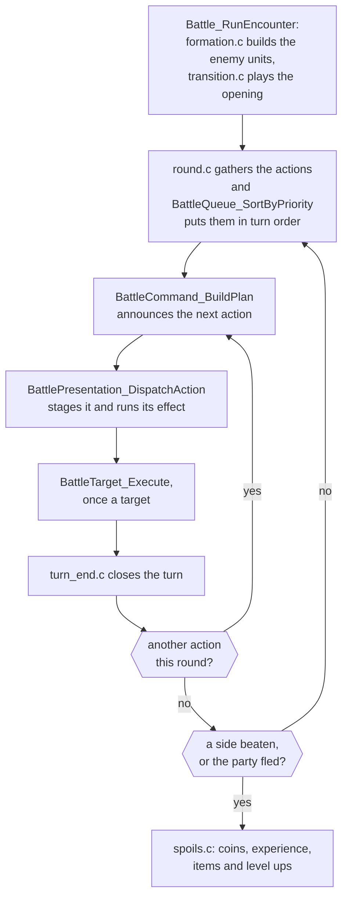
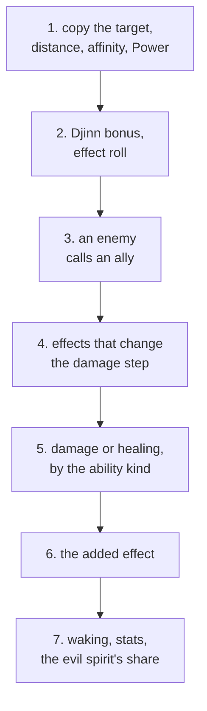

# Battles

The battle code runs a fight from its opening transition to the spoils: it
builds the units, gathers each round's actions and sorts them into turns,
plans each action, stages it, and applies the ability to every target. Three
other folders share the work. [Battle effects](../effect/README.md) draws the
animations, `../window` holds the command menu and the party's status
window, and [Game rules](../game/README.md) holds the ability, item and enemy
tables and the arithmetic in `game/battle_calc.c`. [Battle](../../battle.md)
explains how a battle is entered from the field and how the rules and the
effects run at the same time; this page explains the code underneath.

## Rounds

A battle is a loop of rounds: each gathers every unit's action, sorts them
into turns and plays them one after another, until one side has no unit
standing or the party gets away.

`Battle_RunEncounter` ([`battle/encounter.c`](battle/encounter.c)) fights the
whole battle and returns the number of enemies defeated, `ENCOUNTER_FLED` or
`ENCOUNTER_PARTY_LOST`. Before the first round `formation.c` turns the enemy
group into units, with their levels and the letters that tell two of a kind
apart, and `transition.c` plays the opening: the curtain, or the Venus
Lighthouse storm. After the last, `spoils.c` hands out coins, experience,
items and level ups.

Each round runs five steps, and the battle ends when one side has no unit
standing or the party gets away:

1. `round.c` gathers the actions: the party's from the command menu
   (`BattlePresentation_BuildActions`), or from `auto_battle.c` under
   `FLAG_AUTO_BATTLE`; the enemies' from `BattleCommand_SelectAutomatic`
   (`enemy_ai.c`), or from the other console in a link battle. A unit with
   two actions a round is listed twice, an enemy's second entry at half its
   Agility.
   `BattleQueue_SortByPriority` sorts them by Agility, fastest first, except
   that a Djinni whose added effect is a guard or Ground (Granite, Flash,
   Ground) goes before everyone. Defend and Total Defense are raised here,
   before anyone acts.
2. `BattleCommand_BuildPlan` (`plan.c`) announces each action and fills the
   plan.
3. `BattlePresentation_DispatchAction` (`staging.c`) stages the plan and runs
   its effect.
4. `BattleTarget_Execute` (`target_exec.c`) applies the ability to each target,
   called once a target from the event playback.
5. `turn_end.c` closes the actor's turn and then the round: stat changes and
   statuses count down, Djinn recover, poison takes a tenth of the maximum HP
   (deadly poison a fifth), the Grim Reaper takes a unit whose countdown has
   run out, and a summon's boost is applied.

| Name | Value | Meaning |
| --- | --- | --- |
| `ENCOUNTER_PARTY_LOST` | -1 | `Battle_RunEncounter`'s result when the party is beaten |
| `ENCOUNTER_FLED` | 999 | its result when the party ran away |
| `PARTY_BATTLE_SIZE` | 4 | party members who fight at a time |
| `ENEMY_BATTLE_SIZE` | 6 | enemies in a battle at most |
| `LINK_PARTY_SIZE` | 3 | party members each console sends to a link battle |

### Enemy actions

An enemy picks one of the eight abilities in its row of `../game/enemies.tsv`
by its action strategy (`enum EnemyActionStrategy`). Three strategies draw at
random by a row of `gBattleCommand_SelectionWeights`: evenly, falling by 6 a
place, or falling steeply from 113 in 256 to 5. The other four take the list
in order, from a random place or the first, or repeat the last pick, and
remember their place between turns. A
pick the enemy cannot use (too little PP, a seal, no target worth it) is
drawn again, and after 18 failed picks the enemy defends.

| Strategy | Value | How the place is picked |
| --- | --- | --- |
| `ACTION_STRATEGY_EVEN` | 0 | at random, 32 in 256 each |
| `ACTION_STRATEGY_FALLING` | 1 | at random, from 53 in 256 down to 11 |
| `ACTION_STRATEGY_FIRST_FAVOURED` | 2 | at random, the first 113 in 256, down to 5 |
| `ACTION_STRATEGY_RANDOM_START` | 3 | a random place the first time, then each in turn |
| `ACTION_STRATEGY_IN_ORDER` | 4 | each in turn from the remembered place |
| `ACTION_STRATEGY_NEXT_PICK` | 5 | the next place at each new pick, from 0 |
| `ACTION_STRATEGY_SAME` | 6 | the place last picked |

An ability whose added effect is Defend, Total Defense or Flee is never used
as an ability. `BattleCommand_SelectAutomatic` turns it into the command
`COMMAND_DEFEND`, `COMMAND_DEFEND2` or `COMMAND_FLEE`, aimed at the enemy itself, so the
guard is raised with the party's before anyone acts.

### First strikes and escape

`BattleWork.encounterMode` records which side has the jump. In a random
encounter (`BATTLE_START_NORMAL`) the party strikes first one time in 16, and
otherwise the enemies one time in 32; the Djinn tutorial (`FLAG_DJINN_LESSON`)
always gives the party the first strike. When the party strikes first, no
enemy acts in that round and running away cannot fail. When the enemies do,
the party chooses no commands, and two to five enemies, drawn at random, act
once each. The mode returns to normal at the round's end.

`BattleEscape_CheckSuccess` (`round.c`) gives a 50 percent chance, plus 20
for each failed try in the battle, plus 5 for each level the party's average
is above the enemies' (or less, below). It always fails when the battle
cannot be escaped (`BATTLE_START_NO_ESCAPE`). A failed escape turns the rest
of the round into one the enemies began.

| Name | Value | Meaning |
| --- | --- | --- |
| `BATTLE_ENCOUNTER_NORMAL` | 0 | neither side has the jump |
| `BATTLE_ENCOUNTER_PARTY_FIRST` | 1 | the party strikes first |
| `BATTLE_ENCOUNTER_ENEMIES_FIRST` | 2 | the enemies strike first |
| `BATTLE_START_NORMAL` | 0 | a random encounter: the first-strike rolls are made |
| `BATTLE_START_NO_ESCAPE` | 2 | a battle the party cannot run from, such as a Mimic's |
| `BATTLE_START_SCENE` | 3 | a battle a scene starts; the command menu refuses to run |
| `BATTLE_START_LINK` | 4 | a link battle |
| `BATTLE_START_DEBUG` | 5 | the debug battle menu's battle; the party may run |

## Planning an action

`BattleCommand_BuildPlan` ([`battle/plan.c`](battle/plan.c)) turns the chosen
command into an ability id, shows its announcement, picks its targets and
makes the rolls that must be known before the effect plays. It returns 0 to
stage the plan, or `PLAN_REPORTED` when the action failed and its message
has been shown.

| Name | Value | Meaning |
| --- | --- | --- |
| `PLAN_REPORTED` | -1 | the action failed and its message has been shown |

### Commands and ability ids

The command the actor chose decides which ability id the plan carries.

- `COMMAND_ATTACK` is `ABILITY_ATTACK`, unless the equipped weapon unleashes
  (`RollWeaponUnleashFar`): then the weapon's `unleash_action` replaces it,
  at a chance of five times its `unleash_chance` percent plus what the
  equipment adds. The player reads `<unit>'s <weapon> lets out a howl!` and
  then the ability's name.
- `COMMAND_PSYNERGY` is the ability chosen in the menu. Its PP cost is paid here,
  only when the cast goes ahead: a sealed caster, or one short of PP, pays
  nothing.
- `COMMAND_DJINN` reads the Djinni's ability from `../game/djinn.tsv`
  (`Djinn_GetAbilityIdFar`). Only a set Djinni is unleashed, and it then goes
  on standby; one on standby is set again instead, and one still recovering
  says so.
- `COMMAND_ITEM` takes the item's `action_id`. An item with none, or a broken
  one, makes the user defend. What using it costs is the item's `use_type`
  ([Game rules](../game/README.md)), spent in `staging.c` after the effect.
- `COMMAND_SUMMON` takes the summon's ability from `../game/summons.tsv` and
  marks the standby Djinn it uses.
- `COMMAND_ABILITY` is an enemy's ability, chosen as above.

The plan takes its element from the ability's row, except that a plain
Attack strikes with the weapon's element, or an enemy's with its own
(`Item_GetEquippedElement`).

| Command | Value | Ability |
| --- | --- | --- |
| `COMMAND_ATTACK` | 0 | `ABILITY_ATTACK`, or the weapon's unleash |
| `COMMAND_PSYNERGY` | 1 | the ability chosen in the menu |
| `COMMAND_ITEM` | 2 | the item's `action_id` |
| `COMMAND_DEFEND` | 3 | Defend |
| `COMMAND_ABILITY` | 4 | an enemy's ability |
| `COMMAND_DJINN` | 5 | the Djinni's ability |
| `COMMAND_SUMMON` | 6 | the summon's ability |
| `COMMAND_DEFEND2` | 7 | an enemy's Total Defense |
| `COMMAND_NONE` | 8 | nothing this turn |
| `COMMAND_FLEE` | 99 | running away |

### Targets and range

An ability reaches the places of the target side within its range of the aimed
one, counted in places rather than pixels.

![Isaac aims Quake at four enemies, Garet, Mia, Ivan and Jenna, and moves the aim right three times, from Mia to Ivan to Jenna and round to Garet. On the left the game marks the aimed one with a large pink marker and its name and each other unit in range with a small one. On the right the same battlefield is drawn from above: the enemies in a line at x -80, from z 45 down to z -69, and Isaac at x 80, z 48; the aimed enemy is ringed in yellow and labelled AIMED, the others in range ringed in orange as STEP 1, and those out of range grey with their steps, 2 or 3.](https://alchemy.pascalpixel.com/guides/battle/battle-places.gif)

`BattlePlan_SetTargets` walks the target side's places outward from the
aimed one, as far as the ability's `range`: 1 is the aimed unit alone, each
step more adds a place on either side, and `ABILITY_RANGE_ALL` is the whole
side, with every target treated as the aimed one. It passes over a place
whose unit has left the battle, and a downed unit unless the ability revives,
but a downed unit still holds its place and counts as a step. It keeps each
target's distance from the aimed place, at most `TARGET_MAX` targets. If no
one in range is left, the actor defends (`<unit> is defending!`). The player
sees the same range as a cursor and smaller markers while aiming
(`BattleTarget_RunSelection`, `../window/battle_command/targets.c`).

Seen from above, the battlefield is a plane in pixels.
`BattleUnit_RefreshPlacement` stands the party at x 80, each member at the z
of their place in `gBattlePlacement_StepPairs`, and
`BattlePlacement_LayoutEnemies` lines the enemies up at x -80, each taking
38 pixels of the line if large and 27 if small. The four characters copied
onto the enemy side in the recording are large, so they stand 38 pixels
apart, from z 45 to z -69, off centre because the line starts from an
estimate of 30 pixels an enemy. Range is counted in places, not pixels:
Quake's range of 2 reaches one place on either side of the aimed one, so with
the aim on Jenna, at the end of the line, only Ivan is covered beside her.
The aim wraps from the last place to the first.

| Name | Value | Meaning |
| --- | --- | --- |
| `ABILITY_RANGE_ALL` | 255 | the whole side, every target treated as the aimed one |
| `TARGET_MAX` | 14 | targets a plan holds at most |
| `PLACE_PARTY` | `0x100` | added to a party place to make its place code |
| `PLACE_ENEMY` | `0x180` | added to an enemy place to make its place code |

### Rolls made in advance

The plan makes the rolls the effect must know before it plays: whether a plain
Attack misses or lands a critical hit, and how many blows a multiple-blow
ability strikes.

A plain Attack never misses a target that cannot act (down, asleep, stunned,
charmed or held by Ground). Otherwise it misses one time in 32, and a deluded
attacker also misses 153 times in 256; the Djinn tutorial's attack always
misses. A miss sets the target's multiplier to 0, and the player reads
`<unit> nimbly dodges the blow!`. A critical hit comes one time in 32, or
failing that at half the percentage the equipment adds to its unleash chance
(`CRITICAL_HIT`).

An ability with a double or triple blow rolls it once for every target: 153
in 256 for Gust, Rapid Smash, Slice and Sonic Smash, and one time in four for
Flying Attack, Double Fang, Twin Beaks and Swift Strike. Sonic Smash and Swift
Strike strike three times. A success raises the targets' multiplier, which
`BattleTarget_Execute` multiplies the damage by, and the effect's variant, so the
animation shows the extra blows. `enum AbilityEffect` also has blows one time
in eight and an ability's own critical hit (`CRITICAL_STRONG`, half as much
again), but no ability uses them.

Annihilation rolls its instant death here, at full rate whatever the
distance, so that its effect can show whether it landed. Every other added
effect is rolled per target in `BattleTarget_Execute`.

| Name | Meaning |
| --- | --- |
| `CRITICAL_HIT` | an attack's critical hit: a quarter more damage |
| `CRITICAL_STRONG` | an ability's own critical hit, half as much again; no ability uses it |

### Staging and announcement

The plan records how its action is staged, from `actflags.tsv` and
`actstat.tsv`, and the announcement the player reads before it plays.

`actflags.tsv` gives the plan's presentation flags: the effect kind in the
low twelve bits (`STAGING_KIND_MASK`), its variant above them, and the bits
that choose the effect's entry point (`STAGING_BY_ID_RANGE`,
`STAGING_SCENE`). [Battle effects](../effect/README.md) explains the effect
kinds and their variants.

The outcome comes from `actstat.tsv` where its row is not 0. Otherwise an
ability that costs PP, or Psy Drain (`Ability_IsPsynergy`), is a cast
(`PLAN_SHOW_CAST`); another ability with an effect to draw is a cast too, or
`PLAN_SHOW_ENEMY_CAST` for an enemy; and one with nothing to draw shows only
its messages (`PLAN_SHOW_MESSAGES`). An item's use is staged as
`PLAN_SHOW_ITEM` unless its outcome is a summon or full screen.
`actstat.tsv` gives `PLAN_SHOW_FULL_SCREEN` to Gaia, Mother Gaia, Grand Gaia,
Rockfall, Rockslide, Avalanche and Procne: the camera turns, the side that
isn't targeted fades out, and only the actor and the target side stay on the
field while the effect plays (`BattlePresentation_RunUnitTransition`). It
gives `PLAN_SHOW_ENEMY_CAST` to Slice and seven weapon unleashes, so they play
with the element's streaks in place of the gathering star field.

The announcement follows the command: `<unit> attacks!`,
`<unit> casts <ability>!`, `<unit> unleashes <ability>!` for a Djinni,
`<unit> summons <ability>!`, and `<unit> uses <item>!`, or
`<unit> raises the <item>!` for an item the user keeps. An enemy's ability is
`<unit> uses <ability>!`, or `<unit> unleashes <ability>!` for
`ABILITY_KIND_UNLEASHED_DAMAGE`, and some enemy moves have wordings of their
own, chosen by ability id in `BattleCommand_BuildPlan`.

| Name | Value | Meaning |
| --- | --- | --- |
| `PLAN_SHOW_MESSAGES` | 1 | no animation: each target's events only |
| `PLAN_SHOW_ATTACK` | 2 | the actor runs up and strikes |
| `PLAN_SHOW_CAST` | 3 | Psynergy, and Venus, Mercury, Mars and Jupiter |
| `PLAN_SHOW_ITEM` | 4 | an item |
| `PLAN_SHOW_SUMMON` | 5 | the larger summons, the actor hidden |
| `PLAN_SHOW_DJINNI` | 6 | a Djinni with no attack |
| `PLAN_SHOW_FLEE` | 7 | a unit runs |
| `PLAN_SHOW_ENEMY_CAST` | 8 | the element's streaks in place of the star field |
| `PLAN_SHOW_FULL_SCREEN` | 9 | the camera turns and the side not targeted fades out |
| `STAGING_KIND_MASK` | `0xfff` | the effect kind |
| `STAGING_VARIANT_MASK` | `0x3000` | the effect's variant, from bit 12 (`STAGING_VARIANT_SHIFT`) |
| `STAGING_BY_ID_RANGE` | `0x4000` | the effect is chosen by ability id range |
| `STAGING_SCENE` | `0x8000` | the effect is a scene seen from the actor |

## How an ability resolves

`BattleTarget_Execute` turns the plan into what happens to one target: its damage
or healing, its added effect, and the events that show them.

`BattleTarget_Execute` ([`battle/target_exec.c`](battle/target_exec.c)) applies
the plan to one target. It draws nothing and never waits: it changes the
units at once and pushes the events that show the change, in the order the
player sees them. It runs in seven phases, marked in its body:

1. It copies the target, to measure stat changes later; finds the target's
   distance from the aimed place; finds the element's affinity; and takes the
   actor's Power in the ability's element, or 100 for an item's user.
2. It rolls the Djinn bonus and whether the added effect lands.
3. It handles an enemy calling an ally.
4. It applies the added effects that change the damage step.
5. It deals the damage or healing, by the ability kind.
6. It applies the added effect.
7. It rolls waking from damage, recalculates the target's stats and gathers
   the evil spirit's share for a haunted actor.

| Name | Value | Meaning |
| --- | --- | --- |
| `FULL_RATE` | 256 | 1 in the multipliers, which are counted in 256ths |
| `ABILITY_KIND_MASK` | 15 | the bits of an ability's `flags` that are its kind |

### The ability kind

The ability kind chooses the formula in phase 5. The formulas are in
[`../game/game/battle_calc.c`](../game/game/battle_calc.c), and the battle
calls them by their far-call names (`../system/far_call/GAME.S`).

| Ability kind | What the target takes | What the power is |
| --- | --- | --- |
| `ABILITY_KIND_HEAL_HP` (Cure, Ply, Herb) | HP back, by the healer's Power in the element (`Battle_CalcRecoveryFar`) | the HP restored at Power 100 |
| `ABILITY_KIND_EFFECT` (Sleep, Impair, Drain) | damage only when the added effect lands, and otherwise `But it has no effect on <unit>!` | the damage at an even match |
| `ABILITY_KIND_ATTACK` (Attack, Ragnarok) | a blow, the actor's Attack against the target's Defense (`Battle_CalcAttackDamageFar`) | damage added to a plain blow |
| `ABILITY_KIND_ATTACK_MULTIPLIED` (Flint, Quick Strike) | a plain blow times the power | the multiplier, in tenths |
| `ABILITY_KIND_DAMAGE` (Quake, Avalanche) | damage scaled by the actor's Power against the target's Resist (`Battle_CalcPsynergyPowerFar`) | the damage at an even match |
| `ABILITY_KIND_UNLEASHED_DAMAGE` (Fire Blessing, War Cry) | as `ABILITY_KIND_DAMAGE`, falling off faster | the damage at an even match |
| `ABILITY_KIND_SUMMON` (Ramses, Judgment) | as `ABILITY_KIND_DAMAGE`, with a share of the target's maximum HP added to the power, falling off by its own table | the damage at an even match, before the share |
| `ABILITY_KIND_PP_DAMAGE` (Crazy Voice) | PP lost, as `ABILITY_KIND_DAMAGE` | the PP lost at an even match |
| `ABILITY_KIND_HEAL_PP` (Psy Crystal, Adept Ring) | PP back, as `ABILITY_KIND_HEAL_HP` | the PP restored at Power 100 |

An even match is the actor's Power in the element equalling the target's
Resist in it. `ABILITY_KIND_BLANK` (only the unused rows named `?`),
`ABILITY_KIND_EFFECT_ONLY` (Granite, Flash, Kite) and `ABILITY_KIND_NO_POWER`
(the field Psynergy, Defend, Flee, the enemies' commands and the stat-raising
items) apply no power. Every other kind except the two attacks skips its
formula when the power is 0, so such an ability does only its added effect;
an attack's power is only added to the blow, so Attack, whose power is 0,
still strikes. Ember is `ABILITY_KIND_HEAL_PP` with a power of 0: its PP
comes from its added effect.

A summon called with `COMMAND_SUMMON` adds 3 percent of the target's maximum HP
to the power for each Djinni it uses, so 3 to 12 percent. HP healing,
attacks and HP damage then add a random 0 to 3; an added effect's damage, PP
damage and PP healing do not. A guarding target takes half the damage, or a
tenth behind Total Defense (`REDUCE_BY_GUARD`). A blow always does at least
1 damage; Psynergy damage can come to 0. A critical hit adds a quarter to a
blow, then the target's level divided by 5, plus 6.

`ABILITY_KIND_UNLEASHED_DAMAGE` is the enemies' Blessings, gases, howls and
similar moves, which is why most of them are announced as
`<unit> unleashes <ability>!`. A weapon's unleash is unrelated: it replaces
Attack with the weapon's own ability, nearly always `ABILITY_KIND_ATTACK`.

### The element multiplier

The element bonus is the actor's Power in the ability's element less the
target's Resist in it. `Battle_GetElementMultiplier` turns it into a
multiplier read from the five points of `gElement_PowerResistCurve`
(`../game/element_curve.s`), which lie on one line: 1 at an even match,
moving half a percent for each point, from 0 at 200 points behind to 2 at
200 ahead. A blow feels the element at half strength, from 0.5 to 1.5. An
ability with no element (`ELEMENT_NONE`) gets no bonus. Healing uses the
healer's Power alone: each point above or below 100 moves it one percent,
from nothing at 0 to double at 200, and an ability with no element heals as
if at 100. The multipliers are counted in 256ths (`FULL_RATE`), and every
result rounds down.

A unit's Power and Resist come from its element levels
(`gElement_PowerResistByLevel`) or, for an enemy, its element preset, with
the equipment's added by `Unit_Calculate`. A Resistance stage adds 20 Resist in
every element (`RESISTANCE_PER_STAGE`). A summon's boost, applied at the end
of the summoner's turn, raises the element it spent most Djinn of by 10, 30,
60 or 100 Power for one to four Djinn (`BattleUnit_ProcessTurnEnd`).

The damage message says how the element fared against the target's base
Resist, before equipment and stages (`baseElement`): `<unit> takes <damage>
damage.` when the ability's element is the one the target resists best,
`damage!!!` when it is the one it resists worst, and `damage!` otherwise. A
target that resists all four alike gets `damage!!!`.

A Djinni that strikes the element the target resists worst may also earn the
Djinn bonus, at a chance of the actor's Power less the target's Resist, plus
30 percent: an enemy it fells then gives more coins and experience and a
better chance of its item (`BattleEnemy_RecordDefeat`).

| Name | Value | Meaning |
| --- | --- | --- |
| `RESISTANCE_PER_STAGE` | 20 | Resist added in every element by one Resistance stage |

### Distance

Every kind but the attacks falls off with the target's distance from the aimed
place.

In the recording Isaac aims at Ivan, with no one on Ivan's other side, so
Garet is one step away and Mia two.

The share each step keeps comes from the tables in `battle_calc.s`. The
figures are percentages:

| Steps from the aimed place | 0 | 1 | 2 | 3 | 4 | 5 |
| --- | --- | --- | --- | --- | --- | --- |
| `ABILITY_KIND_DAMAGE`, `ABILITY_KIND_HEAL_HP`, `ABILITY_KIND_HEAL_PP` | 100 | 80 | 60 | 40 | 20 | 10 |
| `ABILITY_KIND_SUMMON` | 100 | 70 | 40 | 30 | 20 | 10 |
| `ABILITY_KIND_UNLEASHED_DAMAGE`, `ABILITY_KIND_EFFECT`, `ABILITY_KIND_PP_DAMAGE` | 100 | 50 | 30 | 10 | 10 | 10 |
| an added effect's chance (`gHitTable`) | 100 | 60 | 30 | 30 | 30 | 30 |

Avalanche is `ABILITY_KIND_DAMAGE` with a power of 160 and a range of 3, the
aimed foe and two places on either side. At an even match `Battle_CalcPsynergyPowerFar`
gives 160, so the aimed foe takes 160 to 163 with the random, a foe one place
away 128 to 131 and one two places away 96 to 99. With the actor's Power 20
ahead, the multiplier is 281 in 256ths, and the three take 175 to 178, 140 to
143 and 105 to 108; a defending aimed foe takes 87 to 89.

The blows work differently. With Attack 100 against Defense 60 at an even
match, a plain Attack deals half of Attack less Defense, 20 to 23 with the
random. Ragnarok (`ABILITY_KIND_ATTACK`, power 35) adds twice its power
before the halving, 55 to 58. Flint (`ABILITY_KIND_ATTACK_MULTIPLIED`, power
16) multiplies the plain blow by 1.6, 32 to 35. Cure (`ABILITY_KIND_HEAL_HP`,
power 70) restores 70 to 73 HP from a healer with Power 100 and 83 to 86 from
one with 120, and the Healing Ring, whose `action_id` is Cure's row, always
restores 70 to 73 because an item's user counts as Power 100.

### Whether the added effect lands

An added effect lands on each target by its own roll, from the effect's base
rate moved by element levels, Luck and weakness and scaled by distance.

`Battle_RollEffectSuccessFar` (`Battle_RollEffectSuccess`) rolls it, unless the plan
rolled it already. It fails at once when there is nothing to do: a revival on
a unit still standing, a cure on a unit without the ailment, Curse on a unit
whose countdown is at its last turn. Otherwise the chance starts from the
effect's base rate (`Battle_GetEffectBaseSuccessRate`: Sleep 45 percent,
Taint 55, Condemn 20 and so on), gains 3 for each element level the actor is
ahead of the target, loses 3 for every two points of the target's Luck, and
gains 25 when the effect is one of the three the target is weak to. The
distance table then scales it. A negative base rate is a fixed chance that
levels, Luck and weakness don't change: Quartz 60 percent, Dew 90, and 100
for an effect with no rate of its own. Luff gets three tries.

When the added effect of an `ABILITY_KIND_EFFECT` ability fails, the target
takes no damage either.

### Added effects that change the damage step

Some added effects change how the damage is dealt, or stand in for it, and are
applied before it.

Phase 4 runs only for an effect that landed. Torch's blow counts half the
target's Defense; Severe Blow and Thrash leave the target 1 HP at most;
Condemn and the other instant deaths skip the damage; Dynamite and Mortal
Blow remove their user from the battle; and Psy Drain becomes
`ABILITY_KIND_PP_DAMAGE`, or misses a target with no PP. Ground holds a
target only while it still has an entry in the round's action list:
`BattlePresentation_DispatchAction` clears each entry as it plays it, so a
target that has already acted is left alone.

Phase 3 handles Ally Search, Search for Help and Speed Surge. When the roll
succeeds, a free unit id exists and the enemy sprite slots have room
(`Enemy_CheckRoom`), the new enemy fills an empty place or is appended, the
enemies are laid out again, and the player reads `<unit> appears!!` or
`It split off into <unit>!`; otherwise `But no one came!` or
`It failed to divide!`.

### Applying the added effect

Phase 6 applies the effect when it landed and the target is still standing.
A revival needs the target down instead, and a drain still works on a target
its own damage has just felled (`BattleEffect_CheckDead`). The case comments
in `BattleTarget_Execute` and the notes on `enum AbilityEffect`
([`battle_unit.h`](../../include/battle/battle_unit.h)) give each effect's
detail; the rules they share are these.

- A stat change moves Attack, Defense or Resistance one or two stages,
  between `STAT_STAGE_MIN` and `STAT_STAGE_MAX`, for `STAT_CHANGE_TURNS`.
  A stage is an eighth of Attack or Defense. The number in the message is
  how far the stat moved, measured against the copy from phase 1, so a stat
  at its limit shows 0. Zephyr and Vine set the Agility stage outright, to
  double or half, for `AGILITY_CHANGE_TURNS`.
- A status (Delude, Confuse, Charm, Paralyze, Sleep) and Bind's seal last
  `STATUS_TURNS`, counted down at the end of each round. Luff's seal
  (`PSY_SEAL_LUFF`) lasts two turns that never end early. Taint does nothing
  to a poisoned unit, and Poison's deadly poison replaces plain poison. Curse
  starts the Grim Reaper's countdown of `CURSE_TURNS`, and each later curse
  brings it a turn closer.
- A lowered stat and a status may end early: once five turns or fewer are
  left, the end of each round rolls for it, more often for a lucky unit and
  as the turns run down (`BattleUnit_RollCounterEarlyEnd`). A raised stat and
  the Agility change always last their turns.
- Restore and Elixir clear delusion, stun, sleep, the seal and the Grim
  Reaper's countdown. Tonic clears those, poison and the evil spirit. Neither
  clears confusion or charm, which wear off or end when the unit goes down.
- Drain gives the actor all the HP the target lost, Sap half, Psy Drain the
  PP it took, and Psy Leech a tenth of the damage as PP.
- Defend and Granite set `GUARD_DEFEND`, Total Defense and Flash
  `GUARD_TOTAL_DEFENSE`; the message shows either way, but a guard is never
  lowered. Break returns every raised stage to 0 and removes a summon's
  boost. Kite lets the target act twice next turn, Ground costs it its next
  action, and Haunt sets an evil spirit on it.

| Name | Value | Meaning |
| --- | --- | --- |
| `STAT_STAGE_MIN` | -4 | the lowest stat stage: half the stat |
| `STAT_STAGE_MAX` | 4 | the highest: one and a half times the stat |
| `AGILITY_STAGE_DOUBLED` | 8 | Zephyr's Agility stage: twice the Agility |
| `STAT_CHANGE_TURNS` | 7 | turns a stat change lasts |
| `AGILITY_CHANGE_TURNS` | 5 | turns an Agility change lasts |
| `STATUS_TURNS` | 7 | turns a status or Bind's seal lasts |
| `CURSE_TURNS` | 7 | the Grim Reaper's countdown |
| `PSY_SEAL_BIND` | 7 | Bind's seal: seven turns, in the low three bits |
| `PSY_SEAL_LUFF` | 16 | Luff's seal: two turns of 8, never ending early |
| `GUARD_DEFEND` | 1 | Defend and Granite: half the damage |
| `GUARD_TOTAL_DEFENSE` | 2 | Total Defense and Flash: a tenth of the damage |

### After each target

Once a target has been dealt with, the damage it took may wake it and may feed
a haunted actor's evil spirit.

Losing HP or PP wakes a sleeping target one time in four, unless it fell
asleep this round. A haunted actor, one time in four for each target it took
HP or PP from, adds a quarter of that loss (at least 1) to
`BattlePlan.hauntDamage`, and takes the total from its own HP at the end of
its turn (`BattleUnit_ProcessTurnEnd`).

In the Djinn tutorial a Djinni's blow always leaves its target 1 HP, and a
summon always fells it.

## Rules and pictures meet at the event queue

The battle event queue is the one channel from the rules, which change the
units at once, to the screen, which shows the changes one by one while the
effect plays.

![Isaac's Quake against Garet, Ivan and Mia, one frame for each event playback plays, beside the queue it is playing with that event marked. First the rock pillars throw the three into the air while playback is idle and no target has been resolved. Then for each target in turn, Garet, Ivan and Mia, the queue holds eight events: the hit, which flashes the unit white; the number and the unit's name; the message `Garet takes 14 damage!!!`, then `Ivan takes 15 damage!` and `Mia takes 12 damage!`, which waits for the player; and a refresh of the unit, its name again, a clear of the arguments and a last refresh, which play in the same frame as the next target's hit.](https://alchemy.pascalpixel.com/guides/battle/round-events.gif)

`BattleTarget_Execute` never draws or waits, and an effect never computes an
outcome. [Battle](../../battle.md#rules-and-effects-run-together) explains how
`BattleEvent_Playback` runs as a task while the effect's own loop waits, and
runs each target's rules once the effect calls `EFFECT_SHOW_DAMAGE`. Of the
66 files under `../effect/parts/`, 57 call it; the rest are the effect
system's own code (`blitter.c`, `canvas.c`, `dispatch.c`, `display.c`,
`positions.c`) and four effects that never do (`atalanta.c`,
`djinn_heal.c`, `torch.c`, and `orbiting.c`, which is unreachable). For
those, `BattleEvent_WaitForReady` finds playback idle when the effect returns
and starts it itself.

In the recording, Quake plays for about two seconds before its blow lands
and starts playback. Playback then resolves the three targets in the plan's
order, the battlefield's (Garet, Ivan, Mia), not the aimed Ivan first, and
each target's `BattleTarget_Execute` queues the same eight events. Only the hit
(nine frames of flashing) and the message (until the player presses A) make
playback wait; the number and name it pushes before the message, and the
name pushed for an added effect Quake doesn't have, the clear and the
refreshes after it, all play within one frame.

The queue (`struct BattleEventQueue`, `BATTLE_EVENT_CAPACITY` events) is the
only channel from the rules to the screen. A message takes its names and
numbers from the window system's argument table when it is decoded, so they
are pushed before it, and a message uses them up, so each later message
pushes the name again. `BattleEvent_DispatchQueued` plays the same queue
straight through for an outcome shown outside an effect, such as a cast that
is sealed or short of PP.

| Name | Value | Meaning |
| --- | --- | --- |
| `BATTLE_EVENT_CAPACITY` | 64 | events the queue holds |

## Design

### Results nobody reads

Some of the original's functions are declared to return a value and end
without one, and no caller reads it. The matching build keeps the declared
type where `void` would change the epilogue, and `UBFIX` gives the `void`
form; [Matching](../MATCHING.md) explains the rule. `BattleTarget_Execute`,
`BattleEvent_DispatchQueued` and `BattleEvent_WaitForReady` are among them.

### One sprite, several structs

A unit's figure is one of the object slots `Object_CreateFar` hands out. The
battle reads it as a `struct MotionObject`, while the field's far calls take
it as a `struct DispatchObject` or a `struct ObjectRuntime`. They describe the
same record, with fields at the same offsets, and a call into the field casts
to the view its prototype names. XXX: whether these could be one struct
depends on naming the fields only one view names so far.

## Limits

- There are 519 abilities. The plan reads `actflags.tsv` only up to
  `ABILITY_THRASH`, and `actstat.tsv`, a row shorter, up to
  `ABILITY_SEVERE_BLOW`.
- A plan reaches at most `TARGET_MAX` targets.
- The party fights `PARTY_BATTLE_SIZE` at a time and the enemies
  `ENEMY_BATTLE_SIZE` at most; in a link battle each console sends
  `LINK_PARTY_SIZE`.
- `formatn.tsv` has 380 enemy groups, each of up to five kinds of enemy with
  the least and most of each (`member0` to `member4`, `minimum0` to
  `minimum4`, `maximum0` to `maximum4`). The encounter zones in
  `../object/encounter.tsv` choose among them.
- The event queue holds `BATTLE_EVENT_CAPACITY` events.

## Files

| File | What it holds |
| --- | --- |
| `battle.c` | the battle object: it includes `battle_internal.h`, then the parts in `battle/` in ROM order |
| `battle_internal.h` | the private header every part includes: the names two or more parts use |
| `battle/*.c` | the code, in 24 parts |
| `battle_data.s`, `battle_vars.s` | the smaller tables and pictures in ROM order, including where the `.tsv` tables below are placed |
| `battle_calc.s` | the fall-off tables: the share of damage, healing or an added effect's chance a target gets by its distance from the aimed place |
| `actflags.tsv` | each ability's effect kind and staging bits (`gBattle_ActionFlags`) |
| `actstat.tsv` | each ability's staging, where it overrides the plan's choice (`gBattle_ActionStatus`) |
| `formatn.tsv` | the enemy groups (formations) |
| [`sprites.tsv`](sprites.tsv) | each enemy class's battle sprite |
| `presets.tsv` | the debug party presets |
| `advarrow.s` | the arrow beside a battle message that waits for the player, built from `advarrow.png`: sixteen 8 by 16 frames, of which the code cycles through the first eight, one every four frames |
| `presentation/` | the opening curtain's tiles and their variants, and the brightness steps of a unit's highlight (`highlight_ramp.s`) |
| `effect/` | two 32 by 16 sparks that `../object/arcspark.s` places for the field Psynergy effects |

The ROM holds the battle as one object, and it is built as one. The split
into parts is ours, made where one family of functions ends and the next
begins; the folder's [guide](../README.md) explains how parts are compiled.
The first lines of the parts, read in the order `battle.c` includes them,
form a table of contents. The functions are declared in
[`unit/battle/battle.h`](../../include/unit/battle/battle.h).

## Words used here

- **unit**, **unit id**: everyone in a fight. Party members keep their
  character numbers as unit ids, up to `ALLY_MAX`, and enemies take ids from
  `FIRST_ENEMY_UNIT`. `Unit_GetFar` returns a unit's `struct BattleUnit`: its
  HP, PP, stats, statuses, stat stages and a Power and a Resist in each
  element (`BattleUnit.element`).
- **ability**, **ability id**: anything a unit does on its turn, from Attack
  to Quake, a Djinni, a summon, an item's use or an enemy's move. The id is a
  row number in three tables: `../game/actions.tsv` (`struct BattleAct`, read
  with `BattleAction_Get`), `actflags.tsv` and `actstat.tsv`.
- **ability kind**: the low four bits of the ability's `flags`
  (`ABILITY_KIND_MASK`, `enum AbilityKind`). It chooses the formula each
  target goes through. The **effect kind** in `actflags.tsv` is unrelated and
  chooses only the animation (`enum BattleFxKind`).
- **power**: the `power` column of `actions.tsv`. What it counts depends on
  the ability kind. A unit's **Power** and **Resist**, capitalized as the
  status screen writes them, are its per-element stats.
- **added effect**: what an ability does besides damage or healing, the
  `effect` column of `actions.tsv` (`enum AbilityEffect`).
- **element level**: the level the status screen shows under each element
  (`Unit_GetElementLevel`). A character's Power and Resist start from it, and
  it moves the chance of an added effect.
- **place**, **place code**: a unit's position in its side's line-up
  (`BattleWork.partyUnits`, `BattleWork.enemyIds`). A command aims at a place
  code, the place plus `PLACE_PARTY` or `PLACE_ENEMY`.
- **side**: the party or the enemies (`BATTLE_SIDE_PARTY`,
  `BATTLE_SIDE_ENEMIES`). A unit's own `side` field says which side it is on,
  or that it has left the battle.
- **plan**: the action under way (`struct BattlePlan`): the actor, the
  ability, its element, its targets with their distances and rolls, its
  **outcome** (`enum BattlePlanStaging`, how it is staged) and its
  **presentation flags** (the `actflags.tsv` row: `STAGING_*`).
- **battle object**: a unit's figure on the battlefield (`struct BattleObj`,
  `BattleObject_Get`). Its **records** are its sprites; the Kraken and the Fusion
  Dragon are drawn in two parts and have two (`SPRITE_WITH_SECOND_PART_A`,
  `SPRITE_WITH_SECOND_PART_B`).
- **event**: one thing the battle shows while an action plays, waiting in the
  battle event queue (`BattleEvent_Push`, `enum BattleEventOpcode` in
  `battle_event.h`): a message, a name or number the next message needs, a
  flinch, a defeat, a redraw or a sound.
- **pose**: how a battle object stands (`POSE_*`, set with
  `ObjectDispatch_SelectAnimationFar`).

The parts give the same locals the same names: `battle` or `work` for
`gBattleWork`, `unitId`, `unit` for its `struct BattleUnit`, `battleObject`
for its `struct BattleObj`, `object` for that object's
`struct MotionObject`, `record` for one of its sprites, and `plan`.

## Function prefixes

| Prefix | What it acts on |
| --- | --- |
| `Battle_` | the battle as a whole: `Battle_RunEncounter`, the round's end |
| `BattleParty_` | the unit lists: who is in the battle and who is still standing |
| `BattleQueue_` | the round's action list and its turn order |
| `BattleCommand_` | an action chosen and planned |
| `BattlePlan_` | the plan's targets |
| `BattleTarget_` | targets an enemy or a confused unit picks |
| `BattlePresentation_` | what the battle shows: the staging, the opening transition, the camera, the palettes |
| `BattleEvent_` | the event queue and its playback |
| `BattleObject_`, `BattleObject_Get`, `BattleObject_Make`, `BattleObject_Put` | the battle objects |
| `BattleMotion_` | their movements |
| `BattlePlacement_` | where each place stands on the battlefield |
| `BattleUnit_` | one unit's battle state: its guard, weapon sprite, status flags and turn-end counters |
| `BattleStatusIcon_` | the status icons that cycle over a unit |
| `BattleFormation_`, `BattleEnemy_` | the enemy groups, and each enemy's level, name letter, defeat and coins |
| `BattleClass_` | an enemy class's row of the battle sprite table |
| `BattleEscape_` | running away |
| `BattleSpoils_` | the items the enemies leave |
| `BattleSummon_` | which summons the party's standby Djinn make available |
| `BattleIntro_` | the message that announces the encounter |
| `ElementGlow_` | a unit's elemental glow: the star field and the other glows |
| `LinkBattle_` | link battles |
| `DebugBattle_`, `DebugParty_` | the debug battle menu, its message viewer and the party presets |

A function that acts on one thing the engine names elsewhere keeps that
thing's prefix (`Camera_`, `Palette_`, `Party_`, `Ability_`, `Text_` and
others). [Matching](../MATCHING.md) explains the unusual spellings and the
`FAKEMATCH` tags.

## Evidence and open questions

Abilities and enemies are named from the label columns of their tables,
`ability` and `enemy`, which follow the English release's text. The formulas
are named from what `battle_calc.c` computes, and the event kinds from what
playback does with each.

Bits 0 and 1 of the `flags` column of `actflags.tsv` (`STAGING_ON_DOWNED`,
`STAGING_OTHER_SIDE`) are read, but no row in either game sets them. The plan
adds the first itself for the revive effects; nothing adds the second, so the
side flip it asks for is unused. `BattlePlacement_LayoutEnemies` lays out the
enemies' column, and `BattleClass_HasHeavyImpact` reads the class bit that
makes a beam blow land with `SE_HEAVY_IMPACT`, which only the Mars Lighthouse
bosses set (Saturos's second fight, Menardi and the Fusion Dragon).

- XXX (picture): enemy actions: an enemy's eight abilities with the weights its strategy picks them by.
- XXX (picture): first strikes and escape: the round the party strikes first beside one the enemies do.
- XXX (picture): the element multiplier: `gElement_PowerResistCurve` drawn as its line, with each target of one cast marked on it.
- XXX (picture): rolls made in advance: a miss, a critical hit and a triple blow beside the plan's rolls.
- XXX (picture): staging: one ability under each outcome, `PLAN_SHOW_CAST` to `PLAN_SHOW_FULL_SCREEN`.
- XXX (picture): applying the added effect: a unit's stat stages and status counters as they change and count down.
- XXX (picture): after each target: a sleeping target woken by damage, and the evil spirit's share.
