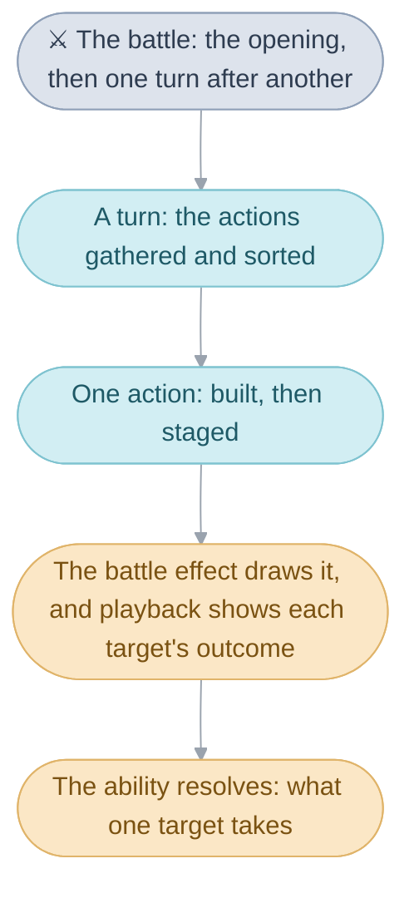
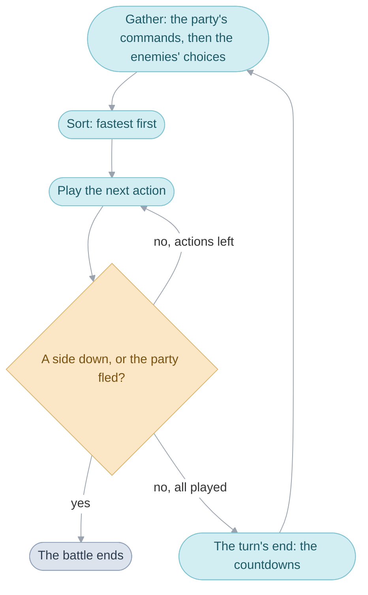
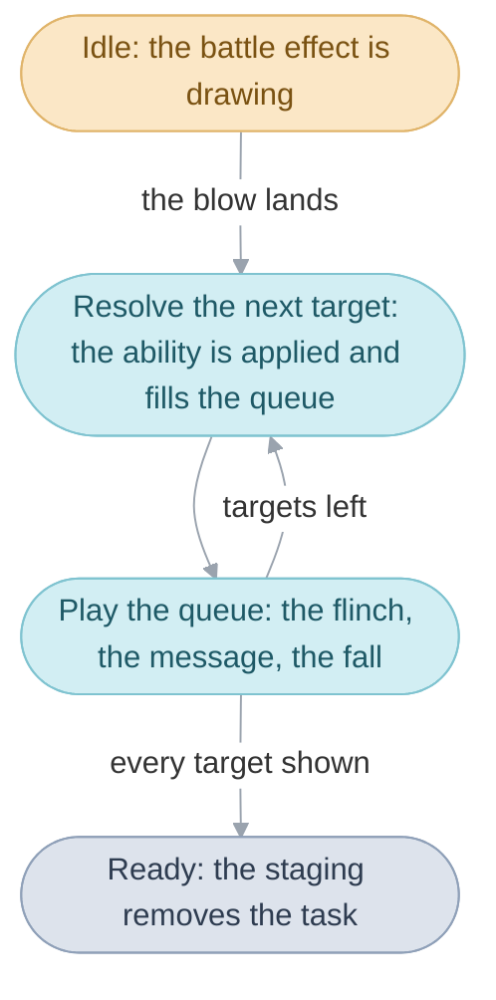

# Battles

The party walks into a battle. The enemies appear one by one, and each
[turn](../../glossary.md#turns-and-actions) the player chooses a command for
each party member. Then every fighter acts one after another, each action
with its announcement, its battle effect and its messages. That goes on until
one side has nobody left standing or the party runs away.

Everything the rules of a fight decide is worked out in this folder:

- who acts in what order
- which move each enemy makes
- who an ability reaches
- whether a blow misses or lands a critical hit
- how much damage each target takes
- which statuses take hold
- what the party wins

The answers come from tables and dice rolls. Each one shows up on screen as a
message, such as `Ivan takes 15 damage!`.

A battle runs on these mechanisms, in the order a fight passes through them:

1. [Starting a battle](#starting-a-battle): the
   [formation](../../glossary.md#formation) becomes a row of enemies, and the
   curtain opens on them.
2. [Turns](#turns): the party's commands and the enemies' choices are
   gathered, sorted by Agility and played one after another.
3. [Building an action](#building-an-action): a chosen command becomes an
   ability, its targets and the rolls the screen must show.
4. [Staging an action](#staging-an-action): the fighters move, the
   [battle effect](../../glossary.md#battle-effect) plays, and each target's
   outcome shows beside it.
5. [How outcomes reach the screen](#how-outcomes-reach-the-screen): the
   [playback queue](../../glossary.md#playback-queue), one target at a time.
6. [How an ability resolves](#how-an-ability-resolves): what one target takes,
   from the ability's kind, the element, the distance and the added effect.
7. [The end of an action and of a turn](#the-end-of-an-action-and-of-a-turn):
   poison, the Grim Reaper, the Djinn and the countdowns.
8. [The end of the battle](#the-end-of-the-battle): the spoils, and the way
   back to the field.
9. [The zoomed battlefield](#the-zoomed-battlefield): one flat picture
   zoomed by the camera.

Three neighbours do the rest of a battle's work.
[Battle effects](../battle_effect/README.md) draws what each ability looks
like. [Windows](../window/README.md) holds the command menu and the
[party](../../glossary.md#the-party)'s status window. And the
[game rules](../game/README.md) hold the ability, item and enemy tables and
the arithmetic of damage.

## Starting a battle

The [scene](../../glossary.md#scene) the party was walking in is cleared away
before a battle starts. So everything the battle needs has to arrive through
the [main routine's work](../../glossary.md#main-routines-work): the party,
the formation to fight, the kind of battle, the music an
[event](../../glossary.md#event) chose and the
[battle background](../../glossary.md#battle-background).
[Field code](../field/README.md#leaving-for-a-battle-and-coming-back) follows
the handover.

The battle then sets itself up in one straight run, before anything shows:

- It takes memory for the camera, for its own
  [work](../../glossary.md#work), for six enemies and for the background, and
  clears away the field's [tasks](../../glossary.md#task).
- It draws the enemies from the formation and stands every fighter on the
  battlefield as a [sprite](../../glossary.md#sprite-and-oam).
- It brings the [Djinn](../../glossary.md#djinn) on standby up to date and
  works out which [summons](../../glossary.md#summons) the party can call.
- It opens the party's status window, starts the music and rolls for a
  [first strike](#first-strikes-and-fleeing).

Only then does the opening play, and the turns begin.

The whole battle, from this set-up to the spoils, is run by one function,
`Battle_Run` in [`battle/run.c`](battle/run.c).

### The enemies of a formation

A formation names up to five kinds of enemy, each with the fewest and the
most of it that can appear. Every kind comes its minimum number of times.
Then each kind gains a random number more, up to its maximum, while there is
room.

A battle has room for six enemies, and a large enemy takes the room of two.
So a formation of large enemies fills up sooner than one of small ones.

The formation's layout orders them on the field:

- A shuffled formation keeps each kind together and shuffles the kinds.
- An interleaved one draws each enemy from a random kind with any left.
- Any other layout keeps the formation's order and stands its first enemy in
  the centre, the rest alternately either side of it.

Two enemies of one kind need telling apart, so each takes a letter after its
name: a digit abroad, a letter of the alphabet in Japanese. The first of a
kind stands bare until a second arrives. Then both are lettered,
`Stone Soldier1` and `Stone Soldier2`. An enemy called into the battle later
takes the next unused letter, and an enemy that leaves gives its letter back.

Every fighter, party member or enemy, is a [unit](../../glossary.md#unit).
A unit is its stats, its HP and [PP](../../glossary.md#psynergy-and-pp), its
statuses and its [Power and Resist](../../glossary.md#power-and-resist) in
each [element](../../glossary.md#the-four-elements)
([The unit](../game/README.md#the-unit)).

The battle keeps each side as a list of its units, four party members at
most and six enemies. A unit's position in its list is its place. Remember
places: every range and distance in a battle is counted in them.

### The opening

A battle opens on a curtain. The curtain is drawn on a
[background layer](../../glossary.md#background-layer) of its own. It starts
as a closed curtain of solid rows, and parts over 80
[frames](../../glossary.md#frame) as one row moves up and its mirror image
moves down.

While it opens, the camera swings round to face the party's side and zooms
in from 180 to 100 percent. The party's status window opens, and each enemy
is announced with `<enemy> appeared!`. A battle with a first strike
announces it last: `<leader>'s party attacks first!` or
`<leader>'s party was caught by surprise!`.

One formation opens differently. The Fusion Dragon on the Venus Lighthouse
aerie arrives in a storm. In place of the curtain, the picture cracks and
shatters into white over the storm's battle background, over 128 frames, and
the Fusion Dragon flashes as the colours come back. Only then does the status
window open and the party fade in, over 16 frames. The enemy is announced
last.

## Turns

A turn is every unit acting once. The party chooses its commands and the
enemies make their choices. The actions are sorted so that the fastest acts
first, and then each action plays in its place in the order.

After every action the game asks whether a side has nobody left standing, so
a battle can end in the middle of a turn. When every action has played, the
turn ends with its countdowns, and the next turn begins with the command
menu.

Each action of the turn is a small record. It holds the unit that acts, its
command, what the command was chosen with (an ability, a Djinni, a summon or
an item), the place it is aimed at, and a priority, the number the turn is
sorted by.

Gathering a turn starts by ending last turn's guards and setting the camera
to the fixed view the player chooses commands in. A turn's first action
waits 10 frames before it plays, and every turn ends with a wait of 20.

### The party's commands

Each party member still standing chooses one action for each action it has
this turn. That is usually one, and a party member with two is asked twice.

A party member who is asleep, confused, charmed or stunned loses the turn
instead. Its lost action is still listed, so that its place in the order is
known. The command menu asks the rest one after another.

A party member's priority is its Agility plus up to a sixteenth more, drawn
at random. That is why two party members of nearly equal speed may swap
places from turn to turn. A second action in the same turn counts half the
Agility.

Flee is different. It is one command for the whole party, listed first with
a priority above any Agility, so the attempt to run plays before anything
else.

### The enemies' choices

Every enemy has a list of eight actions in its row of the enemy table and a
habit for choosing among them. The dice do the rest.

Take a Gryphon. Its list runs Wing Flutter, Tornado, Twin Beaks, Impact,
Attack, Sonic Slash, Bind and Ward, and its habit favours the start of the
list, so it uses Wing Flutter most and Ward least. Each pick rolls a number
from 0 to 255. Wing Flutter takes rolls 0 to 52, Tornado 53 to 99, Twin Beaks
100 to 140, and so on down to Ward's 245 to 255.

| Habit                            | How the entry is picked                                |
| -------------------------------- | ------------------------------------------------------ |
| `ACTION_STRATEGY_EVEN`           | at random, each entry 32 in 256                        |
| `ACTION_STRATEGY_FALLING`        | at random, from 53 in 256 for the first down to 11     |
| `ACTION_STRATEGY_FIRST_FAVOURED` | at random, the first 113 in 256, the last 5            |
| `ACTION_STRATEGY_RANDOM_START`   | a random entry the first time, then the next each time |
| `ACTION_STRATEGY_IN_ORDER`       | the next each time, from where it left off             |
| `ACTION_STRATEGY_NEXT_PICK`      | the next entry at each new pick, from the first        |
| `ACTION_STRATEGY_SAME`           | the entry it picked last time                          |

An enemy chooses twice each turn. While the turn is gathered it keeps its
pick only if it is a guard, so that its guard goes up with the party's before
anyone acts. Any other pick is thrown away, and the enemy picks afresh at the
moment it acts.

The second choice is the one the player sees announced. It is made with the
battlefield as it stands then, after the faster units have acted.

A pick the enemy cannot use is drawn again. That covers Psynergy it lacks the
PP for, or while its Psynergy is sealed, a flight after it has been
challenged, a guard at the moment it acts, and any ability with no target
worth it. After 18 failed picks the enemy defends.

A sleeping or stunned enemy loses its actions. An enemy with two actions a
turn takes its second at half its Agility.

The target is chosen with the ability. Among the units of the side the
ability may reach, the enemy keeps those it would do something to (a stat it
can still raise, a status the unit lacks, a downed unit a revival can bring
back, a standing unit a blow can hurt) and picks one at random.

Some enemies aim a single-target attack at the strongest instead. They sort
the candidates by HP left or by maximum HP and favour the front of the list,
6 chances in 11 for the first of two, and 6, 5 and 4 in 15 for three.

The choosing is `BattleAI_ChooseAction` in
[`battle/enemy_ai.c`](battle/enemy_ai.c).

### Action order

The gathered actions are sorted highest priority first. Equal priorities keep
the order they were listed in. The party's actions come first, so on a tie
the party acts first. The enemies were shuffled before they chose, so enemies
of equal Agility act in a shuffled order.

Three Djinn go before everyone. Granite, Flash and Ground, whose effects
guard or hold, have their priority raised past any Agility.

Once the order is settled, Defend and an enemy's Total Defense take hold at
once, before the first action plays. So a defending unit's guard is up
against everything that turn, including the actions of units faster than it.

### First strikes and fleeing

Now and then a random battle opens with `<leader>'s party attacks first!` and
the enemies stand still for a turn. More rarely it opens with
`<leader>'s party was caught by surprise!`, and some enemies act before the
party can choose anything.

The roll is made while the battle is set up. The party strikes first one time
in 16, and otherwise the enemies one time in 32.

When the party strikes first, no enemy actions are listed that turn. When the
enemies strike first, the party chooses nothing, and two to five enemies,
drawn at random, act once each. The next turn is an ordinary one.

Running away is rolled as the commands are gathered, before any action
plays. The chance grows with every failed try. It is 50 percent, plus 20 for
each failed try in this battle, plus 5 for each level the party's average is
above the enemies' average, or less by 5 for each level below.

So the party at level 20 against Gryphons at level 23 starts at 35 percent,
and after one failure tries again at 55. A party that struck first always
gets away.

A failed try makes the rest of the turn a surprise. The player reads
`But there's no escape!`, and two to five enemies act once each before the
turn ends.

The kind of battle decides which of these rolls are made:

- A random encounter rolls for a first strike, and the party may run.
- A battle that forbids escape, as with a Mimic, makes no first-strike roll,
  and every attempt to run fails.
- In a battle an event starts, the command menu refuses to run.
- A link battle between two consoles makes no first-strike roll.
- The Djinn tutorial always gives the party the first strike.

## Building an action

Just before a unit acts, the player reads its announcement, such as
`Isaac attacks!` or `Isaac's Swift Sword lets out a howl! Sonic Smash!`.

By then the game has turned the chosen command into an action run, the full
account of the action under way. It says which ability it is, who it
reaches, and the rolls the battle effect must show.

Every action of the turn is built this way just as it is about to play, by
`BattleActionRun_Build` in [`battle/action.c`](battle/action.c).

The building follows a fixed order. First comes what stops the unit. A unit
held by Ground is `unable to move!`, a sleeping one `is asleep!`, a paralyzed
one is paralyzed, and a unit bound by a cursed item loses one action in four,
except Defend. An action stopped here shows its message and ends.

Otherwise the command gives the ability, its targets and its announcement.
The unit pays the command's costs, the rolls the battle effect must know are
made, and the way the action is staged is settled.

### Commands and ability ids

Everything a unit can do when it acts is an ability: Attack, Quake, a
Djinni's unleash, a summon, an item's use, an enemy's special move. Each is a
row of the ability table, and its row number is its ability id.

The command the player chose decides which ability the action carries.

- Attack is the ability Attack, unless the weapon unleashes. The chance is
  five times the weapon's unleash chance, in percent, plus what the rest of
  the equipment adds. When it happens, the player reads
  `<unit>'s <weapon> lets out a howl!` and the unleashed ability's name.
- Psynergy is the ability chosen in the menu. A caster short of PP, or whose
  Psynergy is sealed, still announces the cast. The failure shows when the
  cast is staged, and the PP is paid only when the cast goes ahead.
- Djinn takes the Djinni's ability. A set Djinni is unleashed and goes on
  standby. A Djinni on standby is set again instead, with a short burst of
  its element and `<Djinni> is set to <unit>!`, and that is the whole action.
  One still recovering says so.
- Item takes the item's ability. An item with none, or a broken one, makes the
  user defend, and an item an earlier command this turn used up says so. An
  item the user keeps (a weapon, a ring, a Psynergy item) is raised,
  `<unit> raises the <item>!`. Anything else is used.
- Summon takes the summon's ability, counts the standby Djinn of each element
  on the user's side against what the summon needs, and marks the ones it
  uses.
- Defend and Total Defense show `<unit> is defending!` and end, because their
  guard was raised when the order was sorted.
- An enemy's ability is announced as `<unit> uses <ability>!`, or
  `<unit> unleashes <ability>!` for its special attacks, with wording of its
  own for a few (`<unit> looks for allies!`).

The action takes its element from the ability. A plain Attack is the
exception: it strikes with the weapon's element, or an enemy's with its own.

### Targets and range

Move the cursor along the enemies and the ones an ability will reach light
up around it. Each side stands in a line, and an ability reaches the places
within its range of the aimed one. The range is counted in places along the
line, whatever the spacing on the screen.

A range of 1 is the aimed unit alone, and each point more adds a place on
either side. So Quake's range of 2 reaches three units and Avalanche's range
of 3 reaches five. The widest range covers the whole side, with every target
treated as the aimed one. The reach stops at the ends of the line, though the
cursor wraps round.

The reach passes over a unit that has left the battle, and over a downed
unit unless the ability revives. A downed unit still holds its place, so the
units beside it stay as far apart as they were. When nobody in range is left
by the time the action plays, the unit defends instead.

For each target the action run keeps who it is and how many places it stands
from the aimed one. The [distance](#distance) is used when the ability
resolves.

### Rolls made in advance

A dodge and a critical hit look different from a plain blow, so the battle
effect has to know which it is before it starts. That is why the action
rolls them while it is built, before anything is drawn. It keeps the result
beside each target: a miss, one blow, a double or triple blow, and whether it
is critical.

A plain Attack always lands on a target that cannot act (down, asleep,
stunned, charmed or held by Ground). Otherwise it misses one time in 32, and
a deluded attacker also misses 153 times in 256, about three in five. A
critical hit lands one time in 32, or else at half the percentage the
attacker's equipment adds to its unleash chance.

An ability with a double or triple blow makes one roll for all its targets.
The chance is 153 in 256 for Gust, Rapid Smash, Slice and Sonic Smash, and
one time in four for Flying Attack, Double Fang, Twin Beaks and Swift Strike.
Sonic Smash and Swift Strike strike three times, the others twice. A success
multiplies every target's damage and strengthens the battle effect, so the
extra blows show.

Annihilation rolls its instant death here too, so its burst can show whether
it landed. Every other added effect is rolled for each target as the blow
lands.

### Staging and announcement

The [staging](../../glossary.md#staging) is what happens around a battle
effect: whether the unit runs up and strikes, raises a hand to cast, or
nothing moves. Rockslide is staged full screen. The camera swings and the
side that is left alone fades out.

Most abilities are staged by what they are. An Attack is a run up and a
blow, anything that costs PP is a cast, an item is raised, and an ability
with nothing to draw shows only its messages.

A few have a staging of their own in a table. Gaia, Mother Gaia, Grand Gaia,
Rockfall, Rockslide, Avalanche and Procne are full screen. Slice and seven
weapon unleashes are staged as an enemy's special ability is, with streaks of
the element around the user where a caster has a field of stars.

Which battle effect plays comes from another table, a row for each ability.
Its strength is raised by the double or triple blow rolled above
([How an ability picks its effect](../battle_effect/README.md#how-an-ability-picks-its-effect)).

The announcement follows the command: `<unit> attacks!`,
`<unit> casts <ability>!`, `<unit> unleashes <ability>!` for a Djinni,
`<unit> summons <ability>!`, or `<unit> uses <item>!`.

## Staging an action

Staging is the part of an action the player watches.

For each action of the turn the game lets an enemy settle its choice, eases
the camera into the view for the action, highlights the acting unit and
builds the action. Then the action plays in the way its staging names. The
units move, the battle effect plays, and each target's outcome shows beside
it.

Afterwards the action's end effects run and every unit goes back to its
spot. The action is marked done, so that an effect later in the turn can
tell which units have already acted.

Each kind of staging is one function in
[`battle/staging.c`](battle/staging.c).

Every staging that plays a battle effect does it the same way. It tells the
battle effect its kind and strength, the acting unit and the targets still
standing. It starts the playback that will show the outcomes. Then it calls
the battle effect, which runs to its end, and waits until the playback has
shown every target.

### An attack

The attacker runs up to its first target. The camera swings halfway toward
the attacker's side, and the attacker leaps the distance in the frames its
leaping picture takes. The blow's battle effect starts eight frames before
it lands.

A miss plays differently. After ten frames the target hops back, and
`<target> nimbly dodges the blow!` shows at once.

A critical hit gets the stage to itself. It clears the field of everyone but
the pair and zooms the camera in on them, from 100 to 130 percent, over the
run up. Afterwards everyone is shown again.

The blow drawn is the attacker's own: a sword's slash for Isaac, Garet and
Jenna, a different blow for Ivan and Mia, and each enemy's own.

### A cast

The caster raises a hand. The camera swings toward the targets from the
caster's side, the cast's sound plays and the caster glows in its element.

The glow depends on who casts. A field of stars gathers on a unit casting
Psynergy, and streaks of the element surround an enemy using a special
ability. A Djinni's user has no glow, since the Djinni's battle effect opens
with a prelude of its own.

A cast that failed shows why here, `But the Psynergy was blocked!` or
`...But doesn't have enough PP!`, and the rest of the cast is skipped.
Otherwise the battle effect plays with its playback, and the targets return
to their spots.

### A summon or a full-screen cast

The summons and the full-screen Psynergy take the whole screen. The camera
swings to the targets' side (for a summon, the summoner's), and the caster
raises a hand and glows. Over 16 frames the units of the side left alone
fade out, and a summon hides its summoner too.

Only the targets' side stays on the field while the battle effect plays.
Afterwards everyone fades back in over 16 frames and the camera returns to
its usual view.

### An item

The user raises the item. An item with a battle effect dims the background
over 20 frames while it plays, and one with none waits a second.

Then the item is spent as its kind says. An item that is used up leaves the
inventory, and later item commands of the same party member this turn follow
their items to their new slots. An item that may break, such as a ring, does
so one time in eight, `Your <item> broke!`. Hermes' Water becomes an Empty
Bottle.

### A flight

The party's flight was decided when the commands were gathered. A party that
got away runs off the field, each party member able to move running one after
another, eight frames apart, and the battle ends. One that failed reads
`But there's no escape!`.

Enemies run too. An enemy that runs, `<enemy> runs!`, gets away seven times
in ten. It runs off the field and leaves the battle while the camera stays on
the party's view. Otherwise it too reads `But there's no escape!`.

## How outcomes reach the screen

A target's HP changes in one go, but the player sees it happen one thing at a
time. The target flinches, its message appears and waits, and only then does
the next target come.

The game gets there with a list. Applying the ability to a target leaves a
list of what to show, in order, and the screen plays the list. That list is
the playback queue.

The queue holds up to 64 entries, each one thing to show: a unit's name or a
number for the next message, the message itself, a flinch, a fall, a sound,
a redraw of the status window.

The queue is played by a task, which the staging starts just before it calls
the battle effect. The battle effect is an ordinary function with a loop of
its own, calling `wait()` whenever time has to pass, and every `wait()` runs
the tasks ([System](../../system.md#waiting-and-tasks)).

So the playback moves forward inside the battle effect's own waits. The two
run side by side, and neither knows how the other works.

The playback stays idle until the battle effect signals that the blow has
landed. From then on it works through the targets. It applies the ability to
the next one, which changes the target's numbers and fills the queue. It
plays the queue over the frames that follow, and goes on to the next target
once the queue is empty.

When every target has played, the playback is ready. The staging has been
waiting for that, and removes the task.

Three kinds of entry make the playback wait:

- A flinch takes nine frames, in which the unit flashes white twice and its
  panel in the status window lights with it.
- A fallen enemy turns grey and dissolves a few dots a frame, gone after 37
  frames. A fallen party member lies down.
- A message waits until it has finished typing, then shows the bobbing arrow
  and waits for the player to press a button.

The names and numbers a message needs are queued just before it and take no
time.

Playback takes the targets in their order along the battlefield, since that
is the order the action run lists them in.

A battle effect that never signals, such as Torch's, leaves the playback to
start when the effect is over, so its damage shows afterwards. An action
without a battle effect plays the same queue straight through, each target
applied and shown at once.

The task is `BattlePlayback_Run` in [`battle/playback.c`](battle/playback.c).

## How an ability resolves

Once the battle effect shows the blow land, or the healing reach its target,
each target one after another learns what the ability does to it. That means
how much damage it takes or how much it heals, and whether the ability's
added effect (Sleep, a lowered Defense, poison) takes hold.

One function does this for one target, `BattleAbility_ApplyToTarget` in
[`battle/ability.c`](battle/ability.c), in seven steps:

1. It notes how far the target stands from the aimed place, the ability's
   element, and how strong the user is in it.
2. It rolls for the Djinn bonus, and for whether the added effect lands.
3. It brings in a new enemy if the ability calls one.
4. It applies the effects that change how damage is dealt.
5. It deals the damage or healing, by the ability kind.
6. It applies the added effect.
7. It rolls whether the hit woke the target, and works the stats out again.

All of it happens within one frame, and the target's numbers change at once.
Everything the player should see of it goes into the playback queue to be
shown afterwards.

### The ability kind

Every ability has a power, one number in its row of the ability table, and a
kind that decides what the power means.

Ragnarok is an attack kind. Its power is added to a plain blow, so it hits
harder the stronger Isaac's Attack is. Quake's damage follows his Power in
Venus instead.

| Ability kind | What the target takes | What the power is |
| --- | --- | --- |
| healing (Cure, Ply, Herb) | HP back, by the healer's Power in the element | the HP restored at Power 100 |
| effect (Sleep, Impair, Drain) | damage only when the added effect lands | the damage at an even match |
| attack (Attack, Ragnarok) | a blow, the user's Attack against the target's Defense | damage added to a plain blow |
| multiplied attack (Flint, Quick Strike) | a plain blow times the power | the multiplier, in tenths |
| damage (Quake, Avalanche) | damage scaled by the user's Power against the target's Resist | the damage at an even match |
| enemy damage (Fire Blessing, War Cry) | as damage, falling off faster | the damage at an even match |
| summon (Ramses, Judgment) | as damage, with a share of the target's maximum HP added | the damage at an even match, before the share |
| PP damage (Crazy Voice) | PP lost, as damage | the PP lost at an even match |
| PP healing (Psy Crystal, Adept Ring) | PP back, as healing | the PP restored at Power 100 |

An even match is the user's Power in the element equalling the target's
Resist in it. A plain blow is half the difference between the user's Attack
and the target's Defense, plus the power, scaled by the element.

A few rules sit on top of the table:

- Healing, attacks and damage add a random 0 to 3.
- A summon adds 3 percent of the target's maximum HP for each Djinni it uses.
- A blow always does at least 1 damage.
- A critical hit adds a quarter, then the target's level divided by 5, plus
  6.

Granite, Flash, Kite, the field Psynergy, Defend and Flee apply no power at
all, and every other kind but the two attacks does nothing when its power is
0.

A guard cuts the result. A target that defends, or that the Djinni Granite
guards, takes half. One behind an enemy's Total Defense or the Djinni Flash
takes a tenth.

Garet, defending, takes 36 from Tornado. Without his guard the same cast
would take twice that from him.

The formulas themselves belong to the game rules. That way the menus, which
show what Cure would heal, get the same answers as the battle
([Battle arithmetic](../game/README.md#battle-arithmetic)).

### The element multiplier

Look at how a damage message ends. Three exclamation marks mean the element
is the one the target resists worst, a full stop the one it resists best.

That is a hint at a rule underneath. Each unit has a Power and a Resist in
each of the four elements, and the gap between the attacker's Power and the
target's Resist decides how much the element counts.

Each point of Power ahead of the Resist adds half a percent, up to double at
200 points ahead. Each point behind takes half a percent off, down to
nothing at 200 behind. A blow feels the element at half strength, a quarter
of a percent a point. Healing uses the healer's Power alone, and each point
above or below 100 moves it one percent.

A character's Power and Resist come from the element levels the Status
screen shows, an enemy's from its element preset, and equipment adds to
both. A raised Resistance adds 20 Resist in every element for each stage.
A summon's boost adds 10, 30, 60 or 100 Power in the element it spent most
Djinn of, for one to four Djinn.

A Djinni striking the element the target resists worst may also earn the
Djinn bonus. An enemy it fells gives more coins and experience and is
likelier to leave its item. The chance, in percent, is the Djinni's user's
Power less the target's Resist, plus 30.

### Distance

An ability that reaches several units hits the one aimed at hardest and the
ones beside it less. Here Isaac aims at Ivan, with no one on Ivan's other
side, so Garet is one place away and Mia two.

Every kind but the attacks falls off with the target's distance from the aimed
place. The figures are percentages:

| Places from the aimed one | 0 | 1 | 2 | 3 | 4 | 5 |
| --- | --- | --- | --- | --- | --- | --- |
| damage and healing | 100 | 80 | 60 | 40 | 20 | 10 |
| summons | 100 | 70 | 40 | 30 | 20 | 10 |
| enemy damage, effect and PP damage | 100 | 50 | 30 | 10 | 10 | 10 |
| an added effect's chance | 100 | 60 | 30 | 30 | 30 | 30 |

Take Avalanche, a damage ability with a power of 160 and a range of 3. At an
even match the aimed foe takes 160 to 163, one place away 128 to 131 and two
places away 96 to 99. With the user's Power 20 ahead, a defending aimed foe
takes 87 to 89.

Blows work differently. With Attack 100 against Defense 60, a plain Attack
deals half the difference, 20 to 23. Ragnarok (power 35) adds its power to
that, 55 to 58. Flint (power 16) multiplies the blow by 1.6, 32 to 35.

Cure (power 70) restores 70 to 73 HP at Power 100 and 83 to 86 at 120. The
Healing Ring, which uses Cure's row, always restores 70 to 73, since an
item's user counts as Power 100.

### Whether the added effect lands

When Ivan casts Confuse at a group, some fall to it and the player reads
`But it has no effect on <unit>!` for the others. Each target gets its own
roll. The chance depends on the effect, the two units' element levels, the
target's Luck and weaknesses, and its distance from the aimed place.

The roll fails at once when there is nothing to do (a revival on a unit still
standing, a cure on a unit without the status).

Otherwise the chance starts from the effect's own rate (Sleep 45 percent,
Taint 55, Condemn 20 and so on). It gains 3 for each element level the user
is ahead, loses 3 for every two points of the target's Luck, and gains 25
when the target is weak to the effect. Then it is scaled by the distance.

A few effects have a fixed chance instead: Quartz 60 percent, Dew 90, and
100 for an effect with no rate of its own.

When the added effect of an effect-kind ability fails, the target takes no
damage either.

### Calling an ally, and effects that change the damage

Some added effects stand in for the damage or change how it is dealt, so they
are applied before it. The most visible brings in a new enemy.

Ally Search, Search for Help and Speed Surge bring one in when the roll
succeeds and there is room for another enemy and its sprite. It takes an
empty place or joins the end of the line, and the enemies are lined up
again. The player reads `<unit> appears!!` or `It split off into <unit>!`.
When it doesn't work, the player reads `But no one came!` or
`It failed to divide!`.

Ally Search calls another of the caller's kind, Search for Help a random
member of the formation.

Other effects that landed change the damage itself:

- Torch's blow counts half the target's Defense.
- Severe Blow and Thrash leave the target 1 HP at most.
- Condemn and the other instant deaths skip the damage.
- Dynamite and Mortal Blow remove their user.
- Psy Drain takes its damage from PP.
- Ground holds a target only if it has an action still to play this turn.

### Applying the added effect

Statuses and stat changes are counters on the unit that the end of each turn
counts down. Impair lowers Mia's Defense for seven turns, and the number in the
message is how far it fell.

The effect is applied when it landed and the target is still standing. A
revival needs the target down instead, and a drain still works on a target its
own damage has just felled. The rules the effects share are these.

- A stat change moves Attack, Defense or Resistance one or two stages, at
  most four either way, for seven turns. A stage is an eighth of Attack or
  Defense, and the message gives how far the stat moved, so a stat at its
  limit shows 0. Zephyr and Vine set Agility outright, to double or half, for
  five turns.
- A status (Delude, Confuse, Charm, Paralyze, Sleep) and Bind's seal last
  seven turns, unless they [end early](#the-end-of-a-turn). Luff's seal lasts
  two turns that always run their course. Curse starts the Grim Reaper's
  countdown of seven turns.
- Restore and Elixir clear delusion, stun, sleep, the seal and the Grim
  Reaper's countdown. Tonic clears those, poison and the evil spirit.
  Confusion and charm run their course under both.
- Drain gives the user all the HP the target lost, Sap half, Psy Drain the PP
  it took, and Psy Leech a tenth of the damage as PP.
- Break returns every raised stage to 0 and removes a summon's boost. Kite
  lets the target act twice next turn, Ground costs it its next action, and
  Haunt sets an evil spirit on it.

### After each target

A sleeping unit that is hit may wake up, and a unit haunted by an evil spirit
pays for its own attacks.

Losing HP or PP wakes a sleeping target one time in four, unless it fell
asleep this turn.

A haunted unit, one time in four for each target it took HP or PP from,
keeps aside a quarter of that loss (at least 1). It loses the total from its
own HP at the end of its action.

The Djinn tutorial has a rule of its own. In it a Djinni's blow always
leaves its target 1 HP, and a summon always fells it.

## The end of an action and of a turn

Some things in a battle happen on their own, with nobody acting. They happen
at two moments: when a unit's action ends, and when the whole turn ends.

### The end of an action

When a unit's action has played, the game settles what the action leaves
behind. The Djinn the unit unleashed come off its set. The Djinn a summon
used start to recover, one a turn, the first in two turns. A summoner takes
its summon's boost in the element it spent most Djinn of,
`<unit>'s Earth Power rises by <n>!`, with a pillar of the element over it.

Then the unit pays what it owes:

- the evil spirit's share of the damage it dealt
- poison's bite (a tenth of the maximum HP, deadly poison a fifth)
- the Grim Reaper's countdown, which at 0 takes the unit,
  `The Grim Reaper calls out to <unit>!`

Each is shown at once through the playback queue.

### The end of a turn

When every action has played, the game goes through the Djinn and then every
unit, the party's first.

A Djinni whose recovery has run out is set again,
`<Djinni> is set to <unit>!`, with a burst of its element.

Each unit still standing regains its regeneration
(`<unit> recovers <n> HP!`). Then every counter it carries comes down one:
the Agility change, the Attack, Defense and Resistance changes, delusion,
confusion, charm, stun, sleep, the seal, Regenerate and Reflect. Each shows
its message when it ends.

A lowered stat or a status may end before its turns run out, and the player
reads, for a delusion, `<unit> sees clearly once again!`. Once five turns or
fewer are left, each turn's end rolls for it. The chance in percent is three
times the unit's Luck, less five times the turns left, plus a bias of the
counter's own.

So a sleeping unit with Luck 5 and three turns left wakes with a chance of
15 − 15 + 50, 50 percent. A raised stat, an Agility change, Regenerate and
Reflect run their full course.

| Counter                         | Bias |
| ------------------------------- | ---- |
| charm                           | 70   |
| confusion                       | 60   |
| sleep                           | 50   |
| stun                            | 40   |
| a lowered Attack                | 30   |
| delusion                        | 30   |
| Bind's seal, once Luff's is gone | 30  |
| a lowered Defense or Resistance | 20   |

## The end of the battle

A battle ends in one of three ways: a win, a flight or a defeat. The battle
hands its result back to the [main routine](../../glossary.md#main-routine),
and for a win the result is the number of enemies that fell.

Every way out passes the same last moves. The party members' battle-only
state is cleared, the Djinn recover one turn, the kind of battle goes back to
normal, and the battle's tasks and memory are released.

### The spoils

A win is named after the first enemy to fall, `<enemy> has been downed!` or
`<enemy>'s party goes down!`, to the victory music. Then the party is handed
what the fallen enemies left.

The spoils were gathered as each enemy fell: its coins, its experience and
perhaps its item. An enemy with an item chance of 1 always leaves its item,
and each step more halves the odds: one time in 2, in 4, in 8. The best four
items are kept.

An enemy felled with the Djinn bonus gives more. Its coins gain a six-sided die for every ten of its levels and one die
more. Its experience gains the same in four-sided dice. Each is at least 30
percent of what the enemy gives without the bonus. And its item is four times
as likely.

The experience goes to each party member still standing,
`You got <n> experience points.`, and each level gained shows what it
brought: the level, the Psynergy newly learned, and each stat that rose.

Then come the coins, and the items best first. An item the inventory has no
room for is held over for the field to deal with.

A loss plays the defeat music and `<leader>'s party has been defeated!`. A
flight only fades to black.

### Back to the field

The main routine reads the result and chooses the next scene
([System](../../system.md#the-main-routine)).

After a win or a flight the party goes back to the scene it came from,
standing where it stood, unless an event set an after-battle
[destination](../../glossary.md#destination).

After a loss the leader is revived with 1 HP. The party goes to the defeat
destination an event set, or else to the restart point, which is most often
the last Sanctum.

## The zoomed battlefield

The battlefield looks deep, but it is one flat picture of the place, 256 by
120 pixels, with its depth already painted in.

The console can zoom and slide one of its background layers as a whole, and
the battlefield is drawn on that layer. Once a frame the camera's distance
sets the zoom and the camera's swing the sideways slide. The windows stay
flat on a layer in front.

The units are sprites over it, each placed from a position on the field. The
party's column is 80 pixels right of the centre, 32 pixels apart, and the
enemies' column 80 pixels left, spaced by their size.

There is a catch. A background layer is drawn from tiles, squares of 8 by 8
pixels, and the zooming layer can use only 256 different ones. The
battlefield needs 480: 15 rows of 32.

So the picture is stored in two halves, its upper eight rows as one set of
tiles and its lower seven as another, and the game changes which set the
layer reads partway down the screen.

It can do that because the console draws the screen line by line from the
top, and the game can change a layer's settings between one line and the
next. At each zoom the game works out the first screen line that shows the
picture's lower half, and from that line down the layer reads the second set.

The battlefield takes the top 136 of the screen's 160 lines. The lines below
it, and the top 16 lines except while commands are being chosen, are switched
to a different grid of tiles instead.

The setting for every line is prepared in a list off screen and swapped in at
the next [VBlank](../../glossary.md#vblank), so a half-written list is never
shown. The line-by-line work is in
[`battle/background.c`](battle/background.c).

A battle effect that needs the zooming layer for its own picture moves the
battlefield to a fixed-size copy on another layer, whose sideways slide still
follows the camera. The staging or the turn's end moves it back
([The canvas](../battle_effect/README.md#the-canvas)).

### The camera

The camera is a task of its own, set to run after everything else in the
battle's frame has moved.

Each frame it closes a sixteenth of the gap between where it points and where
the staging asked it to point, so it slows as it arrives. Then it places its
eye behind its focus at its distance and refreshes the background's zoom.

The staging asks for a swing of an eighth of a circle to one side while a
party member acts, to the other while an enemy does, and halfway toward an
attacker for its run up.

## A turn against two Gryphons

Here is one whole turn, followed through everything above. Isaac and Garet
face two Gryphons. Isaac attacks, Garet attacks, the first Gryphon casts
Impact on the second, and the second casts Tornado on the party.

### Gathering the turn

Last turn's guards end and the camera takes the command view. The command
menu asks Isaac and then Garet, and each chooses Attack on the first Gryphon.
Each action's priority is its Agility plus up to a random sixteenth.

Then the two Gryphons are shuffled and each makes a pick. Neither draws a
guard, so both picks are thrown away and each Gryphon waits to choose until
it acts.

The four actions are sorted: Isaac, Garet, then the Gryphons, since the
party's Agility is higher.

### Isaac's attack

This is the turn's first action, so it waits 10 frames, and then the action
is built. Nothing stops Isaac. His command is Attack, and the unleash roll
fails, so the ability is Attack itself, with one target, the first Gryphon,
at the aimed place. `Isaac attacks!` is shown. The miss roll and the critical
roll both fail, so this is one plain blow, staged as an attack with the
slash of Isaac's class.

The camera turns halfway toward Isaac and he leaps up to the Gryphon. Eight
frames before he lands, the playback task starts and the blow's battle effect
begins. The effect draws the slash and, as it lands, signals.

In that frame the playback applies the ability to the Gryphon. The attack
kind takes half the difference between Isaac's Attack and the Gryphon's
Defense, scaled by his sword's element, plus a random 0 to 3, and comes to
123. The Gryphon's HP drops at once, and the queue gets a flinch, the
Gryphon's name, the number and the message.

Over the next frames the playback flashes the Gryphon for nine frames, types
`Gryphon1 takes 123 damage!` and waits for the player. The battle effect
ends, the playback is ready, and the end of the action finds nothing owed.
Isaac and the Gryphon return to their spots, and both sides are still
standing.

### Garet's attack

Garet's action goes the same way, for 144 damage.

### The first Gryphon's Impact

Now the first Gryphon acts, and it chooses again, this time for real. Its
weighted roll picks Impact, Psynergy it has the PP for. Impact reaches the
caster's own side, so the candidates are the Gryphons whose Attack can still
rise. That is both of them, and the second is picked at random.

The action is built: `Gryphon1 casts Impact!`, the PP is paid, and it is
staged as a cast. The Gryphon raises a hand in a field of stars, and Impact's
battle effect plays with the playback beside it.

When the effect signals, the ability is applied. Impact is an effect kind
with no damage to deal. Its added effect has a fixed chance of 100 percent,
so it lands. Gryphon2's Attack rises two stages, its stats are worked out
again, and the difference, 53, goes into the queue with
`Gryphon2's Attack rises by 53!`. The counter is set to seven turns.

### The second Gryphon's Tornado

The second Gryphon picks Tornado, a damage ability aimed at the party. Its
targeting strategy and Tornado's range of 3 leave the target to a plain
random pick between the two party members, and it aims at Garet. The action
run lists Garet at the aimed place and Isaac one place from it.

The cast plays, and the playback applies Tornado to the targets in
battlefield order. Garet, at the aimed place, takes Tornado's power scaled by
Gryphon2's Jupiter Power over his Jupiter Resist, 90. Isaac, one place away,
takes 80 percent of his own figure, 72.

Each shows one after the other, `Isaac takes 72 damage!` and then
`Garet takes 90 damage!`, with a flinch before each.

### The turn's end

Every action has played and both sides stand, so the turn ends. No Djinni was
unleashed, nobody regenerates, and Gryphon2's Attack change comes down from
seven turns to six. A raised stat runs its full course, so no early-end roll
is made.

After a wait of 20 frames the next turn begins with the command menu.

## Design

The rules and what is drawn are kept apart on purpose. The rules decide
everything before or while the battle effect plays, and leave only a list of
what to show. The battle effect decides only when the damage appears.

So the same arithmetic serves every battle effect, and a battle effect can be
replaced or skipped without changing an outcome.

Actions are worked out in two stages for the same reason. What the battle
effect must show (a miss, a critical hit, a double blow) is rolled while the
action is built, before anything is drawn. Everything else is rolled target
by target as the blow lands.

An enemy decides at the moment it acts, so its choice fits the battlefield as
it stands then. A target felled by a faster unit is passed over, and an ally
hurt in the meantime can be healed.

Guards are the one exception, since a guard that went up after a faster blow
would be worthless.

## How it fits with the rest of the game

To the rest of the game a battle is one more
[sequence](../../glossary.md#sequence). The main routine runs it in place of
the [field sequence](../../glossary.md#field-sequence), and the party comes
back to the same spot.

While it runs, the battle borrows from its neighbours:

- the system's tasks and memory
- the field's [actors](../../glossary.md#actor) for its units
- the window code for its menus and status window
- the game rules for its tables and arithmetic, which sit in another
  [bank](../../glossary.md#bank) and are reached by
  [far calls](../../glossary.md#far-call)

The battle effects are called by the staging and hand back control when they
finish.

## Limits

- The party fights four at a time and the enemies six at most. In a link
  battle each console sends three.
- There are 380 formations, each of up to five kinds of enemy. The encounter
  zones of the [field](../field/README.md) choose among them.
- A turn holds 20 actions at most, and an action reaches 14 targets at most.
- The playback queue holds 64 entries, and nothing checks that an action
  stays within them.
- There are 519 abilities. The table of battle effects is read only up to
  Thrash, and the table of stagings, a row shorter, up to Severe Blow.
- An enemy's name is cut to 14 characters, its letter included.

## Words used here

- **[unit](../../glossary.md#unit)**, **[staging](../../glossary.md#staging)**,
  **[playback queue](../../glossary.md#playback-queue)**: as the glossary
  defines them.
- **ability**, **ability id**: anything a unit does when it acts, from Attack
  to Quake, a Djinni, a summon, an item's use or an enemy's move. The id is
  its row number in the ability table.
- **ability kind**: which formula an ability's targets go through. The
  battle effect an ability plays is chosen separately.
- **power**: an ability's one number, whose meaning depends on its kind. A
  unit's Power and Resist, capitalized as the Status screen writes them, are
  its stats in each element.
- **added effect**: what an ability does besides damage or healing.
- **element level**: the level the Status screen shows under each element
  ([Element levels](../game/README.md#element-levels)).
- **place**: a unit's position in its side's line.
- **side**: the party or the enemies.
- **action run**: the full account of the action under way: the acting unit,
  the ability, its element, its targets with their distances and rolls, its
  staging and its battle effect.

## Evidence

Abilities and enemies are named from their tables' label columns, which
follow the English release's text. The formulas are named from what they
compute, and the playback queue's entries from what playback does with each.
The shadow under each unit is named from what the battle's recordings show.

Two switches in the table of battle effects are read but never set by any
row in either game. One lets an effect play on a downed unit, the other flips
the side it plays on. Building the action sets the first itself for the
revive effects. Nothing sets the second, so the flip is unused.

Only the Venus Lighthouse bosses (Saturos's second fight, Menardi and the
Fusion Dragon) are marked so that a beam's blow lands on them with a heavier
sound.
