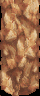

# Battle animations


When Isaac casts Quake or Garet [summons](../../glossary.md#summons) Mars, the
battle stops drawing its own effects and an animation plays over it: rock
pillars rising, flames flying, sparks bursting. Every
[Psynergy](../../glossary.md#psynergy-and-pp), [Djinni](../../glossary.md#djinn),
summon, item and monster attack has one, and the code for all of them is in
this folder.

Most animations work the same way. They draw into a small hidden picture, the
canvas, which the screen shows stretched over the battle. Each
[frame](../../glossary.md#frame) they move their sparks a little, stamp each
picture onto the canvas, and let what was drawn before fade, which leaves the
glowing trails. The animation decides how it looks and when the damage
appears; the battle has already worked out what the damage is
([Battle](../../battle.md#rules-and-animations-run-together)).

Each animation is one function, its handler, which draws a fixed number of
frames and returns when it is over. It is told which animation to play, at
what strength, who uses it and who the targets are, and which side of the
field they stand on, since most animations are drawn mirrored for the other
side.

## How a move picks its animation


Moves of one family share an animation and differ in strength. Quake,
Earthquake and Quake Sphere play the same pillars, rising once, twice and
three times; each pillar stands 32, 64 or 96 frames and the screen shakes 2,
4 or 8 pixels.

Each ability's row in the battle's table of animations names its animation
and its strength, the variant: basic, stronger or strongest. The animation
chooses only the picture; how much damage the targets take is the ability's
own business ([Battles](../battle/README.md#the-ability-kind)).

An ordinary animation is looked up in a table of handlers. Each handler is
named for the first ability whose row selects it, under the English release's
name, so searching the code for a move's name finds its animation; a name
already taken passes to the next ability (`BattleAnim_RunNova` plays Nova
because the first Blast took `BattleAnim_RunBlast`). A family drawn by one
routine, a runner, has small handlers that only tell the runner which member
to draw: `BattleAnim_RunCure` calls
`BattleAnim_RunHealingMotes(effect, HEALING_MODE_CURE)`.

The rows are `gAbilityAnimations` ([`../battle/ability_staging.c`](../battle/ability_staging.c)),
the handler table `gBattleAnim_Handlers` (`battle_anim_table.c`), and the
handler is passed a `struct BattleAnimArgs`.

### The animation word

An ability's row is one number holding the animation, its variant and a few
switches: whether it is one of the numbered scenes or a summon's, whether it
also shows on downed targets, and whether the camera takes the other side's
view or turns right round (Venus, Mercury, Mars and Jupiter do the first;
twenty rows, among them the blessings, the second). Building the turn adjusts
it: a double or triple blow raises the variant, a revival adds the switch for
downed targets, and Annihilation's instant death landing on its first target
sets the variant to 1. A critical hit adds `ANIM_ID_CRITICAL_OFFSET` to a plain attack's
animation, which turns it into the ring and spark scene.

The bits are named by the `ANIM_` macros in `../battle/battle_internal.h`,
and the layout is written out on `BattleTurn.animation`
(`include/battle_type.h`).

## Entry points and their blocks

The battle reaches this folder by three doors
([Battle](../../battle.md#animations)): the summons' scenes; a range of
numbered scenes (the casting impacts that Djinn and weapon unleashes share,
the ring and spark scenes of critical hits, and the beams of plain attacks);
and everything else, through the handler table.

Whichever door it takes, the animation is lent three blocks of memory for as
long as it plays: the pictures it draws (the sheet), its working space (the
work block) and the canvas. The door takes them before the animation starts
and gives them back in reverse order when it returns. Giving a block back also
gives back every block taken after it, so an animation must stop every
[task](../../glossary.md#task) that reads them before it returns. While it
plays it may also use two drawing routines of its own, the blitters, and the
field's map buffer, which a battle doesn't need, as a large pool of
particles.

The doors are `BattleAnim_RunSummonEffect`, `BattleAnim_DispatchByIdRange`
and `BattleAnim_RunTableEffect` ([`dispatch.c`](parts/dispatch.c) and
[`positions.c`](parts/positions.c)); the work block is
`struct BattleAnimWork`.

## The canvas


Nearly everything an animation draws goes onto one small picture, the canvas,
128 pixels square, which the hardware shows twice as wide and blended over the
battle, so fire and light glow on top of the fighters without hiding them.
Each canvas pixel holds not a colour but a level, a step on a ramp of colours
the animation loads: Heat Wave's runs from dark red through orange to white,
and another ramp draws the same pictures in other colours.

The canvas is shown on the [background layer](../../glossary.md#background-layer)
the hardware can scale, which the battlefield gives up for the time being. A
level picks one of the first 64 colours; level 0 is see-through, and 63 is as
bright as adding light can go. On the wide canvas, a point some distance
across the screen is half that distance across the canvas.

`BattleAnim_StartCanvasLayer` ([`canvas.c`](parts/canvas.c)) opens the canvas
and `BattleAnim_EndCanvasLayer` closes it.

### The transfer


After each frame the canvas is copied to the screen, and the game then
decides what it keeps for the next frame: nothing, or a dimmer copy of what was
there. Keeping a dimmer copy is how every fireball and spark leaves a trail.
Fire keeps three quarters of each level, so a trail dies away over about
twelve frames.

Because a pixel is a level, dimming is arithmetic on every byte at once, with
no bookkeeping for each spark. An animation never writes to the screen
itself: at the end of its frame it asks for the copy and waits, and a task
copies the canvas and then clears, halves, dims or darkens what is left, as
the animation chose. The usual ending stops that task before anything it
reads is given back, then closes the layer.

The task is `BattleAnim_ProcessPendingGraphicsTransfer`, its modes
`enum CanvasTransferMode`, and the frame's end `ANIM_END_FRAME`.

## Particles


Every spark, ember, mote and chip of rock is a particle: a point that moves a
little each frame and has a picture drawn where it is. An animation keeps them
in two pools of fixed size and reuses a finished particle's place, so it never
asks for memory mid-animation.

A particle has a position and a speed in three directions, and one spare
number each family uses as it likes: a life, a frame, a picture. The small
pool is the work block's 64; the large one is the field's map buffer, room for
1,170. Each animation sets aside its own ranges of the large pool. Helpers
move particles under gravity and turn a position on the battlefield into a
point on the screen, but each family throws its own pieces, because the order
of its random numbers is part of what it draws.

A particle is a `struct Particle` ([`particle.h`](../../include/field/particle.h));
the large pool is `PARTICLES`, and the helpers are in
[`positions.c`](parts/positions.c).

## Blitters


Every picture goes onto the canvas through a blitter, a small routine that
copies a picture of a given size to a given point. How it combines with what
is already there decides whether it covers, keeps the brighter of the two, or
adds light. Ray draws with two: one keeps the brighter level, the other adds,
mirrored, so crossing bolts glow.

The game writes each blitter while it runs, as machine code for exactly one
combination of canvas size, mirroring, clipping at the canvas's edges and way
of combining, and keeps it in the fast internal memory when it fits. An
animation builds only the one or two it draws with. The battle's star field
and the Lucky Wheels borrow the same builder.

| Name | Meaning |
| --- | --- |
| `COMPOSITE_COPY` | each pixel replaces the canvas pixel |
| `COMPOSITE_TRANSPARENT` | each pixel replaces it unless it is level 0 |
| `COMPOSITE_LIGHTEN` | keeps the brighter of the two |
| `COMPOSITE_ADDITIVE` | adds the two, at most 63 |

`BattleAnim_BuildBlitter` ([`blitter.c`](parts/blitter.c)) writes a blitter,
and its opening comment describes the routine block by block;
`ANIM_LOAD_BLITTER` builds one for the canvas.

## Pictures


The flames, rocks and sparks an animation stamps are small pictures kept packed
in the game's data and unpacked when the animation starts. Every one of
Quake's pillars is drawn from one picture of rock, 40 by 96 pixels:



The picture never moves; each frame Quake draws only its top part, more as a
pillar rises and less as it sinks, with a strip of the battle's own ground
laid on top as its cap. Quake draws its pillars so they hide what is behind
them, and clears the canvas after every frame rather than leaving trails.
Since a pixel is only a level, one picture can be drawn in another ramp of
colours, as the rushing strikes do.

The pictures are PNGs in [`graphics/battle_anims`](../graphics/battle_anims),
asked for by their resource ids (`ResourceId_RockWallSheet`) and unpacked into
the work block's sheet; each animation reads its pictures at its own offsets
there. The rest of the work block holds a sideways offset for each of the 160
screen lines, which some animations hand to the hardware to make the canvas
sway or ripple (`BattleAnim_ArmBg2AffineHBlankDma`).

## Animation families


Moves that look alike share one animation drawn with different settings.
Rockfall and Avalanche are the same wall of rock at different widths: Gaia,
Mother Gaia, Grand Gaia, Rockfall, Rockslide and Avalanche all play one
animation, which stretches the canvas 1.25, 1.5 or 2 times across by
strength and draws larger rocks at the higher ones ([`gaia.c`](parts/gaia.c)).

Larger families have a runner that draws every member from a row of settings,
chosen by the member's handler:

| Runner | What it draws |
| --- | --- |
| [`BattleAnim_RunTargetStrike`](parts/target_strike.c) | repeated slashes or columns of light on the first target |
| [`BattleAnim_RunProjectileVolley`](parts/projectiles.c) | shots that fly from the user and burst on each target |
| [`BattleAnim_RunLobbedShells`](parts/lobbed_shells.c) | shells lobbed at each target in turn, bursting into smoke |
| [`BattleAnim_RunBurstShower`](parts/burst_shower.c) | a shower of bursts at random points near the targets |
| [`BattleAnim_RunTargetMotes`](parts/target_motes.c) | smoke, hearts or orbs turning around each target |
| [`BattleAnim_RunStatBoost`](parts/stat_change.c) | flares that swirl into each target and burst |
| [`BattleAnim_RunStatReduction`](parts/stat_change.c) | a dagger or shield over each target that shatters |
| [`BattleAnim_RunHealingMotes`](parts/healing.c) | healing motes swirling in to each target |
| [`BattleAnim_RunStreakVolley`](parts/streaks.c) | streaks fired from above the user at its target |
| [`BattleAnim_RunRushingStrike`](parts/rushing_strike.c) | the user rushes at the first target and strikes |
| [`BattleAnim_RunBurstSequence`](parts/burst_sequence.c) | a flurry of strikes on the first target |
| [`BattleAnim_RunGrowingColumns`](parts/growth.c) | vines or green pillars growing from the ground |
| [`BattleAnim_RunSparkGroups`](parts/plasma.c) | flashes and bouncing sparks in one or three bursts |
| [`BattleAnim_RunDjinnBeams`](parts/djinn_beams.c) | a Djinni appears, then columns of light fall on the targets, in the Djinni's [element](../../glossary.md#the-four-elements) |

The families below share enough to be easier to follow told as a whole.

### The prelude


When a Djinni is unleashed, its animation can open with the Djinni itself
appearing: sparks gather into its shape and it sways for a moment before the
attack plays. The battle asks for this opening for a Djinni and for an attack
that plays an animation; the animations of five families honour it. The
opening leaves the canvas open and clear, and the attack draws on the same
canvas.

The opening is `BattleAnim_RunDjinniEntrance` ([`projectiles.c`](parts/projectiles.c)),
asked for by `BattleAnimArgs.prelude`.

### Casting impacts


The attacks of eight Djinn (Bane, Smog, Mist, Fever, Flint, Scorch, Squall and
Sap) and many weapons' unleashes share one shape: sparks gather on the
attacker, then something strikes the target. Flint has no impact of its own,
so its recording shows only what every impact shares; Scorch, above, adds a
burst of fire.

An impact runs in four phases. First 64 sparks close in on the caster over 32
frames, and a Djinni's impact shows its Djinni above the caster. Then the
canvas is moved so the impact sits over the target; four impacts stop here
and hand the canvas on, to Blizzard's volley, Mystic Flame's orbs, the comets
or the spark groups. Then the impact itself plays for 20 to 80 frames: the
damage shows on its third frame, the heavy impact sounds on the fourth, and
the target is knocked back on the sixth. Last the canvas is released, except
that Meltdown hands over to the shield that Impair shatters.

`BattleAnim_RunCastingImpact` ([`casting_impact.c`](parts/casting_impact.c))
is passed an `enum CastingImpact`; the phases are marked in its body.

### Venus, Mercury, Mars and Jupiter


The four summons that need only one Djinni each show a small Djinni of their
element and throw flames at the enemies, each its own way. Unlike the other
summons, they are ordinary animations from the handler table.

Venus raises ten columns of flame from the ground, one every 4 frames;
Mercury fires five flames across, each shattering on its fifth frame; Mars
erupts nine flames along a flattened arc, 2 frames apart, sixteen embers in
each; and Jupiter drops eight flameballs from the top right, one every 4
frames. Each keeps three quarters of the canvas between frames, so the
flames trail.

They are in [`djinn_attacks.c`](parts/djinn_attacks.c).

### Judgment


For most of its length Judgment doesn't draw over the battle at all: it
replaces the screen with scenes of its own, then brings the battle back for
the damage.

It runs in two parts, each with its own count of frames. The gathering lasts
160 frames: a formation of sixteen figures, four by four, moves forward while
motes shrink in on its centre, a burst grows there, and a ring of dimming
motes spreads out. The sweep lasts 320: an aerial view from its first frame,
a beach from frame 150, a forest from 214, the battle again from 280, and the
damage on frame 300. Pressing A or B skips ahead: the gathering ends at once
after its fourth frame, and the sweep jumps to its next view.

It is [`judgment.c`](parts/judgment.c), whose work block is read as
`struct JudgmentWork`.

### Spark groups


Nova, Supernova and the bombs set off bursts of light that spray sparks
bouncing across the ground; the strongest set off three in quick succession.

Blast, Nova, Supernova, the three bombs and Dynamite play the spark groups. A
burst is a large flash, a ring of twelve small flashes, and a spray of sparks
that fall under their own gravity, lose a sixteenth of their speed each
frame, bounce at half speed off a line near the canvas's bottom and shrink as
their life runs out. Bursts come 8 frames apart, and the strength sets how
many sparks each throws and how many bursts there are. Severe Blow's impact
and Thrash put the bursts below the user with the sparks rising.

They are [`plasma.c`](parts/plasma.c)'s `BattleAnim_RunSparkGroups`, reading
`gPlasma_Shapes`.

### Projectile volleys


Many attacks throw something at each target: fireballs, ice, feathers, comets.
One runner draws them all, and each shot bursts when it reaches its target.

The member chooses the shot's picture, its aim and its sounds, how many shots
fly at each target, how long they take, how far apart they leave and how many
sparks a hit throws. Each frame every shot moves and is drawn; a shot that
passes its target hits once, starting a flash, throwing sparks, shaking the
camera and making the target reel. Heat Wave, Sleet and a Gryphon's Wing
Flutter are volleys.

The runner is `BattleAnim_RunProjectileVolley` ([`projectiles.c`](parts/projectiles.c)),
its members `enum ProjectileVolleyMode` and their rows
`gProjectileVolley_Modes`.

### Rushing strikes


Some monsters hurl themselves across the field at their target. Bone Charge,
Brute Force, Onslaught and Headbutt are one runner, each in its own colours.

The user moves at the first target, strikes on the tenth of 60 frames, flares
a ring and scatters 64 sparks. The burst picture is stored as its top half
and drawn again upside down beneath itself, and each member lays its own
colours over the burst's.

It is [`rushing_strike.c`](parts/rushing_strike.c).

### Stat reductions and the scenes beside them


Psynergy that lowers a stat shows it as a weapon or shield over each target
that breaks apart.

A dagger (Dull) or a shield (Impair and Weaken) appears over each target, 4
frames apart, and breaks into 24 shards that darken through seven dimmer
copies of the shard picture, made before the first frame; the canvas is
halved each frame, so they trail. Single scenes nearby follow the same plan:
Flare raises flames along half an ellipse ([`flare.c`](parts/flare.c)), Fire
sends out embers that hang and then home in ([`fire.c`](parts/fire.c)), Frost
spirals motes while ice columns spring up ([`frost.c`](parts/frost.c)), and
Blast and Smoke Bomb burst a fountain of motes and smoke
([`eruption.c`](parts/eruption.c)).

The reductions are `BattleAnim_RunStatReduction` ([`stat_change.c`](parts/stat_change.c)).

### Healing motes


Healing Psynergy and items gather glittering motes on each target in turn, and
one runner draws all of them: Ply, Wish, Cure, Cure Poison's two, Tonic and
Psy Crystal.

Each target gets a swarm of motes around a point 40 pixels above it, starting
8 frames after the one before; there are 32, 64 or 128 motes by strength.
Most draw the motes in; Cure's start as a ring on the ground, and Cure
Poison's and Tonic's go out one by one. Each target turns white 36 frames into
its swarm, and the battle shows the recovery on frame 40.

The runner is `BattleAnim_RunHealingMotes` ([`healing.c`](parts/healing.c)),
its members `enum HealingMotesMode`.

### Target strikes


Twelve monster attacks, bites, fangs and slashes, are one animation with a
different row of settings each.

A row gives the kind of strike (six pictures sweeping across the target each
hit, or a column of light rising), the number of hits, the extras (smoke,
light drawn in, glints, sparks, a heavy blow), the colours and the timing.
Before the first frame the runner places 64 puffs of smoke, 128 motes and 512
sparks on the target with random speeds, and each hit sets off the next group
of them. The groups are counted by a slash's timing, so a column's third hit
sets off the same group as its second, and only the first 128 sparks are ever
drawn, though a heavy hit lights all 512.

Cannibal Fang, Poison Tail and Twin Beaks are among them; the runner is
`BattleAnim_RunTargetStrike` ([`target_strike.c`](parts/target_strike.c)),
its styles `enum TargetStrikeStyle` and their rows `gTargetStrike_Styles`.

## Design

An animation is an ordinary function with its own frame loop, as the rest of
the game is ([Engine](../../engine.md#waiting-and-tasks)). Its setup opens the
canvas, builds the blitters, loads the pictures and places the particles; it
runs a fixed number of frames; and it releases what the setup took. Within a
frame the steps run in a fixed order, each over its own range of frames, and
whatever happens on a single frame (a sound, a shake, a change of colour) is a
test of the frame number. The order is part of the output, since later steps
draw over earlier ones and many draw random numbers. `BattleAnim_RunBolt`
([`bolt.c`](parts/bolt.c)), cut down to its outline, shows the shape nearly
every handler has:

```c
void BattleAnim_RunBolt(struct BattleAnimArgs *effect) {
  ...
  ANIM_GET_SLOTS(slots, cursor, work, canvas); /* the three blocks */
  work->effect = effect;
  BattleAnim_StartCanvasLayer(BGCNT_PRIORITY(1)); /* BG2 shows the canvas */
  ANIM_LOAD_BLITTER(HEAP_SLOT_RAM_CODE, ANIM_CLIP_BOUNDS, COMPOSITE_LIGHTEN);
  draw[0] = ANIM_SLOT(slots, HEAP_SLOT_RAM_CODE);
  Resource_LoadAndDecompress((s32)&ResourceId_LightningBoltSheet,
                             work->sheet + BOLT_CELLS, 1, 1);
  ANIM_START_TRANSFER(work, CANVAS_COPY_AND_FADE, CANVAS_FADE_THREE_QUARTERS);
  for (frame = 0; frame != work->effect->count * 8 + 40; frame++) {
    if (frame == 24)
      ANIM_SHOW_DAMAGE(SE_IMPACT);             /* the damage may show */
    ...                                          /* for each bolt: */
    draw[0](canvas, picture, x, y, 24, height);  /* stamp it */
    ...                                          /* move and draw sparks */
    ANIM_END_FRAME(work);                      /* copy, wait a frame */
  }
  ANIM_FINISH_CANVAS_ONE_BLITTER();            /* stop, free, close */
}
```

The door, not the handler, takes and gives back the three blocks, so every
handler starts from the same three; the cost is that an animation must stop
its tasks before it returns.

Because pixels are levels rather than colours, the transfer can fade the whole
canvas with byte arithmetic, and one picture can be drawn in another ramp of
colours.

The animations are one object, `battle_anim.c`, written as parts. In the ROM
the animation code is one unbroken stretch, as one source file compiles, and
the tables follow it as separate data. The parts are ours, cut where one family
ends and the next begins; `battle_anim.c`'s opening comment walks through the
shared machinery and the form of the reach line each handler's comment
carries. A few forms, such as the parts' order and the tables not being
`const`, are kept so the code compiles to the original's bytes
([matching decompilation](../../glossary.md#matching-decompilation)).

## How animations fit with the rest of the game

The battle decides everything that matters to the rules before an animation
starts: [Battles](../battle/README.md) works out the turn, its targets and its
damage, and [Battle](../../battle.md#animations) stages the animation. The
animation only draws, and tells the battle when to show the damage. While it
draws it borrows from the rest of the game: the heap from
[Runtime](../runtime/README.md), the map grid's buffer
([Layouts](../layout/README.md)), and the battle's own background, camera and
fighters, which it shakes, tints and moves through the battle's helpers. The
blitter builder also serves the battle's star field and the Lucky Wheels.

## Limits

- The canvas is 128 by 128 pixels.
- The sheet holds 27,008 bytes of pictures; an animation that doesn't use the
  per-line offsets after it may use up to 28,800.
- The work block has 64 particles. The large pool has room for 1,170 before
  it would run into the field's object sprites, and 1,755 in the whole map
  buffer.
- There are two blitters at a time, and each combination of canvas size,
  mirroring, clipping and way of combining needs its own.

## Words used here

- **animation kind**: the number that picks which animation plays.
  `enum BattleAnimId` names the handler table's kinds, `enum SummonAnimId` the
  summons' scenes and `enum CastingImpact` the casting impacts. It is not the
  ability kind.
- **runner** and **mode**: a runner draws a family of animations, and the
  mode it is passed picks the member.
- **variant**: the ability's strength, basic, stronger or strongest. A
  particle's spare number is also called its variant, and is unrelated.
- **side**: which side the targets stand on, the
  [party](../../glossary.md#the-party)'s or the enemies'. Animations mirror on
  it.
- **sheet** and **cell**: a sheet is a set of unpacked pictures in the work
  block, and a cell is where one picture starts in it.
- **level**: a pixel value on the canvas, a step on a ramp of colours.
- **prelude**: the Djinni's entrance that some animations play first.

The same locals have the same names in every handler: `effect` for the
`struct BattleAnimArgs` it is passed, `slots` and `cursor` for the walk to the
three blocks (`ANIM_GET_SLOTS`), `work`, `canvas`, `sheet`, `draw` for its
blitters, `frame` for the frame counter and `cell` for a picture's offset.

## Evidence

A handler's name comes from the abilities that reach its kind, read from
`gAbilityAnimations` and named as the English release names them; a runner is
named from what it draws. The ability recordings come from
[Alchemy Devtools](https://github.com/PascalPixel/alchemy-devtools#pictures),
which plays an ability in a built tbs-en [edition](../../glossary.md#editions)
over a plain grey background; the monster attacks are played in a battle from
the battle test menu.

Three handlers are unused, and are named from what they draw:
`BattleAnim_RunUnusedOrbitingSpirals` (`planet_diver.c`),
`BattleAnim_RunUnusedTriangleStrike` (`bind.c`) and
`BattleAnim_RunUnusedSevereBlowLeap` (`thrash.c`). The handler table is reached
only with a kind from a `gAbilityAnimations` row, through the turn's
animation: building the turn changes only the variant and the staging bits,
the auto battle passes kind 0, and a critical hit's offset applies only to
plain attacks, which are dispatched by id range. No row names any of the three
kinds. [The Lost Age](../../glossary.md#the-two-games) keeps the same three
handlers at the same kinds, and its row for Severe Blow names
`BATTLE_ANIM_UNUSED_SEVERE_BLOW_LEAP`: there Severe Blow is the leap, where
here it plays a casting impact. The three animations in `orbiting.c` are
unused too: no code calls them and nothing in the ROM holds their addresses.

A plain attack's kind is 1 or 4 for the party (`BattleTurn_Build`) and 1 to 5
for an enemy (`battle_sprites.c`), all by id range, so the beam sequences play
them. No ability uses the critical-hit effects
(`ABILITY_EFFECT_CRITICAL_1_IN_64` to `ABILITY_EFFECT_CRITICAL_1_IN_4`), so
only plain attacks score critical hits, and `ANIM_ID_CRITICAL_OFFSET` reaches
kinds 201 to 205: the ring and spark scene, which plays the same for each.

The work block holds no unknown fields. `unused7788` and `padding` (before the
word-aligned `bg2x`) are never read or written in either game; `imageTail` is
the end of `imageStorage`; and a `BattleBg2Origin`'s `queued` word is set once
its coordinates are queued, but the queue copies only `x` and `y` and nothing
reads it.

`work->sheet` and the per-line table share their storage with `imageStorage`,
so an animation may unpack a picture past `sheet` only when it doesn't build
the table. `casting_impact.c`, the one part that names both, keeps that rule:
Mortal Danger and Asura unpack their pictures from the start of the work
block, Asura's reaching 27,648 bytes, and those two impacts alone skip
building it.

No animation uses `PARTICLES` past its first 32 KB, over `gActorSpriteSlots`:
the largest range any animation reserves is 1,024 particles, 28 KB
(`gathering_lights.c`, `helm_splitter.c`, `lobbed_shells.c`, `neptune.c`,
`nereid.c`, `plasma.c`, `projectiles.c` and `target_strike.c`).

`BattleAnim_DispatchByIdRange` sizes its sheet slot `0x60e` bytes. The largest
picture its three runners unpack there is `ParticleSpritesD`'s ten flare
cells, 2 by 2 to 20 by 20 pixels, 1,540 bytes (`2 * MOTE_SET_BYTES`); the
slot's last 10 bytes are never written.
