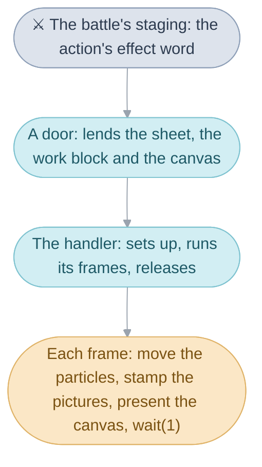
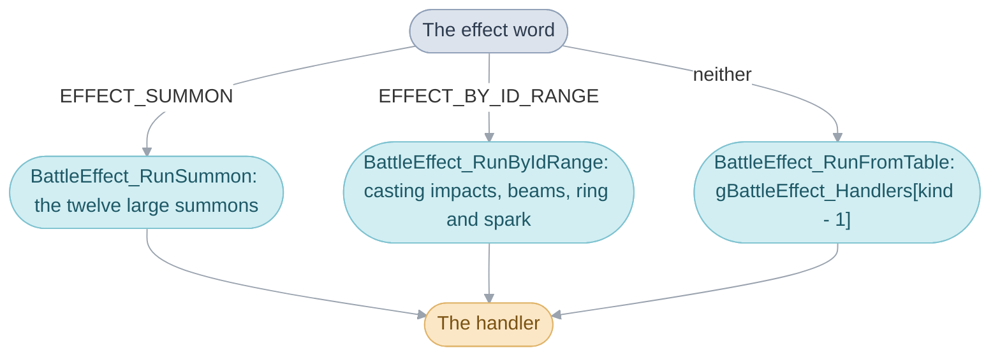
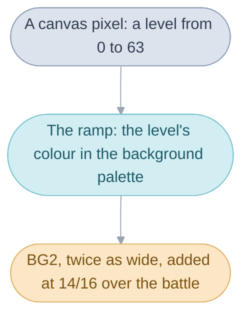
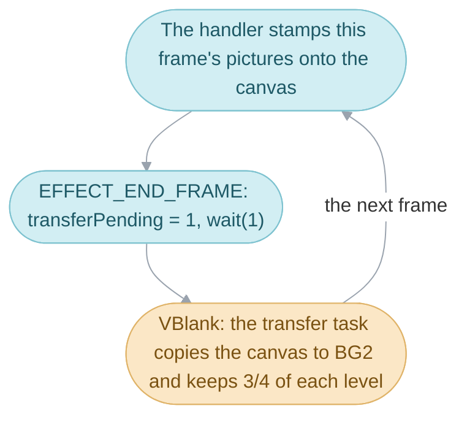
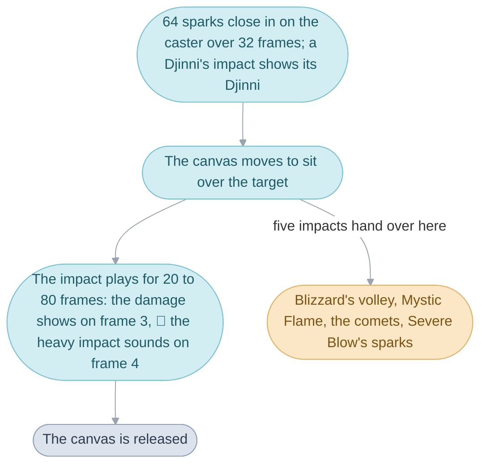

# Battle effects


When Isaac casts Earthquake, rock pillars rise under the three targets,
throw them into the air and sink again, and the damage appears while the
rock is still on screen. Every [Psynergy](../../glossary.md#psynergy-and-pp),
[Djinni](../../glossary.md#djinn), [summon](../../glossary.md#summons), item
and monster attack has a drawing like this played over the battle, its
[battle effect](../../glossary.md#battle-effect), and the code for all of
them is in this folder.

By the time an effect starts, the [battle](../../glossary.md#battle) has
already worked out what the ability does: who it hits and for how much
([Battle](../../battle.md#rules-and-battle-effects-run-together)). The
effect's work is to show it. An effect is one function, its handler, which
draws for a fixed number of [frames](../../glossary.md#frame) and returns
when it is over, and it tells the battle at which of those frames to show
the damage.

An effect is drawn out of a few shared pieces, each explained here before
the one that leans on it:

1. The ability's row says which effect it plays and at what strength.
2. One of three doors lends the effect its memory and calls its handler.
3. The canvas is the small picture nearly every effect draws into, shown
   stretched and blended over the battle.
4. The transfer copies the canvas to the screen once a frame and decides
   what the canvas keeps for the next frame, which leaves the trails.
5. The blitters are the routines that stamp a picture onto the canvas.
6. The pictures are unpacked into a sheet when the effect starts.
7. The particles are the sparks, embers and rocks that move each frame.
8. A handler's frame loop puts the pieces together.
9. Abilities that look alike share one effect at different settings.
10. A Djinni's effect may open with the Djinni itself, and the casting
    impacts are the one shape Djinn and weapon unleashes share.



## How an ability picks its effect


Each ability's row in the battle's table of effects names the effect it
plays and the strength to play it at, so that abilities of one family can
share one effect and differ only in a setting.

Quake, Earthquake and Quake Sphere play the same pillars, rising once,
twice and three times. Their rows name one effect kind, `BATTLE_EFFECT_QUAKE`,
and three variants: basic, stronger and strongest. The effect reads the
variant and picks its timings from it; how much damage the targets take is
decided by the ability's rules
([Battles](../battle/README.md#the-ability-kind)).

```c
BATTLE_EFFECT_QUAKE, // Quake
BATTLE_EFFECT_QUAKE | (1 << EFFECT_VARIANT_SHIFT), // Earthquake
BATTLE_EFFECT_QUAKE | (2 << EFFECT_VARIANT_SHIFT), // Quake Sphere
```

The row is one number, the effect word, and its bits say three things: the
effect kind in the low twelve bits, the variant in the two above, and a few
switches above those. Two of the switches choose which of the three doors
the effect goes through: `EFFECT_SUMMON` for the large summons and
`EFFECT_BY_ID_RANGE` for the numbered effects of the next section; a row
with neither goes through the handler table. The other switches say whether
the effect also shows on downed targets, and whether the camera swings to
the other side's view (`EFFECT_VIEW_ACROSS`: the summons Venus, Mercury,
Mars and Jupiter) or turns right round (`EFFECT_VIEW_REVERSED`: twenty
rows, among them the blessings).

Building the [action](../../glossary.md#turns-and-actions) adjusts the word
before the effect sees it: a double or
triple blow raises the variant, a revival adds the switch for downed
targets, and a critical hit adds `EFFECT_ID_CRITICAL_OFFSET` to a plain
attack's kind, which turns it into the ring and spark effect.

An ordinary effect's kind is an index into a table of handlers,
`gBattleEffect_Handlers`. Each handler is named for the first ability whose
row selects it, under the English release's name, so searching the code for
an ability's name finds its effect; a name already taken passes to the next
ability (`BattleEffect_RunNova` plays Nova because the first Blast took
`BattleEffect_RunBlast`). Each handler's comment carries a reach line,
`Abilities: ...`, listing every ability that reaches it.

The rows are `gAbilityBattleEffects`
([`../battle/ability_staging.c`](../battle/ability_staging.c)), the bits are
named by the `EFFECT_` macros in `include/battle/ability_staging.h`, and the
handler table is in `battle_effect_table.c`.

| Name                       | Value       | Meaning                                              |
| -------------------------- | ----------- | ---------------------------------------------------- |
| `EFFECT_ID_MASK`           | bits 0 to 11 | the effect kind                                     |
| `EFFECT_VARIANT_SHIFT`     | 12          | the variant sits in bits 12 and 13                   |
| `EFFECT_VARIANT_BASIC`     | 0           | Quake, Douse, Ply                                    |
| `EFFECT_VARIANT_STRONGER`  | 1           | Earthquake, Drench, Ply Well                         |
| `EFFECT_VARIANT_STRONGEST` | 2           | Quake Sphere, Deluge, Pure Ply                       |
| `EFFECT_BY_ID_RANGE`       | bit 14      | the door for the numbered effects                    |
| `EFFECT_SUMMON`            | bit 15      | the door for the large summons                       |
| `EFFECT_ON_DOWNED`         | bit 16      | shown on downed targets too: the revivals            |
| `EFFECT_VIEW_ACROSS`       | bit 18      | the camera takes the other side's view               |
| `EFFECT_VIEW_REVERSED`     | bit 19      | the camera turns right round                         |
| `EFFECT_ID_CRITICAL_OFFSET` | 200        | added to a plain attack's kind for a critical hit    |

## The three doors and what they lend


A door is the function the battle calls to play an effect: it takes three
blocks of memory for the effect, calls the handler, and gives the blocks
back when the handler returns.

The battle reaches this folder by three doors
([Battle](../../battle.md#battle-effects)), chosen by the effect word's
switches:



`BattleEffect_RunSummon` switches on the kind to one of the twelve large
summons, Ramses to Thor. `BattleEffect_RunByIdRange` splits the numbered
kinds: from 100 the casting impacts that Djinn and weapon unleashes share,
from 200 the ring and spark effect of a critical hit, and every other kind,
below 100 and from 136 to 199, the beams of plain attacks.
`BattleEffect_RunFromTable` looks the kind up in
the handler table; the kind `BATTLE_EFFECT_NONE` plays nothing.

Whichever door it takes, the handler is lent three blocks of memory from the
[heap](../../glossary.md#heap-and-pools), each in a
[heap slot](../../glossary.md#heap-slot) of its own, for as long as it
plays: a small block for the motes, the ten tiny spark pictures most
effects stamp (`HEAP_SLOT_BATTLE_SHEET`); its working space, the work block
(`HEAP_SLOT_BATTLE_EFFECT`, a `struct BattleEffectWork`, which holds the
sheet, the run of memory its own pictures are unpacked into); and the canvas
(`HEAP_SLOT_BATTLE_CANVAS`). The door takes them in that order before the
handler starts and gives them back in reverse order when it returns. Giving
a block back also gives back every block taken after it, so a handler must
stop every [task](../../glossary.md#task) that reads them before it returns.

Beside the three, a handler may take two more slots for the drawing
routines of the next sections (`HEAP_SLOT_RAM_CODE` and
`HEAP_SLOT_RAM_CODE_2`), which it frees itself, and it may use the field's
map buffer, which a battle has no use for, as a large pool of particles.

The handler is passed a `struct BattleEffectParams`: the kind, the variant,
who uses the effect, the targets and their count, and which side of the
field the targets stand on, since most effects are drawn mirrored for the
other side. The doors are in [`dispatch.c`](battle_effect/dispatch.c) and
[`positions.c`](battle_effect/positions.c).

| Name                          | Value      | Meaning                                              |
| ----------------------------- | ---------- | ---------------------------------------------------- |
| `EFFECT_RANGE_CASTING_IMPACT` | 100        | the first casting impact's kind                      |
| `EFFECT_RANGE_BEAM`           | 136        | the first beam's kind                                |
| `EFFECT_RANGE_RING_AND_SPARK` | 200        | the ring and spark effect, a critical hit's          |
| `HEAP_SLOT_BATTLE_SHEET`      | `MOTE_SET_BYTES` | the mote pictures, 770 bytes (1,550 through `BattleEffect_RunByIdRange`) |
| `HEAP_SLOT_BATTLE_EFFECT`     |            | the work block, `struct BattleEffectWork`, the sheet inside it |
| `HEAP_SLOT_BATTLE_CANVAS`     |            | the canvas, `CANVAS_BYTES`                           |
| `BattleEffectParams.side`     | 0 or 1     | the enemies' side or the party's; mirrored for the party |

## The canvas


The canvas is a small square of pixels kept off screen, 128 by 128, which
nearly every effect draws into, and which the hardware shows twice as wide
and blended over the battle, so that fire and light glow on top of the
fighters without hiding them.

A pixel of the canvas holds a level, a number from 0 to 63, and the level
picks a colour from a ramp the effect loads into the first 64 colours of the
background palette. Level 0 is see-through. Heat Wave's ramp runs through
the colours of fire; another ramp draws the same pictures in other colours,
which is how the four rushing strikes scatter the same sparks in four
palettes. The canvas is shown on the
[background layer](../../glossary.md#background-layer) the hardware can
scale, `BG2`, which the battlefield gives up for the time being, stretched
to twice its width so that it spans the battle view, and added to what lies
under it at fourteen sixteenths of its colour. On the wide canvas a point
some distance across the screen is half that distance across the canvas,
which every effect allows for when it places a picture.



Opening the canvas takes five frames (`BattleEffect_StartCanvasLayer`):
it hides `BG2` while its settings change, writes the layer's tile table (its
screen block), clears the canvas in its slot and in video memory, adds the
fade task that darkens the battle background once an effect sets a count
(`fadeFrames`), and saves the battlefield's scroll. Closing it takes eleven
(`BattleEffect_EndCanvasLayer`): the closing sound, the scroll put back, the
canvas cleared, and the battle background's colours brought back over eight
frames. A few effects show the canvas at its own width instead
(`EFFECT_START_NARROW_CANVAS`: Frost, Judgment and the Helm Splitter among
them), and Quake sets that width and turns the blending off itself, so that
its pillars hide what is behind them; the beams of plain attacks show the
canvas on `BG1` through an ordinary tiled layer
(`BattleEffect_SetupCanvasTileMap`).

The canvas and its layer are in [`canvas.c`](battle_effect/canvas.c).

| Name                   | Value             | Meaning                                          |
| ---------------------- | ----------------- | ------------------------------------------------ |
| `CANVAS_BYTES`         | `128 * 128`       | the canvas, one byte a pixel                     |
| a level                | 0 to 63           | a pixel's value; 0 is see-through                |
| the ramp               | 64 colours        | background palette colours 0 to 63               |
| `REG_BG2PA`            | `Q_8_8(0.5)`      | each canvas pixel two screen pixels wide         |
| `BLEND_ALPHA(14, 16)`  | 14/16             | the canvas's share added over the battle         |
| opening                | 5 frames          | `BattleEffect_StartCanvasLayer`                  |
| closing                | 11 frames         | `BattleEffect_EndCanvasLayer`                    |

## The transfer


The transfer is the task that copies the canvas to the screen once a frame
and then decides what the canvas keeps for the next frame; keeping a dimmer
copy is how every fireball and spark leaves a trail.

Everything an effect draws reaches the screen through this task. At the end
of a frame the effect marks the canvas ready (`transferPending`) and waits a
frame, and the transfer task, which runs in the
[VBlank](../../glossary.md#vblank) pass, copies the canvas into `BG2`'s
tiles and then treats what is left as the effect chose:
all of it, nothing, half or three quarters of each level, or each level
lowered by a step. Fire keeps three quarters of each level, so a trail dies
away over about twelve frames.



Because a pixel is a level, dimming needs no bookkeeping for each spark: the
routine that keeps three quarters dims four pixels at a time, one per byte of
a word, multiplying the word by three with one add, shifting it right by two
and masking off what crossed into the next byte
(`PaletteFade_ScaleThreeQuartersKernel`). The usual ending of an effect
stops the task before anything it reads is given back, then frees the
blitters and closes the layer (`EFFECT_FINISH_CANVAS`).

The task is `BattleEffect_ProcessPendingGraphicsTransfer`, its modes
`enum CanvasTransferMode`, and `EFFECT_START_TRANSFER` sets the mode and
adds the task.

| Name                       | Value | Meaning                                                 |
| -------------------------- | ----- | ------------------------------------------------------- |
| `CANVAS_COPY`              | 0     | copy as drawn; the canvas keeps everything              |
| `CANVAS_COPY_AND_CLEAR`    | 1     | copy, then clear the canvas: Quake redraws every frame  |
| `CANVAS_COPY_AND_FADE`     | 2     | copy, then keep half or three quarters of each level    |
| `CANVAS_COPY_AND_DARKEN`   | 3     | copy, then lower each level by a step                   |
| `CANVAS_FADE_HALF`         | 50    | the share kept: half                                    |
| `CANVAS_FADE_THREE_QUARTERS` | 75  | the share kept: three quarters, a trail of about 12 frames |
| `TASK_PASS_VBLANK`         |       | the pass the transfer task runs in                      |

## Blitters


A blitter is a small routine that copies a picture of a given size to a
given point of the canvas, and how it combines each pixel with what is
already there decides whether the picture covers, keeps the brighter of the
two, or adds light. Ray draws with two: one keeps the brighter level, the
other adds, mirrored, so crossing bolts glow.

The game writes each blitter while it runs, as machine code for exactly one
combination of canvas size, mirroring, clipping at the canvas's edges and
way of combining, and keeps it in the fast memory when it fits. An effect
builds only the one or two it draws with, in the two slots the doors leave
to it. `BattleEffect_BuildBlitter` walks a template of ARM words,
`gBlitterTemplate`, splices in the pixel fragments for the chosen way of
combining (`blitter_fragments.s`, `blitter_color_fragments.s`), and patches
in the canvas width and height and the branch distances. A handler then
calls the slot's block as a function, `draw(canvas, picture, x, y, width,
height)`.

The builder is in [`blitter.c`](battle_effect/blitter.c), whose opening
comment describes the routine block by block, and `EFFECT_LOAD_BLITTER`
builds one for the canvas. The same builder serves the battle's star field
and the Lucky Wheels.

| Name                    | Value | Meaning                                          |
| ----------------------- | ----- | ------------------------------------------------ |
| `COMPOSITE_COPY`        | 0     | each pixel replaces the canvas pixel             |
| `COMPOSITE_TRANSPARENT` | 1     | each pixel replaces it unless it is level 0      |
| `COMPOSITE_LIGHTEN`     | 2     | keeps the brighter of the two                    |
| `COMPOSITE_ADDITIVE`    | 3     | adds the two, at most 63                         |
| `COMPOSITE_FLIP_X`      | flag  | mirrors the picture left to right                |
| `COMPOSITE_FLIP_Y`      | flag  | mirrors the picture top to bottom                |
| `EFFECT_CLIP_BOUNDS`    | flags | skips the pixels outside the canvas's edges      |
| `HEAP_SLOT_RAM_CODE`, `_2` |    | the two blitter slots                            |

## Pictures and the sheet


The flames, rocks and sparks an effect stamps are small pictures kept packed
in the game's data and unpacked into the sheet when the effect starts; the
sheet is the start of the work block (`work->sheet`), and each effect reads
its pictures at its own offsets there.

Every one of Quake's pillars is drawn from one picture of rock, 40 by 96
pixels, [`rock_wall.png`](../graphics/battle_effects/rock_wall.png) in
`graphics/battle_effects`. The picture never moves; each frame Quake draws
only its top rows, more as a pillar rises and less as it sinks, with a strip
of the battle's own ground cut from the background and laid on top as its
cap.

The pictures are PNGs in
[`graphics/battle_effects`](../graphics/battle_effects), asked for by their
resource ids (`ResourceId_RockWallSheet`) and unpacked by
`Resource_LoadAndDecompress`. Most effects also unpack a set of ten mote
pictures, 1 by 2 to 10 by 20 pixels, into the small block the door lends
for them, which `EFFECT_DRAW_MOTE` stamps by size; a set of flares, squares
from 2 to 20 pixels across, serves `EFFECT_DRAW_FLARE` the same way. The
work block after the sheet holds a sideways offset for each of the 160
screen lines, which some effects hand to the hardware to make the canvas
sway or ripple (`BattleEffect_ArmBg2AffineHBlankDma`).

| Name                 | Value         | Meaning                                              |
| -------------------- | ------------- | ---------------------------------------------------- |
| `work->sheet`        | 27,008 bytes  | the effect's unpacked pictures                       |
| `bg2xLines`          | 160 words     | a sideways offset for each screen line               |
| `imageStorage`       | 28,800 bytes  | the sheet and the line table as one block            |
| a mote picture       | 1 to 10 wide  | n pixels wide and 2n tall, `gBattleEffect_MoteCells` |
| a flare picture      | 2 to 20 across | a square, `gBattleEffect_FlareCells`                |
| `rock_wall.png`      | 40 by 96      | Quake's one picture of rock                          |

## Particles


A particle is a point that moves a little each frame and has a picture
drawn where it is: every spark, ember, mote and chip of rock is one.

A particle has a position and a speed in three directions, in 16.16 fixed
point, and one spare number each family uses as it likes: a life, a frame, a
picture; -1 marks a particle that is idle in the work block's pool, and an
effect using the large pool picks its own idle mark. An effect keeps its
particles in
two pools of fixed size and reuses a finished particle's place, so it never
asks for memory partway through. The small pool is the work block's 64; the
large one is the field's map buffer, `PARTICLES`, with room for 1,170, and
each effect sets aside its own ranges of it.

Two routines move a particle one frame: `Particle_AdvanceWithGravity2D` on
the screen, where a positive gravity pulls down, and
`Particle_AdvanceWithGravity3D` in the field's space, before projection.
Each adds the speed to the position, gravity to the vertical speed, and
damps every speed by a factor out of 64. `Projection_Point` turns a
battlefield position into a screen point, 16 pixels higher than the
projection, which is where effects anchor on a unit
([`positions.c`](battle_effect/positions.c)). Each family spawns and moves
its own particles; a particle is a `struct Particle`
([`particle.h`](../../include/field/particle.h)).

| Name                       | Value       | Meaning                                         |
| -------------------------- | ----------- | ----------------------------------------------- |
| `work->particles`          | 64          | the small pool, in the work block               |
| `PARTICLES`                | 1,170       | the large pool, the field's map buffer          |
| `variant`                  | -1          | the particle is idle (the work block's pool)    |
| damping                    | out of 64   | 64 keeps the speed, 60 loses about 6% a frame   |
| `Projection_Point`         | -16 pixels  | a screen point, raised to a unit's anchor       |

## A handler's frame loop


A handler waits for each frame as the rest of the game does
([System](../../system.md#waiting-and-tasks)): its setup opens the canvas,
builds the blitters, unpacks the pictures and places the particles; it runs
a fixed number of frames; and it releases what the setup took.

Within a frame the steps run in a fixed order, each over its own range of
frames, and whatever happens on a single frame (a sound, a shake, a change
of colour) is a test of the frame number. The order shows in the output,
since later steps draw over earlier ones and many draw random numbers. The
frame on which the damage shows is one such test: `EFFECT_SHOW_DAMAGE`
starts the battle's [playback](../../glossary.md#playback-queue), which from
then on shows each target's
flinch, message and falling HP while the effect goes on drawing
([Battles](../battle/README.md#how-outcomes-reach-the-screen)).
`BattleEffect_RunBolt` ([`bolt.c`](battle_effect/bolt.c)), cut down to its
outline, shows the shape nearly every handler has:

```c
void BattleEffect_RunBolt(struct BattleEffectParams *args) {
  ...
  EFFECT_GET_SLOTS(slots, cursor, work, canvas); /* the work block, the canvas */
  work->args = args;
  BattleEffect_StartCanvasLayer(BGCNT_PRIORITY(1)); /* BG2 shows the canvas */
  EFFECT_LOAD_BLITTER(HEAP_SLOT_RAM_CODE, EFFECT_CLIP_BOUNDS, COMPOSITE_LIGHTEN);
  draw[0] = EFFECT_SLOT(slots, HEAP_SLOT_RAM_CODE);
  Resource_LoadAndDecompress((s32)&ResourceId_LightningBoltSheet,
                             work->sheet + BOLT_OFFSETS, 1, 1);
  EFFECT_START_TRANSFER(work, CANVAS_COPY_AND_FADE, CANVAS_FADE_THREE_QUARTERS);
  for (frame = 0; frame != work->args->targetCount * 8 + 40; frame++) {
    if (frame == 24)
      EFFECT_SHOW_DAMAGE(SE_IMPACT);             /* the damage may show */
    ...                                          /* for each bolt: */
    draw[0](canvas, picture, x, y, 24, height);  /* stamp it */
    ...                                          /* move and draw sparks */
    EFFECT_END_FRAME(work);                      /* copy, wait a frame */
  }
  EFFECT_FINISH_CANVAS_ONE_BLITTER();            /* stop, release, close */
}
```

A hit on a target is one call too: `EFFECT_STRIKE_TARGET` flashes the target
white in its damage pose for a few frames and knocks it back, and
`BattleEffect_CountDownBattlerTints`, run by `EFFECT_END_FRAME`, gives the
target its own colours back when the frames are up. The screen shakes
through `BattleCamera_Shake`, which the handler calls each frame it wants
the shake, and the camera's own task places the view afterwards.

| Name                        | Value      | Meaning                                                  |
| --------------------------- | ---------- | -------------------------------------------------------- |
| `EFFECT_GET_SLOTS`          |            | the work block and the canvas from their slots; `EFFECT_SLOT(slots, HEAP_SLOT_BATTLE_SHEET)` reads the motes' block |
| `EFFECT_LOAD_BLITTER`       |            | a blitter for the 128 by 128 canvas                      |
| `EFFECT_START_TRANSFER`     |            | the transfer mode, and the task added                    |
| `EFFECT_SHOW_DAMAGE`        | an `SE_`   | starts playback with the hit's sound                     |
| `EFFECT_STRIKE_TARGET`      | frames     | the target flashes white and is knocked back             |
| `EFFECT_END_FRAME`          |            | counts the flashes down, presents the canvas, waits one frame |
| `EFFECT_FINISH_CANVAS`      |            | stops the transfer, frees the blitters, closes the layer |
| Bolt's frames               | `8 * targets + 40` | one target struck every 8 frames                  |
| Bolt's damage               | frame 24   | `EFFECT_SHOW_DAMAGE(SE_IMPACT)`                          |

## Effect families


Abilities that look alike share one effect drawn with different settings,
chosen by the variant or by a mode the handler passes.

Rockfall and Avalanche are the same glowing wall at different widths: Gaia,
Mother Gaia, Grand Gaia, Rockfall, Rockslide and Avalanche all play one
effect, which stretches the canvas 1.25, 1.5 or 2 times across by variant
and draws larger rocks at the higher ones ([`gaia.c`](battle_effect/gaia.c)).

Larger families have a runner, a function that draws every effect of the
family from a mode, and a two-line handler for each ability that only tells
the runner which mode to draw: `BattleEffect_RunCure` calls
`BattleEffect_RunHealingMotes(args, HEALING_MODE_CURE)`.


| Runner | What it draws |
| --- | --- |
| [`BattleEffect_RunTargetStrike`](battle_effect/target_strike.c) | repeated slashes or columns of light on the first target: twelve monster attacks, among them Cannibal Fang, Poison Tail and Twin Beaks |
| [`BattleEffect_RunProjectileVolley`](battle_effect/projectiles.c) | shots that fly from the user and burst on each target: Heat Wave, Sleet, Wing Flutter |
| [`BattleEffect_RunLobbedShells`](battle_effect/lobbed_shells.c) | shells lobbed at each target in turn, bursting into smoke |
| [`BattleEffect_RunBurstShower`](battle_effect/burst_shower.c) | a shower of bursts at random points near the targets |
| [`BattleEffect_RunTargetMotes`](battle_effect/target_motes.c) | smoke, hearts or orbs turning around each target |
| [`BattleEffect_RunStatBoost`](battle_effect/stat_change.c) | flares that swirl into each target and burst |
| [`BattleEffect_RunStatReduction`](battle_effect/stat_change.c) | a dagger (Dull) or a shield (Impair, Weaken) over each target that shatters |
| [`BattleEffect_RunHealingMotes`](battle_effect/healing.c) | healing motes swirling in to each target: Ply, Wish, Cure, Cure Poison, Tonic, Psy Crystal |
| [`BattleEffect_RunStreakVolley`](battle_effect/streaks.c) | streaks fired from above the user at its target |
| [`BattleEffect_RunRushingStrike`](battle_effect/rushing_strike.c) | the user rushes at the first target and strikes: Bone Charge, Brute Force, Onslaught, Headbutt |
| [`BattleEffect_RunFlurry`](battle_effect/flurry.c) | a flurry of strikes on the first target |
| [`BattleEffect_RunGrowingColumns`](battle_effect/growth.c) | vines or green pillars growing from the ground |
| [`BattleEffect_RunSparkGroups`](battle_effect/plasma.c) | flashes and bouncing sparks in one or three bursts: Blast, Nova, Supernova, the bombs, Dynamite |
| [`BattleEffect_RunDjinnBeams`](battle_effect/djinn_beams.c) | columns of light fall on the targets, after a Djinni appears when it is a Djinni's: Revive, Water of Life, Quartz, Dew |

Two routines several families share have sections of their own: the prelude
a Djinni's effect opens with, and the casting impacts that Djinn and weapon
unleashes play.

### The prelude


The prelude is the Djinni itself appearing before its attack plays: sparks
gather into its shape and it sways for a moment, and then the attack draws
on the same canvas.

The battle sets the prelude switch in the effect's parameters for a Djinni
(`CAST_DJINNI` in `staging.c`) and for an attack that plays an effect, and
the stat boosts, the volleys, the healing motes, the Djinn beams, the
flurries, Bind and Luff open with the Djinni only when it is set. Hail,
Ground, Torch, Kite and Vine always open with it; in Hail and Ground the
prelude only keeps the Djinni circling. The opening leaves the canvas open
and clear, and the attack draws on the same canvas.

The opening is `BattleEffect_RunDjinniEntrance`
([`projectiles.c`](battle_effect/projectiles.c)), and the switch is
`BattleEffectParams.prelude`.

| Name                   | Value     | Meaning                                              |
| ---------------------- | --------- | ---------------------------------------------------- |
| `prelude`              | 1         | the effect opens with the Djinni                     |
| the entrance           | 64 frames | sparks gather into the Djinni, which sways           |
| `DJINNI_ENTRANCE_LONG` | 84 frames | the longer entrance, ending in a burst of motes      |

### Casting impacts


A casting impact is the one shape the attacks of eight Djinn (Bane, Smog,
Mist, Fever, Flint, Scorch, Squall and Sap) and many weapons' unleashes
share: sparks gather on the attacker, then something strikes the target.
Flint has no impact of its own, so its recording shows only what every
impact shares; Scorch, above, adds a burst of fire.

An impact runs in four phases, each over its own frames:



First 64 sparks close in on the caster over 32 frames, and a Djinni's impact
shows its Djinni above the caster. Then the canvas is moved so the impact
sits over the target. Four impacts no ability selects stop here: three hand
the canvas to Blizzard's volley, Mystic Flame or the comets, and one simply
ends. Severe Blow stops here too and hands over to the spark groups' rising
sparks. Then the impact itself plays for 20 to 80 frames, counted from 0:
the damage shows on frame 3, the heavy impact sounds on frame 4, and on
frame 6 some impacts knock the target back. Last the canvas is released,
except that Meltdown hands over to the shield that Impair shatters.

`BattleEffect_RunCastingImpact`
([`casting_impact.c`](battle_effect/casting_impact.c)) is passed an
`enum CastingImpact`, the kind less `EFFECT_RANGE_CASTING_IMPACT`; the
phases are marked in its body.

| Name                           | Value     | Meaning                                       |
| ------------------------------ | --------- | --------------------------------------------- |
| `CASTING_IMPACT_SPARKS`        | 64        | sparks that gather on the caster              |
| `CASTING_IMPACT_GATHER_FRAMES` | 32        | frames the sparks take to gather              |
| the impact                     | 20 to 80 frames | by impact; the damage shows on frame 3     |

## Ivan's Bolt, mechanism by mechanism


Ivan casts Bolt at Isaac. The battle has built the action, rolled the
damage and chosen the [staging](../../glossary.md#staging); what follows is
this folder's share.

Bolt's row of `gAbilityBattleEffects` is `BATTLE_EFFECT_BOLT` with no
variant bits and neither door switch, so the staging runner for a Psynergy
cast calls `BattleEffect_RunFromTable`. The door takes the sheet, the work
block and the canvas, writes the parameters into the work block, and calls
`gBattleEffect_Handlers[BATTLE_EFFECT_BOLT - 1]`, which is
`BattleEffect_RunBolt`.

The handler's setup opens the canvas on `BG2` and builds one blitter that
keeps the brighter level, so a bolt drawn over its sparks brightens rather
than covers them. It unpacks three sets of pictures: the tornado sheet, used
only for its glints, and the lightning bolt pictures after it, both into the
work block's sheet, and the mote pictures the sparks are drawn with into the
small block the door lent for them. The first 1,024 particles of the large
pool are given a life of 0, which for Bolt marks them idle, and the transfer
is set to keep three quarters of each level, which is what makes the bolt
crackle away rather than vanish. The row of `gBolt_Counts` for the basic
variant says 16 sparks, no glints, a spread of 15 pixels and one strike.

Then come the frames, `8 * 1 + 40` of them for one target. On frame 0 the
whole canvas is set to level 16, the flash. From frame 0 to 15 the bolt
picture is stamped at Isaac's screen position, projected by
`Projection_Unit` and halved for the wide canvas, growing 64 pixels a frame
down to 104; on frame 1 the screen starts a four-frame shake; on frame 2
sixteen sparks are thrown up from the bolt's foot into the large pool, each
with a life of 32 to 39 frames; on frame 4 Isaac flashes white in his
damage pose and bounces back. Every frame after that, each living spark
gains a sixteenth of a pixel a frame of downward speed each frame, bounces
off the ground at half speed and is stamped as a mote that shrinks as it
dies. On frame 24 `EFFECT_SHOW_DAMAGE(SE_IMPACT)` starts the playback, and
`Isaac takes 27 damage!` appears while the sparks are still falling. Each
frame ends with `EFFECT_END_FRAME`: the flash timers count down, the canvas
is marked ready, and `wait(1)` lets the transfer task copy and fade it.

After the last frame, `EFFECT_FINISH_CANVAS_ONE_BLITTER` removes the
transfer task, frees the blitter and closes the canvas layer over eleven
frames, and the handler returns to the door, which gives the three blocks
back. The staging runner then waits for the playback to finish showing the
damage.

| Step                                   | Mechanism                                              |
| -------------------------------------- | ------------------------------------------------------ |
| Bolt's row names its kind and variant  | how an ability picks its effect: the effect word       |
| The sheet, work block and canvas are lent | the doors: `BattleEffect_RunFromTable`              |
| The canvas opens on `BG2`              | the canvas: `BattleEffect_StartCanvasLayer`            |
| One blitter that keeps the brighter level | blitters: `COMPOSITE_LIGHTEN`                       |
| The bolt and mote pictures are unpacked | pictures and the sheet                                |
| The sparks are thrown and fall         | particles: `Particle_AdvanceWithGravity2D`             |
| The bolt grows, the screen shakes, Isaac flashes | the frame loop: tests of the frame number    |
| `Isaac takes 27 damage!` on frame 24   | the frame loop: `EFFECT_SHOW_DAMAGE`                   |
| The trail crackles away                | the transfer: three quarters of each level kept        |
| The blocks go back                     | the doors, after `EFFECT_FINISH_CANVAS_ONE_BLITTER`    |

## Design

Every effect is written as code that waits, one function from its first
frame to its last, because that is how the rest of the game is written: a
handler reads like the effect plays, with each frame's work in order and a
`wait(1)` between frames, and the battle's own tasks (its camera, its
playback) keep running inside those waits. The cost is that one effect
plays at a time, from start to end, which is all a battle asks.

The canvas trades colour for speed: a pixel that is a level, one byte, can
be faded four at a time with one add and one shift, so a trail
costs nothing per spark, and a ramp can recolour a whole effect. Building
each blitter as machine code for one exact case pays the cost of writing a
routine once per effect to make every stamp of a picture as short as it can
be, which is what lets a frame draw hundreds of sparks.

The effects are one object, `battle_effect.c`, written as parts
([Source](../README.md#objects-and-parts)). In the ROM the effect code is
one unbroken stretch, as one source file compiles, and the tables follow it
as separate data. The parts are ours, cut where one family ends and the
next begins; `battle_effect.c`'s opening comment walks through the shared
machinery and the form of the reach line each handler's comment carries. A
few forms, such as the parts' order and the tables not being `const`, are
kept so the code compiles to the original's bytes
([matching decompilation](../../glossary.md#matching-decompilation)).

## How effects fit with the rest of the game

The battle decides everything that matters to the rules before an effect
starts: [Battles](../battle/README.md) works out the action, its targets
and its damage, and [Battle](../../battle.md#battle-effects) stages the
effect. The effect only draws, and tells the battle when to show the damage.
While it draws it borrows from the rest of the game: the heap from
[System code](../system/README.md), the map grid's buffer
([Maps](../map/README.md)), and the battle's own background, camera and
fighters, which it shakes, tints and moves through the battle's helpers. The
blitter builder also serves the battle's star field and the Lucky Wheels.

## Limits

- The canvas is 128 by 128 pixels.
- The sheet holds 27,008 bytes of pictures; an effect that doesn't use the
  per-line offsets after it may use up to 28,800.
- The work block has 64 particles. The large pool has room for 1,170
  particles before it would run into the field's actor sprites.
- There are two blitters at a time, and each combination of canvas size,
  mirroring, clipping and way of combining needs its own.
- An effect's parameters hold at most 8 targets, and the work block 8 flash
  timers, one a target.

## Words used here

- An **effect kind** is the number that picks which effect plays:
  `enum BattleEffectId` names the handler table's kinds, `enum SummonEffectId`
  the summons' effects and `enum CastingImpact` the casting impacts. The
  ability kind ([Battles](../battle/README.md#the-ability-kind)) is another
  number, which picks the rules' formula.
- A **door** is one of the three functions the battle calls to play an
  effect, which lends the handler its blocks: `BattleEffect_RunSummon`,
  `BattleEffect_RunByIdRange` and `BattleEffect_RunFromTable`.
- A **handler** is the function that draws one effect from its first frame
  to its last; a **runner** draws a family of effects, and the **mode** it
  is passed picks the effect.
- The **variant** is the ability's strength: basic, stronger or strongest. A
  particle's spare number is also called its variant, and is its own
  family's number.
- The **side** is the side the targets stand on, the
  [party](../../glossary.md#the-party)'s or the enemies'. Effects mirror on
  it.
- The **canvas** is the 128 by 128 picture of levels an effect draws into,
  and a **level** a pixel value on it, a step on a ramp of colours.
- A **blitter** is a routine built for one way of stamping a picture onto
  the canvas; a **sheet** is a set of unpacked pictures in the work block.
- A **particle** is a point with a position, a speed and a spare number,
  which an effect moves each frame and draws a picture at.
- The **prelude** is the Djinni's entrance an effect may open with.

Most handlers use the same names for the same locals: `args` for the
`struct BattleEffectParams` it is passed, `slots` and `cursor` for the walk
to the work block and the canvas (`EFFECT_GET_SLOTS`), `work`, `canvas`,
`sheet`, `draw`
for its blitters, `frame` for the frame counter and `cell` for where a
picture starts in the sheet.

## Evidence

The recordings are of a tbs-en [edition](../../glossary.md#editions), each
ability cast by one party member at the others, who stand in for the
enemies; the two monster attacks are cast by their monsters at the party.

Three handlers are unused, and are named from what they draw:
`BattleEffect_RunUnusedOrbitingSpirals` (`planet_diver.c`),
`BattleEffect_RunUnusedTriangleStrike` (`bind.c`) and
`BattleEffect_RunUnusedSevereBlowLeap` (`thrash.c`). The handler table is
reached only with a kind from a `gAbilityBattleEffects` row, through the
action's effect: building the action changes only the variant and the
staging bits, the auto battle passes `BATTLE_EFFECT_NONE`, and a critical
hit's offset applies only to plain attacks, which are dispatched by id
range. No row names any of the three kinds.
[The Lost Age](../../glossary.md#the-two-games) keeps the same three
handlers at the same kinds, and its row for Severe Blow names
`BATTLE_EFFECT_UNUSED_SEVERE_BLOW_LEAP`: there Severe Blow is the leap,
where here it plays a casting impact. The three effects in `orbiting.c` are
unused too: no code calls them and nothing in the ROM holds their addresses.

A plain attack's kind is 1 or 4 for the party (`BattleActionRun_Build`) and
1 to 5 for an enemy (`battle_sprites.c`), all in the beams' range below
`EFFECT_RANGE_CASTING_IMPACT`, so the beams play them. No ability uses the
critical-hit effects (`ABILITY_EFFECT_CRITICAL_1_IN_64` to
`ABILITY_EFFECT_CRITICAL_1_IN_4`), so only plain attacks score critical
hits, and `EFFECT_ID_CRITICAL_OFFSET` reaches kinds 201 to 205: the ring and
spark effect, which plays the same for each.

The work block holds no unknown fields. `unused7788` and `padding` (before
the word-aligned `bg2x`) are never read or written in either game;
`imageTail` is the end of `imageStorage`; and a `BattleBg2Origin`'s `queued`
word is set once its coordinates are queued, but the queue copies only `x`
and `y` and nothing reads it.

`work->sheet` and the per-line table share their storage with
`imageStorage`, so an effect may unpack a picture past `sheet` only when it
doesn't build the table. `casting_impact.c`, the one part that names both,
keeps that rule: Mortal Danger and Asura unpack their pictures from the
start of the work block, Asura's reaching 27,648 bytes, and those two
impacts alone skip building it.

No effect uses `PARTICLES` past its first 32 KB, over `gActorSpriteSlots`:
the largest range any effect reserves is 1,024 particles, 28 KB
(`gathering_lights.c`, `helm_splitter.c`, `lobbed_shells.c`, `neptune.c`,
`nereid.c`, `plasma.c`, `projectiles.c` and `target_strike.c`).

`BattleEffect_RunByIdRange` gives its sprites' block 1,550 bytes; the
largest set its runners unpack there is `ParticleSpritesD`'s ten flare
pictures, 2 by 2 to 20 by 20 pixels, 1,540 bytes (`2 * MOTE_SET_BYTES`), so
its last 10 bytes are never written.
