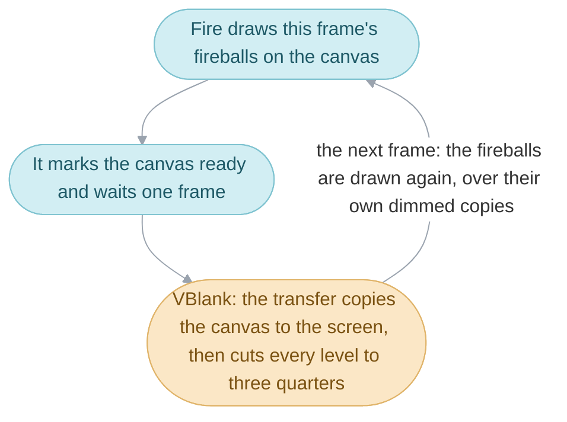
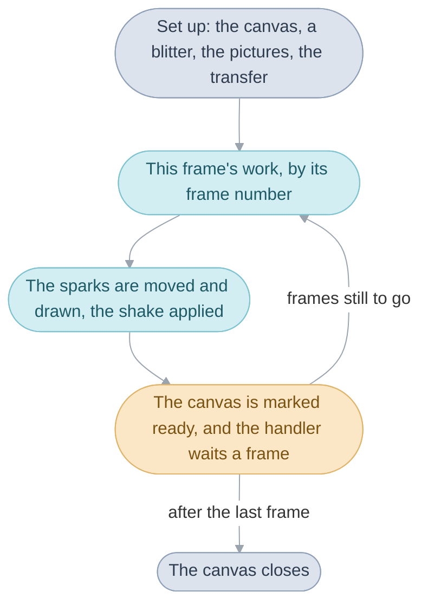
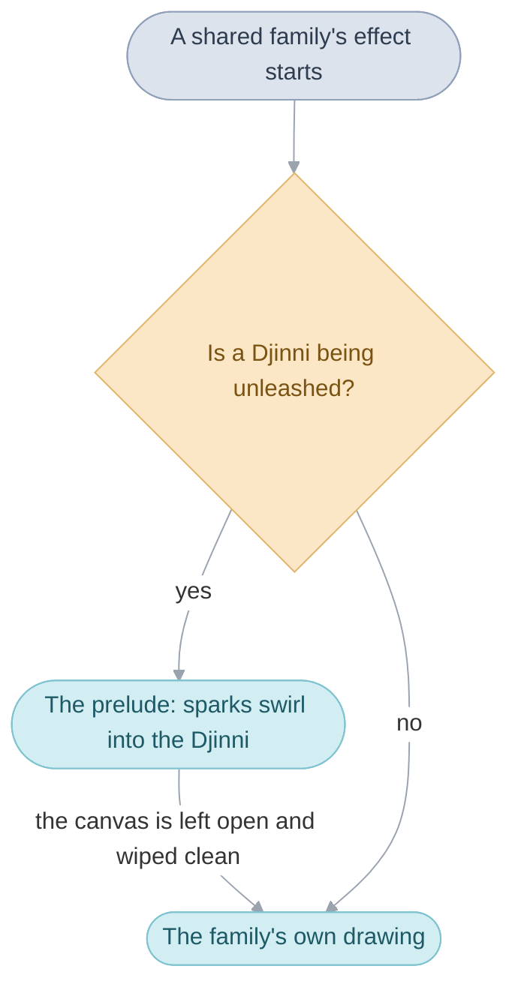
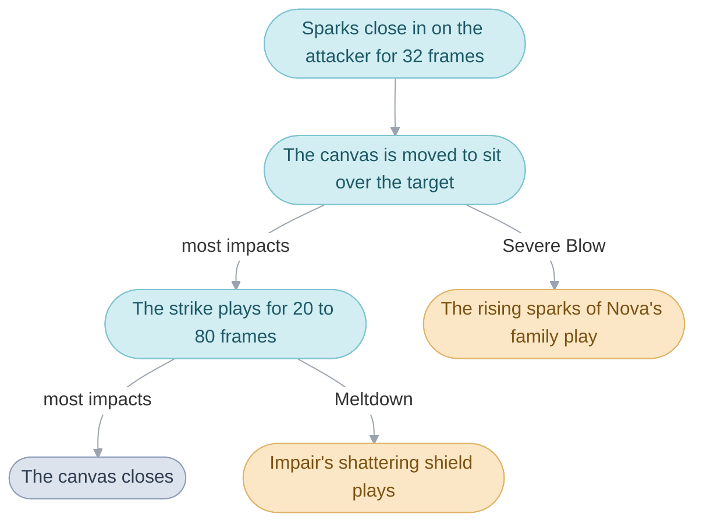
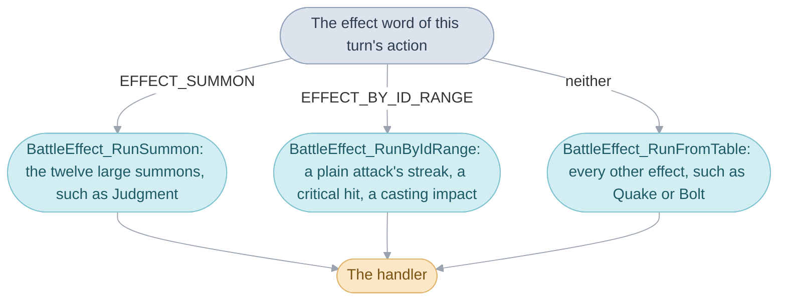

# Battle effects


Cast Earthquake and three pillars of rock push up out of the ground, one
after another from the left. Anyone standing on one is thrown into the air.
The pillars sink, rise a second time and sink for good. Then the damage is
told, while the screen is still shaking.

Every [Psynergy](../../glossary.md#psynergy-and-pp),
[Djinni](../../glossary.md#djinn), [summon](../../glossary.md#summons), item
and monster attack has a show like this, drawn over the
[battle](../../glossary.md#battle) while it plays. The game calls it the
ability's [battle effect](../../glossary.md#battle-effect), and this page is
about how one is drawn.

An effect decides nothing. By the time the pillars start to rise, the battle
has already worked out who Earthquake hits and for how much
([Battles](../battle/README.md#how-an-ability-resolves)). The effect has one
job left, which is to show it.

Effects are timed in [frames](../../glossary.md#frame). A frame is one
picture on the screen, and the console draws about sixty a second.
Earthquake lasts 112 of them, a little under two seconds. The last pillar is
back in the ground by frame 88. On frame 96 the effect tells the battle that
the damage may be shown, and its last 16 frames are only the shaking.

The page goes in this order:

1. Which effect an ability plays, and how strongly
   ([How an ability picks its effect](#how-an-ability-picks-its-effect)).
2. The small picture every effect draws on, and why fire glows
   ([The canvas](#the-canvas)).
3. Where a fireball's trail comes from ([The transfer](#the-transfer)).
4. How pictures are put on the canvas ([Blitters](#blitters),
   [Pictures and the sheet](#pictures-and-the-sheet)) and how sparks fly
   ([Particles](#particles)).
5. One effect, Bolt, followed frame by frame
   ([A handler's frame loop](#a-handlers-frame-loop)).
6. Abilities that turn out to be the same effect
   ([Effect families](#effect-families)).

The last part of the page,
[For readers of the code](#for-readers-of-the-code), is for anyone who wants
to open the files.

## How an ability picks its effect


Quake, Earthquake and Quake Sphere are one effect. The same three pillars
rise once for Quake, twice for Earthquake and three times for Quake Sphere,
as in the recording.

The game keeps a list with one row for every ability. Each row says two
things.

The first is which effect to play. The three rows of the Quake line all
name the same one, the Quake effect. The code calls this the effect kind.

The second is how strongly to play it: 0 for Quake, 1 for Earthquake, 2 for
Quake Sphere. The code calls this the variant. Most abilities that come in
threes share an effect this way.

The effect reads its variant and looks up its own timings. These are
Quake's:

| Ability      | Variant | The effect lasts | Each pillar stands | The screen shakes by |
| ------------ | ------- | ---------------- | ------------------ | -------------------- |
| Quake        | 0       | 80 frames        | 32 frames          | 2 pixels             |
| Earthquake   | 1       | 112 frames       | 64 frames          | 4 pixels             |
| Quake Sphere | 2       | 144 frames       | 96 frames          | 8 pixels             |

A pixel is one dot of the screen, which is 240 dots across and 160 down. A
pillar takes 32 frames to rise and sink, so one that stands for 64 frames
rises twice.

How much damage the targets take is no part of the row. The ability's rules
decide that ([Battles](../battle/README.md#the-ability-kind)).

### What the battle changes


The battle copies the row when it builds the
[action](../../glossary.md#turns-and-actions), and then adjusts the copy
for what is happening in this turn:

- An ability that comes out as a double or triple blow has its variant
  raised by one or two, so it plays the stronger show.
- A revival is marked so that its effect plays on a fighter who is down.
  Every other effect leaves downed targets out.
- Annihilation rolls its instant kill before the effect starts. When the
  kill lands on the first target, the variant becomes 1, and the burst
  shows a second picture and plays a sound.
- A plain attack normally plays a streak of light. On a critical hit the
  battle swaps it for a ring of light and a spray of sparks, as in the
  recording.

## The canvas


Heat Wave's fireballs glow over the battle, and you can still see the
fighters through them.

The fireballs are not drawn on the battle at all. They are drawn on a
square picture, 128 pixels by 128, that the game keeps to one side. The
code calls it the canvas. Nearly every effect draws on it, and the console
then lays it over the battle.

### A pixel is a brightness

A pixel of the canvas is not a colour. It is a brightness, which the code
calls a level, from 0 up to the brightest level.

Each effect brings a ramp of 64 colours, running from dark to bright, and
each level is shown as the colour at its place on the ramp. Level 0 is
see-through.

Heat Wave's ramp runs through the colours of fire. Give the same drawing a
different ramp and it comes out in different colours. Bone Charge, Brute
Force, Onslaught and Headbutt do exactly that: the four attacks scatter the
same sparks, each in a ramp of its own.

### How the canvas is shown

The console builds its picture from a few layers stacked on each other,
which it calls [background layers](../../glossary.md#background-layer).
While an effect plays, the canvas is shown on one of them, starting 16
lines down, where the battle's view starts.

The console can stretch that layer, and it shows the canvas at twice its
width. The 128 columns become 256 on screen, a little more than the
screen's 240.

So every canvas pixel is two screen pixels wide, and an effect has to
allow for that when it aims. Bolt finds where its target stands on the
screen and halves the distance across before it draws the bolt there.

The canvas is not painted over the battle. Its colours are added to
whatever is under them, at a little under full strength (fourteen parts in
sixteen). A bright canvas pixel brightens the fighter behind it, and a dark
one leaves the fighter as it was. That is what makes fire and lightning
glow. Fire turns the adding up to full strength.

### Effects that show it differently

Frost, Judgment and the Helm Splitter are among the effects that show the
canvas at its own width, one canvas pixel to one screen pixel.

Quake does too, and it also turns the adding off, so that a pillar hides
what is behind it.

The canvas can also waver. An effect may give the console a sideways push
for each of the screen's 160 lines, a little different from line to line.
The smoke that Mist, the Mercury Djinni, leaves on its target wavers this
way.

### Opening and closing

Opening the canvas takes five frames and closing it takes eleven. Its layer
is hidden while it is being set up, so the player never sees it half made.

An effect may also dim the battle's background so that its drawing stands
out. A Djinni's entrance does: over 24 frames the background goes down to
three fifths of its brightness. Closing the canvas brings the background's
colours back over eight of its eleven frames.

## The transfer


Each of Fire's fireballs leaves a trail that fades behind it. No code draws
the trail. It is last frame's fireball, left on the canvas a little dimmer.

Here is how that comes about. The effect does not draw on the screen. It
draws on its own copy of the canvas, and when it has finished a frame's
drawing it marks the canvas as ready and waits.

One of the game's [tasks](../../glossary.md#task), which the code calls the
transfer, runs in the short gap after the console has
finished showing one picture and before it starts the next. That gap is the
[VBlank](../../glossary.md#vblank). If the canvas is marked ready, the
transfer copies it to the screen.

Then, straight after the copy, it does one thing to the effect's own copy.
Which thing is the effect's choice:

| What is done to the canvas after the copy | What the player sees                                   |
| ----------------------------------------- | ------------------------------------------------------ |
| it is wiped clean                         | only this frame's drawing: Quake redraws its pillars every frame |
| every level is cut to three quarters      | a long trail: Fire, Ray, Bolt                          |
| every level is cut to half                | a short trail: Frost, Plasma, Volcano                  |
| every level loses a fixed amount          | a trail that fades evenly: Drain takes 4 off a frame   |
| nothing                                   | the drawing builds up frame by frame                   |

Fire keeps three quarters, rounded down. Take one pixel drawn at the
brightest level and never drawn on again. Frame by frame it goes:

```
63  47  35  26  19  14  10  7  5  3  2  1  0
```

It is gone twelve frames later, a fifth of a second. At half it would be
gone in six.



This is where a canvas of brightnesses pays off. The dimming knows nothing
about fireballs. It cuts every pixel of the canvas, and so every trail on it
fades together. Fire throws 16 fireballs, Fireball 32 and Inferno 64, and
the dimming does exactly the same work for each.

## Blitters


Ray's four bolts close in on each other and overlap. What should happen
where one bolt is drawn on top of another?

The effect chooses. An effect draws by copying small pictures onto the
canvas: a bolt, a spark, a piece of rock. The piece of code that does one
such copy is called a blitter, and it treats each pixel of the picture and
the canvas pixel already there in one of four ways:

| Way of combining | What happens to each canvas pixel                     |
| ---------------- | ----------------------------------------------------- |
| copy             | the picture's pixel replaces it                       |
| transparent      | the picture's pixel replaces it, unless it is level 0 |
| lighten          | the brighter of the two stays                         |
| additive         | the two levels are added, up to the brightest level   |

Ray draws all four of its bolts with lighten. Where two cross, the brighter
pixel wins, and the crossing is no brighter than one bolt.

Storm Ray and Destruct Ray are the same effect at the stronger variants.
They draw every second bolt additively, and flipped left to right. Where
one of those crosses another bolt, the levels pile up and the crossing
flares.

Fire uses the same pair another way. A fireball is drawn with lighten for
its first 48 frames, while it hangs in the air, and additively once it
turns towards its target.

Quake uses transparent, which fits an effect that has turned the glow off:
the rock simply covers what is there.

## Pictures and the sheet


Every one of Quake's pillars is drawn from one picture of rock, 40 pixels
wide and 96 tall:
[`rock_wall.png`](../graphics/battle_effects/rock_wall.png). The picture
never changes.

Each frame Quake draws only the picture's top rows: more of them as a
pillar rises, up to 32, and fewer as it sinks.

Now look at the top of a pillar in the recording. It is capped with ground.
When Quake starts, it cuts a strip of ground 40 pixels wide and 16 tall out
of the battle's own background, and it draws that strip on top of each
pillar. So the pillars lift the ground of whatever place the battle is in.

The pillars do not aim, either. They always come up in the same three
places on the canvas, and Quake throws any target who happens to be
standing over one. When the targets are the
[party](../../glossary.md#the-party), it slides the whole canvas 112 pixels
to the right, so that the pillars come up on their side.

### The sheet

The flames, rocks and bolts an effect draws are small pictures like the
rock. On the cartridge they are stored squeezed small, and you can see them
as ordinary pictures in
[`graphics/battle_effects`](../graphics/battle_effects).

When an effect starts, it unpacks the ones it needs and keeps them at hand
until it ends. The code calls this set of unpacked pictures the sheet.
Quake's sheet holds the strip of ground first and the rock after it.

### Motes and flares

Most effects also unpack a set of spark pictures that they all share. It is
one spark at ten sizes, from 1 pixel by 2 up to 10 by 20. The code calls
them motes.

An effect asks for a mote by its size, and that is how a spark shrinks as
it dies. Bolt's sparks are drawn at size 3, then 2, then 1.

A second shared set, the flares, is ten squares from 2 to 20 pixels across.

## Particles


Fiery Blast throws 128 embers and 32 puffs of smoke. Blast, the same effect
at its weakest, throws 16 and 8.

Each ember is a particle: a point that moves a little every frame and has
a picture drawn where it is. Sparks, motes and chips of rock are particles
too.

A particle is very little. It has a position, a speed, and one spare number
that each effect uses as it likes. For Bolt's sparks the spare number is
the frames the spark has left to live.

Positions and speeds are kept far finer than a pixel, in steps of one
65,536th of a pixel. So a slow ember can creep a fraction of a pixel a
frame and still arrive.

### One step a frame

Each frame the effect moves every living particle one step. The speed is
added to the position. Gravity is added to the downward speed. Then every
speed loses a share, which is the drag.

Bolt's sparks show the scale. A spark flies up from the foot of the bolt.
Each frame its fall gets faster by a sixteenth of a pixel a frame, and it
keeps 60 parts in 64 of its speed, losing about 6%. When it hits the ground
it bounces back up at half speed. It lives for 32 to 39 frames.

Gravity does not have to pull down. Ray gives its sparks a small pull
upwards, so they keep rising.

Some particles fly through the battlefield itself, towards the viewer or
away. Fire's fireballs do. Each frame their place on the screen is worked
out from where the battle is being viewed from, and a fireball further away
is drawn as a smaller mote.

## A handler's frame loop


The code that draws one effect from start to end is called its handler.
Bolt's is short, and it reads the way Bolt plays: set up, then one frame's
work after another with a wait of one frame between them, then tidy up. The
rest of the game is written as code that waits, too
([System](../../system.md#waiting-and-tasks)).

The set-up does four things. It opens the canvas. It gets a blitter that
lightens. It unpacks the bolt's four pictures and the motes. And it starts
the transfer keeping three quarters of each level, which is what makes the
bolt crackle away when it stops being drawn.

Then come the frames. Bolt at one target runs for 48 of them, and whatever
happens once is tied to a frame number:

| Frame    | What Bolt does                                                    |
| -------- | ----------------------------------------------------------------- |
| 0        | the whole canvas is set to level 16, a flash                      |
| 1        | the bolt appears over Isaac, 64 pixels long from the top of the canvas; the screen starts a shake of four frames |
| 2        | the bolt reaches the ground, 104 pixels down, and sixteen sparks fly up from its foot |
| 2 to 15  | the bolt is drawn again each frame at full length, changing between its four pictures every 2 frames, which is its flicker |
| 4        | Isaac turns white in his hurt pose for 6 frames and is knocked back |
| 24       | the battle is told it may show the damage                         |
| 47       | the last frame; then the canvas closes                            |

Every frame ends the same way. The living sparks are moved and drawn, the
screen's shake is applied, and the handler marks the canvas ready and waits
a frame.



With more targets, each is struck 8 frames after the one before, and the
effect lasts 8 frames longer for each.

Flash Bolt and Blue Bolt are this handler at the stronger variants. They
throw 32 and 128 sparks where Bolt throws 16, and they add glints that
flicker around the target, three and five a frame. Blue Bolt also draws
each bolt three times over itself.

### Why the damage shows before the effect ends

Frame 24 is the handler's signal to the battle. From that frame the battle
shows each target's flinch, its message and its falling HP, while the effect
goes on drawing. Between frames, while the handler waits, the battle gets
its turn to do that. So Isaac's damage is told while Bolt's sparks are
still bouncing
([Battles](../battle/README.md#how-outcomes-reach-the-screen)).

`BattleEffect_RunBolt` is in [`bolt.c`](battle_effect/bolt.c).

## Effect families


Rockfall and Avalanche are the same glowing wall at different widths.

In fact Gaia, Mother Gaia, Grand Gaia, Rockfall, Rockslide and Avalanche all
play one effect. It draws the same wall each time and has the console
stretch the canvas to 1.25, 1.5 or 2 times its width, by variant. The rocks
are larger at the higher variants ([`gaia.c`](battle_effect/gaia.c)).

Items borrow effects in the same way. Eat an Herb and you get Ply's
sparkles. Corn plays Cure's ring of motes, and an Antidote plays Cure
Poison's twinkles.

### One drawing, several abilities

Abilities that differ by more than strength can share a drawing too. Such a
family has one piece of code that draws every member, and each member tells
it which one to draw. Cure asks the healing family for Cure's ring of
motes. A Smoke Bomb asks for Blast's fountain of embers, in grey.


| What the family draws                                        | Abilities that share it                       |
| ------------------------------------------------------------ | --------------------------------------------- |
| the user rushes at the first target and strikes              | Bone Charge, Brute Force, Onslaught, Headbutt |
| slashes or columns of light on the first target              | thirteen monster attacks, among them Cannibal Fang, Poison Tail and Twin Beaks |
| shots that fly from the user at each target                  | Heat Wave, Sleet and Wing Flutter, among others |
| healing motes around each target                             | Ply, Wish, Cure, Cure Poison, Tonic, Psy Crystal |
| a dagger or a shield over each target that shatters          | Dull (the dagger), Impair and Weaken (the shield) |
| flashes and bouncing sparks in one or three bursts           | Blast, Nova, Supernova, the bombs, Dynamite   |
| columns of light falling on the targets                      | Revive, Water of Life, Quartz, Dew            |

### The prelude


Before Gust's blows land, the Djinni itself appears. Sparks swirl together
into its shape, and it sways for a moment.

The code calls this entrance the prelude. It takes 64 frames, or 84 in a
longer form that ends in a burst of motes. Gust has the longer one. When
it is over, the canvas is left open and wiped clean for the attack to draw
on.

A family needs the prelude for some members only. Quartz and Revive share
the columns of light, and only Quartz is a Djinni.

So the battle tells the effect, yes or no, whether a Djinni is being
unleashed. The shared families (the stat boosts, the shots, the healing
motes, the columns of light, the flurries) open with the prelude only on a
yes. Hail, Ground, Torch, Kite and Vine are Djinn with effects of their
own, and those always open with their Djinni.



### Casting impacts


Sparks gather on the attacker, then something strikes the target. The code
calls that shape a casting impact. The attacks of eight Djinn (Bane, Smog,
Mist, Fever, Flint, Scorch, Squall and Sap) share it, and so do many
weapons' unleashes, such as Terra Strike, Aqua Sock and Asura.

There are 36 casting impacts, and they have most of the show in common.
For the first 32 frames, sparks circle in towards the attacker, four more
joining each frame until there are 64. A Djinni's impact shows its Djinni
above the attacker's head. Then the strike begins: an orb of light appears
at the target, and 32 sparks scatter from it.

Flint adds nothing of its own. What its recording shows at the target is
what every casting impact shows there. Scorch adds bursts of
fire rising from the target, and each of the others adds something
different: smoke for Bane, two bolts for Squall, a spire of rock for Terra
Strike.



The strike lasts 20, 32, 40, 48, 64 or 80 frames, depending on the impact,
and it always opens the same way. The battle is told to show the damage on
the strike's fourth frame. A heavy thud sounds on the fifth. On the seventh
the target turns white, and some impacts knock it back.

Two impacts are only an opening for another effect, as the diagram shows.
Severe Blow stops once the sparks have gathered and hands over to the
rising sparks of Nova's family. Meltdown's strike is 20 frames with nothing
added, and then it hands over to the shield that Impair shatters.

## Design

Two choices explain most of what you see.

An effect is written as one run of code that waits a frame at a time, and
the battle carries on in those waits. That is why a fighter can flinch and
lose HP while the sparks that hit them are still in the air.

A canvas pixel is a brightness and not a colour. That is why a trail costs
nothing to draw, and why one set of sparks can serve four attacks in four
ramps. The price is that everything on the canvas at one moment comes from
a single ramp of 64 colours. Quake's rock and Fire's flames could not be on
it together.

## How it fits with the rest of the game

[Battles](../battle/README.md) decides everything that matters to the
rules, then starts the effect. The effect draws, and tells the battle when
to show the damage.

Effects borrow from the battle as they go. Quake's cap of ground is cut
from the battle's background, and effects shake the battle's view and knock
its fighters back.

The code that builds blitters is used twice more: for the stars that gather
around a fighter casting Psynergy, and for the Lucky Wheels.

## Words used here

- The **effect kind** says which effect an ability plays, and the
  **variant** how strongly: 0 for Quake, 1 for Earthquake, 2 for Quake
  Sphere. The ability kind
  ([Battles](../battle/README.md#the-ability-kind)) is a different thing,
  which picks how the damage is worked out.
- The **canvas** is the 128 by 128 picture an effect draws on. A **level**
  is a pixel's brightness on it, from 0 up to the brightest, and a
  **ramp** is the 64 colours the levels are shown in.
- The **transfer** copies the canvas to the screen each frame and then
  wipes or dims it.
- A **blitter** copies a small picture onto the canvas in one of four ways.
- The **sheet** is an effect's unpacked pictures. A **mote** is one of the
  ten sizes of spark that effects share.
- A **particle** is a moving point: a position, a speed and a spare number.
- A **handler** is the code that draws one effect from its first frame to
  its last.
- The **prelude** is the Djinni's entrance that an effect may open with.
- A **casting impact** is the gather-and-strike effect that Djinn and
  weapon unleashes share.

## For readers of the code

Everything from here on is for someone opening the files in this folder.
It uses the code's own names.

To find an ability's effect, search for the ability's name. Most handlers
are named for the first ability whose row picks them, by its name in the
English release, so Bolt is drawn by `BattleEffect_RunBolt`. The rows are
in [`../battle/ability_staging.c`](../battle/ability_staging.c).

### The effect word

A row is stored as one number, the effect word. Its digits are divided up:
the lowest part holds the kind, the next part the variant, and above them
sit single yes-or-no marks. The Quake line's rows read:

```c
BATTLE_EFFECT_QUAKE, // Quake
BATTLE_EFFECT_QUAKE | (1 << EFFECT_VARIANT_SHIFT), // Earthquake
BATTLE_EFFECT_QUAKE | (2 << EFFECT_VARIANT_SHIFT), // Quake Sphere
```

`1 << EFFECT_VARIANT_SHIFT` puts a 1 in the variant's part, and `|` joins
the parts into the one number.

Two marks turn the battle's view. `EFFECT_VIEW_ACROSS`, on the four summons
Venus, Mercury, Mars and Jupiter, shows the effect from the other side's
view. `EFFECT_VIEW_REVERSED`, on twenty rows, among them the monsters' Fire
Blessing, turns the view right round. `EFFECT_ON_DOWNED` is the mark the
battle adds for a revival. `EFFECT_SUMMON` and `EFFECT_BY_ID_RANGE` choose
which of three routines plays the effect.

### The three routines that play an effect


The battle plays an effect by calling one of three routines
([Battles](../battle/README.md#staging-an-action)). The effect word says
which.



Each routine counts kinds in its own way, so the same number means
different things in each.

- `BattleEffect_RunSummon` plays the twelve large summons, Ramses to Thor,
  each with a handler of its own.
- `BattleEffect_RunFromTable` uses the kind as a place in a table of
  handlers. Quake's kind is 1 and its handler is first.
- `BattleEffect_RunByIdRange` sorts by the number alone. Kinds 100 to 135
  are the casting impacts. Kinds from 200 up are the ring and sparks of a
  critical hit. Every other number is a beam, the streak of a plain attack.
  Isaac, Garet and Jenna attack with kind 1 here, and Ivan and Mia with
  kind 4. A critical hit adds 200, so Isaac's 1 becomes 201. A plain attack
  does not use its row in the list of abilities.

Whichever routine is used, the handler is passed the same parameters
(`struct BattleEffectParams`): the kind and variant, the user, up to 8
targets, the side they stand on, and whether to play the prelude.

Before it calls the handler, the routine takes three blocks from the
[heap](../../glossary.md#heap-and-pools), the game's pool of working
memory: a small one for the motes, the work block
(`struct BattleEffectWork`: the sheet, 64 particles and the effect's
settings) and the canvas. It gives them back when the handler returns.

A handler that added a task, such as the transfer, removes it before it
returns. A task left running would read blocks that now belong to
something else, and draw rubbish from them.

### Blitters are built while the game runs

The cartridge holds no finished blitter. It holds a builder,
`BattleEffect_BuildBlitter` in [`blitter.c`](battle_effect/blitter.c), and
a template of instructions for the console's processor. Asked for a
blitter, the builder copies out the pieces for exactly one case: one canvas
size, one way of combining, flipped or not, and with or without a check for
the canvas's edges. The file's opening comment goes through the result
piece by piece.

An effect holds two blitters at a time. Flash Bolt wants more than that,
because each of its glints is flipped at random. So for every single glint
it has a fresh blitter built, draws with it once and releases it.

The code does not record why Camelot built blitters this way.

### Where particles live

An effect's particles never ask for more memory partway through. They sit
in two arrays that are there from the start, and a place whose particle has
died is used again.

The small one is the 64 particles in the work block. The large one,
`PARTICLES`, is the memory the field keeps its map in
([Maps](../map/README.md)), which is idle during a battle. Bolt, Ray and
Plasma each use 1,024 places of it. For Bolt that is 128 sparks for each of
up to 8 targets.

A place does not have to hold a spark. Quake throws no particles, and it
uses the spare numbers of the small array for something else: one for each
target, saying whether that target has landed yet.

A particle placed in the battlefield is projected onto the screen and then
raised by 16 pixels, the height at which effects sit on a fighter.

The transfer's dimming works on four pixels at once: four canvas pixels
are stored side by side as one number, and it takes three quarters of that
number and trims what spilled from one pixel into the next.

### Limits

- The sheet is 27,008 bytes of the work block.
- The small array holds 64 particles.
- An effect holds two blitters at a time.
- An effect has at most 8 targets.
- One effect plays at a time.

### Evidence

The recordings are of the English release, one of the game's
[editions](../../glossary.md#editions). Each ability is cast by one party
member at the others, who stand in for the enemies. The two monster attacks
are cast by their monsters at the party.

Only plain attacks score critical hits. No ability's entry uses the
critical-hit effects (`ABILITY_EFFECT_CRITICAL_1_IN_64` to
`ABILITY_EFFECT_CRITICAL_1_IN_4`), and 200 is added to the kind only where
a plain attack is played. So the ring and sparks are reached only from a
plain attack, and they play the same for each.

Three handlers in the table are never played, because no ability's row
names their kinds. They are named from what they draw: orbiting spirals
(`planet_diver.c`), a triangle strike (`bind.c`) and a leap (`thrash.c`).

Four of the 36 casting impacts are named by no row either. They stop after
the gathering, as Severe Blow does. Three hand over to Blizzard's stream of
ice, to Mystic Flame and to a volley of comets, and one simply ends.

The three effects in `orbiting.c` are unused too, because no code calls
them.
