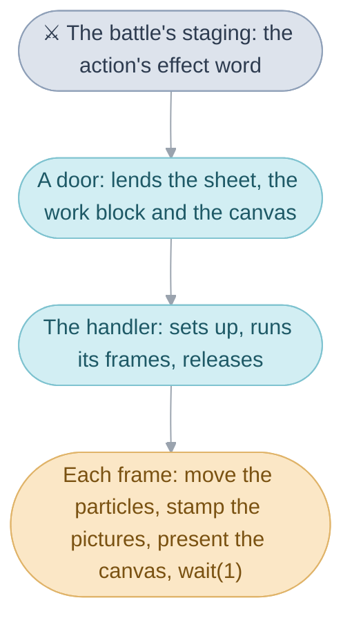
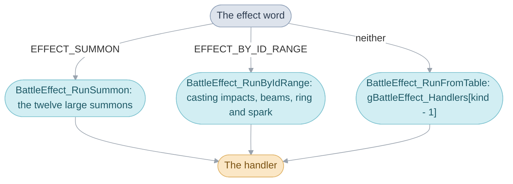
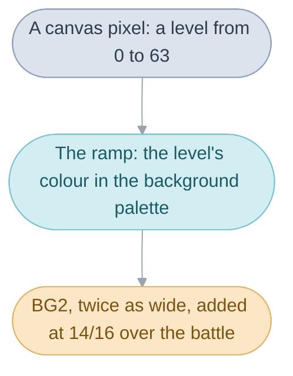
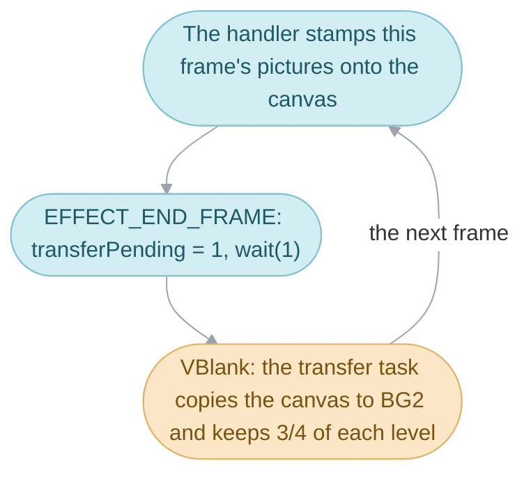
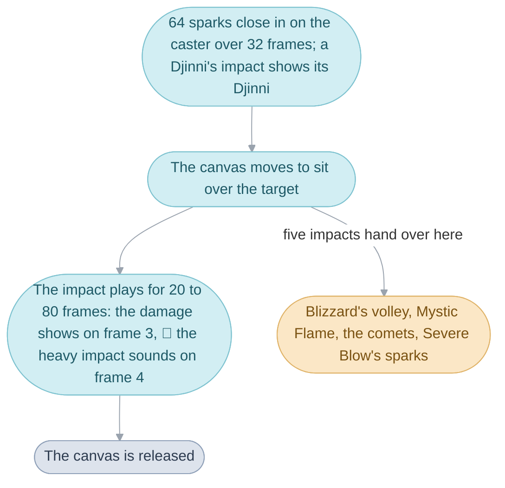

# Battle effects


When Isaac casts Earthquake, rock pillars rise under the three targets,
throw them into the air and sink again, and the damage appears while the
rock is still on screen. Every [Psynergy](../../glossary.md#psynergy-and-pp),
[Djinni](../../glossary.md#djinn), [summon](../../glossary.md#summons), item
and monster attack has a drawing like this played over the battle, its
[battle effect](../../glossary.md#battle-effect).

By the time an effect starts, the [battle](../../glossary.md#battle) has
already worked out what the ability does: who it hits and for how much
([Battles](../battle/README.md#how-an-ability-resolves)). The effect's work
is to show it. Each effect is one function, its handler, which draws for a
fixed number of [frames](../../glossary.md#frame) and returns when it is
over. Along the way it tells the battle on which frame to show the damage.

A handler draws with a few shared pieces:

1. The ability's row says which effect it plays and at what strength.
2. One of three doors lends the effect its memory and calls its handler.
3. The canvas is the small picture nearly every effect draws into, shown
   stretched over the battle.
4. The transfer copies the canvas to the screen once a frame and decides
   what the canvas keeps for the next frame, which leaves the trails.
5. A blitter stamps a picture onto the canvas.
6. The pictures are unpacked when the effect starts.
7. The particles are the sparks, embers and rocks that move each frame.
8. The handler's frame loop puts the pieces together.
9. Abilities that look alike share one effect at different settings.



## How an ability picks its effect


Quake, Earthquake and Quake Sphere play the same pillars, rising once, twice
and three times. They are one effect drawn at three strengths. Each ability
has a row in the battle's table of effects, and the row says which effect
to play, its effect kind, and how strong to play it, its variant: basic,
stronger or strongest.

```c
BATTLE_EFFECT_QUAKE, // Quake
BATTLE_EFFECT_QUAKE | (1 << EFFECT_VARIANT_SHIFT), // Earthquake
BATTLE_EFFECT_QUAKE | (2 << EFFECT_VARIANT_SHIFT), // Quake Sphere
```

The kind and the variant are packed into one number, the effect word. The
effect reads the variant and picks its timings from it. How much damage the
targets take is no part of the word: the ability's rules decide that
([Battles](../battle/README.md#the-ability-kind)).

The word also carries a few yes-or-no switches. One shows the effect on
downed targets too, which the revivals need. Two turn the camera: the
summons Venus, Mercury, Mars and Jupiter are seen from the other side's
view, and twenty rows, the blessings among them, are seen with the camera
turned right round. Two more choose the door of the next section.

The battle adjusts the word while it builds the
[action](../../glossary.md#turns-and-actions). A double or triple blow
raises the variant, a revival adds the switch for downed targets, and a
critical hit moves a plain attack's kind up by 200, which swaps the sword's
slash for a ring of light and a spray of sparks.

In the code each handler is named for the first ability whose row picks it,
by its name in the English release, so searching for an ability's name
finds its effect: Bolt is drawn by `BattleEffect_RunBolt`. The rows
themselves are in
[`../battle/ability_staging.c`](../battle/ability_staging.c).

## The three doors and what they lend


A door is the function the battle calls to play an effect
([Battles](../battle/README.md#staging-an-action)). There are three, and
the effect word's switches choose between them:



The first door plays the twelve large summons, Ramses to Thor, each a
handler of its own. The second plays the effects that go by number alone.
Kinds 100 to 135 are the casting impacts, the shape Djinn and weapon
unleashes share. Kinds from 200 are the ring and spark of a critical hit.
Every other number is a beam, the streak of a plain attack. The third door
serves everything else, Quake and Bolt among them: the kind is a place in a
table of handlers, and the door calls the handler it finds there.

Whichever door it takes, the handler is lent three blocks of memory from
the [heap](../../glossary.md#heap-and-pools) for as long as it plays:

| Block          | What the effect keeps there                                   |
| -------------- | ------------------------------------------------------------- |
| the motes      | ten tiny spark pictures that most effects stamp               |
| the work block | the effect's own pictures, its particles and its settings     |
| the canvas     | the picture it draws into, 128 by 128 pixels                  |

The door takes the blocks before the handler starts and gives them back
when it returns, so no effect can leave memory behind for the next one. A
handler that started a [task](../../glossary.md#task) to help it draw stops
that task before it returns, since the task would otherwise go on reading
memory that is no longer the effect's.

The door also tells the handler what to draw for: who uses the ability, the
targets and how many, and which side of the field the targets stand on.
Most effects are drawn mirrored when the targets are the party.

## The canvas


Heat Wave's blaze glows over the battle, and the fighters show through it.
The blaze is drawn on the canvas, a square picture of 128 by 128 pixels
kept in memory, which nearly every effect draws into and the console then
lays over the battle.

A pixel of the canvas is a brightness, its level, from 0 to 63. The effect
loads a ramp of 64 colours, and each level shows as the colour at its place
on the ramp. Level 0 is see-through. Heat Wave's ramp runs through the
colours of fire. Another ramp draws the same pictures in other colours,
which is how the four rushing strikes scatter the same sparks in four
palettes.

The console shows the canvas on a
[background layer](../../glossary.md#background-layer) it can scale, which
the battlefield gives up while the effect plays. The canvas is stretched to
twice its width, so its 128 columns cover the screen's 240, and its colours
are added to the picture under it at fourteen sixteenths of their
strength. Adding is what makes fire and light glow: a bright canvas pixel
brightens the fighter behind it and a dark one leaves the fighter as it
was. Because of the stretch, a point 100 pixels across the screen is 50
pixels across the canvas, which every effect allows for when it places a
picture.



Opening the canvas takes five frames and closing it eleven. An effect may
darken the battle's background while it plays, and closing brings the
background's colours back over eight of those frames.

A few effects show the canvas differently. Frost, Judgment and the Helm
Splitter are among those that show it at its own width. Quake does too, and
turns the adding off, so that its pillars hide what is behind them.

## The transfer


Each of Fire's fireballs leaves a trail that fades behind it. No code
draws the trail. It is last frame's picture, left on the canvas a little
dimmer.

Everything an effect draws reaches the screen through one task, the
transfer. At the end of a frame the handler marks the canvas ready and
waits a frame. At the next [VBlank](../../glossary.md#vblank) the transfer
copies the canvas to the screen, and then treats the canvas as the effect
chose when it started:

| What the canvas keeps              | What the player sees                               |
| ---------------------------------- | -------------------------------------------------- |
| everything                         | the picture builds up frame by frame               |
| nothing                            | only this frame's drawing: Quake redraws its pillars every frame |
| half or three quarters of each level | a trail that fades fast at first, then slowly: Fire, Ray, Bolt |
| each level less a fixed step       | a trail that fades evenly: Bind and Drain take 4 off a frame |

Fire keeps three quarters, rounded down. A pixel drawn at the brightest
level, 63, and never drawn again goes down like this, and is gone twelve
frames later, a fifth of a second:

```
63  47  35  26  19  14  10  7  5  3  2  1  0
```



Dimming works on the whole canvas at once and knows nothing about
fireballs or sparks. Because a pixel is a brightness, taking three quarters
of every pixel dims every trail on the canvas, however many there are. The
routine that does it handles four pixels in one step, which is what makes
dimming 16,384 pixels every frame affordable.

## Blitters


Where two of Ray's bolts cross, the crossing glows brighter than either
bolt. That comes from how the bolts are put on the canvas. A blitter is a
small routine that copies a picture to a point of the canvas, and it
combines each pixel of the picture with the pixel already there in one of
four ways:

| Way of combining | What happens to each canvas pixel                    |
| ---------------- | ---------------------------------------------------- |
| copy             | the picture's pixel replaces it                      |
| transparent      | the picture's pixel replaces it, unless it is level 0 |
| lighten          | the brighter of the two stays                        |
| additive         | the two levels are added, up to 63                   |

Ray draws with two blitters. One lightens. The other is additive and
mirrors its picture left to right, so bolts that cross add up.

The game writes each blitter while it runs. A blitter is machine code for
exactly one case: one canvas size, one way of combining, mirrored or not,
and with or without a check that skips the pixels falling outside the
canvas. A routine built for one case has no decisions left to make for each
pixel, so it is as short as it can be, and the game keeps it in the
console's fast memory when it fits. An effect builds only the one or two
blitters it draws with. [`blitter.c`](battle_effect/blitter.c) is the
builder, and its opening comment describes the routine it builds piece by
piece.

## Pictures and the sheet


Every one of Quake's pillars is drawn from one picture of rock, 40 by 96
pixels, [`rock_wall.png`](../graphics/battle_effects/rock_wall.png). The
picture never changes. Each frame Quake draws only its top rows, more as a
pillar rises and fewer as it sinks, and lays a strip of the battle's own
ground, cut from the background, on top as the pillar's cap.

The flames, rocks and sparks an effect stamps are small pictures like this
one, kept packed in the cartridge
([`graphics/battle_effects`](../graphics/battle_effects)). When an effect
starts it unpacks the ones it needs into the sheet, the part of the work
block set aside for pictures, 27,008 bytes of it.

Most effects also unpack one of the shared sets of tiny pictures into the
small block the door lends for them. The motes are ten pictures of one
spark at ten sizes, from 1 by 2 pixels to 10 by 20. The flares are ten
squares, from 2 to 20 pixels across. An effect asks for a mote or a flare
by size, which is how a spark shrinks as it dies.

After the sheet, the work block holds a sideways shift for each of the
screen's 160 lines. An effect that fills it in makes the console draw each
line of the canvas a little to one side of the last, and the canvas sways
or ripples.

## Particles


Every ember Fiery Blast sprays is a particle: a point that moves a little
each frame and has a picture stamped where it is. Sparks, motes and chips
of rock are particles too.

A particle is a position, a speed, and one spare number that each effect
uses as it likes: the frames the particle has left to live, or which
picture to draw. Positions and speeds are kept much finer than a pixel, so
a slow ember can move a fraction of a pixel a frame and still arrive.

Each frame the effect moves every living particle one step: the speed is
added to the position, gravity is added to the downward speed, and every
speed loses a share to drag. Bolt's sparks show the scale. Each frame a
spark's fall grows by a sixteenth of a pixel a frame, and it keeps 60
parts in 64 of its speed, losing about 6%. When it hits the ground it
bounces at half speed. It lives 32 to 39 frames and is drawn as a smaller
mote as it dies.

A particle that flies through the battlefield, towards or away from the
camera, moves in three directions and is then projected onto the screen,
16 pixels up, the height at which effects sit on a fighter.

Particles live in two pools of fixed size, and a finished particle's place
is used again, so an effect never asks for memory partway through. The
small pool is 64 particles in the work block. The large one has room for
1,170: it is the memory the field keeps its map in, which a battle has no
use for.

## A handler's frame loop


A handler is code that waits, like the rest of the game
([System](../../system.md#waiting-and-tasks)). It sets up, runs a fixed
number of frames, each ending in a wait of one frame, and gives back what
the set-up took. `BattleEffect_RunBolt` ([`bolt.c`](battle_effect/bolt.c)),
cut down to its outline, shows the shape nearly every handler has:

```c
void BattleEffect_RunBolt(struct BattleEffectParams *args) {
  ...
  EFFECT_GET_SLOTS(slots, cursor, work, canvas); /* the work block, the canvas */
  work->args = args;
  BattleEffect_StartCanvasLayer(BGCNT_PRIORITY(1)); /* BG2 shows the canvas */
  EFFECT_LOAD_BLITTER(HEAP_SLOT_RAM_CODE, EFFECT_CLIP_BOUNDS, COMPOSITE_LIGHTEN);
  draw[0] = EFFECT_SLOT(slots, HEAP_SLOT_RAM_CODE);
  Resource_LoadAndDecompress((s32)&ResourceId_LightningBoltSheet,
                             work->sheet + BOLT_OFFSETS, 1, 1);
  EFFECT_START_TRANSFER(work, CANVAS_COPY_AND_FADE, CANVAS_FADE_THREE_QUARTERS);
  for (frame = 0; frame != work->args->targetCount * 8 + 40; frame++) {
    if (frame == 24)
      EFFECT_SHOW_DAMAGE(SE_IMPACT);             /* the damage may show */
    ...                                          /* for each bolt: */
    draw[0](canvas, picture, x, y, 24, height);  /* stamp it */
    ...                                          /* move and draw sparks */
    EFFECT_END_FRAME(work);                      /* copy, wait a frame */
  }
  EFFECT_FINISH_CANVAS_ONE_BLITTER();            /* stop, release, close */
}
```

The set-up opens the canvas, builds one blitter that lightens, so a bolt
drawn over its sparks brightens them, unpacks the bolt's pictures, and
starts the transfer keeping three quarters of each level, which makes the
bolt crackle away.

Inside the loop, whatever happens once (a sound, a shake, a flash) is a
test of the frame number. Bolt at one target runs `8 * 1 + 40`, 48 frames:

| Frame    | What Bolt does                                                    |
| -------- | ----------------------------------------------------------------- |
| 0        | the whole canvas is set to level 16, a flash                      |
| 0 to 15  | the bolt is stamped over Isaac, growing 64 pixels a frame until it reaches the ground, 104 pixels down |
| 1        | the screen starts a shake of four frames                          |
| 2        | sixteen sparks fly up from the bolt's foot                        |
| 4        | Isaac flashes white in his damage pose and is knocked back        |
| 24       | the damage shows: `Isaac takes 27 damage!`                        |
| 47       | the last frame; the canvas then closes                            |

With more targets, each is struck 8 frames after the one before. Flash
Bolt and Blue Bolt are the same handler at the stronger variants: 32 and
128 sparks for 16, and Blue Bolt draws each bolt three times over itself.

The damage on frame 24 is the handler's signal to the battle. From that
frame the battle shows each target's flinch, message and falling HP while
the effect goes on drawing, which is why `Isaac takes 27 damage!` appears
while the sparks are still falling
([Battles](../battle/README.md#how-outcomes-reach-the-screen)).

The steps inside a frame keep one order, and the order shows on screen: a
later step draws over an earlier one.

## Effect families


Rockfall and Avalanche are the same glowing wall at different widths.
Gaia, Mother Gaia, Grand Gaia, Rockfall, Rockslide and Avalanche all play
one effect, which stretches the canvas to 1.25, 1.5 or 2 times its width
by variant and draws larger rocks at the higher ones
([`gaia.c`](battle_effect/gaia.c)).

Abilities that differ by more than strength share an effect too. A family
of them has one function that draws every member, told which by a mode,
and each ability's handler is two lines that pass its mode along. Cure's
handler asks the healing family for its Cure mode.


| What the family draws                                        | Abilities that share it                       |
| ------------------------------------------------------------ | --------------------------------------------- |
| the user rushes at the first target and strikes              | Bone Charge, Brute Force, Onslaught, Headbutt |
| repeated slashes or columns of light on the first target     | twelve monster attacks, among them Cannibal Fang, Poison Tail and Twin Beaks |
| shots that fly from the user and burst on each target        | Heat Wave, Sleet, Wing Flutter                |
| healing motes swirling in to each target                     | Ply, Wish, Cure, Cure Poison, Tonic, Psy Crystal |
| a dagger or a shield over each target that shatters          | Dull (the dagger), Impair and Weaken (the shield) |
| flashes and bouncing sparks in one or three bursts           | Blast, Nova, Supernova, the bombs, Dynamite   |
| columns of light falling on the targets                      | Revive, Water of Life, Quartz, Dew            |

### The prelude


Before Gust's attack plays, the Djinni itself appears: sparks gather into
its shape and it sways for a moment. This opening is the prelude. It takes
64 frames, or 84 in a longer form that ends in a burst of motes, and it
leaves the canvas open and clear for the attack to draw on.

Many families can be played by a Djinni or by something else. Quartz and
Revive share the columns of light, and only Quartz is a Djinni. So the
battle sets a switch when a Djinni is unleashed, and the shared families
(the stat boosts, the volleys, the healing motes, the columns of light,
the flurries) open with the prelude only when it is set. Hail, Ground,
Torch, Kite and Vine always open with their Djinni.

### Casting impacts


A casting impact is the shape the attacks of eight Djinn (Bane, Smog, Mist,
Fever, Flint, Scorch, Squall and Sap) and many weapons' unleashes share:
sparks gather on the attacker, then something strikes the target. Flint has
no impact of its own, so its recording shows only what every impact shares.
Scorch adds a burst of fire.



First 64 sparks close in on the caster over 32 frames, and a Djinni's
impact shows its Djinni above the caster. Then the canvas is moved so that
the impact sits over the target. The impact itself plays for 20 to 80
frames, by impact: the damage shows on its fourth frame, the heavy impact
sounds on the fifth, and on the seventh some impacts knock the target
back. Last the canvas is released.

Some impacts are only an opening for another effect. Severe Blow stops once
the canvas has moved and hands over to the rising sparks of Blast's
family, and Meltdown ends by handing over to the shield that Impair
shatters. Four impacts that no ability uses stop at the same point: three
hand over to Blizzard's volley, Mystic Flame and the comets, and one
simply ends. [`casting_impact.c`](battle_effect/casting_impact.c) marks the
phases in its code.

## Design

Every effect is written as code that waits, one function from its first
frame to its last, because that is how the rest of the game is written. A
handler reads as the effect plays, each frame's work in order with a wait
between frames, and the battle's own tasks, its camera and its
[playback](../../glossary.md#playback-queue), keep running inside those
waits. The cost is that one effect plays at a time, from start to end,
which is all a battle asks.

The canvas trades colour for speed. A pixel that is one brightness can be
dimmed four at a time, so a trail costs nothing for each spark, and a ramp
can recolour a whole effect. In return the canvas shows at most 64 colours
at a time, all from one ramp.

Building each blitter as machine code for one exact case costs a little
time once, when the effect starts, and makes every stamp of a picture as
short as it can be. That is what lets a frame draw hundreds of sparks.

## How it fits with the rest of the game

The battle decides everything that matters to the rules before an effect
starts: [Battles](../battle/README.md) works out the action, its targets
and its damage, and [stages](../../glossary.md#staging) the effect. The
effect only draws, and tells the battle when to show the damage.

While it draws it borrows from the rest of the game: its memory from the
heap ([System code](../system/README.md)), the map's memory for its large
pool of particles ([Maps](../map/README.md)), and the battle's own
background, camera and fighters, which it shakes, tints and knocks back.
The blitter builder also serves the battle's star field and the Lucky
Wheels.

## Limits

- The canvas is 128 by 128 pixels, and a pixel has 64 levels.
- The sheet holds 27,008 bytes of pictures; an effect that leaves the
  per-line shifts after it alone may use up to 28,800.
- The small pool has 64 particles and the large pool 1,170. No effect
  sets aside more than 1,024 of the large pool.
- An effect has two blitters at a time, and each combination of canvas
  size, mirroring, clipping and way of combining needs its own.
- An effect has at most 8 targets.
- One effect plays at a time.

## Words used here

- An **effect kind** is the number that picks which effect plays. The
  ability kind ([Battles](../battle/README.md#the-ability-kind)) is another
  number, which picks the rules' formula.
- The **variant** is the strength an effect is played at: basic, stronger
  or strongest.
- The **effect word** is an ability's row: its effect kind, its variant
  and its switches in one number.
- A **door** is one of the three functions the battle calls to play an
  effect. It lends the handler its memory.
- A **handler** is the function that draws one effect from its first frame
  to its last.
- The **work block** is the effect's working memory: the sheet, the small
  pool of particles and its settings.
- The **canvas** is the 128 by 128 picture an effect draws into, and a
  **level** is a pixel's brightness on it, a place on a ramp of colours.
- The **transfer** is the task that copies the canvas to the screen each
  frame and dims or clears it for the next.
- A **blitter** is a routine built for one way of stamping a picture onto
  the canvas.
- The **sheet** is the effect's unpacked pictures; a **mote** is one of the
  ten sizes of spark every effect shares.
- A **particle** is a point with a position, a speed and a spare number,
  which an effect moves each frame and draws a picture at.
- The **prelude** is the Djinni's entrance an effect may open with.
- A **casting impact** is the gather-and-strike effect Djinn and weapon
  unleashes share.
- The **side** is the side the targets stand on, the
  [party](../../glossary.md#the-party)'s or the enemies'. Effects mirror on
  it.

## Evidence

The recordings are of a tbs-en [edition](../../glossary.md#editions). Each
ability is cast by one party member at the others, who stand in for the
enemies; the two monster attacks are cast by their monsters at the party.

Only plain attacks score critical hits. No ability's row uses the
critical-hit effects (`ABILITY_EFFECT_CRITICAL_1_IN_64` to
`ABILITY_EFFECT_CRITICAL_1_IN_4`), so the ring and spark is reached only
from a plain attack's kind, and it plays the same for each.

Three effects in the handler table are never played: no ability's row
names their kinds, and nothing else can put a kind in an action. They are
named from what they draw: orbiting spirals (`planet_diver.c`), a triangle
strike (`bind.c`) and a leap (`thrash.c`).
[The Lost Age](../../glossary.md#the-two-games) keeps the same three, and
its row for Severe Blow names the leap, where here Severe Blow plays a
casting impact. The three effects in `orbiting.c` are unused too: no code
calls them.
