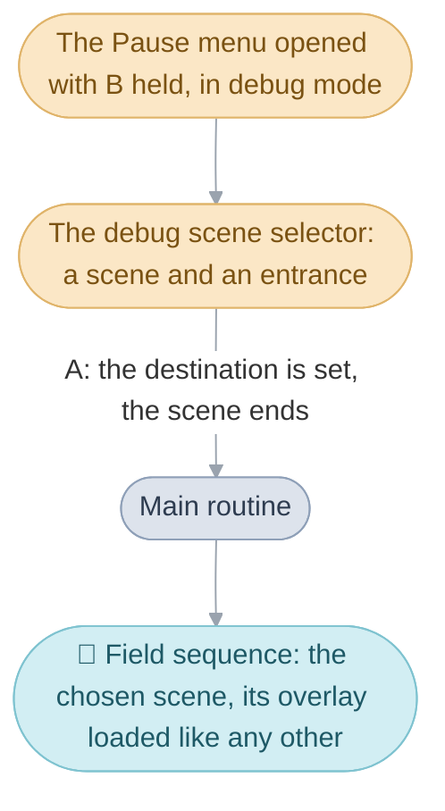

# Debug scenes

The cartridge still holds ten [scenes](../../glossary.md#scene) the
developers used to test the game, and the small window they used to reach
any scene at all. The only way in is the debug scene selector, which the
field opens in debug mode, a switch in memory that start-up turns off, so
the released game starts with it off. The ten are eight test scenes that
hand out
[Djinn](../../glossary.md#djinn), one for raising levels and browsing items,
icons, portraits and abilities, and one of shop and message tests. They
come from three ordinary scene [overlays](../../glossary.md#overlay), each
built exactly as [Scenes](../scene/README.md) describes, which is what makes
them worth reading: the test scenes' overlay is a whole scene in fewer than
130 lines. A tester meets them in this order:

1. [How the debug scenes are reached](#how-the-debug-scenes-are-reached):
   the selector, and why debug mode stays off.
2. [Setup runs on every visit](#setup-runs-on-every-visit): what each
   scene's setup does, since a tester enters them again and again.
3. [The test scenes](#the-test-scenes), [Increase item and
   level](#increase-item-and-level) and [Menu test](#menu-test), one
   section each.

## How the debug scenes are reached

The [debug scene selector](../../glossary.md#debug-menus) is a small window
with two numbers, a scene and an [entrance](../../glossary.md#entrance),
beside the scene's code and the area name the entrance belongs to (`TEST0`
and Test 0 for the first test scene, `PLOGV00` for Vale on the stormy
night). It starts on the scene being played, at the entrance the party came
in by. Up and Down switch between the two numbers, Left and Right step one,
R and L ten, A leaves for that scene and entrance, and B closes the window.
Scene numbers wrap from 200 back to 0, so the selector reaches every scene,
the debug scenes included.

Leaving through the selector is the same handover as walking through a
door. The selector writes the chosen scene and entrance as what runs next
and raises an exit request that keeps that destination; the
[field sequence](../../glossary.md#field-sequence) ends the scene, and the
[main routine](../../glossary.md#main-routine) starts the chosen one,
unpacking its overlay as it would for
any door ([Scenes](../scene/README.md#exits)). The field opens the selector
only in debug mode, when the [Pause menu](../window/README.md#the-pause-menu)
is opened with B held; in the same mode the field menu opened with B and
Select held is a flag editor, and L on the Pause menu a palette editor.

The last ten rows of the scene table are the debug scenes: the eight test
scenes, which share one overlay, each on a map of its own, then Increase
item and level and Menu test.

The selector is `DebugSceneSelect_Run` in the window bank
([debug.c](../window/screens/debug.c)), which `FieldSequence_Run` calls when
the Pause menu request finds B held; it draws the scene's code from
`MsgDebugSceneCode` and its area name from `MsgDebugAreaName` through
`Area_GetNameIndex`, and `Event_SetDestination` sets the destination and
the exit request when A is pressed. The debug scenes are `SceneId_Test0` to
`SceneId_Test7`, `SceneId_IncreaseItemAndLevel` and `SceneId_MenuTest`. The
battle bank also keeps a battle test menu, `DebugBattle_RunMenu`, exported
for a far call as `DebugBattle_RunMenuFar`, which nothing calls.

| Name | Value | Meaning |
| --- | --- | --- |
| the scene number | 0 to 200 | a row of `gScenes`; Right past 200 wraps to 0 |
| the entrance number | 0 to 99 | the entrance the scene starts at; Right past 99 wraps to 0 |
| R and L on the scene | ten rows | steps the scene by ten and sets the entrance back to 0 |

### Why debug mode stays off

Debug mode is one switch, which only two pieces of code ever write:
start-up, which turns it off, and a [sprite](../../glossary.md#sprite-and-oam)
viewer, which turns it on. The viewer's only way in is a
[veneer](../../glossary.md#veneer) in the field bank's
[far-call](../../glossary.md#far-call) table, and nothing on the cartridge
calls that veneer, so a player's game stays in the mode start-up set. The
debug scenes count as reachable all the same, since the debug scene
selector reaches them, as it reaches every scene;
[unused](../../glossary.md#unused) is kept for what nothing reaches.

The switch is `gDebugMode`, and the viewer `SpriteViewer_Run`.

## Setup runs on every visit

A scene's setup runs each time the [party](../../glossary.md#the-party)
enters, as [Scenes](../scene/README.md#the-entry-table) explains. For a town
that means restoring what its flags say has happened; for a debug scene it
means building the test again, so a second visit repeats the first.

The test scenes' setup does nothing. In Increase item and level the setup
draws the level editor 1.6 times its size (1.7 in Japanese) and starts the
emote testers' animations. Menu test's builds a test party: Jenna leaves,
Garet, Mia and Ivan join, the shops may sell three Shamshirs, two Silver
Blades, a Masamune and eight rare pieces of armor, and everyone is raised to
level 30 (Isaac to 50 outside the Japanese edition); in Japanese the coins
are also set to 777,777. Each visit adds to the shops' stock again, but
changes a level only while it is below the target, because levels only ever
go up.

The setups are `Test_Initialize`, `IncreaseItemAndLevel_Initialize` and
`MenuTest_Initialize`.

## The test scenes

Flint, Fizz, Forge and Gust stand in the scene while their flags are
clear, one Djinni of each [element](../../glossary.md#the-four-elements).
Talking to one runs a two-step [event](../../glossary.md#event): give the
party that element's first Djinni, with the same capture the game plays
everywhere (the Djinni goes to the party member with the fewest), then clear
the Djinni's flag again, so it stands there again next time. Those two calls
are all the scenes need from the rest of the game, so their
[import table](../../glossary.md#entry-table-and-import-table) holds just
the two. Each Djinni is one row of the scenes' trigger table, which says:
when the player talks to Flint, always, run Flint's event.

The eight scenes share this one overlay and differ only in their map, each
a copy of `map_001`'s tables drawn with a blank tileset, so the screen shows
the actors on black. Their exit table has a header for each of the first
four and no exits under any of them, and their one entrance stands at
(192, 0, 192) facing west.

The test scenes answer the field's six questions with `Test_Initialize`,
`Test_GetEntrances`, `Test_GetExits`, `Test_GetActorPlacements`,
`Test_GetTriggers` and `Scene_GetExitRegions` (none). The trigger table is
`gTest_Triggers`, and each event, such as `Test_ReceiveFlint`, calls
`Djinn_JoinParty` and `GameFlag_Clear`.

## Increase item and level

The scene's map shows nothing but black, and its people are the tools. One
raises the party's levels, others step through every item, icon, portrait
and ability in the game, and outside Japanese two more test the emotes.
Force, the [Psynergy](../../glossary.md#psynergy-and-pp) that pushes a thing
from a distance, can be cast at the portrait browser, which stays where it
stands.

The level editor raises the party one level with A and five with Start or
Select, with a jingle for each, and B closes it. The item browser steps
through the 270 item numbers, by one, ten or thirty at a time, skips numbers
whose item has no icon, and gives the chosen item to the first party member
with room. The editions differ: the ability browser can be talked to only in
English and German, though French, Spanish and Italian keep its code and its
tester; and Force cast at the portrait browser runs a motion test in
Japanese and shows the character-set captions elsewhere.

The browsers are in [level.c](level.c), such as
`IncreaseItemAndLevel_SelectItem`; the trigger table is
`gIncreaseItemAndLevel_Triggers`, where a row run before Force is cast,
`IncreaseItemAndLevel_EnableEffectChildMode`, keeps the portrait browser in
place.

| Name | Value | Meaning |
| --- | --- | --- |
| `ITEM_COUNT` | 270 | the item numbers the browser steps through, 0 to 269 |
| `BROWSER_ROW_STEP` | 10 | Right and Left move ten numbers |
| `BROWSER_PAGE_STEP` | 30 | R and L move thirty |

## Menu test

The people run the shop, message and inventory tests with the ready-made
party. Garet raises the four to level 10, then 20 on the next talk, and so
on, which changes nothing until the target passes the levels set on entry.
Jenna hands out test equipment, Ivan items to use, and Mia opens the name
entry screen for Isaac. Others open the screen for choosing an item to give
up when the bags are full, give out Djinn and treasure, wound and afflict
Isaac and Garet, and run a ready-made shop with 200,000 coins, broken
equipment and afflicted party members.

There are two Felixes, and they changed most between editions. In Japanese
they are plain talkers: one opens a character selector whose choice nothing
uses, the other an item browser. Everywhere else each answers four ways,
since a trigger row can ask which way the leader is facing: facing him from
below, from the right, from the left or from above, the player browses the
lines of the weapon shop, the armor shop, the item shop or the Sanctum, and
the second Felix the lines of Xian's three shops, whose keepers call the
party warriors ([Shops](../shop/README.md)), in the same way. Facing the
second Felix from above has no row in English; in the other four
international editions it shows one line from Vale with no speaker.

The facing a row asks for is carried in its first word, as
`gMenuTest_Triggers` shows with `TALK_TRIGGER_FACING`; the browsers are
`MenuTest_BrowseWeaponShopMessages` and its kin, and the shop
`Shop_OpenDebugShop`.

## From Vale to Flint

A tester standing in Vale wants Flint. With debug mode on, the Pause menu
opened with B held brings up the selector, Right steps the scene number up
to 191, which shows `TEST0` and Test 0, and A sends the party there; Isaac
walks up to Flint and talks to him. Each step of that is one of the
mechanisms above, and the ordinary ones under them.

### Leaving Vale

`FieldSequence_Run` answers the Pause menu request by calling
`DebugSceneSelect_Run` in the menu's place, since debug mode is on and B is
held. The selector draws Vale's code and name, steps as the keys say, and
when A is pressed calls `Event_SetDestination` with scene 191 and entrance
0, which writes them into the main routine's work and raises the exit
request that keeps them. The selector returns, the loop finds the exit
request first of all, and Vale ends.

### Arriving in Test 0

The main routine reads the destination the selector left, clears the scene
temp flags with `Scene_Arrive`, and unpacks the test scenes' overlay, the
same one for all eight rows. `FieldSequence_Run` asks it the six questions:
`Test_GetTriggers` gives the four talk rows, `Test_GetEntrances` the one
entrance, where Isaac is placed facing west, `Test_GetActorPlacements` the
four Djinn, of which Flint, Fizz, Forge and Gust appear while their caught
flags are clear, and `Test_Initialize` does nothing. The map is `map_001`'s
tables under a blank tileset, so the screen holds only the five of them.

### Talking to Flint

Pressing A with Flint ahead finds his row, `TRIGGER_TALK` for `ACTOR_FLINT`,
which always holds, and `Scene_TalkToActor` calls `Test_ReceiveFlint`. It
runs `Djinn_JoinParty`, which plays the capture on Flint's actor, releases
him and gives the Venus Djinni to the party member with the fewest, and
then `GameFlag_Clear` on Flint's flag, so that the next visit places him
again.

### The same moment, mechanism by mechanism

| Step | Mechanism |
| --- | --- |
| The Pause menu opens the selector | debug mode and B held, tested by the field sequence's Pause menu request |
| 191 shows `TEST0` and Test 0 | the scene's code and area name, drawn from the scene number and entrance |
| A leaves Vale | the destination and an exit request that keeps it |
| The test scene appears | the main routine and the overlay, loaded as for any scene |
| Flint stands there | his actor placement, holding while his flag is clear |
| Talking gives Flint | his trigger row and its event, two calls long |
| Flint is back next time | the event's second call, clearing the flag the placement reads |

## Design

The debug scenes are ordinary overlays reached through the ordinary
destination, a scene and an entrance, so testing needs no separate code
path; that works because
[every sequence starts fresh](../../README.md#why-every-sequence-starts-fresh).

## How it fits with the rest of the game

Their events call the same main-image code the real scenes call, through the
same import tables ([System
code](../system/README.md#how-an-overlay-reaches-the-rest-of-the-game)). The
selector opens from [the Pause menu](../window/README.md#the-pause-menu),
inside [the field
sequence](../field/README.md#the-field-sequence-serves-requests). The
palette editor, which opens with L on the Pause menu in debug mode, is in
the main image
([palette_editor.c](../field/field_sequence/palette_editor.c)), and so is the
flag editor (`DebugFlagEditor_Run`, in [debug.c](../window/screens/debug.c)).

## Limits

- The item browser covers item numbers 0 to 269 (`ITEM_COUNT`).
- The selector's entrance number runs from 0 to 99.

## Words used here

- debug mode: `gDebugMode`, the switch the field tests before opening the
  selector, the flag editor and the palette editor.
- the selector: the debug scene selector, `DebugSceneSelect_Run`.
- a browser: a window that steps through a table of the game's data, an
  item, icon, portrait or ability a press at a time.

## Evidence

Camelot labels the eight test scenes `TEST0` to `TEST7`, and their area names
are Test 0 to Test 7, so their scene ids are `SceneId_Test0` to
`SceneId_Test7` and their overlay's prefix is `Test_`. The other two are
labelled `GET_ITEM` and `MENU` and take their area names, Increase item and
level and Menu test (`SceneId_IncreaseItemAndLevel` and `SceneId_MenuTest`);
their functions are named for what they let a tester do, going by the messages
they show. Each overlay's functions take its scenes' name as their prefix
(`Test_`, `IncreaseItemAndLevel_`, `MenuTest_`), except
`Scene_GetExitRegions`, the name every scene overlay gives that entry.

The eight test scenes use maps `map_172` to `map_179`, which no other scene
uses. Each `map.s` places the same placeholder: `map_001`'s cell pictures,
shapes and grid, drawn with a blank tileset of its own (`Tileset_Set68` to
`Tileset_Set75`, all black), and differs only in its labels. The test scenes
are reserved rows never given their own content, which is why one overlay
serves them all.

The debug mode switch is written only in `system/system/start_up.c` and
`field/field/sprite_viewer.c`; the viewer's veneer is in
`gamepak/far_call/FIELD.S`.
