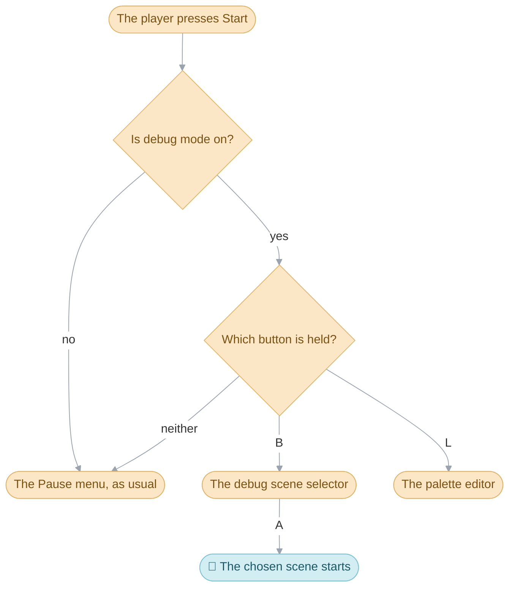

# Debug scenes

Camelot's developers did not walk from Vale to Venus Lighthouse every time
they wanted to test something there. They had a small window that could send
the party to any place in the game, and a few rooms built only for testing:
one that hands out Djinn, one that raises levels and gives any item, and one
full of familiar faces who each run a test when talked to.

All of it is still on the cartridge. The window is in the recording above,
opened in Vale. The rooms are the last ten places in the game's list.

A player never sees any of this. One switch inside the game, called debug
mode, keeps it shut, and in the game as it was sold nothing a player can do
turns that switch on. The recordings on this page were made by setting the
switch from outside the game.

This page shows what is behind the switch:

1. [How the debug scenes are reached](#how-the-debug-scenes-are-reached):
   the window that goes anywhere.
2. [What else the switch unlocks](#what-else-the-switch-unlocks), from
   walking through walls to winning a battle with one button.
3. [The test scenes](#the-test-scenes): eight rooms of Djinn.
4. [Increase item and level](#increase-item-and-level), where a cat raises
   the party's levels.
5. [Menu test](#menu-test), a room of shop, item and message tests.
6. [Setup runs on every visit](#setup-runs-on-every-visit): why a test can
   be repeated.
7. [Why debug mode stays off](#why-debug-mode-stays-off).

## How the debug scenes are reached

The game is divided into [scenes](../../glossary.md#scene). A scene is one
place the party can be: Vale is one, the World Map is one, each floor of a
lighthouse is one. The game numbers them from 0 to 200.

The developers also gave every scene a short code. Vale is `SPWV00`. Vale on
the stormy night the game opens with is `PLOGV00`. The World Map is `WORLD`
and the title screen is `TITLE`. These codes are stored with the rest of the
game's text, in all six languages, and one window is the only thing that
ever shows them.

That window is the [debug scene selector](../../glossary.md#debug-menus). It
holds two numbers. The first is a scene. The second is an
[entrance](../../glossary.md#entrance), which is one of the spots in a scene
where the party can arrive, such as a particular doorway. Above the numbers
it writes the scene's code and the name of the area that entrance belongs
to.

It opens on the scene the party is standing in, at the entrance they came in
by. In the recording at the top it is opened in Vale, so it starts on
`SPWV00`.

| Button         | What it does                                 |
| -------------- | -------------------------------------------- |
| Up and Down    | switch between the scene and the entrance    |
| Left and Right | step the number by one                       |
| L and R        | step it by ten                               |
| A              | sends the party to that scene and entrance   |
| B              | closes the window                            |

Step left from scene 0 and the number goes round to 200, so every scene can
be reached. The test rooms are the last ten, 191 to 200.

Pressing A works the way a door does. Walk through a door in Vale and the
game notes which scene and entrance come next, ends Vale, and starts the new
scene. The selector writes the same note with the two numbers on screen, and
everything after that happens as it would for a door
([Scenes](../scene/README.md#exits)).

### The buttons that open it

Press Start in a town and the
[Pause menu](../window/README.md#the-pause-menu) opens, with `Save your
quest`, `Sleep` and `Change settings`.

Before it opens that menu, the game first asks whether debug mode is on. If
it is, and B is held down, the selector opens instead. If it is, and L is
held instead, a second tool opens.

The second tool is a palette editor. The console keeps the picture's colours
in short lists called palettes, and the editor shows one list at a time:
fifteen colours, each with its amounts of red, green and blue. A developer
could turn those amounts up and down and watch the town behind the window
change colour.

A third tool takes the place of the field menu, the one with Psynergy,
Djinn, Item and Status, when that menu is opened with B and Select held. It
is a flag editor. A [flag](../../glossary.md#game-flag) is one yes-or-no
fact the game remembers, such as "this Djinni has been caught" or "this
boss is beaten". The editor shows 256 of them at a time as a grid of 0s and
1s, sixteen pages in all, and A flips the one under the cursor. With it a
tester could pretend any part of the story had or hadn't happened.

## What else the switch unlocks

The three windows are only part of it. With debug mode on, the whole game
behaves a little differently, in ways a tester would want and a player would
call cheating.

**Walking through walls.** Hold L while walking and nothing blocks the way,
in a town or on the World Map. The game skips the check that asks whether
the next step is clear.

**Skipping through a conversation.** While a story moment is playing, press
R and every pause in it ends at once, and the people in it stop opening
their speech windows. Press L and it plays normally again.

**Stopping time.** Hold Start and Select together and the game freezes. Then
A, B, Select or the direction pad lets it move on by a single
[frame](../../glossary.md#frame), one of the sixty pictures the console
draws each second. Start lets it run again.

**Looking at the enemies.** In a battle, choose Status with Start held and
the Status screens show the enemies instead of the party.

**Three more lines on the Pause menu.** Under `Change settings` it gains
`Rough menu`, `Recovery test` and `Restart quest`. They are only labels now.
The part of the game that acts on the Pause menu's choice has nothing for
these three, so picking one just closes the menu.

**A warning about the save.** If the game can't find the cartridge's save
memory when it reaches the file screen, debug mode makes it say so:
`Unable to detect backup memory.`

Three more changes each need a flag to be set as well as the switch, so a
tester could turn them on and off with the flag editor:

- **No steps counted.** The game stops noticing the party's steps. No
  random battles start, and on the World Map the towns don't react when the
  party walks onto them. Entering the World Map by its own debug entrance
  sets this flag.
- **Winning with one button.** Hold R while a battle's turn is being worked
  out and every enemy is defeated. Hold R and Select and the party is
  defeated instead.
- **A warning click.** The game clicks at each step while it is running
  short of room for the pictures it has loaded.

## The test scenes

Scenes 191 to 198 are named `TEST0` to `TEST7`, and their area names are
Test 0 to Test 7. They are all the same room.

Four [Djinn](../../glossary.md#djinn) stand in the dark: Flint, Fizz, Forge
and Gust. Those are the first Djinni of each
[element](../../glossary.md#the-four-elements), Venus, Mercury, Mars and
Jupiter.

Talk to Flint and he joins the party, with the same capture and the same
message as a Djinni met on the road. He goes to the party member who has the
fewest Djinn, as any Djinni does.

Then the room does one thing no real place does. The game keeps a flag for
each Djinni that says it has been caught, and Flint only stands in the room
while his flag says he has not. Straight after giving him to the party, the
room turns his flag back to "not caught". So Flint is standing there again
on the next visit, ready to be caught again.

That is the whole room. Talking to someone runs a short piece of the scene's
code called an [event](../../glossary.md#event), and each of the four events
here is the same two steps: give the Djinni, then turn its flag back. With the
four Djinn and the list that says which event belongs to which Djinni, the
scene comes to fewer than 130 lines. It is a good first scene to read:
[test_scenes.c](test_scenes.c).

The eight scenes share that one piece of code. Each has a map of its own, but
every one of those maps is drawn entirely in black, which is why the
recording shows Isaac and the Djinn on an empty screen.

## Increase item and level

Scene 199 is `GET_ITEM`, and its area name is the one the developers gave it:
Increase item and level. It is another black room, and the figures standing
in it are the tools. None of them has a name in the game, so they are
described here by what they look like.

**A cat raises levels.** It is drawn at 1.6 times its normal size, the one
giant in the room. Talk to it and a window reads `Raise everyone's level.`
over the leader's name and level. A raises every party member by one level,
with a small jingle. Start or Select raises everyone by five, with a bigger
one. B closes the window.

**A statue of a lady gives items.** Her window reads `Item No:` with a
number, the item's name and what it does. The numbers run from 0 to 269. Up
and Down step by one, Left and Right by ten, L and R by thirty, and the
window passes over any number whose item has no picture. A gives the item on
show to the first party member with room for it. When every bag is full the
window says `ITEM FULL........` instead.

**Saturos shows icons.** Talking to him opens a page of 32 small pictures at
a time: the icons of items, the icons of Psynergy, or a third set of
status icons. L and R switch between the three kinds, and Left and
Right turn the pages.

**Menardi shows portraits.** She steps through the faces the game puts
beside a line of speech, each with a number and a name, starting at `0
Isaac`. In the English game the eighth is Jenna's face, and the name under it
is `Jasmine`. That is Jenna's name in the Japanese game, left untranslated in
a list no player was meant to read.

Menardi also answers to Force, the
[Psynergy](../../glossary.md#psynergy-and-pp) that shoves a thing from a
distance. She is set up so that the shove does not move her, and the cast
runs one more test instead. Which test depends on the language. In the
Japanese game it starts her walking animation and makes the cat shake its
head. In the other five it opens a window with three rows of letters and
marks. The first row reads `A B C D E F G H J K L M N O`, with no `I`.

**A man in a white turban lists abilities**, in every game but the Japanese
one. His window reads `Psy No:` and steps through abilities by number,
showing the name and description of each, the way the statue steps through
items. He can only be talked to in the English and German games. The French,
Spanish and Italian games still carry his code, but he has been moved far
from the others and talking to him runs nothing.

**Two last figures test emotes**, also outside the Japanese game. An emote
is the little bubble that pops up over someone's head. Talk to the first and
a wince appears over it, followed by a line of speech. Talk to the second
and an ellipsis appears over the first, followed by the same line.

The item and ability windows are in [level.c](level.c).

## Menu test

Scene 200, `MENU`, is the busiest room. Fourteen figures stand in rows, most
of them drawn as characters every player knows, and each one runs a test of
the menus, the shops or the bags.

### Two Felixes

Two of the fourteen are Felix, and they are the neatest test in the room.

A shopkeeper has 43 different lines, for every turn a sale can take: the
welcome, the price, the refusal when the party can't pay. There are several
sets of them, one for each kind of shop ([Shops](../shop/README.md)). Someone
had to read every one of those lines in its window, in every language.

So Felix answers differently depending on where Isaac stands. Talk to the
first Felix from below and he shows the weapon shop's lines one after
another. From his right he shows the armor shop's, from his left the item
shop's, and from above the Sanctum's. A or Down goes on to the next line, Up
goes back, and B stops.

Many of those lines are stored with gaps for a name, an item or a number.
The test fills them the same way every time: the name is Garet, the item is
the Virtuous Armlet, and the number is 123456.

The second Felix does the same for the three shops in Xian, whose keepers
call the party `warrior`. He has no fourth set to show. From above he says
nothing in the English game, and in the German, French, Spanish and Italian
games he shows a single line borrowed from Vale.

One Felix can give four answers because of how a scene decides who says
what. It keeps a list with a row for each thing that can happen, such as
"when the player talks to this person, run this event". The game calls a row
a [trigger](../../glossary.md#trigger). A row can add one more condition: the
way the party's leader is facing. Felix simply has four rows.

The Japanese game has neither of these. There, the first Felix opens a
screen for choosing a party member, and the choice is not used for anything.
The second opens an item window like the statue's.

### The other twelve

The room first builds a party to test with. Jenna leaves it, and Garet, Mia
and Ivan join Isaac. Garet, Mia and Ivan are raised to level 30. Isaac is
raised to 50, or to 30 in the Japanese game, which also sets the party's
coins to 777,777.

Then each figure does one thing when talked to:

- **Garet** raises levels. `You went up a level!`, he says, and the four are
  brought up to level 10. The next talk brings them up to 20, and so on by
  tens. Since the room already made them level 30, his first three talks
  change nothing.
- **Jenna** hands out weapons and armor with `You got sturdy equipment!`:
  the Gaia Blade and Muramasa for Isaac, a Demon Axe for Garet, a Zodiac
  Wand for Ivan, an Angelic Ankh for Mia, and more.
- **Ivan** fills the bags with things to use, from Antidotes and Herbs to
  Waters of Life and Lucky Peppers. `You got an item!`
- **Mia** opens the name entry screen, to rename Isaac.
- **Kraden** opens the screen a player meets when the bags are full and
  something has to be given up.
- **Dora** gives Djinn. `You got a Djinni!`, and Isaac has seven Venus
  Djinn, Garet seven Mars, Mia seven Mercury and Ivan six Jupiter, all of
  them set.
- **Saturos** hurts the party. `The body is being torn apart.` Everyone
  loses HP and PP, Isaac is poisoned and haunted, and Garet is given the
  deadlier poison.
- **Menardi** gives `You got treasure!`: the four Elemental Stars, the
  Mythril Bag, the Orb of Force, eleven Game Tickets, eight Lucky Medals and
  other rare things.
- **Vale's armor merchant** opens a shop set up to test everything a shop
  can do. The party is given 200,000 coins. Isaac and Garet are each handed
  a broken piece of equipment to have repaired. Mia, Jenna and Ivan are
  poisoned or haunted. In the Japanese game the shop sells Vale's armor, as
  his looks promise. In the other five it sells Vale's weapons, which is why
  an armor merchant greets Isaac with the weapon shop's welcome in the
  recording further down.
- **The ivy** from Goma Cave opens the same icon pages Saturos shows in
  Increase item and level. Whirlwind, Force and Catch can be cast at it, and
  nothing happens.
- **A second Saturos** says one line from Vale, `Kyle... Will they be able
  to stop the Boulder?`
- **A second Dora** changed from language to language. In the Japanese,
  English and German games she opens the Sanctum's menu. In the French game
  she gives the party a Nut. In the Spanish and Italian games she only says
  `That IS dangerous!`

The room's code is [test.c](test.c).

## Setup runs on every visit

A shop's Artifacts list is where rare items turn up. The game keeps a count
for each rare item of how many the shops may sell. Selling a Masamune to a
shop adds one to its count, and buying one takes it away again.

Menu test fills those counts itself: three Shamshirs, two Silver Blades, one
Masamune and eight rare pieces of armor. In the recording Isaac buys the
Masamune, leaves, comes back, and finds it on sale again.

That happens because every scene has a piece of code that runs each time the
party enters it ([Scenes](../scene/README.md#the-entry-table)). For a town,
this is where the game puts things back the way its flags say they should
be. For Menu test it is where the party is built and the counts are added.
The room adds to them on every visit, so a tester can come in as often as
needed and always find something to buy.

Levels do not pile up the same way. The room only raises a level that is
below its target, so a second visit to a party already at level 30 changes
none.

The other rooms set up far less. The Djinn rooms do nothing on entry, since
turning the flags back already happened when the Djinni was given. Increase
item and level does little more than make its cat big.

## Why debug mode stays off

Can a player turn the switch on? Not with anything the game offers. No
button press and no menu changes it.

Only two places in the whole game ever set the switch. The first is the
moment the console is switched on, when the game turns it off.

The second is one more developers' tool: a viewer that shows copies of one
of the game's figures standing in a ring on a green screen, for checking
its animations. Starting that viewer turns debug mode on.

And nothing starts the viewer. It is still on the cartridge, ready to run,
but no menu, no scene and no button leads to it.

So in a player's game the switch stays where start-up left it, and holding B
while pressing Start does nothing unusual. Seeing any of this takes a tool
outside the game that can reach into the console's memory and flip the
switch by hand, which is how the recordings here were made.

## Design

The test rooms are ordinary scenes. They are stored like Vale, they are
started like Vale, and the selector reaches them by the same two numbers a
door uses. The developers did not need a second way of loading anything in
order to test the game.

That works because a scene builds everything it needs when the party
arrives, wherever they came from ([The Broken
Seal](../../README.md#why-every-sequence-starts-fresh) says why). Vale does
not care whether the party walked in from the World Map or was dropped in by
the selector, and neither does Menu test.

## How it fits with the rest of the game

When Dora hands over Djinn or the armor merchant opens his shop, the room is
not using a test copy of anything. It runs the very same Djinn and shop code
that Vale and every other scene run. So what a tester saw in Menu test's
shop is what a player would see in a real one.

## Limits

The selector's shoulder buttons are blunt. R adds ten to the scene number,
but past the end it does not carry on counting round as single steps do: from
195 it jumps straight to 0. It also puts the entrance number back to 0 each
time.

The entrance number always runs from 0 to 99, whatever the scene. The
selector does not know how many entrances a scene has, and the test rooms
have one each.

## Words used here

- **debug mode**: the switch this page is about. Start-up turns it off, and
  everything on this page needs it on.
- **the selector**: the debug scene selector, the window with a scene number
  and an entrance number. It is one of the
  [debug menus](../../glossary.md#debug-menus).
- **a test room**: one of the ten scenes at the end of the list, 191 to 200.

## Evidence

The names are Camelot's. The selector's text holds a code for each of the
201 scenes, ending in `TEST0` to `TEST7`, `GET_ITEM` and `MENU`, and its list
of area names ends in Test 0 to Test 7, Increase item and level and Menu
test. The names of the rooms' code are ours, chosen from the messages the
rooms show.

## For readers of the code

The scene codes are the messages from `MsgDebugSceneCode` on, and the area
names from `MsgDebugAreaName` on, in each file under `games/tbs/text`.

The switch is `gDebugMode`. It is written only in
`system/system/start_up.c` and `field/field/sprite_viewer.c`. The viewer has
a [far call](../../glossary.md#far-call) in `gamepak/far_call/FIELD.S`, the
list of things other [banks](../../glossary.md#bank) may ask the field bank
to do, and nothing uses it.

The selector, the flag editor and the icon and portrait pages are in the
window bank ([debug.c](../window/screens/debug.c)). The field opens them
from [the field
sequence](../field/README.md#the-field-sequence-serves-requests), which also
holds the palette editor
([palette_editor.c](../field/field_sequence/palette_editor.c)). A test
room's code is an [overlay](../../glossary.md#overlay) like any scene's,
started by the [field sequence](../../glossary.md#field-sequence) and the
[main routine](../../glossary.md#main-routine), and it reaches the Djinn and
shop code as every overlay does ([System
code](../system/README.md#how-an-overlay-reaches-the-rest-of-the-game)).

The eight Djinn rooms use maps `map_172` to `map_179`, which no other scene
uses. Each borrows `map_001`'s layout and adds a tileset of its own that is
entirely black.

The test rooms are not [unused](../../glossary.md#unused): the selector
reaches them as it reaches every scene. That word is kept for what nothing
reaches at all, such as the battle test menu the battle bank also keeps.
