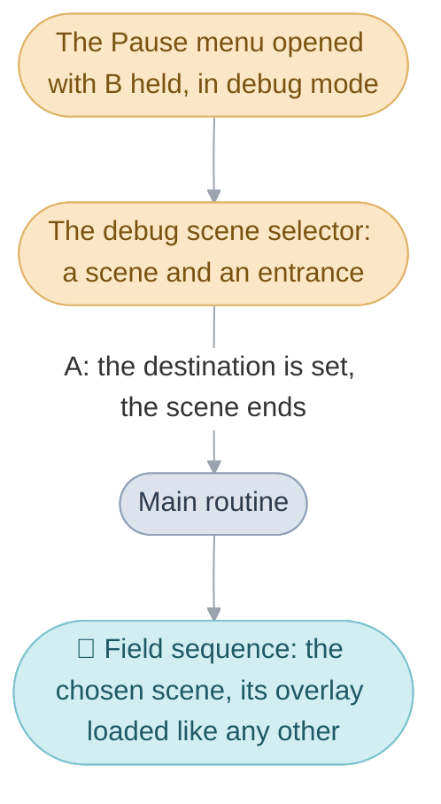

# Debug scenes

The developers left their test rooms on the cartridge. It still holds ten
[scenes](../../glossary.md#scene) they used to test the game, and the small
window they used to jump to any scene at all.

A player never sees them. The window opens only in debug mode, a switch in
memory that start-up turns off.

Eight of the ten are test scenes that hand out
[Djinn](../../glossary.md#djinn). One raises levels and browses items,
icons, portraits and abilities. One tests shops and messages.

They are ordinary scenes, built exactly as [Scenes](../scene/README.md)
describes, and that makes them worth reading. The test scenes are a whole
scene in fewer than 130 lines.

1. How the debug scenes are reached: the selector, and why debug mode stays
   off.
2. What a debug scene's setup does on every visit.
3. The three kinds of debug scene, one section each.

## How the debug scenes are reached

The [debug scene selector](../../glossary.md#debug-menus) is a small window
with two numbers. One is a scene, from 0 to 200, and the other is an
[entrance](../../glossary.md#entrance), from 0 to 99.

Beside them it shows the scene's code and the area name the entrance belongs
to, such as `PLOGV00` and Vale for Vale on the stormy night. It starts on the
scene being played, at the entrance the party came in by.

| Button         | What it does                                        |
| -------------- | --------------------------------------------------- |
| Up and Down    | switch between the scene and the entrance           |
| Left and Right | step the number by one                              |
| L and R        | step it by ten                                      |
| A              | leaves for that scene and entrance                  |
| B              | closes the window                                   |

Both numbers wrap round, so the selector reaches every scene. The debug
scenes are the last ten, 191 to 200. They are the eight test scenes, then
Increase item and level and Menu test.

Leaving through the selector is the same handover as walking through a
door. The selector writes the chosen scene and entrance as what runs next
and asks the scene to end. The
[field sequence](../../glossary.md#field-sequence) ends it, and the
[main routine](../../glossary.md#main-routine) starts the chosen scene,
unpacking its [overlay](../../glossary.md#overlay) as it would for any door
([Scenes](../scene/README.md#exits)).

The field opens the selector when the
[Pause menu](../window/README.md#the-pause-menu) is opened with B held, in
debug mode only.

The same mode opens two more tools. A flag editor takes the place of the
field menu when B and Select are held, and a palette editor opens with L on
the Pause menu.

### Why debug mode stays off

Debug mode is one switch, `gDebugMode`, and only two pieces of code ever
write it. Start-up turns it off. A [sprite](../../glossary.md#sprite-and-oam)
viewer, another developer's tool, turns it on.

Other [banks](../../glossary.md#bank) could reach the viewer through the
field bank's table of [far calls](../../glossary.md#far-call), but nothing on
the cartridge calls it. So a player's game stays in the mode start-up set.

The debug scenes still count as reachable, because the selector reaches them
as it reaches every scene. [Unused](../../glossary.md#unused) is kept for
what nothing reaches at all, such as the battle test menu the battle bank
also keeps.

## Setup runs on every visit

A scene's setup runs each time the [party](../../glossary.md#the-party)
enters ([Scenes](../scene/README.md#the-entry-table)). For a town that means
putting back what its flags say has happened.

For a debug scene it means building the test again. A tester can come in as
often as needed and find the same test.

The three setups differ:

- The test scenes' does nothing.
- Increase item and level's draws the level editor 1.6 times its size (1.7
  in Japanese) and starts the animations of the people who test emotes.
- Menu test's builds a test party. Jenna leaves, and Garet, Mia and Ivan
  join. The shops are stocked with three Shamshirs, two Silver Blades, a
  Masamune and eight rare pieces of armor. Everyone is raised to level 30,
  and Isaac to 50 outside the Japanese edition. In Japanese the coins are
  also set to 777,777.

Menu test adds to the shops' stock on each visit. So a Masamune bought in the
room is on sale again the next time the party comes in, as the recording
shows.

Levels are different. The setup raises a level only while it is below the
target, because levels only ever go up.

## The test scenes

Flint, Fizz, Forge and Gust stand in the scene, one Djinni of each
[element](../../glossary.md#the-four-elements). Each stands there while its
[flag](../../glossary.md#game-flag), the one that says it has been caught,
is clear.

Talking to one runs an [event](../../glossary.md#event) two steps long.
First it gives the party that Djinni, with the same capture the game plays
everywhere, so the Djinni goes to the party member with the fewest. Then it
clears the Djinni's flag again. The Djinni is standing there on the next
visit, and the test can be run again.

Those two steps are all the scenes need from the rest of the game. The whole
scene is four actors, four rows that say "when the player talks to this
Djinni, run its event", and four events that make the same two calls. You can
read all of it in [test_scenes.c](test_scenes.c).

The eight test scenes share this one overlay and differ only in their map.
Each map is drawn with tiles that are all black, so the screen shows the
actors on black.

## Increase item and level

The scene's map shows nothing but black, and its people are the tools. One
raises the party's levels. Others step through every item, icon, portrait
and ability in the game. Outside Japanese, two more test the emotes.

The level editor raises the party one level with A and five with Start or
Select, with a jingle for each. B closes it.

The item browser steps through the 270 item numbers, by one, ten or thirty
at a time. It skips a number whose item has no icon, and gives the chosen
item to the first party member with room.

The editions differ. The ability browser can be talked to only in English
and German, though French, Spanish and Italian keep its code.

The portrait browser has a second use. Force, the
[Psynergy](../../glossary.md#psynergy-and-pp) that pushes a thing from a
distance, can be cast at it, and it stays where it stands. In Japanese that
runs a motion test, and elsewhere it shows the captions of the character set.

The browsers are in [level.c](level.c).

## Menu test

The people here run the shop, message and inventory tests on the party the
setup built:

- Garet raises the four to level 10, then to 20 on the next talk, and so
  on. Nothing changes until the target passes the levels set on entry.
- Jenna hands out test equipment, and Ivan items to use.
- Mia opens the name entry screen for Isaac.
- Others open the screen for choosing an item to give up when the bags are
  full, give out Djinn and treasure, wound and afflict Isaac and Garet, and
  run a ready-made shop with 200,000 coins, broken equipment and afflicted
  party members.

There are two Felixes, and they changed most between editions. In Japanese
they are plain talkers. One opens a character selector whose choice nothing
uses, and the other opens an item browser.

Everywhere else each Felix answers four ways. He can, because a row of a
scene's [trigger](../../glossary.md#trigger) table can ask which way the
leader is facing.

Face the first Felix from below, from the right, from the left or from above,
and you browse the lines of the weapon shop, the armor shop, the item shop or
the Sanctum, as the recording shows. The second Felix does the same for
Xian's three shops, whose keepers call the party warriors
([Shops](../shop/README.md)). Facing him from above has no row in English,
and in the other four editions shows one line from Vale with no speaker.

The scene's code is [test.c](test.c).

## Design

The debug scenes are ordinary overlays, reached through the ordinary
destination, a scene and an entrance. So testing needs no separate path
through the code.

That works because [every sequence starts
fresh](../../README.md#why-every-sequence-starts-fresh). A scene builds
everything it needs on arrival, wherever the party came from.

## How it fits with the rest of the game

The debug scenes' events call the same code the real scenes call, through the
same tables ([System
code](../system/README.md#how-an-overlay-reaches-the-rest-of-the-game)).

The selector opens from [the Pause menu](../window/README.md#the-pause-menu),
inside [the field
sequence](../field/README.md#the-field-sequence-serves-requests). The selector
and the flag editor are in the window bank
([debug.c](../window/screens/debug.c)), and the palette editor is with the
field sequence ([palette_editor.c](../field/field_sequence/palette_editor.c)).

## Limits

- The selector's scene number runs from 0 to 200 and its entrance number
  from 0 to 99.
- The item browser covers item numbers 0 to 269.

## Words used here

- **debug mode**: the switch `gDebugMode`, which the field tests before
  opening the selector, the flag editor and the palette editor.
- **the selector**: the debug scene selector, one of the
  [debug menus](../../glossary.md#debug-menus).
- **a browser**: a window that steps through one kind of the game's data,
  an item, icon, portrait or ability at each press.

## Evidence

Camelot labels the eight test scenes `TEST0` to `TEST7`, and their area
names are Test 0 to Test 7. The other two are labelled `GET_ITEM` and `MENU`
and take their area names, Increase item and level and Menu test. Their
functions are named for what they let a tester do, going by the messages
they show.

The eight test scenes use maps `map_172` to `map_179`, which no other scene
uses. Each is the same placeholder, a copy of `map_001`'s tables with an
all-black tileset of its own. The test scenes are rows of the scene table
that were reserved and never given content of their own, which is why one
overlay serves them all.

The debug mode switch is written only in `system/system/start_up.c` and
`field/field/sprite_viewer.c`, and the viewer's far call is in
`gamepak/far_call/FIELD.S`.
