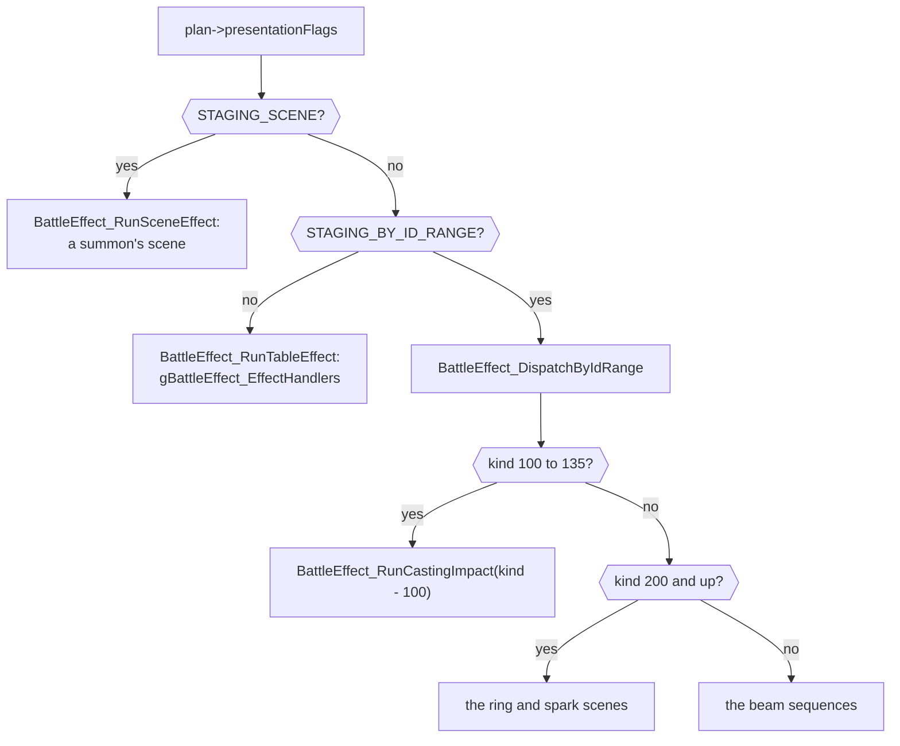
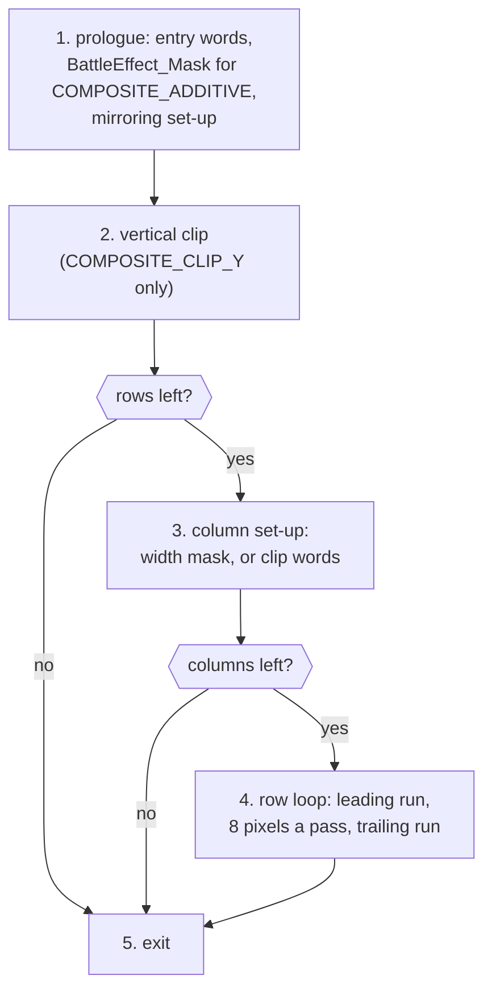
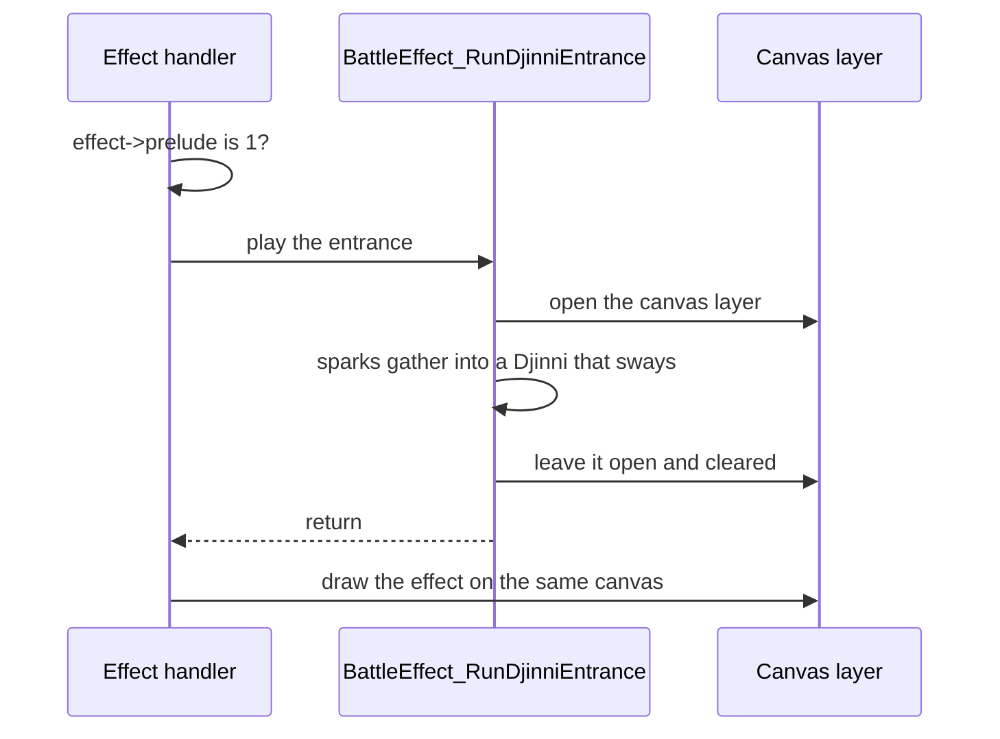
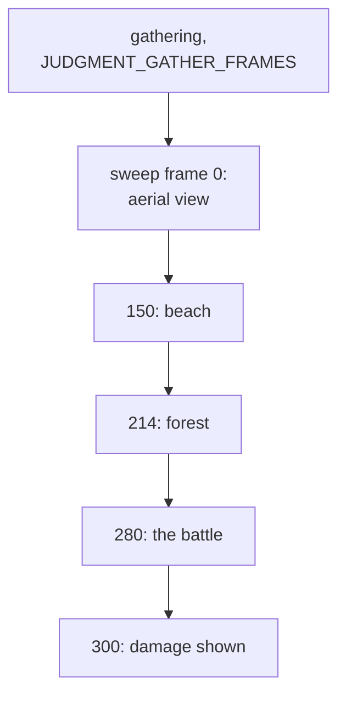
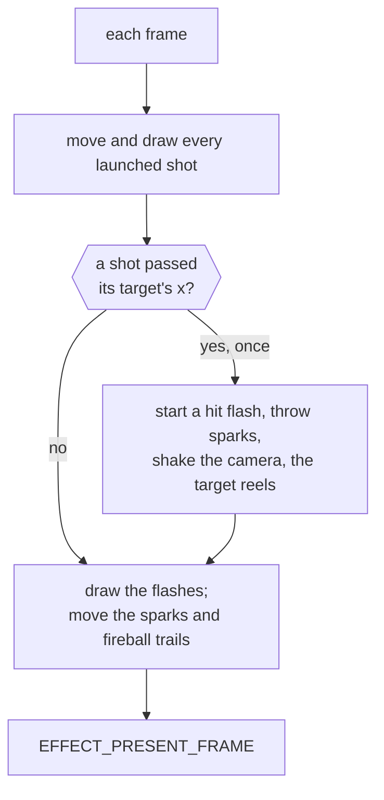

# Battle effects


A battle effect is the animation drawn over the battle while an ability plays:
Psynergy, a Djinni, a summon, an item or a monster's attack. Each effect is one
function, its handler, which the battle calls with a
`struct BattleEffectArgument` (the effect kind, the side the targets are on,
the user, the targets, the variant and the prelude flag). The handler draws a
fixed number of frames and returns when the animation is over. It decides only
when the damage appears, by calling `EFFECT_SHOW_DAMAGE`; how the battle shows
the damage from a task while the effect is still drawing is in
[Battle](../../battle.md#rules-and-effects-run-together).

## How a move picks its effect

An ability's row in `actflags.tsv` gives the effect kind, its variant and how
the battle stages it, packed into one word of the plan.

Each ability, ids 0 to 518, has a row in
[`battle/actflags.tsv`](../battle/actflags.tsv) (`gBattle_ActionFlags`). Its
`effect` and `flags` columns are two halfwords; its `ability` column is a label
for readers that the build skips. When `BattleCommand_BuildPlan`
(`battle/battle/plan.c`) plans an action, it copies the row into the plan's
`presentationFlags` as one word, `effect` in the low half, and the `STAGING_`
macros in `battle/battle_internal.h` name its fields:

| Bits | Field | What it holds |
| --- | --- | --- |
| 0 to 11 | `STAGING_KIND_MASK` | the effect kind, 0 for none |
| 12, 13 | `STAGING_VARIANT_MASK` | the variant, the ability's strength |
| 14 | `STAGING_BY_ID_RANGE` | the kind goes to `BattleEffect_DispatchByIdRange` |
| 15 | `STAGING_SCENE` | the kind is a summon's scene, an `enum SceneEffectKind` |
| 16 | `STAGING_ON_DOWNED` | shown on downed targets too |
| 17 | `STAGING_OTHER_SIDE` | played from the other side |
| 18 | `STAGING_VIEW_ACROSS` | the camera takes the other side's view |
| 19 | `STAGING_VIEW_REVERSED` | the camera turns right round |

Quake, Earthquake and Quake Sphere read `0x001`, `0x1001` and `0x2001`: the
kind `BATTLE_EFFECT_QUAKE` at `EFFECT_VARIANT_BASIC`, `EFFECT_VARIANT_STRONGER` and
`EFFECT_VARIANT_STRONGEST`. Ramses reads `0x8001`, the scene
`SCENE_EFFECT_RAMSES`, and Meltdown `0x4079`, a kind dispatched by its range.
The plan changes the word in three cases: a double or triple blow raises the
variant by the first target's multiplier less one; an ability whose effect
revives adds `STAGING_ON_DOWNED`, which no row sets; and Annihilation's
instant death landing on its first target sets the variant to 1. No row sets
`STAGING_OTHER_SIDE`. Four rows set `STAGING_VIEW_ACROSS` (Venus, Mercury, Mars
and Jupiter) and twenty `STAGING_VIEW_REVERSED`, among them the blessings,
Astral Blast and Dragon Driver.

The effect kind picks only what the player watches. The formula the targets
take is the ability kind, in `game/actions.tsv`, which
[Battles](../battle/README.md) explains: Quake's ability kind is
`ABILITY_KIND_DAMAGE` and its effect kind `BATTLE_EFFECT_QUAKE`.

| Name | Value | Meaning |
| --- | --- | --- |
| `EFFECT_VARIANT_BASIC` | 0 | Quake, Douse, Ply |
| `EFFECT_VARIANT_STRONGER` | 1 | Earthquake, Drench, Ply Well |
| `EFFECT_VARIANT_STRONGEST` | 2 | Quake Sphere, Deluge, Pure Ply |
| `EFFECT_SIDE_ENEMIES` | 0 | the targets are enemies |
| `EFFECT_SIDE_PARTY` | 1 | the targets are the party |
| `BATTLE_EFFECT_NONE` | 0 | no effect: the dispatcher only clears the variant |
| `BATTLE_EFFECT_QUAKE` | 1 | the first kind of the handler table |

### The handler table

An ordinary effect kind indexes `gBattleEffect_EffectHandlers` (`effect_table.c`),
whose rows start at `BATTLE_EFFECT_QUAKE`, the first kind after `BATTLE_EFFECT_NONE`:

```c
[BATTLE_EFFECT_QUAKE - 1] = BattleEffect_RunQuake, // quake.c: Quake
```

Each row's comment names the part that defines the handler and the first
ability that selects the kind. Of the table's 407 rows, 162 have a handler,
143 different functions between them; a kind with no handler has no name in
`enum BattleFxKind` ([`effect.h`](../../include/unit/effect/effect.h)) and an
empty row. Abilities whose rows give the same kind and variant play the same
effect.

A handler is named for the first ability, by id, whose row selects its kind,
under the English release's name: the first row to select `BATTLE_EFFECT_QUAKE` is
Quake's, so its handler is `BattleEffect_RunQuake`. A handler several kinds share
takes the name of its lowest kind's first ability, and a name another handler
has already taken passes to the next ability: `BATTLE_EFFECT_NOVA` plays through
`BattleEffect_RunNova` because its first ability is the second Blast (ability 57),
the first having taken `BattleEffect_RunBlast`. The three handlers no ability
reaches are named from what they draw. Searching the code for a move's English
name therefore finds its handler.

Many kinds belong to a family that one runner draws, and the mode it is passed
picks the member. The kind's handler is then a two-line function that calls the
runner: `BattleEffect_RunCure` calls
`BattleEffect_RunHealingMotes(effect, HEALING_MODE_CURE)`.
[Effect families](#effect-families) lists the runners.

### Reach lines

A handler's comment opens with a sentence saying what the player sees, then a
reach line: the abilities whose rows reach it, and the effect each selects.
The reach line has a fixed form, because the docs build reads it to put each
ability's recording beside its handler and reports a line it cannot match:

```c
/// Abilities: Gaia, Mother Gaia, Grand Gaia, Rockfall, Rockslide, Avalanche
/// (BATTLE_EFFECT_GAIA).
```

It starts with `Abilities: ` and ends with a full stop. Between them are one or
more groups separated by `; `, each a list of ability names separated by `, `,
then a space and the effect the group selects in parentheses. A name is
written as the `ability` column of `actions.tsv` writes it, once in its group
even where several rows share it (the three Fire Blessings). Where rows that
share a name select different effects, like the two Blasts, the group's effect
says which rows are meant. A group whose effect no row selects has `none` for
its list. Names keep their rows' order, groups follow their effects' values,
`none` groups come last, and the line reads as its lines joined by single
spaces:

```c
/// Abilities: Heartrender (BATTLE_EFFECT_HEARTRENDER_346); none
/// (BATTLE_EFFECT_HEARTRENDER).
```

The effect is an enumerator, never a number, and its prefix says how it is
reached:

- `BATTLE_EFFECT_` (`enum BattleFxKind`): a row of the handler table;
- `SCENE_EFFECT_` (`enum SceneEffectKind`): a row with `STAGING_SCENE`;
- `CASTING_IMPACT_` (`enum CastingImpact`, in
  [`casting_impact.c`](parts/casting_impact.c)): a row with
  `STAGING_BY_ID_RANGE` and a kind from 100 to 135, the enumerator's value
  being the kind less 100;
- `FIELD_KIND_` (`enum FieldKind`,
  [`psynergy_effects.h`](../../include/unit/object/psynergy_effects.h)): field
  Psynergy, matched against the `type` column of `actions.tsv`, the form the
  [field Psynergy effects](../object/README.md) use.

Anything else that reaches the handler (an item, another effect that hands
over to it) is a sentence in the next paragraph. A function no row reaches,
such as a runner, has no reach line; its comment says what calls it.

## Entry points and their blocks

The battle starts an effect through one of three entry points, chosen by the
plan's `STAGING_` bits, and each entry point takes and frees the heap blocks
every effect draws with.



The battle's staging (`battle/battle/staging.c`) makes the choice as
[Battle](../../battle.md#effects) describes: `BattlePresentation_RunUnitTransition`
tests `STAGING_SCENE` first, and the attack and Psynergy staging test only
`STAGING_BY_ID_RANGE`. Each entry point allocates
three heap slots, runs the effect and releases them in reverse:

| Slot | Value | Holds |
| --- | --- | --- |
| `HEAP_SLOT_BATTLE_SHEET` | 41 | one set of the ten mote pictures (`MOTE_SET_BYTES`), where most effects decode `ParticleSpritesA` |
| `HEAP_SLOT_BATTLE_EFFECT` | 39 | the work block, `struct BattleEffectWork` |
| `HEAP_SLOT_BATTLE_CANVAS` | 40 | the canvas (`CANVAS_BYTES`) |

- `BattleEffect_RunTableEffect` ([`dispatch.c`](parts/dispatch.c)) sets
  `work->effect` and calls the kind's handler. `BATTLE_EFFECT_NONE` plays nothing
  and only resets the variant.
- `BattleEffect_RunSceneEffect` (`dispatch.c`) switches on `enum SceneEffectKind`
  to the twelve summons' scenes, and leaves setting `work->effect` to each.
  `SCENE_EFFECT_NONE`, which no row selects, plays Meteor's scene.
- `BattleEffect_DispatchByIdRange` ([`positions.c`](parts/positions.c)) splits by
  the kind's range: 100 to 135 are the casting impacts
  (`BattleEffect_RunCastingImpact`, given the kind less 100), 200 and up the ring
  and spark scenes, and every other kind the beam sequences. Its sheet slot is
  `0x60e` bytes, from EWRAM first.

Releasing a heap block also releases every block allocated after it
([Runtime](../runtime/README.md)), so the three come back in the reverse of the
order they were taken, and an effect must remove every callback that reads
them before it returns. While it runs, an effect also has the two blitter slots
(`HEAP_SLOT_BLITTER`, `HEAP_SLOT_BLITTER_ALTERNATE`) and the map cell buffer
(`PARTICLES`) to itself, and frees the blitters before it returns.

A critical hit adds `EFFECT_KIND_CRITICAL_OFFSET` to an attack's kind in
`BattlePresentation_RunAttack` (`battle/battle/staging.c`), which plays the
blow's critical version: for the plain attacks' kinds 1 to 5, the ring and
spark scene at 201 to 205.

| Name | Value | Meaning |
| --- | --- | --- |
| `MOTE_SET_BYTES` | 770 | one set of the ten mote pictures |
| `EFFECT_KIND_CRITICAL_OFFSET` | 200 | added to an attack's kind for a critical hit |
| casting impacts | kinds 100 to 135 | `BattleEffect_RunCastingImpact`, given the kind less 100 |
| ring and spark scenes | kinds 200 and up | through `BattleEffect_DispatchByIdRange` |

## The canvas

Most effects draw into one canvas, a 128 by 128 picture of palette levels that
`BG2` shows blended over the battle.

![Garet casts Heat Wave at Mia. On the left, the screen at twice its size: rings of red light gather round Garet, a fireball swells from him and streams left over Mia as a long blaze, bursts into sparks and embers that drift up and fade, and `Mia takes 90 damage!` appears. On the right, the canvas as character block 1 holds it, 128 pixels square, each byte drawn in the colour its level names, with the 64-level ramp beneath it: the same rings, blaze and embers, squeezed to half their width, on an empty dark ground.](https://alchemy.pascalpixel.com/guides/effect/effect-canvas.gif)

The canvas is 128 by 128 pixels at one byte each, stored as the hardware
stores a 256-colour background, 16 by 16 tiles of 8 by 8 pixels.
`BattleEffect_BeginCanvasLayer` ([`canvas.c`](parts/canvas.c)) makes `BG2`, the
layer the hardware can scale and rotate, show the canvas from character block
1, alpha-blended over the battle inside the effect windows and stretched to
twice its width so that it spans the screen; it waits five frames of its own
while the registers change. `EFFECT_BEGIN_NARROW_CANVAS` opens the layer at one
canvas pixel to a screen pixel instead. On the wide canvas a point x pixels
across the screen is at x / 2 on the canvas. `BG2`'s scale (`REG_BG2PA`) is 8.8
fixed point (`Q_8_8(1)` is 1) and its reference point (`REG_BG2X`) has 8
fractional bits.

A canvas pixel is a level, an index into the palette ramp the effect has
loaded into the first 64 background colours. Level 0 is transparent to the
transparent blitters, as colour 0 is to the hardware, and 63 is as high as
adding and brightening go.

In the recording the canvas holds Heat Wave's pictures at half the width the
screen shows them: the blaze that crosses the screen from Garet to Mia
crosses the canvas from its middle to its left edge. Everything else on the
screen, the battlefield, the fighters and the windows, is the battle's own
layers, over which `BG2` is blended.

| Name | Value | Meaning |
| --- | --- | --- |
| `CANVAS_BYTES` | `(128 * 128)` | the canvas, one byte a pixel |
| level 0 | | transparent to the transparent blitters |
| level 63 | | the highest level adding and brightening reach |
| `REG_BG2PA` | `Q_8_8(0.5)` | the wide canvas: two screen pixels to a canvas pixel |
| `REG_BG2PA` | `Q_8_8(1)` | the narrow canvas (`EFFECT_BEGIN_NARROW_CANVAS`): one screen pixel to a canvas pixel |

### The transfer

The transfer copies each finished frame of the canvas into video memory and
then clears, fades or darkens what the canvas keeps for the next frame.

![Heat Wave's canvas six times side by side, frame for frame, each run with its transfer forced to another mode: `CANVAS_COPY`, `CANVAS_COPY_AND_CLEAR` 0, `CANVAS_COPY_AND_FADE` 50 (Heat Wave's own), `CANVAS_COPY_AND_FADE` 75, `CANVAS_COPY_AND_DARKEN` 0x04040404 and `CANVAS_COPY_AND_BRIGHTEN` 0x01010101. Left as drawn, the blaze and every ember stay and pile up into a white mass; cleared, only the embers drawn that frame show; faded by half, each ember leaves a short tail; by three quarters, a longer one; darkened by 4 levels, long tails that turn yellow before they go; and brightened by 1 level, the whole empty canvas climbs the ramp from dark red to white.](https://alchemy.pascalpixel.com/guides/effect/effect-transfer.gif)

An effect never writes video memory itself. It draws a frame, then
`EFFECT_PRESENT_FRAME` sets `work->transferPending` and waits a frame. The
scheduler callback `BattleEffect_ProcessPendingGraphicsTransfer`, which
`EFFECT_START_TRANSFER` adds, copies the canvas into character block 1 and then
treats what is left in the canvas as `work->transferMode` says
(`enum CanvasTransferMode`, in `battle/battle_effect_work.h`), with
`work->transferValue` as its argument.

The picture plays Heat Wave six times, writing a mode over
`work->transferMode` and `transferValue` each time
`BattleEffect_ProcessPendingGraphicsTransfer` runs, and shows the canvas each run
presented, read from its heap block as the copy starts. The volley presents
78 canvases in every run, its `total` of frames, and draws the same pictures
in the same places, since the transfer draws no random numbers. A trail lasts
as long as a level takes to fall to 0: halving takes level 63 to 0 in six
frames, three quarters keeps it longer, and a step of 4 takes sixteen frames
from 63 and lowers a bright pixel no faster than a dim one, so darkened
trails stay bright the longest. Brightening raises level 0 as well, so it
fills the whole canvas, not only what was drawn. No effect sets
`CANVAS_COPY_AND_BRIGHTEN`; every transfer an effect starts copies, clears,
fades or darkens.

The usual end of a canvas effect, `EFFECT_FINISH_CANVAS`, removes the transfer
callback before anything it reads is freed, then frees the two blitters and
closes the layer (`BattleEffect_EndCanvasLayer`). A handler's comment mentions its
ending only when it differs.

Two kinds of effect use `BG1` as well. The beam sequences and the ring and
spark scenes call `BattleEffect_SetupCanvasTileMap`, which shows the canvas on `BG1`
at its own size instead of on `BG2`. The particle streams of Meteor and Outer
Space (`BattleEffect_RunParticleStreams`, [`particle_streams.c`](parts/particle_streams.c))
draw a full-screen picture into `Ram_MapCellBuffer` while their formation
rises, shown on `BG1` through `BattleEffect_FlushPendingGraphicsTransfer`, which
copies `0x7800` bytes into character block 2; their burst then switches back to
the blended half-scale canvas on `BG2`.

| Mode | Value | After the copy, the canvas is |
| --- | --- | --- |
| `CANVAS_COPY` | 0 | left as drawn |
| `CANVAS_COPY_AND_CLEAR` | 1 | filled with `transferValue`, 0 to clear it |
| `CANVAS_COPY_AND_FADE` | 2 | each level halved when `transferValue` is 50, else scaled to three quarters |
| `CANVAS_COPY_AND_DARKEN` | 3 | each level lowered by a byte of `transferValue`, stopping at 0 |
| `CANVAS_COPY_AND_BRIGHTEN` | 4 | each level raised by a byte of `transferValue`, stopping at 63 |

## Particles

Sparks, motes, embers and chips of rock are particles, kept in two fixed pools
that an effect reserves ranges of.

![Garet casts Heat Wave at Mia, the screen on the left and the two particle pools on the right as grids of slots, dark when free. Of the 64 in the work block, the first seven are the fireballs: dim until launched, orange in flight and white once they have hit. Of the first 1,024 of `PARTICLES`, seven hit flashes light at the top and stay lit; the sparks from slot 100 fill in yellow rows as each fireball hits, over 270 at once, dim as their lives run out and are all free again before the end; and the trails from slot 512 fill in red rows, two for each fireball every frame, until about 480 of the 512 are in use at once, and stay that full until the effect ends.](https://alchemy.pascalpixel.com/guides/effect/effect-particles.gif)

A particle is a `struct EffectStep`
([`effect_step.h`](../../include/field/effect_step.h)): a position and a
velocity on three axes, in 16.16 fixed-point pixels (65,536 is one pixel), and
one spare word, `variant`, that each effect uses for a life, a frame or a
picture. `EFFECT_FREE_PARTICLES` marks particles free with a `variant` of -1,
though some families mark them otherwise, as their own comments say.

There are two pools. The work block holds 64 (`work->particles`). Larger
effects borrow the map's cell buffer, which the battle does not need while an
effect plays: `PARTICLES` names it as particles and `Ram_MapCellBuffer` as
bytes, both at its fixed address. `ewram.s` lays out 32 KB for
`gMapCellBuffer` before `gActorSpriteSlots` and gives the symbol a size of
48 KB, which would hold 1,755 particles. Each effect reserves ranges of
indices, named where it sets them up, and reuses a finished particle's slot
for the next one launched, so a pool never grows during an effect.
`EffectStep_AdvanceWithGravity2D` and its 3D twin
([`positions.c`](parts/positions.c)) move particles under gravity, and
`BattleUnit_ProjectToScreen` turns a battle position into a screen point.

A projectile volley shows both pools at work. Heat Wave's seven fireballs are
`work->particles` 0 to 6, and the volley frees its 1,024 `PARTICLES` with a
`variant` of 0, not -1. Each hit throws 40 sparks into the first free slots
from `PROJECTILE_VOLLEY_FIRST_SPARK`, and each fireball leaves two trails a
frame in the first free slots from `PROJECTILE_VOLLEY_FIRST_TRAIL` for as long
as the volley runs, even after it has hit and flown off the canvas, so the
trail range stays nearly full, about 480 of its 512 slots, each trail living
32 to 39 frames. Heat Wave's hit flashes are marked lit and never drawn or
freed, since only the comet modes draw them.

Several families break something apart: boulders into chips, shells into
shards, an impact into fragments. Each piece is a particle, and each runner
throws its pieces out itself, because every family draws its own random
ranges and the order of those draws is part of its output.

| Name | Value | Meaning |
| --- | --- | --- |
| `work->particles` | 64 particles | the work block's pool |
| `PARTICLES` | 1,170 particles | the map cell buffer's 32 KB before `gActorSpriteSlots` |
| `variant` -1 | | a free particle, as `EFFECT_FREE_PARTICLES` marks it |
| `PROJECTILE_VOLLEY_FIRST_SPARK` | 100 | a volley's first spark in `PARTICLES` |
| `PROJECTILE_VOLLEY_FIRST_TRAIL` | 512 | a volley's first fireball trail in `PARTICLES` |

## Blitters

A blitter is an ARM routine, built while the game runs, that copies a picture
of a given width and height onto the canvas with its top left at a given
point.



Every picture an effect puts on the canvas gets there through a blitter. The
picture may be mirrored across (`COMPOSITE_FLIP_X`) or up and down
(`COMPOSITE_FLIP_Y`), clipped at the canvas's edges (`COMPOSITE_CLIP_X`,
`COMPOSITE_CLIP_Y`), and combined with the canvas in one of four modes
(`battle/battle_effect.h`).

`BattleEffect_BuildBlitter` ([`blitter.c`](parts/blitter.c)) writes an ARM routine
for exactly one combination of canvas size, mirroring, clip and mode while the
game runs, into a heap slot, which the heap places in IWRAM when it fits and
in EWRAM otherwise. `EFFECT_LOAD_BLITTER` builds one for the 128 by 128
canvas. An effect usually holds its two as a `BlitterPair`, `[0]` in
`HEAP_SLOT_BLITTER` and `[1]` in `HEAP_SLOT_BLITTER_ALTERNATE`;
`BattleEffect_FetchRectangleBlitters` ([`mirrored_wall.c`](parts/mirrored_wall.c))
builds the usual pair, clipped on all four sides, `[0]` in `COMPOSITE_MAX` and
`[1]` in `COMPOSITE_ADDITIVE`, both mirrored across when it is passed the
targets' side. The battle's star field (`battle/battle/star_field.c`) and
`object/colorfx.c` reach the builder from other banks through
`BattleEffect_BuildBlitterFar` (`system/far_call/EFFECT.S`).

The builder walks a template of ARM words, `BattleEffect_Composite`, and splices in
the pixel fragments of the mode asked for, from
[`battle_effect_composite.s`](battle_effect_composite.s) and
[`battle_effect_composite_color.s`](battle_effect_composite_color.s), whose
opening comments give the fragments' registers. Some template words are
copied, some chosen by the flags, and some have a number added: the canvas
width or height, or a branch distance. The routine has five blocks:

1. The prologue: three entry words; for `COMPOSITE_ADDITIVE`, the three words
   of `BattleEffect_Mask`, which puts `0x40` in each byte of a register so that a
   sum reaching it can be capped; then the set-up for the mirroring.
2. The vertical clip, only when the routine clips top and bottom.
3. The column set-up: a test that skips everything when no rows are left;
   then either a mask that wraps x round the canvas width or, when clipping
   left and right, the clip words, two of which take the width as an ARM
   immediate from `gBattleEffect_BitOperands` ([`effect_bits.c`](effect_bits.c),
   the rotated-immediate encoding of each power of two from 1 to 32,768); and
   a second test that skips everything when no columns are left.
4. The row loop: a leading run pixel by pixel up to the first 8-pixel
   boundary, a loop of eight pixels a pass, and a trailing run, each skipped
   when empty; its head carries the canvas size in tiles.
5. The exit, where both skip tests land.

Forward branches are written with distance 0, their place remembered and
patched when the walk reaches their target; backward branches are written at
once. The walk runs twice: once only counting words, then into a heap block of
exactly that size. A slot that already holds a block keeps it whatever its
size, and the new routine is written over it, so a caller releases the slot
first when the new routine may be longer. `BattleEffect_BuildBlitter` returns
whether the walk ended just past the template's last word, and no caller reads
the result.

| Name | Value | Meaning |
| --- | --- | --- |
| `COMPOSITE_CLIP_X` | 1 | skips columns outside the canvas; without it a width mask wraps x |
| `COMPOSITE_CLIP_Y` | 2 | skips rows outside the canvas's height |
| `COMPOSITE_FLIP_X` | 4 | mirrors the picture left to right |
| `COMPOSITE_FLIP_Y` | 8 | mirrors the picture top to bottom |
| `COMPOSITE_COPY` | 0 | each pixel replaces the canvas pixel |
| `COMPOSITE_TRANSPARENT` | 1 | each pixel replaces it unless it is level 0 |
| `COMPOSITE_MAX` | 2 | keeps the brighter of the two |
| `COMPOSITE_ADDITIVE` | 3 | adds the two, capped at 63 |
| `HEAP_SLOT_BLITTER` | 46 | a `BlitterPair`'s `[0]` |
| `HEAP_SLOT_BLITTER_ALTERNATE` | 47 | a `BlitterPair`'s `[1]` |

## Pictures

An effect's pictures are linear sheets of levels, decoded from a resource into
`work->sheet` at offsets the runner chooses.


A picture in a sheet is linear, one byte a pixel row after row, unlike the
tiled canvas. The pictures are indexed PNGs in
[`graphics/battle_fx`](../graphics/battle_fx). Quake's rock is
`rock_wall.png`, 40 by 96 pixels:


The build's `ags-graphics` turns it into `rock_wall.gbapal`, its colours as the
hardware stores them, and `rock_wall.bitmap.lz`, its pixels LZ-packed;
`rock_wall.s` joins them, palette first, as `BattleEffect_RockWallSheet`, and the
`BattleEffect` group of the resource directory (`system/resource/directory.s`)
gives it the id `ResourceId_RockWallSheet`. Effects ask for a picture by id,
never by label. `BattleEffect_RunQuake` ([`quake.c`](parts/quake.c)) loads it with
`Resource_LoadAndDecompress`, whose two flags send the palette to the first 64
background colours and the pixels to `work->sheet` at `QUAKE_WALL_CELLS`.

A sheet has no layout of its own: each runner puts its pictures at the offsets
it reads them from (the `*_CELL` and `*_CELLS` constants). Quake keeps the
start of its sheet for a 40 by 16 strip it cuts from the battle's own
background, the ground that caps each pillar. Each frame it draws every
standing pillar with two calls of a `COMPOSITE_TRANSPARENT` blitter, the top
`height` rows of the rock with their top edge at `112 - height` and the strip
above them, and the transfer clears the canvas after each copy
(`CANVAS_COPY_AND_CLEAR`). `height` follows the absolute value of a sine, so a
pillar rises and sinks although only the share of the picture shown changes,
as the recording above shows.

Quake opens its canvas at its own width and turns blending off, so the
pillars hide what is behind them.

Since a pixel is only a level, nothing ties a picture to its colours. The
rushing strikes ([`rushing_strike.c`](parts/rushing_strike.c)) load one burst
and copy another sheet's palette over it, so four abilities draw the same
burst in four colourings, and a picture drawn with `COMPOSITE_MAX` or
`COMPOSITE_ADDITIVE` needs its levels in the ramp the effect loads. A fade
draws from darker copies of a picture built before the first frame. A
symmetric picture is stored as one half and mirrored.

| Name | Value | Meaning |
| --- | --- | --- |
| `work->sheet` | 27,008 bytes | the decoded pictures, before the scanline table |
| `imageStorage` | 28,800 bytes | the whole of the sheet's storage, for an effect that builds no scanline table |

## Effect families

Moves that look alike share an animation drawn with different settings, by
variant or by the mode a family's runner is passed.


The simplest share it through the variant alone: Gaia, Rockfall and the others
in Gaia's reach line play `BATTLE_EFFECT_GAIA`, and `BattleEffect_RunGaia`
([`gaia.c`](parts/gaia.c)) sets `REG_BG2PA` so that `BG2` stretches the canvas
1.25 times across at `EFFECT_VARIANT_BASIC`, 1.5 times at
`EFFECT_VARIANT_STRONGER`, and twice, as the canvas layer left it, at
`EFFECT_VARIANT_STRONGEST`. The same wall therefore comes out wider, and a
higher variant also draws each rock larger. Rockfall, in the first recording,
plays at the basic variant and Avalanche, in the second, at the strongest.

Larger families have a runner that draws every member, and each member's
handler passes it a mode. The mode indexes the family's table in
`effect_table.c`, whose named columns give its pictures, counts and timing.
The largest:

| Runner | Part | What it draws |
| --- | --- | --- |
| `BattleEffect_RunTargetStrike` | [`target_strike.c`](parts/target_strike.c) | repeated slashes or columns of light on the first target |
| `BattleEffect_RunProjectileVolley` | [`projectiles.c`](parts/projectiles.c) | shots that fly from the user and burst on each target |
| `BattleEffect_RunLobbedShells` | [`lobbed_shells.c`](parts/lobbed_shells.c) | shells lobbed at each target in turn, bursting into smoke |
| `BattleEffect_RunBurstShower` | [`burst_shower.c`](parts/burst_shower.c) | a shower of bursts at random points near the targets |
| `BattleEffect_RunTargetMotes` | [`target_motes.c`](parts/target_motes.c) | smoke, hearts or orbs turning around each target |
| `BattleEffect_RunStatBoost` | [`stat_change.c`](parts/stat_change.c) | flares that swirl into each target and burst |
| `BattleEffect_RunStatReduction` | [`stat_change.c`](parts/stat_change.c) | a dagger or shield over each target that shatters |
| `BattleEffect_RunHealingMotes` | [`healing.c`](parts/healing.c) | healing motes swirling in to each target |
| `BattleEffect_RunStreakVolley` | [`streaks.c`](parts/streaks.c) | streaks fired from above the user at each target |
| `BattleEffect_RunRushingStrike` | [`rushing_strike.c`](parts/rushing_strike.c) | the user rushes at the first target and strikes |
| `BattleEffect_RunBurstScene` | [`burst_scene.c`](parts/burst_scene.c) | a flurry of strikes on the first target |
| `BattleEffect_RunGrowingColumns` | [`growth.c`](parts/growth.c) | vines or green pillars growing from the ground |
| `BattleEffect_RunSparkGroups` | [`plasma.c`](parts/plasma.c) | flashes and bouncing sparks in one or three bursts |
| `BattleEffect_RunDjinnBeams` | [`djinn_beams.c`](parts/djinn_beams.c) | a Djinni appears, then columns of light fall on the targets; passed an element rather than a mode |

Smaller runners, such as `BattleEffect_RunMirroredWall` and
`BattleEffect_RunGatheringLights`, have two or three members each. The sections
below cover the families whose shared state is easier to follow told as a whole
than piece by piece in the code.

### The prelude

The prelude is a Djinni's entrance that some effects play first, when
`effect->prelude` is 1.



The effects that test it (in `bind.c`, `burst_scene.c`, `djinn_beams.c`,
`projectiles.c` and `stat_change.c`) first play `BattleEffect_RunDjinniEntrance`
([`projectiles.c`](parts/projectiles.c)): sparks gather into a Djinni that
sways and, in its long form (`DJINNI_ENTRANCE_LONG`), bursts into motes. It
opens the canvas layer, leaves it open and cleared, and the effect that
follows draws on it.

### Casting impacts

A casting impact gathers sparks on the caster and strikes the target, for
eight Djinn and many weapons' unleashes.


The attacks of eight Djinn (Bane, Smog, Mist, Fever, Flint, Scorch, Squall and
Sap) and many weapons' unleashes, such as Terra Strike, Meltdown and Asura, are
casting impacts: `BattleEffect_RunCastingImpact`
([`casting_impact.c`](parts/casting_impact.c)), passed the kind less 100 as an
`enum CastingImpact`. Each runs in four phases, marked in the code:

1. The gathering: `CASTING_IMPACT_SPARKS` sparks, each in its own random
   rotation, close in on the caster over `CASTING_IMPACT_GATHER_FRAMES`, and a
   Djinni's impact shows its Djinni 80 pixels above the caster once the first
   spark has gone out.
2. The placing: `BG2` is moved so that the impact sits over the target. Four
   impacts stop here and hand the canvas on: three that no row selects go to
   Blizzard's volley (`PROJECTILE_VOLLEY_BLIZZARD`), Mystic Flame's orbs and
   `PROJECTILE_VOLLEY_IMPACT_COMETS`, and Severe Blow's goes to the spark groups
   (`SPARK_GROUPS_RISING`). The fourth unused one,
   `CASTING_IMPACT_IMPACT_UNUSED_GATHERING`, simply ends.
3. The impact, 20 to 80 frames by impact. The caster's overlay, an orb, sparks
   and the impact's own animation are drawn while some impacts step the
   background palette towards their own. A Djinni flies to the target over the
   first six frames. The damage shows on frame 3, the heavy impact sounds on
   frame 4, and the target is knocked back on frame 6 and flashes on frames 6
   and 14.
4. The release, or for Meltdown a hand-over to `BattleEffect_RunImpair`, a stat
   reduction.

`work->particles` holds the gathering sparks and then 32 scattering sparks
whose `variant` is their life. The impact's own animation has
`CASTING_IMPACT_IMPACT_PARTICLES`, 64 particles 16 KB into
`Ram_MapCellBuffer`. An impact that hands over first removes its callbacks and
releases the blitters the next runner replaces.

Flint's impact, `CASTING_IMPACT_IMPACT_FLINT`, has no animation of its own, so
its recording, the first above, shows only what every impact shares: the
gathering, the Djinni's flight, the orb and the sparks. Scorch's,
`CASTING_IMPACT_IMPACT_SCORCH`, adds sixteen flash bursts rising from the
target.

| Name | Value | Meaning |
| --- | --- | --- |
| `CASTING_IMPACT_SPARKS` | 64 | gathering sparks in `work->particles` |
| `CASTING_IMPACT_GATHER_FRAMES` | 32 | frames the sparks gather |

### Venus, Mercury, Mars and Jupiter

The four summons that need one Djinni draw a small Djinni of their element and
throw flames at the targets.

The four are ordinary effect kinds, `BATTLE_EFFECT_VENUS` to `BATTLE_EFFECT_JUPITER`,
in [`djinn_attacks.c`](parts/djinn_attacks.c). Each draws a small Djinni of its
element on the canvas and throws flames at the targets: `MERCURY_FLAMES`
fired across, `JUPITER_FLAMEBALLS` falling from the top right,
`VENUS_COLUMNS` rising from the ground and `MARS_FLAMES` erupting along an
arc. The flames live in `work->particles`. The motes a flame shatters into live
in `PARTICLES`, `DJINN_ATTACKS_MOTES_PER_FLAME` slots a flame (Venus fills 16
of them), and the Mars Djinni's embers `MARS_EMBERS_PER_FLAME` a flame.

| Name | Value | Meaning |
| --- | --- | --- |
| `DJINN_ATTACKS_MOTES_PER_FLAME` | 32 | `PARTICLES` slots for each flame's motes |
| `MARS_EMBERS_PER_FLAME` | 16 | embers in each of Mars's flames |

### Judgment

Judgment's scene replaces the battle's display and runs in two parts, a
gathering and a sweep, each with its own frame clock.



Judgment's scene ([`judgment.c`](parts/judgment.c)) is outlined in
[Battle](../../battle.md#effects). The gathering lasts `JUDGMENT_GATHER_FRAMES`: a projected formation
of `JUDGMENT_FORMATION_OBJECTS` moves forward while rotating motes shrink in on
its centre, a burst grows there and throws shards, and a ring of dimming motes
spreads outward. The sweep lasts `JUDGMENT_SWEEP_FRAMES` and changes backdrop,
palettes and debris on set frames: an aerial view from frame 0, a beach from
150, a forest from 214 and the battle again from 280; it shows the damage on
frame 300. Throughout, expanding rings are drawn into a
`JUDGMENT_WAVE_SIZE`-square wave picture kept in the work block.

A or B skips ahead in both parts by different rules: the gathering ends at once
after frame 4, while the sweep jumps to its next backdrop's frame.

The gathering's motes are `PARTICLES` 0 to 127 and its sparks the 128 after
them (`JUDGMENT_SPARKS`); the sweep's debris objects are moved by
`work->particles` 0 to 15. The work block is read as `struct JudgmentWork`:
`JUDGMENT_SHEET_BYTES` of pictures, then eight dimmed copies of the mote sheet.
The sweep draws its wave from the start of the sheet over most of the dimmed
copies, which only the gathering needs.

| Name | Value | Meaning |
| --- | --- | --- |
| `JUDGMENT_GATHER_FRAMES` | 160 | frames of the gathering |
| `JUDGMENT_SWEEP_FRAMES` | 320 | frames of the sweep |
| `JUDGMENT_FORMATION_OBJECTS` | 16 | objects in the formation, 4 by 4 |
| `JUDGMENT_WAVE_SIZE` | 120 | the wave picture is 120 by 120 pixels |
| `JUDGMENT_SPARKS` | `&PARTICLES[128]` | the gathering's sparks |

### Spark groups

The spark groups strike one burst of flashes and bouncing sparks, or three at
the strongest variant, for Nova and its kin and for Dynamite.

The spark groups ([`plasma.c`](parts/plasma.c)) strike their bursts
`SPARK_GROUPS_SPACING` frames apart at `EFFECT_VARIANT_STRONGEST`. A burst is a
large flash, shown for two frames; a ring of `SPARK_GROUPS_RING` small
flashes, each drawn for its last `SPARK_GROUPS_FLASH_DRAWN` frames from a
picture chosen by its age; and a spray of sparks that move under their own
gravity, bounce at half speed off the floor and shrink as their life runs out.
`SPARK_GROUPS_RISING`, which Severe Blow's impact and Thrash play, puts the
bursts below the user in the lightning bolt's colours with the sparks rising.
A burst's `SPARK_GROUPS_FLASHES` flashes are `work->particles`, and its sparks
one run of `PARTICLES`.

| Name | Value | Meaning |
| --- | --- | --- |
| `SPARK_GROUPS_FLASHES` | 16 | flashes kept per burst |
| `SPARK_GROUPS_SPACING` | 8 | frames between bursts |
| `SPARK_GROUPS_RING` | 12 | of the flashes, those drawn as the ring |

### Projectile volleys and rushing strikes

A projectile volley fires shots from the user at each target, and a rushing
strike moves the user itself at the first target.



A projectile volley ([`projectiles.c`](parts/projectiles.c)) fires shots from
the user at each target. Its mode (`enum ProjectileVolleyMode`) picks the shot
picture, the aim and the sounds, and its row of `gProjectiles_Modes` gives the
shots a target (`PROJECTILE_VOLLEY_SHOTS`), their flight
(`PROJECTILE_VOLLEY_STEPS`), the stagger between shots and the delay between
targets, and the sparks a hit throws. Each frame moves and draws every launched
shot; a shot that passes its target's x hits once, starting a hit flash,
throwing sparks, shaking the camera and making the target reel; then the
flashes are drawn and the sparks and fireball trails moved. The shots are
`work->particles`, one for each target and shot. `PARTICLES` holds the hit
flashes from 0, the sparks from `PROJECTILE_VOLLEY_FIRST_SPARK` and the
fireball trails from `PROJECTILE_VOLLEY_FIRST_TRAIL`; a flash's `variant` says
whether it is lit and its z counts the frames it has shown, while a spark's or
trail's `variant` is its life. [Particles](#particles) shows Heat Wave's
volley in both pools.

A rushing strike ([`rushing_strike.c`](parts/rushing_strike.c)) moves the user
at the first target with `BattleEffect_SetApproachMotion` (`projectiles.c`), strikes
on `RUSHING_STRIKE_FRAME`, flares a ring and scatters
`RUSHING_STRIKE_SPARK_COUNT` sparks, over `RUSHING_STRIKE_FRAMES` in all. Its
burst picture is stored as its top half, drawn again upside down beneath
itself, and each mode copies its own palette over the burst's.

| Name | Value | Meaning |
| --- | --- | --- |
| `RUSHING_STRIKE_FRAME` | 10 | the frame the user strikes |
| `RUSHING_STRIKE_FRAMES` | 60 | frames of a rushing strike |
| `RUSHING_STRIKE_SPARK_COUNT` | 64 | sparks scattered by the strike |

### Stat reductions and the scenes beside them

A stat reduction breaks a dagger or a shield over each target into shards that
fly off and darken.

A stat reduction ([`stat_change.c`](parts/stat_change.c)) shows a dagger or a
shield over each target, 4 frames apart, and breaks it into
`STAT_REDUCTION_SHARDS` shards that fly off and darken through seven dimmed
copies of the shard picture, built before the first frame. The shards are
`PARTICLES`, `STAT_REDUCTION_SLOTS` to a target, and leave trails because the
transfer fades or darkens what the canvas already holds.

Single-kind scenes nearby follow the same plan: Flare ([`flare.c`](parts/flare.c))
raises `FLARE_ARC_COUNT` flames along half an ellipse, two or three high at the
higher variants; Fire ([`fire.c`](parts/fire.c)) sends embers out of the user
that hang and then home in on the targets; Frost ([`frost.c`](parts/frost.c))
spirals motes around the target while ice columns spring up, then bursts them;
and Blast and Smoke Bomb ([`eruption.c`](parts/eruption.c),
`BattleEffect_RunEruption`) burst a fountain of motes and smoke beside the
targets. Each marks a particle's state in its own way, as its comments say:
Flare's negative `variant` is the wait before a flame starts, Fire's -1 an
ember in flight.

| Name | Value | Meaning |
| --- | --- | --- |
| `STAT_REDUCTION_SHARDS` | 24 | shards drawn for each target |
| `STAT_REDUCTION_SLOTS` | 32 | `PARTICLES` reserved for each target |

### Healing motes

The healing effects are seven modes of one runner that swarms motes around
each target in turn.


The seven are modes of `BattleEffect_RunHealingMotes`
([`healing.c`](parts/healing.c), `enum HealingMotesMode`): Ply, Wish, Cure,
Cure Poison's two (`HEALING_MODE_CURE_POISON` and `HEALING_MODE_RESTORE`), Tonic
and Psy Crystal. Each target gets a swarm of motes around a point 40 pixels
above it, starting `HEALING_STAGGER` frames after the one before. In most modes
the motes are drawn in, 2 pixels a frame; Cure's start as a ring on the ground
around the target, and Cure Poison's and Tonic's stay where they are and go out
one by one. Each target turns white `HEALING_TINT_DELAY` frames into its swarm,
and the battle shows the recovery on `HEALING_DAMAGE_FRAME`.

The motes are `PARTICLES`, `HEALING_SLOTS` to a target. The variant sets how
many each target draws, 32, 64 or 128; the strongest runs on into the next
target's slots.

| Name | Value | Meaning |
| --- | --- | --- |
| `HEALING_SLOTS` | 64 | `PARTICLES` reserved for each target |
| `HEALING_STAGGER` | 8 | frames between one target's start and the next |
| `HEALING_TINT_DELAY` | 36 | frames from a target's start to its tint |
| `HEALING_DAMAGE_FRAME` | 40 | the frame the battle shows the recovery |

### Target strikes

A target strike plays repeated slashes or columns of light on the first
target, for monster attacks such as Cannibal Fang, Poison Tail and Twin Beaks.

These attacks are styles of `BattleEffect_RunTargetStrike`
([`target_strike.c`](parts/target_strike.c)). A style
(`enum TargetStrikeStyle`, twelve of them) gives its strike kind
(`STRIKE_KIND_SLASH`, a sideways slash, or `STRIKE_KIND_COLUMN`, a column of
light), its number of hits, its extras (`STRIKE_SMOKE`, `STRIKE_ABSORB`,
`STRIKE_GLINTS`, `STRIKE_SPARKS`, `STRIKE_HEAVY`), its palette, the frames each
picture is held, the column's composite mode and the scene's length.

The setup parks every particle, idle with a `variant` of -1: 64 smoke puffs at
the target's feet, and 128 motes and 512 sparks 20 pixels up its body, each
with a random velocity. Each frame draws the strike and, on a hit frame, shakes
and flashes the target and lights the next group of particles; then glints are
scattered around the target and the lit smoke, motes and sparks are drawn and
moved. Only the first 128 sparks are ever drawn, though a heavy hit lights all
512.

## Design

An effect is an ordinary function with its own frame loop, as the rest of the
game is ([Engine](../../engine.md#waiting-and-tasks)). Its setup opens the
canvas, builds the blitters, loads the pictures and places the particles; it
runs a fixed number of frames; and it releases what the setup took. Within a
frame, the steps run in a fixed order, each over its own range of frames, and
the frame ends with `EFFECT_PRESENT_FRAME`. The order is part of the output,
as [Battle](../../battle.md#effects) explains. Cues on a single frame (a sound,
a shake, a palette step) are tests of the frame number.

The entry point, not the handler, takes and frees the three heap blocks, so no
handler allocates them and every handler starts from the same three. The cost
is the rule that an effect removes its callbacks before it returns.

A blitter handles one of sixteen mirror and clip combinations in one of four
modes, at the canvas size it was built for, and an effect builds only the one
or two it draws with. XXX: likely generated because a single routine testing
every option for every pixel would be too slow, and IWRAM too small to keep a
routine for each combination; neither the code nor its comments say so.

Because pixels are levels rather than colours, the transfer can fade, darken or
brighten the whole canvas with byte arithmetic, which makes every trail die
away at once with no bookkeeping per particle, and one picture can be drawn in
another palette.

The effects are one object, `effect.c`, written as parts. In the ROM the
effect code is one unbroken stretch, as one source file compiles, and the
tables follow it as separate data, so the source keeps one object. The parts
are ours, cut where one family ends and the next begins; `effect.c`'s
`#include` order is their order in the ROM, and its opening comment walks
through the shared machinery. Each part's first lines say what it holds
(`head -3 parts/*.c` prints them all), and each part includes
`effect_internal.h` so it reads on its own, though it is compiled only through
`effect.c`.

The tables are plain arrays, not `const`: the effect code reloads their
addresses where `const` would let the compiler keep them, so only plain arrays
match. Each function's small constant vectors are `static` variables inside
it, and they sit in the ROM in the order of the functions that use them.

## Limits

- The canvas is 128 by 128 pixels (`CANVAS_BYTES`).
- `work->sheet` holds 27,008 bytes. An effect that does not use the scanline
  table after it (`bg2xLines`) may use up to 28,800 (`imageStorage`).
- The work block has 64 particles. `PARTICLES` has 1,170 before
  `gActorSpriteSlots` and 1,755 in the 48 KB `ewram.s` gives `gMapCellBuffer`.
- There are two blitter slots, and each combination of canvas size, mirroring,
  clip and mode needs its own blitter; a picture's size is passed with each
  call.

## Files

| File | What it holds |
| --- | --- |
| [`effect.c`](effect.c) | the compiled object: includes `effect_internal.h`, then every part in ROM order |
| [`effect_internal.h`](effect_internal.h) | the includes, macros and helpers every part shares |
| `parts/*.c` | the effects, in 66 parts |
| [`effect_table.c`](effect_table.c) | the effects' tables in the order the code uses them (picture cells, sizes, offsets, frame lists) and the handler table |
| [`effect_bits.c`](effect_bits.c) | `gBattleEffect_BitOperands` |
| [`battle_effect_composite.s`](battle_effect_composite.s), [`battle_effect_composite_color.s`](battle_effect_composite_color.s) | the template and fragments blitters are built from |

The headers are in `include/unit/effect/`: [`effect.h`](../../include/unit/effect/effect.h)
declares the functions and names the effect kinds, and `effect_table.h`
declares the tables. `struct BattleEffectArgument` and
`struct BattleEffectWork` are in `include/battle/`. In
`games/tbs/objects.tsv` the rows from `effect` on place the effect code, the
template, the tables, the colour fragments and the bit operands, in that order.

## Words used here

- **effect kind**: `effect->kind`, the number that picks which effect plays.
  `enum BattleFxKind` names the handler table's kinds, `enum SceneEffectKind`
  the summons' scenes and `enum CastingImpact` the casting impacts. It is not
  the ability kind.
- **runner** and **mode**: a runner draws a family of effect kinds, and the
  mode it is passed picks the member.
- **variant**: `effect->variant`, the ability's strength, from
  `EFFECT_VARIANT_BASIC`. A particle's `variant` is unrelated: its spare word.
- **side**: `effect->side`, `EFFECT_SIDE_PARTY` when the targets are the party
  and `EFFECT_SIDE_ENEMIES` when they are enemies. Effects mirror on it.
- **sheet** and **cell**: a sheet is a decoded set of pictures in
  `work->sheet`, and a cell is a byte offset into it.
- **level**: a pixel value, an index into a palette ramp.
- **element**: where a function takes one, an `enum Element` value, from
  `ELEMENT_VENUS` to `ELEMENT_JUPITER`.
- **prelude**: `effect->prelude`, 1 when an effect that tests it first plays
  [the prelude](#the-prelude).

The same locals have the same names in every handler:

| Local | What it holds |
| --- | --- |
| `effect` | the `struct BattleEffectArgument *` the handler is passed |
| `slots`, `cursor` | `&gWorkSlot[HEAP_SLOT_BATTLE_EFFECT]`, and the pointer that walks from it to `work` and `canvas` (`EFFECT_GET_SLOTS`) |
| `work` | the effect's `struct BattleEffectWork` |
| `canvas` | the canvas |
| `sheet` | the decoded pictures, usually `work->sheet` |
| `draw` | the `BlitterPair` it draws with |
| `frame` | the frame counter |
| `cell` | a picture's index or offset |

## Function prefixes

Functions are named `BattleEffect_` unless they act on one thing the engine names
elsewhere, which keeps its own prefix. Helpers private to one part start with
their family's name, like the `CastingImpact_` ones in `casting_impact.c`.
Where a site keeps an unusual spelling to match, [Matching](../MATCHING.md)
lists it.

| Prefix | What it acts on |
| --- | --- |
| `BattleEffect_` | the effects, their entry points, the canvas, blitters and pictures |
| `Camera_`, `Palette_`, `Graphics_`, `Display_`, `Resource_` | the engine's camera, palettes, graphics, display and resources |
| `EffectStep_`, `EffectPosition_` | a particle, and a position an effect works out |
| `BattleUnit_` | a unit's height and place on screen |
| `ObjectGroup_` | an actor's parts, their animation and their colour timers (`work->actorTimers`) |
| `CastingImpact_` and other family names | helpers private to one part |

## Evidence and open questions

A handler's name comes from the abilities that reach its kind, read from
`actflags.tsv` and named as the English release names them; a runner is named
from what it draws. The recordings come from
[Alchemy Devtools](https://github.com/PascalPixel/alchemy-devtools#pictures),
which plays an ability in a built tbs-en edition over a plain grey backdrop.
The take-apart pictures play Heat Wave over the battle's own background and
read the effect's work block, its canvas in character block 1 and
`PARTICLES` after every frame.

Three handlers are unused, and are named from what they draw:
`BattleEffect_RunUnusedOrbitingSpirals` (`planet_diver.c`),
`BattleEffect_RunUnusedTriangleStrike` (`bind.c`) and
`BattleEffect_RunUnusedSevereBlowLeap` (`thrash.c`). The handler table is reached
only with a kind from an `actflags.tsv` row, through the plan's
`presentationFlags`: the plan changes only the variant and the staging bits,
the auto battle passes kind 0, and a critical hit's offset applies only to
plain attacks, which are dispatched by id range. No row names any of the three
kinds. The Lost Age keeps the same three handlers at the same kinds, and its
row for Severe Blow names `BATTLE_EFFECT_UNUSED_SEVERE_BLOW_LEAP`: there Severe Blow
is the leap, where here it plays a casting impact.

A plain attack's kind is 1 or 4 for the party (`BattleCommand_BuildPlan`) and
1 to 5 for an enemy class (`sprites.tsv`), all by id range, so the beam
sequences play them. No ability uses the critical-hit effects
(`ABILITY_EFFECT_CRITICAL_1_IN_64` to `ABILITY_EFFECT_CRITICAL_1_IN_4`), so
only plain attacks score critical hits, and `EFFECT_KIND_CRITICAL_OFFSET`
reaches kinds 201 to 205: the ring and spark scene, which plays the same for
each.

The work block holds no unknown fields. `unused7788` and `padding` (before the
word-aligned `bg2x`) are never read or written in either game; `imageTail` is
the end of `imageStorage`; and a `BattleCanvasOrigin`'s `queued` word is set
once its coordinates are queued, but the queue copies only `x` and `y` and
nothing reads it. A particle's `variant` is each family's own, and each family
says what it holds where it launches its particles.

`work->sheet` and the scanline table share their storage with `imageStorage`,
so an effect may decode a picture past `sheet` only when it doesn't build the
table. `casting_impact.c`, the one part that names both, keeps that rule:
Mortal Danger and Asura decode their pictures from the start of the work
block, Asura's reaching 27,648 bytes, past the table, and those two impacts
alone skip building it.

No effect uses `PARTICLES` past its first 32 KB, over `gActorSpriteSlots`: the
largest range any effect reserves is 1,024 particles, 28 KB
(`gathering_lights.c`, `helm_splitter.c`, `lobbed_shells.c`, `neptune.c`,
`nereid.c`, `plasma.c`, `projectiles.c` and `target_strike.c`).

`BattleEffect_DispatchByIdRange` sizes its sheet slot `0x60e` bytes. The largest
picture its three runners decode there is `ParticleSpritesD`'s ten flare cells,
2 by 2 to 20 by 20 pixels, 1,540 bytes (`2 * MOTE_SET_BYTES`); the slot's last
10 bytes are never written.

- XXX (picture): how a move picks its effect: one kind at its three variants, Quake, Earthquake and Quake Sphere side by side, beside their `presentationFlags` words
- XXX (picture): Venus, Mercury, Mars and Jupiter: the four Djinn attacks' flames in `work->particles` and their motes in `PARTICLES`
- XXX (picture): spark groups: a burst's flashes and the bouncing sparks in their pools
- XXX (picture): stat reductions: the shards of each target's dagger or shield in `PARTICLES`, beside the screen
- XXX (picture): target strikes: the parked smoke, motes and sparks lit group by group on each hit frame
