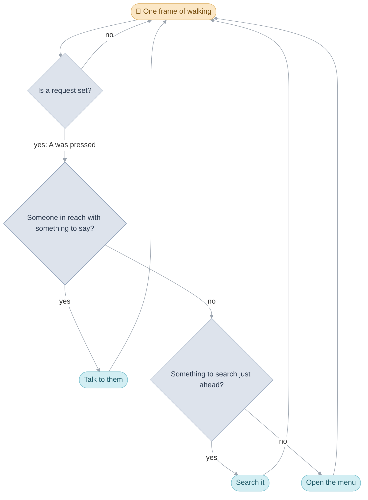
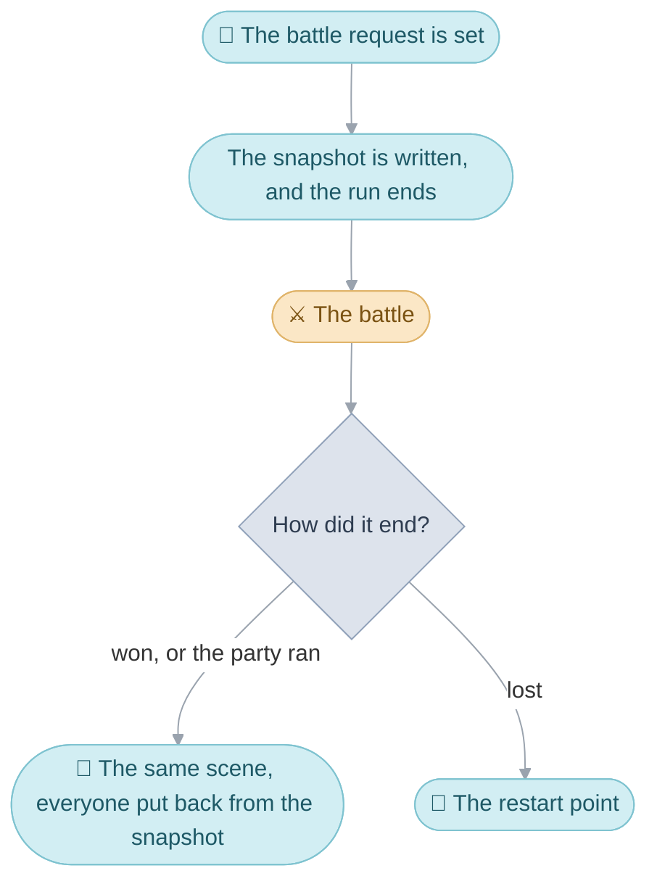
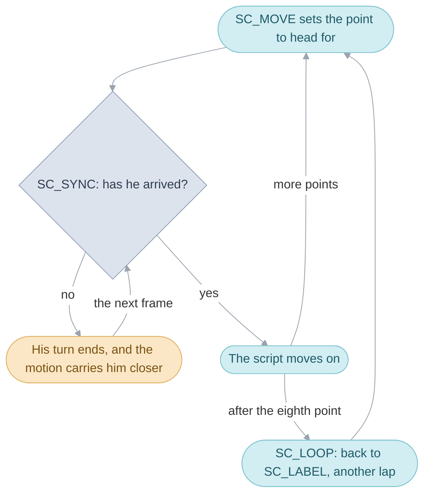
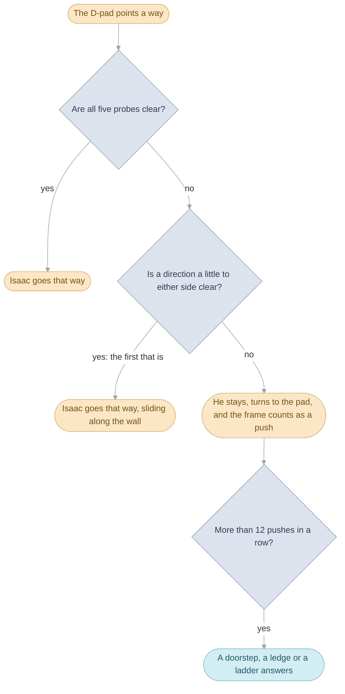
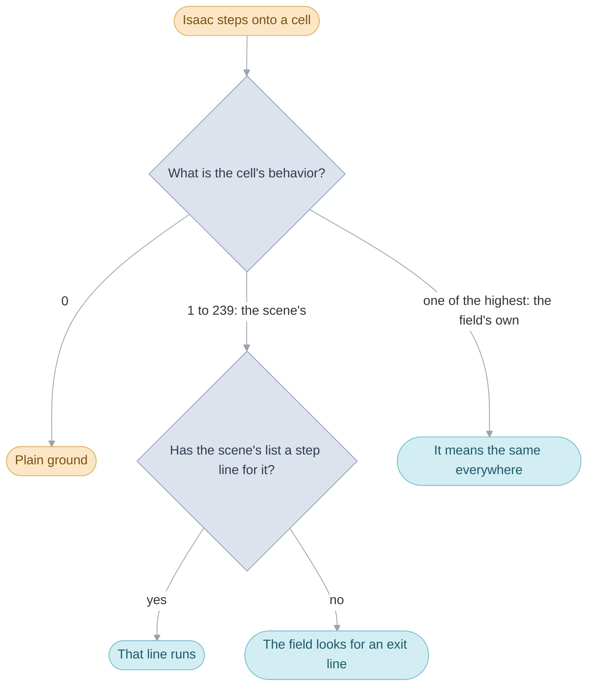
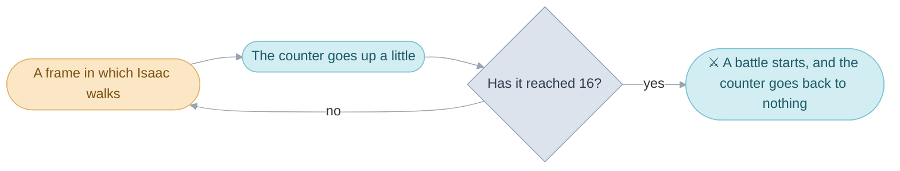
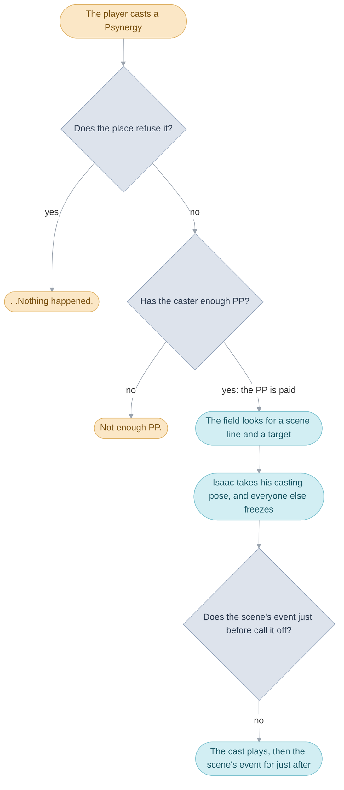

# Field code


In Vault, walk Isaac up to a young man standing in the town and press A.
The man turns to face Isaac, and Isaac turns to face him. He says `Welcome
to Vault, the town at the heart of Angara.` Then the window closes and
Isaac can walk on.

Everything in that moment is the work of this folder. It moves Isaac when
the D-pad is pressed. It moves the villagers who wander, without any help
from the player. It notices the A button, works out who Isaac is facing,
and looks up what that person says.

The player steers one party member, the one at the front, and the game
calls him the leader. This page calls him Isaac, since it nearly always
is.

The game calls all of this the field: everything the player does outside a
battle and outside a menu. This page follows it in the order a player meets
it.

1. One long piece of code runs a whole visit to a town, from the fade in to
   the way out ([The field sequence serves
   requests](#the-field-sequence-serves-requests)).
2. Everything that moves in the town follows a little list of orders
   ([Everything that moves runs an actor
   script](#everything-that-moves-runs-an-actor-script)).
3. The D-pad moves the leader, and the ground decides where he can go
   ([Walking and running](#walking-and-running), [How high a step can
   go](#how-high-a-step-can-go)).
4. The town is drawn around him ([Towns and dungeons on
   screen](#towns-and-dungeons-on-screen), [The World Map in
   perspective](#the-world-map-in-perspective)).
5. Talking, stepping on things and searching find their answers ([What a
   talk, a step or a search runs](#what-a-talk-a-step-or-a-search-runs)).
6. Walking has its costs: [random battles](#random-battles), poison and the
   desert's heat ([What walking does to the
   party](#what-walking-does-to-the-party)).
7. Psynergy is cast on what the leader faces ([How field Psynergy reaches
   its target](#how-field-psynergy-reaches-its-target)).

What belongs to one place is elsewhere. Vault's people, its doors and what
each villager says are Vault's own code ([Scenes](../scene/README.md)), and
the ground Vault stands on is its [map](../../glossary.md#map)
([Maps](../map/README.md)). [Field](../../field.md) gives the whole
division in brief.

## The field sequence serves requests


Walk into a house door in Imil. Everyone in town stops where they are, the
door swings open, and Isaac walks in. A moment before, the player was
steering Isaac freely. Now the game has taken him over to play the door.

One piece of code is behind both halves of that. The game calls it the
[field sequence](../../glossary.md#field-sequence). It starts when the
[party](../../glossary.md#the-party) arrives in a place, it runs for as
long as they stay, and it ends when they leave. Imil with its houses closed
is one run of it. Stepping through that door ends the run, and a new run
begins for the room inside.

Each run does three things in turn. It sets the place up. Then it lets the
player walk, checking after every step of the walk whether anything has
happened that needs an answer: a door, a villager, a monster. When
something has, it stops the walk, answers, and lets the player walk again.

The code is `FieldSequence_Run` in [run.c](field_sequence/run.c). The
game's [main routine](../../glossary.md#main-routine), the code that
decides what the game does next, starts it and tells it which
[entrance](../../glossary.md#entrance) the party came in by. When it ends
it reports the [exit](../../glossary.md#exit) they left by.

### Setting the scene up

Arrive in Vault from the World Map. The screen fades in from a single
colour, `Vault` appears in a small window near the top, and the villagers
are already where they should be.

The game calls a place set up this way a
[scene](../../glossary.md#scene). Setting one up takes these steps, always
in this order, because each needs the one before it:

1. The map is loaded.
2. The scene's random battles are chosen
   ([Random battles](#random-battles)).
3. Room is cleared for 64 [actors](../../glossary.md#actor). An actor is
   anything in the scene that can move: Isaac, a villager, a chest.
4. The scene hands over its list of what can happen there: who can be
   talked to, which doorstep opens which door. Each line of that list is a
   [trigger](../../glossary.md#trigger).
5. The leader is put at the entrance he came in by, and the scene's people
   are put in their places.
6. The chests and Psynergy Stones the map marks are put out, opened or
   closed as the player left them.
7. The scene's own set-up runs. It may send the party straight on to
   another scene, and then this one is never shown.
8. The screen fades in over 16 [frames](../../glossary.md#frame). A frame
   is one picture on the screen, and the console draws about sixty a
   second, so the fade takes a quarter of a second.

If the party has just come into a new area, its name shows for 90 frames, a
second and a half. Moving from one scene to another inside the same area
does not show it again.

### The walk, a frame at a time

After the fade, the player has the leader. For as long as nothing
interrupts, the field does the same three things over and over:

1. It lets one frame of the game go by. In that frame everyone in town
   moves a little, Isaac included, and the picture is drawn.
2. It looks at the ground Isaac is now standing on.
3. It asks one question: has anything happened that needs an answer? If
   not, it goes back to step 1.

It goes round sixty times a second for as long as the player just walks.

Step 2 needs a word about the ground. A map is a grid of squares 16 pixels
across, like a sheet of graph paper laid over the town, and the game calls
each square a [cell](../../glossary.md#cell). A cell says what it is, its
[cell behavior](../../glossary.md#cell-behavior): this is a doorstep, this
is a ledge, monsters live here. Step 2 reads the behavior under Isaac's
feet.

### Requests

So how does pressing A in front of the young man in Vault stop the walk?

The field keeps twelve [field requests](../../glossary.md#field-request),
one for each kind of thing that can interrupt a walk. One of them means "A
was pressed". Another means "the leader stepped on a doorstep", another "a
monster has appeared".

When the player presses A, the request for A is set. Step 3 of the walk
finds a request set, and the walk stops. The field sequence then reads
the requests and answers them.

For the A button it has to work out what the player meant. It looks for
someone to talk to. In Vault the young man is close and Isaac is facing
him, so the A request is replaced by one that says "talk to him". With
nobody in reach, it looks at the ground just ahead for something to search.
With nothing there either, it opens the menu.



Requests come from two places. The cells underfoot set the ones for
doorsteps, ledges and monsters, in step 2 of the walk. The buttons
set the rest: A, Select for the menu, Start for the Pause menu, and L and R
for the Psynergy or item the player has put on them.

### The twelve requests

When several requests are set at once, the field answers them one at a
time, in a fixed order, and goes back to the walk only when none is left.
[The Broken Seal](../../README.md#requests) lists all twelve in that order.
They fall into four groups.

- Leaving comes first. If the party has walked out of the scene, nothing
  else matters, and the run of the field sequence ends.
- Then what the leader walked into: something the scene itself asked for, a
  battle, a marked cell stepped on, or a ledge or ladder pushed against
  ([Stepping and pushing](#stepping-and-pushing)).
- Then the A button, which turns into a talk, a search or the menu as
  above. The talk or the search is itself a request, answered a moment
  later.
- Last come the things chosen from a menu. Pick Move from the Psynergy
  menu and the menu does not cast it. It sets a request and closes, and the
  field casts Move once the menu is gone. That is why the hand never
  appears on top of the menu.

Leaving being first has a neat effect. The door in Imil is an
[event](../../glossary.md#event), a short piece of the scene's code that
takes the leader over. It opens the door, walks Isaac in, and sets the
request to leave. The walk is not running while the event plays, so the
request waits. When the event finishes, the field finds it and the scene
ends.

A battle that an event asks for works the same way. It starts after the
event's last line, never in the middle of one.

### Three things the field answers without the scene

The second group above, "something the scene itself asked for", is how a
scene starts one of its own events when no button or doorstep is
involved. Three such askings never reach the scene. The field makes them
itself and answers them the same way everywhere:

- A party member has just fallen to poison or to the desert's heat
  ([What walking does to the party](#what-walking-does-to-the-party)).
- R was pressed on the World Map, which shows
  [the world picture](#the-world-picture).
- L was pressed on the World Map, which pulls the view back.

A scene can also ask to be told when the player tries to open a menu. In
the guests' room of Vault's inn, while the party corners the thieves, no
menu will open. The field passes the button press to the room, and the
room has Garet say `We don't have time for that, Isaac!`

### Leaving for a battle and coming back


Watch what happens around the battle in the recording. The cave closes, the
battle plays, and the cave comes back with Isaac standing exactly where he
stood.

To the field, a battle is a way out of the scene, like a door. When the
battle request is set the field stops the leader and tells the main routine
that a battle comes next, and against which enemies.

Then it closes the screen. The battle music starts and a beast's cry plays.
The backdrop flashes white, the picture closes in on the leader over 16
frames, and the white fades to black over 16 more. After that the run of
the field sequence ends, as it does for any exit.

Ending the run throws the scene away. So before it ends, the field writes
down where everyone stands: up to 32 actors, each with its place, its
facing and the pose it was in. The game keeps that list somewhere the
battle will not disturb. This page calls it the snapshot.

When the battle is won, or the party runs, the main routine starts the
field sequence for the same scene again. The whole set-up above runs as it
would for any arrival, with one change: everyone is put back from the
snapshot instead of at an entrance. The scene's own set-up runs again too,
and it is told that this is a return, so that it skips whatever it does
when the party first walks in.

A lost battle does not come back. The party is sent to its restart point,
which is usually the last Sanctum it passed.



An event can change both of those before its battle starts. It can name
another place to go after a win, and another place to go after a defeat.

## Everything that moves runs an actor script


Walk through Imil's snow and Isaac leaves footprints, which fade one by one
behind him.

Each footprint is an actor, just as Isaac is. So are the villagers, a
chest, the hand that Move conjures, and the unseen point the screen is
centred on. The scene has room for 64 of them at once.

Every actor carries a short list of orders, and the game calls the list an
[actor script](../../glossary.md#actor-script). A footprint's is two
orders long: wait 120 frames, then disappear. Two seconds after Isaac puts
his foot down, the footprint is gone and its place among the 64 is free
for the next one.

In every frame each actor gets one turn, and a turn has two halves.

First the script. An actor in the middle of a wait counts one frame off and
does nothing else. Any other actor carries out its orders one after
another until it reaches one that takes time.

Then the motion. The actor moves a little toward wherever its script last
sent it.

So a script never moves anyone directly. It says where to go, and the
motion gets the actor there over the frames that follow.

### How an actor script runs


Two children run round and round the well in Vault. Each has a script of
its own. This is the boy's, as it is written in
[vault.c](../scene/vault.c):

```c
s32 gVault_BoyRoundTheWellRoute[] = {
    SC_ANIMATION(2),
    SC_SET(SW_SPEED, PIXELS(4) / 5),
    SC_SET(SW_ACCELERATION, PIXELS(1) / 5),
    SC_LABEL(1),
    SC_MOVE(PIXELS(136), 0, PIXELS(376)),
    SC_SYNC,
    SC_MOVE(PIXELS(120), 0, PIXELS(376)),
    SC_SYNC,
    /* ... six more points round the well ... */
    SC_LOOP(SC_FOREVER, SC_TO(1)),
    SC_END,
};
```

Every word that starts with `SC_` is one order, and the rest is
punctuation the code needs. Read the orders from the top.

`SC_ANIMATION(2)` picks his walking animation. The two `SC_SET` orders
set how fast he can go, four fifths of a pixel a frame, and how quickly
he gets up to that speed. None of those takes any time, so they all
happen in his first frame.

`SC_MOVE` gives him a point to head for. Its three numbers are a place on
the map in pixels: how far across, how high off the ground, and how far
down. The well stands on flat ground, so the middle number is always 0.
`SC_MOVE` takes no time either. It only sets the point.

`SC_SYNC` is the order that takes time. It means: wait here until you
arrive. Every frame the boy's turn comes round, finds him still waiting at
`SC_SYNC`, and ends there, while the motion half carries him a little
closer. When he arrives, the script moves on to the next `SC_MOVE`, and he
sets off for the second point.

After the eighth point, `SC_LOOP` sends the script back to the line marked
`SC_LABEL(1)`, and he starts another lap. `SC_FOREVER` means it never stops
doing so, which is why the `SC_END` after it, the order to stand still for
good, is never reached.



The girl's script has the same eight points. It starts at the fifth, so
she is always on the far side of the well from him.

A script can do more than walk. It can test whether something in the story
has happened yet and take a different path through its orders. That is how
one villager can stand in one spot early in the game and wander later.

These are the orders the scenes use most.
[actor_script.h](../../include/field/actor_script.h) has them all.

| Order                     | What the actor does                                              |
| ------------------------- | ---------------------------------------------------------------- |
| `SC_WAIT(n)`              | nothing, for n frames                                            |
| `SC_MOVE(x, y, z)`        | heads for a point on the map                                     |
| `SC_MOVE_BY(x, y, z)`     | heads for a point that far from where it stands                  |
| `SC_SYNC`                 | waits until it arrives                                           |
| `SC_POSITION(x, y, z)`    | appears at a point at once, standing still                       |
| `SC_ANIMATION(n)`         | plays [sprite animation](../../glossary.md#sprite-animation) n   |
| `SC_SET(what, value)`     | changes one thing about itself, such as its speed                |
| `SC_FLAG_CHECK(f)`        | tests whether story moment f has happened                        |
| `SC_LOOP(n, to)`          | goes back to a label, so the orders between run n times          |
| `SC_WANDER_HOME(a, b, c)` | walks a short way in a random direction, staying near its home   |
| `SC_CALL(code)`           | runs a piece of the scene's own code every frame until it is done |
| `SC_END`                  | stands still from now on                                         |
| `SC_RELEASE`              | disappears, and frees its place among the 64                     |

### How an actor moves


Watch the woman on the cliff above Vale's waterfall set off. She does not
jump to full speed. She eases into her walk, and she eases out of it when
she stops.

Every actor has a top speed and an acceleration, which is how much speed
it can gain in one frame. Each frame an actor with somewhere to go gains
that much speed toward its point, up to its top speed. An actor with
nowhere to go loses that much speed until it is standing still.

There is a small cleverness in stopping. An actor that braked only on
reaching its point would slide past it. So when a script sends an actor to
a point, the game quietly aims it a little short, by the distance it needs
to brake in. The actor reaches the nearer point, begins to slow, and
coasts to rest about where the script asked.

Four more rules shape the motion:

- An actor follows the ground. Walking onto higher ground lifts it, and a
  climb or a drop slows it a little.
- An actor in the air falls, faster each frame. When it lands it bounces,
  keeping a quarter of its speed, until a bounce is too small to see. That
  is the little hop when a character jumps down a ledge.
- A floating actor bobs up and down by 2 pixels, once every 64 frames.
- An actor turns to face the way it is going, by at most 22.5 degrees a
  frame. So it swings round over a few frames and never snaps.

A new actor starts with a top speed of 2 pixels a frame, follows the
ground and falls. Its script then changes whatever it needs to, as the
boy's did.

Some actors are solid, which means others cannot walk through them. An
actor that respects solid ones has its step refused for the frame when
someone is in the way. `SC_SYNC` counts those refused frames. After 60 of
them, one second, the actor gives up on that point and its script moves
on, so that nobody waits for ever behind Isaac.

### Who runs which script

Most people in a town never get a script written for them. The scene lists
each person once, with a place to stand, and picks one of seven
ready-made ways of behaving
([Scenes](../scene/README.md#who-stands-where)):

- stand still, as the young man in Vault does;
- stand still with no shadow, and without being solid;
- wander within 16 pixels of home, walking a few pixels, pausing a third of
  a second, and resting for a second after every third walk;
- the same within 8 pixels, or within 6;
- walk toward someone it is watching (the game's word for this is its
  [watched actor](../../glossary.md#watched-actor));
- stand and turn to keep facing the leader.

A person can be given a script of their own instead, as the two children
were.

The player's control of Isaac is an actor script too. It is one order,
repeated every frame, that hands Isaac to the code that reads the D-pad
([Walking and running](#walking-and-running)). There is a second such
order for the World Map and a third for climbing a ladder.

The point the screen is centred on works the same way. It is an actor
nobody can see, the camera actor, and its one order is "follow the
leader". Each frame it closes an eighth of the gap between itself and
Isaac, which is why the view glides after him and never jerks.

When an event takes Isaac over, as the door in Imil did, it does so by
taking that one order away and giving him others.

## Walking and running


Isaac walks at one pixel a frame, which is sixty pixels, nearly four
cells, a second. With B held he runs at one and a half. From standing he
gains a quarter of a pixel a frame, so he is at walking speed four frames
after the D-pad is pressed.

Every frame the game does four things with the D-pad. It picks the top
speed, from whether B is held. It reads which way the pad points. It tests
whether Isaac can go that way. Then it either moves him or turns him.

The test is five probes of the ground. One looks 8 pixels ahead in the
direction of the pad. The other four look 8 pixels out to either side of
that, at 22.5 and at 45 degrees. All five must be clear, so that Isaac's
whole width fits through and not just his middle.

If they are clear, he goes.

If any is blocked, the game does not give up. It tries the directions a
little to either side of the pad, 22.5 degrees off, then 45, then 67.5,
with the same five probes each time. It takes the first that is clear.

That is the slide along a wall. Walk into a wall at a slant and Isaac
glides along it, because along the wall is the nearest direction that is
open ([Field](../../field.md#movement) has its recording).

When every direction fails, Isaac stays where he is and turns toward the
pad. The game counts each such frame as a push. A doorstep, a ledge or a
ladder answers only after more than 12 of them in a row, a fifth of a
second. That is why Isaac leans on a door for a moment before it opens,
and why brushing past a ledge does not send him over it.



Solid actors block him too. A few of them can be shoved. Once the party
has been to Kalay, an old man wanders Vale's plaza hunting for the
Psynergy Stone that fell
on his roof, and while he hunts Isaac can push him along: he slides a
quarter of a pixel a frame, and Isaac slows to the same crawl behind him.

On Imil's snow, and in part of Bilibin Cave, Isaac leaves a footprint
every 18 frames of walking or every 12 of running, left and right in turn.

### The World Map's walk

On the World Map the party moves at half its usual speed: half a pixel a
frame walking, and one running. The view turns a little toward the way the
D-pad points, at most about 3 degrees a frame, and swings back when the
pad is let go.

The ground there has no heights. Each patch only says what kind of ground
it is, and the test asks whether that kind can be walked on.

In shallow water a ripple follows the leader every 10 frames. In a forest
his shadow is hidden.

The game came out in Japan first, and the English, German, French, Spanish
and Italian [editions](../../glossary.md#editions) were made from it
afterwards with small changes. The World Map's walk is one place they
show. The later editions test the ground at five points where the
Japanese one tests three, and will slide further round an obstacle, up to
a quarter turn. And in Japan R and L act again and again while held,
where the later editions wait for a fresh press.

The walking code is [player_control.c](field/player_control.c), with each
edition's values chosen at the top of the file.

## How high a step can go


In Goma Cave, Isaac can step up out of the stream where the bank is low.
Where the bank is higher it stops him like a wall.

The map is flat on the screen, but every spot on it has a height. Each of
the five probes compares the height where Isaac stands with the height
where the probe lands. He can go up by at most 8 pixels in one step, and
down by at most 12.

Anything steeper blocks him. Most of what feels like a wall in the game is
made this way: a cliff is ground too high to step onto, and the edge of a
cliff top is ground too far to step down from. A cell can also be marked
as a wall outright, and then it blocks whatever the heights.

Heights are not stored for every pixel. Each cell stores a shape, one of
16 kinds, and up to three heights. A flat cell needs one height. A slope
needs two, one for each end, and the game works out the heights between.
The other shapes are a step, a slope that bends in the middle, and a
rounded bump ([Maps](../map/README.md#cells)).

A map is three sheets laid one over another
([Towns and dungeons on screen](#towns-and-dungeons-on-screen)), and each
sheet has its own cells and heights. An actor walks on one of them. So a
bridge can be open ground on one sheet while the stream bed under it is
open ground on another, and the game knows which of the two Isaac is on.

## Actors move first, then the camera draws them

Scroll the view in a town and nobody's picture lags behind their place
on the map. That takes care, because three things happen in every frame
and their order matters:

1. All 64 actors take their turns and move.
2. The map scrolls so that the camera actor is in the middle of the view.
3. Each actor's picture is put on the screen, at the actor's place on the
   map less the corner of the view.

If the pictures were placed first, each would show where its actor was a
frame ago, and Isaac would seem to trail behind himself whenever the view
scrolled.

The three steps are three [tasks](../../glossary.md#task), and tasks
always run in the same order.

The console has only a little memory for the pictures of things that
move, less than a busy town needs. So an actor that walks off the edge of
the screen hands its share back, and takes a share again when it comes
back into view. The player never sees it happen, because it only happens
off screen.

The World Map and battles show their figures at a slant, nearer ones
larger and in front. There step 3 is done by a different task, the
three-dimensional camera, which works out where on the screen each actor
falls from where the view is looking from. It also turns each figure to
suit, so that someone walking north on the World Map still looks as if
they are walking north after the view swings round.

## Sprites and their animation


The picture of an actor on the screen is its
[sprite](../../glossary.md#sprite-and-oam). A sprite can be up to four
pictures laid over one another, each playing its own animation.

In a battle Isaac is three: his body, his weapon and his shadow. Body and
weapon change pose together in the recording, each from its own list,
while the shadow stays flat on the ground.

An animation is a list of pairs: which picture to show, and for how many
frames.

The list does not say which way the figure faces. That is settled
separately, from how many pictures the artists drew of it. A thing drawn
once is shown as drawn when it faces one way and mirrored when it faces
the other. A figure drawn from the front and from the back, as the party
is in a battle, uses the front when it faces toward the player, the back
when it faces away, and mirrors each for left and right. A figure drawn
eight times has one picture for each of the eight compass directions.
Figures drawn three, four, five or six times fall between, mirroring
where they can.

An animation can also be recoloured as it is drawn. Its colours can be
swapped round, turned grey, tinted, or replaced by one flat colour. Isaac
blinking white as Cloak takes hold is the last of these.

## Towns and dungeons on screen


The recording takes Vale apart. What looks like one picture is three flat
sheets with the people between them: the ground at the back, then walls
and edges, then roofs and treetops in front.

The console can show four such sheets at once, and calls each a
[background layer](../../glossary.md#background-layer). A town uses three.
The fourth is kept for messages and menus, in front of everything.

Who hides whom is the console's decision. Every background layer and every
sprite carries a number from 0 to 3, its priority, and the console draws
lower numbers in front. Each map gives its three sheets their numbers. A
sprite usually takes its number from the cell its actor stands on.

So walking behind a house is nothing more than stepping onto cells that
give Isaac a number behind the roof sheet's
([Field](../../field.md#map-layers) has that recording).

The sheets do not have to move together. Each frame the map centres the
view on the camera actor, and scrolls each sheet to match. A sheet can be
told to follow at a fraction of the speed, for a far wall that slides by
more slowly than the ground. Or it can drift by itself, for clouds.

A town is far bigger than the screen, and the console's picture memory is
not. As the view moves, the map draws just the one new row or column of
cells that has come into view, over the one that has left.


Vale's waterfall falls without anyone moving it. The pictures a map is
built from are small squares, and a map can ask for a few of them to be
swapped for others on a timer. Every cell that uses those squares changes
at once. A map can run 16 of these at a time, for water, torches and
flowers. A second kind of timed change alters how the sheets blend into
one another, for a haze or a glow
([Maps](../map/README.md#tileset-animation-and-blend-scripts)).

The code also holds a third kind, which would pass a few of a map's
colours round in a ring. No map uses it.

## The World Map in perspective


The World Map looks as if it stretches away toward a horizon. It is a flat
map, stored just like a town's, and the tilt is a trick played on the
console.

The console can stretch and turn a background layer. On its own that only
gives a flat sheet, bigger or smaller. But the console draws the screen
one line at a time, 160 lines from top to bottom, and it will accept a new
stretch for each line.

So the game gives every line its own. Lines near the bottom of the screen
show a short strip of ground close to the party, drawn large. Lines near
the top show a long strip far away, squeezed small. Stack 160 of those
and the flat map looks tilted.

Each frame the game works out the 160 stretches from where the camera is
and which way it faces. Then, in the tiny pause after the console finishes
each line, it hands over the next line's numbers.

Two things keep this fast enough. The sums are done by code copied into
the quickest memory the console has ([Routines run from
RAM](#routines-run-from-ram)). And the game keeps two lists of 160, using
them on alternate frames, so that it can fill in the next frame's list
while the console is still reading this frame's.

The lowlands are on one background layer. The mountains, woods and cliffs
are on a second, in front, and both are tilted the same way.


Hold L and the view pulls back to about 1.6 times as far over 6 frames.
Let go and it comes back in.

The tilted view has a cost: it uses up the background layers a message
window needs. So when a menu opens or someone starts talking, the game
draws the tilted view once, as it stands, into an ordinary flat
[still picture](../../glossary.md#still-picture), and shows that instead.
The windows open over it. When they close, the moving view returns. All
the player sees is that the world holds still while people talk.

The World Map is also far too big to keep in memory whole, so the game
unpacks only the part around the party as it walks
([Maps](../map/README.md#the-world-maps-data)). The code for all of this
is [world_map.c](field/world_map.c).

## What a talk, a step or a search runs


Every scene has its list of triggers
([Setting the scene up](#setting-the-scene-up)). One line of Vault's says:
when the young man is talked to, show the message `Welcome to Vault, the
town at the heart of Angara.` Another says: when the doorstep of the
mayor's house is walked into from the south, play the event that opens his
door.

The scene writes the list, and [Scenes](../scene/README.md#the-tables)
describes it. The field's part is the question that comes first. Who did
the player mean to talk to? Which cell did Isaac step on? What is in
front of him? Once it knows, it runs the first line of the list that
fits.

### Talking

When A is pressed, the field looks at every actor and picks the nearest
one that is within 32 pixels of Isaac, two cells, and no more than 48
pixels above or below him.

Very close, within 11 pixels, the actor can be on any side. Further off it
has to be roughly in front of him, within about 67 degrees of the way he
faces. So Isaac can talk to someone he is brushing against without
turning, but not to someone behind him across a room.

A scene can mark an actor as easy to reach, and that actor counts as
nearer than it is. It can then be spoken to from up to 41 pixels away.

Only the nearest actor is asked. If the scene's list has nothing for that
one to say, the press goes on to become a search.

Otherwise the talk begins. The actor stops in the middle of whatever its
script was doing, and so does Isaac. They turn to face each other, and the
actor's line of the list runs: a message, or a whole event.

Afterwards the actor's script carries on from where it stopped. The scene
chooses, person by person, whether they turn back to the way they were
facing or keep watching Isaac. It can also say that the field should not
turn a person at all. The two children at Vault's well are set that way,
because their own event stops and turns them.

Someone held still by the Halt Psynergy answers differently. A scene can
give a person a special line for being talked to while Halted. Bane, the
Djinni on Crossbone Isle, has one: it is how he is caught.

Without a special line, a person who would have said a plain message
still says it, but cut short and one slow letter at a time
([Windows](../window/README.md#a-line-the-decoder-cuts-short)). A person
whose talk would have started an event gets no event. They manage only a
few slow dots, one of two such lines picked at random.

Either way, talking to them lets them go.

### Stepping and pushing


A cell's behavior is a number from 0 to 255. Zero means plain ground. The
rest are split between the scene and the field.

Behaviors 1 to 239 belong to the scene. They mean whatever that scene's
list says: in Vault one of them is the mayor's doorstep, in Vale another
is the bridge. Stepping on one sets the step request, and the field looks
up the line for that behavior.

A line for a step can ask for more than a foot on the cell. It can ask
that Isaac be facing a given way, or that he has been pushing against
something for more than 12 frames. The mayor's doorstep asks for both:
facing north, and pushing. That is the lean before the door opens.

If the list has no step line for the behavior, the field looks for an exit
line instead, which says where the cell leads. An exit line also says how
Isaac leaves: with the usual sound, or up or down a staircase.




On a staircase Isaac is moved to the middle of the cell and plays an
18-frame animation of walking into the opening, darkening as he goes. The
field also leaves word for the next scene. As that scene fades in, it
plays the matching animation of Isaac stepping out.

A few of the highest behaviors belong to the field and mean the same thing
everywhere. Three of them answer a push of more than 12 frames:

- A ledge. With Down held, Isaac hops off it.
- A gap. Isaac jumps across it, two cells forward, clearing the cell
  between. If he lands on another jumping spot he jumps again at once.
- A climbing spot: a ladder or a wall with handholds. With Up held at the
  bottom, Isaac jumps on and holds. He then climbs 8 pixels at a time
  while the pad is held, and Up at the top takes him over the edge. Down
  at the top starts the same thing from above.


A stone pillar is not one of the field's own. Each scene with a pillar
gives the cells beside it behaviors of its own, and gives those behaviors
lines that ask for a push.

The event those lines run is the same in every such scene. Isaac leans
on the pillar for a quarter of a second. The event checks that nothing
solid stands beyond the pillar or on top of it, and that the ground
beyond can take it. Then Isaac and the pillar slide one cell together,
with the push sound ([staged_actor.h](../scene/shared/staged_actor.h)).

### Searching

If A finds nobody to talk to, the field looks at the cell 16 pixels ahead
of Isaac, the next cell over.

Six of the field's own behaviors are things to search that need no line in
any scene: a jar, a barrel, a wooden box, a grave, a shelf of books and a
well. Each has two messages of its own. For the wooden box in Vale the
player reads `Isaac checked the wooden box...` and then `but didn't find
anything.`

That is why every jar in every town can be searched, though no scene
lists its jars. The books and the well even have something to say: `They
don't appear to contain anything particularly novel.` and `It's a long
way down.`

Any other behavior is the scene's, and the field looks up its search line.
The line names what Isaac checks, so that the first message can read
`Isaac checked the chest...`, and it says what he finds: a message, an
item, coins, a Psynergy Stone, a mimic, or an event of the scene's own.

If the cell ahead has nothing to search either, the menu opens.

### Chests and Psynergy Stones


A chest is two things that have to agree: a treasure spot on the map
saying a chest stands here, and a search line in the scene saying what is
in it.

When the scene is set up, the field goes through the map's treasure spots.
For each one that has a search line, it puts out an actor. A chest is
shown open if the player has already emptied it. A Psynergy Stone is put
out only if it has not been taken. A scene can have ten of these at once.

Searching a closed chest opens the lid with its creak. The thing inside
appears in front of Isaac, rises over his head to the treasure jingle,
and the game remembers that this chest is now open. Searching it again
gives `but the chest was empty.`

Not every search ends that way:

- If nobody in the party has room for the item, it stays where it was and
  the lid closes again.
- A Psynergy Stone fills every party member's PP, glitters, and vanishes.
- A mimic's chest jumps into the air with a cry, and
  `The treasure chest was really a Mimic!` The battle that follows is one
  where every attempt to run fails. The chest is marked as opened once
  the mimic is beaten.

## Random battles


Walk about the room of Goma Cave with the pond, the one below the room of
the two pillars, and sooner or later the screen flashes and a battle
begins. How soon is not left to chance as much as it seems.

The game keeps a counter. Every frame Isaac walks, the counter goes up a
little. When it reaches 16, a battle starts and the counter goes back to
nothing. The 16 is the same everywhere in the game. What differs from
place to place is how fast the counter fills.



How much it goes up depends on the ground. Each stretch of monster ground
has a number, its rate, and each frame the counter gains Isaac's speed
divided by the rate. The pond room's rate is 30. Isaac walks one pixel a
frame, so each frame adds a thirtieth, and the counter reaches 16 after
480 frames. That is eight seconds of walking, or 480 pixels, thirty cells.

Now run instead. Each frame adds one and a half thirtieths, and the
battle comes after 320 frames, a little over five seconds. But Isaac has
covered the same 480 pixels. The counter measures distance, not time.
Running through a cave meets no fewer monsters than walking through it.

It also means that standing still is safe, and so is pushing against a
wall. The counter only moves on frames when Isaac is really on his way
somewhere.

### What changes the distance

If that were all, the player could count steps. Three things move the
480 pixels about.

The first is luck. After each battle, and each time the party enters a
scene, the game rolls afresh. It adds and subtracts four random numbers,
so that middling results are the commonest, and uses the result to
stretch or shrink the rate until the next battle. Most rolls change it
only a little. At the very extremes the pond room's 30 can
become anything from 1 to 59, so the next battle can come within a cell
or take nearly twice the usual walk.

The second is the party's level. Each stretch of ground is made for a
level, and the pond room is made for level 4. For every level the party's
average is above that, up to five levels, the rate goes up by 5 and
battles come further apart. The game is easing off a party that has
outgrown the place.

The third is the Lure Cap, which doubles the speed the counter sees and
so halves the distance.

| In the pond room                       | Rate | Distance to the next battle |
| -------------------------------------- | ---- | --------------------------- |
| a party at level 4 or below            | 30   | 480 pixels                  |
| a party at level 5, one above          | 35   | 560 pixels                  |
| a party at level 7, three above        | 45   | 720 pixels                  |
| a party at level 9 or more, five above | 55   | 880 pixels                  |
| level 4 with the Lure Cap              | 30   | 240 pixels                  |
| level 4, the luckiest roll             | 59   | about 944 pixels            |
| level 4, the unluckiest roll           | 1    | about 16 pixels             |

Avoid works through the same level rule. With Avoid up, ground the party
has outgrown by even one level has no battles at all. Ground made for the
party's level or higher is untouched, which is why Avoid seems to do
nothing in a new dungeon.

Cloak stops random battles outright while the leader is hidden.

### Which monsters

When the counter reaches 16, the game picks who attacks. Each stretch of
ground lists up to eight groups of monsters, with a weight for each, and
the pick is a raffle in which a group's weight is its number of tickets.

The pond room lists five groups with weights 3, 3, 9, 3 and 6, which is
24 tickets. The group with 9 is two or three Zombies, so that is the
battle a player meets most often there, 9 times in 24. A lone Skeleton
has 6, and each of the other three groups has 3.

The game calls such a stretch of ground, with its rate, its level and its
groups, a zone. There are 104 of them, the rows of
[encounter_zones.c](encounter_zones.c), each named for the place that
uses it.

### Which ground

A map can mark its cells as one of two kinds of monster ground, and the
scene says which zone the first kind is. The second kind gets the zone
after it. Unmarked floor is safe.

A scene can say instead that its unmarked floor is the monster ground, so
that the whole room counts. Goma Cave's rooms do.

On the World Map the zone comes from the region the party is in and the
kind of land under its feet, and the same lookup picks the scenery behind
the battle. That is why a battle in a forest happens in a forest.

One rule exists for a single dungeon. Jenna is in the party only from
Vale to the eruption in Sol Sanctum, and she joins at level 1 with no
experience. Once she has more than 130 experience points, just short of
level 4, random battles stop for as long as she is in the party. So the
party cannot train in Sol Sanctum before the journey begins.

Battles that an event starts, and those against a mimic or a Djinni, name
their monsters directly and never touch the counter.
[Leaving for a battle and coming
back](#leaving-for-a-battle-and-coming-back) says what happens next.

## What walking does to the party


Walking outside a town slowly changes the party, for better and for
worse. The field measures the distance walked, and every 160 pixels, ten
cells, three things happen:

- Each party member gets 1 PP back.
- [Djinn](../../glossary.md#djinn) resting after a summon come one step
  closer to being ready, with a chime when one is set again.
- Poison bites. A poisoned character loses a twentieth of their full HP,
  and one with deadly poison a tenth, never less than 1.

So a walk of 480 pixels, the usual distance to a battle in the pond room,
is worth 3 PP to everyone, and costs a poisoned Garet three bites.

On ground with no monsters the distance counts half as fast, so PP comes
back half as quickly on a safe road.

In a town the distance is not counted at all. PP does not come back, and
poison does not bite, however far the party walks. Avoid, which wears off
with distance, lasts until the party leaves. A town here means any scene
the game lists as one, houses and shops included: 53 of its 201 scenes.

### The desert's heat


In the Lamakan Desert a thermometer climbs the left edge of the screen as
the party walks. When it is full the screen flashes orange, Isaac
flinches, and everyone loses a quarter of their full HP.

The field has three numbers for ground that hurts: a count, a limit, and
a damage. When the count reaches the limit the party takes the damage and
the count starts again.

The desert sets the limit to 600 and the damage to a quarter. Every frame
Isaac walks on its sand, the desert's own code adds one to the count. So
the thermometer fills after 600 frames, ten seconds of walking on sand.
Standing still adds nothing. Wading into an oasis runs the count back
down.

As the thermometer passes a quarter, a half and three quarters, Garet,
Ivan or Mia complains of the heat
([lamakan_desert.c](../scene/lamakan_desert.c)).

### When someone falls

When poison or heat brings a character to 0 HP, Isaac flinches and the
game names each one who fell: `Garet's strength is exhausted...`

If anyone is still standing, the walk goes on.

If nobody is, the defeat music plays, the game says the party has been
annihilated, and the party is sent to its restart point with the leader
at 1 HP. It is the same place a lost battle sends them.

## How field Psynergy reaches its target


Cast Move in the open and a giant hand appears beside Isaac, hangs there
for half a second, and bursts into sparkles. Cast it facing the stone
pillar in Vale and the hand settles on the pillar and waits for the D-pad.

The field code draws the hand both times. What it cannot know is that a
pillar in Vale is something Move should push. That is the scene's
knowledge, and the scene writes it in its list as one more kind of line:
a Psynergy line. Vale's says "Move, on the pillar".

So the first thing a cast does is look. A cast goes like this:

1. Some places refuse. In the Battle Arena every Psynergy gives
   `...Nothing happened.` So does Reveal on the World Map.
2. Retreat has rules of its own. In a town, and in a number of other
   places that forbid it, the game says `It doesn't work here.` Elsewhere it
   asks first, and on Yes it sets the request to leave, for the place the
   party came into the area by.
3. The PP is paid. A caster without enough is told `Not enough PP.` and
   the cast ends.
4. The field checks whether the scene has any line for this Psynergy and
   for what Isaac is facing. If it has, the field looks for a target: the
   nearest actor in front of him, as far as the Psynergy reaches.
5. Isaac takes his casting pose, the Psynergy's name shows, and everyone
   else in the scene freezes.
6. If the scene has a line for just before the cast, its event runs. It
   can call the cast off.
7. The cast plays, on the target if there is one.
8. If the scene has a line for just after the cast, its event runs.



In front of him is strict. The field rounds the way Isaac faces to the
nearest of north, south, east and west, and looks along that. Close up,
the target can be about 34 degrees to either side. Past 19 pixels the
beam narrows to 22.5 degrees. Mind Read is more forgiving and allows 45.

How far each Psynergy reaches:

| Psynergy                                | Reach     |
| --------------------------------------- | --------- |
| Ply, Frost, Lift, Carry, Growth         | 16 pixels |
| Mind Read, Move, Whirlwind, Douse, Halt | 32 pixels |
| Force, Catch                            | 48 pixels |

Vale's line for the pillar is of the "just after" kind. By the time it
runs, the player has already steered the pillar with the hand. The event
only tidies up: it notes which column the pillar now stands in, so that
it will be there next time, and makes the ground under it solid.

A scene can also take the cast over completely. Mind Read on the unseen
Babi in Altmiller Cave is marked that way, and the scene plays the whole
thing itself. Force, Frost and Reveal have one more moment a line can ask
for, the instant they strike.

### Psynergy that lasts


Most casts are over when their animation ends. Three keep going.

Halt holds one actor still, and only one. Casting it on a second person
lets the first go. Where the scene has no line for Halt, it takes hold
only of someone who can be talked to.

Cloak lasts for as long as Isaac stays on ground the map marks as
somewhere to hide. Every frame the field checks the cell under him. The
moment it is not such a cell, he blinks back into sight. Cast Cloak
anywhere else and he reappears at once.

Reveal lasts 600 frames, ten seconds, or until Isaac walks about 60
pixels from where he cast it. Its clock stops while a menu is open. When
it ends, the scene's lines for Reveal ending run, so that what it showed
can be hidden again.

A cast starts in [psynergy.c](field_sequence/psynergy.c), and each
Psynergy's own animation is the file of `event_commands/` named for it.

## The palette fade


When Isaac casts Halt the whole screen slides toward one colour, and
afterwards slides back. Nothing on screen was redrawn to do it.

The console does not store a colour in every pixel. It stores a short
list of colours, a palette, and each pixel only says which entry of the
list it uses. Change an entry, and every pixel that uses it changes with
it, all at once.

The field keeps its own copy of the colours on screen, and a second list
of the colours it wants. Each frame it moves every colour in the copy a
step closer to the wanted one and hands the copy to the console. The
steps are sized so that all the colours arrive on the same frame. On
that last frame each colour is set to its target exactly, so that no
rounding leaves one a shade off.

The game calls this the
[palette fade](../../glossary.md#palette-fade). It is used for:

- the tint of a Psynergy cast, over 8 frames, in one of eight colours
  that the game takes in turn as the frames go by;
- the screen turning grey under Reveal;
- the orange flash when poison or the desert's heat bites, 4 frames long;
- the fade in from a single colour as a scene starts.

The console has 16 palettes for backgrounds and 16 for sprites. The fade
covers the first 14 of each and leaves the last two alone.

A menu open over the field holds the fade still.

The other ways the screen opens and closes, the one that closes on the
leader before a battle among them, are in
[screen_transition.c](field_sequence/screen_transition.c). The plain fade
to and from black belongs to [System code](../system/README.md).

## The world picture


Press R on the World Map and a picture of the whole world comes up, with
a dot on every area the party has visited.

A pointing hand moves with the D-pad. It starts at 1 pixel a frame and
speeds up the longer the pad is held, to 6. Holding L or R sends it back
to where the party is. The dot nearest the hand blinks, and that area's
name shows in a window. A or B closes the picture.

The dots need no list of where to go. Arriving in an area marks it as
visited. To draw an area's dot, the game takes the place where that area
stands on the real World Map and shrinks it down onto the picture.

The picture is a big thing to hold in memory. While it shows, it borrows
the memory that normally holds the map's cells, and gives it back when it
closes.

The German, French, Spanish and Italian editions changed this screen a
little. In those, the hand glides onto the nearest dot when the D-pad is
let go, and it has to be nearer a dot before the name shows.

## Lucky Dice and Lucky Wheels


The two games of chance in Tolbi live in this folder too. The field
sequence is one of several things the main routine can run, and a battle
is another. The game calls each a
[sequence](../../glossary.md#sequence), and each of the two games is a
small sequence of its own.

Starting one works the way starting a battle does. The room in Tolbi asks
the main routine to run the game next, and the room's scene ends. The
main routine runs the game, and afterwards sets the room up again.

Lucky Dice borrows from the battles. Its green field and tumbling dice
are drawn by the same three-dimensional camera that draws a battle.


Lucky Wheels draws its spinning reels itself, a line of the screen at a
time.

Each game is one file, [lucky_dice.c](lucky_dice.c) and
[lucky_wheels.c](lucky_wheels.c).

## Design

### One actor for everything

Isaac, a villager, a chest, a footprint, Move's hand, the point the
screen follows, and the fighters in a battle are all the same kind of
thing to the game. Each is one of the 64 actors, with a place, a speed
and a script.

So the boy at Vault's well, the woman on Vale's cliff and a monster
stepping forward to attack all speed up, slow down and arrive by the same
rules. A footprint's two orders are written in the same words as the
boy's route.

The player's control of Isaac is the plainest case. It is one order in
Isaac's script. When the door in Imil takes Isaac away from the player,
all that changes is which script he is following.

### A battle starts from a snapshot

The field could have kept the cave alive in the background during a
battle. It does not. It writes the snapshot, throws the scene away, and
after the battle builds the scene again from nothing
([Leaving for a battle and coming
back](#leaving-for-a-battle-and-coming-back)).

It means there is only one way to set a scene up, whether the party
walked in through a door or came back from a fight. Saving the game
writes the same snapshot.

## How it fits with the rest of the game

Vault's young man shows the joins. That he stands where he does, and
what he says, is Vault's own code ([Scenes](../scene/README.md)). That
pressing A reaches him is this folder's. The box his words appear in is
[Windows](../window/README.md), and the menu that A opens when nobody is
there is [Menus](../menu/README.md).

Battles borrow from this folder. Their fighters are actors, and the
three-dimensional camera that draws the World Map draws them.

The Lost Age's field code is described by [its own
guide](../../../tla/src/field/README.md), as differences from this one.

## Limits

Three limits are ones a player can run into.

- A scene holds 64 actors, counting every footprint and sparkle. When
  all 64 are in use, a new footprint is simply not made.
- A scene puts out at most ten chests and Psynergy Stones.
- The snapshot remembers 32 actors, and on the World Map only the party.

And one keeps the game from getting stuck. An event that waits for
someone to finish walking gives up after 600 frames, ten seconds, so a
blocked villager cannot freeze the story.

## Words used here

The glossary defines [actor](../../glossary.md#actor),
[actor script](../../glossary.md#actor-script),
[sprite](../../glossary.md#sprite-and-oam),
[sprite animation](../../glossary.md#sprite-animation) and
[field request](../../glossary.md#field-request). This page adds:

- The **camera actor** is the unseen actor the view is centred on. It
  follows the leader unless an event sends it elsewhere.
- A **push** is a frame in which the leader is held against something he
  cannot walk through. Doorsteps, ledges and ladders wait for more than
  12 of them.
- The **snapshot** is the list of where everyone stood, written before a
  battle and when saving.
- A **zone** is one stretch of monster ground: its rate, its level and
  its groups of monsters.

## Evidence

The names of the script orders (`SC_WAIT`, `SC_SYNC` and the rest) are
ours, chosen from what each order does. The requests are named for what
the field does with each, and the zones for the scenes that use them.

One slip in the game as shipped can, rarely, be seen. To ask "is any
request set?" the field does not look at the twelve requests one by one.
Each request is kept as a number, 0 when it is not set, and the field adds
the twelve up and checks whether the total is 0.

Two of the numbers can cancel. When a party member falls to poison, the
field sets one request to -1. If Isaac is standing at that moment on a cell
whose behavior is 1, the step request is 1. The total is 0, and the field
carries on as if nothing had happened. The message that someone's
strength is exhausted would then wait until the next thing interrupts
the walk. Many scenes have cells marked 1, 154 of them. The code marks
the spot [`// BUG:`](../../glossary.md#bug-bugfix-and-ubfix).

## For readers of the code

These notes are for someone opening the files. They add nothing to how
the game plays.

### The walking loop

The three steps of [the walk](#the-walk-a-frame-at-a-time) are this loop
at the end of `FieldSequence_Run`, shown here without one line that is
only for the developers' debug mode:

```c
do {
  wait(1);
  actor = work->actors[gMainRoutineWork.leaderActorId];
  Field_UpdateWalking(actor->layer, actor->x.fixed, actor->y.fixed,
                      actor->z.fixed);
} while (Field_CountRequests() == 0);
```

`wait(1)` is the frame going by
([The Broken Seal](../../README.md#code-that-waits)).

### Actor scripts without addresses

When the boy's script says "go back to label 1", the game finds label 1
by reading the script from the top until it meets it, through at most
its first 1,024 entries. Nothing in a script records where a label is,
so a script is complete as written and a scene can hand one to an actor
at any moment. A jump to a label that is not there starts the script
over from the top.

An order is stored as a number, and there are 36. The table that turns a
number into an order has 47 entries, the last 11 of which all mean
"stand still", but the code that reads a script accepts numbers up to
63. No script in the game holds a number past 35.

### Routines run from RAM

A few jobs have to be done for every line of the screen or every dot of
a picture, sixty times a second. The World Map's 160 stretches are one.

The game's code normally runs straight off the cartridge, which is slow
to read. The console also has a small memory of its own, its RAM, which
is quick. So for the few jobs that must be fast, the game copies the
code for the job off the cartridge into RAM and runs it from there. That
code is also written in the larger of the processor's two sets of
instructions, which does more with each one
([Source](../README.md#c-and-assembly)).

This folder does it for five jobs: the World Map's stretches, drawing
rows of a map, unpacking a sprite's picture, copying a sprite's picture
to the screen, and putting a map's cells together.

A sixth such routine is in the game and nothing uses it. It is a fast
copy of the code that moves actors, for eight actors only, and it cannot
follow the ground, float or respect solid actors.
