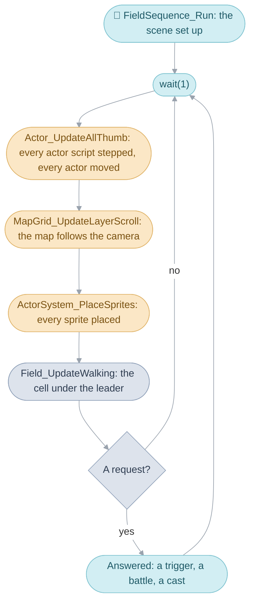
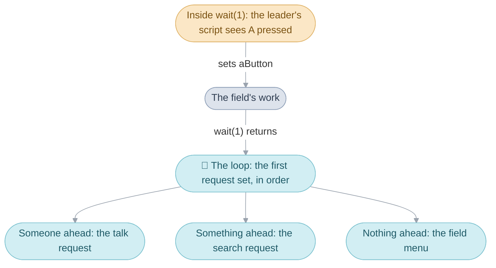

# Field code


The villager walks his rounds, Isaac walks up and presses A, the villager
stops and turns, says his line, and walks on. Everything in that moment is
this folder's work: the [actors](../../glossary.md#actor) and the little
scripts they run, the leader's walk, the search for someone to talk to, the
[scene](../../glossary.md#scene)'s answer, and the
[field sequence](../../glossary.md#field-sequence) that runs the whole visit
to Vault from the moment its code is loaded until the
[party](../../glossary.md#the-party) leaves. The folder is the
[Field](../../glossary.md#field)'s code, in four
[banks](../../glossary.md#bank) of the
[main image](../../glossary.md#main-image):

- Bank 01 is `field.c`, one object written as parts under `field/`: the
  actors and their scripts, sprites, walking, the map grid, the cameras and
  the World Map, with the data it reads and the ARM routines it copies into
  RAM beside it.
- Bank 04 is `field_sequence.c`, under `field_sequence/`: random
  encounters, a scene's actors, walking and the requests it raises,
  `FieldSequence_Run`, the triggers, items and Psynergy on the field, the
  chests, and the screen transitions and palette fade; and
  `event_commands.c`, under `event_commands/`: the
  [event commands](../../glossary.md#event-command) events are written in,
  each field Psynergy, the weather and the world picture. Beside them lie
  the bank's tables: the encounter zones and rules, the area names and music
  rules, the battle music, the field's own actor scripts and the scene
  table, `scenes.s`.
- Bank 11 is `lucky_dice.c`, Lucky Dice, and bank 12 `lucky_wheels.c`,
  Lucky Wheels, the two games played in Tolbi.

Each scene's own code, its [events](../../glossary.md#event) included, is an
[overlay](../../glossary.md#overlay) ([Scenes](../scene/README.md)); what a
town or dungeon shows and stands on is its [map](../../glossary.md#map)
([Maps](../map/README.md)). [Field](../../field.md) gives the division in
brief.

This page follows the code in the order control passes through it during
one visit to a scene:

1. The field sequence sets the scene up and then walks the party a
   [frame](../../glossary.md#frame) at a time, each frame one call of
   `wait(1)`, the call that runs one frame of the whole game
   ([The Broken Seal](../../README.md#code-that-waits)), answering each
   [field request](../../glossary.md#field-request) the walk raises.
2. Inside each frame, one [task](../../glossary.md#task) steps every actor's
   [actor script](../../glossary.md#actor-script) and moves the actor, the
   leader's script among them; a second task places the sprites, after the
   map has scrolled to follow the camera.
3. A request the walk raised is answered once the frame is over: a talk, a
   step, a search, a random battle, a Psynergy cast.



## The field sequence serves requests


The field sequence runs one scene, from the moment the
[main routine](../../glossary.md#main-routine) has loaded its code until the
party leaves, and it is one function, `FieldSequence_Run`. The main routine
calls it with the [entrance](../../glossary.md#entrance) the party arrives
by, and it returns the [exit](../../glossary.md#exit) the party left by.
Between the two it sets the scene up and then loops, a frame at a time,
until something stops the walk.

### Setting the scene up

The set-up runs in a fixed order, because each step needs the one before
it. First the field takes its [work](../../glossary.md#work), the block of
memory that holds everything about the running scene, and notes in the
main routine's work where the party is: the return point a battle comes
back to. Then, in order:

1. The map is loaded (`MapGrid_LoadMap`), or on the World Map the tilted
   view is built instead (`WorldMap_InitializePerspective`).
2. The scene's random battles are chosen, one zone for each kind of ground
   (`Encounter_SelectMapZones`).
3. The 64 actor slots are cleared and the two tasks that move and draw the
   actors are added (`ActorSystem_Initialize`).
4. The scene's code is asked for its trigger table.
5. The party is placed at its entrance (`Scene_ApplyEntrance`), then the
   leader, the scene's people and a camera actor are created
   (`Actor_ResetForLeader`). Coming back from a battle, everyone is put back
   where they stood (`Actor_Restore`).
6. The chests and Psynergy Stones the map marks are placed
   (`Field_PlaceTreasureSpots`), and the
   [palette fade](../../glossary.md#palette-fade) is set up.
7. The restart point a defeat returns to is looked up, and the scene's own
   set-up runs (`gOverlayArea.initialize()`), which may take an exit at
   once and end the scene before it is shown.
8. The screen fades in from the backdrop colour over 16 frames, with the
   arrival animation if the party came up or down a stair; the area's name
   is shown if the area is new; and a Djinni or an item left pending by the
   last scene is given.

### The walk, a frame at a time

The loop is the part of the field the player feels. Each pass hands the
leader to the player, as walking, climbing, carried through the air or on
the World Map, and then runs this until something asks it to stop:

```c
do {
  wait(1);
  Field_UpdateWalking(actor->layer, actor->x.fixed, actor->y.fixed, actor->z.fixed);
} while (Field_CountRequests() == 0);
```

When `wait(1)` returns, `Field_UpdateWalking` reads the
[cell](../../glossary.md#cell) under the leader and raises whatever that
cell calls for: a step trigger, a push, an exit, a random battle. Then
`Field_CountRequests` asks whether any request, any of the twelve members
of the field's work that something sets to stop the walk, is set. The loop
checks the exit first, answers the first request it finds, and starts
again from the top after each answer; when none is left it hands the
leader back to the player and the walk goes on.



A request an event sets waits until the event has finished, since the loop
is standing still in the event's call. A battle an event asks for therefore
starts after the event's last line, and an exit an event asks for ends the
scene once the event returns.

### The twelve requests

The loop works down the requests in one fixed order, answers the first one
set, and starts again from the top. Leaving comes first, so an event that
ends by taking an exit simply ends the scene.

| Order | `FieldWork` member | What it asks for                                                      | Answered by                                            |
| ----- | ------------------ | --------------------------------------------------------------------- | ------------------------------------------------------ |
| 1     | `exit`             | leave the scene by this exit                                          | the loop ends; `Scene_TakeExit` reads the exit table   |
| 2     | `raisedTrigger`    | a trigger the scene's code raised, or one of the field's own below    | `Scene_RunRaisedTrigger`                               |
| 3     | `encounter`        | a battle against this formation                                       | `Actor_Snapshot`, then the battle sequence             |
| 4     | `stepTrigger`      | the cell stepped onto, by its cell behavior                           | `Scene_RunStepTriggerOrExit`                           |
| 5     | `pushCell`         | a ledge, a climbing spot or a gap pushed against                      | `Field_RunPushCell`                                    |
| 6     | `aButton`          | the A button                                                          | turned into a talk, a search or the field menu         |
| 7     | `fieldMenu`        | the field menu                                                        | `FieldMenu_Run`                                        |
| 8     | `talk`             | the actor to talk to, by actor id                                     | `Scene_TalkToActor`                                    |
| 9     | `examineCell`      | the cell to search, by its cell behavior                              | `Field_ExamineCell`                                    |
| 10    | `psynergy`         | a field Psynergy and who uses it                                      | `Field_UsePsynergy`                                    |
| 11    | `item`             | an item and who uses it                                               | `Field_UseItem`                                        |
| 12    | `pauseMenu`        | the Pause menu                                                        | `PauseMenu_Run`                                        |

The A button is answered by asking what is ahead. If an actor with a talk
trigger stands within reach it becomes a talk request; else if the cell
ahead has something to search it becomes a search request; else the field
menu opens. The World Map's view is drawn as a
[still picture](../../glossary.md#still-picture) around most answers
(`WorldMap_Freeze`), so that a window can use a background layer the
moving view needs ([below](#the-world-map-in-perspective)).

### Raised triggers the field answers itself

A raised trigger is a value the scene's code, or the field itself, writes
to ask for an event by number. A positive value is looked up in the
scene's trigger table. Three values the field answers without the scene.

| Name                                  | Value | Meaning                                                                                                                                                     |
| ------------------------------------- | ----- | ----------------------------------------------------------------------------------------------------------------------------------------------------------- |
| `FIELD_RAISED_TRIGGER_PARTY_FELL`     | -1    | a character fell to poison or hazardous ground this step: a message names each one, and if nobody is left standing the party goes to its restart point with the leader at 1 HP |
| `FIELD_RAISED_TRIGGER_WORLD_PICTURE`  | -888  | R on the World Map: the world picture                                                                                                                       |
| `FIELD_RAISED_TRIGGER_WORLD_MAP_ZOOM` | -889  | L on the World Map: the view pulls back while L is held                                                                                                     |
| `FIELD_RAISED_TRIGGER_MENUS`          | 250   | the field menu, the Pause menu or a shortcut key, while `FLAG_MENUS_RAISE_TRIGGER` hands them to the scene, as Vault's inn does while the party corners the thieves |

### Leaving for a battle and coming back

A random battle is a way out of the scene. The loop stops the leader,
saves where everyone stands, writes the battle as what the main routine runs
next with the formation beside it, and closes the screen: the battle music
starts, the beast's cry plays, and the screen closes onto the leader over
16 frames (`Field_StartEncounterTransition`). The exit request is then set to
`EXIT_KEEP_DESTINATION`, which tells the main routine the next scene is
already chosen, and the loop ends.

The [heap](../../glossary.md#heap-and-pools) is emptied between one sequence
and the next, so the actors' places are saved outside it, in
`gActorSnapshot`, a fixed buffer that holds up to 32 actors with each one's
animation, sprite flags and priority. When the battle ends with the party
standing, the main routine comes back to the return point with
`FLAG_KEEP_PARTY_POSITION` set, and the set-up above puts everyone back
instead of placing them afresh. The scene's set-up still runs, and the
scene's own code checks the flag to skip its arrival events.

`FieldSequence_Run` is in [run.c](field_sequence/run.c), the requests and
the walk in [walking.c](field_sequence/walking.c), and the snapshot in
[actors.c](field_sequence/actors.c). The work is `struct FieldWork`,
reached as `gFieldWork`.

| Name                       | Value   | Meaning                                                      |
| -------------------------- | ------- | ------------------------------------------------------------ |
| `EXIT_KEEP_DESTINATION`    | 999     | the next scene is already in the main routine's work         |
| `FLAG_KEEP_PARTY_POSITION` | `0x109` | the next scene starts where the party was, everyone put back |
| `ACTOR_SNAPSHOT_CAPACITY`  | 32      | actors a snapshot keeps                                      |
| `ACTOR_ID_COUNT`           | 66      | actor ids the field's work maps to actors                    |
| `TREASURE_SPOT_MAX`        | 10      | chests and Psynergy Stones the work places                   |

## Everything that moves runs an actor script


The party, the people and things a scene places, the camera, a chest and
each footprint in the snow share the 64 actor slots, and one task,
`Actor_UpdateAllThumb`, gives each actor its share of every frame.

An actor's share of the frame has two halves. First its script runs: an
actor counting down a wait counts one frame off, and any other runs the
commands of its script one after another until a command says the actor is
done for this frame. Then the actor moves: toward the point its script
aimed it at, following the ground up and down, falling, floating, and
refusing to walk into another solid actor. The script decides where the
actor wants to go;
the motion takes it there over the following frames.

### How an actor script runs


A script is a list of 32-bit words: a command, then the values it needs.
The two children who run round Vault's well each run one of these, the boy
the eight points one after another and the girl the same points half a lap
behind ([vault.c](../scene/vault.c)):

```c
s32 gVault_BoyRoundTheWellRoute[] = {
    SC_ANIMATION(2),
    SC_SET(SW_SPEED, PIXELS(4) / 5),
    SC_SET(SW_ACCELERATION, PIXELS(1) / 5),
    SC_LABEL(1),
    SC_MOVE(PIXELS(136), 0, PIXELS(376)),
    SC_SYNC,
    SC_MOVE(PIXELS(120), 0, PIXELS(376)),
    SC_SYNC,
    /* ... six more points round the well ... */
    SC_LOOP(SC_FOREVER, SC_TO(1)),
    SC_END,
};
```

A command that only sets, tests or jumps takes no time, so the next one
runs in the same frame: the animation, the speed and the first `SC_MOVE`
all happen in the boy's first frame. A command like `SC_SYNC` ends the
boy's share of the frame, and ends it again every frame until he has
reached the point; then the next `SC_MOVE` runs. The loop at the end jumps
back to the label, so the boy runs round for ever.

A jump names a label, and the jump searches the script's first 1,024 words
for it. `SC_END` leaves the actor standing idle, and only `SC_RELEASE`
gives its slot back. A script can also test a
[game flag](../../glossary.md#game-flag) and branch on it, and set, add to
or compare any of the actor's values, so a villager can stand or wander by
the story. Beside its script, an actor can carry an update routine, a
function of the scene's own that runs every frame before the script, even
while the actor is paused.

The commands are the `SC_` macros of
[actor_script.h](../../include/field/actor_script.h), each a row of
`gActorScript_CommandTable` in [actor_script.c](actor_script.c) and a
function in [script_commands.c](field/script_commands.c); each returns 1
to run on and 0 to end the actor's frame.

| Name                      | Meaning                                                               |
| ------------------------- | --------------------------------------------------------------------- |
| `SC_WAIT(n)`              | stop for this frame, and run again n frames later                     |
| `SC_SYNC`                 | wait until the actor reaches its target, or 60 frames of being blocked |
| `SC_MOVE(x, y, z)`        | set a target to move towards, in pixels                               |
| `SC_MOVE_BY(x, y, z)`     | set a target this far from where the actor is                         |
| `SC_POSITION(x, y, z)`    | put the actor there at once and stop it                               |
| `SC_ANIMATION(n)`         | play [sprite animation](../../glossary.md#sprite-animation) n         |
| `SC_SET(w, v)`            | set the actor's value w, such as `SW_SPEED`, to v                     |
| `SC_FLAG_CHECK(f)`        | test game flag f for `SC_IF` and `SC_IFNOT`                           |
| `SC_LOOP(n, to)`          | jump to label `to` n - 1 times, so what lies between runs n times     |
| `SC_LABEL(n)`, `SC_TO(n)` | a label, and a jump's name for it                                     |
| `SC_FOREVER`              | an `SC_LOOP` count that never runs out                                |
| `SC_WANDER_HOME(a, b, c)` | walk to a random point a to a + b pixels away, within c of home       |
| `SC_PLAYER`, `SC_WORLD`   | hand the actor to the player control, on a map or the World Map       |
| `SC_CAMERA`               | follow the leader, as the camera does                                 |
| `SC_CALL(fn)`             | call the scene's own function each frame until it returns zero        |
| `SC_END`                  | stand idle for good                                                   |
| `SC_RELEASE`              | give the actor's slot back                                            |

### How an actor moves


An actor moves toward a target. Each frame it gains its acceleration in the
target's direction and is held to its speed limit, so a villager starts
smoothly and tops out at the speed its script set. An actor with no target
loses its acceleration from its speed each frame until it stops. Arrival is
judged on one axis, the one with the furthest to go, and an actor that
reaches or crosses its target on that axis has arrived and drops the
target. Unless its script asked it to land on the point exactly, the target
it is given is pulled in by half its braking distance, so it coasts the
rest of the way and stops where it was sent.

The ground carries the actor up and down. An actor that follows the ground
takes the ground height where it is going and moves by the change, and a
climb or a drop slows it, unless its script said to keep its speed on
slopes. An actor that falls loses its gravity from its upward speed each
frame while it is above the ground, and bounces when it lands, keeping a
quarter of its speed each time until a bounce is too small to matter. A
floating actor bobs up and down two pixels over 64 frames, or eight with
the high setting. A new actor follows the ground and falls, with a speed
limit of 2 pixels a frame, an acceleration of 1 and a gravity of 1; a
placed actor given a height above the ground floats instead.

A solid actor refuses to walk into another solid actor, and the frames it
has been refused are counted, so a script waiting for it to arrive gives
up after 60 of them. An actor that faces its motion turns toward the way
it moves by at most 22.5 degrees a frame.

`Actor_UpdateAllThumb` in [actor_motion.c](field/actor_motion.c) runs every
actor's frame; `Actor_SetMoveTarget` sets a target and picks the axis to
watch, `Actor_Create` gives a new actor its defaults, and
`ActorScript_CheckOverlap` tests for a solid actor in the way.

| Name                           | Value           | Meaning                                                    |
| ------------------------------ | --------------- | ---------------------------------------------------------- |
| `ACTOR_COUNT`                  | 64              | slots in `gActors`                                         |
| `ACTOR_NO_TARGET`              | `0x80000000`    | a target coordinate that is not set                        |
| `ACTOR_FOLLOWS_TERRAIN`        | motion bit 0    | moves with the ground height under it                      |
| `ACTOR_FALLS`                  | motion bit 1    | falls by its gravity and bounces                           |
| `ACTOR_FLOATS`                 | motion bit 2    | bobs up and down                                           |
| `ACTOR_SOLID`                  | collision bit 0 | blocks other actors and the leader                         |
| `ACTOR_PUSHABLE`               | collision bit 1 | the leader pushes it                                       |
| `SCRIPT_BLOCKED_MOVE_FRAMES`   | 60 frames       | after this long blocked, `SC_SYNC` stops waiting            |
| `SCRIPT_LABEL_SEARCH_WORDS`    | 1,024 words     | how far into a script a jump looks for its label           |
| `FACING_STEP`                  | 22.5 degrees    | the most an actor turns in one frame                       |

### Who runs which script

The field starts a few scripts itself, each one command repeated every
frame ([actor_script.c](actor_script.c)): the player control on a map
(`SC_PLAYER`) and on the World Map (`SC_WORLD`), the 8-pixel steps of a
climb (`SC_KEYS`), a bare key check while the leader is carried through
the air (`SC_KEY_COUNT`), the camera (`SC_CAMERA`) and an actor that
follows another (`SC_APPROACH_WATCHED`). A command like these hands the
actor to a built-in script, a routine built into the field that steers the
actor for the rest of the frame, so the player control is an actor script
like any other.

A placed actor takes its script from its row of the scene's actor table.
The row can name a script of its own, as the children's rows do, or one of
the movement types: standing still, wandering within 16, 8 or 6 pixels of
home, following its [watched actor](../../glossary.md#watched-actor), or
turning to face the leader. The actors are `gActors`, read as
`struct Actor`, and `Actor_SetMovementType` turns a row's movement into a
script.

| Name                         | Value | Meaning                                                 |
| ---------------------------- | ----- | ------------------------------------------------------- |
| `MOVEMENT_TYPE_STAND`        | 1     | stands where it was placed                              |
| `MOVEMENT_TYPE_WANDER`       | 2     | wanders within 16 pixels of where it was placed         |
| `MOVEMENT_TYPE_WANDER_NEAR`  | 3     | within 8 pixels                                         |
| `MOVEMENT_TYPE_WANDER_CLOSE` | 4     | within 6 pixels, at its own speed                       |
| `MOVEMENT_TYPE_FOLLOW_WATCHED` | 5   | walks toward its watched actor                          |
| `MOVEMENT_TYPE_FACE_LEADER`  | 6     | watches the leader and turns toward it                  |

## Walking and running


The leader walks at one pixel a frame and runs at one and a half while B is
held. The player control is `SC_PLAYER`, run once a frame as the leader's
script, and each frame it does the same four things: it chooses the speed
from B, picks a step from the D-pad, tests the ground, and moves or turns.

Each frame the control picks a heading from the D-pad and tests the ground
8 pixels along it, and at the ends of four more 8-pixel probes 22.5 and 45
degrees to either side, so that the leader's whole width clears the way;
the leader then moves its speed along that heading. When any of those
tests fails, the control tries headings further and further round, 22.5,
45 and 67.5 degrees off the pad's way, each with the same five probes, and
takes the first that passes: that is the slide along a wall. When every
heading fails the leader stays put, turns toward the pad by at most 22.5
degrees a frame, and the field counts the frame as a push. A doorstep or a ledge
answers only once the count passes 12.

A solid actor just ahead blocks the step too, unless it is pushable: then
it slides a quarter of a pixel away from the leader each frame, as long as
the ground beyond it is clear, and the leader slows to a quarter pixel a
frame while pushing. Few actors are pushable, and only while a script makes
them so, as the old man's does while he searches Vale's plaza for the
Psynergy Stone after Kalay. A stone pillar is pushed by its scene instead,
a cell at a time ([Stepping and pushing](#stepping-and-pushing)).

On a map that shows footprints, Imil's snow or Bilibin Cave's, the leader
leaves one every 18 frames of walking or 12 of running, alternating left
and right; each is an actor of its own, drawn underfoot, that waits 120
frames and disappears.

### The World Map's walk

On the World Map the party walks at half a pixel a frame and runs at one,
and the ground test reads a grid of ground kinds, each walkable or not. The
camera turns toward the way the pad points, a little each frame. In
shallow water a ripple follows the leader every 10 frames; in a forest the
leader's shadow is hidden.

The Japanese edition and the
[international editions](../../glossary.md#editions) test the ground
differently there:

|                                    | Japanese                                                                     | International                                                                             |
| ---------------------------------- | ---------------------------------------------------------------------------- | ----------------------------------------------------------------------------------------- |
| how far ahead the ground is tested | 8 pixels, straight ahead and 30 degrees either side, then up to 67.5 degrees off | 7 pixels, straight ahead and 22.5 and 45 degrees either side, then up to 90 degrees off |
| R and L on the World Map           | act again and again while held                                               | act once a press                                                                          |

`Actor_UpdatePlayerControl` steers the leader on a map,
`Actor_MoveOnWorldMap` on the World Map and `Actor_MoveByKeys` on a
climbable wall, all in [player_control.c](field/player_control.c), with
the edition's values chosen at the top of the file;
`Field_CheckConfiguredKeys`, at the end of each, raises the requests for
Select, A, Start and the two shortcut keys. Speeds are pixels a frame with
a fraction: `0x10000` is one pixel.

| Name                     | Value     | Meaning                                                              |
| ------------------------ | --------- | -------------------------------------------------------------------- |
| `FIELD_WALK_SPEED`       | `0x10000` | 1 pixel a frame                                                      |
| `FIELD_RUN_SPEED`        | `0x18000` | 1.5 pixels a frame, with B held                                      |
| `FIELD_ACCELERATION`     | `0x4000`  | a quarter pixel a frame faster each frame                            |
| `FIELD_FAST_WALK_SPEED`  | `0x40000` | 4 pixels a frame, B held with `FLAG_FAST_WALK`, which nothing sets   |
| `WORLD_MAP_WALK_SPEED`   | `0x8000`  | half a pixel a frame                                                 |
| `WORLD_MAP_RUN_SPEED`    | `0x10000` | 1 pixel a frame, with B held                                         |
| `WORLD_MAP_FAST_SPEED`   | `0x40000` | 4 pixels a frame, while L repeats                                    |
| `WORLD_MAP_PROBE_RADIUS` | 7 or 8 pixels | how far ahead the World Map's ground is tested, by edition       |

## How high a step can go


Every point of a map has a height, and the leader can step up onto ground
at most 8 pixels higher, or down onto ground at most 12 pixels lower.
Anything steeper blocks the way as surely as a wall, and most of the game's
walls are made from heights: a cliff is ground too high to step onto. The
room of Goma Cave with the pillar and the stump (`SceneId_GomaCavePillar`,
drawn on `map_024`) marks no cell as a wall at all.

The height anywhere inside a cell is worked out from the cell's shape, one
of 16 kinds, and up to three height samples in 8-pixel units: flat, a slope
along one axis, a step across a diagonal, a slope that bends on a diagonal,
a rounded bump ([Maps](../map/README.md#cells)). Each actor follows the
ground of one of the map's three layers, so a bridge can cross a stream
with a wall on one layer and open ground on another. The World Map has no
heights: each of its cells says only what kind of ground it is, and a
range of kinds can be walked on.

`MapGrid_GetTerrainHeight` works out a height through one of the 16
functions of `gMapGrid_TerrainHeightFunctions` and `MapGrid_CheckCollision`
judges each step, both in [terrain.c](field/terrain.c);
`WorldMap_IsWalkable` judges the World Map's.

| Name                     | Value | Meaning                                                    |
| ------------------------ | ----- | ---------------------------------------------------------- |
| `COLLISION_NONE`         | 0     | the actor can step there                                   |
| `COLLISION_TOO_HIGH`     | 1     | the ground there is more than 8 pixels higher              |
| `COLLISION_TOO_LOW`      | -1    | the ground there is more than 12 pixels lower              |
| `COLLISION_IMPASSABLE`   | 2     | the cell there is a wall (`CELL_BEHAVIOR_WALL`)            |
| `WORLD_MAP_COLLISION_WALKABLE_FIRST` to `_LAST` | 5 to 12 | the World Map's walkable kinds of ground     |
| `WORLD_MAP_COLLISION_SHALLOW_WATER` | 6 | shallow water: a ripple follows the leader              |
| `WORLD_MAP_COLLISION_FOREST` | 9  | forest: the leader's shadow is hidden                       |

## Actors move first, then the camera draws them

Every frame all the actors move first, and only then does the camera work
out where each sprite appears on the screen and what it is drawn in front
of. The two are tasks, and the actors' task has the higher priority, so
the order never changes and each sprite is drawn where its actor has just
moved to. Between them runs the map's own task, which scrolls the layers
to follow the camera actor, so the sprites are placed on the map as it now
stands.

The camera is one of two kinds. On a town or dungeon map it places each
sprite by the actor's distance from the view's corner, and reads the cell
under the actor for the layer the actor now follows and the priority its
sprite takes. A sprite that has gone off screen gives its video memory back
to the cache, and takes it again when it returns. On the World Map and in a
battle the other camera projects each actor's place in 3D onto the screen,
sorted by distance, and turns every sprite's facing by the camera's own
heading, so a figure keeps its heading in the world as the view turns.

While a menu is open over the field, sprite placing is suspended and only
the actors marked to be held keep their sprites; the rest give their video
memory to the menu.

`ActorSystem_Initialize` adds both tasks; `ActorSystem_PlaceSprites` is the
scrolling camera and `ActorSystem_ProjectSprites` the projecting one, both
in [actor_camera.c](field/actor_camera.c).

| Task                        | Priority               | Each frame                                              |
| --------------------------- | ---------------------- | ------------------------------------------------------- |
| `Actor_UpdateAllThumb`      | `TASK_PASS_FRAME + 10` | steps every actor script and moves every actor          |
| `MapGrid_UpdateLayerScroll` | `TASK_PASS_FRAME + 5`  | scrolls the map's layers to follow the camera actor     |
| `ActorSystem_PlaceSprites`  | `TASK_PASS_FRAME`      | places each sprite where its actor now is               |

| Mode                     | Started by                                | Actor update           | Camera                      |
| ------------------------ | ----------------------------------------- | ---------------------- | --------------------------- |
| `ACTOR_SYSTEM_MAP`       | the field sequence, the debug sprite viewer | `Actor_UpdateAllThumb` | `ActorSystem_PlaceSprites`  |
| `ACTOR_SYSTEM_WORLD_MAP` | the field sequence                        | `Actor_UpdateAllThumb` | `ActorSystem_ProjectSprites` |
| `ACTOR_SYSTEM_BATTLE`    | the battle                                | `Actor_UpdateAllMotion` | `ActorSystem_ProjectSprites` |

## Sprites and their animation


What the player sees of an actor is its
[sprite](../../glossary.md#sprite-and-oam), built from up to four pictures
laid over each other, each playing its own animation. In a battle Isaac's
body, his weapon and the shadow under his feet are three animations of one
sprite, so as he swings, the body and the weapon change pose together, and
whenever any of the four changes picture the sprite's whole picture is drawn
again and sent to video memory.

An animation is a list of pairs: which picture to show, and for how many
frames. It names pictures as if the figure always faced one way, and a
facing table adds a number to each picture and says whether to mirror it,
for each of the ways a figure can face. A figure drawn with a front and a
back picture adds one to every picture its animation names over the half
of the compass where its back shows, which is how the party is seen from
behind in a battle, and a figure drawn with one picture is mirrored to
face left. An animation can also be recoloured as it is drawn: its colours
swapped round, turned grey or tinted, or filled with one flat colour such
as white.

A sprite is `struct Sprite` and each of its animations a
`struct SpriteAnimation`; `Sprite_ComposePicture` in
[sprite_draw.c](field/sprite_draw.c) advances the animations, picks each
one's picture for the facing through the tables of [facing.c](facing.c),
composes them into one picture and uploads it; `Sprite_Create` and
`Sprite_StartAnimation` in [sprite_animation.c](field/sprite_animation.c)
make a sprite and start an animation. The colourings are
`enum SpriteColorMode`.

| Name                           | Value | Meaning                                                              |
| ------------------------------ | ----- | -------------------------------------------------------------------- |
| `ANIM_OBJECT_COUNT`            | 64    | sprites, and the sprite animations they share                        |
| `ANIM_LAYER_COUNT`             | 4     | animations one sprite lays over each other                           |
| `SPRITE_ANIMATION_NORMAL_STEP` | 16    | sixteenths of a frame off an animation's timer each frame: normal speed |
| `ANIM_FACING_ONE_PICTURE`      | 1     | one picture, mirrored to face left                                   |
| `ANIM_FACING_FRONT_BACK`       | 2     | a front and a back picture, each mirrored for the other side         |
| `ANIM_FACING_EIGHT_PICTURES`   | 8     | a picture for each compass direction                                 |
| `SPRITE_COLOR_GREY`            | 6     | drawn in grey                                                        |
| `SPRITE_COLOR_WHITE`           | 7     | filled with white                                                    |

## Towns and dungeons on screen


A town or dungeon is drawn as three flat layers, the ground, a middle
layer and an overhead layer, with the people between the middle and the
overhead one ([Field](../../field.md#map-layers) explains the stack and
the priorities that order it). A sprite wins a tie with a layer of the
same priority.

Each layer is a window onto the one grid of cells, and each frame the map
centres its view on the camera actor, within the bounds the entrance set,
and scrolls each layer there at its own pace: a layer can follow the view
at a fraction of its speed, for a far wall that moves less than the
ground, or drift by itself, for clouds. As the view moves, the map draws
the column or row of cells that comes into view, so the console's tile
maps only ever hold what is near.


Two timed changes run on their own. A tileset animation swaps the pictures
of a few tiles on a timer, a waterfall or a flickering torch, by copying
tiles into video memory; a map can run 16 at once. A blend script changes
how the layers mix over time, for a haze or a glow. The palette cycle,
`PaletteCycle_Step`, is unused code.

`MapGrid_LoadMap` in [map_grid.c](field/map_grid.c) loads a map from its
row of `gMaps` and `MapGrid_UpdateLayerScroll` scrolls it each frame;
`TilesetAnim_Update` and `BlendScript_Run` in
[tile_animation.c](field/tile_animation.c) run the timed changes.
[Maps](../map/README.md#tileset-animation-and-blend-scripts) gives their
format.

| Name                     | Value | Background | Meaning                                   |
| ------------------------ | ----- | ---------- | ----------------------------------------- |
| `MAPGRID_LAYER_GROUND`   | 0     | `BG3`      | the ground, at the back                   |
| `MAPGRID_LAYER_MIDDLE`   | 1     | `BG2`      | walls and edges, under the actors         |
| `MAPGRID_LAYER_OVERHEAD` | 2     | `BG1`      | roofs and treetops, over the actors       |
| `ACTOR_PRIORITY_AUTOMATIC` | 1   |            | the sprite takes its priority from the cell under it |

## The World Map in perspective


The World Map is a flat map, like a town's, that the console tilts so it
seems to stretch away toward the horizon. The console can scale and rotate
two of its background layers, and it reads their scale afresh for every
line of the screen if the game changes it between lines. Each of the 160
lines therefore shows one straight strip of the flat map: lines near the
top show strips farther away and wider, squeezed to fit, so distant ground
looks smaller. The lower ground is on one of the two layers and the
mountains, woods and cliffs on the other, in front, with the sprites in
front of both.

Each frame the game looks at the map from the camera's place and pitch,
works out every line's scale and distance, and has them fed to the console
one line at a time, in the pause after each line is drawn. The line values
are built by a routine copied into RAM, since the work for 160 lines every
frame is too much to run from the cartridge, and they go into one of two
pages, so the next frame's values are written while this frame's are fed.


While L is held the view pulls back to 1.6 times as far over 6 frames, and
comes back when L is released. The ground is far too big to keep unpacked,
so the game unpacks only the tiles around the party as it walks, and the
snowfield region takes graphics of its own. When a menu opens or an event
starts, the game draws the current view once into an ordinary still
picture, and the moving view comes back when it closes.

`WorldMap_InitializePerspective` in [world_map.c](field/world_map.c) sets
the view up; `WorldMap_UpdateView` runs each frame, builds the line table
through `WorldMap_BuildScanlineTable` and fills the page with
`Transform_UpdateVertices`, the routine in
[world_map_lines.c](world_map_lines.c); `WorldMap_ApplyAffinePage` feeds
the page line by line each VBlank; `FieldEffect_RunVisibilityTransition`
is the zoom; `WorldMap_StartStillPicture` makes the still picture and
`WorldMap_LoadAreaGraphics` brings the moving view back. The map's data is
in [Maps](../map/README.md#the-world-maps-data).

| Name               | Value      | Meaning                                              |
| ------------------ | ---------- | ---------------------------------------------------- |
| `MapIndex_World`   | 1          | the World Map's row of the map table                 |
| `VISIBLE_SCANLINES`| 160        | lines of the screen, each with its own scale         |
| L held             | 6 frames   | the zoom out, to 1.6 times as far, and the zoom back |

## What a talk, a step or a search runs


When the loop answers a talk, a step or a search, it looks the request up
in the scene's table of [triggers](../../glossary.md#trigger) and runs the
first row that fits. A row says what starts it, who or where it is for,
the condition under which it still applies, and what it runs: a message,
or an event, which is plain C that plays from top to bottom while the
party waits. A row can also ask for a push of more than 12 frames, or for
the leader to face within 45 degrees of a given heading.

### Talking

The A button looks for someone to talk to: the nearest actor within 32
pixels of the leader and at most 48 pixels higher or lower, and beyond 11
pixels within about 67 degrees of the way the leader faces. An actor
marked as near to talk to counts as closer, so it can be spoken to from
further off. The actor stops and the leader stops, each turns to face the
other, and the actor's row runs. Afterwards the actor goes back to its
script, turns back to its old heading or keeps watching the leader, as its
placement's talk facing says. An actor Halt has stopped answers through
its own row for that case; without one, its talk row still shows its
message, but a talk row that runs an event gives one of two idle lines
instead.

### Stepping and pushing


Each frame the walking update reads the behavior of the cell under the
leader. Any marked cell makes the field test the scene's exit regions,
boxes of pixels that take the party out when the leader is inside one; a
value from the scene's own range also raises a step trigger request. When
the loop answers
the step, it looks for a step trigger row with that value; finding none,
it looks for an exit row, which plays the exit's sound and, for a stair,
the leader's climbing animation, and sets the exit request.

Three values answer a push. Once the leader has pushed for more than 12
frames, a ledge is jumped down with Down held,
a climbing spot is climbed up or down with Up or Down, and a gap is jumped
across; the count then starts again. On a climbing spot the leader crouches,
jumps and holds on, then climbs in 8-pixel steps while the pad is held, and
pushing Up at the top cell takes him over the edge onto the ground above.


A stone pillar is pushed by its scene's step triggers. The cells beside it
carry a value whose row answers walking into it from one side, and the
event leans the leader on the pillar for a quarter of a second, checks
that nothing solid stands beyond it or on it and that the ground there
takes it, then slides the leader and the pillar one cell together at a
fifth of a pixel a frame, with the push sound. `PushedActor_AdvancePair`
in [staged_actor.h](../scene/shared/staged_actor.h), which the scenes with
things to push include, does the push; Vale's pillar is `Vale_PushPillar`.

### Searching

With nobody to talk to, the A button looks at the cell 16 pixels ahead.
Six behaviors are search spots every scene shares, the jars, barrels,
wooden boxes, graves, books and wells: each shows its own two lines, the
`checked` line and what was found, with no row in any scene. Any other
value with an examine row runs that row: the leader checks the thing the
row names (`Isaac checked the chest...`), and the row's value says what is
found, a message, an item, coins, a Psynergy Stone, a mimic, or a function
of the scene's own. With nothing ahead at all, the field menu opens.

### Chests and Psynergy Stones


A chest is a row in the scene's trigger table and a mark on the map. When
the scene loads, the field walks the map's list of marked cells and, for
each mark the scene has an examine row for, places an actor: a chest, shown
open if its flag says it has been opened, or a Psynergy Stone, until it is
taken. The field places up to ten of them; a mark the scene has no row for
takes no slot. Searching an unopened chest opens it with
its sound, lifts what it held above the leader to the treasure jingle, and
sets the row's flag; an opened chest answers `but the chest was empty.`;
an item nobody can carry stays, and the chest closes again. A mimic's chest
jumps up and starts a battle the party cannot flee, and the chest's flag is
set once the one enemy is beaten.

`Scene_FindTrigger` in [triggers.c](field_sequence/triggers.c) finds a row,
`Scene_TalkToActor` runs a talk, `Scene_RunStepTriggerOrExit` a step or an
exit, `Field_RunPushCell` a push and `Field_ExamineCell` a search;
`Field_FindNearbyTalkTarget` in [targets.c](field_sequence/targets.c) picks
whom A is for, and `Field_PlaceTreasureSpots` in
[treasure_spots.c](field_sequence/treasure_spots.c) places the chests. The
rows are `struct Trigger`; [Scenes](../scene/README.md#the-tables)
describes every kind.

| Name                            | Value      | Meaning                                                        |
| ------------------------------- | ---------- | -------------------------------------------------------------- |
| `TRIGGER_TALK`                  | 0          | the A button on an actor                                       |
| `TRIGGER_EXIT`                  | 1          | stepping onto a cell that leads out                            |
| `TRIGGER_STEP`                  | 2          | stepping onto or pushing against a cell                        |
| `TRIGGER_EXAMINE`               | 3          | the A button on what is ahead, when it is no actor             |
| `STEP_TRIGGER_FLAG_WALKING`     | `0x200`    | the leader must have pushed for more than 12 frames            |
| `TRIGGER_FLAG_FACING`           | `0x400`    | the leader must face within 45 degrees of the row's heading    |
| `CELL_BEHAVIOR_JAR` to `_WELL`  | 242 to 247 | search spots with their own lines in every scene               |
| `CELL_BEHAVIOR_LEDGE`, `_CLIMB`, `_JUMP_FORWARD` | 252 to 254 | pushed against: a jump down, a climb, a jump across |

## Random battles


As the party walks through a dungeon or across the World Map, a counter
fills as the leader moves, and a battle starts when it reaches its mark.
Each frame the leader walks, the counter grows by an amount that depends on
the leader's speed and the zone of the ground underfoot, so it measures
the distance walked. A zone says how far apart its battles
are, what level it is made for, and up to eight groups of enemies with the
chance of each. With no other influence, a zone of rate r brings a battle
after about 16 × r pixels walked: the room of Goma Cave past its entrance,
the one with the pond (`SceneId_GomaCavePond`), has rate 30, so a battle
comes every 480 pixels, thirty cells.

Two things stretch that distance. A random bias, drawn again after each
battle, makes the gaps vary around the rate. And when the party's average
level is above the zone's, each level of the difference, up to five, raises
the rate by 5 and so spaces the battles further apart; with Avoid up such a
zone has no battles at all. There are none at all while Cloak is up, in a
zone with no rate, or where the scene or the area turns them off.

A scene's ground has three kinds: ordinary ground and two kinds of marked
cells. The scene's rule, found by its scene and entrance, names a first
zone; the first kind of marked cell takes it and the second kind the next
zone, while ordinary ground has no battles, unless the rule moves the first
zone onto ordinary ground instead, as Goma Cave's rules do. The World Map
takes its zone from the region and the kind of ground under the party, and
the same lookup picks the battle's background. Event battles, mimic chests
and Djinn fights name their zones directly, so those zones are drawn from
without a roll.

One more rule holds only in Sol Sanctum: Jenna is in the party only from
Vale to the Sanctum's eruption, joining at level 1, and random battles stop
while she has more than 130 experience points, just short of level 4, so
the party cannot train there before the journey begins.

When the counter reaches its mark, one of the zone's groups is drawn by its
chance, the battle's music is chosen, and the encounter request is set;
what the loop does with it is above,
[Leaving for a battle and coming back](#leaving-for-a-battle-and-coming-back).

`Encounter_CountStepsAndSelectFormation` in
[encounter.c](field_sequence/encounter.c) fills the counter and draws the
enemies, `Encounter_SelectMapZones` picks a scene's zones from
`gScene_EncounterRules` ([encounter_rules.s](encounter_rules.s)), the World
Map's come from `gWorldMap_EncounterRules`, each zone is a row of
`gEncounterZones` ([encounter_zones.c](encounter_zones.c), read as
`struct EncounterZone`), and `Encounter_SelectBattleMusic` reads
[battle_music.c](battle_music.c).

| Name                                                        | Value      | Meaning                                                                    |
| ----------------------------------------------------------- | ---------- | -------------------------------------------------------------------------- |
| `ENCOUNTER_ZONE_NONE`                                       | 0          | no battles                                                                 |
| `ENCOUNTER_ZONE_MIMIC`                                      | 99         | mimic chests: the chest's slot picks the formation                        |
| `ENCOUNTER_ZONE_VENUS_DJINN` to `ENCOUNTER_ZONE_JUPITER_DJINN` | 100 to 103 | Djinni battles                                                          |
| `encounterThreshold`                                        | 16         | the counter's mark: 16 × rate pixels walked at walking speed               |
| `FLAG_NO_ENCOUNTERS`                                        | `0x160`    | no random battles                                                          |
| `FLAG_NO_ENCOUNTERS_IN_AREA`                                | `0x161`    | no random battles until the next ordinary entry to a scene                 |
| `FLAG_LURE_CAP`                                             | `0x167`    | the counter fills twice as fast                                            |

## What walking does to the party


Walking outside a town slowly changes the party. Every 160 pixels or so
the leader walks, each party member regains one PP, the
[Djinn](../../glossary.md#djinn) recovering from a summon count one step
down, and poison takes its toll: a twentieth of a poisoned character's
maximum HP, or a tenth for deadly poison, and at least 1. On ground with no
random battles the distance counts half as fast. In a town none of this
happens, and Avoid, which wears off with distance, lasts until the party
leaves.


The Lamakan Desert's sand hurts on its own. Its sand is a cell behavior of
the desert's own whose step trigger adds one to the heat count each frame
the leader moves on it, and a thermometer down the left edge of the screen
shows the count. At the limit, 600 frames of walking there, the screen
flashes, the leader flinches and the party loses a quarter of its maximum
HP, with the heavy impact sound, and the count starts again from nothing.
As the count passes each quarter, a party member complains of the heat.
`Field_UpdateWalking` can also count the distance walked on cells of
`CELL_BEHAVIOR_DESERT_SAND`, starting half way to the limit, but the
desert marks its sand with its own value, `HeatGauge_CountStep` in
[lamakan_desert.c](../scene/lamakan_desert.c).

When damage brings a character to 0 HP, the leader flinches, the fallen are
named one by one, and if nobody is left standing the party is sent to its
restart point with the leader at 1 HP, to the defeat music.

`Field_UpdateWalking` in [walking.c](field_sequence/walking.c) counts the
distance and checks the heat count, `Party_AddPp` gives the PP,
`Party_ApplyPoisonDamage` takes the poison's and `Party_AddHp` the sand's,
and the field sequence answers the fall as a raised trigger.

| Name                   | Value   | Meaning                                                           |
| ---------------------- | ------- | ----------------------------------------------------------------- |
| `walkingDistanceScale` | `0x199` | about 1/160: one PP every 160 pixels walked; 0 in a town          |
| `hazardLimit`          | 600     | frames walked on the desert's sand between one hurt and the next  |
| `hazardDamage`         | 25%     | of maximum HP, the desert's damage                                |
| `POISON_NORMAL`        |         | a twentieth of maximum HP each time                               |
| `POISON_VENOM`         |         | a tenth of maximum HP each time                                   |

## How field Psynergy reaches its target


Move shows a giant hand that pushes what is ahead: on a stone pillar the
pillar slides, and where the scene has no row for it, the hand appears,
lingers 30 frames and bursts. What Psynergy does to a scene is decided by
the scene's own rows; the cast only draws it. A Psynergy row names the
ability, what it is for, an actor, a cell or anywhere, and the moment it
runs at, and the field runs the right row at each moment.

A cast runs in this order. First the field refuses the casts a place
forbids: every cast in the Battle Arena, Reveal on the World Map, and
Retreat in every town, which sets `FLAG_RETREAT_BLOCKED` as it loads.
Retreat asks first,
and when accepted sets the scene and entrance the party came into the area
by as the destination and raises the exit. Then the PP is paid. Then the
field looks for the scene's rows for this Psynergy at three moments, and
for a target: the nearest actor in a cone ahead of the leader, as far as
the Psynergy's kind reaches, 16, 32 or 48 pixels. The row for before the
cast runs, and can still stop the cast or turn it away from its target.
The cast plays, on its target if a row named one. The row for after the
cast runs. A row for after the cast can play the cast itself, as two of
Altmiller Cave's Mind Read rows do, and
then the usual cast does not play. Force, Frost and Reveal run the row for
the moment they act, as they act.


Two casts keep state after they end. Halt holds one actor still at a time,
so casting it again lets go of the one held before, and Cloak and Reveal
run out by themselves, and when they do the scene's rows for their ending
run, so a Reveal can hide again what it showed. Cloak lasts while the
leader walks on the ground a map marks as somewhere to hide, and he blinks
back into sight where it ends; Reveal lasts 600 frames, or until the
leader walks about 60 pixels from where it was cast.

`Field_UsePsynergy` in [psynergy.c](field_sequence/psynergy.c) runs a
cast, `Scene_FindPsynergyTrigger` in [items.c](field_sequence/items.c)
finds the row for a moment, `Field_FindNearbyPsynergyTarget` picks the
target, and `FieldPsynergy_Run` and `FieldPsynergy_Dispatch` in
[field_psynergy.c](event_commands/field_psynergy.c) play the cast with no
target and on one; each Psynergy's cast is the part of `event_commands/`
named for it. A row's moment is `enum PsynergyPhase`, and what an ability
does on the field is `enum FieldPsynergy`, the `fieldPsynergy` field of
each ability in [ability_table.c](../game/ability_table.c).

| Name                          | Value   | Meaning                                                                     |
| ----------------------------- | ------- | --------------------------------------------------------------------------- |
| `PSYNERGY_PHASE_BEFORE_CAST`  | 1       | once the PP is paid, before the cast                                        |
| `PSYNERGY_PHASE_AFTER_CAST`   | 0       | after the cast                                                              |
| `PSYNERGY_PHASE_ACTS`         | 5       | as Force, Frost and Reveal act                                              |
| `PSYNERGY_PHASE_BEFORE_END`, `_AFTER_END` | 3, 2 | around the ending of a Psynergy that runs out by itself, Cloak or Reveal |
| `PSYNERGY_PHASE_FADES`        | 4       | as Reveal's colours come back                                               |
| `PSYNERGY_PHASE_ANY`          | 7       | every moment, when a menu asks whether a row exists                        |
| `TRIGGER_SUBJECT_OWN_EFFECT`  | `0x400` | the row after the cast plays the cast itself                                |
| `FLAG_RETREAT_BLOCKED`        | `0x144` | Retreat refuses: set in every town                                          |
| `FLAG_IN_BATTLE_ARENA`        | `0x17e` | all field Psynergy refuses                                                  |

## The palette fade


When Reveal is cast the backgrounds turn grey in one frame, and most field
Psynergy tints the screen over 8 frames as it starts and fades back after
it. Both are the palette fade: a copy of
the colours on screen that moves toward a set of target colours by an
equal amount each frame, so that every colour arrives together, and on the
last frame takes the target itself, so that rounding never leaves a colour
short. The copy holds palettes 0 to 13 of the backgrounds and of the
sprites, so the window colours in palette 15 never fade. A cast's tint is
one of eight colours, picked by the frame counter unless a flag forces one.

`PaletteFade_Initialize` in [palette_fade.c](field_sequence/palette_fade.c)
sets the fade up as each scene loads and adds `PaletteFade_Update` as a
task, which the menus hold still with `FLAG_PALETTE_BLEND_HELD`;
`FieldPsynergy_FadeToCastColor` picks a cast's colour from
`gFieldEffect_TargetColors`. Of the screen transitions the palette fade
serves only the fade from the backdrop colour; the rest are windows and
dissolves in [screen_transition.c](field_sequence/screen_transition.c), and
the fade from black is `ScreenFade_FromBlack` in
[System code](../system/README.md).

| Name                       | Value                  | Meaning                                         |
| -------------------------- | ---------------------- | ----------------------------------------------- |
| `PaletteFade_Update`       | `TASK_PASS_FRAME + 15` | the task: one step of the fade each frame       |
| `FLAG_PALETTE_BLEND_HELD`  | `0x152`                | holds the fade still while a menu is open       |
| `FLAG_PSYNERGY_TINT(n)`    | `0x148 + n`            | forces cast colour n in place of the counter's  |
| a cast's tint              | 8 frames               | the fade to the cast's colour, and back         |

## The world picture


On the World Map, R shows a picture of the whole world with a marker on
every area the party has visited. A hand moves with the D-pad, faster the
longer it is held, and returns to the party's place while L or R is held;
the place nearest the hand blinks and its name shows in a window, and A or
B closes the picture. Each marker is drawn where its area stands on the
World Map, scaled onto the picture, so the picture needs no positions of
its own, and the screen borrows the memory the map's cells normally use.

In the German, French, Spanish and Italian editions the hand also glides
onto the nearest place when the D-pad is let go, and a place's name shows
from closer by.

`WorldPicture_Show` in [world_picture.c](event_commands/world_picture.c)
draws the picture and runs the hand, and `gWorldPicture_AreaMarkers` lists
each area's visited flag, marker and name.

| Name                          | Value                               | Meaning                                                   |
| ----------------------------- | ----------------------------------- | --------------------------------------------------------- |
| `WORLD_MAP_CURSOR_MIN_SPEED`  | 1 pixel a frame                     | the hand's speed as the D-pad is first held               |
| `WORLD_MAP_CURSOR_MAX_SPEED`  | 6 pixels a frame                    | its speed after holding                                   |
| `WORLD_PICTURE_CURSOR_SNAPS`  | 1 in `TBS_PATCH_2` editions, else 0 | the hand glides onto the nearest place when the pad is let go |
| `WORLD_PICTURE_NAME_RANGE`    | 64 in `TBS_PATCH_2` editions, else 100 | how near the hand must be, squared, for a name to show |

## Lucky Dice and Lucky Wheels


The two games in Tolbi are the field's smallest sequences. A scene in
Tolbi's rooms asks for one as what the main routine runs next, the scene
ends, and the main routine runs the game in its place, saving the last two
background palettes, the windows' among them, around it and coming back to
the room afterwards, as it does after a battle. Lucky Dice draws its field
and dice with the battle's 3D camera; Lucky Wheels draws its reels line by
line into a canvas of its own.


`LuckyDice_Start` in [lucky_dice.c](lucky_dice.c) and `LuckyWheels_Start`
in [lucky_wheels.c](lucky_wheels.c) are each one game played to the end,
and `Scene_ReturnFromSequence` brings the party back.

| Name             | Value   | Meaning                                                 |
| ---------------- | ------- | ------------------------------------------------------- |
| `SEQUENCE_DICE`  | `0x1fd` | what the scene asks for to play Lucky Dice              |
| `SEQUENCE_SLOTS` | `0x1fc` | what the scene asks for to play Lucky Wheels            |

## From a step in Goma Cave to a battle and back


Isaac walks through the room of Goma Cave past its entrance, the one with
the pond. A battle starts, the party
wins, and the cave comes back with everyone where they stood. Each step is
one of this page's mechanisms.

### Walking

The field sequence's loop is in `wait(1)`. Inside that frame the actors'
task runs the leader's script, `SC_PLAYER`, which reads the
pad, tests the ground 8 pixels ahead through the cave's heights, and sets
his target and speed, one pixel a frame. The motion then moves him and
carries him up and down with the ground. The map's task scrolls the three
layers after the camera actor, which is closing an eighth of its distance
to him, and the camera task places his sprite, at priority 2 on the open
floor.

### Counting the distance

When `wait(1)` returns, `Field_UpdateWalking` reads the cell under him.
The room's rule has moved its first zone onto ordinary ground, so the
encounter roll runs on every cell of the floor, and the counter in the main
routine's work grows each frame by the leader's speed divided by the
zone's rate of 30, nudged by the random bias drawn on his first step, so
it reaches its mark of 16 after about 480 pixels. At the
same time the distance toward the next PP grows, and every 160 pixels each
party member regains one.

### The battle comes due

On the frame the counter reaches 16, one of the room's groups is drawn by
its chance, the battle music is chosen, and the encounter request is set.
The loop finds it, stops the leader, saves every actor into the snapshot,
writes the battle and the formation as what the main routine runs next, and
closes the screen onto the leader to the beast's cry. The exit request is
`EXIT_KEEP_DESTINATION`, so the loop ends and `FieldSequence_Run` returns
it.

### Coming back

The main routine clears the heap and runs the battle sequence. When it
ends with the party standing, `Scene_ReturnFromSequence` finds no
after-battle destination and so chooses the return point, the same scene
and entrance, with `FLAG_KEEP_PARTY_POSITION`. The main routine runs the
field sequence again: the flags are left alone, the map is loaded again,
the zones are chosen again, `Actor_ResetForLeader` creates the leader where
the loop last noted him, and `Actor_Restore` moves him and every saved
actor back to where they stood, with their animations. The counter was
cleared when the battle was asked for, so the next battle is a full run of
the room away.

### The same moment, mechanism by mechanism

| Step                           | Mechanism                                                     |
| ------------------------------ | ------------------------------------------------------------- |
| Isaac walks the floor          | the player control, an actor script, and the actor's motion   |
| He follows the ground          | how an actor moves: the ground carries him up and down       |
| The bank holds him off         | how high a step can go                                        |
| The cave scrolls under him     | actors move first, then the camera draws them                 |
| The counter grows              | random battles, in the walking update                         |
| The battle is asked for        | the field sequence: the encounter request                     |
| Everyone's place is saved      | leaving for a battle and coming back: the snapshot            |
| The cave comes back as it was  | the set-up, with `Actor_Restore`                              |

## Design

### One actor, a few views

All 64 actors are the same 112-byte `struct Actor`, which the script
commands, the motion loop, the cameras, the battle and the
[field effects](../../glossary.md#field-effect) (`struct FieldEffect`,
fields in the same places) all take. Three field-for-field copies remain
only for matching ([Matching](../MATCHING.md#views-of-one-struct)).

### Actor scripts without addresses

A jump names a label, so a script is a plain C array of words that is
complete as written, at the cost of a search on every jump.

### Routines run from RAM

The work done for every screen line or every pixel is written in ARM, the
processor's 32-bit instructions ([Source](../README.md#c-and-assembly)),
and copied onto the [heap](../../glossary.md#heap-and-pools) before it
runs, into the console's fast internal RAM while there is room: the World
Map's line values (`Transform_UpdateVertices`), drawing rows of the map,
decoding sprite pictures and putting a map's cells together. The
cartridge's bus is 16 bits wide, so ARM runs slowly from it, and the rest
of the game is Thumb, the 16-bit instructions. There is also an ARM copy of
the actor update, `Actor_UpdateAll`, for the first eight actors, which
only the unused `Actor_RunUpdateAllFromHeap` would copy and run: it lacks
the field's extras (flight through the air in 3D, following the ground,
floating, solid actors), so it could not stand in for the usual update.

### A battle starts from a snapshot

Setting the scene up a second time after a battle, from the snapshot
([above](#leaving-for-a-battle-and-coming-back)), keeps one path through
the set-up for every arrival.

### Spellings kept for matching

Several structures are reached by more than one spelling (the field's work,
the field effect, the map's view, the palette fade), each site keeping the
one it matches with; [Matching](../MATCHING.md#heap-slots) explains why.

## How it fits with the rest of the game

The main routine runs the field sequence for every scene. Each scene's
overlay supplies its tables and setup, and calls back into this folder
through its
[import table](../../glossary.md#entry-table-and-import-table) for the
event commands its events are written in: nine overlays ask for the
ground's height, and six rewrite a cell's
[cell behavior](../../glossary.md#cell-behavior). Battles, Lucky Dice and
Lucky Wheels return through the main routine's work, and the screen
transitions close
the field before each battle as well as between scenes. The battle uses the
actors in its own mode for its sprites. The Lost Age's field code is
described by [its own guide](../../../tla/src/field/README.md), as
differences from this one.

## Limits

- 64 actors; 64 sprites, sharing 64 sprite animations, up to four each.
- 66 actor ids in the field's work, each pointing at one of the 64 actors.
- 8 sprite picture caches and 16 tileset animations.
- `gActorScript_CommandTable` has 47 entries: 36 commands, then 11 that act
  as `SC_END`. A label must lie within the first 1,024 words of its script.
- A step can climb 8 pixels and drop 12.
- 104 encounter zones of eight formations each, and 8 kinds of ground a
  scene can give a zone.
- Ten treasure spots, and 24 field effect sprites in the field effect work.
- A battle snapshot keeps up to 32 actors.
- One Halt target at a time.
- The palette fade covers palettes 0 to 13 of the backgrounds and of the
  sprites.

## Words used here

- An **actor** is one of the 64 slots of `gActors`, `struct Actor`
  ([above](#everything-that-moves-runs-an-actor-script)); a scene knows its
  own among them by [actor id](../../glossary.md#actor-id).
- A **sprite** is one of the 64 `struct Sprite`s, with up to four
  **sprite animations** ([above](#sprites-and-their-animation)).
- An **actor script** is a list of 32-bit words, the `SC_` commands and
  their operands ([above](#how-an-actor-script-runs)). A **sprite
  animation's picture list** is a list of byte pairs (which picture, for
  how many frames) that the animation plays.
- A **built-in script** is a routine the field hands an actor to with one
  command: the player control, the camera, the World Map's walk.
- **the field's work**: `struct FieldWork`, the running scene's state
  ([above](#the-field-sequence-serves-requests)). Local name `work`.
- **request**: a member of the field's work that something sets to stop
  the walk (above).
- **field kind**: what an ability does on the field, the `fieldPsynergy`
  field of each ability in [ability_table.c](../game/ability_table.c),
  named by `enum FieldPsynergy` (`module/field/event_commands.h`).
  Whirlwind and Gale share `FIELD_PSYNERGY_WHIRLWIND`.
- **field effect**: `struct FieldEffectWork`
  (`field/field_psynergy_work.h`), the work of the field Psynergy playing:
  the ability, its field kind (`fieldPsynergy`), its caster and target, and
  24 field effect sprites. It is `HEAP_SLOT_FIELD_EFFECT`, reached as
  `gFieldEffectWork`; the Djinn joining uses it too. Local name
  `effectWork`.
- **field effect sprite**: `struct FieldParticle`, one particle a field
  Psynergy moves and draws.
- **treasure spot**: a chest or Psynergy Stone the map places at one of
  its cells; the field's work holds up to ten, apart from the actors.
- **mode**: `work->mode` is `ACTOR_SYSTEM_MAP` on a town or dungeon scene
  and `ACTOR_SYSTEM_WORLD_MAP` on the World Map.
- A map **layer** is one of a town's three backgrounds
  ([Maps](../map/README.md#one-grid-three-layers)).
- Positions are 16.16 fixed-point pixels: x across the map, y up, z down
  the map. Angles are 16-bit fractions of a full circle (`FACING_EAST` is
  0, `FACING_SOUTH` a quarter of one).

In the code, `actor`, `object` and `interpreter` are the actor a command
runs on, `sprite` and `layer` a sprite and one of its animations, `work`
the map work (`gMapGridWork[0]`), and `perspective` the World Map's.
`field.c`, `field_sequence.c` and `event_commands.c` are each one object
written as parts in a folder of its name
([Source](../README.md#objects-and-parts) says how they are compiled), so a
part's own types and macros carry its family's name (`ActorCamera`,
`MapGrid`, `WorldMap`). [Matching](../MATCHING.md) explains why some sites
keep an unusual spelling.

## Evidence

The command names (`SC_WAIT`, `SC_SYNC` and the rest) are the macros of
`actor_script.h`, named from what each handler does; the struct views are
named from the fields each family reads, and the map words from the loader.
None is recovered from the original.

The update accepts command words up to 63, but the table has 47 rows, the
last 11 acting as `SC_END`, so a word from 47 to 63 would call through
whatever follows it. No script holds one: the last command macro is
`SC_KEY_COUNT` (35).

On the field each sprite draws one sprite animation: the World Map leader's
second, `SPRITE_BLANK_32`, draws nothing (Vale, Bilibin, Imil, Goma Cave,
Xian, Tolbi). A battle unit lays its body, weapon and shadow in one
`struct Sprite`.

The field kinds are named from the abilities whose `fieldPsynergy` field
holds each kind, and the Psynergy the English release gives them; the
requests from what the loop does with each; the encounter columns from what
`Encounter_CountStepsAndSelectFormation` computes with them; the zone names
in `encounter_zones.c` from the scenes whose rules select them.

`Field_CountRequests` adds the requests together (`talk` twice) and tests
the sum, so a negative raised trigger with a positive request can hide both.
It can happen: `Field_UpdateWalking` raises `FIELD_RAISED_TRIGGER_PARTY_FELL`
(-1) on the frame a party member falls to poison, and the `stepTrigger`
request is the cell's cell behavior, 1 on the cells of step trigger 1,
which 154 scenes have. Both then wait until another request makes the sum
non-zero, by which time a later cell's behavior may have replaced the step
trigger. It is marked
[`// BUG:`](../../glossary.md#bug-bugfix-and-ubfix), and `BUGFIX` tests
each request instead.

`Event_ShowSpeakerMessage`, `Event_ShowMessageAtPosition` and
`Event_ForwardShowMessageAtPosition` are unused: each is reached only
through a bare [veneer](../../glossary.md#veneer) in
`gamepak/far_call/FIELD_SEQUENCE.S`, which has no symbol for code to call
([messages.c](event_commands/messages.c)).
