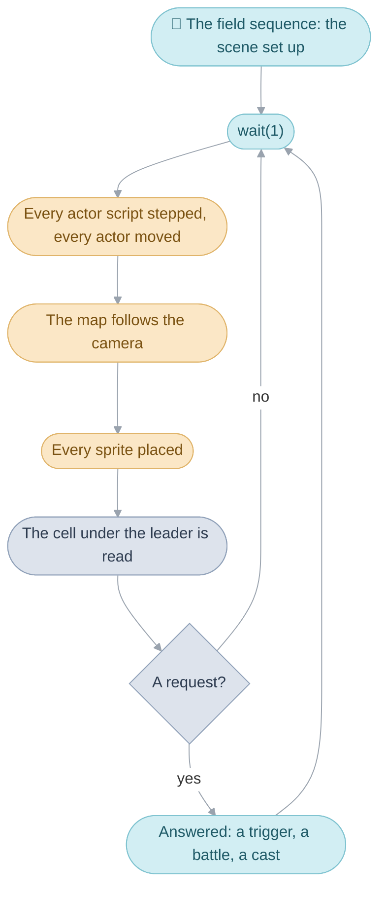
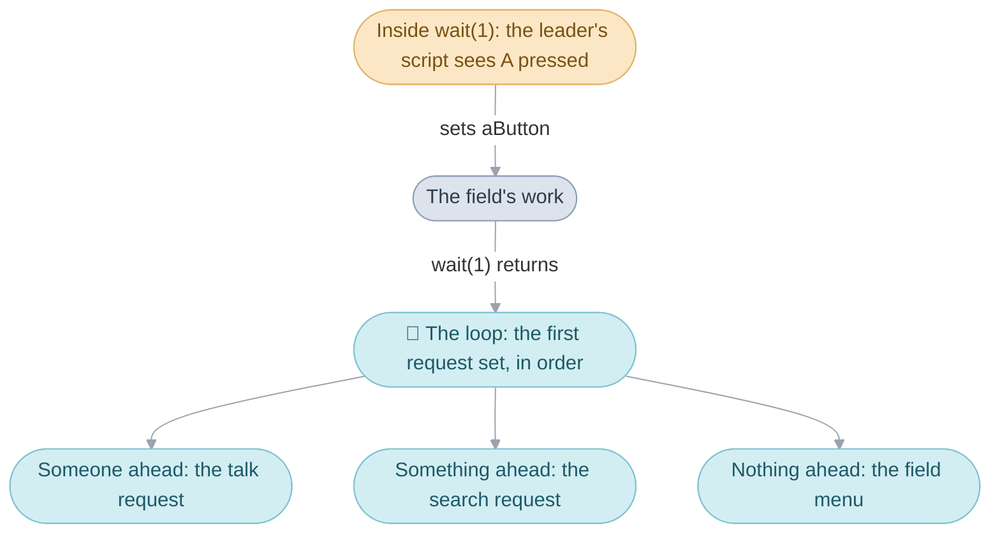

# Field code


The villager walks his rounds. Isaac walks up and presses A, the villager
stops and turns, says his line, and walks on.

Everything in that moment is this folder's work: the
[actors](../../glossary.md#actor) and the little scripts they run, the
leader's walk, the search for someone to talk to, and the [field
sequence](../../glossary.md#field-sequence) that runs the whole visit to
Vault until the [party](../../glossary.md#the-party) leaves. The folder also
holds Lucky Dice and Lucky Wheels, the two games played in Tolbi.

What is particular to one place lies elsewhere. A
[scene](../../glossary.md#scene)'s people, doors and
[events](../../glossary.md#event) are its own code
([Scenes](../scene/README.md)), and the ground it stands on is its
[map](../../glossary.md#map) ([Maps](../map/README.md)).
[Field](../../field.md) gives the division in brief.

A visit to a scene is three things, one inside the other:

1. The field sequence sets the scene up and then walks the party a
   [frame](../../glossary.md#frame) at a time. Each frame is one call of
   `wait(1)`, the call that runs one frame of the whole game
   ([The Broken Seal](../../README.md#code-that-waits)).
2. Inside each frame, one [task](../../glossary.md#task) steps every actor's
   [actor script](../../glossary.md#actor-script) and moves the actor, the
   leader among them. The map then scrolls to follow the camera, and a
   second task places the sprites.
3. Whatever should interrupt the walk leaves a note, a
   [field request](../../glossary.md#field-request), and the field sequence
   answers it once the frame is over: a talk, a step, a search, a random
   battle, a Psynergy cast.



## The field sequence serves requests


The field sequence is one function, `FieldSequence_Run` in
[run.c](field_sequence/run.c). The [main
routine](../../glossary.md#main-routine) calls it with the
[entrance](../../glossary.md#entrance) the party arrives by, and it returns
the [exit](../../glossary.md#exit) the party left by.

Between the two it sets the scene up and then loops, a frame at a time,
until something ends the visit.

### Setting the scene up

The set-up runs in a fixed order, because each step needs the one before it.

First the field takes its [work](../../glossary.md#work), the block of
memory that holds everything about the running scene. It also notes where
the party is, so that a battle knows where to come back to. Then:

1. The map is loaded, or on the World Map the tilted view is built.
2. The scene's random battles are chosen, one zone for each kind of ground.
3. The 64 actor slots are cleared, and the two tasks that move and draw
   the actors are added.
4. The scene's code is asked for its table of triggers, the list of what
   can happen there.
5. The party is placed at its entrance, and the leader, the scene's people
   and a camera actor are created. Coming back from a battle, everyone is
   put back where they stood.
6. The chests and Psynergy Stones the map marks are placed, and the
   [palette fade](../../glossary.md#palette-fade) is made ready.
7. The scene's own set-up runs. It may take an exit at once and end the
   scene before it is ever shown.
8. The screen fades in over 16 frames. If the party has just come into the
   area, the area's name shows for 90 frames, a second and a half. A Djinni
   or an item the last scene left waiting is given.

### The walk, a frame at a time

The loop is the part of the field the player feels. It hands the leader to
the player, and then runs these three lines until something asks it to stop:

```c
do {
  wait(1);
  Field_UpdateWalking(actor->layer, actor->x.fixed, actor->y.fixed, actor->z.fixed);
} while (Field_CountRequests() == 0);
```

`wait(1)` is one frame of the game: everyone moves and the screen is drawn.

When it returns, the walking update reads the [cell](../../glossary.md#cell)
under the leader and raises whatever that cell calls for. That can be a step
trigger, a push, an exit or a random battle.

The last line asks whether any request is set. While none is, the loop goes
round again, sixty times a second.

A request can be set from two places. The walking update sets the ones that
come from the ground. The ones that come from the buttons are set by the
leader's own script, running inside the frame, since it is the code that
reads them.



A request an event sets waits until the event has finished, because the loop
is standing still inside the event. So a battle an event asks for starts
after the event's last line, and an exit an event asks for ends the scene
once the event returns.

### The twelve requests

[The Broken Seal](../../README.md#requests) lists the twelve requests in the
order the loop looks at them. The loop answers the first one it finds set,
then starts again from the top. When none is left it hands the leader back
to the player.

The answers fall into four groups.

- Leaving. The exit request is looked at first and ends the loop. The main
  routine then reads the scene's exit table to find where the exit leads.
- What the leader walked into. A trigger the scene raised runs its event.
  A battle is started, as
  [below](#leaving-for-a-battle-and-coming-back). A step onto a marked
  cell runs that cell's row of the trigger table, and a push against a
  ledge, a climbing spot or a gap starts the jump or the climb
  ([What a talk, a step or a search runs](#what-a-talk-a-step-or-a-search-runs)).
- The A button. The loop asks what is ahead. If someone who can be talked
  to stands within reach, the press becomes a talk request. Otherwise, if
  the cell ahead has something to search, it becomes a search request.
  Otherwise the field menu opens. The talk or the search is then answered
  on the loop's next pass.
- Menus and uses. The field menu and the Pause menu open. A Psynergy or an
  item chosen from a menu comes back as a request of its own, naming what
  is used and who uses it, so the menu has closed before the cast plays.

On the World Map the moving view is drawn as a
[still picture](../../glossary.md#still-picture) around most answers, so
that a window can use a background layer the moving view needs
([The World Map in perspective](#the-world-map-in-perspective)).

### Raised triggers the field answers itself

A raised trigger is a number that the scene's code, or the field itself,
writes down to ask for an event. Most are looked up in the scene's trigger
table. Four of them the field answers without the scene:

- A party member fell to poison or hazardous ground on this step. A
  message names each one, and if nobody is left standing the party goes to
  its restart point with the leader at 1 HP.
- R was pressed on the World Map: [the world picture](#the-world-picture)
  shows.
- L was pressed on the World Map: the view pulls back while L is held.
- A menu or shortcut key was pressed while a scene has asked to hear of
  it. Vault's inn does this while the party corners the thieves, so that
  the scene decides what the buttons do there.

### Leaving for a battle and coming back

A random battle is a way out of the scene. The loop stops the leader, saves
where everyone stands, and tells the main routine that a battle comes next
and against which enemies.

Then it closes the screen. The battle music starts, the beast's cry plays,
and the screen closes onto the leader over 16 frames. After that the loop
ends, as it does for any exit.

The saving is needed because of how memory is shared. The
[heap](../../glossary.md#heap-and-pools), the memory a sequence borrows, is
emptied between one sequence and the next, so the actors would be lost. The
field copies them into a fixed buffer outside the heap. This is the
snapshot, and it holds up to 32 actors with each one's animation.

When the battle ends with the party standing, the main routine runs the
field sequence for the same scene again, with a [game
flag](../../glossary.md#game-flag) set that says to keep everyone's place.
The whole set-up above runs as for any arrival, except that everyone is put
back from the snapshot. The scene's own set-up still runs too, and checks
the flag to skip its arrival events.

Where the party goes after a battle is settled as the field sequence starts,
and an event can change it before its battle. A win or a flight goes to the
after-battle destination if an event set one, and otherwise back to the
scene the party left. A defeat goes to the defeat destination if an event
set one, and otherwise to the restart point, which is usually the last
Sanctum.

These ways out never read the scene's exit table. Neither does Retreat, nor
an event that chooses the next scene itself.

## Everything that moves runs an actor script


The party, the people and things a scene places, the camera, a chest and
each footprint in the snow share 64 actor slots. One task gives each actor
its share of every frame.

An actor's share has two halves. First its script runs. An actor counting
down a wait counts one frame off. Any other runs the commands of its script
one after another, until a command says the actor is done for this frame.

Then the actor moves toward the point its script aimed it at. So the script
decides where the actor wants to go, and the motion takes it there over the
following frames.

### How an actor script runs


A script is a list of commands, each followed by the values it needs. The
two children who run round Vault's well each run one. The boy runs through
eight points one after another, and the girl through the same points half a
lap behind ([vault.c](../scene/vault.c)):

```c
s32 gVault_BoyRoundTheWellRoute[] = {
    SC_ANIMATION(2),
    SC_SET(SW_SPEED, PIXELS(4) / 5),
    SC_SET(SW_ACCELERATION, PIXELS(1) / 5),
    SC_LABEL(1),
    SC_MOVE(PIXELS(136), 0, PIXELS(376)),
    SC_SYNC,
    SC_MOVE(PIXELS(120), 0, PIXELS(376)),
    SC_SYNC,
    /* ... six more points round the well ... */
    SC_LOOP(SC_FOREVER, SC_TO(1)),
    SC_END,
};
```

A command that only sets, tests or jumps takes no time, so the next one runs
in the same frame. The animation, the speed of four fifths of a pixel a
frame and the first `SC_MOVE` all happen in the boy's first frame.

`SC_SYNC` is a command that takes time. It ends the boy's share of the
frame, and ends it again every frame until he has reached the point. Then
the next `SC_MOVE` runs. The loop at the end jumps back to the label, so the
boy runs round for ever.

A jump names a label by its number, and the game finds the label by
searching the script from its start, up to 1,024 words in. `SC_END` leaves
the actor standing idle, and only `SC_RELEASE` gives its slot back.

A script can also test a game flag and branch on it, so a villager can stand
or wander as the story stands. And beside its script, an actor can carry an
update routine. That is a function of the scene's own that runs every frame
before the script, even while the actor is waiting.

These are the commands a scene's scripts use most.
[actor_script.h](../../include/field/actor_script.h) has them all.

| Command                   | Meaning                                                                |
| ------------------------- | ---------------------------------------------------------------------- |
| `SC_WAIT(n)`              | stop for this frame, and run again n frames later                      |
| `SC_MOVE(x, y, z)`        | set a point to move towards, in pixels                                 |
| `SC_MOVE_BY(x, y, z)`     | set a point this far from where the actor is                           |
| `SC_SYNC`                 | wait until the actor reaches its point, or 60 frames of being blocked  |
| `SC_POSITION(x, y, z)`    | put the actor there at once and stop it                                |
| `SC_ANIMATION(n)`         | play [sprite animation](../../glossary.md#sprite-animation) n          |
| `SC_SET(w, v)`            | set one of the actor's values, such as its speed                       |
| `SC_FLAG_CHECK(f)`        | test game flag f, for a branch that follows                            |
| `SC_LOOP(n, to)`          | jump back to a label so that what lies between runs n times            |
| `SC_WANDER_HOME(a, b, c)` | walk to a random point a to a + b pixels away, within c of home        |
| `SC_CALL(fn)`             | call the scene's own function each frame until it returns zero         |
| `SC_END`                  | stand idle for good                                                    |
| `SC_RELEASE`              | give the actor's slot back                                             |

### How an actor moves


An actor moves toward a target point. Each frame it gains its acceleration
in the target's direction and is held to its speed limit. So a villager
starts smoothly and tops out at the speed her script set. An actor with no
target slows by its acceleration each frame until it stops.

Arrival is judged on one axis, the one with the furthest to go. An actor
that reaches or crosses its target on that axis has arrived. Unless its
script asked it to land on the point exactly, the target it is given is
pulled in by half its braking distance, so the actor coasts the rest of the
way and stops where it was sent.

The ground carries the actor up and down. An actor that follows the ground
takes the ground's height where it is going, and a climb or a drop slows it.

An actor that falls gains downward speed each frame while it is above the
ground. It bounces when it lands, keeping a quarter of its speed each time
until a bounce is too small to matter. A floating actor bobs up and down two
pixels over 64 frames.

A new actor follows the ground and falls, with a speed limit of 2 pixels a
frame. A placed actor given a height above the ground floats.

A solid actor refuses to walk into another solid actor. The frames it has
been refused are counted, which is how `SC_SYNC` knows to give up after 60
of them.

An actor that faces the way it moves turns by at most 22.5 degrees a frame,
a sixteenth of a circle. So it swings round instead of snapping.

### Who runs which script

The field has a few scripts of its own, each a single command repeated every
frame. Such a command hands the actor to a built-in script, a routine inside
the field that steers the actor for the rest of the frame.

The player's control of the leader is one of these, with a second for the
World Map and a third for climbing. The camera's script follows the leader,
and another makes one actor follow another. That makes the player's control
an actor script like any other.

A placed actor takes its script from its row of the scene's actor table
([Scenes](../scene/README.md#who-stands-where)). The row can name a script
of its own, as the children's rows do. Or it can name one of six ready-made
ways of moving: standing still, wandering within 16, 8 or 6 pixels of home,
walking toward its [watched actor](../../glossary.md#watched-actor), or
turning to face the leader.

## Walking and running


The leader walks at one pixel a frame and runs at one and a half while B is
held. Each frame his script does the same four things. It chooses the speed
from B, picks a heading from the D-pad, tests the ground, and moves or
turns.

The ground test is five probes. One looks 8 pixels along the heading. Four
more look 8 pixels out at 22.5 and 45 degrees to either side, so that the
leader's whole width clears the way.

If all five pass, the leader moves along the heading. If any fails, the
control tries headings further and further round, 22.5, 45 and 67.5 degrees
off the way the pad points. Each gets the same five probes, and the first
that passes is taken. That is the slide along a wall
([Field](../../field.md#movement) has its recording).

When every heading fails, the leader stays put and turns toward the pad, and
the field counts the frame as a push. A doorstep or a ledge answers only
once the count passes 12, a fifth of a second. That is why the leader leans
on a door for a moment before it opens.

A solid actor just ahead blocks the step too, unless it is pushable. A
pushable actor slides a quarter of a pixel away from the leader each frame,
as long as the ground beyond it is clear, and the leader slows to a quarter
pixel a frame while pushing.

Few actors are pushable, and only while a script makes them so. The old
man's does while he searches Vale's plaza for the Psynergy Stone after
Kalay. A stone pillar is pushed by its scene instead, a cell at a time
([Stepping and pushing](#stepping-and-pushing)).

On a map that shows footprints, Imil's snow or Bilibin Cave's, the leader
leaves one every 18 frames of walking or 12 of running, alternating left and
right. Each is an actor of its own, drawn underfoot, that waits 120 frames
and disappears.

| The leader's speed          | Pixels a frame |
| --------------------------- | -------------- |
| walking                     | 1              |
| running, with B held        | 1.5            |
| gained each frame from rest | 0.25           |
| pushing a pushable actor    | 0.25           |
| walking on the World Map    | 0.5            |
| running on the World Map    | 1              |

### The World Map's walk

On the World Map the party moves at half its usual speed. The ground there
has no heights. Each cell says only what kind of ground it is, and the test
asks whether that kind can be walked on.

The camera turns toward the way the pad points, a little each frame. In
shallow water a ripple follows the leader every 10 frames, and in a forest
the leader's shadow is hidden.

The Japanese edition and the [international
editions](../../glossary.md#editions) test the ground differently there:

|                                    | Japanese                                                                         | International                                                                           |
| ---------------------------------- | -------------------------------------------------------------------------------- | --------------------------------------------------------------------------------------- |
| how far ahead the ground is tested | 8 pixels, straight ahead and 30 degrees either side, then up to 67.5 degrees off | 7 pixels, straight ahead and 22.5 and 45 degrees either side, then up to 90 degrees off |
| R and L on the World Map           | act again and again while held                                                   | act once a press                                                                        |

The walking code is [player_control.c](field/player_control.c), with each
edition's values chosen at the top of the file.

## How high a step can go


Every point of a map has a height. The leader can step up onto ground at
most 8 pixels higher, or down onto ground at most 12 pixels lower.

Anything steeper blocks the way as surely as a wall. In fact most of the
game's walls are made from heights: a cliff is ground too high to step onto.
The room of Goma Cave with the pillar and the stump marks no cell as a wall
at all.

The height anywhere inside a cell is worked out from the cell's shape, one
of 16 kinds, and up to three height samples in 8-pixel units. The shapes are
a flat floor, a slope along one axis, a step across a diagonal, a slope that
bends on a diagonal, and a rounded bump ([Maps](../map/README.md#cells)). A
half-cell step up is therefore always allowed, and a full-cell one never is.

Each actor follows the ground of one of the map's three layers. So a bridge
can cross a stream with a wall on one layer and open ground on another.

## Actors move first, then the camera draws them

Every frame all the actors move first. Only then does the camera work out
where each sprite appears on the screen and what it is drawn in front of.

The two are tasks, and tasks run in a fixed order, so each sprite is always
drawn where its actor has just moved to. Between them runs the map's own
task, which scrolls the map to follow the camera actor. So the sprites are
placed on the map as it now stands.

The camera is one of two kinds. On a town or dungeon map it places each
sprite by the actor's distance from the corner of the view. It also reads
the cell under the actor, to learn which layer the actor now follows and
what its sprite is drawn in front of. A sprite that has gone off screen
gives its video memory back, and takes it again when it returns.

On the World Map and in a battle the other camera works in three dimensions.
It projects each actor's place onto the screen and sorts the sprites by
distance. It also turns every sprite's facing by the camera's own heading,
so a figure keeps its heading in the world as the view turns.

While a menu is open over the field, sprite placing is suspended, and only
the actors marked to be kept hold on to their sprites. The rest give their
video memory to the menu.

## Sprites and their animation


What the player sees of an actor is its
[sprite](../../glossary.md#sprite-and-oam). A sprite is built from up to
four pictures laid over each other, each playing its own animation.

In a battle Isaac's body, his weapon and the shadow under his feet are three
animations of one sprite. So as he swings, the body and the weapon change
pose together. Whenever any of the four changes picture, the whole sprite is
drawn again and sent to video memory.

An animation is a list of pairs: which picture to show, and for how many
frames. It names pictures as if the figure always faced one way. A facing
table then adjusts each picture for the way the figure really faces, in one
of three styles:

| A figure drawn with          | How it faces every way                                         |
| ---------------------------- | -------------------------------------------------------------- |
| one picture                  | the picture is mirrored to face left                           |
| a front and a back picture   | the back shows over half the compass; each is mirrored as well |
| eight pictures               | one for each compass direction                                 |

The front-and-back style is how the party is seen from behind in a battle.

An animation can also be recoloured as it is drawn. Its colours can be
swapped round, turned grey or tinted, or filled with one flat colour such as
white.

## Towns and dungeons on screen


A town or dungeon is drawn as three flat layers: the ground, the walls and
edges, and the roofs and treetops. Each is on one of the console's four
[background layers](../../glossary.md#background-layer). The fourth is left
for messages and menus, in front of everything.

On most maps the ground is at the back and the roofs in front, with the
people between the walls and the roofs. That is how Isaac passes behind a
roof ([Field](../../field.md#map-layers) has that recording).

The console decides who hides whom. Every background layer and every sprite
has a priority, a number from 0 to 3, and the console draws the lower
numbers in front.

Each map gives its three layers their priorities. An actor's sprite takes
its own from the cell under it: 2 on open ground, and 3 where the cells put
it behind a building. A sprite wins a tie with a layer of the same priority.

Each layer is a window onto the one grid of cells. Each frame the map
centres its view on the camera actor, within the bounds the entrance set,
and scrolls each layer there at its own pace. A layer can follow the view at
a fraction of its speed, for a far wall that moves less than the ground. Or
it can drift by itself, for clouds.

As the view moves, the map draws only the column or row of cells that comes
into view. So video memory only ever holds what is near the party.


Two timed changes run on their own. A tileset animation swaps the pictures
of a few tiles on a timer, for a waterfall or a flickering torch, and a map
can run 16 at once. A blend script changes how the layers mix over time, for
a haze or a glow.
[Maps](../map/README.md#tileset-animation-and-blend-scripts) gives the
format of both.

The code also holds a way of rotating a palette's colours, which no map
uses.

## The World Map in perspective


The World Map is a flat map, like a town's, that the console tilts so it
seems to stretch away toward the horizon.

The console can scale and rotate two of its background layers, and it reads
their scale afresh for every line of the screen if the game changes it
between lines. So each of the 160 lines shows one straight strip of the flat
map. Lines near the top show strips farther away and wider, squeezed to fit,
so distant ground looks smaller.

The lower ground is on one of the two layers. The mountains, woods and
cliffs are on the other, in front, with the sprites in front of both.

Each frame the game looks at the map from the camera's place and tilt and
works out a scale and a distance for every line. The console is then given
one line's values at a time, in the pause after each line is drawn.

Two things keep this fast enough. The routine that works out the 160 lines
is copied into the console's fast memory to run ([Routines run from
RAM](#routines-run-from-ram)). And the values go into one of two pages in
turn, so the next frame's values can be written while this frame's are still
being read.


While L is held the view pulls back to 1.6 times as far over 6 frames, and
comes back when L is released.

The ground is far too big to keep unpacked, so the game unpacks only the
tiles around the party as it walks
([Maps](../map/README.md#the-world-maps-data)).

When a menu opens or an event starts, the game draws the current view once
into an ordinary still picture. That frees a background layer for the
windows, and the moving view comes back when the menu closes. The code for
all of it is [world_map.c](field/world_map.c).

## What a talk, a step or a search runs


When the loop answers a talk, a step or a search, it looks the request up in
the scene's table of [triggers](../../glossary.md#trigger) and runs the
first row that fits ([Field](../../field.md#triggers-and-events)).

The field's part is deciding what the player meant: whom A is for, which
cell was stepped on, what lies ahead.
[Scenes](../scene/README.md#the-tables) describes the rows themselves.

### Talking

The A button looks for someone to talk to. It picks the nearest actor within
32 pixels of the leader and at most 48 pixels higher or lower.

Within 11 pixels the actor can be anywhere around the leader. Beyond that it
must be within about 67 degrees of the way he faces. An actor marked as near
to talk to counts as closer than it is, so it can be spoken to from further
off.

The actor stops and the leader stops, each turns to face the other, and the
actor's row runs. Afterwards the actor goes back to its script. It either
turns back to its old heading or keeps watching the leader, as its row of
the actor table says.

An actor that Halt has stopped answers through a row of its own for that
case. Without one, its talk row still shows its message, but a talk row that
would run an event gives one of two idle lines instead.

### Stepping and pushing


Each frame the walking update reads the [cell
behavior](../../glossary.md#cell-behavior) of the cell under the leader.

Any marked cell makes the field test the scene's exit regions, boxes of
pixels that take the party out when the leader is inside one. A behavior
from the range that belongs to the scene also raises a step request.

When the loop answers the step, it looks for a step row for that behavior.
Finding none, it looks for an exit row, which plays the exit's sound and
sets the exit request.


An exit row says how the leader leaves: with the exit sound, silently, or up
or down a stair.

A stair centres the leader on its cell and plays his leaving animation for
18 frames, in which he walks into the opening away from the player,
darkening as he goes. It also sets a flag that makes the next scene play the
matching arrival as it fades in, in which he steps out of an opening toward
the player.

Three behaviors answer a push, and they mean the same in every scene. Once
the leader has pushed for more than 12 frames, a ledge is jumped down with
Down held, a climbing spot is climbed up or down with Up or Down, and a gap
is jumped across.

On a climbing spot the leader crouches, jumps and holds on, then climbs in
8-pixel steps while the pad is held. Pushing Up at the top cell takes him
over the edge onto the ground above.

A scene's own row can ask for the same push of more than 12 frames, or for
the leader to face within 45 degrees of a given heading.


A stone pillar is pushed by its scene's step rows. The cells beside it carry
a behavior whose row answers walking into the pillar from one side.

The row's event leans the leader on the pillar for a quarter of a second. It
checks that nothing solid stands beyond the pillar or on it, and that the
ground there can take it. Then it slides the leader and the pillar one cell
together at a fifth of a pixel a frame, with the push sound.

The scenes with things to push share that code
([staged_actor.h](../scene/shared/staged_actor.h)).

### Searching

With nobody to talk to, the A button looks at the cell 16 pixels ahead.

Six behaviors are search spots every scene shares: the jars, barrels, wooden
boxes, graves, books and wells. Each shows its own two lines, the `checked`
line and what was found, with no row in any scene.

Any other behavior with a search row runs that row. The leader checks the
thing the row names (`Isaac checked the chest...`), and the row says what is
found. That can be a message, an item, coins, a Psynergy Stone, a mimic, or
a function of the scene's own.

With nothing ahead at all, the field menu opens.

### Chests and Psynergy Stones


A chest is a row in the scene's trigger table and a mark on the map. When
the scene loads, the field walks the map's list of marked cells and, for
each mark the scene has a search row for, places an actor: a chest, shown
open if its flag says it has been opened, or a Psynergy Stone, until it is
taken. The field places up to ten of them.

Searching an unopened chest opens it with its sound, lifts what it held
above the leader to the treasure jingle, and sets the row's flag. An opened
chest answers `but the chest was empty.`

An item nobody can carry stays, and the chest closes again. A mimic's chest
jumps up and starts a battle the party cannot flee, and the chest's flag is
set once the mimic is beaten.

## Random battles


As the party walks through a dungeon or across the World Map, a counter
fills, and a battle starts when it reaches its mark.

Each frame the leader walks, the counter grows by his speed divided by a
number the ground underfoot supplies, its rate. So the counter measures
distance, and running brings the next battle no sooner in pixels than
walking does.

The ground belongs to a zone. A zone gives the rate, the level it is made
for, and up to eight groups of enemies with a weight for each. The counter's
mark is 16, so with nothing else at work a zone of rate r brings a battle
after 16 × r pixels.

Three things change that distance:

- A random bias, drawn afresh after each battle, stretches or shrinks the
  rate for the next one. It is most often small, but at its extremes the
  next battle can come almost at once or take nearly twice the usual
  distance.
- When the party's average level is above the zone's, each level of the
  difference, up to five, adds 5 to the rate and so spaces the battles
  further apart. With Avoid up, such a zone has no battles at all.
- The Lure Cap doubles the speed the counter sees, which halves the
  distance.

There are no random battles while Cloak is up, in a zone with no rate, or
where the scene or the area turns them off.

Which zone the ground belongs to is the scene's choice. A map can mark its
cells as one of two kinds of battle ground, and the scene's rule names a
first zone. The first kind of marked cell takes that zone and the second
kind takes the zone after it, while unmarked ground has no battles.

A rule can instead put its first zone on unmarked ground, as Goma Cave's
rules do, so that the whole floor counts. The World Map takes its zone from
the region and the kind of ground under the party, and the same lookup picks
the battle's background.

One more rule holds only in Sol Sanctum. Jenna is in the party only from
Vale to the Sanctum's eruption, joining at level 1. Random battles stop
while she has more than 130 experience points, just short of level 4, so the
party cannot train there before the journey begins.

When the counter reaches its mark, one of the zone's groups is drawn by its
weight, the battle's music is chosen, and the battle request is set.
[Leaving for a battle and coming
back](#leaving-for-a-battle-and-coming-back) says what the loop does with
it. Battles that an event, a mimic chest or a Djinni starts name their zone
and group directly and skip the counter.

The zones are the rows of [encounter_zones.c](encounter_zones.c), each named
for the place that uses it.

## What walking does to the party


Walking outside a town slowly changes the party. Every 160 pixels the leader
walks, ten cells, three things happen. Each party member regains one PP. The
[Djinn](../../glossary.md#djinn) recovering from a summon count one step
down. And poison takes its toll: a twentieth of a poisoned character's
maximum HP, or a tenth for deadly poison, and at least 1.

On ground with no random battles the distance counts half as fast.

In a town none of this happens, and Avoid, which wears off with distance,
lasts until the party leaves. A town is a scene whose row of the scene table
says so. Of the 201 scenes, 53 are towns or rooms of one.


Hazardous ground hurts on its own. The game keeps a hazard count, a limit
and a damage. When the count reaches the limit, the party takes the damage
and the count starts again from nothing. Every ordinary arrival in a scene,
though not a return from a battle, sets the limit to 16 and the damage to 1
HP.

The Lamakan Desert is the one place that changes them. Its set-up raises the
limit to 600 and the damage to a quarter of each party member's maximum HP.

Its sand is a cell behavior of the desert's own, whose step row adds one to
the count each frame the leader moves on it. A thermometer down the left
edge of the screen shows the count.

At the limit, 600 frames or ten seconds of walking there, the screen
flashes, the leader flinches and the party loses its quarter. As the count
passes each quarter of the way, a party member complains of the heat.

The field can also count for itself. It counts by the pixels the leader
walks on a kind of sand cell that every scene shares, starting half way to
the limit when he steps onto one. With the values every scene starts with,
such a cell would cost 1 HP every 16 pixels. The desert marks its sand with
its own behavior instead and does its own counting
([lamakan_desert.c](../scene/lamakan_desert.c)).

When damage brings a character to 0 HP, the leader flinches and the fallen
are named one by one. If nobody is left standing, the party is sent to its
restart point with the leader at 1 HP, to the defeat music.

## How field Psynergy reaches its target


Move shows a giant hand that pushes what is ahead. On a stone pillar, the
pillar slides. Where the scene has no row for it, the hand appears, lingers
30 frames and bursts.

The cast only draws the Psynergy. What it does to a place is decided by that
scene's rows. A Psynergy row names the Psynergy, what it is for, which is an
actor, a cell or anywhere, and the moment it runs at.

A cast runs in this order:

1. The field refuses the casts a place forbids: every cast in the Battle
   Arena, Reveal on the World Map, and Retreat in every town.
2. Retreat asks first, and when accepted sets the exit that takes the
   party out by the way it came into the area.
3. The PP is paid. A caster without enough is told so, and the cast ends.
4. The field looks for a target: the nearest actor in a cone ahead of the
   leader, as far as the Psynergy reaches.
5. The scene's row for before the cast runs. It can still stop the cast or
   turn it away from its target.
6. The cast plays, on its target if there is one.
7. The scene's row for after the cast runs.

| Psynergy                                   | Reach     |
| ------------------------------------------ | --------- |
| Ply, Frost, Lift, Carry, Growth            | 16 pixels |
| Mind Read, Move, Whirlwind, Douse, Halt    | 32 pixels |
| Force, Catch                               | 48 pixels |

In Vale the pillar below the cliff has a row that answers Move after the
cast. Its event notes which column the pillar now stands in and makes the
ground under it solid.

A row for after the cast can also play the cast itself, as two of Altmiller
Cave's Mind Read rows do, and then the usual cast does not play. Force,
Frost and Reveal have one more moment, the moment they act, and a row for it
runs as they act.


Two kinds of cast keep going after they end. Halt holds one actor still at a
time, so casting it again lets go of the one held before.

Cloak and Reveal run out by themselves. When they do, the scene's rows for
their ending run, so a Reveal can hide again what it showed. Cloak lasts
while the leader walks on the ground a map marks as somewhere to hide, and
he blinks back into sight where it ends. Reveal lasts 600 frames, ten
seconds, or until the leader walks about 60 pixels from where it was cast.

A cast starts in [psynergy.c](field_sequence/psynergy.c), and each
Psynergy's own picture is the file of `event_commands/` named for it.

## The palette fade


Most field Psynergy tints the screen over 8 frames as it starts and fades
back after it. When Reveal is cast, the backgrounds turn grey in one frame.
Both are the palette fade.

The game keeps a copy of the colours on screen and a set of target colours.
Each frame it moves every colour of the copy toward its target by an equal
share of the distance, so that all the colours arrive together. On the last
frame each colour takes its target exactly, so that rounding never leaves
one short.

The fade covers 14 of the 16 palettes of the backgrounds and of the sprites.
The windows' colours are in the last palette, so they never fade.

A cast's tint is one of eight colours, picked by the frame counter unless a
game flag asks for a particular one. A menu open over the field holds the
fade still.

Of the ways the screen opens and closes, the palette fade serves only the
fade from the backdrop colour as a scene starts. The rest are windows and
dissolves in [screen_transition.c](field_sequence/screen_transition.c), and
the fade from black belongs to [System code](../system/README.md).

## The world picture


On the World Map, R shows a picture of the whole world with a marker on
every area the party has visited.

A hand moves with the D-pad, from 1 pixel a frame up to 6 the longer the pad
is held, and returns to the party's place while L or R is held. The place
nearest the hand blinks and its name shows in a window. A or B closes the
picture.

Arriving in an area sets that area's visited flag, which is what the picture
reads. Each marker is drawn where its area stands on the World Map, scaled
down onto the picture, so the picture needs no positions of its own.

While it shows, the screen borrows the memory the map's cells normally use.

In the German, French, Spanish and Italian editions the hand also glides
onto the nearest place when the D-pad is let go, and a place's name shows
from closer by.

## Lucky Dice and Lucky Wheels


The two games in Tolbi are the field's smallest
[sequences](../../glossary.md#sequence). A scene in Tolbi's rooms asks for
one as what the main routine runs next, and the scene ends. The main routine
runs the game in its place and comes back to the room afterwards, as it does
after a battle.

Lucky Dice draws its field and dice with the battle's 3D camera. Lucky
Wheels draws its reels line by line into a picture of its own.


Each game is one file, [lucky_dice.c](lucky_dice.c) and
[lucky_wheels.c](lucky_wheels.c), played from top to bottom.

## A walk through Goma Cave, in numbers


Isaac walks through the room of Goma Cave past its entrance, the one with
the pond. Its zone has rate 30 and is made for level 4, and the room's rule
puts the zone on the whole floor. Suppose the party's average level is 4 and
the random bias came out at nothing.

Each frame of walking moves Isaac one pixel and adds a thirtieth to the
counter. The counter reaches its mark of 16 after 16 × 30 = 480 frames. So
the battle comes 480 pixels on, thirty cells, after eight seconds of
walking.

Running, each frame moves him a pixel and a half and adds a twentieth. The
battle then comes after 320 frames, a little over five seconds, at the same
480 pixels.

On the way, the distance toward the next PP has passed 160 pixels three
times, so each party member has regained 3 PP, and a poisoned one has been
hurt three times.

The other rules move the distance like this:

| In the pond room                          | Rate | Distance to the next battle |
| ----------------------------------------- | ---- | --------------------------- |
| a party at level 4 or below               | 30   | 480 pixels                  |
| a party at level 5, one above the zone    | 35   | 560 pixels                  |
| a party at level 7, three above           | 45   | 720 pixels                  |
| a party at level 9 or more, five above    | 55   | 880 pixels                  |
| level 4 with the Lure Cap                 | 30   | 240 pixels                  |
| level 4, the bias at its lowest           | 1    | about 16 pixels             |
| level 4, the bias at its highest          | 59   | about 944 pixels            |

When the counter reaches 16, a group is drawn. The pond room's zone has five
groups with weights 3, 3, 9, 3 and 6, which add up to 24. So the third group
is drawn 9 times in 24 and each of the rarest 3 times in 24.

The counter is cleared as the battle starts, and a new bias is drawn on the
first step after the party returns. The party comes back standing where it
stood, with the next battle a full count away.

## Design

### One actor for everything

All 64 actors are the same record, whatever they are for. So one script
language, one way of moving and one pair of cameras serve the leader, a
villager, a chest, a footprint and the figures of a battle. The [field
effects](../../glossary.md#field-effect) of a Psynergy keep their fields in
the same places, so the same routines move them too.

### Actor scripts without addresses

A jump names a label, and the game searches for it. That makes a script a
plain list that is complete as written, with nothing to fill in when it is
loaded. The cost is a search on every jump.

### Routines run from RAM

The work done for every line of the screen or every pixel has to be the
fastest code in the game.

The processor has two sets of instructions, a 32-bit one called ARM and a
16-bit one called Thumb ([Source](../README.md#c-and-assembly)). The
cartridge is read 16 bits at a time, so ARM runs slowly from it, and almost
all of the game is Thumb.

The few routines that must be fast are written in ARM and copied into RAM
before they run, into the console's fast internal memory while there is
room. They are the World Map's line values, drawing rows of the map,
decoding sprite pictures and putting a map's cells together.

There is also an ARM copy of the actor update for the first eight actors,
which nothing runs. It lacks what the field needs (following the ground,
floating, solid actors), so it could not stand in for the usual update.

### A battle starts from a snapshot

After a battle the scene is set up a second time, from the snapshot
([Leaving for a battle and coming
back](#leaving-for-a-battle-and-coming-back)). That keeps one path through
the set-up for every arrival. The field keeps nothing alive across a battle
but the snapshot.

## How it fits with the rest of the game

The main routine runs the field sequence for every scene. Each scene's
[overlay](../../glossary.md#overlay) supplies its tables and set-up. It
calls back into this folder through its [import
table](../../glossary.md#entry-table-and-import-table) for the [event
commands](../../glossary.md#event-command) its events are written in.

Battles, Lucky Dice and Lucky Wheels come back through the main routine, and
the screen transitions close the field before each battle as well as between
scenes. The battle uses the actors and the projecting camera for its own
figures.

The Lost Age's field code is described by [its own
guide](../../../tla/src/field/README.md), as differences from this one.

## Limits

- 64 actors; 64 sprites, each with up to four animations.
- 66 actor ids, each pointing at one of the 64 actors.
- 16 tileset animations on one map.
- 36 actor script commands. A label must lie within the first 1,024 words
  of its script.
- A step can climb 8 pixels and drop 12.
- 104 encounter zones of eight groups each.
- Ten chests and Psynergy Stones placed in one scene.
- A battle snapshot keeps up to 32 actors.
- One Halt target at a time.
- The palette fade covers 14 of the 16 palettes of the backgrounds and of
  the sprites.

## Words used here

The glossary defines [actor](../../glossary.md#actor),
[actor script](../../glossary.md#actor-script),
[sprite](../../glossary.md#sprite-and-oam),
[sprite animation](../../glossary.md#sprite-animation),
[field request](../../glossary.md#field-request),
[field effect](../../glossary.md#field-effect) and
[work](../../glossary.md#work). This page adds:

- A **built-in script** is a routine the field hands an actor to with one
  command: the player's control, the camera, the World Map's walk.
- **The field's work** is the running scene's state, `struct FieldWork`:
  the requests, the actor ids, the chests placed.
- A **field kind** is what an ability does on the field, one value for
  each field Psynergy. Whirlwind and Gale share one.
- A **treasure spot** is a chest or Psynergy Stone the map places at one
  of its cells.
- A **zone** is one row of the random battle table: a rate, a level and up
  to eight groups of enemies.
- A **position** is in pixels with a fraction: x across the map, y up, z
  down the map. An **angle** is a fraction of a full circle, starting from
  east.

## Evidence

The command names (`SC_WAIT`, `SC_SYNC` and the rest) are ours, named from
what each command does. The field kinds are named from the Psynergy the
English release gives the abilities that hold each kind, the requests from
what the loop does with each, and the zones from the scenes whose rules
select them.

The actors' task accepts command numbers up to 63, but only 36 are commands,
and the 11 after them act as `SC_END`. A number from 47 to 63 would run
whatever follows the table. No script holds one.

On the field each sprite draws one animation. A battle figure lays its
body, weapon and shadow in one sprite.

The test for "any request set" adds the requests together and tests the sum,
so a negative raised trigger and a positive request can cancel.

It can happen. The walking update raises the party-fell trigger, -1, on the
frame a party member falls to poison. A step request is the cell's behavior,
which is 1 on the cells of step trigger 1, and 154 scenes have those. Both
then wait until another request makes the sum non-zero. The code marks it
[`// BUG:`](../../glossary.md#bug-bugfix-and-ubfix).
