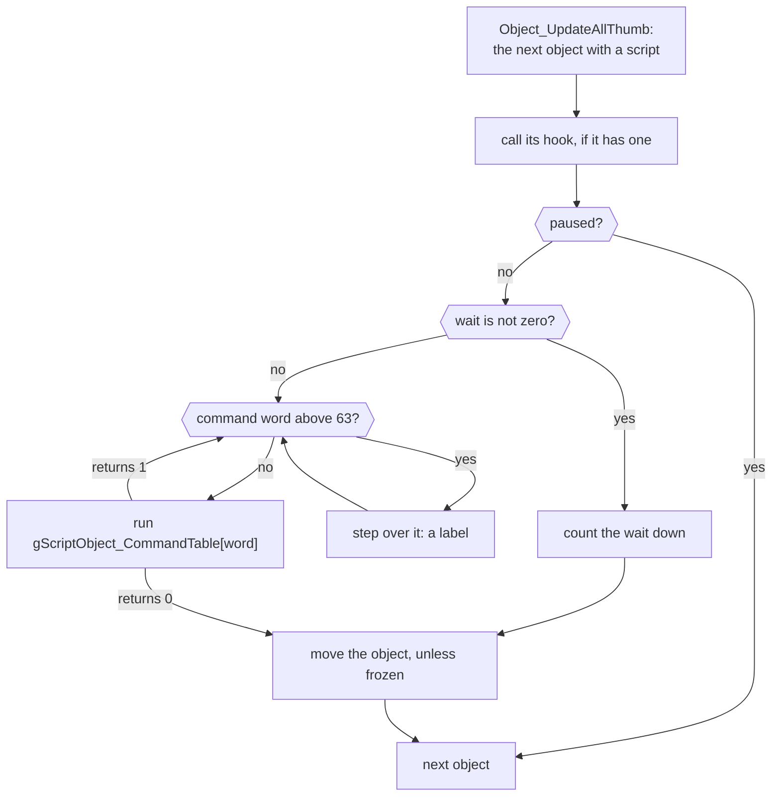
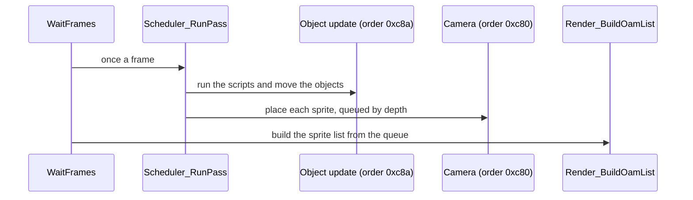
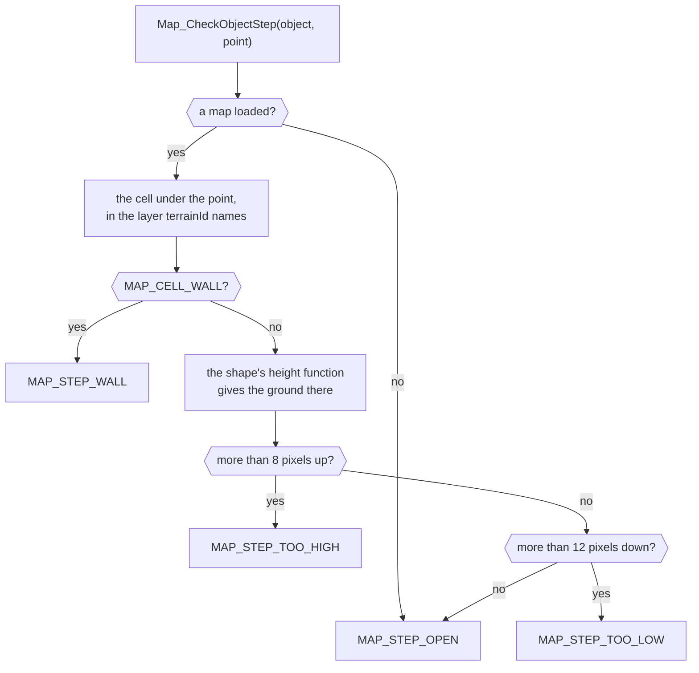

# Field

The field engine runs whatever the player walks around in: a town, a dungeon
or the world map. It keeps the 64 field objects and runs a script on each of
them every frame, draws their sprites, turns the direction pad into steps,
loads and scrolls the layered maps, draws the world map in perspective, and
answers how high the ground is at a point and whether an object may stand
there. It decides nothing about a place. [Field objects](../object/README.md)
runs a field scene on the engine, each place's overlay in
[Scenes](../scene/README.md) supplies the events, and [Maps](../map/README.md)
holds the map data the engine loads. [World](../../world.md) gives the layer
as a whole.

## Object scripts

Every field object in use runs a script of 32-bit command words once a
frame, even if only the idle one, and that is how the camera, the actors and
the player's control all act.

The camera, an actor wandering near its home and a footprint waiting to
disappear are scripts, and so is the leader: the player's control is a
script command run once a frame.

`Object_UpdateAllThumb` (`field/object_motion.c`) runs the scripts. For each
object with a script it first calls the object's hook, if it has one, even
when the object is paused. A paused object does nothing else that frame.
Otherwise, if the object's wait is not zero, the update counts it down; if it
is zero, the update runs commands until one yields. A command word is an index
into `gScriptObject_CommandTable`, whose entry takes the object and returns 1
or 0:

- 1 means the command has finished and moved the cursor past its operands, and
  the next command runs in the same frame. Tests, jumps, flags and work-value
  arithmetic return 1, so a script branches without spending a frame.
- 0 ends the object's frame. A command that waits for something returns 0
  without moving the cursor until it is satisfied: `SC_SYNC` waits until the
  object reaches its target, or until a solid object has blocked it for 60
  frames. `SC_WAIT(n)` moves past itself, sets the wait to n - 1, since the
  current frame counts as the first, and returns 0.

A word above 63 is not a command, and the update steps over it. That is what
lets a label sit in the stream: `SC_LABEL(n)` is a word with its top bit set
and n in bits 16 up. A jump's operand, `SC_TO(n)`, is the same word with bit
30 also set. `Script_FindLabel` clears bit 30 and searches the first 1,024
words for the result, so it finds the label rather than the jump's own
operand, and the script continues after the label. A label it cannot find,
and `SC_TOP` (0), restart the script.

`SC_END` does not free the object: it points the script at
`gScript_MainScript`, a lone `SC_END`, so the object idles until something
gives it another script. `SC_FREE` frees the slot. A footprint is the whole
lifetime in two words: the player's control creates an object of
`FIELD_SPRITE_FOOTPRINT` every 18 frames of walking or 12 of running and
starts it on `gWorldMap_FootprintActions`, `SC_WAIT(120), SC_FREE`.

The scripts the engine starts by itself (`object_script.c`) each repeat one
command: the command, `SC_WAIT(1)`, `SC_LOOP(SC_FOREVER, SC_TOP)`. Most
command handlers are in `field/script_commands.c`; `SC_BASE`, `SC_B54_OFF`
and `SC_B54_ON` are at the top of `field/object_motion.c`, and the controls
(`SC_PLAYER`, `SC_KEYS`, `SC_WORLD`, `SC_KEY_COUNT`) are in
`field/player_control.c`.

After the scripts, the same loop moves each object that isn't frozen: free
flight in 3D towards its target, following the terrain, floating, and solid
objects refusing to overlap. In a battle, `Object_UpdateAllMotion` replaces
it; it moves the first 14 objects and runs no scripts.

The objects are the 64 slots of `gObjectSlots`, 112 bytes each, in the heap
block `HEAP_SLOT_OBJECT_POOL`; the commands are the macros of
[`objcmd.h`](../../include/objcmd.h), and the handlers are the rows of
`gScriptObject_CommandTable` (`object_script.c`).

| Name | Value | Meaning |
| --- | --- | --- |
| `FIELD_OBJECT_COUNT` | 64 | field objects, the slots of `gObjectSlots` |
| `SC_WAIT(n)` | `0x00`, n | end the frame and wait n frames |
| `SC_SYNC` | `0x01` | wait until the object reaches its target |
| `SC_LOOP(n, to)` | `0x0c`, n, to | jump to label `to` n - 1 times, so what lies between runs n times |
| `SC_END` | `0x10` | return to `gScript_MainScript` and idle |
| `SC_PLAYER` | `0x18` | the player's control on a layered map |
| `SC_KEYS` | `0x19` | move 8 pixels a step by the direction pad |
| `SC_WORLD` | `0x1a` | the player's control on the world map |
| `SC_FREE` | `0x1b` | free the object's slot |
| `SC_KEY_COUNT` | `0x23` | check the configured keys; the last command |
| `SC_LABEL(n)` | `0x80000000 \| n << 16` | a label: a word the update steps over |
| `SC_TO(n)` | `0xc0000000 \| n << 16` | a jump's operand naming label n |
| `SC_TOP` | 0 | the script's start |
| `SC_FOREVER` | `0xffff` | an `SC_LOOP` count that never runs out |

## Sprites and their animation

A sprite is an image composed from up to four layers, each playing its own
animation script, and redrawn into video memory whenever one of their frames
changes.

![Isaac attacking in a battle, the screen on the left and his sprite taken apart on the right. Its three layers are each composed alone: `entries[0]`, sprite 300, his body; `entries[1]`, sprite 320, his sword; and `entries[2]`, sprite 510, a dark ellipse along the bottom of its 64 by 64 picture. Beside them is the buffer composed from all three, read back from video memory: the ellipse under his feet, the body over it and the sword over the body. As he winds up, swings and lands, the body's and the sword's frame numbers change together, from 1 to 5 standing, then 13, 15 and 17 for the swing, 7 and 9 as he lands, while the ellipse stays at frame 0.](https://alchemy.pascalpixel.com/guides/field/sprite-layers.gif)

Each layer of a sprite plays an animation script of byte pairs. A first byte
below `ANIM_CMD_END` (239) is a frame to show and the second byte how long.
The layer's timer counts sixteenths of a frame and loses
`AnimationEntry.step` each frame, `ANIMATION_NORMAL_STEP` (16) at normal
speed, so a layer can be made to play slower or faster. From 239 up, the
first byte is a command (`enum AnimationCommand` in `field_internal.h`):
`ANIM_CMD_END`, `ANIM_CMD_SET_KIND` (choose a facing table), `ANIM_CMD_HOLD`,
`ANIM_CMD_WAIT`, `ANIM_CMD_JUMP`, `ANIM_CMD_PLAY` (switch animation) and
`ANIM_CMD_BLANK`. The drawing code skips 242 to 244, 246 to 250 and 252 as
unused, and shows 251 as an ordinary frame.

When any layer's frame changes, `Sprite_ComposeAnimationFrame` redraws the
sprite: it decodes each layer's frame into one pixel buffer in priority order,
adds an outline if asked, and uploads the result to the sprite's tiles in
video memory. A layer's colour mode (`AnimationEntry.param`) can run its
pixels through a 256-byte table: one of the five
`gResourceSlot_ConversionTables`, then the four of `gRuntime_ByteRemapTable`.
The first remap table also recolours the command icons
(`Runtime_RemapBytesByTable`).

A battle unit's sprite shows how layers combine. `BattleObject_SpawnObjectsForList`
(`../battle/battle/objects.c`) gives Isaac's sprite three layers: his body
(`BattleObj.resource`) and his weapon (`BattleObj.overlay`) at priority 1, and
the 64 by 64 sprite 510 (`BattleObj.effect`) at priority 0. The two at priority
1 are drawn in layer order, so the weapon lies over the body; the layer at
priority 0 is drawn first, so its ellipse lies under his feet. The body and the
weapon play scripts with the same frame numbers, so each change of pose
changes both and redraws the whole buffer. In the picture each layer is drawn
alone by the game's own `Sprite_ComposeAnimationFrame`: as it is called for
Isaac's sprite, the other layers' priority is raised past 3 and every layer's
`step` set to 0, so the scripts stand still while it composes, and the buffer
is read back from video memory before the machine is put back as it was.

A sprite is a `struct AnimationObject`, and each of its layers a
`struct AnimationEntry`; the colour tables are `gResourceSlot_ConversionTables`
and `gRuntime_ByteRemapTable` (`remap0.tsv` to `remap3.tsv`).

| Name | Value | Meaning |
| --- | --- | --- |
| `ANIMATION_OBJECT_COUNT` | 64 | sprites, and the layer records they share |
| `ANIMATION_LAYER_COUNT` | 4 | layers a sprite composes, `AnimationObject.entries` |
| `ANIMATION_NORMAL_STEP` | 16 | sixteenths of a frame off a layer's timer each frame: normal speed |
| `ANIM_CMD_END` | 239 | blank the layer and stop its script |
| `ANIM_CMD_SET_KIND` | 240 | use facing table `arg` |
| `ANIM_CMD_HOLD` | 241 | stay on this command and frame for good |
| `ANIM_CMD_WAIT` | 245 | keep the current frame `arg` frames longer |
| `ANIM_CMD_JUMP` | 253 | continue at script position `arg` |
| `ANIM_CMD_PLAY` | 254 | switch to animation `arg` |
| `ANIM_CMD_BLANK` | 255 | show nothing for `arg` |

## Cameras and the frame

The object system runs as two tasks, the object update and a camera, and
the camera places every object's sprite on the screen once the objects have
moved.

`ObjectSystem_Initialize` sets the engine up for one mode and schedules two
tasks: the object update at order 0xc8a and a camera at 0xc80. The scheduler
runs higher orders first, so objects move before the camera places them.

| Mode | Started by | Object update | Camera |
| --- | --- | --- | --- |
| `MODE_LAYERED_MAP` (2) | the field scene runner (`object/object/run_scene.c`), the debug sprite viewer | `Object_UpdateAllThumb` | `ObjectSystem_UpdateCamera`, which scrolls with the map |
| `MODE_WORLD_MAP` (3) | the field scene runner | `Object_UpdateAllThumb` | `ObjectSystem_UpdateCameraFixed`, which projects 3D points onto the screen |
| `MODE_BATTLE` (4) | the encounter (`battle/battle/encounter.c`) | `Object_UpdateAllMotion` | `ObjectSystem_UpdateCameraFixed` |

The camera places each object's sprite and queues it by depth; the frame's
sprite list is built from that queue. The battle effects, the Psynergy
effects and the menus place their own sprites through the same routine,
`Object_ApplyProjectedPlacementFar`. While the item, Psynergy, Status, Djinn
or debug menu is open, `ObjectSystemWork.suspended` is set, so sprites that
are not held are not drawn and give up their video memory.

## Player control

The player moves the leader through one of the engine's scripts, which sets
the leader's speed from the keys and probes the ground ahead before each
step.

When the scene loop gives control back to the player, it starts one of the
engine's scripts on the leader: `SC_PLAYER` on a layered map, `SC_WORLD` on
the world map, `SC_KEYS` (8-pixel steps by the pad) while climbing, or only
`SC_KEY_COUNT`, which checks the configured keys, while the party is carried
through the air.

Each control sets the leader's `speedLimit` and `acceleration` from the
speeds named at the top of `field/player_control.c`. On a layered map,
`FieldObject_UpdatePlayerControl` walks at `FIELD_WALK_SPEED` (1 pixel a
frame) and runs at `FIELD_RUN_SPEED` (1.5) while a dash key is held, gaining
`FIELD_ACCELERATION` (a quarter pixel) a frame. With `FLAG_FAST_WALK` set,
holding B moves at `FIELD_FAST_WALK_SPEED` (4); no ☀️ code sets that flag. On
the world map, `Object_MoveOnWorldMap` walks at `WORLD_MAP_WALK_SPEED` (half a
pixel a frame) and runs at `WORLD_MAP_RUN_SPEED` (1), and L raises the limit
to `WORLD_MAP_FAST_SPEED` (4) while it repeats.

Before each step the control probes ahead with the ground checks below. On a
layered map it tries 8 pixels the way the pad points and the headings 22.5
and 45 degrees either side, then headings up to 67.5 degrees off, so a leader
pushed into a wall slides along it. On the world map the probe reaches
`WORLD_MAP_PROBE_RADIUS`. The edition block at the top of
`field/player_control.c` chooses what differs:

| | Japanese | English on |
| --- | --- | --- |
| world map probe | 8 pixels; the step and 30 degrees either side, then up to 67.5 degrees off | 7 pixels; the step and 22.5 and 45 degrees either side, then up to 90 degrees off |
| R and L on the world map | raise their events while held | raise them once a press |

R raises `FIELD_EVENT_WORLD_MAP_PICTURE`, which opens [the world map
screen](../object/README.md#the-world-map-screen), and L
`FIELD_EVENT_WORLD_MAP_ZOOM`, which zooms the view out.

Speeds are 16.16 fixed-point pixels a frame.

| Name | Value | Meaning |
| --- | --- | --- |
| `FIELD_WALK_SPEED` | `0x10000` | 1 pixel a frame |
| `FIELD_RUN_SPEED` | `0x18000` | 1.5 pixels a frame, with a dash key held |
| `FIELD_ACCELERATION` | `0x4000` | a quarter pixel a frame faster each frame |
| `FIELD_FAST_WALK_SPEED` | `0x40000` | 4 pixels a frame, B held with `FLAG_FAST_WALK` |
| `FIELD_FAST_WALK_ACCELERATION` | `0x10000` | 1 pixel a frame faster each frame |
| `WORLD_MAP_WALK_SPEED` | `0x8000` | half a pixel a frame |
| `WORLD_MAP_RUN_SPEED` | `0x10000` | 1 pixel a frame, with a dash key held |
| `WORLD_MAP_ACCELERATION` | `0x4000` | a quarter pixel a frame faster each frame, walking |
| `WORLD_MAP_RUN_ACCELERATION` | `0x14000` | 1.25 pixels a frame faster each frame, running |
| `WORLD_MAP_FAST_SPEED` | `0x40000` | 4 pixels a frame, while L repeats |
| `WORLD_MAP_PROBE_RADIUS` | `0x80000`, `0x70000` | 8 pixels in Japanese, 7 from English on |
| `FIELD_EVENT_WORLD_MAP_PICTURE` | -888 | R on the world map: the world map screen |
| `FIELD_EVENT_WORLD_MAP_ZOOM` | -889 | L on the world map: zoom the view out |

## The ground under an object

The engine answers how high the ground is at a point, and whether an object
may step there, from the cell under the point in the map layer the object
follows.

An object's `terrainId` names the map layer whose ground it follows. Code
that asks about the ground at a point reads the cell there in that layer's
window and looks up its shape: the low four bits of the shape's first byte
pick one of `TERRAIN_KIND_COUNT` (16) functions in
`gMap_TerrainHeightFunctions`, which interpolates the shape's three height
samples (`Map_GetTerrainHeight`). Walls and heights can therefore differ
from one layer to the next.

`Map_CheckObjectStep` (`field/terrain.c`) decides each probe:
`MAP_STEP_WALL` for a `MAP_CELL_WALL` cell, `MAP_STEP_TOO_HIGH` for ground
more than 8 pixels above the object's, `MAP_STEP_TOO_LOW` for ground more
than 12 pixels below, and `MAP_STEP_OPEN` otherwise. On the world map,
`CheckWorldMapWalkable` asks `GetWorldMapCollision` instead, which reads a
4-bit collision value from the world map's upper collision layer where it
has one, else the lower.

The height functions are `gMap_TerrainHeightFunctions` (`curve_data.c`); the
cells and their shapes are the map's, as [Maps](../map/README.md#cells)
describes.

| Name | Value | Meaning |
| --- | --- | --- |
| `TERRAIN_KIND_COUNT` | 16 | ground height functions a shape can pick |
| `MAP_STEP_TOO_LOW` | -1 | the ground there is more than 12 pixels lower |
| `MAP_STEP_OPEN` | 0 | the object can step there |
| `MAP_STEP_TOO_HIGH` | 1 | the ground there is more than 8 pixels higher |
| `MAP_STEP_WALL` | 2 | the cell there is a wall (`MAP_CELL_WALL`) |

## Layered maps on screen

A town or dungeon is drawn as three map layers on three backgrounds, whose
hardware priorities put each layer in front of or behind the actors; the
picture at the top of this page takes Vale apart into them.

`Map_LoadLayeredScene` loads a map from its row of `gMap_LayeredScenes`;
[Maps](../map/README.md) describes the data and where each part is decoded.
The three map layers are drawn on three of the four backgrounds:
`MAP_LAYER_GROUND` on `BG3`, `MAP_LAYER_MIDDLE` on `BG2` and
`MAP_LAYER_OVERHEAD` on `BG1`. `BG0` is left for the windows.

Depth comes from the hardware's priorities, not from code. Each layer's
priority comes from the map's header, and a lower number is drawn nearer the
front. The field draws sprites at priority 2, and a sprite wins a tie with a
background. Of the 182 maps, 101 give the layers 3, 2 and 1, so the ground is
at the back, the middle layer under the actors and the overhead layer over
them, as with the Sanctum's roof and the tree top in front of Isaac above.
Another 49 give 3, 1 and 2, which puts the middle layer over the actors and
the overhead layer under them, 15 give 3, 1 and 1, and the rest use other
orders. A priority of 0 leaves the layer off; nine maps show only their
ground.

Each layer scrolls by its own parallax and drift from the header, so a layer
can move at its own rate as the view moves or drift while it stands still.
`Map_UpdateLayerScroll` redraws the rows and columns of the BG maps that come
into view from the cells and their blocks.

Three timed effects run as tasks while a map is shown
(`field/map_animation.c`): the tile animation copies tiles into video memory
on up to 16 channels, the blend script writes the blend registers over time,
and palette cycles rotate colours. The scripts for the first two come from the
map; [Maps](../map/README.md#tile-animation-and-blend-scripts) gives their
format. Only `PaletteQueue_Start` schedules palette cycles, and nothing calls
it, so no palette cycle runs in the game.

The maps are the rows of `gMap_LayeredScenes` (`layered.tsv`).

| Name | Value | Background | Meaning |
| --- | --- | --- | --- |
| `MAP_LAYER_GROUND` | 0 | `BG3` | the ground, at the back |
| `MAP_LAYER_MIDDLE` | 1 | `BG2` | walls and edges, under the actors |
| `MAP_LAYER_OVERHEAD` | 2 | `BG1` | roofs and tree tops, over the actors |

## The world map view

The world map is a flat map that the display tilts into perspective by
giving every scanline of an affine background its own scale.

`BG2` and `BG3` are affine backgrounds, which the hardware scales and rotates
as it draws, and the field gives every scanline its own scale, so a line
higher on the screen covers more of the map than a line lower down.

`WorldMap_BuildScanlineTable` gives each screen line a width scale and a
ground distance, or zeros for a line above the horizon. It runs when the world
map is set up and again only if the camera's pitch changes, which nothing in
the game does, and at that one pitch every line meets the ground. Each frame
`Transform_UpdateVertices`, an ARM routine run from RAM, turns them into a
page of affine values. `MapAnimation_ApplyAffineFrame` sets the first line's
values and starts a DMA that runs in each HBlank, the pause after a scanline
is drawn, to feed the next line its own. There are two pages, and alternate
frames use them.

Each screen line reads one straight row of the flat ground, and its affine
values set how wide that row is and where it lies. Together the 160 lines
sample a trapezoid around the party; when the player holds L to zoom out, the
lines spread so far apart that some rows of the ground are never drawn.

The ground is unpacked a square at a time around the party
(`Map_UpdateCurrentTileBlock`), and `Map_PreloadCurrentTileBlock` loads at
most one missing square a frame as the party walks. `WorldMap_LoadGraphics`
chooses between the two graphics sets of `gWorldMap_GraphicsResources` by the
32-pixel region under the point it is given: the second set where it is
`WORLD_MAP_REGION_SNOWFIELD`.

When a menu or event starts, `WorldMap_BeginStillView` draws the current
affine frame into ordinary 256-colour tiles on `BG1` with `TileMap_DrawRows`,
an ARM routine run from RAM (through `TileMap_DrawRowsFromRam`), and switches
the display to `DISPCNT_MODE_0`, in which no background is affine.
`Map_LoadAreaGraphics` reloads the area's palette and tiles afterwards and
returns to the moving view.

The world map's graphics sets are `gWorldMap_GraphicsResources`
(`world_map_resources.c`); its own data is described in
[Maps](../map/README.md#the-world-maps-data).

| Name | Value | Meaning |
| --- | --- | --- |
| `WORLD_MAP_REGION_SNOWFIELD` | 21 | the region whose ground takes the world map's second graphics set |

## Design

### One object, many views

All 64 objects are the same 112 bytes, but each family of code reads them
through a struct of its own: `ObjectRuntime` (`include/object_runtime.h`),
`DispatchObject` (`include/object_dispatch.h`), `ScriptInterpreter` and
`ScriptOperands` (`include/field/script.h`), `ScriptMotionObject`
(`include/script_motion.h`), `ScriptObjectRuntime`
(`include/field/script_object_runtime.h`), `ScriptObjectEntry`
(`include/script_object_entry.h`) and `FieldActor` (`include/field_obj.h`).
Other folders add more, such as the battle's `MotionObject` and the field
effects' `FieldEffect`. Each view was written from the code that reads it and
names only what that code uses: `ScriptInterpreter` is 100 bytes, since no
command reads the last 12.

The views agree on the layout (the script first, then position, velocity and
target) and differ in names and types where their readers differ. The wait is
unsigned in `ObjectRuntime` and `FieldActor` and signed in
`ScriptMotionObject`; the routine run each frame at offset 0x6c is `hook` to
the scripts, `update` to scenes and `unk6c` to `ObjectRuntime`. Even
`gObjectSlots` is declared as an `ObjectRuntime *` in `include/field/field.h`
and as a `ScriptMotionObject *` in `update.c`.

They stay apart because they are also what the code matches with: the
compiler addresses a field differently by its declared type and by whether it
is reached through a union (the `FieldActor` union moves a load, as
[Matching](../MATCHING.md) records), so one merged struct would change the
bytes at sites each view now matches. XXX: likely one struct in Camelot's
source, because every view describes the same 112 bytes; merging them waits
until every field has one name and type that every site matches with.

### Scripts without addresses

A jump stores a label number, not an offset, and `Script_FindLabel` searches
for it each time. A script is therefore a plain array of words that C
initializers can write, with no assembler to fix up its branches, at the cost
of a linear search on every jump and the 1,024-word reach.

### Routines run from RAM

The work done per scanline or per pixel is ARM code copied into RAM before it
runs: `Transform_UpdateVertices`, `TileMap_DrawRows`, the sprite frame
decoder (`Render_DecodeFrame`) and `Tile_ConvertMap`. The cartridge's bus is
16 bits wide, so 32-bit ARM instructions run slowly from ROM, and the rest of
the game is Thumb. `Object_UpdateAll` is an ARM copy of the object update for
the first eight objects, written for the same treatment, but nothing runs it.
It is a smaller update than the field needs: it covers eight objects of the
64, and has none of the field's extras that `Object_UpdateAllThumb` adds (free
flight, terrain following, floating, and solid objects that refuse to overlap),
so it could not stand in for the Thumb update.

## How the field fits with the rest of the game

[Field objects](../object/README.md) owns the scene loop: it starts the
object system, loads the map and the overlay, places the actors and handles
requests; the engine supplies the objects, scripts and ground checks it
uses. Overlays reach the engine through their import tables
(`src/scene/import/`): nine import `Map_GetTerrainHeight` and six
`SetMapCellCollision`, with which a scene rewrites a cell's collision code.
The battle uses the object system in `MODE_BATTLE` for its own sprites. The
Lost Age's field code is described by [its own
guide](../../../tla/src/field/README.md), as differences from this one.

## Limits

- 64 field objects; 64 sprites, sharing 64 animation layer records, up to
  four each.
- 8 resource slots, 16 tile animation channels and 4 palette cycles.
- `gScriptObject_CommandTable` has 47 entries: 36 commands, then 11 that act
  as `SC_END`. A label must lie within the first 1,024 words of its script.
- A step can climb 8 pixels and drop 12.

## Files

| File | What it holds |
| --- | --- |
| `field.c` | the field object: a guide comment, then `field_internal.h` and the 14 parts under `field/` in ROM order |
| `field_internal.h` | the parts' includes, and the names more than one part uses; it places no bytes |
| `field/*.c` | the 14 parts, each one family of functions; `head -3 field/*.c` prints what each holds |
| `update.c` | `Object_UpdateAll`, an ARM copy of the object update for the first eight objects, which only the unused `Object_RunUpdateAllFromHeap` would run |
| `vertices.c` | `Transform_UpdateVertices`, the ARM routine that turns the world map's scanline table into `BG2`'s affine values |
| `object_script.c`, `operand.c` | the scripts the engine starts by itself, `gScriptObject_CommandTable`, and the handlers of the work values |
| `facing.c` | the facing tables and the small tables the parts read: the order a sprite's tiles dissolve in, the fixed camera's matrix, the wave a floating object bobs on, the idle script, the direction pad's headings, the footprint and dust scripts, and the world map camera's lean for each pad direction |
| `curve_data.c`, `mapdata.c` | the ground height tables, `gMap_TerrainHeightFunctions`, the world map's terrain behaviour table, and two tables nothing reads (`gWorldMap_DirectionOffsets`, `gWorldMap_UnitScale`) |
| `world_map_resources.c` | `gWorldMap_GraphicsResources`, the world map's two graphics sets |
| `griddata.c` | the scale the debug sprite viewer draws at |
| `lucky_dice.c` | the Lucky Dice minigame, with its camera defaults and 8.8 fixed-point helpers |
| `layered.tsv` | `gMap_LayeredScenes`: each layered map's header, palette, three tile sheets and layer data, as resource numbers counted from `ResourceId_Map001` |
| `remap0.tsv` to `remap3.tsv` | `gRuntime_ByteRemapTable`, four 256-byte colour remap tables |
| `scenes.s` | `gField_SceneTable`: each scene's overlay, place group, variant (town or field) and map; each row also defines the scene's `SceneId_` |
| `common/effect/` | the ground particle and sparkle pictures of the field's weather, which [`scripts.s`](../object/scripts.s) places |

The headers are in `games/tbs/include/unit/field/`, one for each C file but
`world_map_resources.c`, whose table `field.h` declares. Link order is in
`games/tbs/objects.tsv`.

`field.c` is one object in the ROM; the parts are our cut of it, made where
one family of functions ends and the next begins. They are compiled only
through `field.c`, and each also includes `field_internal.h` so that it reads
on its own.

## Words used here

- A **field object** is one of the 64 slots of `gObjectSlots`, 112 bytes
  each. The party, the people and things a scene places, the camera and the
  footprints are all field objects. A slot with no script is free.
- A **sprite** is one of the 64 `struct AnimationObject`s: an image and a
  shadow, two entries of OAM (the hardware's sprite list), and up to four
  animation **layers** (`struct AnimationEntry`) composed into one picture.
- An **object script** is a list of 32-bit words: `SC_` commands of
  [`objcmd.h`](../../include/objcmd.h) and their operands. An **animation
  script** is a list of byte pairs that a sprite layer plays.
- A **work value** (`SW_`) is a field of the object as `SC_SET`, `SC_ADD` and
  `SC_CMP` number it.
- A **cell** is one 16 by 16 pixel square of a layered map, and a map
  **layer** one of its three backgrounds; [Maps](../map/README.md) defines
  both. A map's layers have nothing to do with a sprite's.
- Positions are 16.16 fixed-point pixels: x across the map, y up, z down the
  map. Angles are 16-bit fractions of a turn (`FACING_EAST` is 0,
  `FACING_SOUTH` a quarter turn).

In the code, `object` and `interpreter` are the object a command runs on,
`sprite` and `layer` a sprite and one of its layers, `work` or `mapWork` the
map work (`gMapWork[0]`), and `perspective` the world map's.

Because the parts compile as one file, a part's own types, macros and static
helpers carry its family's name (`ObjectCamera`, `LayeredScene`, `WorldMap`),
and a part undefines its macros at its end.
[Matching](../MATCHING.md) lists the sites that keep an unusual spelling.

## Function prefixes

| Prefix | What it covers |
| --- | --- |
| `Sprite_`, `Render_` | drawing sprites |
| `Animation_`, `AnimationObjects_`, `ResourceMetadata_`, `ResourceObject_`, `ResourceSlot_` | sprites, their layers and the resource slots they draw from |
| `ObjectSystem_`, `ObjectDispatch_`, `FieldObject_`, `Object_` | keeping and moving objects |
| `Script_` | object script commands |
| `Field_` | the configured keys |
| `Map_`, `TileMap_` | layered maps, their cells and the BG maps built from them |
| `WorldMap_` | the world map |
| `GetWorldMap`, `CheckWorldMap` | the ground under a point on the world map; `GetMapCellCollision`, `SetMapCellCollision` and `CheckMapPositionCellOccupied` ask the same of a layered map |
| `MapAnimation_`, `DisplayBlend_`, `PaletteQueue_` | tile animation, the blend script and palette cycles |
| `Curve_` | ground height functions |
| `Ui_` | the debug sprite viewer |
| `LuckyDice_` | the Lucky Dice minigame |

A few functions take the prefix of the one thing they act on
(`Resource_DecompressLz`, `Camera_FollowLeaderInBounds`). Names other
folders or The Lost Age's copy also use change only in a rename across all of
them.

## Evidence and open questions

The command names (`SC_WAIT`, `SC_SYNC` and the rest) are the macros of
`objcmd.h`, named from what each handler does; the struct views are named
from the fields each family reads, and the map words from the loader. None is
recovered from the original.

The update accepts command words up to 63 but the table has 47 entries, so a
word from 47 to 63 would call through whatever follows the table. No script
does: every script in the game is written in `objcmd.h`'s macros, whose last
command is `SC_KEY_COUNT` (`0x23`), and no script holds a bare word from
`0x24` to 63, so neither the eleven entries that act as `SC_END` nor the words
past the table are ever called.

The field scenes sampled for a sprite with more than one drawn layer (Vale,
Bilibin's item shop and inn, Imil, Goma Cave, Xian, Tolbi and the world map)
have none: the leader on the world map has a second layer,
`SPRITE_BLANK_32`, which draws nothing even in a forest, where the player
control gives it priority 1. The take-apart picture of a sprite's layers is
therefore of a battle unit, whose sprite is the same `struct AnimationObject`
composed by the same `Sprite_ComposeAnimationFrame`.

- XXX (picture): player control, the leader's probes for a step drawn over the map as a leader slides along a wall
