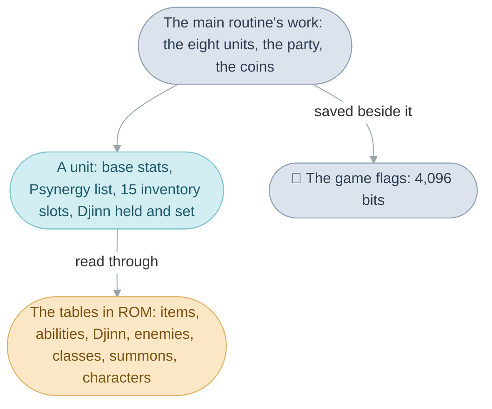
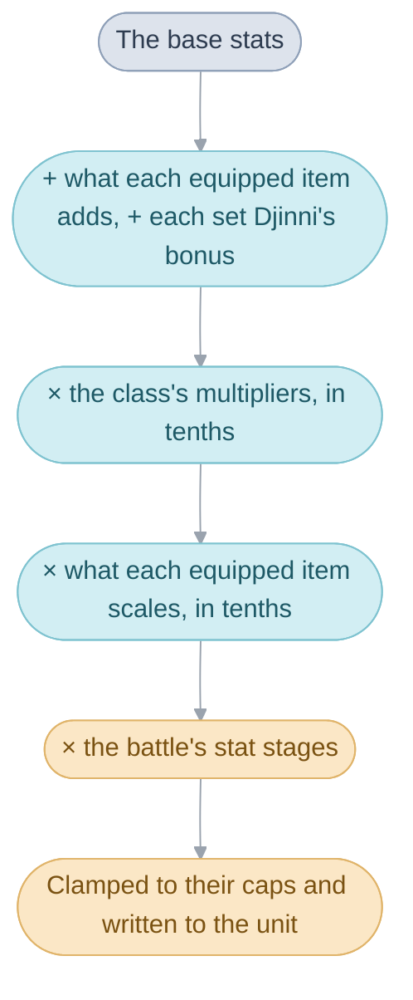
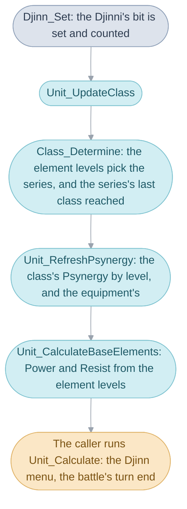
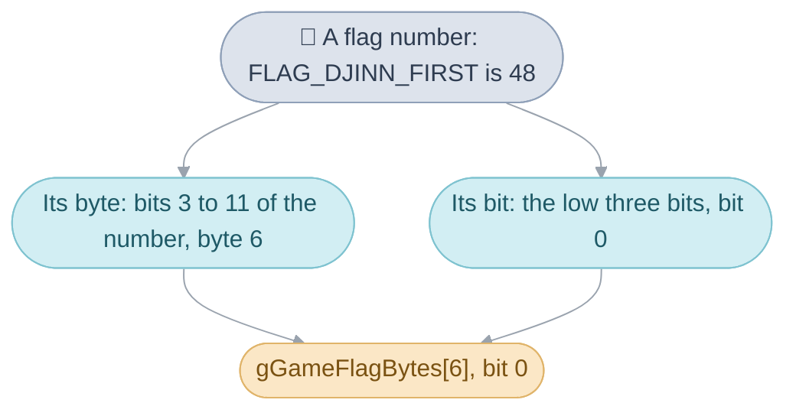

# Game rules


The Status screen says Isaac's Attack is 121, a shop says the Long Sword
costs 200 coins and that Ivan `Can't equip` it, a Djinni joins and the save
file counts one more, and a chest the party has opened stays open. Every one
of those facts is asked of one bank of code, the game rules: the
[field](../../glossary.md#field), the [battle](../../glossary.md#battle), the
menus and the shops all ask it the same questions, and it keeps the only
copy of the answers. The bank is a set of questions and their answers: it
is called, answers, and returns.

It works in ten mechanisms. The first three say what the game knows; the
rest say what it does with that.

1. A [unit](../../glossary.md#unit) is one struct holding a character or an
   enemy: its stats, its Psynergy, its items and its Djinn.
2. The tables describe every item, ability, Djinni, enemy, class, summon and
   character, each a row found by a number, and that number also finds the
   row's name in the game's text.
3. An item's row says what the item is, and a slot of a unit's inventory
   says which item the unit carries, in what state and how many.
4. A unit's stats are worked out from scratch whenever anything feeding
   them changes.
5. Setting a Djinni changes a character's class, and the class changes its
   Psynergy and its stats.
6. Experience raises a level, and a level up adds to the base stats.
7. The party is the characters travelling together, with their coins.
8. The [game flags](../../glossary.md#game-flag) remember every yes or no.
9. The rare item counters say what the shops may still sell.
10. The battle arithmetic turns stats into damage, healing and chances.



The units, the party and the flags live in the
[main routine's work](../../glossary.md#main-routines-work) and the game
flags, the two pieces of memory a save file keeps, so everything on this
page survives a save and a load. The tables live in the cartridge, as they
were written. The code is one object, `game.c`, written as parts under `game/`
([Source](../README.md#objects-and-parts)); each table is a C file of its
own beside it. Code in the other banks reaches this one through
[far calls](../../glossary.md#far-call), by names ending in `Far`.

## The unit

A unit is the struct that holds one fighter, `struct Unit`, the same for a
character and for an enemy, so that a battle can treat both sides alike.

A unit is found by its unit id. The eight characters of both games are
`ISAAC` (0) to `PIERS` (7), and their units live in the main routine's work
for the whole game, whether or not they are in the party. The enemies of the
current battle are the six units from `FIRST_ENEMY_UNIT` (128), filled when
the battle starts and gone when it ends. `Unit_Get` turns an id into its
unit, and nearly every bank calls it.

The unit keeps two copies of each stat. The base stats (`baseHp`,
`baseAttack` and the rest) are what the character has earned: they change
only when it levels up. The stats the player sees (`hpMax`, `atk` and the
rest) are worked out from the base stats and everything on top of them, and
are rewritten whenever that changes
([Stats](#why-stats-are-always-worked-out-from-scratch)). Beside the stats
sit the Psynergy list (`psynergy`, 32 entries), the
inventory (`inventory`, 15 slots), the Djinn held and set
(`djinnHeld`, `djinnSet`, one bit per Djinni in each element) and the
statuses a battle leaves: poison, sleep, the stat stages a battle raises or
lowers.

An enemy's unit is filled from its row of the enemy table when the battle
starts (`BattleUnit_Set`): its stats, its name with a number after it when
the [formation](../../glossary.md#formation) holds more of its kind
(`Gryphon1`), the items it carries and its element preset, a row of fixed
element levels, Power and Resist (`gEnemy_ElementPresetTable`). An enemy
has no class: its `classId` is `CLASS_NONE`, and
that one field is how the code throughout tells an enemy from a character.

| Name               | Value | Meaning                                                |
| ------------------ | ----- | ------------------------------------------------------ |
| `ISAAC` to `PIERS` | 0 to 7 | the characters' unit ids                              |
| `FIRST_ENEMY_UNIT` | 128   | the first of the six enemy units of a battle           |
| `CLASS_NONE`       | 0     | the class id that marks an enemy                       |
| `UNIT_LEVEL_MAX`   | 99    | the highest level                                      |
| `UNIT_STAT_MAX`    | 999   | the cap on Attack, Defense and Agility                 |
| `UNIT_CHARACTER_HP_MAX` | 1999 | a character's cap on maximum HP and PP             |
| `UNIT_HP_MAX`      | 9999  | an enemy's cap on maximum HP and PP                    |

## How one number finds a row and its name

Every item, ability, Djinni, enemy and class is one row of a table in the
cartridge, and the number of that row is the only name the code has for it.

The Healing Ring costs 800 coins, heals like Cure when used, and is called
`Healing Ring` on screen. Those facts sit in different places, the price in
the item table and the name in the game's text, and what joins them is a
number: the ring is item 265.

The tables have no column saying which item a row is: an item's number is
its row, counting from 0. Every line of the game's text is a numbered
message, and each table's names are a run of messages in the same order, so
the name of item 265 is the 265th message after the first item name:

```
name message = MsgItemName + item id
             = 386 + 265 = 651 for the Healing Ring
```

Enemies, abilities and Djinn find their names and descriptions the same way.
The tables and the six languages' text are parallel lists tied only by
position: a row inserted into the item table would give every later item the
next one's name.

Each table is a C array of the struct that reads it, with a comment above
each entry giving the English name its message holds. The headers
`item_ids.h`, `ability_ids.h`, `djinn_ids.h` and `enemy_ids.h` name the ids
the code uses, so that the code says `ITEM_HERB`.

| Table                      | File                | Rows | Read through                |
| -------------------------- | ------------------- | ---- | --------------------------- |
| `gItem_DefinitionTable`    | `item_table.c`      | 324  | `Item_GetDirect`            |
| `gAbilityDefinitions`      | `ability_table.c`   | 519  | `Ability_GetDirect`         |
| `gDjinn_DefinitionTable`   | `djinn_table.c`     | 80   | `Djinn_GetDefinition`       |
| `gEnemy_Definitions`       | `enemy_table.c`     | 165  | `Enemy_GetDefinition`       |
| `gClass_DefinitionTable`   | `class_table.c`     | 203  | `Class_GetDefinition`       |
| `gSummon_DefinitionTable`  | `summon_table.c`    | 16   | `SummonDefinition_GetNear`  |
| `gCharacter_DefinitionTable` | `character_table.c` | 8  | `Character_GetDefinition`   |

An ability is the widest word of the five: Psynergy, what a Djinni or a
summon does, what an item does when used, and an enemy's move are all rows
of the ability table, and a Djinni's row, a summon's row and an item's row
each name the ability they play. [Battles](../battle/README.md) follows an
ability from these tables to its damage.

## An item's row

Everything the player learns about an item in a shop or on the Item screen
comes from one row of the item table, `struct ItemDefinition`: its price,
what kind of thing it is, who can equip it, what it adds to Attack or
Defense, and what using it does.


The Long Sword's row says 200 coins, a weapon, Attack 14, for Isaac, Garet
and Felix, which is why the shop shows `Can't equip` for Ivan and compares
it with Isaac's and Garet's swords:

```c
// Long Sword
{
    .price = 200,
    .type = ITEM_TYPE_WEAPON,
    .equipMask = EQUIP_CHARACTER(ISAAC) | EQUIP_CHARACTER(GARET) | EQUIP_CHARACTER(FELIX),
    .icon = 1,
    .primaryBonus = 14,
    .element = ELEMENT_NONE,
},
```

The type says what the item is: a weapon, armor, a shield, a helm, boots, a
shirt, a ring, or one of the Psynergy items. A unit wears one item of each
type at a time, so equipping a second sword takes the first off
(`Inventory_Equip`); the Psynergy items are the exception, and any number
may be worn together. The equip mask has one bit per character.

A row also says what using the item costs: whether it is used up, may break
(one time in eight, after which a smith can mend it,
[Shops](../shop/README.md#repairing)), leaves an Empty Bottle, or costs
nothing. It carries the item's flags too: cursed, cannot be taken off, rare,
important (never dropped and worth nothing to a shop), or kept in a stack.
The eight Psynergy items, from the Orb of Force to the Catch Beads, are never
used up: while one is equipped, the Psynergy it names is on its owner's list
(`ITEM_USE_TEACHES`).

Beside the plain bonuses, a row holds up to four effects the item has while
worn, each a kind and an amount: add to HP, scale Agility in tenths, add to
the weapon's unleash chance. They are the `EQUIP_EFFECT_` kinds, and the
stats mechanism below applies them. A weapon also names the ability it
unleashes, the weapon's own attack that sometimes replaces a plain blow, and
the chance of it, in steps of five percent.

| Name                   | Value | Meaning                                             |
| ---------------------- | ----- | --------------------------------------------------- |
| `ITEM_USE_FREE`        | 0     | using it costs nothing: equipment                   |
| `ITEM_USE_CONSUMED`    | 1     | one is used up: Herb, Antidote                      |
| `ITEM_USE_MAY_BREAK`   | 2     | breaks one time in eight: the rings and staffs      |
| `ITEM_USE_TEACHES`     | 3     | worn, it puts its ability on the Psynergy list      |
| `ITEM_USE_EMPTIES`     | 4     | Hermes' Water leaves an Empty Bottle                |
| `ITEM_STACKABLE`       | flag  | kept in one slot with a count                       |
| `ITEM_INDISPENSABLE`   | flag  | never dropped and worth nothing to a shop           |
| `unleashChance`        | steps of 5 | a weapon's unleash chance in percent           |

When an item is used in battle, the battle builds an
[action](../../glossary.md#turns-and-actions) from the ability the row
names ([Battles](../battle/README.md#how-an-ability-resolves)).

## What an inventory slot holds


Each character carries up to 15 things, and the Item screen shows for each
whether it is equipped (a small E), whether it is broken (a red cross) and
how many there are of a stackable item such as Herbs. All of that fits in
one 16-bit number per slot, so an item, its state and its count move
together.

The number has four fields: the item, an equipped mark, a broken mark and
the count:

```
bits: 15..11 quantity | 10 broken | 9 equipped | 8..0 item id
```

The count is kept as one less, so a single item's count field is 0, and a
stack grows to 30. Because the marks and the count share the number, the
same item equipped, broken or stacked is a different number, and code that
asks which item a slot holds masks the rest away first
(`INVENTORY_ITEM_ID_MASK`).

The slots are kept closed up: when the last of an item leaves its slot, the
slots after it move up (`Inventory_CompactSlots`), so the first empty slot is
always the end of the list, and `Inventory_Count` can count to it. Giving a
unit an item joins its first stack of that item, or takes the first empty
slot (`Inventory_AddItem`); a full stack refuses the item even when another
slot is free. Giving the party an item tries each party member in order
(`PartyInventory_Add`), which is how a chest's item or a battle's spoils
lands on whoever has room.

The slots are `Unit.inventory`; `enum InventoryEncoding` in `item.h` gives
the bit layout, and [game/inventory.c](game/inventory.c) reads and writes
them.

| Name                       | Value   | Meaning                                  |
| -------------------------- | ------- | ---------------------------------------- |
| `INVENTORY_SLOTS`          | 15      | slots a unit has                         |
| `INVENTORY_ITEM_ID_MASK`   | `0x1ff` | the item id, bits 0 to 8                 |
| `INVENTORY_EQUIPPED`       | `0x200` | the equipped mark                        |
| `INVENTORY_BROKEN`         | `0x400` | the broken mark                          |
| `INVENTORY_QUANTITY_STEP`  | `0x800` | one more in the stack                    |
| a stack                    | 30      | the most of one stackable item in a slot |

## Why stats are always worked out from scratch


When the player points at Remove on Isaac's Machete, the status panel shows
his Attack falling from 24 to 17 before anything is chosen. Whenever
anything that feeds a stat changes, the game works every stat out again
from the character's base stats, equipment, Djinn and class. A menu's
preview is that same calculation, run on the changed unit and then undone
from a copy.

The calculation is `Unit_Calculate` ([game/units.c](game/units.c)), and it
runs after equipping, setting a Djinni, levelling up or a class change. It
takes the steps in a fixed order, and the order is why the numbers come out
as they do:



First come the additions: each equipped item's Attack and Defense bonus and
its adding effects (`EQUIP_EFFECT_ADD_HP` and its kin), then the stat bonus
of each Djinni that is set. Then the class multiplies every stat by its own
figure in tenths: a Squire's row says 11 for Attack, so Attack becomes eleven
tenths of the sum, rounded down. Then the scaling effects of the equipment
multiply in the same way. Last come the stages a battle has moved a stat up
or down, an eighth of the stat each, and every stat is held to its cap. An
enemy skips the equipment, the Djinn and the class, having none.

The Machete adds 6 to Attack, but the panel shows 7 less, because the class
multiplies the sum and the result rounds down. With an Attack of 16 before
the class and a class that multiplies by 11 tenths (the Squire's, among
others):

```
with the Machete     (16 + 6) * 11 / 10 = 24
without it                 16 * 11 / 10 = 17
```

Working stats out from scratch means no change can leave a stat a point off.
It also means current HP and PP keep their share of a changed maximum: the
unit keeps each as a gauge, its fraction of the maximum in 2.14 fixed point
(`hpGauge`, `ppGauge`, `UNIT_GAUGE_FULL` for full), and when the maximum
changes the current value is rebuilt from the gauge, never falling to 0 while
any was left. Code that writes HP or PP directly, as the inn and the battle
do, updates the gauges afterwards (`Unit_RecalculateGauges`).

Two more things ride on the same pass. A cursed item sets the unit's curse
bits, and an item with `EQUIP_EFFECT_CURSE_REMOVABLE` lifts them again. Once
the lighthouse of a character's own element is lit (`FLAG_VENUS_LIGHTHOUSE_LIT`
for Isaac), the pass gives it 4 more PP a
[turn](../../glossary.md#turns-and-actions).

| Name                   | Value   | Meaning                                                |
| ---------------------- | ------- | ------------------------------------------------------ |
| class multiplier       | tenths  | 10 keeps a stat; the Squire's Attack is 11             |
| a stat stage           | eighths | `(stage + 8) / 8` of Attack, Defense or Agility        |
| a Resist stage         | 20      | added to Resist in every element                       |
| `UNIT_GAUGE_FULL`      | `1 << 14` | a full HP or PP gauge                                |
| lit lighthouse         | +4 PP   | PP regained a turn once the character's lighthouse is lit |
| `UNIT_ELEMENT_MAX`     | 200     | the cap on Power and Resist in an element              |

## Djinn and classes


A [Djinni](../../glossary.md#djinn) set on a character raises its stats and
helps decide its class, and the class decides what Psynergy it knows and how
far its stats are multiplied; putting the Djinni on standby undoes all of it
at once.

A unit holds its Djinn as bits: one word per element with a bit for each
Djinni held, and another for each Djinni set, with counts beside them
(`djinnHeld`, `djinnSet`, `djinnHeldCounts`, `djinnSetCounts`). A character
holds at most ten of one element. The Djinn themselves are 80 rows, 20 to an
element in element order, each naming the ability it unleashes and the stat
bonus it gives while set: Flint adds 8 HP, 4 PP and 3 Attack.

Setting a Djinni is one call that sets off a chain, each link needing the
one before, and the caller then works the stats out again:



### Element levels

A character's element level in each of the
[four elements](../../glossary.md#the-four-elements) is the number the
Status screen shows beside the element, and it comes from two things: the
Djinn set in that element, ten points each, and the character's own bonus
from its row of the character table. Isaac's bonus is 54 in Venus and 3, 1
and 2 in the others, so with no Djinn set he is a Venus Adept of level 5,
and each Venus Djinni set raises that by one. `Unit_GetElementLevels`
counts the levels in tenths, so one Venus Djinni on Isaac gives 64; the
Status screen and `Unit_GetElementLevel` show the whole number, 6. An enemy's
levels come from its element preset instead, a row of
`gEnemy_ElementPresetTable`.

The levels also give the character's base [Power and
Resist](../../glossary.md#power-and-resist) in each element
(`Unit_CalculateBaseElements`): a table holds the pair for each whole level
from 0 to 15 (`gElement_PowerResistByLevel`), 75 Power and 85 Resist at
level 0 rising by 5 a level, except that Resist rises by 10 at level 14,
and the level's tenths are added on top.

### Which class a character has

The class is chosen from the element levels alone (`Class_Determine`). The
two strongest elements pick a class series through a 4 by 4 table
(`Class_GetSeries`): Venus alone is the Squire's series, Mars alone the
Guard's, Mercury alone the Water Seer's and Jupiter alone the Wind Seer's,
and a mixed pair picks a mixed series. A second element counts only once it
reaches level 1. Then the character gets the last class of that series whose
requirements it meets: each class row says the level it needs in each
element, in whole levels, and the search runs down the table from the end,
so the highest class reached wins. A Squire needs Venus 5, a Knight Venus 7:
Isaac with two Venus Djinn set stands at 7 and is a Knight; with one he is
at 6, a Squire.

Three characters have fixed classes: Isaac and Garet as children in the
prologue (while `FLAG_CHILDHOOD` is set) and Jenna, the Flame User, whose
rows close the class table. A class that no series reaches gives 0, which is
also an enemy's class.

### The Psynergy list

The class decides most of what the character can cast. Its row lists up to
16 abilities with the level each is learned at, and `Unit_RefreshPsynergy`
rebuilds the character's list from three sources whenever the class, level or
equipment changes: the class's abilities the character's level has reached,
then the Psynergy of each equipped Psynergy item, and after them the
Psynergy an [event](../../glossary.md#event) taught for good (Isaac's Move
and Retreat after the prologue, `Unit_LearnPsynergy`). Each entry carries a
mark saying which source it came from, so the rebuild can drop the class's
and the items' entries and keep the taught ones. The list is kept closed
up, so the Psynergy screen shows it as it is.

| Name                     | Value          | Meaning                                                |
| ------------------------ | -------------- | ------------------------------------------------------ |
| `DJINN_PER_ELEMENT`      | 20             | Djinn of each element in the table                     |
| Djinn held per element   | 10             | the most one character holds in one element            |
| one Djinni set           | +10            | to the element's level, counted in tenths              |
| `elementBonus`           | 54, 3, 1, 2    | Isaac's own levels in tenths, Venus first              |
| `ClassDefinition.required` | whole levels | the level needed in each element                       |
| fixed classes            | 200, 201, 202  | Isaac and Garet as children, and Jenna                 |
| `PSYNERGY_FROM_CLASS`    | bit 15         | a list entry the class gave                            |
| `PSYNERGY_FROM_ITEM`     | bit 14         | a list entry an equipped item gave                     |
| the Psynergy list        | 32 entries     | `Unit.psynergy`                                        |

## Levels and experience


A battle's spoils add experience to each party member, and a level is
reached when the experience passes the next level's threshold; every level
up adds a little to each base stat.

Each character has its own table of thresholds, 99 words in
`gCharacter_LevelExpTable`: Isaac's level 2 needs 24 points, his level 10
2,910. After a battle the spoils try each party member once for each level
it can reach (`Unit_TryLevelUp`, which compares the experience with
`Unit_GetExperienceForLevel` for the next level).

A level up (`Unit_LevelUp`) raises the level and adds to each base stat.
The character's row holds a growth curve for each stat: six points, the
stat's value at levels 0, 20, 40, 60, 80 and 100. A level inside a band of
twenty adds a twentieth of the band's rise, with a random share so that the
rounding comes out right on average: the gain is `(difference + a random 0
to 19) / 20`, so a band whose HP rises by 152 gives 7 or 8 a level and the
whole 152 over the band. Level 1 adds the curve's first point as well,
Isaac's 30 HP, so a new game starts him at 37 or 38 base HP, 40 or 41 once
the Squire's multiplier is applied. The gains come back in a
`struct LevelUpResult` for the spoils to report, and the level up then
rebuilds the Psynergy list and the stats, so a class ability learned at the
new level appears at once.

A new game is the same mechanism run from nothing: each character's
inventory is filled and equipped from its row, its class worked out, and
`Unit_LevelUpTo` raises it to its starting level one level at a time
(`Party_InitializeCharacters`). Mia starts at level 10 and Ivan at 4.

| Name                      | Value        | Meaning                                          |
| ------------------------- | ------------ | ------------------------------------------------ |
| `gCharacter_LevelExpTable` | 99 a character | the experience each level needs                |
| a growth curve            | 6 points     | the stat at levels 0, 20, 40, 60, 80, 100        |
| a level's gain            | `(d + r) / 20` | the band's rise d, a random r from 0 to 19     |
| `startingLevel`           | 1, 1, 4, 10  | Isaac, Garet, Ivan and Mia at a new game         |
| level 99                  |              | the next level needs -1 points, which none reaches |

## The party and its coins

The [party](../../glossary.md#the-party) is the characters travelling
together, and it is kept twice: a flag for each character says whether it is
in (`FLAG_IN_PARTY`, the first eight game flags), and
`gMainRoutineWork.party` lists the members in order, which is the order the
menus and the battle show them in. `Party_AddMember` sets the flag and
appends; `Party_RemoveMember` clears it and closes the gap. Every screen that
lists the party asks `Party_ListMembers` for the list.

The party's coins are one number in the main routine's work, kept between 0
and 999,999 by `Party_AdjustCoins`, which the shops, the inn, the sanctum,
the spoils and Lucky Dice all go through. The shops keep two more counters
the same way: the credit the party has spent, from which Game Tickets are
given, and the tickets given so far ([Shops](../shop/README.md)).

The party's average level, rounded down, is what a random battle's choice of
enemies and Lucky Dice's prizes read (`Party_GetAverageLevel`).

| Name                  | Value       | Meaning                                       |
| --------------------- | ----------- | --------------------------------------------- |
| `FLAG_IN_PARTY(c)`    | flag c      | character c is in the party, c from 0 to 7    |
| coins                 | 0 to 999,999 | `gMainRoutineWork.coins`                     |
| shop credit           | 0 to 999,999 | spent in shops, for Game Tickets             |
| shop gifts            | 0 to 28     | Game Tickets given so far                     |

## The game flags


The game remembers what has happened (a chest opened, a Djinni found, an
event already played) as 4,096 yes-or-no flags, one bit each. When Tonic
joins, its found flag is set: a Djinni found once cannot join again, and
each save file's summary counts the Djinn found. The Title offers its Battle
option only once some save file's summary counts a Djinni found.

A flag is a number, and the number says where its bit is: the low three
bits pick the bit within a byte, and the next nine pick the byte of
`gGameFlagBytes`, 512 bytes in all. `GameFlag_Get`, `GameFlag_Set` and
`GameFlag_Clear` do the arithmetic, and every bank goes through them.



Eight flags in a row, read together as a byte, also hold small counters,
such as the Battle Arena's win count (`GameFlag_GetByte`,
`GameFlag_SetByte`); four in a row hold a nibble. Two ranges are scratch
space for the scene code: a [scene](../../glossary.md#scene)'s own flags,
cleared each time the party walks into a scene (and left alone on coming
back from a battle), and an
[area](../../glossary.md#area)'s, cleared when it enters another
([Scenes](../scene/README.md#state-that-cleans-itself-up) shows how a scene
uses them).

The named flags are in `flags.h`, each with the evidence for its name. The
Djinn's found flags start at `FLAG_DJINN_FIRST`, 20 to an element in the
Djinn table's order, so Tonic's is `FLAG_DJINN_FIRST` plus 20 for Mercury
plus its index. A new game clears all 512 bytes
(`MainRoutineWork_InitializeDefaults`).

| Name                  | Value          | Meaning                                            |
| --------------------- | -------------- | -------------------------------------------------- |
| the flags             | 4,096          | bits in `gGameFlagBytes`, 512 bytes                |
| `FLAG_IN_PARTY(c)`    | 0 to 7         | the party members                                  |
| `FLAG_CHILDHOOD`      | `0x20`         | the prologue: Isaac and Garet are children         |
| `FLAG_DJINN_FIRST`    | 48             | the first of the 80 Djinn's found flags            |
| `FLAG_SCENE_TEMP_00` to `_FF` | `0x200` to `0x2ff` | cleared on entering a scene             |
| `FLAG_AREA_TEMP_00` to `_FF` | `0x300` to `0x3ff` | cleared on entering another area         |
| a flag past 4,095     |                | wraps onto a lower flag (`GAME_FLAG_BYTE`)         |

## Rare item counters


A shop never runs out of Herbs, but it can sell a rare item such as the
Witch's Wand only while that item's counter is above zero;
[Shops](../shop/README.md#artifacts) shows what the player sees of it. There
are 128 counters, each kept between 0 and 99 (`RareItemStock_Adjust`).
Buying a rare item takes one from its counter, and selling or dropping one
puts one back (`Inventory_Discard`), so a sold Witch's Wand can be bought
again.

The counters are `gRareItemStock`, and `gItem_ArtifactSlotTable` says which
counter, if any, each item uses, as the counter's number plus one, 0 for an
ordinary item; `Item_AdjustCounter` changes an item's counter.

| Name                      | Value    | Meaning                                       |
| ------------------------- | -------- | --------------------------------------------- |
| `gRareItemStock`          | 128      | counters, each 0 to 99                        |
| `gItem_ArtifactSlotTable` | 512      | each item id's counter number plus one, or 0  |

## Battle arithmetic


The arithmetic that turns stats into numbers on the screen lives here too,
so that the battle and the menus (which show what Cure would heal) get the
same answers.

### The element multiplier

Every damage and healing formula passes through one multiplier that rewards
Power over Resist. The difference between the caster's Power and the
target's Resist in the ability's element, held to -200 to 200, is read off
a line of five points (`gElement_PowerResistCurve`), which gives 256 plus
1.28 for each point of difference: 256 means one times, 512 twice, 0
nothing. `Battle_GetElementMultiplier` returns it, and halves the effect of
the difference for a physical attack.

### Damage and healing

Psynergy damage is the ability's power times that multiplier
(`Battle_CalculatePsynergyPower`). An attack's damage is the attacker's
Attack less the target's Defense, never below 0, plus twice the power the
ability adds, times the halved multiplier, halved again
(`Battle_CalculateAttackDamage`). Healing is the ability's power times the
multiplier for twice the healer's Power above 100, so a healer with 100
Power heals the ability's power exactly (`Battle_CalculateRecovery`).
[Battles](../battle/README.md#how-an-ability-resolves) puts the formulas in
the order the battle uses them.

### The unleash roll

A weapon unleashes when a roll comes in under its chance: five percent for
each step of its row's `unleashChance`, plus what the wearer's equipment adds
(`EQUIP_EFFECT_ADD_UNLEASH_CHANCE`). `RollWeaponUnleash` rolls once for each
Attack command and returns the unleash ability or 1, which is Attack. The
roll uses the battle's own random number generator, `Battle_Random`, a
separate seed from the field's, which the link battle exchanges before a
turn so that both sides roll the same.

### Whether an added effect lands

An ability's added effect (poison, sleep, a stat drop) lands by a roll
against a chance (`Battle_RollEffectSuccess`). It fails at once when there
is nothing for it to do: a revive on a standing unit, a cure of a poison
the target has not got. Otherwise the chance starts from the effect's base
rate (`Battle_GetEffectBaseSuccessRate`: Sleep 45 percent, Stun 40,
Condemn's instant death 20), adds three for each level the caster leads
the target by in the element less half the target's Luck, adds 25 against a
weakness the target's enemy row or class row lists, and is scaled by the
ability's own factor. A negative base rate is a fixed chance, which the
levels, Luck and weakness leave alone. Luff gets three tries.

| Name                    | Value      | Meaning                                            |
| ----------------------- | ---------- | -------------------------------------------------- |
| the multiplier          | 256        | one times; 1.28 a point of Power over Resist       |
| the difference          | -200 to 200 | Power less Resist, held to this range             |
| `unleashChance`         | ×5 percent | a weapon's unleash chance                          |
| a base rate             | percent    | Sleep 45, Stun 40, Condemn 20                      |
| a level of lead         | +3 percent | the caster's element level over the target's      |
| the target's Luck       | -1.5 a point | half the Luck, times three                       |
| a weakness              | +25 percent | listed in the enemy's or class's row              |
| Luff                    | 3 tries    | `ABILITY_EFFECT_SEAL_2_TURNS`                      |

## Setting Flint on Isaac, mechanism by mechanism


In Vale, Isaac holds two Venus Djinn, Flint and Granite, both set, and the
Djinn menu puts Flint on standby. The menu only asks; each number that
changes on its screen is one of this page's mechanisms answering.

Isaac's unit is `Unit_Get(ISAAC)`, the first of the eight in the main
routine's work. His Djinn are the two low bits of `djinnHeld[ELEMENT_VENUS]`
and of `djinnSet[ELEMENT_VENUS]`, and `djinnSetCounts[ELEMENT_VENUS]` is 2.

Standby is
`Djinn_PutOnStandby(ISAAC, ELEMENT_VENUS, DJINNI_INDEX(DJINNI_FLINT))`:
Flint's set bit is cleared, the count falls to 1, and `Unit_UpdateClass`
runs the chain. `Unit_GetElementLevels` now counts Isaac's Venus at 54 plus
10, 64 in tenths; the other elements stay at 3, 1 and 2. His strongest
element is Venus and no second reaches level 1, so `Class_GetSeries` gives
the Squire's series. The last class of that series he reaches is the Squire,
whose row needs Venus 5; the Knight's needs 7, and he stands at 6.

`Unit_RefreshPsynergy` drops the Knight's Psynergy from his list and adds
the Squire's, which at his level are the same, so the panel says `No
change`, and `Unit_CalculateBaseElements` writes his Venus Power and Resist
for level 6 plus four tenths. Then the menu calls `Unit_Calculate`, which
rebuilds the stats:
Flint's 8 HP, 4 PP and 3 Attack leave the sum, and the Squire's
multipliers, 11 tenths of HP and Attack where the Knight's were 13 and 12,
are applied to what is left. The panel shows HP 178 falling to 141, PP 61
to 51, Attack 121 to 107, Defense 80 to 73 and Agility 69 to 63, each the
Squire's tenths of a sum without Flint, rounded down.

Setting Flint again would be `Djinn_Set`, which asks `Djinn_CanSet` first
(held, on standby, recovered from any summon) and runs the same chain the
other way: the count is 2 again, Venus is 74 in tenths, the Knight's row at
7 is reached, and the stats come back to the numbers they had.

| Step                                   | Mechanism                                       |
| -------------------------------------- | ----------------------------------------------- |
| The menu finds Isaac                   | the unit, by its unit id                        |
| Flint's bit is cleared and counted     | Djinn and classes: `Djinn_PutOnStandby`         |
| Venus falls from 74 to 64 in tenths    | the element levels: `Unit_GetElementLevels`     |
| The Squire replaces the Knight         | which class a character has: `Class_Determine`  |
| The Psynergy list is rebuilt           | the Psynergy list: `Unit_RefreshPsynergy`       |
| Power and Resist are rewritten         | the element levels: `Unit_CalculateBaseElements` |
| HP falls from 178 to 141, Attack from 121 to 107 | stats worked out from scratch: `Unit_Calculate` |
| The menu shows the new numbers         | the unit, read by the menu                      |

## Design

The bank keeps one copy of every rule so that the field, the battle, the
menus and the shops agree: a shop's preview of a sword is the same
`Unit_Calculate` the battle will run, and a menu's check of who can wear it
is the same `Item_CanUnitEquipDirect` the equip command uses.

Working the stats out from scratch is what makes that safe. Any code may
change a base stat, equip an item or set a Djinni and then call one
function, and every stat, the curse, the Psynergy list and the element
levels come out consistent. The cost is that a change to one stat
recomputes all of them, which the game pays only at the moments the player
makes a change.

Enemies share the character's unit struct, with `CLASS_NONE` telling them
apart, so a battle's code reads one shape for both sides.

## How it fits with the rest of the game

Code in the other banks calls this one's functions by their far-call names,
and a scene's [overlay](../../glossary.md#overlay) through the list of
outside functions it was built with (its
[import table](../../glossary.md#entry-table-and-import-table)). The units
and the party live in the main routine's work (`gMainRoutineWork.units`,
`.party`), which other code also reads directly, as the save file summary
does. The battle folder reads `ability_table.c` beside its own tables, which
choose how an ability is drawn ([Battle](../../battle.md)). The flags and
the units are part of the save file ([System](../../system.md#saving)).

## Limits

- Item ids are 9 bits, 0 to 511; `item_table.c` has 324 rows, and rows 269
  to 323 have no name.
- A unit has 15 inventory slots, and a stack holds 30.
- 20 Djinn to an element, 519 abilities, 165 enemies (the last with no
  name), 203 classes.
- 4,096 [game flags](../../glossary.md#game-flag); a flag number past that
  wraps onto a lower flag.
- Levels go up to 99.
- 128 rare item counters, each 0 to 99.
- Coins stop at 999,999.

## Words used here

- **unit id** and **unit**: a unit id is a number, and a unit the
  `struct Unit` `Unit_Get` returns for it. The characters' units are kept in
  `gMainRoutineWork.units`, by the character ids in `character_ids.h`.
- **base stat**: a stat as the character has earned it by levelling up,
  before equipment, Djinn and class; `Unit_Calculate` builds the stat the
  player sees from it.
- **gauge**: a unit's current HP or PP as a fraction of its maximum, in 2.14
  fixed point, which a change of maximum keeps.
- **party**: the characters travelling together. `FLAG_IN_PARTY(character)`
  says who is in it and `gMainRoutineWork.party` lists them in order.
- **inventory slot**: one of a unit's `INVENTORY_SLOTS` (15) halfwords,
  holding an item, its state and its count.
- **ability**: a row of `ability_table.c`. Psynergy, what a Djinni or summon
  does, an item's use and an enemy's attack are all abilities.
- **element**: `enum Element`, `ELEMENT_VENUS` to `ELEMENT_JUPITER`, and
  `ELEMENT_NONE`. A character's **element levels** are the Djinn set on it
  plus its own element bonus, an enemy's come from its element preset;
  `Unit_GetElementLevels` returns each level times ten.
- **Djinni** element and index: a Djinni is its element and its number in
  that element (`DJINNI_INDEX`). It is either set on the unit that holds it
  or on standby; the Djinn a summon uses recover for some turns before they
  can be set again.
- **class series**: the classes a character's two strongest elements select;
  `Class_Determine` picks the last in the series whose element levels the
  character reaches.
- **flag**: one of the 4,096 bits of `gGameFlagBytes`, by number; the named
  ones are in `flags.h`.
- **rare item counter**: one of the 128 counts of how many of a rare item
  the shops may still sell.

## Evidence

The label columns are the English names from `games/tbs/text/en.po`, by the
message each row's id reaches. The columns are named from what the code reads
in them, and the equip effect kinds (`EQUIP_EFFECT_`) from what
`Unit_Calculate` does with each. The 80 flags from `FLAG_DJINN_FIRST` are the
Djinn's found flags because `Djinn_GiveToParty` sets
flag `FLAG_DJINN_FIRST` + 20 × element + index when a Djinni joins. The
Machete's arithmetic on this page is the one multiplier in `class_table.c`
that gives both numbers the recording shows. The Knight's and Squire's
requirements and multipliers are their rows of `class_table.c`, and Isaac's
element bonus his row of `character_table.c`; the worked example's levels
follow from them.

`character_table.c`'s first twenty words (`CharacterDefinition.reserved`) and
`summon_table.c`'s two bytes after the ability (`SummonDefinition.reserved`)
are 0 in every row and read by no code. The last byte of each
`class_table.c` row, `weakEffects[3]`, is the fourth weak effect, which
`BattleAbility_IsWeakToEffect` stops short of; it too is 0 in every row, as
is the enemies' fourth (`EnemyDefinition.weakEffects`).

Rows 269 to 323 of `item_table.c` are 55 copies of one row: a weapon only
Isaac can equip, priced 100 coins, with Attack 11, no icon and no name
message. Nothing gives one: the shops' stock table (`shop/shop/stock.c`) and
the events name no item past `ITEM_CLERICS_RING`
(268), no enemy in `enemy_table.c` carries or drops one, and the debug item
browser covers 0 to 269 and skips items without an icon. They are filler to
324 rows.

The two class rows before Jenna's, 200 and 201, have no name message (`?`
in the table's comments): they are Isaac's and Garet's classes while
`FLAG_CHILDHOOD` is set (`Class_Determine`), and Jenna's row, 202, is the
Flame User.
