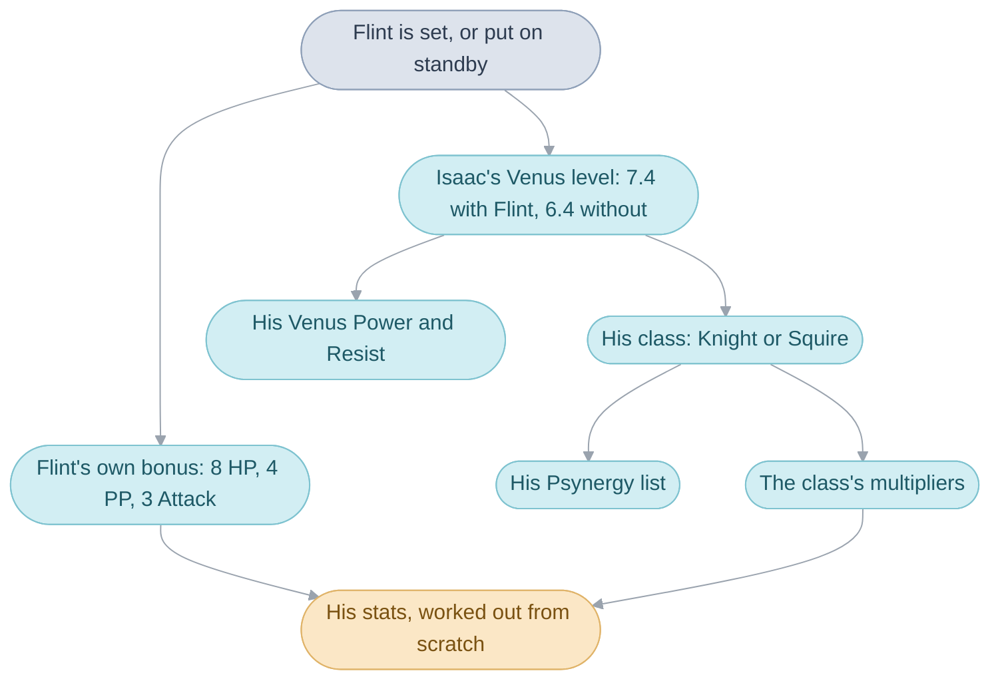

# Game rules


Open the Status screen on Isaac and it says he is a Knight with an Attack of
121. A weapon shop says the Long Sword costs 200 coins, and that Ivan
`Can't equip` it. A chest the party opened hours ago is still open.

Something has to know all of that. The game is run by code, long lists of
instructions for the console, and the code is divided into parts with jobs
of their own. One part's whole job is to keep these facts and answer
questions about them. This page calls it the game rules.

The game rules draw nothing and play no sound. The
[field](../../glossary.md#field), the [battle](../../glossary.md#battle),
the menus and the shops come and ask: what is Isaac's Attack, can Ivan wear
this, has this chest been opened? They all get the same answer, because
there is only one copy of it.

The page takes the game rules in this order:

1. [The unit](#the-unit): everything the game keeps about one character or
   one enemy.
2. [The tables](#how-one-number-finds-a-row-and-its-name): the lists of
   every item, ability, Djinni, enemy and class, and how a single number
   finds both a row and its name.
3. [An item's row](#an-items-row) and
   [an inventory slot](#what-an-inventory-slot-holds): what an item is, and
   what a character is carrying.
4. [Stats](#why-stats-are-always-worked-out-from-scratch): why taking off a
   sword that adds 6 costs Isaac 7.
5. [Djinn and classes](#djinn-and-classes): how one Djinni turns a Knight
   into a Squire.
6. [Levels and experience](#levels-and-experience).
7. [The party and its coins](#the-party-and-its-coins).
8. [The game flags](#the-game-flags): how the game remembers that a Djinni
   has joined.
9. [Rare item counters](#rare-item-counters): what the shops may still
   sell.
10. [Battle arithmetic](#battle-arithmetic): whether a sword howls, whether
    Sleep takes hold, and how much a blow hurts.

## The unit

Everything the Status screen shows about Isaac is kept together in one
bundle: his name, his level and experience, his HP and
[PP](../../glossary.md#psynergy-and-pp), his stats, his class, the Djinn he
holds, his Psynergy and his items. The game calls that bundle a
[unit](../../glossary.md#unit).

There are eight units for characters: Isaac, Garet, Ivan, Mia, Felix,
Jenna, Sheba and Piers. All eight are there from the first moment of a new
game, long before most of them join.

Jenna's is filled in properly: she starts at level 1 with a Wooden Stick
and a One-Piece Dress. Felix, Sheba and Piers get their names and nothing
more.

An enemy is a unit too. The cartridge holds a table of enemies, a list with
one row for each kind. When a battle starts, each enemy in it gets a unit
filled in from its row: its level, HP, PP, stats and the items it carries.
There is room for six, and they are thrown away when the battle ends.

An enemy's name comes from the game's text. When a battle holds two of a
kind, a number is put on the end to tell them apart, which is why the battle
can say `Gryphon1 takes 161 damage!`

Because both sides are the same kind of bundle, a battle can ask the same
questions of Isaac and of a Gryphon: what is its Attack, how fast is it, is
it asleep?

One thing tells the two apart. A character always has a class, such as
Knight, and an enemy has none. Wherever the game has to treat a character
and an enemy differently, that is what it looks at.

A unit also holds what a battle leaves on a fighter: poison, sleep, a
curse, a raised or lowered stat.

Some of a unit's numbers have a ceiling:

| Number                          | Stops at |
| ------------------------------- | -------- |
| level                           | 99       |
| Attack, Defense and Agility     | 999      |
| Luck                            | 99       |
| a character's maximum HP and PP | 1,999    |
| an enemy's maximum HP and PP    | 9,999    |

## How one number finds a row and its name

The Healing Ring costs 800 coins. Used as an item it heals like Cure. On
screen it is called `Healing Ring`.

Those facts are kept in two different places. The price and the Cure are in
the item table, a list in the cartridge with one row for each item. The name
is in the game's text.

What joins them is a number. The Healing Ring is item 265, which means row
265 of the item table. (The game counts rows from 0, so the first row is row
0.) Nothing written in the row says which item it is. Being row 265 is all
there is to it.

The text works the same way. Every line of it is a numbered message, and
the items' names are a run of messages in the same order as the table. In
the English text that run starts at message 386, so the ring's name is:

```
386 + 265 = message 651
```

Message 651 is stored as `{article_class:2}Healing Ring`. The part in braces
is a note to the game about which small word, `a`, `an` or `some`, goes in
front of the name ([Windows](../window/README.md#what-a-blank-can-hold)).

Each language has its own text, with the names in the same order. In German
the run starts at message 364, so `Heilungsring` is message 629.

So the table and the names are tied together by their order and nothing
else. If an item were ever added in the middle of the table, every item
after it would show the next one's name.

The game has seven of these tables:

| Table      | Rows | What a row is                                      |
| ---------- | ---- | -------------------------------------------------- |
| items      | 324  | a thing carried: its price, type, bonuses and use  |
| abilities  | 519  | anything a unit can do when it acts                |
| Djinn      | 80   | the ability it unleashes and the bonus it gives    |
| enemies    | 165  | an enemy's stats, items, weaknesses and spoils     |
| classes    | 203  | stat multipliers and the Psynergy learned by level |
| summons    | 16   | the ability and the standby Djinn it needs         |
| characters | 8    | growth, starting level and items, element bonus    |

Ability is the widest word there. Psynergy is an ability. So is what a
Djinni does when unleashed, what a summon does, what an item does when used
and each move an enemy makes.

That is how the Healing Ring can heal like Cure. Its row says nothing about
healing. It only names Cure, and Cure's row of the ability table has the
rest: the Venus element, a cost of 3 PP and a base power of 70.
[Battles](../battle/README.md) follows an ability from these tables to its
damage.

## An item's row


Everything a shop or the Item screen tells the player about an item comes
from its row of the item table.

The rows can be read. The game's source code is its code written out as
text, and this is the Long Sword's row as the source code has it:

```c
[ITEM_LONG_SWORD] = {
    .price = 200,
    .type = ITEM_TYPE_WEAPON,
    .equipMask = EQUIP_CHARACTER(ISAAC) | EQUIP_CHARACTER(GARET) | EQUIP_CHARACTER(FELIX),
    .icon = 1,
    .primaryBonus = 14,
    .element = ELEMENT_NONE,
},
```

Take it a line at a time, and the recording explains itself:

- `price`: 200 coins.
- `type`: it is a weapon.
- `equipMask`: who can equip it. The `|` between the names only means
  "and", so the list is Isaac, Garet and Felix. Ivan isn't on it, which is
  why the shop shows `Can't equip` for him.
- `icon`: which of the small item pictures is drawn beside its name.
- `primaryBonus`: worn, it adds 14 to Attack.
- `element`: none. Some weapons strike with an element, and this one
  doesn't.

### One of each type

The type says what kind of thing the item is: a weapon, armor, a shield, a
helm, boots, a shirt or a ring. A character wears one of each type at a
time, so equipping a second sword takes the first one off.

Eight items are the exception, the ones that teach Psynergy, from the Orb of
Force to the Catch Beads. Any number of them can be worn together. While one
is worn, its Psynergy is on its owner's list.

### What using it costs

A row also says what happens to the item when it is used:

- A Herb or an Antidote is used up. One leaves the stack.
- A Healing Ring may break, one use in eight. It stays in the list with a
  red cross on it until a smith mends it
  ([Shops](../shop/README.md#repairing)).
- Hermes' Water leaves an Empty Bottle behind.

### Marks and worn effects

Then come five yes-or-no marks. An item can be cursed. It can refuse to come
off once worn. It can be rare. It can be kept in a stack, as Herbs are. And
it can be important, like the Small Jewel, which means it is never dropped
and a shop will give nothing for it.

A worn item can do more than add to Attack or Defense. A row has room for
four more effects, each a kind and an amount. Adept's Clothes add 8 to
maximum PP. Turtle Boots halve Agility. Hyper Boots add 12 to the chance of
an unleash.

An unleash is a weapon's own special attack, which sometimes takes the place
of a plain blow. A weapon's row names that attack and how likely it is. The
Swift Sword's row names Sonic Smash ([The unleash roll](#the-unleash-roll)).

When an item is used in battle, the battle builds an
[action](../../glossary.md#turns-and-actions) from the ability the row
names ([Battles](../battle/README.md#how-an-ability-resolves)).

## What an inventory slot holds


Each character carries up to 15 things. For each one the Item screen shows
whether it is worn (a small E), whether it is broken (a red cross), and how
many there are when it is a stack, such as Herbs.

A unit has 15 slots for this, and each slot is a single number. That one
number says four things at once, because it is built like this:

```
the item's number
+   512 if it is worn
+ 1,024 if it is broken
+ 2,048 for each one in the stack after the first
```

Item numbers stay below 512, so the four parts can never be mistaken for
one another. Some slots, then:

| What Isaac carries       | The sum               | The slot's number |
| ------------------------ | --------------------- | ----------------- |
| a Long Sword (item 1)    | 1                     | 1                 |
| the same sword, worn     | 1 + 512               | 513               |
| a broken Healing Ring    | 265 + 1,024           | 1,289             |
| three Herbs (item 180)   | 180 + 2,048 + 2,048   | 4,276             |

So when Isaac gives Garet a broken Healing Ring, it arrives broken. The
number 1,289 moves from one list to the other, and the broken mark is part
of it.

It also means a sword worn and the same sword not worn are two different
numbers, 513 and 1. Whenever the game wants to know which item a slot
holds, it takes the marks and the count off first.

### Stacks and gaps

A stack holds up to 30 of one item. Giving a character an Herb adds it to
the Herbs they already have. Otherwise it goes in their first empty slot.

A stack of 30 refuses a 31st, and the game does not start a second stack,
even when another slot is free.

The slots are kept closed up. When the last Herb leaves its slot, every slot
after it moves up one. That is why the list on the Item screen never has a
gap, and why the first empty slot is always the end of the list.

### Who gets an item


When the party as a whole gets an item, from a chest or from a battle's
spoils, the game tries each party member in order and stops at the first one
with room. In the recording Isaac's 15 slots are full, so the chest's Small
Jewel goes to Garet.

### Before Colosso

The numbers make one more trick easy. Before Colosso the party's things are
taken away. The game writes down all four characters' 15 slots, then empties
them of everything except the items that teach Psynergy, and gives Isaac a
Short Sword.

When Colosso is over it copies the numbers back, and every item returns
worn, broken or stacked exactly as it was.

## Why stats are always worked out from scratch


The Machete is the sword Isaac starts the game with. Its row carries the
mark that says it cannot come off, so Remove is greyed out for it. The hand
can still rest on Remove, though, and while it does the status panel shows
what taking the Machete off would do: his Attack would fall from 24 to 17.

The Machete adds 6 to Attack. So why does the panel show 7 less?

A unit keeps each stat twice. The base stat is what the character has
earned by levelling up. The stat on the screen is the base stat with
everything else on top: equipment, Djinn, class.

The game never adds to or takes from the stat on the screen. Whenever
anything behind it changes, it throws the old number away and works every
stat out again from the base stats.

It takes the steps in a fixed order:

1. Additions first: what each worn item adds, then the bonus of each Djinni
   that is set.
2. The class multiplies the sum. Each class's row has a figure for each
   stat, in tenths. The Squire's row says 11 for Attack, so a Squire's
   Attack becomes eleven tenths of the sum, rounded down.
3. Worn items that scale a stat, such as the Turtle Boots, multiply the same
   way.
4. Then the changes a battle has made, such as a raised Attack. Each step up
   or down is an eighth of the stat.
5. Every stat is held to its ceiling and written to the unit.

An enemy skips steps 1 to 3, since it has no equipment, Djinn or class.

Now the Machete. Isaac's class multiplies Attack by 11 tenths. The screen
never shows his base Attack, but only one number fits both 24 and 17, and
that is 16:

```
with the Machete     (16 + 6) * 11 / 10 = 24.2, shown as 24
without it                 16 * 11 / 10 = 17.6, shown as 17
```

The class multiplied the Machete's 6 along with everything else, and the
rounding did the rest.

The panel's preview is this same calculation. The menu takes a copy of
Isaac, makes the change, has the stats worked out, shows them, and puts
Isaac back from the copy ([Menus](../menu/README.md#the-status-panel)).

Working stats out from scratch means no string of changes can leave a stat a
point off. However many times a sword is put on and taken off, the answer
with it on is the same.

Isaac keeps the Machete until the prologue ends, when the game swaps it for
a Short Sword.

### HP and PP

Current HP and PP are the two numbers that cannot be worked out from
anything else. So the unit remembers each as a share of its maximum.

When the maximum changes, the current value is rebuilt from the share. Say
Isaac has 60 HP of 120 and puts on armor that raises his maximum to 140. He
was at half, so he is given 70.

A character with any HP left is never rounded down to 0 this way.

### Mia in Mercury Lighthouse

The same calculation sets how much PP a character gets back at the end of
each turn of a battle, and it knows where the party is.

While the party is inside Mercury Lighthouse, Mia regains 4 more PP every
turn. Inside Venus Lighthouse the same goes for Isaac. Step outside and it
stops.

## Djinn and classes


Putting Flint on standby takes Isaac from Knight to Squire, his HP from 178
to 141 and his Attack from 121 to 107. One Djinni does all of that.

A [Djinni](../../glossary.md#djinn) that is set on a character does two
things. It adds a bonus of its own to the stats: Flint's row of the Djinn
table says 8 HP, 4 PP and 3 Attack. And it raises the character's level in
its element, which can change the class.

The class then decides two more things: how far the stats are multiplied,
and what Psynergy the character knows.



The Djinn table has 80 rows, 20 to an element. In this game only the first
seven of each element have a name and a bonus: Flint, Granite, Quartz, Vine,
Sap, Ground and Bane for Venus. The other thirteen rows of each element are
placeholders, and the text names every one of them `=`.

A unit remembers which Djinn it holds and which of those are set. It can
hold at most ten of one element.

### Element levels

A character's level in each of the
[four elements](../../glossary.md#the-four-elements) is the number the
Status screen shows beside the element. It comes from two things: the Djinn
set in that element, and a bonus of the character's own, from its row of the
character table.

The game counts these levels in tenths. A set Djinni is worth 10, one whole
level. Isaac's own bonus is 54 in Venus, and 3, 1 and 2 in Mercury, Mars
and Jupiter.

So with no Djinn set Isaac stands at 5.4 in Venus, which the Status screen
shows as 5. Each Venus Djinni set on him adds one.

The levels also give a character's base
[Power and Resist](../../glossary.md#power-and-resist) in each element.
Level 0 is worth 75 Power and 85 Resist, each level up to 13 adds 5 to both,
and each tenth adds one more point.

At 5.4 in Venus that works out to 104 Power and 114 Resist for Isaac.
Neither can go above 200, whatever equipment adds.

An enemy sets no Djinn. Its row of the enemy table picks one of 44
ready-made sets of levels, Power and Resist instead.

### Which class a character has

The class is chosen from the element levels and nothing else.

First the two strongest elements pick a class series, a ladder of classes.
Venus alone is the Squire's ladder, Mars alone the Guard's, Mercury alone
the Water Seer's and Jupiter alone the Wind Seer's.

A second element only counts once it reaches level 1, and then the pair
picks a mixed ladder. Isaac's own 0.3 in Mercury is too little. Set one
Mercury Djinni on him, though, and he stands at 1.3. Venus with Mercury is
the Swordsman's ladder, so he becomes a Swordsman.

Then the character gets the highest class on the ladder whose requirements
it meets. Each class's row says the level it needs in each element. On
Isaac's own ladder a Squire needs Venus 5, a Knight 7, a Gallant 9, a Lord
11 and a Slayer 13.

With Flint and Granite set, Isaac stands at 7.4 and is a Knight. With Flint
on standby he is at 6.4, a Squire.

That is where the preview's numbers come from. Flint's own bonus leaves the
sum, and the Squire's multipliers, 11 tenths for HP and for Attack, replace
the Knight's 13 and 12.

As with the Machete, the screen shows only the results. But just one sum
before the class fits each pair: 137 for HP and 101 for Attack.

```
HP      Flint set       137 * 13 / 10 = 178
        on standby      (137 - 8) * 11 / 10 = 141
Attack  Flint set       101 * 12 / 10 = 121
        on standby      (101 - 3) * 11 / 10 = 107
```

Three characters have a class that Djinn cannot change: Isaac and Garet as
children in the prologue, and Jenna, who is always a Flame User.

### The Psynergy list

The class decides most of what a character can cast. Its row lists up to 16
abilities, each with the level it is learned at.

The Squire and the Knight list the same ones at the same levels: Cure at
level 1, Quake at 2, Earthquake at 4, Spire at 6 and so on. That is why the
preview marks Isaac's Psynergy as unchanged when he drops to Squire.

A unit's list has room for 32. It is rebuilt whenever the class, the level
or the worn equipment changes, from three sources in this order:

1. the class's abilities that the character's level has reached,
2. the Psynergy of each worn item that teaches one,
3. the Psynergy the story taught for good.

Isaac's Move and Retreat are of the third kind. They are given to him when
the prologue ends, and no class change can take them away.

Each entry carries a mark saying which source it came from. A rebuild throws
away everything from the class and from items, keeps what was taught, and
fills the rest in again.

## Levels and experience


After a battle the party's experience goes up, and a character gains a level
when its experience reaches the next level's threshold.

Each character has its own list of 99 thresholds. Isaac needs 24 points for
level 2 and 2,910 for level 10. Garet needs 30 for level 2.

The spoils check each party member again and again until its experience
falls short, so one big battle can give several levels.

### What a level adds

A level up adds a little to each base stat. How much comes from the
character's row, which holds a growth curve for each stat. A curve is six
numbers: the stat's value at levels 0, 20, 40, 60, 80 and 100.

Isaac's HP curve starts at 30 and reaches 182 at level 20. That is a rise of
152 over twenty levels, or 7.6 a level.

Stats are whole numbers, though, and 7.6 is not. So the game adds a random
number from 0 to 19 before dividing by 20, and throws the remainder away:

```
gain = (152 + a random 0 to 19) / 20, rounded down
```

That comes to 7 on eight tries in twenty and 8 on the other twelve, which
averages 7.6. So the line about maximum HP in the recording reads 7 for
some players and 8 for others.

It is also why two players' Isaacs at the same level differ by a few points.

After the gains, the level up rebuilds the Psynergy list and the stats.
Spire is on the Squire's list at level 6, so `Mastered the Squire's Spire!`
comes with the level that reaches it.

### A new game

A new game is the same mechanism run from nothing. Each character is given
the items in its row, and they are put on where they can be worn. Its class
is worked out. Then it is raised to its starting level one level at a time:
1 for Isaac, Garet and Jenna, 4 for Ivan, 10 for Mia.

So Mia's stats when she joins were decided, level by level, at the very
start of the game.

Level 1 adds the first number of each curve as well, Isaac's 30 HP. That
gives him a base HP of 37 or 38. His class as a child multiplies HP by 8
tenths, which works out to 29 or 30 HP when the game begins.

## The party and its coins

The [party](../../glossary.md#the-party) is the characters travelling
together, and the game keeps it in two ways at once.

Each character has a yes-or-no note saying whether it is in the party. And a
list holds the members in order, which is the order the menus and the battle
show them in.

Joining sets the note and adds the character to the end of the list. Leaving
clears the note and closes the gap in the list.

The party's coins are one number for everyone, kept between 0 and 999,999.
The shops, the inn, the sanctum, a battle's spoils and Lucky Dice all change
it by asking the game rules, which hold it in that range.

A new game starts with no coins. When the prologue ends and the story jumps
three years ahead, the party is given 300. The same moment swaps Isaac's
and Garet's Machetes for Short Swords.

The shops keep two more counts the same way: the coins the party has spent
in them, which earn Game Tickets, and the tickets given so far
([Shops](../shop/README.md#game-tickets)).

## The game flags


Granite waits in Kolima until Isaac talks to it. After it joins, it is never
standing there again. How does the game know?

It keeps 4,096 yes-or-no notes about what has happened: a chest opened, a
Djinni found, a conversation already had. Each one is a
[game flag](../../glossary.md#game-flag), and each has a number, from 0 to
4,095.

Every Djinni has a flag of its own, in the Djinn table's order. Flint's is
flag 48 and Granite's is 49. When Granite joins, flag 49 is set to yes.
Each time the party walks into Kolima, the game looks at flag 49 before it
puts Granite in its place. Yes means leave it out.

The same flags have other readers. The Status screen lists the Djinn whose
flags are set. Each save file notes how many are set, and the start menu
offers Battle only once some file has at least one.

Who gets the Djinni is decided here too. It goes to the party member holding
the fewest Djinn, and to the earlier one in the party when two hold equally
few.

### Flags with a job

Most flags belong to one moment of the story. A few runs of them are set
aside for a purpose:

- Flags 0 to 7 say who is in the party, one for each character. This is the
  yes-or-no note from the party section: flag 0 for Isaac, 1 for Garet, and
  so on.
- Flag 32 is the prologue. While it is set, Isaac and Garet are children.
- Flags 48 to 127 are the 80 Djinn.

### Flags that forget

Some things should not be remembered for long. A lever pulled in a puzzle
room matters while the party is in that room and not a week later.

For those the game sets aside two runs of 256 flags that it wipes by
itself. It calls a piece of the world, such as a town or one floor of a
dungeon, a [scene](../../glossary.md#scene), and a group of scenes that
share a name an [area](../../glossary.md#area).

Flags 512 to 767 are wiped each time the party walks into a scene. Flags
768 to 1,023 are wiped when the party enters a different area.

Coming back from a battle wipes neither, so a puzzle half solved is still
half solved after a fight.
[Scenes](../scene/README.md#state-that-cleans-itself-up) shows how a scene
uses them.

A new game sets every flag to no.

## Rare item counters


A shop never runs out of Herbs. The Witch's Wand under Artifacts is
different: it can sell out.

The Witch's Wand's row carries the rare mark, and every rare item has a
counter that says how many of it the shops may still sell. A shop offers the
item only while its counter is above zero.

Buying a rare item takes one from its counter. Selling or dropping one puts
one back. That is why a Witch's Wand sold to any shop can be bought again.

A counter runs from 0 to 99. The game has 99 rare items, and each has a
counter to itself.

[Shops](../shop/README.md#artifacts) shows what the player sees of it, and
how a counter gets its first one.

## Battle arithmetic


In the recording Isaac chose Attack, and his Swift Sword did Sonic Smash
instead. Whether a sword does that, whether Sleep takes hold and how much a
blow hurts are all decided by the game rules. The battle asks and shows the
answer.

The battle is not the only one that asks. Cure cast from the Psynergy
screen in Vale heals by the same sum as Cure cast in a fight.

Several of these answers are rolls. A roll is the game throwing dice: it
picks a number at random and compares it with a chance.

### The unleash roll

A weapon's row gives its unleash a chance, counted in steps of five percent.
The Swift Sword's row says 7 steps, so it howls 35 times in a hundred.

Other things a character wears can add to that. Hyper Boots add 12, which
would make it 47.

The roll is made once each time a character is told to Attack.

The battle has dice of its own, apart from the ones the field uses. When two
players link their consoles to fight each other, the consoles pass the state
of those dice across before each turn. So both screens show the same
unleash.

### Whether an added effect lands

Many abilities do something besides damage: put a target to sleep, poison
it, lower its Defense. Each of those effects has a base rate, a chance out
of a hundred:

| Effect                                | Base rate |
| ------------------------------------- | --------- |
| a Resist drop                         | 75        |
| a Defense drop                        | 70        |
| Delusion, an HP drain                 | 65        |
| an Attack drop, a PP drain, the curse | 60        |
| Poison, Venom, a Psynergy seal        | 55        |
| Sleep                                 | 45        |
| Stun                                  | 40        |
| Confusion                             | 35        |
| Charm                                 | 30        |
| Haunt                                 | 25        |
| instant death                         | 20        |

Then the two units are compared, and the rate moves.

Take Ivan casting Sleep on a Vermin. Sleep is a Jupiter ability. Ivan with
no Djinn set is at level 5 in Jupiter, and the Vermin at level 0. The
Vermin has 2 Luck. And its row of the enemy table lists Sleep as a
weakness.

```
Sleep's base rate                                  45
Ivan is 5 levels ahead: 3 for each level          +15
the Vermin's Luck: every 2 points undo one level   -3
the Vermin is weak to Sleep                        +25
                                                   --
                                                   82
```

Had the Vermin been the one ahead in Jupiter, each level would have taken 3
off instead. Each enemy's row, and each class's row, lists up to three
effects it is weak to.

The roll is a number from 0 to 99, and Sleep takes hold when the roll is 82
or less.

Two things can change that:

- An ability aimed at one target can reach the ones beside it. The one
  aimed at gets the whole rate, the one next to it six tenths of it, and
  any further away three tenths.
- An effect with nothing to do fails without a roll: a revive on someone
  still standing, a cure for poison on someone who isn't poisoned.

A few effects ignore levels, Luck and weaknesses. An effect with no base
rate, such as a stat boost, starts from 100. Two of the revives have a fixed
60 and a fixed 90. And when the Jupiter Djinni Luff seals a target's
Psynergy, its roll is made up to three times.

### The element multiplier

Every unit has a Power and a Resist in each element. When a Psynergy hits,
the game takes the caster's Power in the Psynergy's element and subtracts
the target's Resist in it.

Each point the caster is ahead adds half a percent to the damage. Each
point behind takes half a percent off. At 200 ahead the damage is doubled,
and at 200 behind it is nothing. Past 200 either way, the extra is ignored.

### Damage and healing

Two different numbers are called power. An ability has a base power, the
number in its row of the ability table. A unit has a Power, with a capital,
in each element. Three sums bring them together.

**Psynergy.** The damage is the ability's base power, raised or lowered by
the element multiplier. Take a base power of 160, cast by someone whose
Power is 20 above the target's Resist. That is ten percent more, which
should be 176. The game gets 175, because it works the percentage out in
whole steps of a 256th and drops what is left over.

**A blow with a weapon.** The damage starts from half of Attack less
Defense. If Defense is the higher, that half counts as 0. An ability such
as Ragnarok adds its base power on top. The element counts half as much
here, a quarter of a percent a point. So an Attack 80 above the target's
Defense, with no difference in the element, does 40.

**Healing.** No one resists being healed, so only the healer's Power
counts: each point above 100 adds a percent, and each point below takes one
off. Cure has a base power of 70. Cast from the Psynergy screen by Isaac
with no Djinn set, whose Venus Power is 104, it works out to 72 HP.

In a fight the battle adds touches of its own on top, such as a few random
points and less for targets further from the aim.
[Battles](../battle/README.md#how-an-ability-resolves) has those.

## Design

The weapon shop has no rules of its own. When it previews the Long Sword on
Garet, the game rules work the stats out exactly as they will when Garet
swings it in a battle. When it says `Can't equip` for Ivan, it has asked the
question the Equip command asks. So a shop, a menu and a battle cannot tell
the player three different things.

The cost is paid in work. Changing one thing means working out every stat
again. The game only does that at moments such as the player pressing A on
Equip, where no one would notice.

## How it fits with the rest of the game

Nothing on this page happens by itself. The field, the battle, the menus
and the shops ask, and the game rules answer.

What they keep is what a save file holds. The units, the party's order, the
coins and the game flags are all written to the cartridge when the player
saves, which is how Isaac's Djinn and an opened chest come back after the
power has been off ([System](../../system.md#saving)).

The tables are not saved. They are part of the cartridge as it was made,
and never change.

[Battle](../../battle.md) shows what a fight does with these numbers, and
[Menus](../menu/README.md) and [Shops](../shop/README.md) show where the
player reads them.

## Limits

- A character with 30 Herbs cannot take a 31st, even with empty slots. When
  a chest gives the party one, it goes to the next party member with room.
- A Psynergy list is full at 32. A class teaches up to 16 and the items
  that teach Psynergy could add eight more, so there is always room for at
  least eight taught by the story.
- At level 99 the next threshold is a number no experience reaches, so the
  level stays there.
- Coins stop at 999,999. Anything won past that is lost.

## Words used here

- [Unit](../../glossary.md#unit), [party](../../glossary.md#the-party),
  [game flag](../../glossary.md#game-flag) and
  [Djinn](../../glossary.md#djinn) are in the glossary. A **party member**
  is a unit whose character is in the party.
- A **table** is a list in the cartridge with one **row** for each item,
  ability, Djinni, enemy, class, summon or character.
- A **base stat** is a stat before equipment, Djinn and class.
- An **inventory slot** is one of a unit's 15 places for an item.
- An **ability** is a row of the ability table: Psynergy, what a Djinni or
  summon does, an item's use or an enemy's move.
- A character's **element levels** are the Djinn set on it plus its own
  element bonus, counted in tenths.
- A Djinni is **set** on the unit that holds it or on **standby**.
- A **class series** is the ladder of classes a character's two strongest
  elements pick.
- A **rare item counter** says how many of a rare item the shops may still
  sell.

## For readers of the code

This section is for anyone who opens the source code beside this page.

The code is in the files under `game/`: [game/units.c](game/units.c) has
the stat calculation, `Unit_Calculate`, and
[game/inventory.c](game/inventory.c) has the slots. The tables
are the other files of this folder, such as [item_table.c](item_table.c).
In them every number has a name, so the Healing Ring's row is headed
`ITEM_HEALING_RING`, never 265. The named flags are in `flags.h`, each with
the evidence for its name.

The game's code is cut into fourteen stretches called
[banks](../../glossary.md#bank), and the game rules are one. Code in another
bank reaches them by a [far call](../../glossary.md#far-call), through a
list of entrances at the start of the bank. The units, the party's order
and the coins live in the
[main routine's work](../../glossary.md#main-routines-work).

### Where a flag is kept

The console's memory is made of bytes, and a byte holds eight yes-or-no
answers, called bits. The 4,096 flags are packed eight to a byte, in 512
bytes. A flag's number divided by 8 gives its byte, and the remainder gives
the bit inside it:

```
48 / 8 = 6, remainder 0     Flint's flag: byte 6, bit 0
49 / 8 = 6, remainder 1     Granite's flag: byte 6, bit 1
```

A whole byte of eight flags can also be read as one number from 0 to 255.
The Battle Arena keeps its count of wins that way.

A flag number past 4,095 does not reach outside the flags. It wraps round
onto a lower flag.

The source writes flag numbers in hex, a way of writing numbers with
sixteen digits, because the game's own flag editor for its testers shows
them so:

| Flags        | In the source      | What they hold        |
| ------------ | ------------------ | --------------------- |
| 0 to 7       | `0x000` to `0x007` | who is in the party   |
| 32           | `0x020`            | the prologue          |
| 48 to 127    | `0x030` to `0x07f` | the 80 Djinn          |
| 512 to 767   | `0x200` to `0x2ff` | wiped with each scene |
| 768 to 1,023 | `0x300` to `0x3ff` | wiped with each area  |

### Slots, items and abilities

A slot leaves room for item numbers 0 to 511, and the item table has 324
rows. The rows from 269 on are fillers ([Evidence](#evidence)).

A small table says which rare item counter belongs to which item. There is
room for 128 counters, and the Witch's Wand, item 57, has counter 25.

The ability table has 519 rows, numbered 0 to 518, but the check on the
number lets 519 through, and the game would then read what comes after the
table. The source marks it with `// BUG:`.

### The sums

The difference is the attacker's Power less the target's Resist, held
between -200 and 200.

| What               | How much                                                             |
| ------------------ | -------------------------------------------------------------------- |
| Psynergy damage    | base power × (1 + difference / 200)                                  |
| an attack's damage | ((Attack − Defense) / 2 + base power) × (1 + difference / 400)       |
| healing            | base power × the healer's Power / 100                                |

## Evidence

The names on this page are the English release's. Each row's name is the
message its number reaches in `games/tbs/text/en.po`.

The 80 flags from 48 are the Djinn's because the code that gives the party
a Djinni sets flag 48 + 20 × the element's number + the Djinni's place in
its element.

The base Attack of 16 in the Machete's sum, and the 137 and 101 in Flint's,
are not shown on any screen. Each is the only whole number that gives both
of the numbers the screen does show, using the multipliers in
`class_table.c`. An Attack figure of 11 belongs both to the Squire and to
the class Isaac has as a child. And 16 is one of the two base Attacks level
1 can give him, 16 or 17.

Rows 269 to 323 of the item table are 55 copies of one row: a weapon only
Isaac can equip, priced 100 coins, with 11 to Attack and no icon. The
items' names stop after the Cleric's Ring, number 268, and the enemies'
names follow straight on, so these rows have no name of their own. No shop
stocks one, nothing in the story gives one, and no enemy carries or drops
one.

The last enemy row has no name either, for the same reason at the other
end: the abilities' names start where it would be.

The two class rows before Jenna's are named `?` in the text. They are the
classes Isaac and Garet have as children, while the prologue's flag is set.
