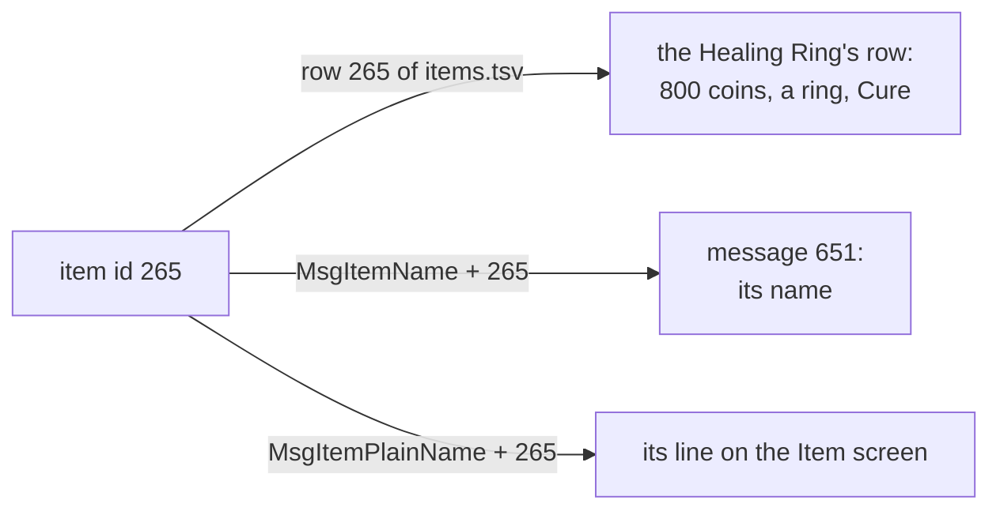
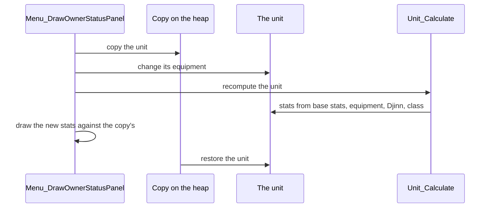
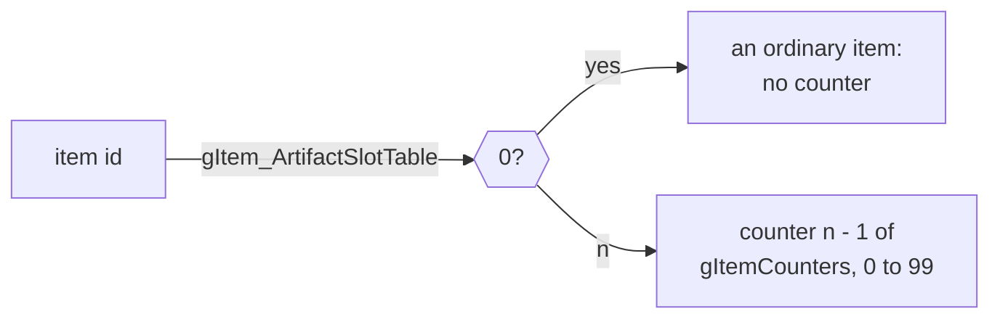

# Game rules


The game object holds the party's state and the rules the rest of the game
asks about: the units and their stats, items and inventories, levels and
classes, the Djinn each character holds, and the game flags. Its `.tsv`
tables define every item, ability, Djinni, enemy, summon and class. A scene
asks it whether a chest has been opened, a shop what an item costs, a menu
what a character's Attack would be, and a battle what a blow does;
[Battles](../battle/README.md) follows an ability from these tables to its
damage.

## A row's id is its position, and its name is a message at the same position

The definition tables give every item, ability, Djinni, enemy, summon and
class its id by its row, and its name by the message at the same position.



The definition tables have no id column: an entry's id is its row, the first
row after the header being entry 0. The same id, added to the number of a
message, gives the entry's name. An item's name is `MsgItemName` + id and the
line the Item screen shows about it `MsgItemPlainName` + id; an enemy's name
is `MsgEnemyName` + id, an ability's `MsgAbilityName` + id and its
description `MsgAbilityDescription` + id, and a Djinni's `MsgDjinnName` + its
row, which is also its ability, `ABILITY_DJINNI_FIRST` + row. Code reaches a
name by adding (`itemId + MsgItemName` in the shops and menus).

The tables and the message catalogs are therefore parallel lists tied only by
position. A row inserted into `items.tsv` would give every later item the
name of the one after it unless all six catalogs gained a message at the same
place, and rows no item uses keep their places. The Healing Ring is on line
267 of `items.tsv`, so it is item 265; its name is message 651 and its line
"Ring: Use to restore 70 HP".

Each `.tsv` header names its columns as `name:type`: `u8`, `s8`, `u16`,
`s16`, `u32` and `s32` are bytes of that size and sign, and `strN` is text
of up to N bytes. The build writes a `.table` beside each `.tsv`, and its
`.s` places it under its symbol. A column without a type (`item`, `ability`,
`djinni`, `enemy`) is a label for readers and builds no bytes: the English
name its message gives, `?` or `=` where the message marks the row unused,
or `(no name message)` for a row past the last name. `reserved_` and `pad_`
columns are zero in every row, and `unknown_` and `unk_` columns are fields
whose meaning isn't known. `item_ids.h`, `ability_ids.h` and `djinn_ids.h`
name the ids the code uses.

| Table | One row per | Placed as |
| --- | --- | --- |
| `items.tsv` | item (324) | `gItem_DefinitionTable` (`item_table.s`) |
| `actions.tsv` | ability (519) | `gBattleAction_DefinitionTable` (`actions.s`) |
| `djinn.tsv` | Djinni, `DJINN_PER_ELEMENT` (20) to an element, Venus, Mercury, Mars, Jupiter (80) | `gDjinn_DefinitionTable` (`djinn_table.s`) |
| `enemies.tsv` | enemy (165) | `gEnemy_Definitions` (`enemies.s`) |
| `summons.tsv` | summon (16) | `gSummon_DefinitionTable` (`summons.s`) |
| `classes.tsv` | class (203) | `gClass_DefinitionTable` (`classes.s`) |
| `chars.tsv` | character (8) | `gCharacter_DefinitionTable` (`chars.s`) |
| `elempre.tsv` | enemy element preset (44) | `gEnemy_ElementPresetTable` (`element_table.s`) |
| `artifact_slots.tsv` | 16 item ids, columns `x0` to `xf` (32 rows, 512 ids): a rare item's counter number plus one, or 0 | `gItem_ArtifactSlotTable` (`artifact_slots.s`) |
| `level_experience_0.tsv` to `_7.tsv` | level (99), with the experience it needs, one table per character | `gCharacter_LevelExpTable` (`experience_table.s`) |

| Name | Value | Meaning |
| --- | --- | --- |
| `DJINN_PER_ELEMENT` | 20 | Djinn to an element |
| `ABILITY_DJINNI_FIRST` | `0x12c` (300) | the first Djinni's ability; Djinni row n is ability 300 + n |

## An item's row

An item is its row of `items.tsv`, read as `struct ItemDefinition`
(`games/tbs/include/game/item.h`): what it costs, who equips it, what it adds
while equipped and what using it does.

| Column | What it holds |
| --- | --- |
| `price` | the price in coins |
| `type` | `enum ItemType`: `ITEM_TYPE_NONE` for anything that isn't equipment, then weapons, armor, shields, helms, boots, `ITEM_TYPE_PSYNERGY`, rings and shirts; a unit equips one of each type but Psynergy items |
| `flags` | `enum ItemFlags`: `ITEM_CURSED`, `ITEM_CANNOT_UNEQUIP`, `ITEM_RARE`, `ITEM_INDISPENSABLE` and `ITEM_STACKABLE` |
| `equip_mask` | one bit per character who can equip it, bit 0 for Isaac: the Long Sword's `0x13` is Isaac, Garet and Felix |
| `icon` | its menu icon (`gUiIcon_ItemIconPointers`) |
| `primary_bonus`, `secondary_bonus` | Attack and Defense added while equipped |
| `unleash_action`, `unleash_chance` | the ability a weapon unleashes, at `unleash_chance` steps of 5 percent (`RollWeaponUnleash`) |
| `use_type` | what using it costs: `ITEM_USE_CONSUMED`, `ITEM_USE_MAY_BREAK` (one time in eight), `ITEM_USE_EMPTIES` (leaves an Empty Bottle), or `ITEM_USE_FREE` |
| `element` | a weapon's attack element, `ELEMENT_NONE` for none |
| `effect0_kind`, `effect0_amount` to `effect3_` | up to four effects while equipped, `enum ItemEffectKind` (`ITEM_EFFECT_ADD_HP`, `ITEM_EFFECT_SCALE_ATTACK` and the rest), which `Unit_Calculate` applies |
| `action_id` | the ability the item uses |

`action_id` and `unleash_action` are rows of `actions.tsv`. Used in battle,
the item command plans its `action_id` (`BattleCommand_BuildPlan`,
[battle/battle/plan.c](../battle/battle/plan.c)), and
[Battles](../battle/README.md#how-an-ability-resolves) follows that ability
to its effect. An item whose `use_type` is `ITEM_USE_TEACHES` is never used:
while it is equipped its `action_id` is in the unit's Psynergy list
(`game/levels.c`). These are the eight Psynergy items, from the Orb of Force
on.

The Healing Ring's row shows the pieces together: 800 coins, `type` ring,
`ITEM_RARE`, an `equip_mask` of `0xff` for all eight characters, `use_type`
`ITEM_USE_MAY_BREAK` and `action_id` 90, Cure.

| Name | Value | Meaning |
| --- | --- | --- |
| `ITEM_CURSED` | 1 | equipping it curses the wearer |
| `ITEM_CANNOT_UNEQUIP` | 2 | once equipped it cannot be taken off, or dropped while worn |
| `ITEM_RARE` | 4 | selects the shop's rare item offers |
| `ITEM_INDISPENSABLE` | 8 | never dropped; kept first among a battle's drops |
| `ITEM_STACKABLE` | `0x10` | kept in one inventory entry with a count |
| `ITEM_USE_FREE` | 0 | using it costs nothing, as with equipment |
| `ITEM_USE_CONSUMED` | 1 | one is used up |
| `ITEM_USE_MAY_BREAK` | 2 | it breaks one time in eight |
| `ITEM_USE_TEACHES` | 3 | never used: equipped, it teaches its `action_id` as Psynergy |
| `ITEM_USE_EMPTIES` | 4 | it leaves an Empty Bottle |

## An inventory entry is one halfword

Each of a unit's inventory slots is one halfword holding the item, whether it
is equipped or broken, and how many of it the slot holds.

```
bits 15..11   count less one   (INVENTORY_QUANTITY_SHIFT)
bit 10        broken           (INVENTORY_BROKEN)
bit 9         equipped         (INVENTORY_EQUIPPED)
bits 8..0     item id          (ITEM_ID_MASK)
```

An item, its state and its count move in one load and one store, and an
empty slot is 0, which `Inventory_CompactSlots` relies on to close gaps. A
stack of an `ITEM_STACKABLE` item grows to 30 (`Inventory_AddItem`). Code
that asks which item a slot holds masks it with `ITEM_ID_MASK` first, since
the same item equipped, broken or stacked is a different halfword. The slots
are `BattleUnit.inventory`; `enum InventoryEncoding` in `item.h` names their
parts, and [game/inventory.c](game/inventory.c) reads and writes them.

| Name | Value | Meaning |
| --- | --- | --- |
| `ITEM_ID_MASK` | `0x1ff` | the item id, 0 to 511 |
| `INVENTORY_EQUIPPED` | `0x200` | the item is equipped |
| `INVENTORY_BROKEN` | `0x400` | the item is broken |
| `INVENTORY_ENTRY_MASK` | `0x7ff` | all but the count: the item with its state |
| `INVENTORY_QUANTITY_SHIFT` | 11 | the first bit of the count less one |
| `INVENTORY_QUANTITY_STEP` | `0x800` | one more in the stack |
| `INVENTORY_QUANTITY_MASK` | `0xf800` | the count less one |
| `INVENTORY_SLOTS` | 15 | the slots a unit has |

## Stats are recomputed whole

A unit's stats are never adjusted in place: `Unit_Calculate` works them all out
again whenever one of their inputs changes, and a menu previews a change by
running the same computation, as the picture at the top of the page shows.



`Unit_Calculate` ([game/units.c](game/units.c)) works a unit's stats out again
from its base stats, equipment, set Djinn, class and battle stat levels,
clamps each and writes them back, keeping current HP and PP at the same
fraction of their maximums. It runs after anything that changes an input:
equipping, setting a Djinni, levelling up, a class change.

A menu that previews a change uses the same path. To show Attack without the
Machete, `Menu_DrawOwnerStatusPanel`
([menu/menu/common.c](../menu/menu/common.c))
copies the unit to the heap, changes the real unit's equipment, lets
`Unit_Calculate` run, draws the new numbers against the copy and restores the
unit from it. The preview is what equipping would do because it is the same
computation.

## The game flags

The game flags are 4,096 bits that record what has happened, and the bytes
and nibbles they make up also hold small counters.

```
flag number   bits 11..3   its byte of gGameFlagBytes   (GAME_FLAG_BYTE)
              bits 2..0    its bit in that byte
```

`gGameFlagBytes` holds the 4,096 flags in 512 bytes. A flag's low three bits
pick its bit and the next nine its byte; `GAME_FLAG_BYTE` drops the rest, so
a number past 4,095 wraps onto a lower flag instead of reaching other memory.
Eight flags from a multiple of 8 are therefore also one byte, which
`GameFlag_GetByte`, `GameFlag_SetByte` and `GameFlag_IncrementByte` read and
write whole, and four flags one nibble (`GameFlag_GetNibble`,
`GameFlag_SetNibble`). Counters live among the flags this way, such as the
Battle Arena's win count (`FLAG_MONSTER_BATTLE_WINS`) and a link battle's
party size (`FLAG_LINK_PARTY_COUNT`), and follow the flags' rules: one in
a scene's range is cleared with that range, and all are saved.
[The front page](../../README.md) gives the ranges and when they are
cleared.

Flags `FLAG_DJINNI_0` (48) to 127 are the Djinn's found flags, Djinni n of
element e being flag `FLAG_DJINNI_0` + 20 × e + n. The save summary counts
how many are set (`SaveState_BuildSummaryHeader`), the title offers Battle
only when some file has found a Djinni (`gTitleExtraOptionEnabled`), and the
save menu's `SAVE_MENU_EXTRA` mode lists only those files
([window/battle_command/save.c](../window/battle_command/save.c)).

The flag functions are in [game/flags.c](game/flags.c), `GAME_FLAG_BYTE` in
`game_flags.h` and the named flags in `flags.h`.

| Name | Value | Meaning |
| --- | --- | --- |
| `GAME_FLAG_BYTE(flag)` | bits 3 to 11 of `flag` | the byte of `gGameFlagBytes` that holds the flag |
| `FLAG_DJINNI_0` | 48 | the first Djinni's found flag; the 80 run to 127 |
| `FLAG_LINK_PARTY_COUNT` | `0x3f0` | a byte: the members the linked opponent sent |
| `FLAG_MONSTER_BATTLE_WINS` | `0x3f8` | a byte: the Battle Arena's win count |

## Rare item counters

The rare item counters limit how many of each rare item the shops may still
sell.



`gItemCounters` holds 128 counters, each 0 to 99, for how many of each rare
item the shops may still sell. `gItem_ArtifactSlotTable` gives each item id
its counter number plus one, 0 for an ordinary item. Buying one takes one off
and selling or discarding one puts it back (`Item_AdjustCounter`,
`ItemCounter_Adjust`, in [game/inventory.c](game/inventory.c)).

| Name | Value | Meaning |
| --- | --- | --- |
| `gItemCounters` | 128 bytes | one counter a rare item, 0 to 99 |
| `gItem_ArtifactSlotTable` | 512 entries | an item's counter number plus one, or 0 |

## How it fits with the rest of the game

Other banks call these functions by their `Far` names and overlays through
their import tables; some code reads `gGameState` directly, as the save
summary does. The battle folder reads `actions.tsv` through
`struct BattleAct` beside its own `actflags.tsv` and `actstat.tsv`, which
choose how an ability is drawn ([Battle](../../battle.md)). The flags and the
units are part of the save file.

## Limits

- Item ids are 9 bits, 0 to 511 (`ITEM_ID_MASK`); `items.tsv` has 324 rows,
  and rows 269 to 323 have no name message.
- A unit has 15 inventory slots, and a stack holds 30.
- 20 Djinn to an element, 519 abilities, 165 enemies (the last with no name
  message), 203 classes.
- 4,096 game flags.
- Levels go up to 99.
- 128 rare item counters, each 0 to 99.

## Files

| File | What it holds |
| --- | --- |
| `game.c` | the object: it includes `game_internal.h`, then the parts in `game/` in ROM order; its opening comment says where each family starts |
| `game_internal.h` | the object's includes and `Inventory_CompactSlots`, which two parts use |
| [`game/units.c`](game/units.c) | the party's units and their stats, a new game, the prologue, HP and PP |
| [`game/inventory.c`](game/inventory.c) | items and inventories: equipping, adding, removing, breaking and counting, and the rare item counters |
| [`game/levels.c`](game/levels.c) | each unit's actions and Psynergy list, the characters, experience and levelling up |
| [`game/flags.c`](game/flags.c) | the game flags, read as bits, bytes and nibbles |
| [`game/party.c`](game/party.c) | enemy units, the active party, coins and counters, and summons |
| [`game/classes.c`](game/classes.c) | element levels and classes |
| [`game/battle_calc.c`](game/battle_calc.c) | battle arithmetic: the attack, Psynergy and healing formulas, the element multiplier, the battle's random numbers, the effect rolls and the weapon unleash |
| [`game/snapshot.c`](game/snapshot.c) | equipping a given item, and the equipment put aside for the Colosso |
| [`game/djinn.c`](game/djinn.c) | the Djinn: their definitions, setting them, standby and recovery, and counting them |
| `starting_equipment.c` | the starting items, class and level of the characters who begin a new game equipped: Isaac, Garet, Ivan, Mia and Jenna |
| `element_curve.s` | `gElement_PowerResistCurve`, the points `Battle_GetElementMultiplier` interpolates between |
| `*.tsv`, each with the `.s` that places it | the definition tables, listed under [their ids](#a-rows-id-is-its-position-and-its-name-is-a-message-at-the-same-position) |

The prototypes are in `games/tbs/include/unit/game/`. Code in other banks
calls these functions through the far-call table
`games/tbs/src/system/far_call/GAME.S`, by their `Far` names.

## Words used here

- **owner** and **unit**: an owner is a number, and a unit the
  `struct BattleUnit` `Unit_Get(owner)` returns, with its stats, HP and PP,
  inventory and Djinn. Owners `ISAAC` (0) to `PIERS` (7) are the eight
  characters, kept in `gGameState.owners` (`character_ids.h`); owners from
  `FIRST_ENEMY_UNIT` (128) are the current battle's six enemies.
- **party**: the characters travelling together. `FLAG_IN_PARTY(owner)`
  says who is in it and `gGameState.activeOwners` lists them in order.
- **inventory entry**: one of a unit's `INVENTORY_SLOTS` (15) halfwords,
  holding an item, its state and its count.
- **ability**: a row of `actions.tsv`. Psynergy, a Djinni's and a summon's
  effect, an item's use and an enemy's attack are all abilities.
- **element**: `enum Element`, `ELEMENT_VENUS` to `ELEMENT_JUPITER`, and
  `ELEMENT_NONE`. A character's **element levels** are the Djinn set on it
  plus its own element bonus, an enemy's come from its element preset;
  `Unit_GetElementLevels` returns each level times ten.
- **Djinni** element and index: a Djinni is its element and its number in
  that element (`DJINNI_INDEX`). It is either set on the unit that holds it
  or on standby; the Djinn a summon uses recover for some turns before they
  can be set again.
- **class series**: the classes a character's two strongest elements select;
  `Class_Determine` picks the last in the series whose element levels the
  character reaches.
- **flag**: one of the 4,096 bits of `gGameFlagBytes`, by number; the named
  ones are in `flags.h`.

## Function prefixes

| Prefix | What it acts on |
| --- | --- |
| `Unit_`, `Unit_Get`, `Unit_Calculate`, `Unit_UpdateRatios` | one unit: stats, HP and PP, Psynergy, levels, elements |
| `Party_`, `GameState_`, `Game_` | the party and the game state |
| `Item_`, `Inventory_`, `PartyInventory_`, `InventorySnapshot_`, `ItemCounter_`, `Equipment_` | items: one unit's inventory, the party's, the Colosso's snapshot, and the rare item counters |
| `Character_`, `Class_`, `Enemy_`, `Summon_`, `SummonDefinition_`, `BattleAction_` | one entry of a definition table |
| `GameFlag_` | the game flags |
| `Djinn_`, `DjinnRecovery_` | the Djinn, and their recovery lists |
| `Battle_`, `Battle_Random`, `BattleTarget_` | the battle arithmetic the battle folder calls |
| `BattleUnit_Set` | filling an enemy unit at the start of a battle |
| `Runtime_` | `Runtime_CopyBytesDirectional` and `Runtime_GetBuildStampTime`, which the engine names elsewhere |

## Evidence and open questions

The label columns are the English names from `games/tbs/text/en.po`, by the
message each row's id reaches. The columns are named from what the code reads
in them, and the item effect kinds from what `Unit_Calculate` does with each. Flags
48 to 127 are the Djinn's found flags because `Djinn_AddToLeastLoadedOwner`
sets flag `FLAG_DJINNI_0` + 20 × element + index when a Djinni joins.

The tables keep no unknown columns. `chars.tsv`'s first twenty words
(`CharacterDefinition.reserved`) and `summons.tsv`'s two bytes after the
ability (`SummonDefinition.reserved`) are 0 in every row and read by no code.
The last byte of `classes.tsv`, `weak_effect3`, is the fourth weak effect,
which `BattleTarget_IsWeakToEffect` stops short of; it too is 0 in every row,
as is the enemies' fourth (`EnemyDefinition.weakEffects`).

Rows 269 to 323 of `items.tsv` are 55 copies of one row: a weapon only Isaac
can equip, priced 100 coins, with Attack 11, no icon and no name message.
Nothing gives one: the shops' stock table (`shop/artifacts.c`) and the
scripts name no item past `ITEM_CLERICS_RING` (268), no enemy in
`enemies.tsv` carries or drops one, and the debug item browser covers 0 to 269
and skips items without an icon. They are filler to 324 rows.

- XXX (picture): an item's row: its columns beside the Item and shop screens that show them.
